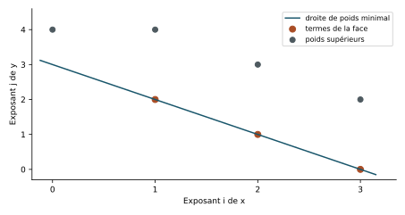

# ENS MP — Mathématiques D 2013 · Corrigé brut

*Corrigé rédigé par IA, non officiel. Signalez toute erreur.*

**Rédaction** · GPT-6.2 Astra Ultra · vitesse non renseignée

**Révision (tour 1)** · GPT-6.2 Astra Ultra · vitesse non renseignée · 26 novembre 2026

**Polynômes hyperboliques.** On note $\lambda_1(x;a)\le\cdots\le\lambda_d(x;a)$ les racines comptées avec leurs multiplicités, et $C(p;a)$ la région où elles sont toutes positives. Les parties V et VI nécessitent la normalisation du signe de $p$ expliquée en 20.b.

## Préliminaires et I. Exemples

### Question 1

De $P(tv)=t^dP(v)$ on tire en dérivant en $t=1$ l’identité d’Euler $\sum_{j=1}^n v_j\partial_jP(v)=dP(v)$. Elle vaut aussi en $v=0$.

### Question 2

Dans $p(ta-x)$, le coefficient de $t^d$ est $p(a)$, par développement des monômes homogènes. Il est non nul par définition. Le polynôme a donc degré exactement $d$ et possède $d$ racines avec multiplicité, toutes réelles par hypothèse.

### Question 3

On a $p(ta-x)=p(a)\prod_{j=1}^d(t-\lambda_j(x;a))$. En $t=0$, l’homogénéité donne $p(x)=p(a)\prod_j\lambda_j(x;a)$. Pour $s>0$, $\lambda_j(sx;a)=s\lambda_j(x;a)$, pour $s<0$, $\lambda_j(sx;a)=s\lambda_{d+1-j}(x;a)$ par renversement de l’ordre, et pour $s=0$ toutes valent 0. Enfin $p(ta-(x+sa))=p((t-s)a-x)$ donne $\lambda_j(x+sa;a)=\lambda_j(x;a)+s$ pour tout réel $s$.

### Question 4

Le déterminant est une somme signée de produits de $m$ entrées, donc homogène de degré $m$ sur les matrices symétriques. Dans la direction $a=I_m$ il vaut 1. Pour toute matrice réelle symétrique $S$, les racines de $\det(tI_m-S)$ sont les valeurs propres de $S$, toutes réelles par diagonalisation orthogonale. Cette direction convient.

### Question 5

Notons $B$ la polaire. Pour une direction $a$ avec $q(a)\ne0$, la réalité des racines équivaut à $B(a,x)^2-q(a)q(x)\ge0$ pour tout $x$. Écrivons $x=ta+z$ avec $B(a,z)=0$, ce qui est possible car $q(a)\ne0$. Le discriminant réduit vaut $-q(a)q(z)$. Si $q(a)>0$, la forme doit être négative ou nulle sur $a^\perp$. Si $k\ge2$, le sous-espace des $k$ premières coordonnées rencontre $a^\perp$ en un vecteur positif non nul, contradiction. Pour $k=1$, en revanche, $a=e_1$ convient. Symétriquement, si $q(a)<0$, il faut $n-k=1$, et dans ce cas $a=e_n$ convient. La réponse pour $1\le k\le n$ est donc $k=1$ ou $k=n-1$ dans cet intervalle, ce qui comprend le cas $n=1,k=1$.

### Question 6

$q=D_ap$ est homogène de degré $d-1$ et vaut $dp(a)\ne0$ en $a$ par Q1. Or $q(ta-x)=(d/dt)p(ta-x)$. Si le polynôme initial a $s$ racines distinctes de multiplicités $m_j$, sa dérivée en garde $\sum(m_j-1)=d-s$ avec multiplicité et en a au moins $s-1$ entre elles par Rolle. Cela épuise le degré $d-1$. Toutes sont réelles.

### Question 7

$\Sigma_n(x)=\prod_jx_j$ est hyperbolique en $e$, ses racines étant les $x_j$. Or $D_e\Sigma_k=(n-k+1)\Sigma_{k-1}$, car chaque monôme de degré $k-1$ peut provenir de l’ajout puis la suppression de l’une des $n-k+1$ variables absentes. Des applications successives de Q6 donnent le résultat pour chaque $1\le d\le n$.

## II. Continuité des racines

### Question 8

Si $F$ était discontinue en $\bar x$, il existerait $\varepsilon>0$ et des $x_m$ avec $\|x_m-\bar x\|<1/m$ et $\|F(x_m)-F(\bar x)\|\ge\varepsilon$. Aucune sous-suite de leurs images ne pourrait converger vers $F(\bar x)$, en contradiction avec l’hypothèse.

### Question 9.a

Le polynôme monique $p(ta-x_m)/p(a)$ a des coefficients polynomiaux en $x_m$, donc bornés en module par un même $C$ pour la suite. Si $|t|>1+C$, la somme des modules des termes de degrés $<d$ est au plus $C(|t|^d-1)/(|t|-1)<|t|^d$. Un tel $t$ ne peut être racine. Toutes les racines sont donc bornées uniformément.

### Question 9.b

Si $x_m\to x$, la suite des $d$-uplets de racines triées est bornée par (a). Une sous-suite converge vers un $d$-uplet croissant $(\mu_j)$. La continuité des coefficients et du produit donne $p(ta-x)=p(a)\prod_j(t-\mu_j)$. En tenant compte des multiplicités et de l’ordre, $\mu_j=\lambda_j(x;a)$ pour chaque $j$. Le critère de Q8 donne la continuité de $\Lambda$.

## III. Cône du futur et hyperbolicité stricte

### Question 10

Pour $x\in C(p;a)$, $0\le s\le1$, les racines de $sx+(1-s)a$ valent $s\lambda_j(x;a)+1-s>0$. Le segment joint donc $x$ à $a$ dans le cône. Pour $d\ge2$, toutes les racines de la dérivée directionnelle sont dans l’intervalle des racines de $p(ta-x)$ par Q6, donc strictement positives si $x\in C(p;a)$. Cela donne l’inclusion. En degré 1, la dérivée est constante et son cône n’est pas défini par la convention de l’énoncé.

### Question 11

Pour $t\to+\infty$, $\phi_j(t)/t=\lambda_j(b+x/t;a)\to\lambda_j(b;a)>0$. Pour $t\to-\infty$, la limite est $\lambda_{d+1-j}(b;a)>0$. La fonction continue $\phi_j$ tend donc respectivement vers $+\infty$ et $-\infty$, et prend toute valeur réelle. Si $d\ge2$, l’égalité de deux branches à $t$ impose par stricte hyperbolicité $tb+x=sa$ pour un certain $s$. Réciproquement toutes les racines d’un tel vecteur valent $s$. La condition d’existence est donc $x\in\mathrm{Vect}(a,b)$.

### Question 12

Comme $p(b)=p(a)\prod\lambda_j(b;a)\ne0$, le polynôme $t\mapsto p(tb+x)$ a degré $d$. Si $x$ n’est pas colinéaire à $b$, chacune des $d$ branches de Q11 atteint 0 et deux ne peuvent le faire au même moment : Q11 donnerait $tb+x=0$. On obtient $d$ racines réelles distinctes. Si $x=cb$, on obtient $p(b)(t+c)^d$. Remplacer $x$ par $-x$ fournit exactement l’hyperbolicité stricte dans la direction $b$.

### Question 13

Fixons $s$. Les temps où $\phi_j(t)=s$ sont des racines de $p(sa-x-tb)$. Si $x-sa$ n’est pas colinéaire à $b$, les $d$ branches atteignent chacune $s$ en des temps distincts, puisque le seul point d’une rencontre au niveau $s$ serait $x+tb=sa$. Le degré $d$ interdit toute seconde solution sur une branche. Si $x-sa$ est colinéaire à $b$, le polynôme est un multiple non nul de $(t-t_0)^d$ et $t_0$ est encore la seule solution pour chacune. Chaque $\phi_j$ est donc continue injective, ainsi strictement monotone. Ses limites en Q11 imposent le sens croissant.

### Question 14

Pour $\varepsilon>0$, $b=y+(\varepsilon-\lambda_1(y;a))a$ a première racine $\varepsilon$ et appartient au cône. Par Q13, $t\mapsto\lambda_1(x+ty;a)-t\lambda_1(y;a)+t\varepsilon$ croît. En comparant deux temps fixes puis en laissant $\varepsilon\downarrow0$, on obtient la croissance au sens large demandée. En comparant 0 et 1, $\lambda_1(x+y;a)\ge\lambda_1(x;a)+\lambda_1(y;a)$. L’homogénéité positive donne alors la concavité par application à $(1-s)x$ et $sy$, $0\le s\le1$. Le sur-niveau strict $\{\lambda_1>0\}$ est convexe et stable par multiplication par un scalaire strictement positif.

### Question 15

Pour $t\le0$, $x-tb\in C(p;a)$ par Q14 (y compris $t=0$), donc $p(x-tb)\ne0$ par Q3. Les racines de $p(tb-x)$ sont réelles par Q12. Aucune n’est non positive, donc $\lambda_1(x;b)>0$.

### Question 16

La Q15 donne $C(p;a)\subseteq C(p;b)$. En particulier $a$ appartient au deuxième cône. La Q12 fournit l’hyperbolicité stricte en $b$, donc Q15 appliquée en intervertissant $a,b$ donne l’inclusion réciproque.

## IV. Suivi des multiplicités dans le cas général

### Question 17.a

Écrivons $R=\sum c_{ij}x^iy^j$. Le point $(m,0)$ est le premier du support sur l’axe horizontal et $(0,r)$ appartient au support. Posons
$$\beta/\alpha=\max_{c_{ij}\ne0,\ j>0}(m-i)/j,$$
en fraction irréductible. Ce nombre est strictement positif grâce à $(0,r)$. Tous les points satisfont $\alpha i+\beta j\ge\alpha m$, avec égalité en $(m,0)$ et en au moins un point de $j>0$. Sur cette droite, les points entiers sont $(m-\beta h,\alpha h)$, $h\ge0$ entier, puisque les poids sont premiers entre eux. Leurs monômes donnent $R_0=x^m Q_0(y^\alpha/x^\beta)$, expression polynomiale après développement. On a $Q_0(0)=c_{m0}\ne0$, $0<\beta\deg Q_0\le m$. Les autres termes ont poids entier au moins $\alpha m+1$ et forment $R_1$.

### Question 17.b

Chaque monôme devient $c_{ij}z^i u^{\alpha i+\beta j}$. Les termes de poids minimal donnent $\widehat R(z)=z^mQ_0(z^{-\beta})$ et tous les autres donnent $u^{\alpha m+1}S(z,u)$ avec $S$ polynomial. Comme $Q_0$ est non constant et de terme constant non nul, une de ses racines $\xi$ est non nulle. Toute solution de $w^{-\beta}=\xi$ est une racine non nulle de $\widehat R$.

### Question 17.c

Si $w\notin\mathbb R$, choisir un cercle centré en $w$ dont le disque fermé évite $\mathbb R$ et dont le bord ne contient aucun zéro de $\widehat R$. Le minimum du module de $\widehat R$ sur le cercle est positif. Pour $|u|$ assez petit, $\sup|uS(z,u)|$ y est strictement inférieur à ce minimum par compacité et continuité. Le lemme donné fournit un zéro $z$ de $\widehat R+uS$ dans le disque, donc non réel. L’identité de (b) donne $R(zu^\alpha,u^\beta)=0$, et pour $u=0$ cette dernière égalité est immédiate.

### Question 18.a

Une racine non réelle de $\widehat R$ donnerait, pour $u>0$ petit, une racine non réelle $zu^\alpha$ de $R(\cdot,u^\beta)$, alors que $u^\beta$ est réel. Cela contredit l’hypothèse.

### Question 18.b

Pour $\zeta=e^{2\pi i\alpha/\beta}$, $\zeta^\beta=1$ et $\widehat R(\zeta z)=\zeta^m\widehat R(z)$. Donc les racines sont stables sous cette rotation. Par 17.b, il existe une racine réelle non nulle $w$, et $\zeta w$ doit encore être réelle. Ainsi $\zeta=\pm1$ et $\beta\mid 2\alpha$. Par coprimalité, $\beta\le2$.

### Question 18.c

Supposons $\beta=2$, donc $\alpha$ impair. Pour $R(z u^\alpha,-u^2)$, le polynôme de poids minimal est $z^mQ_0(-z^{-2})$, car sur la face $j=\alpha h$. Si $w\ne0$ est racine réelle de $\widehat R$, $iw$ est une racine non réelle de ce nouveau polynôme puisque $-(iw)^{-2}=w^{-2}$. Par le même argument de perturbation qu’en 17.c, pour $u>0$ petit $R(\cdot,-u^2)$ aurait une racine non réelle. Contradiction. Ainsi $\beta=1$.

### Question 18.d

Le point $(0,r)$ vérifie $\beta r\ge\alpha m$. Comme $\beta=1$ et $\alpha\ge1$, on obtient $r\ge m$.

### Question 19.a

Posons $R(z,u)=p((s_*+z)a-(t_*+u)b-x)$. Pour $u$ réel, les racines en $z$ sont réelles par hyperbolicité en $a$. Le degré en $z$ est $d$ avec coefficient $p(a)\ne0$, et en $u$ il est $d$ avec coefficient $(-1)^d p(b)\ne0$, par Q3. La multiplicité $m$ de 0 dans $R(z,0)$ compte exactement les branches $\phi_j(t_*)=s_*$. Celle de 0 dans $R(0,u)$ est $r$ par hypothèse. La question 18.d s’applique donc et donne $m\le r$.

### Question 19.b

Les asymptotiques et la surjectivité établies dans la première partie de Q11 utilisent seulement la continuité et $b\in C(p;a)$. Chaque branche atteint donc 0. Regroupons ces $d$ occurrences par temps $t_*$. Par (a), leurs nombres respectifs ne dépassent pas les multiplicités des racines réelles de $p(-tb-x)$. Ce polynôme de degré $d$ possède déjà au moins $d$ racines réelles avec multiplicités. Toutes sont donc réelles. Remplacer $x$ par son opposé ou changer $t$ de signe donne l’hyperbolicité dans la direction $b$.

## V. Formes polaires et inégalité de Gårding

### Question 20.a

Dans $p(tb-x)=M(tb-x,\ldots,tb-x)$, le coefficient de $t^{d-1}$ est $-dM(x,b,\ldots,b)$ par symétrie des $d$ arguments. La factorisation de Q3 donne aussi $-p(b)\sum_j\lambda_j(x;b)$. L’identification prouve l’égalité.

### Question 20.b

Il manque à la partie V la normalisation $p(a)>0$, que l’on peut toujours obtenir en remplaçant simultanément $p,M$ par $-p,-M$, sans modifier les racines. Dans ce qui suit, les puissances réelles de $p$ désignent le polynôme ainsi normalisé. Par Q16 et Q19, $a,b$ sont dans le même cône et $\lambda_j(a;b)>0$. La formule du produit donne $p(b)>0$ et $\prod_j\lambda_j(a;b)=p(a)/p(b)$. La moyenne arithmétique est au moins la moyenne géométrique. Par (a),
$$M(a,b,\ldots,b)\ge p(b)\big(p(a)/p(b)\big)^{1/d}.$$
Sans choix de signe, en degré pair les puissances demandées peuvent être indéfinies. Même en degré impair la multiplication par $p(b)<0$ inverse l’inégalité. Par exemple $p(x)=-x_1x_2x_3$, $a=(1,4,1)$ et $b=(1,1,1)$ donnent $M(a,b,b)=-2<-\sqrt[3]{4}$.

### Question 21

En développant $p(x+ta)$, le coefficient de $t$ est $dM(a,x,\ldots,x)$. Le polynôme demandé est donc $D_ap/d$, hyperbolique en $a$ d’après Q6 et de degré $d-1$.

### Question 22

Procédons par récurrence sur $d$ pour le polynôme normalisé par $p(a)>0$. Le degré un donne une égalité. Pour $d\ge2$, fixons $b=x^1$ dans le cône, donc $p$ est hyperbolique en $b$ et $C(p;b)=C(p;a)$. Posons $q(z)=M(b,z,\ldots,z)=D_b p(z)/d$. Il est hyperbolique en $b$ et son cône contient $C(p;b)$ par Q10. Sa polaire de degré $d-1$ est $(z^2,\ldots,z^d)\mapsto M(b,z^2,\ldots,z^d)$. Par l’hypothèse de récurrence et Q20.b appliquée à $b,x^j$,
$$M(b,x^2,\ldots,x^d)\ge\prod_{j=2}^d q(x^j)^{1/(d-1)}
\ge p(b)^{1/d}\prod_{j=2}^d p(x^j)^{1/d}.$$
La positivité de $q$ sur les arguments est assurée par la même estimation, et $q(b)=p(b)>0$.

### Question 23.a

Sur $\mathbb R\times\mathbb R^m$, $p(t,x)=t^2-q(x)$ est hyperbolique vers $e=(1,0)$, avec racines $t\pm\sqrt{q(x)}$ pour le vecteur $(t,x)$. Sa polaire vaut $M((t,x),(s,y))=ts-B(x,y)$. Les deux vecteurs donnés sont dans le cône car leur première racine est positive. La Q22 au degré deux donne directement l’inégalité cherchée.

Avec les notations du feuillet, $\lambda_1(\alpha,u)=\alpha-\sqrt{q(u)}>0$ et $\lambda_1(\beta,v)=\beta-\sqrt{q(v)}>0$. L’évaluation de la forme polaire et des deux facteurs de Q22 s’écrit donc
$$\boxed{\alpha\beta-B(u,v)\ \ge\ \sqrt{\bigl(\alpha^2-q(u)\bigr)\bigl(\beta^2-q(v)\bigr)}.}$$

### Question 23.b

Prenons $p(x)=x_1\cdots x_d$ et comme direction le vecteur de uns. Le cône est l’orthant strictement positif. La forme polaire évaluée sur les lignes $v_1,\ldots,v_d$ est $M(v_1,\ldots,v_d)=\operatorname{per}(A)/d!$, en symétrisant le produit des coordonnées. Par Q22, cette expression est au moins $\prod_i p(v_i)^{1/d}=(\prod_{ij}a_{ij})^{1/d}$. Si « positifs » autorise des zéros, appliquer d’abord aux coefficients $a_{ij}+\varepsilon$, puis passer à la limite par continuité.

## VI. Concavité de la racine du polynôme

### Question 24

En écrivant $M(x[k],y[d-k])$ pour $k$ copies de $x$ et $d-k$ copies de $y$, Q22 donne un minorant $p(x)^{k/d}p(y)^{(d-k)/d}$ de chaque terme. Donc
$$p(x+y)=\sum_{k=0}^d\binom dk M(x[k],y[d-k])\ge(p(x)^{1/d}+p(y)^{1/d})^d.$$
La racine $p^{1/d}$ est ainsi suradditive et positivement homogène de degré un sur le cône. Appliquer aux vecteurs $(1-t)x,ty$ donne la concavité pour $0<t<1$, les extrémités étant immédiates.

### Question 25

Les racines de Q4 sont les valeurs propres et $\lambda_1(S;I)>0$ caractérise les symétriques définies positives. Leur ensemble est donc le cône convexe $C(\det;I)$ par la partie IV. Le déterminant vaut 1 en $I$. La Q24 donne la concavité de $(\det S)^{1/d}$ sur ce cône, avec l’égalité linéaire triviale pour $d=1$.

## VII. Inégalités de Weyl

### Question 26

Si $k=1$, alors $i+j=2$, d’où $i=j=1$. La stricte inégalité supposée contredit la suradditivité de $\lambda_1$ en Q14. Donc $k\ge2$.

### Question 27

Si $y=ca$, on aurait $\lambda_k(x+y)=\lambda_k(x)+c\ge\lambda_i(x)+\lambda_j(y)$ puisque $k=i+j-1\ge i$. Donc $y$ n’est pas colinéaire à $a$ et ses racines sont distinctes. Posons $u=x$ et $v=y-(\lambda_j(y)-\varepsilon)a$. Prendre $\varepsilon>0$ strictement plus petit que la marge $\lambda_i(x)+\lambda_j(y)-\lambda_k(x+y)$ et, si $j>1$, que $\lambda_j(y)-\lambda_{j-1}(y)$. Les règles de translation de Q3 donnent $\lambda_k(u+v)<\lambda_i(u)$ et exactement $j-1$ racines négatives de $v$. Les suivantes sont strictement positives.

### Question 28

Écrivons $h_r(t)=\phi_r(t)-\lambda_*$. En $0$, $h_r>0$ pour $r\ge i$. En $1$, $h_r<0$ pour $r\le k$. À $+\infty$ le signe est celui de $\lambda_r(v)$, donc positif pour $r\ge j$ et négatif sinon. À $-\infty$, le signe est l’opposé de celui de $\lambda_{d+1-r}(v)$, donc négatif pour $r\le d+1-j$ et positif sinon.

Il y a au moins un zéro si les signes aux deux infinis sont opposés. Lorsque ces signes sont tous deux négatifs, un signe positif en 0 impose deux zéros. Lorsqu’ils sont tous deux positifs, un signe négatif en 1 en impose deux. Enfin, dans le cas des signes négatif puis positif aux infinis et pour $i\le r\le k$, le parcours des signes est $-,+,-,+$, ce qui donne trois zéros distincts. Tous ces minorants suivent du théorème des valeurs intermédiaires sur des intervalles disjoints.

Le tableau récapitule les contributions qui seront additionnées en 29.a. Les signes aux infinis désignent les signes de $h_r$ pour $|t|$ suffisamment grand.

| Signe à gauche | Signe à droite | Information intérieure | Nombre garanti |
|---|---|---|---|
| $-$ | $+$ | aucune | $1$ |
| $-$ | $+$ | $h_r(0)>0$ et $h_r(1)<0$ | $3$ |
| $+$ | $-$ | aucune | $1$ |
| $-$ | $-$ | $h_r(0)>0$ | $2$ |
| $+$ | $+$ | $h_r(1)<0$ | $2$ |

La deuxième ligne affine la première pour les branches concernées. Elle apporte deux zéros de plus dans la somme.

### Question 29.a

Abrégeons les intervalles entiers par $[h,l]$ et notons $A=[j,d]$, $B=[1,d+1-j]$, leurs compléments étant pris dans $[1,d]$. Les signes sont opposés aux infinis pour $r\in A\cap B$ ou $r\in A^c\cap B^c$. Les deux cas à signes de même sens en Q28 ajoutent deux solutions respectivement sur $A^c\cap B\cap[i,d]$ et $A\cap B^c\cap[1,k]$. Enfin $A\cap B\cap[i,k]$ apporte deux solutions de plus que le zéro déjà compté. Leur somme donne exactement
$$D=|A\cap B|+|A^c\cap B^c|+2|A^c\cap B\cap[i,d]|+2|A\cap B^c\cap[1,k]|+2|A\cap B\cap[i,k]|.$$
Tout zéro de branche est racine de $P(t)=p(\lambda_*a-u-tv)$. Si deux branches se rencontrent au niveau choisi, leur vecteur est $\lambda_*a$ par stricte hyperbolicité et $P(t)$ est alors un multiple non nul de $(t-t_*)^d$. Ce zéro commun compte donc bien pour toutes les branches concernées avec multiplicité. On peut aussi choisir $\lambda_*$ en évitant la valeur de rencontre : comme $v$ n’est pas colinéaire à $a$, la droite $u+\mathbb Rv$ rencontre $\mathbb Ra$ en au plus un point. Pour la contradiction, le comptage avec multiplicités suffit dans tous les cas.

### Question 29.b

Des hypothèses, $j\le i\le d+1-j$. Ainsi $A\cap B=[j,d+1-j]$, $A^c\cap B^c=\varnothing$ et $A^c\cap[i,d]=\varnothing$. De plus $A\cap B^c=[d+2-j,d]$. Il reste
$$D=|[j,d+1-j]|+2|[d+2-j,k]|+2|[j,d+1-j]\cap[i,k]|,$$
avec la convention des intervalles vides.

### Question 30

Comme $j\le i\le d+1-j$, les deux ensembles comptés avec poids deux forment une partition de $[i,k]$. Donc
$$D=d+2-2j+2(k-i+1)=d+2,$$
en utilisant $k=i+j-1$.

### Question 31

Le coefficient dominant de $P(t)$ est $(-1)^d p(v)$, non nul puisque les racines de $v$ sont toutes non nulles par Q27. Le degré $d$ interdit $d+2$ racines avec multiplicités. L’hypothèse contradictoire tombe, donc $\lambda_{i+j-1}(x+y)\ge\lambda_i(x)+\lambda_j(y)$. Par échange simultané de $x,i$ avec $y,j$, la condition $j\le i$ disparaît. Enfin l’ordre croissant des racines donne la borne pour $\ell\ge i+j-1$, tant que $\ell\le d$.

### Question 32

Oui. Voici une approximation qui traite aussi les polynômes ayant un facteur répété. Choisir des formes linéaires $L_1,\ldots,L_{n-1}$ s’annulant en $a$, de noyau commun $\mathbb Ra$. Pour $\varepsilon>0$, appliquer à $p$, successivement pour chaque $j$, l’opérateur $(1+\varepsilon L_j D_a)^d$ et noter $p_\varepsilon$ le résultat. Il est homogène de degré $d$, vaut $p(a)$ en $a$ et converge coefficient par coefficient vers $p$.

Sur la droite $ta-x$, chaque application simple agit sur le polynôme univarié $P(t)$ par $P\mapsto P+cP'$ avec $c=-\varepsilon L_j(x)$, car $L_j(a)=0$. Pour $P$ à racines réelles, si $c\ne0$, chaque racine de multiplicité $m$ subsiste avec multiplicité exactement $m-1$. Les autres racines sont simples et réelles. En effet, hors des racines de $P$, l’équation est $P'/P=\sum_h m_h/(t-\rho_h)=-1/c$, dont le membre gauche décroît strictement de $+\infty$ à $-\infty$ dans chaque intervalle entre racines et atteint aussi la valeur voulue dans l’un des deux intervalles extrêmes. Ces racines et les anciennes épuisent le degré. Si $c=0$, le polynôme reste inchangé.

Pour tout $x\notin\mathbb Ra$, un des $L_j(x)$ est non nul. Les $d$ applications correspondantes éliminent toutes les multiplicités, et les autres opérations conservent la simplicité acquise. Ainsi $p_\varepsilon$ est strictement hyperbolique en $a$. À $x,y,x+y$ fixés, les racines ordonnées convergent vers celles de $p$ par le raisonnement de Q9, car les coefficients convergent et le terme dominant reste $p(a)$. Passer à la limite dans Q31 prouve l’inégalité générale.
