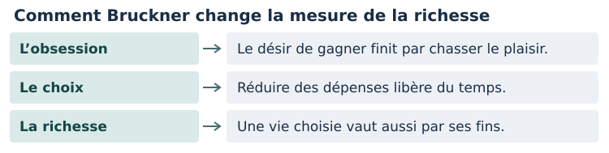
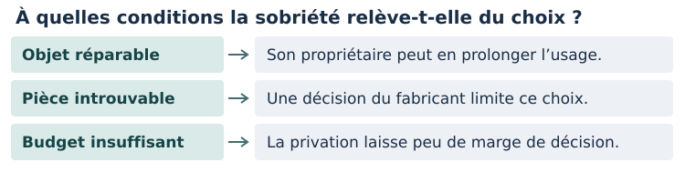

# X-ENS · MP-PC · Anglais 2013 — Corrigé guidé

*Corrigé rédigé par IA, non officiel. Signalez toute erreur.*

**Rédaction** · GPT-6.2 Astra Ultra · vitesse non renseignée

Les gardes XEULC prévoient deux épreuves sans dictionnaire d’une heure trente chacune. Le récit anglais à traduire figure p. 3 du premier fascicule. Le second donne le texte de Pascal Bruckner et demande deux réponses en anglais, de 120 à 150 puis de 180 à 200 mots à titre indicatif.

Pour la version, dessiner le parcours sur le bateau et dater les scènes successives. Pour l’expression, suivre les trois paragraphes de Bruckner, puis décider quel exemple permettra de discuter la frugalité en tant que choix de vie.

## I. Version — Lefty et Desdemona

**Dessiner le trajet.** *Forward* situe la proue, *aft* la poupe et *port* désigne bâbord. La chaîne fait barrière entre deux catégories de passagers. Le texte distingue expressément *steerage* et *third class*. Traduire les deux par « troisième classe » effacerait la chaîne et la différence de statut. La parenthèse publicitaire met le confort promis en regard de l’éclairage intermittent d’aujourd’hui.

**Lire les gestes comme un spectateur.** Le narrateur révèle le petit arrangement avant que les passagers ne se mettent à raconter l’histoire. *For an appropriate amount of time* donne l’impression d’une durée calculée. *As arranged* confirme qu’au moins une partie de la scène est préparée. La froideur de Desdemona le deuxième jour et le sourire du troisième composent ainsi deux réponses différentes. *Inquired if any of them might happen to know* multiplie les précautions et donne du naturel à la comédie.

Le deuxième jour de la traversée, aussitôt après le dîner, Lefty fit le tour du navire. Il se fraya un passage entre les corps étalés sur le pont des passagers d’entrepont. Il dépassa l’escalier qui menait à la timonerie et se glissa entre les marchandises embarquées en supplément, des caisses d’olives de Kalamata et d’huile d’olive, des éponges de mer de Kos. Il continua vers la proue, la main glissant sur les bâches vertes des canots de sauvetage, jusqu’à la chaîne qui séparait les passagers d’entrepont de ceux de troisième classe. Au temps de sa splendeur, le *Giulia* avait appartenu à la compagnie austro-hongroise. Doté de tout le confort moderne (« éclairage électrique, ventilation et confort maximal »), il avait assuré une fois par mois la liaison entre Trieste et New York. À présent, les lampes électriques ne fonctionnaient qu’en première classe, et encore, par intermittence. Les rambardes de fer étaient rouillées. La fumée de la cheminée avait noirci le drapeau grec. Le bateau sentait les vieux seaux à serpillière et des années de mal de mer. Lefty n’avait pas encore le pied marin. Il ne cessait de se cogner au bastingage. Il resta près de la chaîne le temps qui convenait, passa sur bâbord et revint vers la poupe. Comme convenu, Desdemona se tenait seule au bastingage. En passant, Lefty lui sourit et la salua d’un signe de tête. Elle lui rendit froidement son salut et reporta son regard sur le large.

Le troisième jour, Lefty repartit se promener après le dîner. Il marcha vers la proue, passa sur bâbord et revint vers la poupe. Il sourit à Desdemona et la salua une nouvelle fois d’un signe de tête. Cette fois, elle lui rendit son sourire. Retrouvant les fumeurs avec qui il avait ses habitudes, Lefty leur demanda si l’un d’eux connaissait par hasard le nom de cette jeune femme qui voyageait seule.

Le quatrième jour de la traversée, Lefty s’arrêta et se présenta.

« Jusqu’ici, nous avons eu beau temps.

— Pourvu que ça dure.

— Vous voyagez seule ?

— Oui.

— Moi aussi. Où allez-vous en Amérique ?

— À Detroit.

— Quelle coïncidence ! Moi aussi, je vais à Detroit. »

Ils restèrent encore quelques minutes à bavarder. Puis Desdemona prit congé et descendit dans les entreponts.

La rumeur de cette idylle naissante eut vite fait de courir d’un bout à l’autre du navire. Pour passer le temps, bientôt tout le monde racontait comment le grand jeune Grec au port élégant s’était épris de la belle brune qu’on ne voyait jamais sans son coffret en bois d’olivier sculpté. « Ils voyagent seuls tous les deux, disait-on. Et ils ont l’un et l’autre de la famille à Detroit. »

*Jeffrey Eugenides, Middlesex, 2002.*

## II.1. Que dit Bruckner de notre rapport à l’argent ?

**Suivre la progression.** Le premier paragraphe explique l’addiction par une inversion entre le moyen et la fin. Le deuxième s’intéresse à la possibilité de limiter volontairement ses besoins au sein même d’une société riche. Le troisième élargit le sens de la richesse au temps et à la vie de l’esprit. Le rapport d’expression demande de relier ces étapes. L’exemple du spéculateur illustre le mécanisme de l’addiction sans faire de tous les individus des spéculateurs. *Money* et *wealth* sont ici indénombrables.

Bruckner compares the desire for money to an addiction. We expect money to free us from worry, yet wanting more of it can take up all our attention, even when we already possess enough. A speculator may be excited by the sheer size of a transaction long after its proceeds have ceased to serve any purpose. Bruckner acknowledges both the pleasure money can bring and the suspicion that surrounds financial success in France. He also sees signs of doubt within wealthy American society itself. People who deliberately limit their spending can give more time to the pursuits they value. Freedom, silence, friendship and access to beauty offer measures of wealth that a bank balance misses. For someone able to choose, determining what money is for becomes part of deciding what kind of life to lead.

*135 mots.*

## II.2. Une nouvelle morale de la frugalité a-t-elle sa place dans la société ?

**Prendre les trois termes au sérieux.** La *frugalité* suppose que l’on puisse régler certains besoins. La *morale* engage ici le consommateur, le fabricant et les institutions. L’adjectif *nouvelle* invite à rapprocher un idéal ancien de conditions de consommation contemporaines. Le rapport évoque Sénèque et les mouvements italiens en faveur de la lenteur comme points de comparaison possibles. Le téléphone réparable développe ici une autre comparaison autour d’une décision concrète.

Frugality deserves a place in public life if it gives people more control over what they buy and keep. The idea of limiting one's wants is ancient. What has changed is the difficulty of acting on it when a manufacturer can make replacing a device easier than repairing it. Consider a phone with a failing battery. Its owner may be perfectly content with the camera, the screen and the software. Being able to buy a replacement battery at a fair price would let that person decide when the phone has reached the end of its life.

That example also suggests where a moral appeal can go wrong. Someone who can barely afford a working phone needs affordable goods and a reliable income. Praising that person's enforced sacrifices as a virtue would make the rest of society feel generous at very little cost.

I would therefore link the appeal to buy less with a duty on producers to make repair possible. Public libraries that lend tools could widen that choice further. A contemporary ethic of frugality is worth defending when the institutions asking people to live more simply also give them the means to do so.

*195 mots.*

Le rapport d’anglais de 2013 cité ici porte sur l’expression écrite. Aucun rapport distinct de version n’a été identifié dans les documents consultés.

[Version en anglais](https://banques-ecoles.fr/cms/wp-content/uploads/2013/04/13_mppc_lv_version_xeulc.pdf#page=3) · [Expression écrite commune, réponses en anglais](https://banques-ecoles.fr/cms/wp-content/uploads/2013/04/13_mppc_lv_expressionecrite_xeulc.pdf) · [Rapport d’anglais](https://www.ens.psl.eu/IMG/file/concours/2013/MPI/13_mppc_rap_eangexprecr.pdf)
