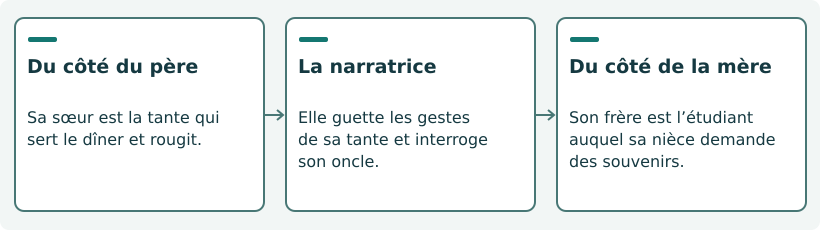

# X-ENS · MP-PC · Arabe 2013 — Corrigé brut

*Corrigé rédigé par IA, non officiel. Signalez toute erreur.*

**Rédaction** · GPT-6.2 Astra Ultra · vitesse non renseignée

La version et l’expression écrite durent chacune une heure et demie. Les deux questions sur l’essai de Pascal Bruckner demandent des réponses en arabe, d’environ 120 à 150 mots pour la première et 180 à 200 mots pour la seconde.

## Version. Mon oncle

Quand mon oncle maternel prit place avec nous pour le dîner, ma tante, la sœur de mon père, le servit le premier en disant qu’il avait l’air faible et le teint jaune. Quand il quitta la table pour aller se laver les mains, elle marmonna que, s’il avait si mauvaise mine, c’était à force de vivre en ville et de fréquenter des femmes de peu. Ma tante avait plusieurs années de plus que mon oncle. Pourtant, ses joues roses en sa présence trahissaient ce qu’elle essayait de cacher et que j’étais désormais capable de sentir, depuis que je commençais à comprendre les choses entre les femmes et les hommes.

Mon oncle est encore étudiant à l’université. Il vient rarement nous rendre visite à la montagne. Il étudiait, mangeait et dormait au même endroit. Il m’a un jour parlé de sa chambre, dont la fenêtre donnait sur des arbres aux fleurs de toutes les couleurs, mais qui ne portaient pas de fruits. Il m’a parlé de la mer bleue qui s’étendait à perte de vue devant lui et où il allait chaque jour se baigner avec ses camarades. J’aime ces heures que je passe avec mon oncle, même s’il répète qu’il aimerait être seul pour lire. Dans la petite chambre, il s’assied sur le canapé d’en face et étend ses longues jambes jusqu’à ce que ses pieds touchent le bord du lit de fer. Je lui pose des questions sur ma mère. De quoi avait-elle l’air ? De quelle couleur étaient ses yeux ? Se rappelle-t-il quelque signe particulier ? Il me répond les yeux toujours fixés sur le livre qu’il tient, comme s’il parlait d’une femme avec laquelle il n’aurait aucun lien. Il n’aimait guère parler d’elle. Un jour que je lui demandais si je lui ressemblais en quelque chose, il me dit que nous étions aussi entêtées l’une que l’autre. Il me rappela que plusieurs fois déjà il m’avait demandé d’arrêter de me couper les cheveux comme les garçons. En vain.

*Iman Younes Humaydan, B comme maison, comme Beyrouth.*

## Expression écrite 1. Quel rapport entretenons-nous avec l’argent ?

يصف باسكال بروكنر علاقة مضطربة بالمال. فمن يفتقر إليه يقضي وقتا طويلا في التفكير فيه، ومن يملك الكثير قد يصبح أسير الرغبة في المزيد. وكان المنتظر أن يخلصنا المال من القلق، فإذا به يصير غاية مستقلة تحرمنا حتى لذة الانتفاع بما لدينا. وفي المضاربة قد يفتتن المرء بحجم الأرقام وبالمغامرة ذاتها بعد أن ينسى ما كان يريد أن يشتريه. ولا يدعو الكاتب إلى احتقار النجاح، بل إلى تقدير الثمن الذي ندفعه من أعمارنا في سبيل الربح. فهناك خيرات يفسدها أن نقيسها بسعر، مثل الصمت أو التمتع بعمل فني أو الوقت الذي نقضيه مع من نحب. ولهذا يميز بين فقر مفروض يضيق الخيارات وبين تقليل للنفقات يختاره الإنسان كي يوسع مجال حريته ويستعيد القدرة على تقرير ما يجعل حياته جديرة بأن تعاش.

## Expression écrite 2. La frugalité a-t-elle sa place dans notre société ?

أرى أن للاكتفاء مكانا في مجتمعنا بشرط أن يبقى قرارا يقدر الإنسان على اتخاذه بحرية. فكثير من الإعلانات يدعونا إلى تغيير الهاتف كل سنة، حتى إن جهازا يعمل جيدا قد يبدو لصاحبه قديما حين يرى ما اشتراه أصدقاؤه. ولو حسب هذا الشاب عدد ساعات العمل التي يتطلبها الجهاز الجديد لربما آثر أن يصلح بطارية هاتفه وأن يستعمل الوقت المتبقي لتعلم العزف أو لزيارة قريب يعيش وحده. وقيمة هذا الاختيار تتحدد بما أتاحه لصاحبه أن يفعل.

لكن مخاطبة أسرة تعجز عن دفع الإيجار باللغة نفسها ظلم لها. فمن يقتصد في الطعام لكي يسدد فاتورة الكهرباء لا يملك ترف المفاضلة بين متعتين. ولذلك لا يجوز أن تتحول الدعوة إلى البساطة إلى ذريعة لتخفيض الأجور أو إهمال الخدمات العامة. تستطيع البلدية مثلا أن تفتح مكتبة في المساء وأن تدعم ورشة لإصلاح الأجهزة، فيستفيد منها من يريد تقليل مشترياته ومن يحتاج إلى الخدمة لقلة موارده.

وثمة خطر أخير هو أن تصبح البساطة نفسها سلعة غالية يباهي بها أصحابها. وأفضل وسيلة لتجنب ذلك أن نسأل عن أثر عاداتنا في الوقت والعلاقات والبيئة، وأن نترك لكل فرد مجالا ليختار ما يستحق جهده. عندئذ يغدو الاكتفاء وسيلة لتوسيع الحياة اليومية.

[Version en arabe](https://banques-ecoles.fr/cms/wp-content/uploads/2013/04/13_mppc_lv_version_xeulc.pdf#page=4) · [Expression écrite commune, réponses en arabe](https://banques-ecoles.fr/cms/wp-content/uploads/2013/04/13_mppc_lv_expressionecrite_xeulc.pdf)
