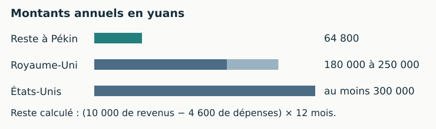

# X-ENS · MP-PC · Chinois 2013 — Corrigé guidé

*Corrigé rédigé par IA, non officiel. Signalez toute erreur.*

**Rédaction** · GPT-6.2 Astra Ultra · vitesse non renseignée

Les deux cahiers portent le code XEULC (École polytechnique, ESPCI, ENS de Paris, Lyon et Cachan). La version et l’expression écrite durent chacune 1 h 30 et se composent sans dictionnaire. Pour l’expression, le sujet donne à titre indicatif 120 à 150 mots, puis 180 à 200 mots. Il ne fixe pas d’équivalence en caractères chinois.

## Version · Ce qu’il en coûte aux Chinois d’étudier à l’étranger

> [!INDICATION]
> La référence est un article adapté de Xinhua, daté du 27 avril 2011. Ancrez « actuellement » dans le temps de l’article et traduisez son titre. Le premier paragraphe indique le pays d’**origine** des étudiants. 28,5 dizaines de milliers donnent 285 000. Au paragraphe suivant, 至少 (« au moins ») concerne le minimum américain, 大约 la fourchette britannique. Pour 2 %, le texte parle d’étudiants à l’étranger quelques années plus tôt. Pour 34 %, il parle de futurs partants en 2010. Gardez les deux populations distinctes.

> [!INDICATION]
> Pour vérifier les ordres de grandeur, calculez la somme disponible sur un an à Pékin après les dépenses citées. Le calcul du schéma éclaire le passage pour le lecteur du corrigé. En copie, traduisez les montants effectivement donnés. À la fin, les guillemets autour de 小皇帝 donnent à entendre une image familiale, et 可能 appelle « peut ».

D’après les statistiques, 285 000 Chinois sont partis étudier à l’étranger en 2010. La Chine est devenue le pays qui envoie le plus d’étudiants à l’étranger au monde.

Or de telles études représentent une dépense considérable. Aux États-Unis, il faut compter au moins 300 000 yuans par an. Au Royaume-Uni, une année coûte de 180 000 à 250 000 yuans environ. Une telle somme est peut-être peu de chose pour une famille aisée, mais elle pèse lourd sur bien des foyers qui vivent de leurs salaires. Prenons Pékin. Les ménages de la classe moyenne y gagnent actuellement 10 000 yuans par mois en moyenne et en dépensent en moyenne 4 600. On voit sans peine que même pour eux, financer les études d’un enfant à l’étranger n’a rien de facile. Que dire alors des familles ordinaires ? Il y a quelques années, seuls 2 % des étudiants partis à l’étranger venaient de ces familles. Or cette proportion augmente rapidement. En 2010, parmi les jeunes qui se préparaient à partir étudier à l’étranger, la proportion de ceux qui étaient issus de familles ordinaires atteignait 34 %. De plus en plus de parents chinois doivent vendre leur logement ou emprunter à des proches ou à des amis pour que leur enfant puisse terminer ses études secondaires et universitaires à l’étranger.

Pour les enfants de ces familles ordinaires vivant de leurs salaires, étudier à l’étranger peut aussi entraîner une pression psychologique plus forte que celle que subissent les autres. Peu habitués à se débrouiller et à trouver par eux-mêmes leur équilibre, ces jeunes que l’on a toujours traités en « petits empereurs » à la maison se sentent souvent perdus dans un milieu qui leur est étranger.

## Expression écrite · Première question

> [!INDICATION]
> Dans *L’Euphorie perpétuelle* (2000), Bruckner part d’un paradoxe. L’instrument de la tranquillité devient une source de tracas. Reprenez l’exemple de la spéculation pour montrer que l’obsession peut porter sur le chiffre lui-même. Puis répondez à la question implicite de l’auteur : qu’abandonne-t-on pour continuer à gagner ? L’opposition entre pauvreté subie et restriction choisie prépare sa redéfinition du luxe.

布吕克内指出，人原想靠钱摆脱生活中的烦恼，却很容易整天为钱操心。没有钱时，人觉得处处受限；有了钱，又怕失去，或总想再多挣一点。这样一来，手段反倒占据了目的的位置。甚至在金融投机中，有人迷恋的是数字越滚越大的快感，早已说不清利润究竟有什么用。

作者承认钱可以改善生活，问题在于我们愿意为它付出多少时间和自由。无休止地借钱购物，会让人连享受所得的工夫都没有。相反，主动减少某些开支，便可能腾出时间去爱一个人、读一本书。一个社会若让更多人也能享有闲暇和美，就创造了收入数字无法衡量的财富。能够决定怎样度过自己的一生，才是最难得的奢侈。

Le découpage lexical indicatif compte environ 149 mots dans cette proposition.

## Expression écrite · Seconde question

> [!INDICATION]
> La question porte sur la place à accorder aujourd’hui à cette morale. Choisissez deux personnages dont les dépenses diminuent et vérifiez pour chacun les conséquences de ce choix sur le temps disponible. Une mesure collective comme le prêt d’outils permet ensuite de discuter les conditions matérielles d’une sobriété choisie. La question finale porte sur l’accès réel à une autre façon de vivre.

> [!INDICATION]
> En chinois, 节制 dit la retenue et 节俭 l’économie dans les dépenses. 贫困 désigne une situation subie. Posez le sujet de chaque verbe avec soin quand vous passez de la personne salariée à votre exemple personnel.

今天讨论节制，要先问是谁在选择少花钱。一个护士如果为了付房租而放弃坐车，每天多走半小时，她得到的是疲劳。向她推荐简朴生活，恐怕只会让她觉得自己的困难无人理会。可是假如我为了买新手机而多接一份周末的工作，放弃购买就能让我重新支配那两天。同样省钱，后果迥异。

节制也可以成为一种共同的选择。比如，街区里有十户人家一年只用几次电钻。大家若能到图书馆借工具，个人省下了钱，也不用各自找地方存放。不过，借用点假如只在白天开放，上班的人还是得买一把。只有在人们需要的时候能借到，少买东西才算多了一份自由。

所以我赞成让这种生活方式有一席之地，也希望衡量它时问两个具体的问题。省下的时间归谁使用，省下的钱能否让本来没有选择的人也多一种选择？如果答案只是让穷人继续忍耐，再动听的道理也说服不了我。

Le même découpage donne environ 197 mots.

Le rapport de jury propre à cet écrit n’a pas été retrouvé. [Index des écrits de 2013](https://www.ens.psl.eu/rapports-et-sujets-pc-2013)

[Version, p. 5](https://banques-ecoles.fr/cms/wp-content/uploads/2013/04/13_mppc_lv_version_xeulc.pdf#page=5) · [Expression écrite, p. 1–2](https://banques-ecoles.fr/cms/wp-content/uploads/2013/04/13_mppc_lv_expressionecrite_xeulc.pdf)
