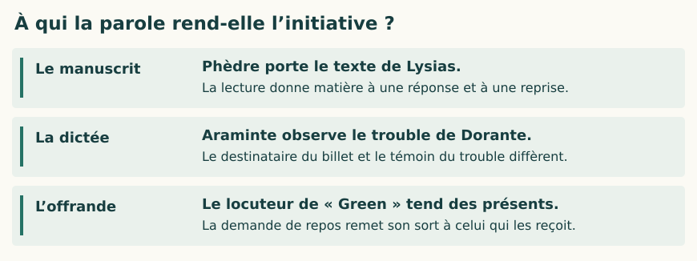

# Parler, respirer et jouer selon Valère Novarina · X-ENS 2013 · Corrigé brut

*Corrigé rédigé par IA, non officiel. Signalez toute erreur.*

**Rédaction** · GPT-6.2 Astra Ultra · vitesse non renseignée

**Révision** · GPT-6.2 Astra Ultra · vitesse non renseignée

## Sujet de la composition

*Filières MP et PC · XEULC · quatre heures.*

« Les bêtes aussi communiquent bien : elles font même ça parfaitement sans parler. Parler, c’est tout autre chose que d’avoir à se transmettre mutuellement des humeurs ou se déverser des idées ; parler n’est pas la transmission de quelque chose qui puisse passer de l’un à l’autre : parler est une respiration et un jeu. »

Valère Novarina, Le Théâtre des paroles, 1989.

Vous commenterez ces propos du dramaturge Valère Novarina (né en 1947) en vous appuyant sur votre lecture des œuvres au programme, Phèdre de Platon, Les Fausses Confidences de Marivaux et Romances sans paroles de Verlaine.

## Introduction

Il y a tout ce qu’il faut sur la table pour écrire le billet qu’Araminte dicte à Dorante. Il manque pourtant à cet excellent secrétaire la faculté de voir le papier qu’il a sous les yeux. À l’annonce du mariage de sa maîtresse, sa main se met à trembler. Les mots de la dictée arriveront peut-être intacts au destinataire. Mais la scène des *Fausses Confidences* se joue entre celle qui parle et celui qui écrit. Or que passe-t-il entre eux, si l’essentiel tient dans ce qui trouble la transmission ? Valère Novarina, dans *Le Théâtre des paroles*, s’autorise de l’efficacité même de la communication animale pour retirer à la parole sa définition la plus familière. On admet volontiers qu’elle fasse passer l’idée du locuteur dans l’esprit de l’auditeur. Le dramaturge entend dans cette image la prétention de disposer de ce que l’on dit comme d’un liquide qu’il suffirait de verser. Il lui oppose deux activités, respirer et jouer. On respire pour vivre, on joue pour le plaisir et au risque de ce qui peut arriver. Cependant, qui prend la parole s’adresse à quelqu’un et peut se voir demander compte de ce qu’il a dit. Comment le mouvement propre de la parole peut-il atteindre autrui sans que le sens ait été tout formé avant l’échange ? Le *Phèdre* de Platon, la comédie de Marivaux et les *Romances sans paroles* de Verlaine permettront de prendre au sérieux cette dépense vivante, d’en éprouver le pouvoir parfois inquiétant et de chercher à quelles conditions quelqu’un peut y répondre.

## Ce qui se produit quand une voix s’élève

Dans la troisième des « Ariettes oubliées », le changement d’un son fait surgir un événement dont on chercherait en vain la cause dans le récit. « Il pleure dans mon cœur / Comme il pleut sur la ville ». Le lecteur entend la pluie avant de pouvoir décider qui pleure. Le premier « il » emprunte au second l’allure impersonnelle du bulletin météorologique. Le cœur a un possesseur, « mon », mais celui-ci paraît aussi surpris que quiconque de ce qui l’habite. Un énoncé traduisible par « je suis triste parce que… » fournirait une information sur une personne. La voix de l’ariette se découvre au contraire en reprenant, en déplaçant et en questionnant les sons qu’elle vient de prononcer. Respirer désigne ici un rapport du sujet à sa propre parole. Il se donne du temps pour éprouver ce qu’un jugement immédiat sur son humeur lui aurait caché.

Dans « Spleen », un des poèmes des *Romances sans paroles*, une description de couleurs se transforme en adresse. Après le rouge des roses et le noir du lierre, le mot « Chère » fait surgir quelqu’un à qui le poème parle. La reprise sonore de « rouges » par « bouges » relie une couleur au plus léger mouvement de cette personne. Nous pourrions apprendre par une notice que celui qui parle craint de voir partir celle qu’il aime. Le poème nous fait éprouver cette crainte d’une autre façon. Le déplacement presque imperceptible de la destinataire suffit à faire basculer le paysage entier, alors même qu’aucune de ses couleurs n’a changé. Le jeu sonore fait ainsi davantage que rendre plaisante une information déjà prête. Il laisse apparaître la relation qui donnait à ces perceptions leur importance et qui permet enfin de comprendre pour qui elles comptent.

Ce temps s’inscrit sur le corps. Dans la dictée de Marivaux, Araminte distingue très bien deux usages d’une même phrase. « Votre mariage est sûr » ferait une excellente nouvelle pour le comte. À celui qui doit lui écrire, elle coupe presque le souffle. L’actrice peut lancer la proposition, laisser au silence de Dorante le temps de s’installer, puis reprendre les mots d’un ton presque professionnel. C’est cette différence de rythme qui permet d’entendre son impatience à elle. En aparté, elle constate que son cœur bat. On croyait observer un secrétaire pris en défaut. Le spectateur découvre qu’ordonner, attendre et relancer exposent aussi la personne qui mène l’épreuve. Si deux interprètes débitaient les seules informations du billet, ils escamoteraient ce que la scène nous apprend d’eux.

Le jeu peut même faire produire à celui qui s’y prête une parole qu’il n’avait nullement prévu de prononcer. Phèdre a caché sous son manteau le discours de Lysias. Il entend en faire l’épreuve auprès de Socrate. Quand le manuscrit est découvert, ce qui aurait pu être une répétition de mémoire prend la forme d’une lecture, puis d’un défi. Socrate prononcera à son tour un discours sur le même sujet. L’existence d’un texte déjà constitué, capable de voyager hors de la maison de son auteur, rend possible cette rencontre. Mais c’est le goût de varier, de recommencer, de faire entendre les choses autrement qui la transforme en dialogue. Le mot de « jeu » désigne une liberté à l’égard de la première version entendue. Sans cette possibilité, on saurait seulement dire si le récitant a été fidèle.

## Celui qui joue engage aussi celui qui écoute

La liberté de reprendre les mots d’autrui peut tourner contre lui. Chez Marivaux, Dubois fait savoir à Araminte que son nouvel intendant l’aime. La vérité de ce renseignement ne fait guère de doute au spectateur. Ce que le valet organise, c’est le moment où elle l’entendra, le ton de la confidence, la possibilité d’en obtenir ensuite des signes. Supposons qu’Araminte ait reçu anonymement une note énonçant le même fait. Elle saurait peut-être ce qu’éprouve Dorante, sans pour autant se mettre à surveiller ses gestes et à lui tendre des pièges. Le récit distribué par Dubois lui donne déjà un rôle. La manipulation emprunte sa force à cela même que Novarina admire, à la capacité d’une parole incarnée de faire arriver quelque chose.

Ce danger conduit à rappeler les droits de l’exactitude. Dans le *Phèdre*, le mythe de l’invention de l’écriture oppose aux promesses de Theuth le jugement de Thamous. Ce que l’inventeur propose comme secours à la mémoire risque de produire une confiance abusive dans des signes extérieurs. On serait pourtant injuste envers l’écriture en concluant qu’il faudrait renoncer à conserver des mots. Phèdre peut précisément soumettre le discours de Lysias à l’examen parce que sa lettre est disponible. Socrate peut demander pourquoi l’orateur a mis telle proposition à telle place et si une autre disposition vaudrait aussi bien. Lorsque deux lecteurs contestent, il importe qu’ils retrouvent l’énoncé qu’ils contestent. La transmission d’une suite stable de signes ménage ainsi une condition de la critique. Son efficacité se mesure à ce qu’elle donne à faire ensuite.

Reste que la plus belle aisance à faire jouer les mots ne garantit aucunement la justesse de ce qu’ils produisent. Socrate en fait l’expérience après son premier discours contre l’amoureux. Il allait partir quand son signe divin l’arrête. Son habileté lui a permis de soutenir mieux encore la cause dont il avait accepté de se charger. Il lui faut désormais réparer l’offense faite à Éros. La palinodie conserve le mouvement du jeu et pourtant elle change le sens de cette virtuosité. Qui recommence peut avoir à se dédire. On trouve chez Verlaine une autre limite au plaisir d’entendre sa voix. Si la pluie de la troisième ariette nous berce, la dernière strophe ne délivre aucune explication consolante au sujet de la peine. Le retour du même son fait sentir la persistance d’une question. Jouer devient exigeant lorsqu’on accepte que l’échec d’une réponse demeure audible.

## Adresser une parole et laisser à l’autre de quoi répondre

Pour penser une relation qui n’aurait ni la mécanique du transfert ni la violence d’un spectacle imposé, le *Phèdre* oppose à la solitude de certains écrits la possibilité d’une parole vivante. Un écrit qu’on questionne donne inlassablement la même réponse et ne sait pas à qui il convient de parler. Le dialecticien, lui, se préoccupe du terrain où il sème. Une même définition peut avoir à être reprise autrement devant deux interlocuteurs. Si quelqu’un peut à son tour défendre une proposition, la mettre à l’épreuve et la faire porter du fruit ailleurs, il a acquis davantage que les mots qu’il a entendus. Il peut recommencer l’opération par laquelle ils prennent sens. À cet égard, le lecteur du dialogue fait une expérience singulière. Platon lui a laissé une œuvre écrite dont les changements de voix l’obligent à juger lui-même de la différence entre persuader, séduire et donner une raison.

À la dernière rencontre d’Araminte et de Dorante, un autre recommencement devient possible. Elle a laissé échapper qu’elle l’aime. Lui pourrait s’arrêter à cette heureuse issue, laisser le stratagème devenir le secret qui les sépare et jouir de la perfection du jeu de Dubois. Il choisit de lui révéler l’industrie du domestique. Le contenu de la révélation compte rigoureusement. Sans lui, Araminte ne pourrait apprécier ce qui lui a été fait. Toutefois la valeur présente de l’aveu tient aussi au risque qu’il fait courir à celui qui parle. L’amant rend à la femme dont il dépend le pouvoir de rompre, au moment où il pourrait se croire assuré de son amour. L’exactitude met ainsi fin au monopole d’un metteur en scène. Araminte peut interpréter ce qui s’est passé, pardonner en connaissance de cause et décider ce qu’elle veut en faire. La liberté de parole apparaît dans la possibilité donnée à une autre liberté de déjouer une fin déjà écrite.

« Green », dans les *Romances*, offre au lecteur une expérience plus discrète de cette adresse. « Voici des fruits, des fleurs, des feuilles et des branches / Et puis voici mon cœur » : à force de présenter des choses qu’on pourrait en effet porter, le premier vers rend presque naturel ce don impossible du cœur. La reprise de « voici », l’attente qu’ouvre « et puis », le changement soudain de ce qu’on offre font accomplir au lecteur le geste de tendre les bras. Or voici que la voix demande à pouvoir reposer sa tête, puis à dormir près de l’être aimé. Celui qui semblait apporter un trésor attend à son tour de l’autre un accueil. Le poème ne met à notre disposition ni des présents ni la vie intérieure de Verlaine. Il nous rend sensibles à la réversibilité de l’offrande, à la vulnérabilité de celui qui désire donner. Il peut ainsi toucher un inconnu qui n’a reçu aucun des objets énumérés.

## Conclusion

Novarina a raison de partir d’une communication qui fonctionnerait parfaitement. Elle ferait parvenir le signe attendu au bon destinataire et laisserait encore inexpliqué le moment où quelqu’un prend la parole. Ce moment engage un corps qui hésite, une voix qui se surprend et un interlocuteur dont la réponse échappe au calcul. La parole reste capable de transmettre un fait, et une confidence qui s’est jouée de nous appelle parfois une rectification très exacte. Mais le plus précieux de la rectification tient à ce qu’elle permet à l’autre de reprendre l’histoire avec nous. C’est lorsqu’il rend une réponse possible, jusqu’à risquer une réponse qui le déçoive, que le jeu de la parole devient une manière de respirer ensemble.

[Énoncé](https://banques-ecoles.fr/cms/wp-content/uploads/2013/04/13_mppc_fr_xeulc.pdf) · [Rapport du jury](https://www.ens.psl.eu/IMG/file/concours/2013/MPI/13_mppc_rap_efran.pdf)
