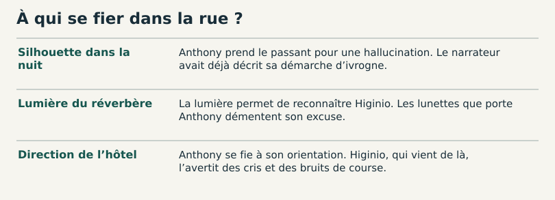

# X-ENS MP-PC — Espagnol 2013 · Corrigé brut

*Corrigé rédigé par IA, non officiel. Signalez toute erreur.*

**Rédaction** · GPT-6.2 Astra Ultra · vitesse non renseignée

Les cahiers XEULC prévoient chacun une heure et demie, sans dictionnaire. La version est à rendre en français. Les deux réponses au texte de Pascal Bruckner sont à rédiger en espagnol, en 120 à 150 puis 180 à 200 mots environ.

## Version — Encuentro

**Rencontre**

Du pas mal assuré et cérémonieux des ivrognes, Anthony Whitelands regagnait son hôtel par les rues froides et désertes du Madrid hivernal. Il entendit soudain une voix qui l’interpellait. Un individu aux allures de mendiant, coiffé d’un chapeau à larges bords d’un autre âge, se mit à ses côtés et régla son pas sur le sien. Comme l’homme semblait tout droit sorti d’un tableau, Anthony crut à une hallucination. Il continua de marcher sans lui adresser un mot ni un regard, jusqu’au moment où ce compagnon surgi de nulle part lui prit doucement le coude, le força à s’arrêter dans le cône de lumière d’un réverbère et lui dit d’un ton blessé :

— Mais enfin, vous ne me reconnaissez pas ? Regardez-moi bien. Je suis Higinio Zamora Zamorano, celui qui vous a gardé votre portefeuille l’autre soir.

Tout en parlant, il avait relevé le bord de son chapeau pour que le réverbère éclaire ses traits émaciés. En les voyant, l’Anglais sursauta et s’exclama :

— Que diable, don Higinio ! Vous voudrez bien m’excuser. L’éclairage public laisse à désirer et j’ai dû oublier mes lunettes au Ritz.

— Mais non, monsieur, vos lunettes, vous les avez sur le nez. Et ne m’appelez pas don Higinio. Higinio tout court me suffit. Vous vous sentez bien ?

— Oh oui. Parfaitement, parfaitement. Et je suis très heureux que le hasard nous ait réunis. J’ai ainsi l’occasion de vous témoigner ma gratitude. J’ai essayé en vain de savoir où vous trouver. Je souhaitais vous offrir une récompense pour avoir porté mes affaires à l’ambassade.

Higinio Zamora Zamorano décrivit une arabesque de son chapeau avant de le remettre.

— Certainement pas. Il ne manquerait plus que ça. Mais dites-moi, où allez-vous donc à cette heure-ci, d’un pas si fier ? Si ce n’est pas indiscret, bien entendu.

Anthony montra le haut de la rue et dit d’un ton résigné :

— À l’hôtel, cuver mon vin.

— Ah ! C’est loin ?

— Non. Si mon sens de l’orientation ne me trompe pas, c’est par là.

Higinio Zamora me reprit le bras plus fermement et dit :

— Eh bien, n’allez pas dans cette direction. J’en viens et j’ai entendu des cris et des gens qui couraient…

*Eduardo Mendoza, Riña de gatos, 2010.*

*Le cahier imprime « se pude », « a dormi » et, dans la dernière incise narrative, « volvió a sujetarme ». Les deux premières formes ont été comprises au sens de « se puede » et de « a dormir ». Le « me » de la traduction conserve le changement de personne de la troisième.*

## Expression écrite — Première question. Notre rapport à l’argent

Según Pascal Bruckner, esperamos que el dinero nos libre de preocupaciones, pero hasta quien lo posee puede acabar pensando en él a todas horas. En la especulación, las cantidades llegan a fascinar por su magnitud incluso cuando se ha perdido de vista la utilidad del beneficio. Reconocer lo que el dinero permite exige por tanto preguntarse qué estamos dispuestos a sacrificar para conseguirlo. Las propuestas de frugalidad que surgen en Estados Unidos, por pasajeras que sean, devuelven esa pregunta al centro del debate. El autor distingue la miseria que se padece de la decisión de limitar los gastos para disponer del propio tiempo. Escuchar música, amar o contemplar un paisaje constituyen riquezas que el precio de los objetos no mide. Para Bruckner, el mayor lujo consiste en poder decidir qué vida llevar.

## Expression écrite — Seconde question. La frugalité dans la société

Creo que la frugalidad tiene un lugar en nuestra sociedad siempre que podamos elegirla. Varias familias pueden turnarse para llevar a sus hijos de excursión y compartir el material de montaña. Al gastar menos, los adultos pueden dedicar un sábado entero a caminar con los niños. El beneficio se percibe en ese día juntos. Nadie les pide que consideren una virtud el mero hecho de poseer menos cosas.

La crisis inmobiliaria española también invita a examinar el coste de ciertos ideales de éxito. Durante años, comprar una vivienda parecía un paso imprescindible para entrar en la vida adulta. Quien aceptó una hipoteca difícil de pagar al perder el empleo no necesita ahora una lección de sobriedad. Necesita ingresos y una vivienda asequible. Confundir su situación con la de quien decide trabajar menos horas para cultivar otras aficiones convertiría una elección moral en un juicio injusto sobre los demás.

Por eso me interesan las instituciones que hacen posible esa elección. Una biblioteca abierta el sábado o un parque al que se pueda llegar en transporte público ofrecen placeres que exigen poco dinero. La frugalidad adquiere sentido cuando aumenta nuestra libertad efectiva.

[Cahier, p. 6](https://banques-ecoles.fr/cms/wp-content/uploads/2013/04/13_mppc_lv_version_xeulc.pdf#page=6) · [Cahier d’expression écrite](https://banques-ecoles.fr/cms/wp-content/uploads/2013/04/13_mppc_lv_expressionecrite_xeulc.pdf) · [Rapport du jury](https://www.ens.psl.eu/IMG/file/concours/2013/MPI/13_mppc_rap_eesp.pdf)
