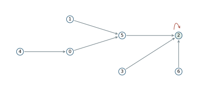
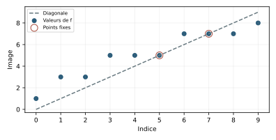

# X-ENS MP-PC · Informatique B 2013 · Corrigé brut

*Corrigé rédigé par IA, non officiel. Signalez toute erreur.*

**Rédaction** · GPT-6.2 Astra Ultra · vitesse non renseignée · 25 novembre 2026

Langage choisi : Python. Les tableaux représentent des applications de l’ensemble des entiers de 0 à n−1 dans lui-même, avec n strictement positif. Les fonctions consultent le tableau sans modifier ses entrées.

## I · Recherche générale et attracteur

### Question 1 · Existence d’un point fixe

Le parcours s'arrête au premier $x$ vérifiant `t[x] == x`. S'il arrive au bout, aucun point fixe n'existe. Sur le premier exemple, $f_0(9)=9$ rend la réponse vraie. Temps maximal $\Theta(n)$, mémoire de travail constante.

```python
def admet_point_fixe(t):
    for x in range(len(t)):
        if t[x] == x:
            return True
    return False
```

### Question 2 · Nombre de points fixes

Après $j$ itérations, `total` est le nombre de $x<j$ tels que $t[x]=x$. Une dernière itération complète donne donc le cardinal voulu. Pour $f_0$, l'équation $2x+1\equiv x\pmod {10}$ donne $x\equiv9\pmod {10}$, donc le résultat est 1.

```python
def nb_points_fixes(t):
    total = 0
    for x in range(len(t)):
        if t[x] == x:
            total += 1
    return total
```

### Question 3 · Calcul de l’itérée

Après $r$ tours, la variable `x` contient $f^r(x_{\rm initial})$. Chaque lecture reste dans $E_n$ puisque $f$ est une application de $E_n$ dans lui-même. Si $k=0$, le corps n'est pas exécuté et l'on restitue l'argument initial. La procédure fonctionne aussi pour un nombre quelconque d'itérations représentable, sans modifier le tableau.

```python
def itere(t, x, k):
    while k > 0:
        x = t[x]
        k -= 1
    return x
```

### Question 4 · Points fixes d’une itérée

L'indice $x$ doit être compté exactement quand $f^k(x)=x$, ce qui peut se produire pour des cycles de longueur supérieure à 1. On applique la procédure de Q3 à chaque départ. Lorsque $k=0$, $f^0$ est l'identité et le résultat est $n$. Le coût de cette solution directe est $O(n(k+1))$.

```python
def nb_points_fixes_iteres(t, k):
    total = 0
    for x in range(len(t)):
        if itere(t, x, k) == x:
            total += 1
    return total
```

### Question 5 · Attracteur commun à toutes les orbites

Avant sa première arrivée en un point fixe, une orbite qui converge ne peut visiter deux fois le même point. Sinon elle répéterait déjà un cycle. Si l'attracteur principal $z$ existe, on a ainsi $f^{n-1}(x)=z$ pour tout $x$. Réciproquement, si ces valeurs sont égales à un même point vérifié fixe, c'est un attracteur principal. Il suffit donc de tester le candidat issu du départ 0 puis chaque orbite. Le calcul termine aussi lorsqu'il existe plusieurs cycles ou aucun point fixe. Pour $f_1$ il renvoie vrai, pour $f_0$ faux et pour le singleton vrai.

```python
def admet_attracteur_principal(t):
    n = len(t)
    candidat = itere(t, 0, n - 1)
    if t[candidat] != candidat:
        return False
    for x in range(n):
        if itere(t, x, n - 1) != candidat:
            return False
    return True
```

### Question 6 · Temps d’une convergence

Sous l'hypothèse d'un attracteur principal, la boucle atteint le point fixe en au plus $n-1$ tours. Elle incrémente `k` pour chaque transition avant ce point et renvoie 0 lorsque le départ est déjà fixe. Dans l'exemple $4\to0\to5\to2$, $2$ est fixe, donc la durée vaut 3.

```python
def temps_de_convergence(t, x):
    k = 0
    while t[x] != x:
        x = t[x]
        k += 1
    return k
```

### Question 7 · Temps de convergence maximal en temps linéaire

La valeur $-1$ représente une distance inconnue. Pour un départ, on empile les sommets dont le successeur doit encore être étudié. On atteint soit un sommet à distance connue, soit le point fixe auquel on attribue 0. On dépile ensuite les prédécesseurs : leur distance est celle du successeur, augmentée de 1. L'hypothèse d'attracteur exclut un cycle non trivial sur le chemin. Un sommet non fixe n'entre qu'une fois dans un chemin de calcul, car sa distance est fixée avant le départ suivant. L'ensemble coûte donc $\Theta(n)$ en temps et $O(n)$ en mémoire. Pour $f_1$ on trouve les distances $(2,2,0,1,3,1,1)$, donc un maximum de 3.

```python
def temps_de_convergence_max(t):
    distances = [-1] * len(t)
    maximum = 0
    for depart in range(len(t)):
        x = depart
        chemin = []
        while distances[x] == -1 and t[x] != x:
            chemin.append(x)
            x = t[x]
        if distances[x] == -1:
            distances[x] = 0
        while chemin:
            y = chemin.pop()
            distances[y] = distances[x] + 1
            x = y
        maximum = max(maximum, distances[depart])
    return maximum
```



## II · Croissance dans l’ordre usuel

### Question 8 · Croissance du tableau

Si toutes les inégalités consécutives $t[i-1]\le t[i]$ sont vraies, on peut les enchaîner entre toute paire d'indices ordonnés. Une violation adjacente prouve immédiatement que la fonction n'est pas croissante. Le temps maximal vaut $\Theta(n)$, atteint sur un tableau croissant. Un tableau d'une seule case est bien déclaré croissant.

```python
def est_croissante(t):
    for i in range(1, len(t)):
        if t[i - 1] > t[i]:
            return False
    return True
```

### Question 9 · Point fixe par dichotomie

On maintient $f(a)\ge a$ et $f(b)\le b$, vraies au début pour $a=0$ et $b=n-1$. Si $f(m)>m$, l'intégralité des valeurs et la croissance donnent $f(m+1)\ge f(m)\ge m+1$. On peut donc prendre $a=m+1$. Si $f(m)<m$, on a symétriquement $f(m-1)\le m-1$ et l'on prend $b=m-1$. En cas d'égalité, $m$ convient. Quand les bornes se rejoignent, les deux inégalités imposent également l'égalité. On calcule le milieu sans sommer les deux bornes afin de rester dans les limites d'entiers garanties par le sujet.

```python
def point_fixe(t):
    a, b = 0, len(t) - 1
    while a < b:
        m = a + (b - a) // 2
        if t[m] == m:
            return m
        if t[m] > m:
            a = m + 1
        else:
            b = m - 1
    return a
```



### Question 10 · Terminaison et temps de la recherche

Dans le cas $f(m)<m$, l'invariant interdit $m=a$. Dans le cas $f(m)>m$, l'invariant interdit $m=b$. Les bornes restent donc valides. Si l'on ne renvoie pas $m$, le nombre positif de candidats $b-a+1$ est au plus divisé par deux (arrondi à l'entier inférieur). Le variant $b-a$ décroît strictement jusqu'à zéro. Chaque itération coûte un nombre constant d'opérations, donc $O(\log n)$ au pire. Pour le minorant, la fonction constante $f(x)=n-1$ oblige à conserver chaque fois la moitié droite jusqu'au dernier point. Sur cette famille la boucle prend $\Omega(\log n)$ tours. La complexité maximale est bien $\Theta(\log n)$.

## II · Ordre partiel et divisibilité

### Question 11 · Plus petit point fixe dans un ordre fini

Soit $x$ un point fixe. Le plus petit élément $m$ satisfait $m\preceq x$. Si $f^j(m)\preceq x$, la croissance donne $f^{j+1}(m)\preceq f(x)=x$. Par récurrence toute itérée de $m$ est inférieure à $x$. Dès que $f^k(m)$ est fixe, elle appartient à l'ensemble des points fixes et en minore tous les éléments. C'en est le plus petit élément.

### Question 12 · Divisibilité et pgcd

Soit $z$ le plus petit point fixe pour la divisibilité. Il divise chacun des points fixes, donc est diviseur commun. Réciproquement tout diviseur commun divise $z$ car $z$ figure dans la famille. Cette double propriété caractérise le pgcd. Si tous les points fixes sont nuls, la famille se réduit à $\{0\}$ et la convention du sujet donne également $z=0$. Pour $n=1$, le seul élément et seul point fixe est 0.

### Question 13 · Calcul du pgcd des points fixes

Pour $n\ge2$, le plus petit élément est 1 car 1 divise chaque entier, y compris 0. Par la Q11, la première valeur stationnaire sur son orbite est le plus petit point fixe, donc, par la Q12, le pgcd demandé. Le cas $n=1$ doit être traité avant tout accès à `t[1]`. Dans le tableau de la dernière partie du sujet, l'orbite est $1\to2\to4\to4$ et la réponse est 4. Les autres points fixes incluent 0, qui ne change pas ce pgcd.

```python
def pgcd_points_fixes(t):
    x = 1 if len(t) > 1 else 0
    while t[x] != x:
        x = t[x]
    return x
```

### Question 14 · Longueur d’une chaîne stricte de divisibilité

Comme $1\mid f(1)$ puis $f^j(1)\mid f^{j+1}(1)$ par croissance, les valeurs positives successives avant le point fixe sont multipliées au moins par 2. Elles restent $\le n-1$. Il y a au plus $\lfloor\log_2(n-1)\rfloor$ telles augmentations, puis éventuellement un passage à 0. Si la chaîne atteint 0, la croissance impose $0\mid f(0)$, donc $f(0)=0$. Le nombre de lectures est $O(\log n)$. Pour constater que cet ordre est atteint, prendre $f(0)=0$, $f(x)=2x$ si $0<2x<n$, et $f(x)=0$ sinon. Cette application préserve la divisibilité : pour $a\mid b$ positifs, soit $2b<n$ et $2a\mid2b$, soit $f(b)=0$, divisible par $f(a)$. L'orbite de 1 parcourt les puissances de deux avant 0. Elle impose $\Omega(\log n)$ tours pour les tailles croissantes, et donc un maximum $\Theta(\log n)$.
