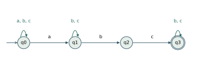
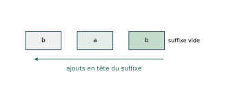
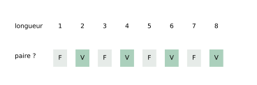

# X-ENS MP · Informatique A 2013 · Corrigé brut

*Corrigé rédigé par IA, non officiel. Signalez toute erreur.*

**Rédaction** · GPT-6.2 Astra Ultra · vitesse non renseignée · 25 novembre 2026

**Logique temporelle.** Le langage de programmation choisi est OCaml. Les positions d’un mot sont numérotées à partir de zéro. Les formules sont évaluées sur des mots finis non vides ; une lecture hors du mot renvoie faux.

## I · Sémantique des mots finis

### Question 1 · Quatre évaluations sur un mot

Pour $u=bbbcbbaa$, les lettres aux positions $0,\ldots,7$ sont $b,b,b,c,b,b,a,a$. (a) **Vrai** : le suffixe à partir de 4 ne contient que des $a$ et $b$. (b) **Faux** : après le pas depuis 2, on est en 3 et la position 4 porte $b$, qui ne vérifie ni $p_a$ ni $p_c$. (c) **Vrai** : choisir 4 comme témoin de $F$. (d) **Vrai** : en position 3, $p_c$ est vrai et les positions strictement précédentes portent toutes $b$. La branche gauche de $U$ n’est pas exigée en 3.

### Question 2 · Un a puis un b

Une formule est $F(p_a\land X(Fp_b))$. Le premier $F$ choisit une occurrence de $a$, le $X$ passe à la position suivante et le second $F$ choisit un $b$ à partir de là. Un $a$ final ne peut donc servir de témoin. Les deux lettres étant distinctes, $F(p_a\land Fp_b)$ est aussi correcte.

### Question 3 · Dernière position

À toute position valide, $\mathrm{Fin}=\neg X\mathrm{VRAI}$ convient. Un successeur existe exactement aux positions $i<|u|-1$. Le caractère fort du $X$ sur un mot fini est essentiel.

### Question 4 · Une dernière lettre imposée

La formule $F(\mathrm{Fin}\land p_a)$ convient. Le mot a une dernière position unique et la formule exige que cette position porte $a$. Elle n’impose aucune condition au préfixe.

### Question 5 · Le langage des alternances complètes

Une solution sur un alphabet quelconque contenant $a$ et $b$ est

$$
p_a\land F(\mathrm{Fin}\land p_b)\land
G\bigl((p_a\land Xp_b)\lor(p_b\land(\mathrm{Fin}\lor Xp_a))\bigr).
$$

Elle impose un premier $a$, un dernier $b$, puis un $b$ après chaque $a$ et un $a$ après chaque $b$ non final. Le grand $G$ exclut toute troisième lettre. Une induction sur les positions donne un mot $(ab)^k$, $k\ge1$. Réciproquement chacun de ces mots réalise tous les tests, y compris le dernier $b$.

### Question 6 · Automate du dernier a et du facteur bc

Le mot doit avoir un dernier $a$ suivi d’un facteur contigu $bc$, sans nouvel $a$ après le choix initial. Construisons un automate non déterministe. L’état initial $q_0$ boucle sur $a,b,c$ et possède en plus une transition $a$ vers $q_1$. L’état $q_1$ boucle sur $b,c$ et peut aussi prendre $b$ vers $q_2$. De $q_2$, la seule transition est $c$ vers l’état final $q_3$, lequel boucle sur $b,c$. Les transitions absentes font échouer la branche. Tout parcours acceptant expose le $a$ choisi puis les deux lettres consécutives. Réciproquement un mot vérifiant la formule donne un tel parcours. Le rapport du jury confirme que la notation de l’énoncé « $\varphi\models u$ » doit se lire $u\models\varphi$.



### Question 7 · Dépliage de l’opérateur jusqu’à

Si le témoin $j$ de $\varphi\,U\,\psi$ est la position courante $i$, alors $\psi$ est vraie en $i$. Si $j>i$, alors $\varphi$ est vraie en $i$ et le même $j$ témoigne de $\varphi\,U\,\psi$ en $i+1$. Réciproquement la branche $\psi$ donne $j=i$ et la branche $\varphi\land X(\varphi\,U\,\psi)$ prolonge d’une position vers la gauche le témoin du suffixe. À la dernière position $X$ est faux. Ainsi, à toute position valide, $\varphi\,U\,\psi\equiv\psi\lor(\varphi\land X(\varphi\,U\,\psi))$.

## II · Normalisation et évaluation directe

### Question 8 · Taille de l’arbre

Nous utilisons OCaml, avec les constructeurs du sujet. Les fonctions suivantes se lisent dans l’ordre des questions.

```ocaml
type formule =
  | VRAI | Predicat of char
  | NON of formule | X of formule | F of formule | G of formule
  | ET of formule * formule | OU of formule * formule
  | U of formule * formule

let rec taille = function
  | VRAI | Predicat _ -> 1
  | NON f | X f | F f | G f -> 1 + taille f
  | ET (f,g) | OU (f,g) | U (f,g) -> 1 + taille f + taille g
```

La mesure diminue strictement sur les sous-arbres. Pour $m$ occurrences de nœuds, le temps est $\Theta(m)$.

### Question 9 · Éliminer F en temps linéaire

On a $Ff\equiv\mathrm{VRAI}\,U\,f$. Le parcours suivant conserve la possibilité d’un $G$ lorsqu’on demande seulement d’éliminer $F$. Son paramètre permet aussi de répondre à la question suivante sans dupliquer le parcours.

```ocaml
let rec transforme elimine_g formule =
  let tr = transforme elimine_g in
  match formule with
  | VRAI | Predicat _ -> formule
  | NON f -> NON (tr f)
  | X f -> X (tr f)
  | F f -> U (VRAI, tr f)
  | G f when elimine_g -> NON (U (VRAI, NON (tr f)))
  | G f -> G (tr f)
  | ET (f,g) -> ET (tr f, tr g)
  | OU (f,g) -> OU (tr f, tr g)
  | U (f,g) -> U (tr f, tr g)

let normaliseF f = transforme false f
```

Chaque nœud d’entrée est traité une fois et produit au plus un nombre constant de nœuds de sortie. Le temps et la taille du résultat sont $O(m)$.

### Question 10 · Éliminer aussi G

L’équivalence $Gf\equiv\neg F(\neg f)\equiv\neg(\mathrm{VRAI}\,U\,\neg f)$ reste valable jusqu’à la dernière position incluse. Utilisons la branche dédiée de la fonction précédente.

```ocaml
let normalise f = transforme true f
```

Une induction structurelle utilisant les deux équivalences prouve la conservation de la vérité pour tout mot. Il reste comme connecteurs temporels $X$ et $U$. À chaque constructeur on transforme ses enfants une seule fois, d’où $\Theta(m)$.

### Question 11 · Évaluation récursive directe


```ocaml
let veriteN formule mot debut =
  let n = String.length mot in
  let rec vrai f i =
    i >= 0 && i < n &&
    match f with
    | VRAI -> true
    | Predicat c -> mot.[i] = c
    | NON g -> not (vrai g i)
    | ET (g,h) -> vrai g i && vrai h i
    | OU (g,h) -> vrai g i || vrai h i
    | X g -> vrai g (i+1)
    | U (g,h) -> vrai h i || (vrai g i && vrai f (i+1))
    | G _ | F _ -> invalid_arg "formule non normalisee"
  in
  vrai formule debut
```

La question 7 justifie la branche $U$. En partant d’un indice valide, la mesure $(n-i)+\mathrm{taille}(f)$ diminue à chaque appel, soit par descente dans l’arbre, soit par passage au successeur. Les indices invalides terminent aussitôt. La profondeur est $O(n+m)$ et le branchement est borné, d’où une borne exponentielle. Cette implémentation peut effectivement prendre un temps exponentiel. Posons $f_0=p_b$, $f_{k+1}=\mathrm{VRAI}\,U\,f_k$ et prenons le mot $a^n$. Tous les tests à droite échouent. Le nombre de sous-appels contient la récurrence de Pascal $C(k,n)\ge C(k-1,n)+C(k,n-1)$ aux indices intérieurs. Pour $k=n$, le coût est exponentiel en $m+n$.

## III · Sous-formules et automates

### Question 12 · Construire l’ensemble vide

La définition récursive d’OCaml ci-dessous exprime les mêmes données que le couple arbre–booléen du cahier.

```ocaml
type ensemble = eformule * bool
and eformule =
  | AVRAI | APredicat of char
  | ANON of ensemble | AX of ensemble
  | AET of ensemble * ensemble | AOU of ensemble * ensemble
  | AU of ensemble * ensemble

let rec initialise f =
  let arbre = match f with
    | VRAI -> AVRAI
    | Predicat c -> APredicat c
    | NON g -> ANON (initialise g)
    | X g -> AX (initialise g)
    | ET (g,h) -> AET (initialise g, initialise h)
    | OU (g,h) -> AOU (initialise g, initialise h)
    | U (g,h) -> AU (initialise g, initialise h)
    | F _ | G _ -> invalid_arg "formule non normalisee"
  in
  (arbre, false)
```

La valeur sentinelle renvoyée sur le suffixe vide a tous ses booléens faux, y compris celui de $\mathrm{VRAI}$. La sémantique du sujet n’admet aucune position valide sur un mot vide.

### Question 13 · Calcul par ajout d’une lettre en tête

Écrivons $b_s$ pour l’ancien booléen d’une sous-formule $s$ sur $u$ et $b'_s$ pour sa valeur sur $au$. Les feuilles deviennent $b'_{\rm VRAI}=1$, $b'_{p_c}=[a=c]$. Les connecteurs booléens utilisent les **nouvelles** valeurs des enfants. Les deux règles temporelles sont

$$
b'_{Xh}=b_h,\qquad b'_{g\,U\,h}=b'_h\lor(b'_g\land b_{g\,U\,h}).
$$

La première saute la lettre ajoutée et la seconde vient de la question 7. Ces règles dépendent uniquement de la lettre et des étiquettes anciennes. Elles permettent un parcours de bas en haut. Avec le suffixe vide, les valeurs anciennes fausses rendent $Xh$ faux et $g\,U\,h$ équivalent à $h$ sur la dernière lettre.

### Question 14 · Mettre à jour toutes les étiquettes


```ocaml
let rec maj (noeud, ancien) lettre =
  let suivant e = maj e lettre in
  match noeud with
  | AVRAI -> (AVRAI, true)
  | APredicat c -> (APredicat c, c = lettre)
  | ANON e ->
      let f = suivant e in (ANON f, not (snd f))
  | AX e ->
      let f = suivant e in (AX f, snd e)
  | AET (e,d) ->
      let f = suivant e and g = suivant d in
      (AET (f,g), snd f && snd g)
  | AOU (e,d) ->
      let f = suivant e and g = suivant d in
      (AOU (f,g), snd f || snd g)
  | AU (e,d) ->
      let f = suivant e and g = suivant d in
      (AU (f,g), snd g || (snd f && ancien))
```

La fonction construit aussi les fils dont la valeur ne change pas le résultat booléen du parent. C’est indispensable pour disposer de toutes les étiquettes à l’étape suivante. La descente structurelle termine, traite chaque occurrence une fois et coûte $\Theta(m)$ en temps et en espace de résultat.

### Question 15 · Balayer le mot de droite à gauche


```ocaml
let sousFormulesVraies f mot =
  let etat = ref (initialise f) in
  for i = String.length mot - 1 downto 0 do
    etat := maj !etat mot.[i]
  done;
  !etat
```

Avant l’itération d’indice $i$, l’état décrit le suffixe commençant en $i+1$. Les questions 12 et 13 établissent l’invariant à l’initialisation et à chaque ajout. Une fois la boucle finie, le mot entier est traité. Le temps est $\Theta(m(n+1))$ et la mémoire de travail vivante est $O(m)$ hors mot d’entrée. Une chaîne vide effectue zéro itération.



### Question 16 · Tester le mot entier


```ocaml
let veriteBis formule mot =
  snd (sousFormulesVraies (normalise formule) mot)
```

La normalisation permet aussi un appel sur une formule arbitraire. Le calcul reste polynomial. Un mot vide renvoie faux même pour une négation, car aucune position initiale n’est définie.

### Question 17 · Automate du langage miroir

Fixons l’arbre normalisé de la formule, de taille $m$. Un état est un étiquetage de ses $m$ occurrences par des booléens. L’état initial est entièrement faux, la transition sur $a$ est $\mathrm{maj}(S,a)$ et un état est final si sa racine vaut vrai. Depuis n’importe quel étiquetage et n’importe quelle lettre, la transition est bien définie et unique. Après lecture de $v$, l’invariant de la question 15 dit que l’état décrit le miroir de $v$. L’automate reconnaît donc $\widetilde{L_\varphi}$ et compte au plus $2^m$ états, dont certains peuvent être inaccessibles. L’état initial est non final.

### Question 18 · Revenir au sens de lecture initial

Renversons toutes les flèches de l’automate précédent. Les anciens finaux deviennent initiaux, l’ancien initial devient l’unique final. Un chemin étiqueté $a_1\cdots a_n$ devient un chemin de sens inverse étiqueté $a_n\cdots a_1$. Le nouvel automate non déterministe reconnaît $L_\varphi$. Il conserve au plus $2^m$ états si plusieurs états initiaux sont autorisés. Pour exiger un seul initial, ajouter un état initial distribuant les départs par $\varepsilon$-transitions, soit au plus $2^m+1$ états.

## IV · Satisfiabilité et expressivité

### Question 19 · États atteignables

Initialiser une file et un ensemble de visite avec l’état initial. À chaque extraction $q$, examiner les $\delta(q,a)$ pour toutes les lettres. Insérer tout successeur encore inconnu dans l’ensemble et dans la file. Le processus termine car chaque état entre au plus une fois et l’automate est fini. Tout état inséré est atteint par le chemin du parent prolongé ; réciproquement l’induction sur la longueur d’un chemin montre que son extrémité sera trouvée. Le coût est $O(|Q|\,|A|)$ avec accès constant aux marques et transitions.

### Question 20 · Longueur d’un témoin minimal

Le miroir d’un témoin minimal donne un plus court chemin de l’état initial à un état final dans l’automate de la question 17. Si deux états du chemin coïncident, supprimer la portion intermédiaire donne un chemin acceptant plus court. Le mot ainsi obtenu n’est pas vide car l’état initial est non final. Ainsi ce chemin est simple et $|u_{\min}|\le 2^m-1$. Cette borne exponentielle porte sur la longueur, non sur le nombre de mots qu’il conviendrait d’énumérer.

### Question 21 · Décider et produire un témoin

Chaque état porte ici un mot témoin sous forme de liste de caractères. Après la transition sur $c$, la nouvelle liste est $c$ suivi de l’ancienne, dans le sens du mot original. La file explore en largeur. Un ensemble ordonné par comparaison structurelle élimine les revisites.

```ocaml
module Etats = Set.Make(struct
  type t = ensemble
  let compare = Stdlib.compare
end)

let satisfiable formule =
  let depart = initialise (normalise formule) in
  let visites = ref (Etats.singleton depart) in
  let file = Queue.create () in
  Queue.add (depart, []) file;
  let rec cherche () =
    if Queue.is_empty file then "Formule non satisfiable"
    else
      let etat, lettres = Queue.take file in
      if snd etat then String.of_seq (List.to_seq lettres)
      else begin
        List.iter (fun c ->
          let autre = maj etat c in
          if not (Etats.mem autre !visites) then begin
            visites := Etats.add autre !visites;
            Queue.add (autre, c :: lettres) file
          end
        ) ['a'; 'b'];
        cherche ()
      end
  in cherche ()
```

Les chemins et visites satisfont l’invariant de la question 17. L’état initial non final exclut le témoin vide. Si la file se vide, aucun état final n’est accessible. Pour une formule **déjà normalisée**, $m$ nœuds donnent au plus $2^m$ états. Une mise à jour coûte $O(m)$ et la recherche dans l’arbre équilibré coûte $O(m\log 2^m)=O(m^2)$ avec comparaisons structurelles. Les listes de témoins partagent leurs queues. Le coût total $O(m^2 2^m)$ est par exemple $O(2^{3m})$, soit $\alpha=3,\beta=1$ dans la notation du sujet. Sur une entrée arbitraire, la normalisation ne multiplie la taille que par une constante.

### Question 22 · Pourquoi la parité échappe à cette logique

Pour une formule $f$, posons $B_f(n)=[a^n\models f]$ et travaillons avec $n\ge1$. Les feuilles ont une valeur constante. Les connecteurs booléens conservent la constance à partir du plus grand des seuils de leurs enfants. Pour $Xf$, on a $B_{Xf}(n)=B_f(n-1)$ dès $n\ge2$, donc un décalage du seuil suffit. Pour $h=f\,U\,g$, prenons $N\ge2$ tel que $B_f,B_g$ soient constants à partir de $N$. La question 7 donne alors

$$
B_h(n)=B_g(n)\lor\bigl(B_f(n)\land B_h(n-1)\bigr).
$$

Si la valeur stable de $g$ est vraie, $B_h$ devient vraie ; si $f$ et $g$ sont toutes deux fausses, elle devient fausse. Dans le dernier cas, $f$ est vraie et $g$ fausse, donc $B_h(n)=B_h(n-1)$ pour tout $n\ge N$ et la suite se fige à sa valeur au rang $N-1$. Toute formule normalisée est donc ultimement constante ; la normalisation étend la conclusion à toutes les formules. Le langage des longueurs paires positives alterne indéfiniment entre deux valeurs. Il est reconnaissable par automate fini, mais aucune formule de cette logique ne le définit.


