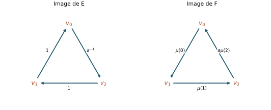

# X-ENS MP — Mathématiques A 2013 · Corrigé brut

*Corrigé rédigé par IA, non officiel. Signalez toute erreur.*

**Rédaction** · GPT-6.2 Astra Ultra · vitesse non renseignée

**Algèbres d’opérateurs sur les suites à support fini.** Le décalage $E$ diminue l’indice du vecteur de base. Le quotient de la dernière partie transforme la droite entière des indices en un cycle de longueur $\ell$.

## I. Opérateurs sur les fonctions à support fini

### Question 1.a

Le support de la fonction nulle est vide. Si $f,g$ sont à support fini, le support de $af+bg$ est inclus dans $\operatorname{Supp}(f)\cup\operatorname{Supp}(g)$, fini, pour tous $a,b\in\mathbb C$. Cela prouve que $V$ est un sous-espace de $\mathbb C^{\mathbb Z}$.

### Question 1.b

Pour tout entier $k$, on a $E(af+bg)(k)=af(k+1)+bg(k+1)$. Ainsi $E$ est linéaire sur $\mathbb C^{\mathbb Z}$. Comme $\operatorname{Supp}(Ef)=\{i-1:i\in\operatorname{Supp}(f)\}$, il préserve $V$.

### Question 2

L’application $D$ définie par $Df(k)=f(k-1)$ est linéaire et préserve les supports finis, qu’elle translate de $+1$. On vérifie pour tout $f\in V$ et tout $k$ que $(EDf)(k)=(DEf)(k)=f(k)$. Ainsi $E\in GL(V)$ et $E^{-1}=D$.

### Question 3.a

Toute relation finie $\sum_i a_iv_i=0$, évaluée en $k$, donne $a_k=0$. La famille est libre. Pour tout $f\in V$, la somme finie $\sum_{i\in\operatorname{Supp}(f)} f(i)v_i$ coïncide avec $f$ en chaque entier. La famille engendre donc $V$ et en est une base.

### Question 3.b

$E(v_i)(k)=v_i(k+1)$ vaut 1 exactement pour $k=i-1$ et 0 ailleurs. Ainsi $E(v_i)=v_{i-1}$.

### Question 4

Les coefficients de $v_{i-1}$ dans $HEv_i$ et $(EH+2E)v_i$ valent $\lambda(i-1)$ et $\lambda(i)+2$. L’égalité sur la base équivaut donc à ce que $\lambda(i)+2i$ soit constant sur tous les entiers. Sa valeur en 0 donne $\lambda(i)=\lambda(0)-2i$. Cette formule vérifie la relation à tout indice, y compris négatif.

### Question 5

Les deux membres appliqués à $v_i$ donnent respectivement $\mu(i)v_i$ et $(\mu(i-1)+\lambda(i))v_i$. Pour $P(i)=i(\lambda(0)-1)-i^2$, on calcule $P(i)-P(i-1)=\lambda(0)-2i=\lambda(i)$. L’égalité cherchée équivaut à la constance de $\mu(i)-P(i)$ sur $\mathbb Z$. Sa valeur est $\mu(0)$, ce qui donne l’équivalence annoncée.

### Question 6.a

Pour $S=\operatorname{Supp}(f)$, l’espace $V_S=\operatorname{Vect}(v_i:i\in S)$ est stable par $H$ puisque $Hv_i=\lambda(i)v_i$. Tous les $H^n f$ appartiennent à $V_S$, de dimension $|S|$. Leur espace engendré est donc de dimension finie.

### Question 6.b

Prenons un élément non nul $f$ du sous-espace stable $W$ et un $i$ dans son support fini $S$. Les valeurs $\lambda(j)=\lambda(0)-2j$ sont deux à deux distinctes. Le polynôme
$$P(X)=\prod_{j\in S\setminus\{i\}}\frac{X-\lambda(j)}{\lambda(i)-\lambda(j)}$$
vaut 1 en $\lambda(i)$ et 0 aux autres valeurs de $S$. Par stabilité, $P(H)f=f(i)v_i\in W$. Comme $f(i)\ne0$, on a $v_i\in W$.

### Question 7.a

Ici $\mu(i)=1-i-i^2=1-i(i+1)$. Le produit de deux entiers consécutifs est pair, donc ne vaut jamais 1. L’application $v_j\mapsto v_{j-1}/\mu(j-1)$ définit un endomorphisme de $V$ sur sa base et fournit un inverse de $F$ à gauche comme à droite.

### Question 7.b

Pour $r\ge1$, $E^rv_0=v_{-r}\ne v_0$, et $F^rv_0=\big(\prod_{j=0}^{r-1}\mu(j)\big)v_r\ne v_0$, le produit étant non nul. Aucune puissance strictement positive n’est l’identité.

### Question 7.c

On a $Hv_i=-2iv_i$. Pour une somme finie $\sum f(i)v_i$, être dans le noyau signifie donc $f(i)=0$ pour $i\ne0$. Ainsi $\ker H=\mathbb Cv_0$. Pour $r\ge1$, $H^rv_0=0\ne v_0$, donc $H^r\ne\operatorname{Id}_V$.

### Question 8.a

L’évaluation $P\mapsto P(E)$ est un morphisme d’algèbres unitaire, surjectif sur $\mathbb C[E]$ par définition. Si $P(E)=0$ pour $P=\sum a_jX^j$, alors $P(E)v_0=\sum a_jv_{-j}=0$. La liberté donne $a_j=0$ pour tout $j$. Le morphisme est un isomorphisme.

### Question 8.b

L’évaluation $P\mapsto P(F)$ est un morphisme d’algèbres surjectif sur $\mathbb C[F]$. Si son image est nulle, $P(F)v_0=\sum_j a_j(\prod_{k=0}^{j-1}\mu(k))v_j=0$ (produit vide égal à 1). Chaque poids est non nul par 7.a. L’indépendance des $v_j$ donne $P=0$, donc l’isomorphisme.

### Question 8.c

Le morphisme surjectif d’évaluation $P\mapsto P(H)$ satisfait $P(H)v_i=P(-2i)v_i$. Si $P(H)=0$, le polynôme $P$ s’annule sur l’ensemble infini $-2\mathbb Z$, donc est nul. L’évaluation induit ainsi $\mathbb C[X]\simeq\mathbb C[H]$.

## II. Un décalage cyclique

### Question 9

L’égalité $(q^2)^r=1$ équivaut à $\ell\mid 2r$. Comme $\ell$ est impair, elle équivaut à $\ell\mid r$. L’ordre de $q^2$ vaut donc $\ell$.

### Question 10.a

$G_av_j=v_{j+1}$ pour $0\le j<\ell-1$ et $G_av_{\ell-1}=av_0$. Le décalage parcourt tout le cycle en $\ell$ pas et rencontre exactement une fois le facteur $a$, d’où $G_a^\ell=a\operatorname{Id}$. Le polynôme $X^\ell-a$ est scindé sur $\mathbb C$ et n’a aucune racine commune avec sa dérivée puisque $a\ne0$. Ce polynôme annulateur à racines simples donne la diagonalisabilité.

### Question 10.b

Les racines de $z^\ell=a$ sont $z=bq^h$ pour $0\le h<\ell$. Pour un vecteur de coordonnées $c_j$, l’équation propre impose $c_{j-1}=zc_j$ pour $1\le j<\ell$ et $ac_{\ell-1}=zc_0$. Ainsi $c_j=z^{-j}c_0$, et la dernière condition est vérifiée. Pour chaque $z=bq^h$, les vecteurs propres sont donc les multiples non nuls de $\sum_{j=0}^{\ell-1}(bq^h)^{-j}v_j$. Toutes les valeurs propres ont été obtenues grâce à 10.a.

### Question 11

Si $i=p\ell+r$ avec $0\le r<\ell$, on a $P_av_i=a^pv_r\in W_\ell$. Pour $0\le i<\ell$, $P_av_i=v_i$, donc $P_a$ fixe tout $W_\ell$ et son image vaut exactement $W_\ell$. En réappliquant $P_a$ à une valeur de son image, on obtient $P_a^2=P_a$.

## III. Opérateurs quantiques

### Question 12

Sur $v_i$, l’équation équivaut à $\lambda(i-1)=q^2\lambda(i)$. Elle signifie que $q^{2i}\lambda(i)$ est constant sur $\mathbb Z$, donc que $\lambda(i)=\lambda(0)q^{-2i}$. Cette expression satisfait aussi l’égalité initiale sur chaque vecteur de la base.

### Question 13

Posons $L=\lambda(0)\ne0$. Tous les $\lambda(i)=Lq^{-2i}$ sont non nuls. L’endomorphisme défini sur la base par $v_i\mapsto L^{-1}q^{2i}v_i$ est inverse à gauche et à droite de $H$, donc $H\in GL(V)$.

### Question 14

Les coefficients de $v_i$ dans $EFv_i$, $FEv_i$, $Hv_i$ et $H^{-1}v_i$ sont respectivement $\mu(i)$, $\mu(i-1)$, $Lq^{-2i}$ et $L^{-1}q^{2i}$. Ainsi l’égalité sur la base équivaut pour tout $i$ à
$$\mu(i)=\mu(i-1)+Lq^{-2i}-L^{-1}q^{2i}.$$

### Question 15.a

La formule de $\lambda$ donne $\lambda(i+\ell)=\lambda(i)$. Pour $\mu(i+\ell)-\mu(i)$, sommons la formule 14 pour les indices $i+1$ à $i+\ell$. Les deux progressions géométriques de raison $q^2$ ou $q^{-2}$ ont somme nulle sur un tour complet car leurs raisons sont différentes de 1. Ainsi $\ell$ est une période de chacune, et la période positive minimale divise $\ell$ par division euclidienne.

### Question 15.b

Un entier $d>0$ est période de $\lambda$ exactement si $Lq^{-2d}=L$, soit $q^{2d}=1$. Par 9, le plus petit est $\ell$.

### Question 15.c

Posons $u=q^2$. Si $d$ est période de $\mu$, sa différence $Lu^{-i}-L^{-1}u^i$ est aussi $d$-périodique. On en tire pour tout $i$
$$L(u^{-d}-1)u^{-i}-L^{-1}(u^d-1)u^i=0.$$
Les suites $u^{-i}$ et $u^i$ sont indépendantes. En évaluant en 0 et 1, le déterminant vaut $u-u^{-1}\ne0$ car $u$ est d’ordre impair $\ell\ge3$. Les deux coefficients sont nuls, d’où $u^d=1$ et $\ell\mid d$. Avec 15.a, la période est exactement $\ell$.

### Question 16.a

On a $EF=FE+H-H^{-1}$. Dans $C$, le coefficient de $H$ devient $q-q^{-1}+q^{-1}=q$ et celui de $H^{-1}$ devient $-(q-q^{-1})+q=q^{-1}$. Ainsi $C=(q-q^{-1})FE+qH+q^{-1}H^{-1}$.

### Question 16.b

Puisque $EFv_i=\mu(i)v_i$, on obtient $Cv_i=r_iv_i$, avec
$$r_i=(q-q^{-1})\mu(i)+q^{-1}\lambda(i)+q\lambda(i)^{-1}.$$
Le vecteur $v_i$ est non nul, donc propre.

### Question 16.c

D’après 16.a, $r_i=(q-q^{-1})\mu(i-1)+q\lambda(i)+q^{-1}\lambda(i)^{-1}$. Comme $\lambda(i-1)=q^2\lambda(i)$, cette valeur égale exactement $r_{i-1}$ de 16.b. Sur toute la base $C$ agit donc par le même scalaire
$$R=(q-q^{-1})\mu(0)+q^{-1}L+qL^{-1}.$$

### Question 16.d

Pour $q,L$ fixés, la formule de 16.c est affine en $\mu(0)$, de coefficient $q-q^{-1}\ne0$ par l’ordre de $q$. Pour toute cible $R$ elle a l’unique antécédent $(R-q^{-1}L-qL^{-1})/(q-q^{-1})$.

### Question 16.e

Posons $z=L/q$ et $c=(q-q^{-1})\mu(0)$. Résoudre $c+z+z^{-1}=R$ revient à résoudre $z^2-(R-c)z+1=0$. Toute cible possède au moins une racine complexe, nécessairement non nulle car le produit des racines vaut 1. L’application est surjective. Elle prend la même valeur pour $z=2$ et $z=1/2$, donc pour deux $L$ distincts. Elle n’est pas injective.

## IV. Opérateurs quantiques modulaires

### Question 17.a

Écrivons $P=P_a$. Si $\phi P=P\phi$, alors $P\phi P=P^2\phi=P\phi$. C’est la compatibilité demandée.

### Question 17.b

Si $i=p\ell+r$, la périodicité donne $\lambda(i)=\lambda(r)$. Ainsi $PHv_i=\lambda(i)a^pv_r=HPv_i$. Les scalaires inverses sont également périodiques, donc $PH^{-1}=H^{-1}P$. Les deux opérateurs sont compatibles par 17.a.

### Question 18

L’égalité $P\phi P=P\phi$ signifie $P\phi(I-P)=0$. Comme $\operatorname{Im}(I-P)=\ker P$, cela équivaut à $\phi(\ker P)\subset\ker P$. L’identité stabilise ce noyau. Les combinaisons linéaires et les compositions d’applications qui le stabilisent le stabilisent encore. Cela fait de $U_q$ une sous-algèbre unitaire.

### Question 19

Pour $i=p\ell+r$, $PEv_i=P(v_{i-1})$ vaut $a^pv_{r-1}$ si $r>0$ et $a^{p-1}v_{\ell-1}$ si $r=0$. Ce sont aussi les valeurs de $PEPv_i=a^p PEv_r$. De même $PFv_i=\mu(i)P(v_{i+1})$ vaut $\mu(r)a^pv_{r+1}$ si $r<\ell-1$ et $\mu(r)a^{p+1}v_0$ si $r=\ell-1$, par 15.a. Ces valeurs égalent $PFPv_i$. Ainsi $E,F\in U_q$.

### Question 20.a

Si $w\in W_\ell$, $Pw=w$. L’équation impose donc $\Psi_a(\phi)w=P\phi(w)$, d’où l’unicité. Réciproquement cette formule définit un endomorphisme de $W_\ell$ et $\Psi_a(\phi)P=P\phi P=P\phi$ par compatibilité. L’application $\Psi_a$ est linéaire, envoie l’identité sur celle de $W_\ell$ et, pour $w\in W_\ell$, vérifie
$$\Psi_a(\phi)\Psi_a(\psi)w=P\phi P\psi w=P\phi\psi w=\Psi_a(\phi\psi)w.$$
C’est le morphisme d’algèbres voulu.

### Question 20.b

Par 20.a et la surjectivité de $P$ sur $W_\ell$, $\Psi_a(\phi)=0$ équivaut à $P\phi=0$, donc à $\operatorname{Im}\phi\subset\ker P$. Or $\ker P=\operatorname{Im}(I-P)$ est engendré par $(I-P)v_i=v_i-a^pv_r$ pour $i=p\ell+r$. Cela prouve exactement l’équivalence demandée.

### Question 21.a

$\Psi_a(E)v_0=PEv_0=Pv_{-1}=a^{-1}v_{\ell-1}$ puisque $-1=(-1)\ell+\ell-1$. Pour $1\le j<\ell$, $\Psi_a(E)v_j=v_{j-1}$.

### Question 21.b

Posons $D=\Psi_a(E)$. La question 21.a donne $D=G_a^{-1}$ puisque $G_a$ décale en sens inverse et multiplie le retour par $a$. Ainsi $\Psi_a(E^\ell)=D^\ell=a^{-1}\operatorname{Id}_{W_\ell}$ par 10.a et 20.a.

### Question 21.c

La relation de 21.b ramène tout polynôme en $D$ au degré au plus $\ell-1$. Les $D^j$, $0\le j<\ell$, sont indépendants puisque sur $v_{\ell-1}$ ils donnent les $\ell$ vecteurs distincts $v_{\ell-1-j}$. Ainsi $\dim\mathbb C[D]=\ell$.

### Question 21.d

Pour $b^\ell=a$ et $0\le h<\ell$, la droite engendrée par $w_h=\sum_{j=0}^{\ell-1}(bq^h)^{-j}v_j$ est, par 10.b, propre pour $G_a$ de valeur $bq^h$. Elle est donc propre pour $D=G_a^{-1}$ de valeur $(bq^h)^{-1}$. Les valeurs sont distinctes et les $\ell$ droites donnent tous les vecteurs propres en prenant leurs multiples non nuls.

### Question 22.a

Pour $0\le j<\ell$, $\Psi_a(H)v_j=\lambda(j)v_j$ et les $Lq^{-2j}$ sont distincts par 9. Prenons $0\ne w=\sum c_jv_j\in W$ et $i$ tel que $c_i\ne0$. Le polynôme de Lagrange égal à 1 en $\lambda(i)$ et 0 aux autres poids, évalué en $\Psi_a(H)$, envoie $w$ sur $c_iv_i$. La stabilité par $\Psi_a(H)$ donne donc $v_i\in W$.

### Question 22.b

Les itérés de $D$ envoient $v_i$ sur des multiples non nuls de tous les vecteurs de base d’après 21.a, car le coefficient de passage $a^{-1}$ est non nul. Si $W$ est en plus stable par $D$, il contient toute cette base, donc $W=W_\ell$.

### Question 23

Posons $T=\Psi_a(F)$. Sur $v_j$, $T$ avance d’un rang avec poids $\mu(j)$, le dernier passage recevant en plus le facteur $a$. Par conséquent
$$T^\ell=a\Big(\prod_{j=0}^{\ell-1}\mu(j)\Big)\operatorname{Id}.$$
Si un poids est nul, $T^\ell=0$. Sinon cette puissance est inversible, ce qui exclut la nilpotence. La formule de 16.b donne $R=(q-q^{-1})\mu(j)+q^{-1}Lq^{-2j}+qL^{-1}q^{2j}$. Puisque $q-q^{-1}\ne0$, on obtient la condition nécessaire et suffisante
$$R\in\{Lq^{-2j-1}+L^{-1}q^{2j+1}:0\le j<\ell\}.$$
Le paramètre non nul $a$ intervient dans le produit du cycle et n’affecte pas son annulation.

