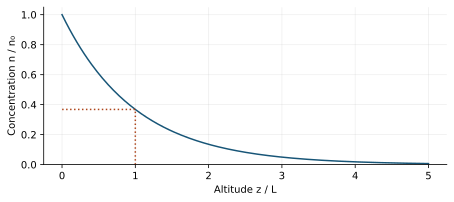
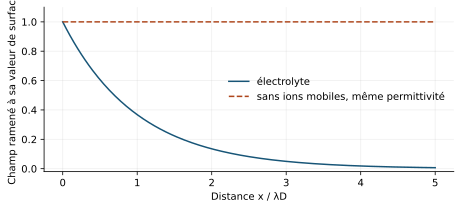
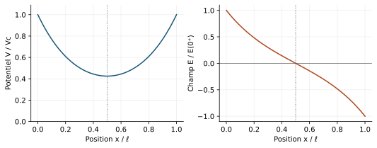

# X-ENS MP 2013 — Physique · Corrigé guidé

*Corrigé rédigé par IA, non officiel. Signalez toute erreur.*

**Lecture du rapport du jury** · GPT-6.2 Astra Ultra · vitesse non renseignée

**Rédaction** · GPT-6.2 Astra Ultra · vitesse non renseignée

## Quelques aspects de l’interaction coulombienne

## I — Équilibre d’une suspension colloïdale

### Question 1 — Pression osmotique d’un gaz dilué

**Indication.** Le nombre $N$ de colloïdes se distingue d’une quantité de matière en moles.

L’équation du gaz parfait $P_c V=Nk_BT$ appliquée aux particules dispersées donne $P_c=nk_BT$. Ici $n$ compte des particules par mètre cube. Le produit est une énergie par unité de volume, donc une pression.

### Question 2 — Hydrostatique de l’ensemble

**Indication.** Écrire d’abord le bilan pour la solution entière. Bien compter le volume qui reste au liquide.

Dans un volume $\delta V$, les particules occupent $nv\,\delta V$ et le liquide $(1-nv)\delta V$. La masse volumique moyenne est donc $\rho_f+nv(\rho_{\rm or}-\rho_f)$. Le gradient de la pression totale $P_f+P_c$ équilibre le poids de toute la tranche de solution. En prenant $z$ ascendant et $T$ uniforme,
$$
\frac{dP_f}{dz}+g\rho_f+k_BT\frac{dn}{dz}+nvg\,\Delta\rho=0 .
$$
Le terme en $\Delta\rho$ tient compte du volume de liquide remplacé par les particules.

### Question 3 — Équation du profil

**Indication.** Utiliser l’hypothèse d’hydrostatique du liquide pour éliminer deux termes.

Le liquide seul vérifie $dP_f/dz=-\rho_fg$ dans l’approximation admise. En soustrayant cette relation du bilan précédent, $k_BT\,dn/dz=-nvg\Delta\rho$. Pour ces particules plus lourdes que l’eau, le nombre par unité de volume diminue vers le haut.

### Question 4 — Hauteur caractéristique

**Indication.** Vérifier que le dénominateur est le poids apparent, en newtons, et que son rapport avec $k_BT$ donne bien une longueur.

L’intégration avec $n(0)=n_0$ donne $n(z)=n_0 e^{-z/L}$ avec
$$
L=\frac{k_BT}{vg\Delta\rho}=\frac{3k_BT}{4\pi a^3g\Delta\rho}.
$$
Pour $a=50\,\mathrm{nm}$, $v\simeq5{,}2\times10^{-22}\,\mathrm{m^3}$ et $\Delta\rho\simeq1{,}83\times10^4\,\mathrm{kg\,m^{-3}}$, d’où $L\simeq4\times10^{-5}\,\mathrm m$.

### Question 5 — Interprétation statistique

**Indication.** Intégrer la densité de probabilité entre les deux limites de l’échantillon avant d’approximer la hauteur.

Le potentiel de pesanteur apparent est $U(z)=vg\Delta\rho\,z$. La concentration est proportionnelle au poids de Boltzmann $e^{-U/k_BT}$, et monter de $L$ coûte l’énergie thermique $k_BT$. La normalisation sur $[0,H]$ donne
$$
\delta p=\frac{e^{-z/L}}{L(1-e^{-H/L})}\,\delta z
\simeq\frac{e^{-z/L}}{L}\,\delta z \quad(H\gg L).
$$

### Question 6 — Seuil de sédimentation

**Indication.** Faire apparaître la quatrième puissance, car le poids varie lui-même comme le cube du rayon.

La convention $L(a_c)=a_c$ donne $a_c=[3k_BT/(4\pi g\Delta\rho)]^{1/4}\simeq3\times10^{-7}\,\mathrm m$. À ce seuil, relever le centre d’un colloïde de son propre rayon coûte environ $k_BT$. Pour $a\ll a_c$, $L/a\gg1$, les particules explorent plusieurs tailles en hauteur. Pour $a\gg a_c$, leur hauteur de localisation est plus petite que leur taille et un dépôt contre le fond devient la description pertinente.

### Question 7 — Régime dilué

**Indication.** Comparer une distance à une distance ou calculer directement une fraction volumique.

La distance moyenne $\ell_n=n^{-1/3}$ doit être grande devant le diamètre, ou de façon équivalente la fraction volumique $nv=(4\pi/3)na^3$ doit être petite. On trouve $\ell_n\simeq1\,\mu\mathrm m$, environ dix diamètres, et $nv\simeq5\times10^{-4}$. L’exclusion de volume est donc faible. L’approximation idéale suppose aussi des interactions entre particules négligeables à cette distance.

### Question 8 — Uniformité locale

**Indication.** Estimer la variation relative de $n(z)$ sur l’élément de volume.

Il faut $\delta z\ll L$, afin que $|\delta n|/n\simeq\delta z/L$ soit faible dans l’élément de volume. On peut alors lui affecter une seule concentration locale.

### Question 9 — Caractère statistique d’un élément

**Indication.** Évaluer le nombre de colloïdes à l’intérieur du volume où l’on définit une concentration moyenne.

L’élément doit contenir un grand nombre de particules, $n\,\delta V\gg1$, et être plus grand que l’échelle microscopique des particules. Pour un élément de forme grossièrement cubique cela impose $n^{-1/3}\ll\delta z\ll L$. Pour une tranche étendue, le critère de comptage porte sur son volume total.

### Question 10 — Temps de sédimentation

**Indication.** Distinguer le temps d’établissement de la vitesse d’une particule du temps de transport à travers tout le récipient.

Sur une trajectoire de chute, le poids apparent $vg\Delta\rho$ est rapidement compensé par le frottement de Stokes $6\pi\eta a\,u_s$. La vitesse limite est $u_s=2a^2g\Delta\rho/(9\eta)\simeq1\times10^{-7}\,\mathrm{m\,s^{-1}}$. Pour une hauteur $H\gg L$ il faut que les particules les plus hautes descendent sur une distance de l’ordre de $H$. Ainsi
$$
\tau\sim\frac{H}{u_s}=\frac{9\eta H}{2a^2g\Delta\rho}\sim10^6\,\mathrm s,
$$
soit une dizaine de jours. Le temps inertiel d’une bille, $m/(6\pi\eta a)$, est de l’ordre de $10^{-8}\,\mathrm s$ et justifie l’emploi de la vitesse limite. Une suspension préparée à l’instant peut donc sembler homogène longtemps avant d’atteindre son profil final.

## II.A — Équations de la double couche

### Question 11 — Flux particulaire

**Indication.** Additionner les vitesses de dérive multipliées par la concentration et le flux de Fick. Ne pas multiplier le flux particulaire par la charge.

Pour une espèce, la dérive électrique donne $J_C=n\mu E=-n\mu\,dV/dx$. La diffusion de Fick donne $J_D=-D\,dn/dx$. Ainsi $J=-n\mu V'-Dn'$. C’est un nombre traversant une surface par unité de temps. La mobilité algébrique porte déjà le signe du porteur.

### Question 12 — Distribution stationnaire

**Indication.** La stationnarité fixe un flux constant. Utiliser la condition physique qui donne sa valeur avant d’intégrer.

L’équation de conservation en régime permanent impose $dJ/dx=0$. La surface ne laisse traverser aucun ion et la solution homogène éloignée n’a pas de flux, d’où $J=0$. On a alors $dn/n=-(\mu/D)\,dV$. En prenant $V(\infty)=0$, $n(\infty)=n_\infty$,
$$
n(x)=n_\infty e^{-\mu V(x)/D}.
$$

### Question 13 — Relation d’Einstein

**Indication.** Comparer les deux exposants et vérifier le signe du coefficient de diffusion.

Un ion de charge $q$ a l’énergie électrostatique $U(x)=qV(x)$ avec l’origine choisie. La loi de Boltzmann prédit $n/n_\infty=e^{-qV/(k_BT)}$. L’identification donne $\mu/D=q/(k_BT)$, soit $D=\mu k_BT/q$. Pour un anion la mobilité et la charge sont toutes deux négatives et $D$ demeure positif.

### Question 14 — Équation de Poisson–Boltzmann

**Indication.** La différence des deux exponentielles fait apparaître un sinus hyperbolique dont le signe dépend de leur ordre.

Posons $q_*=Ze>0$. Les densités sont $n_+=n_\infty e^{-q_*V/(k_BT)}$ et $n_-=n_\infty e^{q_*V/(k_BT)}$. La charge locale et l’équation plane de Poisson donnent
$$
\rho_{\rm sol}=q_*(n_+-n_-)=-2q_* n_\infty\sinh\left(\frac{q_*V}{k_BT}\right),\qquad
V''=\frac{2q_*n_\infty}{\varepsilon}\sinh\left(\frac{q_*V}{k_BT}\right).
$$

### Question 15 — Échelles de potentiel et d’écran

**Indication.** Fixer séparément l’échelle de l’argument adimensionnel et le coefficient du terme dérivé.

L’argument du sinus hyperbolique doit devenir $\Psi=V/V_T$, donc $V_T=k_BT/q_*$. Puis $V''=(V_T/\lambda_D^2)\,d^2\Psi/dX^2$. Le choix
$$
\lambda_D^2=\frac{\varepsilon k_BT}{2n_\infty q_*^2}
$$
donne $\Psi''(X)=\sinh\Psi$. Toutes les solutions en géométrie plane s’expriment dans les mêmes variables réduites, avec des conditions de surface encore spécifiques à chaque problème.

### Question 16 — Ordres de grandeur

**Indication.** Vérifier que la concentration utilisée est un nombre d’ions par mètre cube pour chacune des espèces.

Pour des ions monovalents, $V_T\simeq26\,\mathrm{mV}$, soit $3\times10^{-2}\,\mathrm V$ à un chiffre significatif. Avec $\varepsilon=80\varepsilon_0$ et $n_\infty\simeq6\times10^{24}\,\mathrm{m^{-3}}$, $\lambda_D\simeq3\,\mathrm{nm}$. On a $a/\lambda_D\simeq16$, soit $2\times10^1$ à un chiffre significatif.

## II.B — Écrantage linéaire

### Question 17 — Linéarisation

**Indication.** Comparer l’énergie électrostatique maximale à l’agitation thermique.

Si $|\Psi|\ll1$ dans toute la couche, ou $|q_*V|\ll k_BT$, $\sinh\Psi=\Psi+O(\Psi^3)$. L’équation devient $\Psi''=\Psi$. Pour le profil monotone d’une surface isolée, il suffit de l’imposer à la surface où $|V|$ est maximal.

### Question 18 — Champ et potentiel d’une surface isolée

**Indication.** Imposer séparément le comportement au loin et le saut du déplacement électrique à la surface du conducteur.

La solution de $\Psi''=\Psi$ s’annulant à l’infini conserve la seule exponentielle décroissante. Le champ est nul dans le métal et la condition à la surface est $\varepsilon E(0^+)=\sigma_0$. Avec $E=-V'$ on obtient
$$
V(x)=\frac{\sigma_0\lambda_D}{\varepsilon}e^{-x/\lambda_D},\qquad
E(x)=\frac{\sigma_0}{\varepsilon}e^{-x/\lambda_D}.
$$

### Question 19 — Portée de l’écran

**Indication.** Distinguer la diminution du champ de surface due à la permittivité de sa décroissance avec la distance due aux ions.

Pour $\sigma_0>0$ le champ sort de la surface, reste positif puis tombe exponentiellement à zéro. Sans ions mobiles, le champ extérieur d’un plan conducteur uniformément chargé reste constant dans cette géométrie, de valeur $\sigma_0/\varepsilon_0$ dans le vide. Ici l’excès de contre-ions écrante le champ. À concentration et permittivité fixées, $\lambda_D\propto\sqrt T$ croît avec l’agitation thermique, qui disperse la charge. Le rapport $a/\lambda_D\gg1$ permet de négliger localement la courbure du colloïde sur l’épaisseur ionique.

### Question 20 — Capacité linéaire

**Indication.** La distance de séparation effective des charges est l’échelle d’écran.

La question 18 donne $V_c=\sigma_0\lambda_D/\varepsilon$. À aire $A$ fixée, $Q_c=A\sigma_0$, donc $C_c=(\partial Q_c/\partial V_c)=\varepsilon A/\lambda_D$. La couche diffuse joue pour ce bilan le rôle de la distance d’un condensateur plan de même surface et de même permittivité.

### Question 21 — Charge par surface atomique

**Indication.** Multiplier la densité en unités SI par une aire atomique, puis diviser par la charge élémentaire.

À la frontière estimée du régime linéaire, on prend $V(0)=V_T$. Alors $\sigma_0\simeq\varepsilon V_T/\lambda_D\simeq6\times10^{-3}\,\mathrm{C\,m^{-2}}$. Avec $1\,\text{Å}^2=10^{-20}\,\mathrm{m^2}$, cela représente environ $4\times10^{-4}\,e/\text{Å}^2$, soit une charge élémentaire par quelques milliers d’ångströms carrés. L’unité mesure directement la quantité de charge par aire d’échelle atomique. Cette valeur illustre la faiblesse de la densité surfacique dans le domaine linéaire, ici utilisée à sa limite.

## II.C — Solution non linéaire

### Question 22 — Champ caractéristique

**Indication.** La fonction est adimensionnée ainsi que sa variable d’espace. Appliquer la règle de dérivation en chaîne.

De $E=-dV/dx$ et $E^\star=-d\Psi/dX$ il résulte $E=E_c E^\star$, où $E_c=V_T/\lambda_D$. Avec les échelles des questions précédentes on attendait un champ égal à une chute de potentiel caractéristique divisée par la longueur sur laquelle elle se produit.

### Question 23 — Première intégrale

**Indication.** La condition lointaine fixe la constante d’intégration et la monotonie fixe le signe de la racine carrée.

Multiplions $\Psi''=\sinh\Psi$ par $\Psi'$. On obtient $(\Psi'^2/2)'=(\cosh\Psi)'$. Comme $\Psi,\Psi'\to0$ à l’infini, $\Psi'^2/2=\cosh\Psi-1=2\sinh^2(\Psi/2)$. À la surface positive le potentiel décroît vers zéro. Le signe physique donne donc $E^\star=-\Psi'=2\sinh(\Psi/2)$.

### Question 24 — Signe des charges en solution

**Indication.** Identifier l’espèce dont l’énergie baisse lorsqu’elle s’approche d’un mur au potentiel positif.

On retrouve $\rho_{\rm sol}=-2Ze\,n_\infty\sinh\Psi$. Pour un colloïde positif, $\Psi>0$ près de la surface, les anions contre-ions s’y accumulent et $\rho_{\rm sol}<0$. Loin de la surface, les deux concentrations redeviennent égales et la charge locale s’annule.

### Question 25 — Charge de la surface

**Indication.** Utiliser la valeur de la première intégrale au bord du liquide.

La continuité appropriée du déplacement normal donne $\sigma_0=\varepsilon E(0^+)$ puisque le métal est équipotentiel. Avec $E_c=V_T/\lambda_D$,
$$
\sigma_0=\frac{2\varepsilon V_T}{\lambda_D}\sinh(\Psi_0/2).
$$
À petit $\Psi_0$, la loi linéaire $\sigma_0=\varepsilon V_c/\lambda_D$ est retrouvée.

### Question 26 — Capacité différentielle

**Indication.** Pour une loi non linéaire, la capacité demandée est une dérivée au point considéré.

À température et concentration fixées $Q_c=A\sigma_0$ et $d\Psi_0/dV_c=1/V_T$. En dérivant on obtient $C_c=(\varepsilon A/\lambda_D)\cosh(\Psi_0/2)$. La valeur linéaire est le minimum de cette capacité, qui croît avec la valeur absolue du potentiel de surface.

### Question 27 — Neutralité du colloïde entouré de son nuage

**Indication.** Relier la charge intégrée au flux entre la surface métallique et une région où le champ a disparu.

En intégrant $dE/dx=\rho_{\rm sol}/\varepsilon$ de la paroi jusqu’à l’électrolyte neutre, $\sigma_{\rm sol}=\int_0^\infty\rho_{\rm sol}\,dx=\varepsilon[E(\infty)-E(0^+)]=-\sigma_0$. Le colloïde et son nuage sont exactement compensés par unité d’aire dans ce modèle. Il existe donc une séparation locale des charges malgré la neutralité de l’ensemble. L’électrolyte hors des couches redevient localement neutre.

### Question 28 — Retour à la loi linéaire

**Indication.** Deux développements distincts interviennent, celui de la tangente hyperbolique et celui du logarithme.

Pour $|\Psi_0|\ll1$, $\theta_0=\tanh(\Psi_0/4)\simeq\Psi_0/4$. En posant $u=\theta_0 e^{-X}$, $\ln[(1+u)/(1-u)]=2u+O(u^3)$. La formule complète donne donc $\Psi\simeq4u=\Psi_0e^{-X}$, ce qui redonne le profil et le champ de la question 18.

### Question 29 — Limite du modèle d’ions ponctuels

**Indication.** Convertir les unités des deux axes en longueurs et volumes comparables à ceux d’un ion.

La figure prévoit près de la surface environ $-32\,e/\text{Å}^3$ et une forte diminution de la charge en valeur absolue sur un centième de longueur de Debye, soit environ $0{,}3\,\text{Å}$. Or des ions monovalents de taille voisine de $1\,\text{Å}$ ne peuvent occuper un même ångström cube à plusieurs dizaines. Passé une densité d’ordre $1\,e/\text{Å}^3$, l’exclusion de volume des ions devient essentielle. Le très grand pic de contact est une limite de l’hypothèse d’ions ponctuels.

### Question 30 — Couche compacte et couche diffuse

**Indication.** Distinguer la demande de charge de compensation de la possibilité de la loger dans un volume physique fini.

Le calcul nécessite un fort excès de contre-ions dans un volume très mince au contact. Avec leur taille réelle, les premiers contre-ions y remplissent les places disponibles, sous l’effet de l’attraction et, le cas échéant, de l’adsorption. On modélise cette zone comme une couche compacte. Au-delà, la densité est moindre et les ions conservent de l’espace pour diffuser et dériver. La décroissance du champ s’achève dans la couche diffuse. Le profil continu seul ne détermine pas les détails moléculaires de l’adsorption.

### Question 31 — Épaisseur compacte

**Indication.** Soustraire la charge que la région diffuse peut encore neutraliser avant de diviser par la densité de la couche compacte.

À l’endroit où le modèle diffus redevient compatible avec une densité maximale d’environ $1\,e/\text{Å}^3$, l’état de référence fourni correspond à $310\,\mathrm{mV}$ et $0{,}15\,e/\text{Å}^2$ encore à compenser par la couche diffuse. La couche compacte doit prendre la différence $0{,}85-0{,}15=0{,}70\,e/\text{Å}^2$ en valeur absolue. À la densité maximale estimée, son épaisseur est de l’ordre de $0{,}70\,\text{Å}$, soit de l’ordre d’une couche d’ions.

### Question 32 — Validité de la description continue

**Indication.** Retrouver les deux échelles de moyennage des questions 8 et 9, cette fois pour les ions.

Dans la région de contact de la figure 2, la longueur de variation du calcul est inférieure au diamètre ionique. Il n’existe pas d’élément de volume à la fois riche en ions et petit devant cette longueur. La description continue y échoue. Plus loin, quand le champ varie sur plusieurs dizaines d’ångströms et que les variations sont faibles à l’échelle ionique, une description de couche diffuse redevient envisageable.

## III — Interaction de deux colloïdes

### Question 33 — Potentiel entre deux surfaces identiques

**Indication.** Identifier le plan de symétrie, puis utiliser le signe de la dérivée seconde pour choisir entre un maximum et un minimum central.

Les conditions aux bords sont $V(0)=V(\ell)=V_c>0$ et le système est symétrique autour de $x=\ell/2$. Le potentiel positif est convexe puisque $V''$ a le signe de $\sinh(V/V_T)$. Il décroît jusqu’à un minimum positif au milieu puis remonte. Le champ $E=-V'$ est positif à gauche, nul au milieu et négatif à droite. Par exemple, dans le domaine linéaire,
$$
V(x)=V_c\frac{\cosh[(x-\ell/2)/\lambda_D]}{\cosh[\ell/(2\lambda_D)]}.
$$

### Question 34 — Travail réversible et interaction

**Indication.** Tracer un rectangle dans le plan $(V_c,\ell)$. Le facteur deux du travail électrique vient du nombre de surfaces. L’opérateur équilibre la force recherchée.

**a.** Le générateur apporte $V_c\,dQ_c$ à chacune des deux surfaces. Le déplacement de la seconde fait intervenir la force de maintien. Ainsi $\delta W=2V_c\,dQ_c+F_{\rm op}\,d\ell$.

**b.** Sur le chemin réversible $\delta Q=T\,dS$, d’où $dU=T\,dS+2V_c\,dQ_c+F_{\rm op}\,d\ell$.

**c.** À potentiel et température imposés, prenons $G=U-TS-2V_cQ_c$. Alors $dG=-S\,dT-2Q_c\,dV_c+F_{\rm op}\,d\ell$.

**d.** À $T$ constant, on peut d’abord charger les surfaces éloignées de $0$ à $V_0$, puis les rapprocher à potentiel constant. Cela donne $\Delta G=-2A\int_0^{V_0}\sigma_0(\infty,V)\,dV+\int_\infty^{\ell_0}F_{\rm op}(V_0,\ell)\,d\ell$. Si l’on rapproche d’abord les surfaces déchargées, la contribution de force électrostatique est nulle sur ce segment. On les charge ensuite à distance $\ell_0$, ce qui donne $\Delta G=-2A\int_0^{V_0}\sigma_0(\ell_0,V)\,dV$. L’égalité des deux valeurs fournit
$$
\int_\infty^{\ell_0} F_{\rm op}(V_0,\ell)\,d\ell
=2A\int_0^{V_0}[\sigma_0(\infty,V)-\sigma_0(\ell_0,V)]\,dV .
$$
À grande distance, $\sigma_0(\infty,V)=(2\varepsilon V_T/\lambda_D)\sinh[V/(2V_T)]$.

**e.** En dérivant en $\ell_0$ puis en appliquant l’équilibre mécanique, $F=-F_{\rm op}=2A\int_0^{V_0}(\partial\sigma_0/\partial\ell)_{V,T}\,dV$. La force est répulsive. Pour justifier le signe, le premier intégral de Poisson entre les surfaces donne une pression totale constante $k_BT(n_++n_-)-\varepsilon E^2/2$. Au milieu $E=0$ et $n_++n_-=2n_\infty\cosh\Psi_m$. En retranchant la pression du liquide éloigné, l’excès de pression est $2n_\infty k_BT(\cosh\Psi_m-1)>0$ pour le potentiel médian $\Psi_m>0$. Il pousse les deux surfaces à s’écarter.

### Question 35 — Effet du sel

**Indication.** Comparer la portée des deux interactions lorsque l’on augmente la concentration de l’électrolyte.

À température donnée, augmenter $n_\infty$ réduit $\lambda_D$ comme $n_\infty^{-1/2}$. La répulsion électrostatique de portée $\lambda_D$ est alors plus vite atténuée avec la distance, tandis que l’attraction de van der Waals en puissance inverse de $\ell$ persiste. La barrière à l’approche peut donc diminuer suffisamment pour que les rencontres conduisent à l’agrégation.

### Question 36 — Charge d’un agrégat

**Indication.** La charge totale croît comme le volume initial cumulé, tandis que la surface extérieure croît moins vite.

Un agrégat compact a un volume proportionnel à $N$, donc un rayon $a_N\simeq aN^{1/3}$ dans l’approximation sans vides. Sa charge conservée est $NQ_1$. La densité de surface est alors $\sigma_N=NQ_1/(4\pi a_N^2)=\sigma_1 N^{1/3}$. Dans ce modèle, la croissance accroît la densité de charge de même signe et renforce la répulsion à l’égard d’autres agrégats. L’effet électrostatique tend à limiter la croissance ultérieure.

### Question 37 — Vitesse d’agrégation

**Indication.** Distinguer un transport jusqu’au contact de la probabilité de rester attaché après la rencontre.

Il faut d’abord une rencontre, puis un attachement. Dans une suspension peu concentrée, la fréquence de rencontres croît avec la concentration en colloïdes. La diffusion brownienne dépend de $T$, de la viscosité et de la taille, avec $D_{\rm col}=k_BT/(6\pi\eta a)$ pour une sphère isolée. La section ou distance de capture intervient également. L’agitation du fluide ou des vitesses de sédimentation différentes peuvent augmenter le nombre de collisions. La proportion de rencontres donnant un agrégat dépend de la barrière répulsive comparée à $k_BT$, donc notamment de la charge et de la concentration ionique, ainsi que de l’attraction au contact. Ces paramètres évoluent eux-mêmes avec la taille des agrégats.
