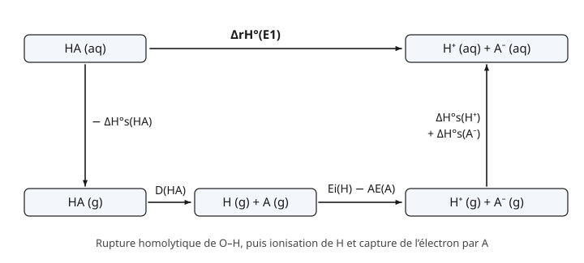
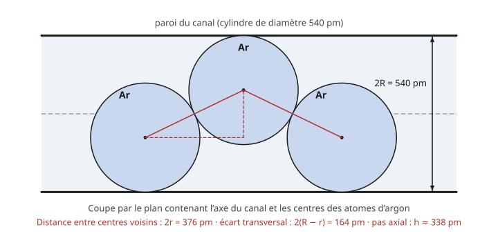
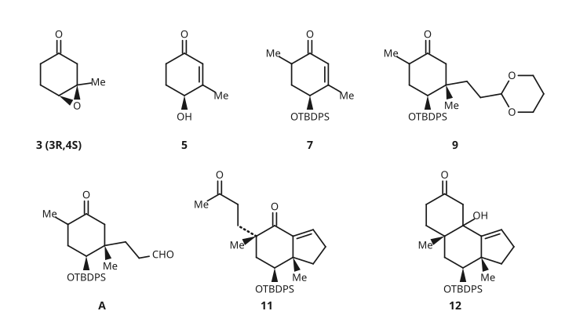
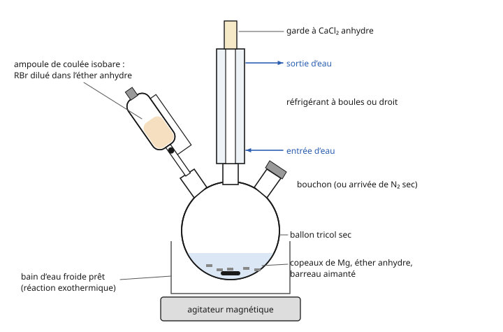
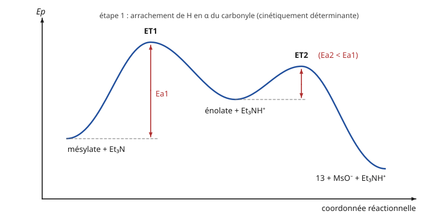
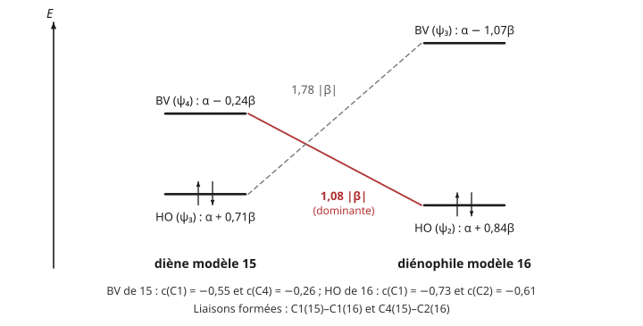

# X-ENS PC — Chimie 2013 · Corrigé guidé

*Corrigé rédigé par IA, non officiel. Signalez toute erreur.*

**Rédaction** · modèle exact non renseigné (famille Claude) · effort non renseigné · vitesse non renseignée

**Révision (tour 2)** · modèle exact non renseigné (famille Claude) · effort non renseigné · vitesse non renseignée · 28 novembre 2026

## Présentation du sujet

Épreuve écrite de chimie commune à l’École polytechnique, aux Écoles normales supérieures et à l’ESPCI, filière PC, session 2013 : **4 heures, calculatrices interdites**. Le sujet compte 70 questions réparties en deux parties indépendantes ; les données numériques (masses et rayons atomiques, électronégativités, longueurs de liaison, tables de RMN et d’infrarouge, racines utiles) sont regroupées à la fin de l’énoncé.

| Partie | Questions | Thème | Notions mobilisées |
|---|---|---|---|
| I. Les oxoacides | 1 à 8 | relation entre structure et $\mathrm{p}K_A$ | Lewis, VSEPR, mésomérie, acide de Lewis |
| II. Des monoacides aux polyacides | 9 à 19 | cycle thermodynamique et modèle électrostatique de l’acidité | thermochimie, lecture de graphes, esprit critique sur un modèle |
| III. Les zéolithes, solides poreux | 20 à 29 | maille de la ZSM-5, surface spécifique, tamis moléculaire | cristallographie, géométrie, ordres de grandeur sans calculatrice |
| IV. Les zéolithes, acides solides | 30 à 32 | méthylation du toluène | substitution électrophile aromatique, sélectivité de forme |
| V. Synthèse du rippertenol | 33 à 70 | synthèse totale (Snyder, 2011) | stéréochimie, énolates, organomagnésiens, acétals, aldolisation, élimination, Diels-Alder et orbitales frontières, spectroscopies |

La première partie demande peu de connaissances mais beaucoup de recul : les questions 9 à 19 construisent pas à pas un modèle, et les questions 23 à 28 sont des problèmes de géométrie où il faut poser soi-même les hypothèses. La seconde partie est une synthèse organique classique dans sa forme, dont presque toutes les questions sont abordables indépendamment grâce aux structures fournies de **4**, **6**, **10**, **13**, **14** et **19**.

> [!JURY]
> 1359 copies, moyenne 9,60 sur 20, écart-type 3,03. Les correcteurs encouragent « plus que jamais » à lire l’énoncé avec attention et à proposer le mécanisme de la réaction demandée, non celui d’une étape voisine. Ils jugent inacceptables les équations-bilans non équilibrées en espèces ou en charges, regrettent le traitement approximatif de points de cours centraux (montage de la synthèse magnésienne) et rappellent qu’un acide de Brønsted protone : la « déprotonation par l’APTS » a été lue trop souvent. Les meilleures notes supposent d’avoir traité les deux parties en persévérant sur les questions qui demandent le plus de réflexion.

Documents officiels : [sujet](https://www.ens.psl.eu/IMG/file/concours/2013/PC/13_pc_chi_xeulc.pdf) et [rapport du jury](https://www.ens.psl.eu/IMG/file/concours/2013/PC/13_pc_rap_echi.pdf).

Les structures des intermédiaires de synthèse qui ne sont pas données par l’énoncé sont décrites en toutes lettres et rassemblées sur la figure 3 (question 36).

## Première partie · Les zéolithes : des solides microporeux

## I. Les oxoacides

### Question 1 — Structures de Lewis et géométries

> [!INDICATION]
> Compter d’abord les électrons de valence, placer l’atome central (N, C ou S) et n’y attacher les hydrogènes que par l’intermédiaire d’un oxygène.

> [!INDICATION]
> L’azote, élément de la deuxième période, ne dépasse jamais l’octet : il faut des charges formelles. Le soufre peut être hypervalent.

#### Solution

On dénombre les électrons de valence, puis on écrit des formules où tous les doublets non liants et toutes les charges formelles figurent.

| Acide | Électrons de valence | Formule de Lewis (description) | Type VSEPR | Géométrie autour de l’atome central |
|---|---|---|---|---|
| $\mathrm{HNO_3}$ | $1+5+3\times 6=24$ (12 doublets) | N lié à trois O : une liaison $\mathrm{N{=}O}$, une liaison $\mathrm{N{-}O^-}$ (O porteur de trois doublets libres et d’une charge $-$), une liaison $\mathrm{N{-}OH}$ ; N porte une charge $+$ et aucun doublet libre | $\mathrm{AX_3}$ | trigonale plane, angles voisins de $120^\circ$ |
| $\mathrm{H_2CO_3}$ | $2+4+3\times 6=24$ (12 doublets) | C lié à trois O : une liaison $\mathrm{C{=}O}$ et deux liaisons $\mathrm{C{-}OH}$ ; pas de charge formelle | $\mathrm{AX_3}$ | trigonale plane, angles voisins de $120^\circ$ |
| $\mathrm{H_2SO_4}$ | $2+6+4\times 6=32$ (16 doublets) | S lié à quatre O : deux liaisons $\mathrm{S{=}O}$ et deux liaisons $\mathrm{S{-}OH}$ (S hypervalent, 12 électrons) ; forme limite respectant l’octet : $\mathrm{S^{2+}}$ lié à deux $\mathrm{O^-}$ et à deux OH | $\mathrm{AX_4}$ | tétraédrique, angles voisins de $109^\circ$ |

Dans chaque formule, un oxygène doublement lié porte deux doublets libres, un oxygène de groupe hydroxyle en porte deux, un oxygène chargé $-$ en porte trois.

Pour l’acide nitrique, l’azote appartient à la deuxième période : il ne peut pas s’entourer de plus de huit électrons, d’où la séparation de charges $\mathrm{N^+/O^-}$ ; les deux liaisons N–O sans hydrogène sont équivalentes par mésomérie. Le soufre, élément de la troisième période, admet l’hypervalence.

La méthode VSEPR compte une liaison multiple comme une seule direction de répulsion. L’atome central ne porte aucun doublet libre dans les trois cas, d’où :

**$\mathrm{HNO_3}$ et $\mathrm{H_2CO_3}$ : type $\mathrm{AX_3}$, géométrie trigonale plane ; $\mathrm{H_2SO_4}$ : type $\mathrm{AX_4}$, géométrie tétraédrique.**

Les angles réels s’écartent un peu des valeurs idéales, une liaison double étant plus répulsive qu’une liaison simple.

> [!PIEGE]
> Oublier les doublets non liants des oxygènes ou la charge formelle de l’azote, ou encore écrire un azote à cinq liaisons : un élément de la deuxième période ne peut pas être hypervalent.

> [!JURY]
> Le rapport signale que les doublets non liants et les charges formelles ont été trop souvent omis et qu’une hypervalence de l’azote a parfois été invoquée ; 28 % seulement des copies ont obtenu tous les points.

### Question 2 — Acide éthanoïque et éthanol

> [!INDICATION]
> L’ordre de grandeur attendu est celui d’un acide carboxylique courant. L’alcool primaire à comparer possède le même squelette à deux carbones.

> [!INDICATION]
> Comparer la stabilité des deux bases conjuguées : l’une d’elles possède deux formes mésomères équivalentes.

#### Solution

Le couple acide éthanoïque/ion éthanoate a un $\mathrm{p}K_A$ voisin de **4,8** à 25 °C.

L’alcool primaire le plus proche en structure est l’**éthanol** $\mathrm{CH_3CH_2OH}$, dont le $\mathrm{p}K_A$ (couple éthanol/ion éthanolate) est voisin de **16**.

L’écart, d’environ onze unités, s’interprète en comparant les bases conjuguées :

- dans l’ion éthanoate $\mathrm{CH_3CO_2^-}$, la charge négative est délocalisée sur les deux atomes d’oxygène (deux formes mésomères équivalentes, $\mathrm{O{=}C{-}O^-}\leftrightarrow\mathrm{{}^-O{-}C{=}O}$) : la base est stabilisée ;
- dans l’ion éthanolate $\mathrm{CH_3CH_2O^-}$, la charge reste localisée sur un seul oxygène, et le groupe alkyle, donneur inductif, ne la stabilise pas.

De plus, le groupe carbonyle, attracteur, polarise davantage la liaison O–H de l’acide. Plus la base conjuguée est stabilisée, plus l’acide est fort :

$$\boxed{\mathrm{p}K_A(\mathrm{CH_3CO_2H})\approx 4{,}8\ \ll\ \mathrm{p}K_A(\mathrm{CH_3CH_2OH})\approx 16}$$

> [!JURY]
> Le jury relève, comme les années précédentes, une méconnaissance des ordres de grandeur de $\mathrm{p}K_A$ d’espèces courantes ; la justification attendue est la comparaison des stabilités des ions éthanoate et éthanolate (13 % de réussite complète).

### Question 3 — Série HClO, HClO2, HClO3

> [!INDICATION]
> Écrire les trois acides avec le chlore central et un seul groupe O–H, puis compter les oxygènes sur lesquels la charge de la base conjuguée peut se délocaliser.

#### Solution

Dans les trois acides, l’hydrogène est porté par un oxygène et le chlore est l’atome central : $\mathrm{Cl{-}OH}$, $\mathrm{O{=}Cl{-}OH}$, $\mathrm{O{=}Cl({=}O){-}OH}$ (chlore hypervalent ; il n’y a aucune liaison O–O).

Le tableau 1 donne $\mathrm{p}K_A=7{,}5$ ; $2{,}0$ ; $-2{,}7$ : l’acidité augmente fortement avec le nombre d’oxygènes.

Le raisonnement est le même qu’à la question 2. La charge de la base conjuguée est :

- localisée sur l’unique oxygène dans $\mathrm{ClO^-}$ (une seule forme) ;
- délocalisée sur deux oxygènes dans $\mathrm{ClO_2^-}$ (deux formes mésomères équivalentes) ;
- délocalisée sur trois oxygènes dans $\mathrm{ClO_3^-}$ (trois formes mésomères équivalentes).

Plus la charge est délocalisée, plus la base est stable et plus l’acide est fort. S’y ajoute l’effet inductif attracteur de chaque oxygène supplémentaire, qui appauvrit la liaison O–H.

$$\boxed{\mathrm{p}K_A(\mathrm{HClO})>\mathrm{p}K_A(\mathrm{HClO_2})>\mathrm{p}K_A(\mathrm{HClO_3})}$$

> [!PIEGE]
> Écrire des enchaînements O–O (peroxydes) : dans un oxoacide, chaque oxygène est lié à l’atome central.

> [!JURY]
> Le rapport mentionne des formes de Lewis « très surprenantes » (polyperoxydes) et attend le décompte des formes mésomères de chaque base conjuguée (21 %).

### Question 4 — Formule générale et relation linéaire

> [!INDICATION]
> Dans $\mathrm{X(O)}_n\mathrm{(OH)}_p$, $n$ compte les oxygènes non hydroxylés. Relever comment varie le $\mathrm{p}K_A$ quand $n$ augmente d’une unité.

#### Solution

Avec $\mathrm{X=Cl}$ et $p=1$ dans les trois cas :

| Acide | Écriture $\mathrm{X(O)}_n\mathrm{(OH)}_p$ | $n$ | $\mathrm{p}K_A$ |
|---|---|---|---|
| $\mathrm{HClO}$ | $\mathrm{Cl(OH)}$ | 0 | 7,5 |
| $\mathrm{HClO_2}$ | $\mathrm{ClO(OH)}$ | 1 | 2,0 |
| $\mathrm{HClO_3}$ | $\mathrm{ClO_2(OH)}$ | 2 | $-2{,}7$ |

Chaque oxygène supplémentaire abaisse le $\mathrm{p}K_A$ d’environ cinq unités ($-5{,}5$ puis $-4{,}7$, soit $-5{,}1$ en moyenne). On retient :

$$\boxed{\mathrm{p}K_A\approx 7{,}5-5\,n}$$

Cette relation redonne $7{,}5$ ; $2{,}5$ ; $-2{,}5$, à moins d’une demi-unité des valeurs expérimentales.

> [!METHODE]
> Une relation « approximative » se construit sur des nombres ronds : pente moyenne arrondie à $-5$, ordonnée à l’origine fixée par l’acide $n=0$.

### Question 5 — pKA de l’acide perchlorique

> [!INDICATION]
> Écrire $\mathrm{HClO_4}$ sous la forme $\mathrm{ClO_3(OH)}$ et appliquer la relation précédente.

#### Solution

L’acide perchlorique s’écrit $\mathrm{ClO_3(OH)}$, soit $n=3$ et $p=1$ :

$$\mathrm{p}K_A(\mathrm{HClO_4})\approx 7{,}5-5\times 3$$

$$\boxed{\mathrm{p}K_A(\mathrm{HClO_4})\approx -7{,}5}$$

C’est un acide très fort, dont la base conjuguée répartit sa charge sur quatre oxygènes équivalents.

### Question 6 — Influence de l’atome central : chlore et iode

> [!INDICATION]
> Les deux acides ont le même $n$ : ce qui change est l’atome X. Regarder le tableau des électronégativités.

#### Solution

Les acides chlorique $\mathrm{ClO_2(OH)}$ et iodique $\mathrm{IO_2(OH)}$ ont tous deux $n=2$ ; la relation de la question 4 leur attribuerait le même $\mathrm{p}K_A\approx -2{,}5$. Or $\mathrm{p}K_A(\mathrm{HClO_3})=-2{,}7$ et $\mathrm{p}K_A(\mathrm{HIO_3})=0{,}8$.

Le chlore est plus électronégatif que l’iode ($\chi_{\mathrm{Cl}}=3{,}16$ contre $\chi_{\mathrm{I}}=2{,}66$). L’atome de chlore attire davantage les électrons des liaisons X–O : il appauvrit la liaison O–H, plus polarisée, et stabilise mieux la charge négative de la base conjuguée. L’iode, plus gros et moins électronégatif, stabilise moins bien l’anion (recouvrements moins efficaces avec les orbitales des oxygènes), d’où un acide plus faible :

$$\boxed{\chi_{\mathrm{Cl}}>\chi_{\mathrm{I}}\ \Longrightarrow\ \mathrm{p}K_A(\mathrm{HClO_3})<\mathrm{p}K_A(\mathrm{HIO_3})}$$

### Question 7 — Structure de Lewis de l’acide borique

> [!INDICATION]
> Le bore n’a que trois électrons de valence : une fois les trois liaisons formées, que lui manque-t-il pour atteindre l’octet ?

#### Solution

L’acide borique $\mathrm{H_3BO_3}$ s’écrit $\mathrm{B(OH)_3}$ : $3+3\times 6+3=24$ électrons de valence, soit 12 doublets. Le bore est lié par trois liaisons simples à trois groupes hydroxyle ; chaque oxygène porte deux doublets libres. Le bore n’est entouré que de six électrons : il porte une **lacune électronique** (orbitale $2p$ vacante, perpendiculaire au plan de la molécule), ce qui en fait un accepteur de doublet, c’est-à-dire un **acide de Lewis**.

La molécule est de type $\mathrm{AX_3}$ autour du bore : trigonale plane.

> [!PIEGE]
> Ne pas confondre le symbole de la lacune (case vide) avec celui d’un doublet non liant : le bore ne porte aucun doublet libre.

### Question 8 — Acidité de l’acide borique dans l’eau

> [!INDICATION]
> L’acide de Lewis fixe une base de Lewis présente dans le milieu ; le proton libéré provient de cette base, non de l’acide borique.

#### Solution

Le bore accepte un doublet d’une molécule d’eau (ou d’un ion hydroxyde) ; le proton libéré provient de la molécule d’eau coordinée, et non d’une liaison O–H de l’acide :

$$\boxed{\mathrm{B(OH)_3\,(aq)+2\,H_2O\,(\ell)=B(OH)_4^-\,(aq)+H_3O^+\,(aq)}}$$

L’équation est équilibrée en atomes (B : 1 ; O : 5 ; H : 7) et en charges (0 de chaque côté). Dans l’ion tétrahydroxoborate, le bore est tétraédrique ($\mathrm{AX_4}$) et porte la charge formelle négative.

> [!JURY]
> Le jury insiste : l’acidité de Brønsted de l’acide borique passe par la coordination d’une molécule d’eau puis la libération d’un proton, et beaucoup d’équations n’étaient pas équilibrées en atomes ou en charges (35 %).

## II. Des monoacides aux polyacides · II.A pKA et structure

### Question 9 — Cycle thermodynamique de la dissociation

> [!INDICATION]
> Passer par la phase gazeuse : désolvater HA, rompre la liaison de façon homolytique, puis fabriquer les ions à partir des atomes ou radicaux, enfin les solvater.

> [!INDICATION]
> L’énergie d’ionisation concerne l’atome d’hydrogène, l’affinité électronique concerne le radical A ; il n’y a pas lieu de faire intervenir le dihydrogène.

#### Solution

Équation de la réaction (E1), avec la notation simplifiée du sujet :

$$\mathrm{HA\,(aq)=H^+\,(aq)+A^-\,(aq)}$$

(ou, de façon équivalente, $\mathrm{HA\,(aq)+H_2O\,(\ell)=A^-\,(aq)+H_3O^+\,(aq)}$).

On décompose cette transformation en étapes dont les enthalpies sont connues :

| Étape | Transformation | Enthalpie |
|---|---|---|
| désolvatation de l’acide | $\mathrm{HA\,(aq)\to HA\,(g)}$ | $-\Delta H^\circ_S(\mathrm{HA})$ |
| rupture homolytique de la liaison | $\mathrm{HA\,(g)\to H\,(g)+A\,(g)}$ | $D_{\mathrm{HA}}$ |
| ionisation de l’atome d’hydrogène | $\mathrm{H\,(g)\to H^+\,(g)+e^-}$ | $E_i(\mathrm{H})$ |
| capture d’un électron par A | $\mathrm{A\,(g)+e^-\to A^-\,(g)}$ | $-A_E(\mathrm{A})$ |
| solvatation des ions | $\mathrm{H^+\,(g)\to H^+\,(aq)}$ et $\mathrm{A^-\,(g)\to A^-\,(aq)}$ | $\Delta H^\circ_S(\mathrm{H^+})+\Delta H^\circ_S(\mathrm{A^-})$ |

Les grandeurs sont précisées ainsi : $D_{\mathrm{HA}}$ est l’énergie de la liaison H–A (ici une liaison O–H) ; $E_i(\mathrm{H})$ est l’énergie de première ionisation de l’atome d’hydrogène gazeux ; $A_E(\mathrm{A})$ est l’affinité électronique du radical A gazeux, comptée positivement comme l’énergie à fournir pour réaliser $\mathrm{A^-\,(g)\to A\,(g)+e^-}$.

L’enthalpie étant une fonction d’état, en assimilant les énergies (définies à 0 K) à des enthalpies à la température $T$ :

$$\boxed{\Delta_rH^\circ_1=-\Delta H^\circ_S(\mathrm{HA})+D_{\mathrm{HA}}+E_i(\mathrm{H})-A_E(\mathrm{A})+\Delta H^\circ_S(\mathrm{H^+})+\Delta H^\circ_S(\mathrm{A^-})}$$

> [!PIEGE]
> Les trois enthalpies de solvatation n’ont aucune raison d’être égales : celle du proton, petit et chargé, est de loin la plus négative. Il ne faut pas les simplifier entre elles par défaut.

> [!JURY]
> D’après le rapport, la décomposition attendue fait intervenir $\mathrm{A_{gaz}}$ et $\mathrm{H_{gaz}}$ ; invoquer $\mathrm{H_2}$ dans le cycle n’est pas pertinent, et supposer d’office les enthalpies de solvatation identiques n’est pas justifié (37 %).

### Question 10 — Expression de pKA1

> [!INDICATION]
> Relier $\mathrm{p}K_A$ à $\Delta_rG^\circ$ en faisant attention au passage du logarithme népérien au logarithme décimal.

> [!INDICATION]
> Regrouper d’un côté ce qui dépend de A et de l’autre ce qui n’en dépend pas ; il faut une hypothèse sur les termes de solvatation de HA et de $\mathrm{A^-}$.

#### Solution

À l’équilibre, $\Delta_rG^\circ_1=-RT\ln K_{A1}$ et $\mathrm{p}K_{A1}=-\log K_{A1}$, donc :

$$\mathrm{p}K_{A1}=\frac{\Delta_rG^\circ_1}{RT\ln 10}$$

$$\mathrm{p}K_{A1}=\frac{\Delta_rH^\circ_1-T\Delta_rS^\circ}{RT\ln 10}$$

En reportant le résultat de la question 9 :

$$\mathrm{p}K_{A1}=\frac{E_i(\mathrm{H})+\Delta H^\circ_S(\mathrm{H^+})+\Delta H^\circ_S(\mathrm{A^-})-\Delta H^\circ_S(\mathrm{HA})}{RT\ln 10}+\frac{D_{\mathrm{HA}}-A_E(\mathrm{A})-T\Delta_rS^\circ}{RT\ln 10}$$

Approximations :

- les énergies de liaison, d’ionisation et d’attachement électronique sont assimilées à des enthalpies standard à la température $T$ ;
- $E_i(\mathrm{H})$ et $\Delta H^\circ_S(\mathrm{H^+})$ ne dépendent pas de A ;
- la différence $\Delta H^\circ_S(\mathrm{A^-})-\Delta H^\circ_S(\mathrm{HA})$ est supposée constante dans la famille des oxoacides : quand A change, les variations des enthalpies de solvatation de l’anion et de l’acide se compensent (espèces de taille et de structure voisines, solvatées par les mêmes groupes oxygénés).

On obtient bien la forme demandée :

$$\boxed{\mathrm{p}K_{A1}=a+b\,\bigl(D_{\mathrm{HA}}-A_E(\mathrm{A})-T\Delta_rS^\circ\bigr)}$$

$$\boxed{a=\frac{E_i(\mathrm{H})+\Delta H^\circ_S(\mathrm{H^+})+\Delta H^\circ_S(\mathrm{A^-})-\Delta H^\circ_S(\mathrm{HA})}{RT\ln 10}}$$

$$\boxed{b=\frac{1}{RT\ln 10}}$$

Le coefficient $b$ est positif et homogène à l’inverse d’une énergie molaire ; $a$ est sans dimension.

> [!PIEGE]
> Confondre $\ln$ et $\log$, ou $K_A$ et $\mathrm{p}K_A$ : le facteur $\ln 10\approx 2{,}3$ est indispensable.

> [!JURY]
> Le rapport note une grande confusion entre ln et log et précise que l’hypothèse de compensation sur les enthalpies de solvatation « n’a été que peu invoquée » (6 %).

### Question 11 — Acidité en phase gazeuse et terme entropique

> [!INDICATION]
> Deux droites parallèles se déduisent l’une de l’autre par une translation horizontale : que vaut la différence des deux abscisses pour un même acide ?

#### Solution

Équation de la réaction (E2) :

$$\mathrm{HA\,(g)=H^+\,(g)+A^-\,(g)}$$

Pour un même acide (même ordonnée $\mathrm{p}K_A$), les deux points de la figure 1 ont pour abscisses $\Delta_rH^\circ_g$ et $\Delta_rG^\circ_g$, liées par :

$$\Delta_rH^\circ_g-\Delta_rG^\circ_g=T\Delta_rS^\circ_g$$

Les deux droites de régression étant parallèles, l’écart horizontal entre elles est le même quelle que soit l’ordonnée, donc quel que soit l’oxoacide. À $T$ fixée :

$$\boxed{\Delta_rS^\circ_g\ \text{est indépendante de A dans la famille des oxoacides}}$$

Lecture sur la figure 1 du sujet : la droite en trait plein ($\Delta_rG^\circ_g$) est décalée d’environ 25 à 30 kJ·mol⁻¹ vers la gauche par rapport à la droite en pointillés ($\Delta_rH^\circ_g$), ce qui correspond à $T\Delta_rS^\circ_g\approx 30\ \mathrm{kJ\,mol^{-1}}$, soit $\Delta_rS^\circ_g\approx +10^2\ \mathrm{J\,K^{-1}\,mol^{-1}}$ vers 300 K. Le signe positif est attendu : une mole de gaz en donne deux.

> [!PIEGE]
> Il s’agit d’une constance par rapport à la nature de A, à température fixée, et non d’une indépendance vis-à-vis de la température.

> [!JURY]
> Seul 1 % des copies a traité correctement cette question ; le jury a relevé un amalgame entre variations thermiques et variations selon la nature de A.

### Question 12 — pKA1 en fonction de la seule affinité électronique

> [!INDICATION]
> Quelle liaison est rompue dans tous les oxoacides ? Son énergie dépend-elle de X d’après l’hypothèse de l’énoncé ?

#### Solution

Deux simplifications s’ajoutent à celles de la question 10 :

- l’entropie de réaction en solution, $\Delta_rS^\circ$, est supposée indépendante de A, comme en phase gazeuse ;
- dans tous les oxoacides, la liaison rompue est une liaison O–H ; son énergie ne dépendant que de la nature des deux atomes liés, $D_{\mathrm{HA}}=D_{\mathrm{O{-}H}}$ est la même pour toute la famille.

L’expression de la question 10 devient :

$$\mathrm{p}K_{A1}=a+b\,\bigl(D_{\mathrm{O{-}H}}-T\Delta_rS^\circ\bigr)-b\,A_E(\mathrm{A})$$

$$\boxed{\mathrm{p}K_{A1}=a'+b'\,A_E(\mathrm{A})}$$

$$\boxed{a'=a+\frac{D_{\mathrm{O{-}H}}-T\Delta_rS^\circ}{RT\ln 10}}$$

$$\boxed{b'=-\frac{1}{RT\ln 10}}$$

Comme $b'<0$, l’acide est d’autant plus fort que l’affinité électronique de A est grande, c’est-à-dire que l’anion $\mathrm{A^-}$ est stable par rapport au radical A.

## II. Des monoacides aux polyacides · II.B Modèle électrostatique simple

### Question 13 — Anions de l’acide phosphorique

> [!INDICATION]
> Écrire l’acide sous la forme $\mathrm{PO(OH)_3}$ et retirer les protons un à un. Pour la monobase, repérer les oxygènes non protonés.

> [!INDICATION]
> Chercher une forme mésomère où le phosphore porte deux liaisons doubles P=O : quelle est alors sa charge formelle ?

#### Solution

L’acide phosphorique s’écrit $\mathrm{PO(OH)_3}$ ($n=1$, $p=3$). Les anions successifs sont :

$$\mathrm{H_2PO_4^-=[PO_2(OH)_2]^-}$$

$$\mathrm{HPO_4^{2-}=[PO_3(OH)]^{2-}}$$

$$\mathrm{PO_4^{3-}=[PO_4]^{3-}}$$

(ions dihydrogénophosphate, hydrogénophosphate et phosphate).

Dans la monobase $[\mathrm{PO_2(OH)_2}]^-$, deux oxygènes ne portent pas d’hydrogène. Les deux formes mésomères équivalentes $\mathrm{O{=}P{-}O^-}\leftrightarrow\mathrm{{}^-O{-}P{=}O}$ montrent que la charge négative est répartie sur ces **deux atomes d’oxygène** ($n+1=2$). Les oxygènes des groupes hydroxyle ne participent pas : aucune forme mésomère raisonnable n’y place la charge.

Le phosphore, élément de la troisième période, peut être hypervalent. On peut écrire une troisième forme limite avec deux liaisons doubles P=O et deux liaisons P–OH : le phosphore y engage six liaisons et porte la charge formelle $5-6=-1$. Le phosphore participe donc lui aussi à la délocalisation de la charge négative, qui s’étend sur **trois atomes** (deux O et P).

> [!JURY]
> Le rapport attend les formes mésomères de $\mathrm{H_2PO_4^-}$ : délocalisation sur deux oxygènes, « ainsi que sur P par hypervalence » (33 %).

### Question 14 — Nombre N d’atomes porteurs de la charge

> [!INDICATION]
> Généraliser le décompte fait pour le phosphore : combien d’oxygènes non protonés dans la monobase $[\mathrm{X(O)}_{n+1}\mathrm{(OH)}_{p-1}]^-$ ?

#### Solution

La monobase de $\mathrm{X(O)}_n\mathrm{(OH)}_p$ est $[\mathrm{X(O)}_{n+1}\mathrm{(OH)}_{p-1}]^-$. La charge se délocalise sur les $n+1$ oxygènes non hydroxylés et sur l’atome central X :

$$\boxed{N=n+2}$$

Vérification pour l’acide phosphorique : $n=1$ donne $N=3$, conformément à la question 13.

### Question 15 — Rayon de la sphère équivalente

> [!INDICATION]
> Écrire l’égalité entre le volume d’une sphère de rayon $R_1$ et le volume total des $N$ atomes.

#### Solution

Le volume de la sphère conductrice est égal à celui des $N=n+2$ atomes de volume $v$ :

$$\frac{4}{3}\pi R_1^3=(n+2)\,v$$

$$\boxed{R_1=\left(\frac{3\,(n+2)\,v}{4\pi}\right)^{1/3}}$$

> [!JURY]
> Le jury demande la cohérence avec la réponse apportée à la question précédente, qui a manqué dans de nombreuses copies (19 %).

### Question 16 — Énergie électrostatique et affinité électronique

> [!INDICATION]
> Écrire l’équation qui définit l’affinité électronique et faire le bilan des énergies électrostatiques des trois espèces, sans oublier l’électron libre.

> [!INDICATION]
> Le radical A est neutre : dans ce modèle, son énergie électrostatique est nulle.

#### Solution

**Relation entre $W_1$ et $A_E$.** L’affinité électronique est l’énergie de la transformation :

$$\mathrm{A^-\,(g)\to A\,(g)+e^-}$$

En ne retenant que les énergies électrostatiques : l’anion sphérique possède l’énergie $W_1$ ; le radical A, neutre, n’en possède pas ; l’électron isolé possède une énergie électrostatique propre $W_e$, la même quel que soit l’oxoacide. Pour une mole :

$$A_E(\mathrm{A})=N_A\,\bigl(W_e+0-W_1\bigr)$$

$$\boxed{A_E(\mathrm{A})=N_A W_e-N_A W_1}$$

C’est une relation affine entre $A_E$ et $W_1$, de pente $-N_A$ et d’ordonnée à l’origine $N_AW_e$, toutes deux indépendantes de l’oxoacide ($W_1$ est écrite pour un anion, d’où le facteur $N_A$).

**Expression de $W_1$.** Avec $Q=-e$ et le rayon de la question 15 :

$$W_1=\frac{e^2}{4\pi\epsilon R_1}$$

$$\boxed{W_1=\frac{e^2}{4\pi\epsilon}\left(\frac{4\pi}{3\,v}\right)^{1/3}\frac{1}{(n+2)^{1/3}}}$$

**Relation entre $\mathrm{p}K_{A1}$ et $W_1$.** On reporte dans le résultat de la question 12 :

$$\mathrm{p}K_{A1}=a'+b'\,N_AW_e-b'\,N_A\,W_1$$

$$\boxed{\mathrm{p}K_{A1}=a''+b''\,W_1}$$

$$\boxed{b''=-N_A\,b'=\frac{N_A}{RT\ln 10}}$$

avec $a''=a'-N_AW_e/(RT\ln 10)$. On a $b''>0$ : plus la charge est concentrée ($R_1$ petit, $W_1$ grand), moins l’anion est stable et plus le $\mathrm{p}K_A$ est élevé. Le rapport $N_A/R$ n’est autre que l’inverse de la constante de Boltzmann.

> [!PIEGE]
> Attribuer une énergie électrostatique au radical A : il est neutre. C’est l’électron libéré qui porte le terme constant.

> [!JURY]
> Le rapport souligne que l’énergie électrostatique de l’électron « a souvent été omise » et que A en est dépourvu « en tant qu’espèce neutre » ; 3 % de réussite complète.

### Question 17 — Fonction f(n) et acide perchlorique

> [!INDICATION]
> Isoler dans $b''W_1$ ce qui dépend de $n$ : il reste une puissance de $(n+2)$.

> [!INDICATION]
> Calculer $f(n)$ pour $n=0,1,2,3$ avec les racines cubiques fournies, puis placer $n=3$ sur la droite de la figure 2.

#### Solution

En reportant $W_1$ dans la relation précédente :

$$\boxed{\mathrm{p}K_{A1}=a''+C\,f(n)}$$

$$\boxed{f(n)=\frac{1}{\sqrt[3]{n+2}}}$$

$$\boxed{C=\frac{N_A\,e^2}{4\pi\epsilon\,RT\ln 10}\left(\frac{4\pi}{3\,v}\right)^{1/3}}$$

La fonction $f$ est sans dimension, et $C$ aussi (rapport d’une énergie électrostatique molaire à $RT$).

**Attribution des points.** Les racines cubiques arrondies de l’énoncé ($\sqrt[3]{2}=1{,}3$ ; $\sqrt[3]{3}=1{,}4$ ; $\sqrt[3]{4}=1{,}6$ ; $\sqrt[3]{5}=1{,}7$) donnent $f\approx 0{,}77$ ; $0{,}71$ ; $0{,}63$ ; $0{,}59$ ; les valeurs plus précises du tableau ci-dessous coïncident avec les abscisses des trois points de la figure 2 :

| Acide | $n$ | $f(n)$ | $\mathrm{p}K_A$ (tableau 1) | Point de la figure 2 |
|---|---|---|---|---|
| $\mathrm{HClO}$ | 0 | $1/\sqrt[3]{2}\approx 0{,}79$ | 7,5 | point de droite |
| $\mathrm{HClO_2}$ | 1 | $1/\sqrt[3]{3}\approx 0{,}69$ | 2,0 | point central |
| $\mathrm{HClO_3}$ | 2 | $1/\sqrt[3]{4}\approx 0{,}63$ | $-2{,}7$ | point de gauche |

**Acide perchlorique.** Pour $n=3$, $f(3)=1/\sqrt[3]{5}\approx 0{,}59$ (valeur plus précise : 0,585). La droite tracée sur la figure 2 passe à peu près par $(0{,}56\ ;\,-7{,}5)$ et $(0{,}80\ ;\,9{,}3)$, soit une pente voisine de 70 ; à l’abscisse 0,585–0,59 on lit :

$$\boxed{\mathrm{p}K_A(\mathrm{HClO_4})\approx -6}$$

(entre $-5{,}5$ et $-6$ selon la lecture).

**Comparaison.** La relation linéaire en $n$ de la question 5 donnait $-7{,}5$. Les deux estimations concordent sur l’essentiel, un acide très fort de $\mathrm{p}K_A$ très négatif, mais diffèrent d’une unité et demie environ : $f(n)$ n’est pas une fonction affine de $n$ (les écarts successifs de $f$ valent 0,10 ; 0,06 ; 0,045), de sorte que le modèle électrostatique prévoit un effet de plus en plus faible de chaque oxygène supplémentaire. Aucune des deux valeurs n’est mesurable directement dans l’eau, où l’acide est totalement dissocié.

### Question 18 — Acidités successives : généralisation

> [!INDICATION]
> Reprendre le cycle de la question 9 en retirant d’abord toutes les charges de l’acide en phase gazeuse, puis en rechargeant le squelette de la base après la rupture de O–H.

> [!INDICATION]
> Dans le modèle électrostatique, l’énergie d’un anion de charge $-ke$ est $W_k=(ke)^2/(4\pi\epsilon R_k)$ ; compter les atomes porteurs de charge dans l’acide et dans la base de la réaction (E3).

#### Solution

**Cycle pour la réaction (E3).** Notons $\mathrm{B}_{k-1}^{(k-1)-}=[\mathrm{X(O)}_{n+k-1}\mathrm{(OH)}_{p-k+1}]^{(k-1)-}$ l’acide et $\mathrm{B}_k^{k-}=[\mathrm{X(O)}_{n+k}\mathrm{(OH)}_{p-k}]^{k-}$ sa base conjuguée. On construit un cycle analogue à celui de la question 9 :

| Étape | Transformation | Enthalpie |
|---|---|---|
| désolvatation de l’acide | $\mathrm{B}_{k-1}^{(k-1)-}\mathrm{(aq)}\to \mathrm{B}_{k-1}^{(k-1)-}\mathrm{(g)}$ | $-\Delta H^\circ_S(\mathrm{B}_{k-1})$ |
| perte des $k-1$ charges de l’acide | $\mathrm{B}_{k-1}^{(k-1)-}\mathrm{(g)}\to \mathrm{B}_{k-1}\mathrm{(g)}+(k-1)\,e^-$ | $A_{E,k-1}$ |
| rupture homolytique d’une liaison O–H | $\mathrm{B}_{k-1}\mathrm{(g)}\to \mathrm{B}_{k}\mathrm{(g)}+\mathrm{H\,(g)}$ | $D_{\mathrm{O{-}H}}$ |
| ionisation de H | $\mathrm{H\,(g)\to H^+\,(g)}+e^-$ | $E_i(\mathrm{H})$ |
| capture de $k$ électrons par le squelette de la base | $\mathrm{B}_{k}\mathrm{(g)}+k\,e^-\to \mathrm{B}_{k}^{k-}\mathrm{(g)}$ | $-A_{E,k}$ |
| solvatation des produits | passage en solution de $\mathrm{H^+}$ et de $\mathrm{B}_k^{k-}$ | $\Delta H^\circ_S(\mathrm{H^+})+\Delta H^\circ_S(\mathrm{B}_k)$ |

Le bilan électronique est correct : $(k-1)+1$ électrons libérés, $k$ électrons captés. D’où :

$$\Delta_rH^\circ_k=E_i(\mathrm{H})+\Delta H^\circ_S(\mathrm{H^+})+\Delta H^\circ_S(\mathrm{B}_k)-\Delta H^\circ_S(\mathrm{B}_{k-1})+D_{\mathrm{O{-}H}}-\bigl(A_{E,k}-A_{E,k-1}\bigr)$$

Comme à la question 10, $\mathrm{p}K_{Ak}=(\Delta_rH^\circ_k-T\Delta_rS^\circ_k)/(RT\ln 10)$. Avec les mêmes hypothèses qu’aux questions 10 à 12 (différence des enthalpies de solvatation de la base et de l’acide invariante dans la famille, énergie $D_{\mathrm{O{-}H}}$ commune, entropie de réaction commune) :

$$\boxed{\mathrm{p}K_{Ak}=\alpha+\beta\,\bigl(A_{E,k}-A_{E,k-1}\bigr)}$$

$$\alpha=\frac{E_i(\mathrm{H})+\Delta H^\circ_S(\mathrm{H^+})+\Delta H^\circ_S(\mathrm{B}_k)-\Delta H^\circ_S(\mathrm{B}_{k-1})+D_{\mathrm{O{-}H}}-T\Delta_rS^\circ_k}{RT\ln 10}$$

$$\beta=-\frac{1}{RT\ln 10}$$

Pour $k=1$, $A_{E,0}=0$ et l’on retrouve la question 12.

**Modèle électrostatique.** L’espèce neutre a une énergie électrostatique nulle, les $k$ électrons libres ont chacun l’énergie $W_e$ et l’anion de charge $-ke$ l’énergie $W_k$ :

$$A_{E,k}=N_A\,(k\,W_e-W_k)$$

$$A_{E,k}-A_{E,k-1}=N_A\,W_e-N_A\,(W_k-W_{k-1})$$

$$\boxed{\mathrm{p}K_{Ak}=D+\frac{N_A\,\Delta W_k}{RT\ln 10}}$$

$$\boxed{\Delta W_k=W_k-W_{k-1}}$$

où $D=\alpha+\beta N_AW_e$ est invariant dans la famille ; pour qu’un même polyacide donne une droite quand $k$ varie, il faut de plus admettre que $\alpha$ ne dépend pas de $k$ (différence des enthalpies de solvatation et entropie de réaction identiques d’une acidité à la suivante), hypothèse forte que la figure 3 met à l’épreuve.

**Expression en fonction de $n$ et $k$.** Dans la base $[\mathrm{X(O)}_{n+k}\mathrm{(OH)}_{p-k}]^{k-}$, la charge $-ke$ est répartie sur les $n+k$ oxygènes non hydroxylés et sur X, soit $n+k+1$ atomes ; dans l’acide $[\mathrm{X(O)}_{n+k-1}\mathrm{(OH)}_{p-k+1}]^{(k-1)-}$, la charge $-(k-1)e$ est répartie sur $n+k$ atomes. Comme à la question 15 :

$$R_k=\left(\frac{3\,(n+k+1)\,v}{4\pi}\right)^{1/3}$$

$$R_{k-1}=\left(\frac{3\,(n+k)\,v}{4\pi}\right)^{1/3}$$

$$W_k=\frac{k^2e^2}{4\pi\epsilon R_k}$$

$$W_{k-1}=\frac{(k-1)^2e^2}{4\pi\epsilon R_{k-1}}$$

$$\frac{N_A\,\Delta W_k}{RT\ln 10}=\frac{N_A\,e^2}{4\pi\epsilon\,RT\ln 10}\left(\frac{4\pi}{3v}\right)^{1/3}\left(\frac{k^2}{\sqrt[3]{n+k+1}}-\frac{(k-1)^2}{\sqrt[3]{n+k}}\right)$$

On reconnaît la constante $C$ de la question 17 :

$$\boxed{\mathrm{p}K_{Ak}=C\left(\frac{k^2}{\sqrt[3]{n+k+1}}-\frac{(k-1)^2}{\sqrt[3]{n+k}}\right)+D}$$

Pour $k=1$, on retrouve $\mathrm{p}K_{A1}=C/\sqrt[3]{n+2}+D$, c’est-à-dire la question 17.

> [!METHODE]
> Vérifier un résultat général sur le cas particulier déjà traité ($k=1$) et sur les abscisses d’un graphe du sujet : pour $\mathrm{H_3PO_4}$ ($n=1$), la parenthèse vaut 0,69 ; 1,83 ; 2,74, ce qui correspond aux trois points de la figure 3.

> [!JURY]
> « Une justification rigoureuse de chaque étape du calcul était néanmoins attendue » ; moins de 1 % des candidats l’ont apportée.

### Question 19 — Discussion du modèle sur les polyacides

> [!INDICATION]
> (a) Le modèle prévoit une relation affine entre $\mathrm{p}K_{Ak}$ et l’abscisse : que faut-il observer sur le graphe ? (b), (c) Comparer les valeurs de $n$. (d) Sur quelle droite se placent les points de $\mathrm{H_3PO_3}$, et combien d’acidités possède-t-il ?

> [!INDICATION]
> (e), (f) La base conjuguée $\mathrm{B(OH)_4^-}$ a-t-elle la structure supposée par le modèle ? Que vaut $n$ pour $\mathrm{Si(OH)_4}$ ?

#### Solution

Abscisses calculées avec le résultat de la question 18, $x_k=k^2/\sqrt[3]{n+k+1}-(k-1)^2/\sqrt[3]{n+k}$ :

| $n$ | $x_1$ | $x_2$ | $x_3$ |
|---|---|---|---|
| 0 | 0,79 | 1,98 | 2,90 |
| 1 | 0,69 | 1,83 | 2,74 |
| 2 | 0,63 | 1,71 | 2,61 |

**(a) Acide phosphorique.** Les trois points $(0{,}69\ ;\,2{,}1)$, $(1{,}83\ ;\,7{,}2)$ et $(2{,}74\ ;\,12{,}4)$ sont sensiblement alignés (pentes successives 4,5 et 5,7). Le modèle rend donc correctement compte de l’écart entre les acidités successives : il est **convenable** pour cet acide. C’est l’alignement qui valide le modèle, pas le fait que les ordonnées coïncident avec le tableau 1, dont elles sont tirées.

**(b) Droites confondues.** $\mathrm{H_2SO_3=SO(OH)_2}$, $\mathrm{H_3AsO_4=AsO(OH)_3}$ et $\mathrm{H_3PO_4=PO(OH)_3}$ ont tous $n=1$. Dans le modèle, le $\mathrm{p}K_{Ak}$ ne dépend que de $n$ et de $k$, et non de la nature de X ni de $p$ : mêmes abscisses, mêmes ordonnées prévues, donc **droites quasiment confondues**. Le tableau 1 le confirme : 1,8 ; 2,2 ; 2,1 pour la première acidité et 7,2 ; 7,0 ; 7,2 pour la deuxième.

**(c) Acide sulfurique.** $\mathrm{H_2SO_4=SO_2(OH)_2}$ a $n=2$. La charge de chaque anion est répartie sur un atome de plus que pour $n=1$ : les anions sont plus stables, les abscisses sont un peu plus faibles (0,63 et 1,71) et surtout les $\mathrm{p}K_A$ sont plus bas d’environ cinq unités ($-3$ lu sur la figure 3, alors que le tableau 1 donne $-2$, et 2, contre 2 et 7), en accord avec la règle empirique de la question 4. La droite est donc **parallèle aux précédentes (même pente $C$) mais située en dessous**. On remarque que l’abaissement observé est plus grand que ce que donnerait le seul glissement des abscisses le long d’une droite unique : le terme $D$ n’est pas rigoureusement indépendant de $n$.

**(d) Acide phosphoreux.** Les points de $\mathrm{H_3PO_3}$ (2,0 et 6,7) se placent sur les droites des acides à $n=1$, et l’acide n’a que deux acidités. Il s’écrit donc $\mathrm{HPO(OH)_2}$ ($n=1$, $p=2$) : le phosphore, tétraédrique, porte une liaison double $\mathrm{P{=}O}$, **une liaison P–H** (non acide) et deux groupes hydroxyle ; chaque oxygène porte deux doublets libres et le phosphore aucun. La formule $\mathrm{P(OH)_3}$ ($n=0$) donnerait trois acidités et un premier $\mathrm{p}K_A$ voisin de 8.

**(e) Acide borique.** Non. D’après la question 8, l’acidité de $\mathrm{B(OH)_3}$ ne résulte pas de la rupture d’une liaison O–H : la base conjuguée est $\mathrm{B(OH)_4^-}$ et non $[\mathrm{BO(OH)_2}]^-$. Le cycle (rupture de O–H), le décompte des atomes porteurs de charge et la délocalisation supposée n’ont plus de sens. La figure 3 le confirme : la droite de l’acide borique a une pente environ deux fois plus faible que les autres et ne leur est pas parallèle. Le modèle **ne convient pas**.

**(f) Acide orthosilicique.** $\mathrm{H_4SiO_4=Si(OH)_4}$ a $n=0$ : sa monobase $[\mathrm{SiO(OH)_3}]^-$ ne délocalise pratiquement pas sa charge (un seul oxygène non hydroxylé). L’abscisse de la première acidité est $x_1=1/\sqrt[3]{2}\approx 0{,}79$. Sur la figure 3, le seul point à cette abscisse est celui de la première acidité de l’acide borique, lui aussi sans oxygène non hydroxylé : $\mathrm{p}K_{A1}=9{,}2$. Par analogie, et en notant que la translation de cinq unités par oxygène en moins, appliquée aux droites $n=1$, donne une valeur du même ordre ($2+5=7$), on propose :

$$\boxed{\mathrm{p}K_{A1}(\mathrm{H_4SiO_4})\approx 9\ \text{à}\ 10}$$

Cette estimation est cohérente avec la très faible acidité de la silice dissoute.

> [!PIEGE]
> En (a), dire que « les points ont les bonnes ordonnées » ne prouve rien : elles sont recopiées du tableau. Seul l’alignement teste la relation affine.

> [!JURY]
> Le rapport donne les clés : (a) l’observation d’une droite valide le modèle ; (b) mêmes valeurs de $n$ ; (c) $n$ différent ; (d) une liaison P=O, une liaison P–H et deux liaisons P–OH ; (e) le modèle ne peut s’appliquer ; (f) estimation « par analogie » avec $\mathrm{H_3BO_3}$, faute de délocalisation de la charge. Réussite de 1 à 10 % selon les items.

## III. Les zéolithes : des solides poreux · III.A Estimation structurale de la surface spécifique

### Question 20 — Système cristallin

> [!INDICATION]
> Comparer les trois longueurs entre elles et regarder les trois angles.

#### Solution

Les trois paramètres sont différents ($a\neq b\neq c$) et les trois angles valent $90^\circ$ : la maille est un parallélépipède rectangle, elle appartient au système

$$\boxed{\text{orthorhombique}}$$

> [!PIEGE]
> Un système cristallin se définit par la métrique de la maille (longueurs et angles) ; ce n’est ni un type structural (NaCl, blende, fluorine) ni un mode d’empilement (cubique à faces centrées, hexagonal compact).

> [!JURY]
> Le jury constate « la méconnaissance de ce qu’est un système cristallographique » : des structures types ont souvent été citées à la place (8 %).

### Question 21 — Volume de la maille

> [!INDICATION]
> Convertir les trois paramètres en nanomètres avant de multiplier, et arrondir : $2\times 2\times 1{,}3$.

#### Solution

La maille étant un parallélépipède rectangle :

$$V=a\,b\,c$$

$$V=2{,}009\times 1{,}974\times 1{,}314\ \mathrm{nm^3}$$

Sans calculatrice, $2{,}0\times 2{,}0\times 1{,}3=5{,}2$ (le calcul exact donne 5,21) :

$$\boxed{V\approx 5{,}2\ \mathrm{nm^3}=5{,}2\times 10^{-21}\ \mathrm{cm^3}}$$

### Question 22 — Masse volumique et volume poreux spécifique

> [!INDICATION]
> La maille contient un motif $\mathrm{Si_{96}O_{192}}$ : calculer sa masse molaire, puis la masse d’une maille.

> [!INDICATION]
> Le volume poreux d’une maille vaut $0{,}45\,V$ ; le diviser par la masse de la maille.

#### Solution

**Masse volumique.** La maille contient une unité formulaire $\mathrm{Si_{96}O_{192}}$, de masse molaire :

$$M=96\times 28+192\times 16=2688+3072=5760\ \mathrm{g\,mol^{-1}}$$

$$\rho=\frac{M}{N_A\,V}$$

$$\rho=\frac{5760}{6{,}0\times 10^{23}\times 5{,}2\times 10^{-21}}=\frac{5760}{3120}\ \mathrm{g\,cm^{-3}}$$

$$\boxed{\rho=\frac{M}{N_A\,abc}\approx 1{,}8\ \mathrm{g\,cm^{-3}}}$$

(1,85 avec les valeurs arrondies, 1,84 avec les valeurs exactes).

**Volume poreux spécifique.** La porosité $\varphi=0{,}45$ est la fraction du volume de la maille occupée par les pores :

$$V_p=\frac{\varphi\,V}{M/N_A}=\frac{\varphi}{\rho}$$

$$V_p=\frac{0{,}45}{1{,}85}\ \mathrm{cm^3\,g^{-1}}$$

$$\boxed{V_p=\frac{\varphi\,N_A\,abc}{M}\approx 0{,}24\ \mathrm{cm^3\,g^{-1}}}$$

Ordres de grandeur raisonnables : la zéolithe est moins dense que le quartz (2,65 g·cm⁻³), ce qui traduit sa porosité.

> [!PIEGE]
> Les erreurs viennent des unités : $1\ \mathrm{nm^3}=10^{-21}\ \mathrm{cm^3}$. Poser l’opération avec les puissances de dix séparées avant de simplifier.

> [!JURY]
> Selon le rapport, « les applications numériques sont très souvent des échecs » (5 % de réussite), alors que les expressions littérales étaient souvent justes.

### Question 23 — Surface spécifique pour des canaux droits sans croisement

> [!INDICATION]
> Pour un cylindre de diamètre $d$ et de longueur $L$, écrire le volume et la surface latérale, puis éliminer $L$.

#### Solution

On assimile le réseau poreux à des cylindres de diamètre $d=540\ \mathrm{pm}$ et de longueur totale $L$ par gramme de solide. Le volume poreux et la surface des parois sont :

$$V_p=\frac{\pi d^2}{4}\,L$$

$$S=\pi d\,L$$

En éliminant $L$ :

$$\boxed{S=\frac{4\,V_p}{d}=\frac{4\,\varphi}{\rho\,d}}$$

Application numérique, avec $V_p=0{,}24\ \mathrm{cm^3\,g^{-1}}=0{,}24\times 10^{-6}\ \mathrm{m^3\,g^{-1}}$ et $d=5{,}4\times 10^{-10}\ \mathrm{m}$ :

$$S=\frac{4\times 0{,}24\times 10^{-6}}{5{,}4\times 10^{-10}}\ \mathrm{m^2\,g^{-1}}$$

$$\boxed{S\approx 1{,}8\times 10^{3}\ \mathrm{m^2\,g^{-1}}}$$

Par maille, cela correspond à une longueur de canal $L_m=\varphi V/(\pi d^2/4)=2{,}35/0{,}229\approx 10{,}2\ \mathrm{nm}$ et à une surface $\pi d L_m\approx 17{,}4\ \mathrm{nm^2}$.

> [!METHODE]
> L’élimination de la longueur évite de dénombrer les canaux : seul le rapport surface/volume d’un cylindre, $4/d$, intervient.

> [!JURY]
> Le passage de la surface exposée dans une maille à une surface spécifique a posé problème : 0,5 % de réussite.

### Question 24 — Prise en compte des croisements

> [!INDICATION]
> Le volume poreux reste $0{,}45\,V$. À un croisement, deux canaux partagent un même volume et la paroi de l’un est percée de deux fenêtres circulaires de diamètre $d$.

> [!INDICATION]
> Raisonner par maille : corriger la longueur totale de canal pour conserver le volume, puis retirer la surface de paroi qui n’existe pas aux croisements.

#### Solution

**Modèle.** On raisonne sur une maille, de volume poreux imposé $\varphi V=2{,}35\ \mathrm{nm^3}$. À chacun des trois croisements, un canal en traverse un autre :

- le volume commun aux deux canaux est assimilé à un tronçon cylindrique de diamètre $d$ et de longueur $d$, de volume $\pi d^3/4$ ; il ne doit être compté qu’une fois ;
- le canal traversé est percé de deux fenêtres circulaires (une entrée, une sortie), d’aire $\pi d^2/4$ chacune ;
- sur la longueur $d$ de la traversée, le canal traversant n’a pas de paroi (aire $\pi d\times d$ manquante).

**Conservation du volume.** Si $L'_m$ est la longueur totale des axes des canaux dans la maille :

$$\frac{\pi d^2}{4}\,\bigl(L'_m-3\,d\bigr)=\varphi V$$

$$L'_m=L_m+3\,d$$

avec $L_m$ la longueur trouvée sans croisement (question 23).

**Surface.** On retire, pour chaque croisement, la paroi absente et les deux fenêtres :

$$S'_m=\pi d\,L'_m-3\left(\pi d^2+2\,\frac{\pi d^2}{4}\right)$$

$$S'_m=\pi d\,L_m-\frac{3}{2}\,\pi d^2$$

Le résultat est simple : tout se passe comme si l’on retirait de la surface de la question 23 les **six fenêtres** de la maille, d’aire $\pi d^2/4$ chacune.

**Application numérique.** $\pi d^2/4=0{,}229\ \mathrm{nm^2}$, donc $6\times 0{,}229\approx 1{,}4\ \mathrm{nm^2}$ :

$$S'_m\approx 17{,}4-1{,}4=16{,}0\ \mathrm{nm^2}\ \text{par maille}$$

La masse d’une maille est $M/N_A=5760/(6{,}0\times 10^{23})=9{,}6\times 10^{-21}\ \mathrm{g}$ :

$$S'=\frac{16{,}0\times 10^{-18}}{9{,}6\times 10^{-21}}\ \mathrm{m^2\,g^{-1}}$$

$$\boxed{S'=\frac{N_A}{M}\left(\frac{4\,\varphi\,abc}{d}-\frac{3}{2}\,\pi d^2\right)\approx 1{,}7\times 10^{3}\ \mathrm{m^2\,g^{-1}}}$$

Les croisements diminuent la surface d’environ 8 %. L’ordre de grandeur est inchangé et reste quatre fois supérieur à la valeur mesurée ($420\ \mathrm{m^2\,g^{-1}}$), ce que la partie III.B explique.

> [!METHODE]
> La question est une question de modélisation : annoncer clairement les hypothèses géométriques (volume commun, fenêtres planes) compte autant que le nombre final. D’autres découpages raisonnables conduisent à une correction du même ordre, inférieure à 10 %.

> [!JURY]
> Selon le rapport, il s’agissait de « soustraire les contributions au volume poreux et à la surface spécifique des croisements » ; aucune copie n’a obtenu tous les points.

## III. Les zéolithes : des solides poreux · III.B Mesure expérimentale de la surface spécifique

### Question 25 — Nature de l’interaction d’adsorption

> [!INDICATION]
> L’argon et le diazote sont apolaires et l’adsorption se fait à basse température, de façon réversible.

#### Solution

L’argon et le diazote sont des espèces apolaires et chimiquement inertes vis-à-vis de la surface : il s’agit d’une **physisorption**, due aux **interactions de van der Waals**, ici essentiellement les forces de dispersion de London (dipôle instantané–dipôle induit), complétées par une interaction de type Debye entre les dipôles permanents des liaisons Si–O de la surface et le dipôle induit de l’atome ou de la molécule polarisable. Ces interactions sont faibles (quelques kJ·mol⁻¹), non spécifiques et réversibles : c’est pourquoi on opère près de la température de liquéfaction du gaz. Aucune liaison covalente n’est formée.

### Question 26 — Argon dans un canal cylindrique

> [!INDICATION]
> Comparer le diamètre d’un atome d’argon ($2\times 188\ \mathrm{pm}$) au diamètre du canal : deux atomes peuvent-ils se trouver à la même hauteur ? Où se placent les centres par rapport à l’axe ?

> [!INDICATION]
> Les centres de deux atomes voisins sont distants de $2r$ ; leur écart perpendiculairement à l’axe est $2(R-r)$. Le théorème de Pythagore donne l’écart le long de l’axe.

#### Solution

**Données.** Rayon de van der Waals de l’argon $r=188\ \mathrm{pm}$ (diamètre 376 pm) ; rayon du canal $R=270\ \mathrm{pm}$.

**Disposition.** Un atome au contact de la paroi a son centre à la distance $R-r=82\ \mathrm{pm}$ de l’axe. Deux atomes ne peuvent pas être côte à côte dans une même section ($2\times 376>540$), et un atome centré sur l’axe ne toucherait pas la paroi. Le remplissage le plus compact est donc un **zigzag plan** : les atomes s’appuient alternativement sur deux génératrices diamétralement opposées du cylindre, chacun touchant la paroi.

**Nombre de contacts.** Deux atomes consécutifs ont des centres distants de $2r=376\ \mathrm{pm}$ (contact), séparés transversalement de $2(R-r)=164\ \mathrm{pm}$. Leur écart le long de l’axe est donc :

$$h=\sqrt{(2r)^2-\bigl(2(R-r)\bigr)^2}$$

$$h=\sqrt{376^2-164^2}=\sqrt{(376-164)(376+164)}=\sqrt{212\times 540}\ \mathrm{pm}$$

$$h=\sqrt{114\,480}\ \mathrm{pm}\approx 338\ \mathrm{pm}$$

Le premier et le troisième atome, situés du même côté, sont distants de $2h\approx 677\ \mathrm{pm}>376\ \mathrm{pm}$ : ils ne se touchent pas. Parmi trois atomes consécutifs, il y a donc **deux contacts** argon–argon (1–2 et 2–3) : chaque atome touche ses deux voisins et la paroi.

**Longueur de canal par atome.** Chaque atome ajouté fait progresser l’empilement de $h$ :

$$\boxed{h=2\sqrt{R\,(2r-R)}\approx 3{,}4\times 10^{2}\ \mathrm{pm}}$$

(la forme factorisée vient de $r^2-(R-r)^2=R\,(2r-R)$). Cette longueur est inférieure au diamètre de l’atome (376 pm) : le zigzag est plus dense qu’une file rectiligne.

> [!METHODE]
> Pour extraire la racine sans calculatrice : $114\,480\approx 1{,}145\times 10^5$, et $340^2=115\,600$, donc $h$ est très légèrement inférieur à 340 pm.

> [!JURY]
> Moins de 1 % des candidats ont traité la question ; le rapport félicite ceux qui ont pris en compte « les diamètres respectifs de ces deux entités ».

### Question 27 — Surface par atome adsorbé et surface spécifique mesurée

> [!INDICATION]
> La surface de paroi associée à un atome est celle d’un tronçon de cylindre de longueur $h$.

> [!INDICATION]
> Sur une surface plane, attribuer à chaque atome un carré de côté égal à son diamètre. La mesure sous-estime la surface réelle dans le rapport des deux aires.

#### Solution

**Surface de cylindre par atome adsorbé.** À chaque atome correspond un tronçon de canal de longueur $h$ :

$$s_{\mathrm{cyl}}=\pi d\,h$$

$$s_{\mathrm{cyl}}=\pi\times 540\times 338\ \mathrm{pm^2}\approx 5{,}7\times 10^{5}\ \mathrm{pm^2}$$

$$\boxed{s_{\mathrm{cyl}}\approx 0{,}57\ \mathrm{nm^2}}$$

**Surface recouverte sur une surface plane.** L’énoncé ne précise pas le modèle. Sur un plan, on attribue à chaque atome d’argon un carré de côté égal à son diamètre :

$$s_{\mathrm{plan}}=(2r)^2$$

$$s_{\mathrm{plan}}=376^2\ \mathrm{pm^2}\approx 1{,}4\times 10^{5}\ \mathrm{pm^2}$$

$$\boxed{s_{\mathrm{plan}}\approx 0{,}14\ \mathrm{nm^2}}$$

Cette valeur est proche de l’aire attribuée par convention à l’atome d’argon dans les mesures d’adsorption. (Un pavage hexagonal compact donnerait $2\sqrt{3}\,r^2\approx 0{,}12\ \mathrm{nm^2}$, le simple disque $\pi r^2\approx 0{,}11\ \mathrm{nm^2}$.) Dans le canal, un atome d’argon « couvre » donc une surface de paroi environ **4 fois plus grande** que sur un plan ($0{,}57/0{,}14\approx 4{,}1$) : la courbure et l’étroitesse du canal empêchent de tapisser la paroi d’une monocouche.

**Surface spécifique mesurée.** La mesure compte les atomes adsorbés et attribue à chacun l’aire $s_{\mathrm{plan}}$, alors que chacun représente en réalité $s_{\mathrm{cyl}}$ de paroi :

$$S_{\mathrm{mes}}=S'\,\frac{s_{\mathrm{plan}}}{s_{\mathrm{cyl}}}$$

$$S_{\mathrm{mes}}\approx\frac{1{,}7\times 10^{3}}{4{,}1}\ \mathrm{m^2\,g^{-1}}$$

$$\boxed{S_{\mathrm{mes}}\approx 4{,}1\times 10^{2}\ \mathrm{m^2\,g^{-1}}}$$

(on trouverait $4{,}5\times 10^{2}\ \mathrm{m^2\,g^{-1}}$ à partir de la valeur sans croisement de la question 23, et $3{,}6\times 10^{2}\ \mathrm{m^2\,g^{-1}}$ avec l’aire du pavage hexagonal, hors de l’intervalle expérimental). Le résultat tombe dans l’intervalle expérimental, $420\pm 20\ \mathrm{m^2\,g^{-1}}$ : l’écart d’un facteur 4 entre l’estimation structurale et la mesure s’explique par le mode de remplissage des canaux. Cet accord reste celui d’un modèle rustique (canaux parfaitement cylindriques, rayon de van der Waals pris comme rayon de contact).

> [!JURY]
> La question « n’a été que très peu abordée, et jamais en intégralité » (0 %).

## III. Les zéolithes : des solides poreux · III.C Tamis moléculaires

### Question 28 — Diamètre minimal des xylènes

> [!INDICATION]
> La molécule est plane : c’est sa plus petite largeur dans son plan qui compte. Pour le *para*-xylène, la faire entrer « dans le sens de la longueur », méthyles sur l’axe du canal.

> [!INDICATION]
> Placer les hydrogènes du cycle sur un cercle de rayon $140+109\ \mathrm{pm}$, calculer la distance entre les noyaux extrêmes dans la direction transverse et ajouter un rayon covalent de H de chaque côté.

#### Solution

**Géométrie commune.** Le cycle benzénique est un hexagone régulier de côté 140 pm : chaque carbone est à 140 pm du centre, et chaque hydrogène du cycle à $140+109=249\ \mathrm{pm}$ du centre, dans la direction du carbone qui le porte. On mesure la largeur entre les noyaux d’hydrogène extrêmes et l’on ajoute de part et d’autre le rayon covalent $r_{\mathrm{H}}=37\ \mathrm{pm}$.

**Para-xylène.** La molécule entre dans le canal selon l’axe passant par les deux groupes méthyle. Perpendiculairement à cet axe, les atomes les plus éloignés sont les hydrogènes du cycle, dont les directions font un angle de $60^\circ$ avec l’axe, donc de $30^\circ$ avec la direction transverse :

$$d_{para}=2\times(140+109)\cos 30^\circ+2\,r_{\mathrm{H}}$$

$$d_{para}=249\times 1{,}7+74\ \mathrm{pm}$$

$$\boxed{d_{para}\approx 5{,}0\times 10^{2}\ \mathrm{pm}}$$

(505 pm avec $\sqrt 3=1{,}732$). Les hydrogènes des groupes méthyle, situés à une centaine de picomètres de l’axe, ne débordent pas de cette largeur.

**Ortho-xylène.** Les deux méthyles voisins élargissent la molécule. L’orientation la plus favorable place dans l’axe du canal l’axe de symétrie de la molécule (qui passe par les milieux des liaisons C1–C2 et C4–C5). Perpendiculairement, les atomes extrêmes sont les hydrogènes portés par C3 et C6, diamétralement opposés :

$$d_{ortho}=2\times(140+109)+2\,r_{\mathrm{H}}$$

$$\boxed{d_{ortho}=572\ \mathrm{pm}\approx 5{,}7\times 10^{2}\ \mathrm{pm}}$$

Les carbones des méthyles sont à $(140+153)\sin 30^\circ\approx 147\ \mathrm{pm}$ de l’axe et leurs hydrogènes ne dépassent pas sensiblement 249 pm. Toute autre orientation dans le plan donne une largeur au moins comparable (un balayage numérique des orientations donne un minimum de 567 pm, hydrogènes des méthyles compris).

$$\boxed{d_{para}\approx 505\ \mathrm{pm}<d_{ortho}\approx 572\ \mathrm{pm}}$$

> [!PIEGE]
> Calculer la plus grande dimension (d’un méthyle à l’autre pour le *para*, environ 0,7 nm avec la même convention, 0,9 nm avec les rayons de van der Waals) : c’est la plus petite section qui décide de l’entrée dans un pore.

> [!JURY]
> Le rapport note que « très souvent, c’est le diamètre maximal qui a été calculé » ; moins de 1 % de réussite.

### Question 29 — Choix de la zéolithe séparatrice

> [!INDICATION]
> Il faut des fenêtres plus larges que le diamètre minimal de l’un des isomères et plus étroites que celui de l’autre.

#### Solution

Pour séparer les deux isomères, les fenêtres doivent laisser passer l’un et arrêter l’autre : leur diamètre doit être compris entre $d_{para}\approx 505\ \mathrm{pm}$ et $d_{ortho}\approx 572\ \mathrm{pm}$.

| Zéolithe | Fenêtres (pm) | *para*-xylène (505 pm) | *ortho*-xylène (572 pm) | Séparation |
|---|---|---|---|---|
| ZSM-5 | 530 et 560 | passe | arrêté | oui |
| Chabazite | 380 | arrêté | arrêté | non |
| Zéolithe Y | 740 | passe | passe | non |
| Zéolithe BETA | 560 et 770 | passe | passe (par les fenêtres de 770 pm) | non |

$$\boxed{\text{Seule la ZSM-5 permet de séparer les deux isomères}}$$

Le *para*-xylène diffuse dans ses canaux, l’*ortho*-xylène en est exclu.

## IV. Les zéolithes : des acides solides

### Question 30 — Évolution de CH5+

> [!INDICATION]
> Par analogie avec la figure 6, l’ion comporte une liaison à trois centres et deux électrons entre C et deux H : quelle petite molécule stable peut s’en détacher ?

#### Solution

L’ion méthanium $\mathrm{CH_5^+}$ comporte une liaison à trois centres et deux électrons (C, H, H). Il évolue en expulsant une molécule de dihydrogène, très stable :

$$\boxed{\mathrm{CH_5^+\to CH_3^++H_2}}$$

L’équation est équilibrée en atomes et en charge. Le carbocation méthyle formé est un électrophile très réactif ; le dégagement gazeux de dihydrogène rend la transformation irréversible. De même, $\mathrm{H_3^+}$ redonne $\mathrm{H_2}$ en cédant un proton.

### Question 31 — Méthylation du toluène : nom et mécanisme sur zéolithe

> [!INDICATION]
> Avec $\mathrm{AlCl_3/HCl}$, on fixe un groupe alkyle sur un cycle aromatique : il s’agit d’une alkylation, pas d’une acylation.

> [!INDICATION]
> Sur la zéolithe, le proton du site $\mathrm{Si{-}O(H){-}Al}$ joue le rôle de l’acide : il active le méthanol en faisant de l’eau un groupe partant. Terminer en régénérant le site acide.

#### Solution

**Nom.** Avec $\mathrm{AlCl_3/HCl}$, il s’agit d’une **alkylation de Friedel et Crafts**, substitution électrophile aromatique.

**Mécanisme sur la zéolithe.** On note $\mathrm{Z{-}OH}$ le site acide de Brønsted de la figure 8 (hydroxyle pontant $\mathrm{Si{-}O(H){-}Al}$) et $\mathrm{Z{-}O^-}$ sa base conjuguée.

1. *Activation du méthanol.* Un doublet de l’oxygène du méthanol capte le proton du site acide :

$$\mathrm{CH_3OH+Z{-}OH\rightleftharpoons CH_3OH_2^++Z{-}O^-}$$

L’ion méthyloxonium possède un bon groupe partant, l’eau. (Il peut aussi céder son méthyle à un oxygène de la charpente, avec départ d’eau, pour donner un groupe méthoxy de surface $\mathrm{Z{-}O{-}CH_3}$, électrophile équivalent.)

2. *Attaque électrophile.* Le cycle aromatique du toluène attaque le carbone du groupe méthyle activé, l’eau partant simultanément (un carbocation méthyle libre serait trop instable) ; on obtient un intermédiaire de Wheland (ion arénium), dont la charge est délocalisée sur les positions *ortho* et *para* du carbone attaqué :

$$\mathrm{C_6H_5CH_3+CH_3OH_2^+\to [CH_3C_6H_5CH_3]^++H_2O}$$

Le groupe méthyle du toluène, donneur, stabilise mieux l’intermédiaire lorsque l’attaque a lieu en *ortho* ou en *para* (la charge est alors portée, dans une forme limite, par le carbone tertiaire qui porte le méthyle).

3. *Réaromatisation.* La base conjuguée du site, $\mathrm{Z{-}O^-}$, arrache le proton porté par le carbone tétraédrique : le cycle retrouve son aromaticité et le site acide est régénéré :

$$\mathrm{[CH_3C_6H_5CH_3]^++Z{-}O^-\to CH_3C_6H_4CH_3+Z{-}OH}$$

Bilan : $\mathrm{C_6H_5CH_3+CH_3OH=CH_3C_6H_4CH_3+H_2O}$ ; la zéolithe est bien un catalyseur.

> [!PIEGE]
> Confondre alkylation et acylation de Friedel-Crafts, ou écrire un acide qui déprotone : un acide de Brønsted protone, sa base conjuguée déprotone.

> [!JURY]
> Le rapport relève la confusion fréquente entre acylation et alkylation, et note que la transposition du mécanisme au proton de la zéolithe « a posé quelques problèmes » (3 %).

### Question 32 — Sélectivité de forme de la ZSM-5

> [!INDICATION]
> Relier les proportions de la figure 7 aux diamètres minimaux de la question 28 : quel isomère peut sortir des canaux ?

#### Solution

Avec $\mathrm{AlCl_3/HCl}$, en phase homogène, on obtient le mélange des trois isomères, dominé par l’isomère *méta*, le plus stable (contrôle thermodynamique, les alkylations étant renversables).

Dans la ZSM-5, la réaction a lieu sur les sites acides situés à l’intérieur des canaux, dont les fenêtres mesurent 530 à 560 pm. Seul le *para*-xylène, de diamètre minimal 505 pm, est assez étroit pour se former sans gêne dans le canal et surtout pour diffuser rapidement vers l’extérieur ; les isomères *ortho* et *méta*, plus larges (environ 570 pm et plus), restent piégés. Ils s’isomérisent alors sur les sites acides (migrations de méthyle par l’intermédiaire d’ions arénium, étapes renversables) jusqu’à donner l’isomère *para*, qui s’échappe. La sélectivité (97 %) n’est donc pas d’origine électronique : c’est une **sélectivité de forme**, imposée par la taille des pores, en accord avec la question 29.

## Seconde partie · Le rippertenol

## V. Étude de la synthèse du rippertenol

### Question 33 — Centres stéréogènes du rippertenol

> [!INDICATION]
> Chercher les carbones tétraédriques portant quatre substituants différents ; examiner aussi la double liaison.

#### Solution

Les carbones asymétriques du rippertenol **1** sont :

- C12, qui porte un méthyle ;
- le carbone de jonction voisin de C12, qui porte un hydrogène ;
- le carbone du cycle à sept chaînons qui porte un méthyle ;
- le carbone de jonction entre les cycles à sept et à cinq chaînons, qui porte un hydrogène ;
- le carbone quaternaire méthylé de la partie gauche ;
- C3, qui porte le groupe hydroxyle ;
- le carbone quaternaire méthylé voisin de C3.

La double liaison C=C est tétrasubstituée et incluse dans des cycles de petite taille : sa géométrie est imposée, elle n’est pas un élément stéréogène.

$$\boxed{\text{7 centres stéréogènes (7 carbones asymétriques)}}$$

Cela ferait au plus $2^7=128$ stéréoisomères, d’où la difficulté de la synthèse.

### Question 34 — Configuration absolue de C3 et C12

> [!INDICATION]
> Classer les quatre substituants par les règles de Cahn, Ingold et Prelog ; attention à la position de l’hydrogène, vers l’arrière pour C3 et vers l’avant pour C12.

#### Solution

**Carbone 3.** Substituants et rangs explorés : $\mathrm{OH}$ (O) ; le carbone quaternaire voisin (C, C, C) ; le groupe $\mathrm{CH_2}$ du cycle (C, H, H) ; H. Ordre de priorité :

$$\mathrm{OH}>\mathrm{C_{quaternaire}}>\mathrm{CH_2}>\mathrm{H}$$

Le groupe hydroxyle est vers l’avant, donc l’hydrogène est vers l’arrière : on lit directement le sens de rotation. Sur la figure 9, OH est en bas, le carbone quaternaire à droite et le $\mathrm{CH_2}$ en haut à gauche : la séquence tourne dans le sens inverse des aiguilles d’une montre.

$$\boxed{\text{C3 : }S}$$

**Carbone 12.** Substituants : le carbone de jonction CH (C, C, H) ; le $\mathrm{CH_2}$ du cycle (C, H, H) ; le méthyle (H, H, H) ; H. Ordre de priorité :

$$\mathrm{CH_{jonction}}>\mathrm{CH_2}>\mathrm{CH_3}>\mathrm{H}$$

Le méthyle est vers l’arrière, donc l’hydrogène est vers l’avant : le sens lu sur le dessin doit être inversé. Sur la figure 9, le carbone de jonction est en bas à droite, le $\mathrm{CH_2}$ en bas à gauche et le méthyle en haut : la séquence apparaît dans le sens des aiguilles d’une montre, donc le sens réel, vu avec H à l’arrière, est le sens inverse.

$$\boxed{\text{C12 : }S}$$

> [!PIEGE]
> Oublier d’inverser le sens de lecture lorsque le substituant de plus faible priorité pointe vers l’observateur (cas de C12).

### Question 35 — Nom du composé 2

> [!INDICATION]
> La fonction principale est la cétone : son carbone porte le numéro 1. Numéroter ensuite pour donner le plus petit indice à la double liaison.

#### Solution

Le cycle à six carbones porte une cétone (fonction principale, carbone 1). On numérote dans le sens qui donne le plus petit indice à la double liaison : elle est alors entre C3 et C4, et le méthyle est porté par C3.

$$\boxed{\text{3-méthylcyclohex-3-én-1-one}}$$

La double liaison n’est pas conjuguée avec le carbonyle.

> [!JURY]
> Le rapport déplore la méconnaissance des règles élémentaires : choix du groupe prioritaire et numérotation des fonctions secondaires (46 %).

### Question 36 — Structure et stéréoisomères de 3

> [!INDICATION]
> Un peroxyacide transforme un alcène en époxyde ; vérifier avec la formule brute. Les deux faces de l’alcène sont-elles différenciées ?

#### Solution

L’acide *méta*-chloroperoxybenzoïque époxyde la double liaison C3=C4 (seul site oxydable dans ces conditions douces ; formule brute $\mathrm{C_7H_{10}O}+\mathrm{O}=\mathrm{C_7H_{10}O_2}$) : **3** est la **3,4-époxy-3-méthylcyclohexan-1-one**.

L’addition de l’oxygène est *syn* : les deux liaisons C–O se forment du même côté du plan de l’alcène. Les carbones C3 et C4 deviennent asymétriques, mais leurs configurations sont liées (l’époxyde accolé au cycle est nécessairement *cis*). Le réactif et le substrat étant achiraux, l’attaque a lieu avec la même probabilité sur les deux faces :

**On obtient 2 stéréoisomères, les énantiomères (3*R*,4*S*) et (3*S*,4*R*), en proportions égales : mélange racémique.**

**Représentation du $(3R,4S)$.** Avec le cycle dessiné comme sur la figure 10 (carbonyle en haut, C3 en bas à droite, C4 en bas), l’oxygène de l’époxyde est en avant du plan ; le méthyle de C3 et l’hydrogène de C4 pointent vers l’arrière. Vérification : en C4, l’ordre $\mathrm{O}>\mathrm{C3}>\mathrm{C5}>\mathrm{H}$, H à l’arrière, donne une rotation dans le sens inverse des aiguilles d’une montre, soit *S* ; en C3, l’ordre $\mathrm{O}>\mathrm{C4}>\mathrm{C2}>\mathrm{CH_3}$ donne *R*.

> [!JURY]
> Le jury précise le vocabulaire : on obtient deux énantiomères en proportions égales, et l’on parle de « mélange racémique », non de « proportions racémiques » (53 %).

### Question 37 — Mécanisme du passage de 3 à 4

> [!INDICATION]
> La base est encombrée et non nucléophile : chercher l’hydrogène le plus acide de **3**. L’époxyde tendu peut s’ouvrir sous la poussée du carbanion voisin.

> [!INDICATION]
> L’alcoolate (ou l’alcool) obtenu réagit ensuite avec l’anhydride par addition puis élimination.

#### Solution

**Étape 1 : ouverture de l’époxyde par élimination (type E1cB).**

- La diisopropyléthylamine, base encombrée non nucléophile, arrache un hydrogène de C2, en α du carbonyle et voisin de l’époxyde : il se forme un énolate (charge délocalisée sur C2 et sur l’oxygène du carbonyle) et l’ion ammonium $i\text{-}\mathrm{Pr_2EtNH^+}$.
- Le doublet de l’énolate se rabat pour reformer C=O ; le doublet de la liaison C1=C2 de l’énolate forme la liaison double C2=C3 pendant que la liaison C3–O de l’époxyde se rompt. On obtient un alcoolate sur C4 et une énone conjuguée : la tension du cycle à trois chaînons est libérée et la conjugaison C=C–C=O est créée, ce qui rend l’ouverture favorable.

La liaison C4–O n’est pas touchée : la configuration de C4 est conservée. L’alcoolate, reprotoné par l’ammonium, donne la 4-hydroxy-3-méthylcyclohex-2-énone.

**Étape 2 : acétylation.**

- L’oxygène de l’alcool (ou de l’alcoolate) attaque un carbone électrophile de l’anhydride éthanoïque : addition nucléophile, intermédiaire tétraédrique.
- Le doublet de l’oxygène négatif se rabat et expulse l’ion éthanoate, bon groupe partant : élimination. La base capte le proton de l’oxonium le cas échéant.

Bilan de la séquence :

$$\mathbf{3}+\mathrm{(CH_3CO)_2O}+i\text{-}\mathrm{Pr_2EtN}\to\mathbf{4}+\mathrm{CH_3CO_2^-}+i\text{-}\mathrm{Pr_2EtNH^+}$$

**4** est l’éthanoate de (*S*)-2-méthyl-4-oxocyclohex-2-ényle, conforme à la figure 10.

> [!PIEGE]
> Faire ouvrir l’époxyde par attaque nucléophile de l’amine : la diisopropyléthylamine est trop encombrée pour jouer ce rôle, elle agit en base.

> [!JURY]
> Le rapport indique qu’un mécanisme de type E1cb a souvent été proposé par les candidats ayant répondu (31 %), et rappelle en introduction de proposer le mécanisme de la réaction demandée, non celui d’une étape voisine.

### Question 38 — Structure de 5

> [!INDICATION]
> Une bande large vers 3300 cm⁻¹ signale un groupe O–H ; le sous-produit contient le groupe acétyle de **4**.

#### Solution

La bande large vers 3300 cm⁻¹ est caractéristique de la vibration d’élongation O–H d’un alcool associé par liaisons hydrogène (domaine 3200–3400 cm⁻¹ des données). Le sous-produit, l’éthanoate de méthyle, emporte le groupe acétyle : l’ester **4** a subi une **transestérification** par le méthanol.

$$\boxed{\mathbf{5}=(S)\text{-4-hydroxy-3-méthylcyclohex-2-én-1-one}}$$

Le reste de la molécule (énone conjuguée, méthyle, configuration de C4) est inchangé ; la structure est dessinée sur la figure 3.

### Question 39 — Mécanisme de la transestérification

> [!INDICATION]
> L’ion carbonate est une base : il engendre un peu d’ion méthanolate, qui est le véritable nucléophile. Enchaîner addition puis élimination sur l’ester.

#### Solution

1. *Formation du nucléophile.* L’ion carbonate déprotone partiellement le méthanol, solvant :

$$\mathrm{CO_3^{2-}+CH_3OH\rightleftharpoons HCO_3^-+CH_3O^-}$$

2. *Addition.* L’ion méthanolate attaque le carbone électrophile du groupe ester de **4** ; le doublet π de C=O se reporte sur l’oxygène : intermédiaire tétraédrique chargé négativement.

3. *Élimination.* Le doublet de l’oxygène négatif reforme la liaison C=O et expulse l’alcoolate du cycle, $\mathrm{RO^-}$ ; on obtient l’éthanoate de méthyle.

4. *Échange de proton.* L’alcoolate $\mathrm{RO^-}$ capte un proton du méthanol (ou de l’ion hydrogénocarbonate) : il se forme l’alcool **5** et l’ion méthanolate est régénéré.

$$\mathbf{4}+\mathrm{CH_3OH}=\mathbf{5}+\mathrm{CH_3CO_2CH_3}$$

Toutes les étapes sont renversables ; la base est catalytique et le très large excès de méthanol (solvant) déplace l’équilibre vers **5**.

### Question 40 — Spectre RMN du proton de 6

> [!INDICATION]
> Compter d’abord les protons de **6** par groupes équivalents (28 au total) et confronter aux intégrations 4, 6, 1, 1, 4, 3, 9.

> [!INDICATION]
> Utiliser la table de déplacements : le proton éthylénique et le proton porté par le carbone lié à l’oxygène sont les deux signaux d’intégration 1.

#### Solution

Le composé **6** ($\mathrm{C_{23}H_{28}O_2Si}$) possède 28 protons, somme des intégrations indiquées ($4+6+1+1+4+3+9$). Positions lues sur la figure 12 :

| δ (ppm) | Intégration | Allure | Attribution |
|---|---|---|---|
| ≈ 7,7 | 4 H | multiplet | protons aromatiques des deux phényles (positions *ortho* par rapport au silicium) |
| ≈ 7,4 | 6 H | multiplet | autres protons aromatiques (*méta* et *para*) |
| ≈ 5,8 | 1 H | singulet fin | proton éthylénique H–C2 de l’énone (domaine 5,2–6,0) |
| ≈ 4,3 | 1 H | multiplet (triplet apparent) | H–C4, porté par le carbone lié à l’oxygène (domaine 3,6–4,5), couplé aux deux H de C5 |
| 2,0 à 2,6 | 4 H | multiplets | les deux groupes $\mathrm{CH_2}$ du cycle : $\mathrm{CH_2}$ en α du carbonyle (C6) et $\mathrm{CH_2}$ en C5 |
| ≈ 1,9 | 3 H | singulet | méthyle porté par la double liaison, $\mathrm{CH_3{-}C{=}C}$ (domaine 1,6–2,0) ; pas de voisin proche |
| ≈ 1,1 | 9 H | singulet | groupe *tert*-butyle lié au silicium (domaine 0,8–1,1), trois méthyles équivalents sans voisin |

Les 10 protons aromatiques apparaissent en deux massifs autour de 7,3 ppm, conformément à la donnée $\mathrm{C_6H_5{-}H}$. Le proton éthylénique, en α du carbonyle, n’a pas de voisin sur le carbone adjacent (C3 porte le méthyle) : il sort en singulet, éventuellement élargi par un faible couplage à longue distance.

> [!JURY]
> L’interprétation a été « souvent bien traitée, malgré quelques inversions dans l’attribution des signaux intégrant pour un proton » (51 %).

### Question 41 — Protonation de l’imidazole

> [!INDICATION]
> Dénombrer les électrons π du cycle : quel doublet d’azote appartient au sextet aromatique, lequel est dans le plan du cycle ?

#### Solution

L’imidazole est aromatique : cycle plan à cinq atomes, six électrons π délocalisés (deux par liaison double C=C et C=N, plus le doublet de l’azote N–H), conformément à la règle de Hückel.

- Le doublet de l’azote **N–H** (type pyrrole) fait partie du sextet aromatique : le protoner supprimerait l’aromaticité.
- Le doublet de l’azote **doublement lié** (type pyridine) est dans le plan du cycle, dans une orbitale $sp^2$ orthogonale au système π : il est disponible.

La protonation a donc lieu sur l’azote doublement lié. L’ion imidazolium obtenu porte deux groupes N–H, conserve ses six électrons π et possède deux formes mésomères équivalentes qui répartissent la charge positive sur les deux azotes :

**Site de protonation : l’azote de type pyridine ; le cation imidazolium obtenu est symétrique et reste aromatique.**

C’est par ce même doublet que l’imidazole attaque le silicium de TBDPSCl (rôle de nucléophile) et capte le proton libéré (rôle de base).

> [!PIEGE]
> Répondre par une déprotonation de N–H : la question porte sur la forme protonée.

> [!JURY]
> La comparaison des deux formes protonées possibles, sur la base de la conservation de l’aromaticité, était attendue (17 %).

### Question 42 — Préparation du LDA

> [!INDICATION]
> Réaction acide-base entre l’amine secondaire et le carbanion du butyllithium ; équilibrer en atomes.

#### Solution

Le butyllithium, base très forte, déprotone la diisopropylamine (réaction acide-base quantitative, $\mathrm{p}K_A$ d’environ 50 pour le butane contre 36 pour l’amine) :

$$\boxed{(i\text{-}\mathrm{Pr})_2\mathrm{NH}+\mathrm{C_4H_9Li}\to(i\text{-}\mathrm{Pr})_2\mathrm{NLi}+\mathrm{C_4H_{10}}}$$

Le butane, gazeux, se dégage.

### Question 43 — Structure de 7

> [!INDICATION]
> Un doublet intégrant pour trois protons : un méthyle porté par un carbone qui porte un seul hydrogène. Quel carbone de **6** en α du carbonyle porte des hydrogènes ?

#### Solution

Le LDA arrache un hydrogène en α du carbonyle, puis l’énolate est méthylé par l’iodométhane. Dans **6**, la seule position α portant des hydrogènes aisément arrachables dans ces conditions est le groupe $\mathrm{CH_2}$ en C6 (position α′ de l’énone). Après méthylation, C6 porte un hydrogène, un méthyle et deux chaînes différentes : c’est un nouveau centre stéréogène, et son méthyle, couplé à l’unique hydrogène voisin, apparaît en doublet (3 H, vers 1,1 ppm).

**7 est la 4-(*tert*-butyldiphénylsilyloxy)-3,6-diméthylcyclohex-2-én-1-one : le méthyle est introduit sur C6.**

(formule brute $\mathrm{C_{24}H_{30}O_2Si}$, structure sur la figure 3). Cette position est confirmée par la structure de **10**, où le méthyle est porté par le carbone en α de la cétone, du côté opposé à l’énone.

### Question 44 — Mécanisme de formation de 7

> [!INDICATION]
> Deux étapes : déprotonation en α par l’amidure, puis substitution nucléophile sur l’iodométhane par le carbone de l’énolate.

#### Solution

1. *Déprotonation (réaction acide-base).* À −78 °C, l’amidure encombré arrache un hydrogène de C6 ; le doublet de la liaison C–H forme la liaison C6=C1 tandis que le doublet π de C=O se reporte sur l’oxygène : on obtient l’énolate de lithium et la diisopropylamine. La réaction est quantitative et irréversible ($\mathrm{p}K_A\approx 36$ pour l’amine contre environ 20 pour la cétone) : c’est l’énolate cinétique.

2. *C-alkylation (substitution nucléophile bimoléculaire).* Le carbone C6 de l’énolate, nucléophile, attaque le carbone de l’iodométhane à l’opposé de la liaison C–I, tandis que l’ion iodure part ; le carbonyle se reforme.

$$\mathbf{6}+\mathrm{LDA}\to\text{énolate de lithium}+(i\text{-}\mathrm{Pr})_2\mathrm{NH}$$

$$\text{énolate de lithium}+\mathrm{CH_3I}\to\mathbf{7}+\mathrm{LiI}$$

L’iodométhane est un substrat idéal de $\mathrm{S_N2}$ : carbone non encombré, excellent groupe partant.

> [!JURY]
> Le jury confirme qu’il s’agit d’une C-méthylation et signale que la régiosélectivité a pu poser problème (75 % et 71 % de réussite aux questions 43 et 44).

### Question 45 — Choix de la base

> [!INDICATION]
> Comparer la force des bases au $\mathrm{p}K_A$ d’une cétone (environ 20), puis se demander si chacune peut aussi se comporter en nucléophile.

#### Solution

**Hydroxyde de sodium : non.** L’ion hydroxyde ($\mathrm{p}K_A(\mathrm{H_2O/HO^-})\approx 14$ à 16) est une base trop faible pour déprotoner quantitativement une cétone ($\mathrm{p}K_A\approx 20$) : l’énolate, minoritaire, coexiste avec la cétone et l’équilibre conduit à des réactions parasites (aldolisations et crotonisations, polyalkylations, équilibration vers l’énolate thermodynamique). De plus, l’ion hydroxyde est nucléophile : il réagit avec l’iodométhane ($\mathrm{S_N2}$ donnant du méthanol). Il n’est en outre pas utilisable dans le THF anhydre à −78 °C.

**Butyllithium : non.** C’est une base assez forte, mais c’est aussi un excellent nucléophile, peu encombré : il s’additionnerait sur le carbonyle de **6** (addition 1,2 conduisant à un alcoolate tertiaire) au lieu de l’énoliser.

**Intérêt du LDA.** Base très forte ($\mathrm{p}K_A\approx 36$), donc déprotonation totale et irréversible, et très encombrée, donc non nucléophile : on forme sélectivement et quantitativement l’énolate avant d’introduire l’électrophile.

> [!JURY]
> « Si la nucléophilie du butyllithium a souvent été identifiée comme limitante, le caractère trop faible de NaOH n’a pas toujours été invoqué » (9 %).

### Question 46 — Synthèse de l’organomagnésien 8

> [!INDICATION]
> Un organomagnésien réagit avec un aldéhyde : la fonction aldéhyde doit être masquée avant de former la liaison C–Mg. Sous quelle forme apparaît-elle dans **8** ?

#### Solution

**Étape 1 : protection de l’aldéhyde en acétal cyclique.** Le 3-bromopropanal **B** est traité par le propane-1,3-diol en présence d’une quantité catalytique d’acide *para*-toluènesulfonique, avec élimination de l’eau formée (appareil de Dean-Stark, reflux du toluène ou du cyclohexane) pour déplacer l’équilibre :

$$\mathrm{BrCH_2CH_2CHO+HO(CH_2)_3OH=BrCH_2CH_2CH(O(CH_2)_3O)+H_2O}$$

On obtient le 2-(2-bromoéthyl)-1,3-dioxane.

**Étape 2 : insertion du magnésium.** Le bromoacétal réagit avec le magnésium en copeaux dans un éther anhydre (THF) :

$$\mathrm{BrCH_2CH_2CH(O(CH_2)_3O)+Mg\to BrMgCH_2CH_2CH(O(CH_2)_3O)}$$

**Ordre des étapes.** La protection doit précéder la synthèse magnésienne : un organomagnésien, nucléophile et basique, s’additionnerait sur la fonction aldéhyde d’une autre molécule (ou de la même) dès sa formation. L’acétal, lui, est inerte en milieu basique et nucléophile ; il sera retiré plus tard en milieu acide aqueux.

> [!PIEGE]
> La fonction à protéger est un aldéhyde, et non une cétone.

> [!JURY]
> Le rapport signale cette confusion « très fréquemment notée » entre aldéhyde et cétone (26 %).

### Question 47 — Conditions d’une synthèse magnésienne

> [!INDICATION]
> Passer en revue : réactifs, solvant, verrerie, atmosphère, mode d’addition, thermique ; puis écrire chaque réaction parasite avec son équation.

#### Solution

**Conditions opératoires.**

- Réactifs : magnésium en copeaux (léger excès, surface décapée) et halogénoalcane RX en solution.
- Solvant : un éther **anhydre** (éthoxyéthane ou THF), aprotique et base de Lewis ; ses doublets stabilisent l’organomagnésien par coordination du magnésium et le maintiennent en solution.
- Verrerie séchée à l’étuve, garde à chlorure de calcium anhydre, et si possible atmosphère inerte (diazote ou argon secs).
- Addition **goutte à goutte** de RX dilué dans l’éther, sous agitation : la réaction est exothermique (reflux spontané de l’éther), on tient prêt un bain d’eau froide.
- Ni flamme ni point chaud : l’éther est très volatil et inflammable.

**Réactions parasites à éviter.**

- Hydrolyse par l’eau (ou tout composé à hydrogène acide) : $\mathrm{RMgX+H_2O\to RH+\tfrac{1}{2}\,Mg(OH)_2+\tfrac{1}{2}\,MgX_2}$, d’où le milieu anhydre.
- Oxydation par le dioxygène : $\mathrm{2\,RMgX+O_2\to 2\,ROMgX}$, d’où l’atmosphère inerte (les vapeurs d’éther chassent aussi l’air).
- Carbonatation par le dioxyde de carbone : $\mathrm{RMgX+CO_2\to RCO_2MgX}$.
- Couplage de Wurtz : $\mathrm{RMgX+RX\to R{-}R+MgX_2}$, limité par l’addition lente de RX dilué sur un excès de magnésium (faible concentration de RX au contact de l’organomagnésien) et par une température modérée.

> [!JURY]
> Questions de cours « traitées de manière souvent décevante » : le jury attend la nature des réactifs, un solvant base de Lewis et aprotique, un milieu anhydre, une atmosphère inerte, les moyens d’amorçage et l’écriture propre des réactions parasites (12 %).

### Question 48 — Montage et amorçage

> [!INDICATION]
> Trois éléments autour du ballon : ce qui condense les vapeurs, ce qui introduit le réactif goutte à goutte, ce qui protège de l’humidité.

#### Solution

Le montage comprend un ballon tricol sec contenant les copeaux de magnésium recouverts d’éther anhydre et un barreau aimanté, surmonté d’un réfrigérant à eau (circulation de bas en haut) lui-même coiffé d’une garde à chlorure de calcium, et d’une ampoule de coulée isobare contenant l’halogénoalcane dilué dans l’éther anhydre. Le troisième col est bouché ou sert à l’arrivée de gaz inerte. Un agitateur magnétique et un bain d’eau froide amovible complètent l’ensemble ; le montage est ouvert sur l’extérieur par la garde, jamais fermé.

**Amorçage.** Si la réaction ne démarre pas après l’ajout des premiers millilitres (pas de trouble ni d’ébullition), on peut :

- ajouter un cristal de **diiode** (ou quelques gouttes de 1,2-dibromoéthane), qui attaque la couche d’oxyde et active la surface du métal ;
- **chauffer légèrement** le ballon (paume de la main, bain d’eau tiède, sèche-cheveux) ;
- écraser quelques copeaux avec une baguette de verre pour mettre le métal à nu, ou ajouter un peu d’une solution d’organomagnésien déjà préparée.

> [!PIEGE]
> Dessiner un montage de distillation, oublier la garde desséchante ou fermer hermétiquement le montage. Un schéma se trace à la règle, avec le sens de circulation de l’eau.

> [!JURY]
> Le jury regrette « le manque de soin caractérisant la majorité des représentations » et a relevé des confusions avec un montage de distillation fractionnée (26 %).

### Question 49 — Structure de 9

> [!INDICATION]
> Les organocuprates s’additionnent en 1,4 sur les α-énones : sur quel carbone de **7** la chaîne se fixe-t-elle ? Vérifier avec la formule brute et les trois indications infrarouges.

#### Solution

En présence de cuivre(I), l’organomagnésien **8** donne un organocuivreux qui s’additionne en **1,4** (addition conjuguée) sur l’énone **7** : le groupe $\mathrm{CH_2CH_2CH(O(CH_2)_3O)}$ se fixe sur le carbone β, C3, qui porte déjà le méthyle. Après hydrolyse de l’énolate, on obtient une cétone saturée.

**9 est la cyclohexanone dont le carbone C3, devenu quaternaire, porte le méthyle et la chaîne 2-(1,3-dioxan-2-yl)éthyle.**

Le carbone C4 porte toujours le groupe OTBDPS et C6 le méthyle (structure sur la figure 3).

Vérifications :

- formule brute : $\mathrm{C_{24}H_{30}O_2Si}$ (**7**) $+\ \mathrm{C_6H_{11}O_2}$ (chaîne) $+\ \mathrm{H}$ $=\mathrm{C_{30}H_{42}O_4Si}$ ;
- disparition de la bande à 1591 cm⁻¹ : il n’y a plus de liaison C=C ;
- déplacement de la bande C=O de 1678 à 1711 cm⁻¹ : la cétone n’est plus conjuguée (1717 cm⁻¹ pour la cyclohexanone dans les données, 1685 cm⁻¹ pour la cyclohexénone) ;
- la fonction acétal vient du réactif **8**.

D’après la structure de **10**, où le méthyle angulaire et le groupe OTBDPS sont du même côté, la chaîne s’est fixée sur la face opposée au groupe silylé, très encombrant.

> [!PIEGE]
> Proposer une addition 1,2 sur le carbonyle (comportement d’un organomagnésien sans cuivre) : le spectre infrarouge de **9** montre qu’une cétone subsiste.

> [!JURY]
> « L’énoncé indique qu’une addition a lieu en 1,4. Une addition en 1,2, ou de manière surprenante en 1,3, a été fréquemment invoquée » (61 %).

### Question 50 — Déplacement de la bande C=O

> [!INDICATION]
> Assimiler la liaison à un ressort : de quoi dépend la fréquence propre ? Écrire la forme mésomère de l’énone qui affaiblit la liaison C=O.

#### Solution

**Modèle.** La liaison C=O est assimilée à un oscillateur harmonique (deux masses reliées par un ressort de raideur $k$). Son nombre d’onde de vibration est donné par la loi de Hooke :

$$\sigma=\frac{1}{2\pi c}\sqrt{\frac{k}{\mu}}$$

où $\mu$ est la masse réduite des deux atomes et $k$ la constante de force, d’autant plus grande que la liaison est forte (indice de liaison élevé).

**Application.** Dans l’énone **7**, le carbonyle est conjugué avec la liaison C=C. La forme mésomère $\mathrm{{}^+C{-}C{=}C{-}O^-}$ montre que la liaison carbone-oxygène a un caractère partiel de liaison simple : son indice de liaison est inférieur à 2, $k$ est plus faible et la bande sort à 1678 cm⁻¹. Dans **9**, la double liaison C=C a disparu : le carbonyle n’est plus conjugué, la liaison C=O est une double liaison « pleine », $k$ est plus grande, et la masse réduite est inchangée :

$$\boxed{k(\mathbf{9})>k(\mathbf{7})\ \Longrightarrow\ \sigma_{\mathrm{C=O}}(\mathbf{9})=1711\ \mathrm{cm^{-1}}>\sigma_{\mathrm{C=O}}(\mathbf{7})=1678\ \mathrm{cm^{-1}}}$$

> [!PIEGE]
> Attribuer ces bandes à une vibration C=C ou C–C : 1678 et 1711 cm⁻¹ sont des bandes C=O ; la bande C=C de **7** est celle à 1591 cm⁻¹.

> [!JURY]
> Le rapport valorise les candidats ayant écrit les formes mésomères et invoqué « un modèle “ressort” de la liaison chimique » (11 %).

### Question 51 — Rôle du traitement acide

> [!INDICATION]
> Quelle espèce l’addition conjuguée laisse-t-elle dans le milieu avant hydrolyse ? Quelle fonction de **9** craint les acides forts aqueux ?

#### Solution

L’addition conjuguée fournit un **énolate** de magnésium. Le traitement par la solution aqueuse de chlorure d’ammonium, acide faible ($\mathrm{p}K_A=9{,}2$), protone cet énolate (énol, puis cétone **9** par tautomérie) et solubilise les sels de magnésium et de cuivre sans les précipiter sous forme d’hydroxydes.

On ne peut pas utiliser $\mathrm{HCl/H_2O}$ : en milieu acide fort aqueux, la fonction **acétal** serait hydrolysée (déprotection prématurée en aldéhyde, qui est justement la réaction de l’étape suivante menée de façon contrôlée), et l’éther silylé pourrait aussi être attaqué.

**Le chlorure d’ammonium aqueux protone l’énolate en douceur ; l’acide chlorhydrique aqueux est exclu, car il hydrolyserait l’acétal.**

### Question 52 — Structure de l’intermédiaire A

> [!INDICATION]
> Un proton vers 9 à 10 ppm est caractéristique d’une fonction précise ; quelle fonction de **9** la libère en milieu acide aqueux ?

#### Solution

Un signal vers 9 ppm (9,5 à 10 ppm en général) est caractéristique du proton d’un **aldéhyde**. En présence d’acide *para*-toluènesulfonique et d’eau, l’acétal de **9** est hydrolysé : le propane-1,3-diol est libéré et la fonction aldéhyde est régénérée.

**A est le céto-aldéhyde dans lequel C3 porte le méthyle et la chaîne $\mathrm{CH_2CH_2CHO}$.**

Le composé ne comporte plus qu’un cycle carboné, la cyclohexanone (le cycle dioxane a disparu), d’où le qualificatif monocyclique ; la structure est dessinée sur la figure 3.

### Question 53 — Mécanisme de l’hydrolyse de l’acétal

> [!INDICATION]
> Suivre le chemin inverse d’une acétalisation : protonation d’un oxygène, départ assisté par le doublet de l’autre oxygène, attaque de l’eau, puis recommencer pour le second oxygène.

#### Solution

Hydrolyse acide de l’acétal, catalysée par $\mathrm{H^+}$ (apporté par l’acide *para*-toluènesulfonique) ; R désigne le reste de la molécule :

1. *Protonation* d’un oxygène de l’acétal par l’acide (équilibre acide-base rapide).
2. *Ouverture du cycle dioxane* : la liaison entre le carbone de l’acétal et l’oxygène protoné se rompt, assistée par un doublet de l’autre oxygène ; on obtient un ion oxocarbénium $\mathrm{R{-}CH{=}O^+{-}}$, stabilisé par mésomérie, portant en bout de chaîne un groupe hydroxyle libre.
3. *Addition de l’eau* sur le carbone électrophile de l’oxocarbénium, puis *déprotonation* de l’oxonium formé : hémiacétal.
4. *Protonation* de l’oxygène de l’éther restant (prototropie).
5. *Élimination du propane-1,3-diol*, assistée par un doublet de l’oxygène du groupe hydroxyle : aldéhyde protoné.
6. *Déprotonation* : aldéhyde **A** et régénération du catalyseur.

$$\mathrm{R{-}CH(O(CH_2)_3O)+H_2O=R{-}CHO+HO(CH_2)_3OH}$$

Toutes les étapes sont **renversables** (flèches d’équilibre) ; c’est la présence d’eau qui oriente la transformation dans le sens de l’hydrolyse. L’acide n’intervient que comme donneur de proton.

> [!PIEGE]
> Faire jouer à l’acide *para*-toluènesulfonique le rôle d’une base : un acide de Brønsted protone.

> [!JURY]
> Le jury rappelle que la rétro-acétalisation est renversable (28 %) et juge « déroutant » de voir proposer, à de trop nombreuses reprises, une déprotonation par l’APTS.

### Question 54 — Passage de A à 10

> [!INDICATION]
> Le milieu est acide : le nucléophile est un énol, l’électrophile un carbonyle protoné. Repérer sur **10** la liaison C–C créée et la double liaison apparue.

> [!INDICATION]
> Compter la taille du cycle formé selon que l’énol implique le carbone C2 ou le carbone C6 de la cétone.

#### Solution

Il s’agit d’une **aldolisation intramoléculaire suivie d’une crotonisation, en catalyse acide**.

1. *Énolisation de la cétone.* Le carbonyle de la cétone est protoné, puis un hydrogène de C2 (le $\mathrm{CH_2}$ situé entre le carbonyle et le carbone quaternaire C3) est arraché par une base faible du milieu (eau) : énol C1=C2.

2. *Activation de l’aldéhyde.* L’oxygène de l’aldéhyde est protoné : son carbone devient très électrophile.

3. *Formation de la liaison C–C.* Le carbone C2 de l’énol, nucléophile, attaque le carbone de l’aldéhyde protoné, tandis qu’un doublet de l’oxygène de l’énol reforme le carbonyle ; après perte du proton de l’oxonium, on obtient un **aldol** (β-hydroxycétone). Le cycle créé comporte C2, C3, les deux $\mathrm{CH_2}$ de la chaîne et le carbone de l’ancien aldéhyde : **cinq chaînons**.

4. *Crotonisation.* La cétone s’énolise de nouveau vers C2 ; le groupe hydroxyle de l’aldol est protoné et part sous forme d’eau, poussé par le doublet de l’énol : il se forme la liaison C2=CH et le carbonyle protoné, puis le catalyseur est régénéré.

$$\mathbf{A}=\mathbf{10}+\mathrm{H_2O}$$

**Régiosélectivités.**

- L’énol engagé est celui de C2 et non celui de C6 : l’attaque par C6 formerait un cycle ponté à sept chaînons (C6, C1, C2, C3, deux $\mathrm{CH_2}$ et le carbone de l’aldéhyde), bien moins favorable qu’un cycle à cinq chaînons.
- Dernière étape : la déshydratation se fait vers C2, en α du carbonyle, et non vers le $\mathrm{CH_2}$ de la chaîne. On obtient ainsi l’**énone conjuguée**, alcène le plus stable (stabilisation par délocalisation C=C–C=O), et c’est aussi l’hydrogène en α, mobile par énolisation, qui est le plus facile à éliminer. L’élimination d’eau, irréversible dans ces conditions de reflux, tire l’ensemble des équilibres.

> [!PIEGE]
> Écrire un énolate formé par une base : le milieu est acide, on passe par l’énol.

> [!JURY]
> « Les candidats les plus attentifs ont remarqué que la réaction d’aldolisation, suivie d’une crotonisation, avait lieu ici en milieu acide et non basique » ; cycle à 5 et non 7 chaînons, énone conjuguée (1 %).

### Question 55 — Structure et formation de 11

> [!INDICATION]
> En milieu acide, **10** s’énolise du seul côté possible, vers le carbone qui porte le méthyle. La 4-chlorobutan-2-one possède un carbone électrophile porteur d’un groupe partant.

> [!INDICATION]
> Pour la stéréosélectivité, comparer l’encombrement des deux faces de l’énol : de quel côté sont le méthyle angulaire et le groupe OTBDPS ?

#### Solution

**Structure.** Dans **11**, le carbone C6 (en α de la cétone, porteur du méthyle) est devenu quaternaire : il porte le méthyle et la chaîne 3-oxobutyle $\mathrm{CH_2CH_2COCH_3}$. Le reste de **10** (énone conjuguée, cyclopentène, OTBDPS, méthyle angulaire) est inchangé (structure sur la figure 3).

**Mécanisme.**

1. *Énolisation catalysée par l’acide.* L’acide *para*-toluènesulfonique protone l’oxygène du carbonyle de **10** ; la perte de l’hydrogène porté par C6 (seul hydrogène en α disponible, l’autre carbone en α étant engagé dans la double liaison) donne un diénol, C1(OH)=C6 conjugué avec C2=C.

2. *Alkylation de l’énol.* Le carbone C6 de l’énol, nucléophile, attaque le carbone 4 de la 4-chlorobutan-2-one, porteur de l’atome de chlore, avec départ de l’ion chlorure (substitution nucléophile) ; simultanément, un doublet de l’oxygène de l’énol reforme le carbonyle, protoné.

3. *Déprotonation* de l’oxonium : cétone **11**, régénération du catalyseur ; le bilan libère HCl.

$$\mathbf{10}+\mathrm{ClCH_2CH_2COCH_3}\to\mathbf{11}+\mathrm{HCl}$$

On peut aussi envisager que la chlorocétone perde HCl à chaud pour donner la but-3-én-2-one, sur laquelle l’énol s’additionne en 1,4 : le produit est le même.

**Stéréosélectivité.** L’énol est plan autour de C6 : l’électrophile peut approcher par l’une ou l’autre face. La face avant est encombrée par le méthyle angulaire (porté par le carbone quaternaire de jonction) et par le volumineux groupe OTBDPS ; la chaîne entre donc par la **face arrière**, la moins encombrée, et le méthyle de C6 se retrouve vers l’avant, comme on le voit sur la structure de **13**.

**Rôle de l’acide *para*-toluènesulfonique.** C’est un acide fort soluble en milieu organique, utilisé en quantité catalytique : il catalyse l’équilibre céto-énolique (protonation du carbonyle) qui engendre le nucléophile. Il ne joue jamais le rôle de base.

> [!JURY]
> Le rapport précise que l’APTS « induit la tautomérie céto-énolique » et que la 4-chlorobutan-2-one présente un groupe partant permettant la substitution par l’énol ; l’APTS a été assez fréquemment proposé comme base, à tort (2 %).

### Question 56 — Structure de 12

> [!INDICATION]
> En milieu basique, un énolate attaque un carbonyle de la même molécule. Sur **13**, repérer le nouveau cycle à six chaînons pour identifier la liaison créée ; **12** est un alcool.

#### Solution

Le texte indique que **12** possède une fonction alcool, et **13** montre un nouveau cycle à six chaînons formé du carbone C6, des deux $\mathrm{CH_2}$ de la chaîne, du carbonyle de la méthylcétone, de son ancien méthyle et de l’ancien carbone C1. **12** est donc le produit d’une **aldolisation intramoléculaire** : le carbone du méthyle terminal s’est lié à C1.

**12 est un cétol tricyclique : alcool tertiaire sur l’ancien carbone C1 (jonction de cycles), en position β de la nouvelle cétone.**

Le groupe hydroxyle tertiaire est voisin de la double liaison du cyclopentène, qui subsiste (structure sur la figure 3). La séquence alkylation puis aldolisation-déshydratation constitue une annélation de Robinson.

### Question 57 — Mécanisme du passage de 11 à 12

> [!INDICATION]
> Trois étapes : déprotonation en α de la méthylcétone par l’alcoolate, addition nucléophile intramoléculaire, protonation de l’alcoolate.

#### Solution

1. *Formation de l’énolate.* L’ion *tert*-butanolate, base forte encombrée, arrache un hydrogène du méthyle terminal de la méthylcétone (position α) : énolate, charge délocalisée sur le carbone et l’oxygène.

2. *Addition nucléophile intramoléculaire.* Le carbone nucléophile de l’énolate attaque le carbone électrophile du carbonyle du cycle (C1) ; le doublet π de ce carbonyle se reporte sur l’oxygène : alcoolate tertiaire et fermeture d’un cycle à six chaînons.

3. *Protonation.* L’alcoolate capte un proton du *tert*-butanol formé à l’étape 1 (ou lors de l’hydrolyse finale) : cétol **12** ; la base est régénérée.

Les étapes sont renversables. La déprotonation du $\mathrm{CH_2}$ en α de l’autre côté de la méthylcétone est possible, mais l’énolate correspondant ne pourrait fermer qu’un cycle à quatre chaînons, très tendu : sous contrôle thermodynamique, c’est le cycle à six chaînons qui se forme.

> [!JURY]
> Selon le rapport : formation de l’énolate en milieu basique, condensation aldolique intramoléculaire, puis neutralisation (31 % et 15 % aux questions 56 et 57).

### Question 58 — Mécanisme de la mésylation

> [!INDICATION]
> L’énoncé indique que la triéthylamine élimine d’abord HCl du chlorure de méthanesulfonyle : quels hydrogènes de MsCl sont acides, et quelle espèce à double liaison C=S obtient-on ?

#### Solution

1. *Formation du sulfène.* La triéthylamine arrache un hydrogène du méthyle de $\mathrm{CH_3SO_2Cl}$, acidifié par le groupe sulfonyle attracteur ; le doublet libéré forme une liaison double C=S tandis que l’ion chlorure est expulsé (élimination de HCl) :

$$\mathrm{CH_3SO_2Cl+Et_3N\to CH_2{=}SO_2+Et_3NH^+\,Cl^-}$$

L’intermédiaire $\mathrm{CH_2{=}SO_2}$ est un **sulfène**, très électrophile sur le soufre.

2. *Addition de l’alcool.* Un doublet de l’oxygène de l’alcool attaque le soufre du sulfène ; le doublet π de C=S se reporte sur le carbone : zwitterion $\mathrm{R{-}O^+(H){-}SO_2{-}CH_2^-}$.

3. *Prototropie.* Le proton de l’oxonium est transféré sur le carbone (directement ou par l’intermédiaire de la triéthylamine) :

$$\mathrm{CH_2{=}SO_2+ROH\to RO{-}SO_2{-}CH_3}$$

Bilan : $\mathrm{ROH+CH_3SO_2Cl+Et_3N=ROSO_2CH_3+Et_3NHCl}$, conforme à la figure 16. La liaison C–O de l’alcool n’est pas rompue : la configuration du carbone est conservée.

> [!JURY]
> Le rapport décrit la réaction de la triéthylamine sur « le méthanesulfonyle », qui produit « un sulfolène » sur lequel réagit ensuite l’alcool (1 %) ; il faut comprendre le chlorure de méthanesulfonyle et un sulfène.

### Question 59 — Le mésylate, bon groupe partant

> [!INDICATION]
> Comparer les bases $\mathrm{HO^-}$ et $\mathrm{CH_3SO_3^-}$ : force, délocalisation de la charge.

#### Solution

Un groupe partant est d’autant meilleur que l’anion libéré est stable, donc que c’est une base faible.

- L’ion hydroxyde $\mathrm{HO^-}$ est une base forte ($\mathrm{p}K_A(\mathrm{H_2O/HO^-})\approx 14$), à charge localisée : c’est un très mauvais groupe partant.
- L’ion méthanesulfonate $\mathrm{CH_3SO_3^-}$ est la base conjuguée d’un acide fort ($\mathrm{p}K_A\approx -2$) : sa charge est délocalisée par mésomérie sur les trois atomes d’oxygène (trois formes limites équivalentes) et stabilisée par le soufre. C’est une base très faible et un excellent nucléofuge.

En outre, le groupe sulfonyle attracteur accentue la polarisation de la liaison C–O. La transformation $\mathrm{R{-}OH\to R{-}OMs}$ **active** donc l’alcool pour une substitution ou une élimination.

### Question 60 — De 12 à 13

> [!INDICATION]
> Enchaîner la réaction de la figure 16, puis une β-élimination provoquée par l’excès de triéthylamine : où apparaît la nouvelle double liaison dans **13** ?

#### Solution

1. *Mésylation.* L’alcool tertiaire de **12** réagit avec le chlorure de méthanesulfonyle et la triéthylamine (mécanisme de la question 58) : mésylate $\mathrm{R{-}OSO_2CH_3}$ formé *in situ*.

2. *Élimination.* La triéthylamine en excès provoque l’élimination de l’acide méthanesulfonique : départ d’un hydrogène du $\mathrm{CH_2}$ situé entre la cétone et le carbone porteur du mésylate, et départ de l’ion mésylate.

$$\mathrm{R{-}OMs+Et_3N\to\mathbf{13}+Et_3NH^+\,CH_3SO_3^-}$$

La double liaison créée est conjuguée à la fois avec le carbonyle et avec la double liaison du cyclopentène : **13** est une diénone conjuguée, d’où une forte stabilisation qui rend l’élimination facile et régiosélective.

### Question 61 — Type d’élimination, profil et loi de vitesse

> [!INDICATION]
> L’hydrogène arraché est en α d’un carbonyle : la base peut l’enlever avant le départ du groupe partant. Combien d’étapes, combien d’états de transition ?

#### Solution

**Type de mécanisme.** L’hydrogène éliminé est en α de la cétone, donc acide, et le carbanion formé est stabilisé par mésomérie (énolate) : l’élimination est de type **E1cB** (élimination monomoléculaire à partir de la base conjuguée), en deux étapes :

$$\mathrm{R{-}OMs+Et_3N}\ \underset{k_{-1}}{\overset{k_1}{\rightleftharpoons}}\ \text{énolate}+\mathrm{Et_3NH^+}$$

$$\text{énolate}\ \overset{k_2}{\longrightarrow}\ \mathbf{13}+\mathrm{CH_3SO_3^-}$$

**Profil réactionnel.** Deux étapes, donc deux états de transition encadrant un intermédiaire réactionnel, l’énolate. Le mésylate étant un excellent groupe partant, la seconde étape est facile (faible barrière) et la première est cinétiquement déterminante ; la réaction est globalement exothermique (diénone conjuguée).

**Loi de vitesse.** Avec $k_2\gg k_{-1}[\mathrm{Et_3NH^+}]$, la vitesse est celle de la déprotonation :

$$\boxed{v=k_1\,[\mathrm{R{-}OMs}]\,[\mathrm{Et_3N}]}$$

Ordre partiel 1 par rapport au mésylate, ordre partiel 1 par rapport à la base, **ordre global 2**. La triéthylamine étant en excès, on observe une dégénérescence de l’ordre (ordre apparent 1).

Dans l’autre cas limite (pré-équilibre rapide de déprotonation, départ du groupe partant cinétiquement déterminant), l’approximation de l’équilibre rapide donnerait $v=k_2K_1[\mathrm{R{-}OMs}][\mathrm{Et_3N}]/[\mathrm{Et_3NH^+}]$, et le second état de transition serait le plus haut.

> [!METHODE]
> Dans un profil à plusieurs étapes, la loi de vitesse découle de l’étape au plus haut état de transition ; il faut donc annoncer l’hypothèse faite sur l’étape cinétiquement déterminante avant d’écrire la loi.

> [!JURY]
> Un mécanisme de type E1cb pouvait être proposé ; le profil soigné et la loi cinétique correspondante n’ont presque jamais été donnés (0,1 %).

### Question 62 — Règle d’Alder

> [!INDICATION]
> Ne pas la confondre avec la règle de l’*endo* : elle concerne la vitesse de la réaction en fonction des substituants des deux partenaires.

#### Solution

**Règle d’Alder.** Une réaction de Diels-Alder est d’autant plus rapide que le diène est enrichi en électrons (substituants donneurs) et le diénophile appauvri (substituants attracteurs).

Interprétation orbitalaire : ces substituants élèvent la plus haute orbitale occupée (HO) du diène et abaissent la plus basse vacante (BV) du diénophile ; l’écart HO–BV diminue et l’interaction stabilisante entre orbitales frontières augmente. La situation opposée (diène appauvri, diénophile enrichi) accélère aussi la réaction : c’est la demande électronique inverse, rencontrée à la question 65.

> [!JURY]
> « La règle d’Alder a souvent été confondue avec la règle de l’*endo* » (19 %).

### Question 63 — Orbitales frontières de 15 et 16

> [!INDICATION]
> Compter les électrons π de chaque molécule, puis remplir les orbitales par énergie croissante en se souvenant que $\beta$ est négatif.

#### Solution

Comme $\beta<0$, l’orbitale la plus stable est celle dont le coefficient de $\beta$ est le plus grand : l’énergie croît de $E_1$ vers les indices supérieurs.

**Molécule 15.** Six atomes conjugués (C1 à C5 et O6) apportant chacun un électron : **6 électrons π**, qui occupent $\psi_1$, $\psi_2$ et $\psi_3$.

$$\boxed{\text{HO}(\mathbf{15})=\psi_3\ (\alpha+0{,}71\beta)}$$

$$\boxed{\text{BV}(\mathbf{15})=\psi_4\ (\alpha-0{,}24\beta)}$$

**Molécule 16.** Deux électrons pour la liaison C=C et deux pour le doublet du groupe méthoxy : **4 électrons π**, qui occupent $\psi_1$ et $\psi_2$.

$$\boxed{\text{HO}(\mathbf{16})=\psi_2\ (\alpha+0{,}84\beta)}$$

$$\boxed{\text{BV}(\mathbf{16})=\psi_3\ (\alpha-1{,}07\beta)}$$

> [!PIEGE]
> Classer les orbitales à l’envers en oubliant que $\beta$ est négatif, ou ne compter que deux électrons π pour l’éther d’énol : le doublet de l’oxygène participe.

> [!JURY]
> « Le caractère négatif de beta a souvent été omis, ce qui a induit des erreurs dans l’identification des orbitales frontières » (57 %).

### Question 64 — Régiosélectivité de la réaction de Diels-Alder

> [!INDICATION]
> Calculer les deux écarts HO–BV croisés et retenir le plus petit : c’est lui qui désigne les deux orbitales à examiner.

> [!INDICATION]
> Dans ces deux orbitales, comparer les coefficients des atomes qui se lient (C1 et C4 pour le diène, C1 et C2 pour le diénophile) et associer les plus gros entre eux.

#### Solution

**Interaction dominante.** On compare les deux écarts d’énergie entre orbitales frontières :

$$E_{\mathrm{BV}}(\mathbf{16})-E_{\mathrm{HO}}(\mathbf{15})=(\alpha-1{,}07\beta)-(\alpha+0{,}71\beta)=-1{,}78\,\beta=1{,}78\,\lvert\beta\rvert$$

$$E_{\mathrm{BV}}(\mathbf{15})-E_{\mathrm{HO}}(\mathbf{16})=(\alpha-0{,}24\beta)-(\alpha+0{,}84\beta)=-1{,}08\,\beta=1{,}08\,\lvert\beta\rvert$$

Le second écart est nettement le plus faible : l’interaction dominante est celle de la **BV du diène 15 avec la HO du diénophile 16**.

**Coefficients.** Les liaisons se forment aux extrémités du système diénique, C1 et C4 de **15** (C4 est le carbone lié au carbonyle), et sur les deux carbones de **16** :

| Orbitale | Atome | Coefficient | Valeur absolue |
|---|---|---|---|
| BV de **15** ($\psi_4$) | C1 | $-0{,}55$ | la plus grande |
| BV de **15** ($\psi_4$) | C4 | $-0{,}26$ | la plus petite |
| HO de **16** ($\psi_2$) | C1 | $-0{,}73$ | la plus grande |
| HO de **16** ($\psi_2$) | C2 (porteur de l’oxygène) | $-0{,}61$ | la plus petite |

Sous contrôle orbitalaire, le recouvrement est maximal quand les atomes de plus gros coefficients se lient entre eux :

**C1 de 15 se lie à C1 de 16, et C4 de 15 se lie à C2 de 16.**

**Confrontation à l’expérience.** Dans **13**, C4 du modèle correspond au carbone éthylénique en α du carbonyle et C1 au carbone CH du cyclopentène ; dans l’acétal de cétène, C2 du modèle est le carbone porteur des deux oxygènes et C1 celui qui porte le méthyle. On prévoit donc que le carbone de l’acétal se lie au carbone en α du carbonyle et que le carbone méthylé se lie au carbone du cyclopentène : c’est exactement l’enchaînement observé dans **14** ($\mathrm{C{=}O}$, CH, carbone spiro de l’acétal, CH–Me, CH de jonction). **Oui**, les données de Hückel justifient la régiosélectivité.

> [!PIEGE]
> Associer d’emblée les plus gros coefficients d’orbitales choisies au hasard : il faut d’abord identifier le couple HO/BV le plus proche en énergie.

> [!JURY]
> Le rapport rappelle qu’« il faut dans un premier temps identifier l’interaction dominante en calculant les deux écarts HO-BV possibles » (20 %).

### Question 65 — Demande inverse

> [!INDICATION]
> Rappeler quel couple d’orbitales domine dans une réaction de Diels-Alder « classique », et comparer au résultat de la question 64.

#### Solution

Dans une réaction de Diels-Alder à demande normale (règle d’Alder), le diène est riche en électrons et le diénophile pauvre : l’interaction dominante est HO du diène–BV du diénophile.

Ici, c’est l’inverse :

- le **diène** est conjugué avec un carbonyle attracteur : c’est un diène appauvri, dont la BV est basse ($\alpha-0{,}24\beta$) ;
- le **diénophile**, acétal de cétène, porte deux oxygènes donneurs mésomères (un méthoxy dans le modèle) : c’est un alcène enrichi, dont la HO est haute ($\alpha+0{,}84\beta$).

L’interaction dominante est donc **BV du diène–HO du diénophile** (écart $1{,}08\,\lvert\beta\rvert$ contre $1{,}78\,\lvert\beta\rvert$ pour l’interaction habituelle) : les rôles donneur et accepteur des deux partenaires sont échangés, d’où le nom de réaction de Diels-Alder à **demande électronique inverse**.

> [!PIEGE]
> « Demande inverse » ne signifie pas que la régiosélectivité ou le produit seraient inversés par rapport à une prévision : seuls les rôles des orbitales frontières sont échangés.

> [!JURY]
> Le rapport écrit que « la demande inverse ne signifie pas que l’on obtient l’inverse de ce que l’on a prévu... mais que l’interaction dominante expliquant la régiosélectivité est celle existant entre la HO du diène et la BV du diènophile » (28 %). Ce couple est pourtant celui de la demande normale : les énergies de l’énoncé donnent $1{,}08\,\lvert\beta\rvert$ pour BV du diène–HO du diénophile contre $1{,}78\,\lvert\beta\rvert$ pour HO du diène–BV du diénophile. Le calcul désigne donc l’interaction inverse de celle qu’écrit le rapport, où les deux partenaires ont probablement été intervertis.

### Question 66 — Modèle d’approche et stéréochimie de 14

> [!INDICATION]
> La cycloaddition est suprafaciale sur les deux partenaires : les deux nouvelles liaisons se forment sur la même face du diène. Quelle face de **13** est la moins encombrée ?

> [!INDICATION]
> Dans **14**, les deux nouveaux hydrogènes de jonction et le méthyle apporté par le diénophile sont vers l’avant : en déduire la face d’attaque et l’orientation du méthyle.

#### Solution

**Modèle.** Les deux partenaires s’approchent dans des plans parallèles ; les deux liaisons σ se forment de façon concertée, du même côté du diène et du même côté du diénophile (approche suprafaciale-suprafaciale). La stéréochimie relative des substituants de chaque partenaire est donc conservée.

**Face d’attaque.** Dans **13**, les deux méthyles angulaires et le groupe OTBDPS pointent vers l’avant et encombrent la face avant du diène, qui est fixé en conformation *s-cis* par les cycles. Le diénophile approche par la **face arrière**, la plus dégagée. Les deux hydrogènes portés par les extrémités du diène, initialement dans son plan et tournés vers l’intérieur, basculent alors vers l’avant : on retrouve bien dans **14** les deux hydrogènes en avant (en α du carbonyle et à la jonction avec le cycle à cinq chaînons), du même côté que les méthyles angulaires.

**Orientation du diénophile.** Le carbone méthylé du diénophile porte un hydrogène et un méthyle. Dans **14**, ce méthyle est en avant, du même côté que les deux hydrogènes venus des extrémités du diène : il occupait donc dans l’état de transition la position *exo*, tournée vers l’extérieur, tandis que le petit hydrogène se plaçait en *endo*, sous le diène. Cette orientation minimise la gêne stérique avec le squelette polycyclique ; aucune interaction secondaire stabilisante n’appelle ici le méthyle en *endo*. L’acétal cyclique place de toute façon un oxygène de chaque côté.

Les trois nouveaux centres stéréogènes (les deux carbones de jonction porteurs d’un hydrogène et le carbone méthylé) sont ainsi contrôlés en une seule étape, par la différenciation des deux faces du diène et par l’orientation du diénophile.

> [!JURY]
> Le rapport retient une approche du diénophile par la face arrière du diène (2 %).

### Question 67 — Synthèse de l’ylure de phosphore

> [!INDICATION]
> Deux étapes : alkylation de la triphénylphosphine par l’iodométhane, puis déprotonation du sel de phosphonium par une base forte.

#### Solution

1. *Sel de phosphonium.* La triphénylphosphine, nucléophile par le doublet du phosphore, réagit avec l’iodométhane par substitution nucléophile bimoléculaire :

$$\mathrm{Ph_3P+CH_3I\to Ph_3P^+{-}CH_3\ ,\ I^-}$$

2. *Ylure.* Les hydrogènes du méthyle, en α du phosphore chargé positivement, sont acides ($\mathrm{p}K_A$ de l’ordre de 22 à 25 selon le solvant) ; une base forte (butyllithium, hydrure de sodium ou amidure de sodium), en solvant anhydre comme le THF, en arrache un :

$$\boxed{\mathrm{Ph_3P^+{-}CH_3\ ,\ I^-+BuLi\to Ph_3P{=}CH_2+BuH+LiI}}$$

L’ylure, décrit par les formes limites $\mathrm{Ph_3P^+{-}CH_2^-\leftrightarrow Ph_3P{=}CH_2}$, est préparé et utilisé à l’abri de l’eau et de l’air.

### Question 68 — Structure de 17

> [!INDICATION]
> Par analogie avec la réaction de Wittig : quelle fonction de **14** est transformée, et en quoi ? L’acétal réagit-il ?

#### Solution

Les conditions de Takai, Oshima et Lombardo réalisent, comme la réaction de Wittig avec $\mathrm{Ph_3P{=}CH_2}$, une **méthylénation** : le groupe carbonyle $\mathrm{C{=}O}$ de la cétone de **14** est transformé en groupe $\mathrm{C{=}CH_2}$ (alcène exocyclique). L’acétal et l’éther silylé ne réagissent pas, pas plus que la double liaison tétrasubstituée.

**17 a le squelette de 14, la cétone étant remplacée par un méthylène exocyclique $\mathrm{C{=}CH_2}$.**

Ce carbone est celui qui portera le méthyle de C12 du rippertenol.

### Question 69 — Structure de 18

> [!INDICATION]
> Quelle fonction de **17** est sensible à l’eau en milieu acide ? Comparer avec la position de la cétone dans **19**.

#### Solution

En milieu acide aqueux, l’acétal cyclique (dioxane spiro) est hydrolysé, selon le mécanisme de la question 53 : la cétone masquée est régénérée, avec libération de propane-1,3-diol.

**18 porte une cétone à la place de l’acétal ; le méthylène exocyclique $\mathrm{C{=}CH_2}$ est conservé.**

La position de cette cétone est bien celle du carbonyle de **19**. L’éther silylé, robuste, résiste à ces conditions.

### Question 70 — De 18 à 19

> [!INDICATION]
> Comparer **18** et **19** : le groupe $\mathrm{C{=}CH_2}$ est devenu $\mathrm{CH{-}CH_3}$. Quel réactif ajoute deux hydrogènes sur un alcène sans toucher une cétone ?

#### Solution

Le passage de **18** à **19** transforme le méthylène exocyclique $\mathrm{C{=}CH_2}$ en groupe $\mathrm{CH{-}CH_3}$ : c’est une **hydrogénation** de la double liaison C=C.

**Conditions proposées : dihydrogène (pression voisine de 1 bar) en présence d’un catalyseur métallique hétérogène (palladium sur charbon ou platine), dans l’éthanol ou l’éthanoate d’éthyle, à 25 °C.**

Justification de la sélectivité :

- chimiosélectivité : dans ces conditions douces, la cétone n’est pas réduite, et la double liaison tétrasubstituée, enfouie au cœur du squelette, est beaucoup trop encombrée pour s’adsorber sur le catalyseur ; seul l’alcène 1,1-disubstitué, dégagé, réagit ;
- stéréosélectivité : les deux hydrogènes sont transférés en *syn* depuis la surface du métal sur la face la moins encombrée de l’alcène, ce qui fixe la configuration du nouveau centre (méthyle vers l’arrière, hydrogène voisin de jonction vers l’avant dans **19**).

Le rippertenol est ensuite obtenu en trois étapes, la dernière étant le retrait du groupe protecteur silylé (par exemple par une source d’ions fluorure), qui libère l’alcool de C3.

> [!JURY]
> « On peut proposer une hydrogénation catalytique à l’aide de $\mathrm{H_2}$ et d’un catalyseur métallique. De nombreuses propositions pertinentes ont été relevées » (32 %).

## Bilan

**Ce que l’épreuve évalue.** Moins l’étendue des connaissances que la rigueur d’écriture (formules de Lewis complètes, équations équilibrées, mécanismes de la bonne réaction) et la capacité à suivre un modèle inconnu en restant critique.

**Résultats à retenir.**

- Oxoacides $\mathrm{X(O)}_n\mathrm{(OH)}_p$ : $\mathrm{p}K_A\approx 7{,}5-5n$ ; l’acidité croît avec le nombre d’oxygènes non hydroxylés parce que la charge de la base se délocalise sur $n+2$ atomes. Le modèle électrostatique donne $\mathrm{p}K_{A1}=a''+C/\sqrt[3]{n+2}$ et, pour les acidités successives, $\mathrm{p}K_{Ak}=C\,\bigl(k^2/\sqrt[3]{n+k+1}-(k-1)^2/\sqrt[3]{n+k}\bigr)+D$. Il échoue pour l’acide borique, acide de Lewis.
- ZSM-5 purement silicique : maille orthorhombique de $5{,}2\ \mathrm{nm^3}$, $\rho\approx 1{,}8\ \mathrm{g\,cm^{-3}}$, volume poreux $0{,}24\ \mathrm{cm^3\,g^{-1}}$, surface géométrique des canaux voisine de $1{,}7\times 10^3\ \mathrm{m^2\,g^{-1}}$ ; la mesure par adsorption d’argon n’en « voit » qu’un quart environ, car les atomes s’empilent en zigzag dans les canaux.
- Diamètres minimaux : 505 pm pour le *para*-xylène, 572 pm pour l’*ortho*-xylène ; seule la ZSM-5 (530–560 pm) les sépare, ce qui explique aussi sa sélectivité de forme en catalyse.
- Synthèse : époxydation puis ouverture E1cB, transestérification, protection silylée, alkylation d’un énolate cinétique, addition conjuguée d’un organocuivreux, hydrolyse d’acétal, aldolisation-crotonisation en milieu acide, annélation de Robinson, mésylation par un sulfène et élimination E1cB, Diels-Alder à demande inverse (BV du diène, HO du diénophile, écart $1{,}08\,\lvert\beta\rvert$), méthylénation, hydrogénation chimiosélective.

**Méthodes transférables.**

- Pour comparer des acidités, comparer les bases conjuguées (délocalisation, électronégativité) et le dire explicitement.
- Devant un modèle guidé, vérifier chaque formule générale sur le cas particulier précédent et sur les abscisses des graphes fournis.
- Sans calculatrice, séparer les puissances de dix, arrondir tôt, utiliser les racines données et annoncer l’ordre de grandeur attendu.
- En synthèse, raisonner à rebours à partir des structures données : repérer la liaison créée, la taille du cycle formé, la position des doubles liaisons, puis contrôler par la formule brute et les indices spectroscopiques.
- Avant d’écrire un mécanisme, identifier le milieu (acide : énol et carbonyle protoné ; basique : énolate) et le rôle exact de chaque réactif.

**Erreurs les plus pénalisées d’après le rapport.** Équations non équilibrées ; acide employé comme base ; confusion ln/log, alkylation/acylation, règle d’Alder/règle de l’*endo*, système cristallin/type structural ; calcul du diamètre maximal au lieu du minimal ; oubli du signe de $\beta$ ; schémas de montage négligés.
