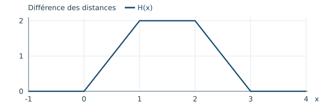
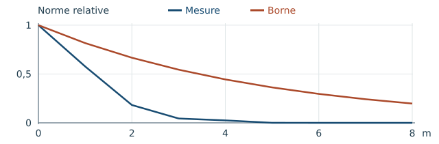

# X-ENS · PC · Mathématiques 2013 — corrigé brut

*Corrigé rédigé par IA, non officiel. Signalez toute erreur.*

**Rédaction** · GPT-6.2 Astra Ultra · vitesse non renseignée · 25 novembre 2026

La norme du problème est celle de Frobenius. Une rotation de Jacobi dans le plan $(p,q)$ transforme $S$ en $R^{\mathsf T}SR$ et annule la case $s_{pq}$. On tire de cette opération locale une preuve de convergence vers les valeurs propres.

## Partie 1 · Rotations et norme de Frobenius

### Question 1 · Interprétation géométrique

Dans $\mathbb R^3$, $R_{pq}(\theta)$ est la rotation qui fixe la droite portée par le vecteur de base d'indice restant. Dans le plan orienté $(e_p,e_q)$, elle tourne de $\theta$ et envoie $e_p$ sur $\cos\theta\,e_p+\sin\theta\,e_q$. L'axe orienté compatible est $e_p\times e_q$.

### Question 2 · Orthogonalité

Le bloc de rotation de taille deux a des colonnes orthonormées par $\cos^2\theta+\sin^2\theta=1$. Sur le complément la matrice est l'identité, sans couplage. Donc $R^{\mathsf T}R=I_n$ pour toute dimension et $R$ est orthogonale.

### Question 3 · Conjugaison orthogonale

$(R^{\mathsf T}SR)^{\mathsf T}=R^{\mathsf T}S^{\mathsf T}R=R^{\mathsf T}SR$. De plus $R^{\mathsf T}=R^{-1}$, donc la nouvelle matrice est semblable à $S$ par définition.

### Question 4 · Isométrie à gauche et à droite

La cyclicité de la trace et les identités d'orthogonalité donnent
\[
\|UAV\|^2=\mathrm{Tr}(V^{\mathsf T}A^{\mathsf T}U^{\mathsf T}UAV)
=\mathrm{Tr}(A^{\mathsf T}AVV^{\mathsf T})=\|A\|^2.
\]
Prendre les racines carrées.

### Question 5 · Fonction à quatre valeurs absolues

Notons $H(x)=|x-a|-|x-b|-|x-c|+|x-d|$. Avec $a+d=b+c$, on trouve successivement $0$, $2(x-a)$, $2(b-a)$, $2(d-x)$, $0$ sur les intervalles découpés par $a,b,c,d$. Les expressions concordent aux bornes puisque $b-a=d-c$. La fonction est positive au sens large, croissante puis constante puis décroissante entre ses deux zones nulles.

## Partie 2 · Suppression d'un coefficient hors diagonale

### Question 6 · Somme des deux diagonales

La trace est conservée par similitude. Pour $k\notin\{p,q\}$ on a $Re_k=e_k$, d'où $s'_{kk}=s_{kk}$. Leur retrait dans la trace laisse $s'_{pp}+s'_{qq}=s_{pp}+s_{qq}$.

### Question 7 · Formules de mise à jour

Notons $a=s_{pp},d=s_{qq},b=s_{pq}$, $c=\cos\theta$, $s=\sin\theta$. Pour $i,j\notin\{p,q\}$, $s'_{ij}=s_{ij}$. Si $i\notin\{p,q\}$,
\[
s'_{ip}=c s_{ip}+s s_{iq},\quad s'_{iq}=-s s_{ip}+c s_{iq}.
\]
Les entrées transposées sont égales. Dans le bloc,
\[
a'=c^2a+2csb+s^2d,\quad d'=s^2a-2csb+c^2d,\quad
b'=(c^2-s^2)b+cs(d-a).
\]

### Question 8a · Équation pour la tangente

Le cosinus est strictement positif sur l'intervalle choisi. Avec $t=s/c$, diviser $b'$ par $c^2$ donne $b(1-t^2)+(d-a)t$. Comme $b\ne0$, l'annulation est équivalente à $t^2+(a-d)t/b-1=0$.

### Question 8b · Choix de la rotation

Les deux racines réelles sont de signes opposés, de produit $-1$. Sauf lorsqu'elles valent $\pm1$, l'une a module strictement inférieur à un, l'autre strictement supérieur. Dans le cas d'égalité, $+1$ appartient à $]-1,1]$ et $-1$ en est exclu. Les angles $\arctan t_0,\arctan t_1$ diffèrent en valeur absolue de $\pi/2$, puisque les vecteurs $(1,t_0),(1,t_1)$ sont orthogonaux.

### Question 8c · Déplacements diagonaux

Le premier axe tourné, proportionnel à $(1,t)$ dans le bloc, est propre pour ce bloc puisque le coefficient croisé s'annule. Sa valeur propre est $a+bt$, lue sur la première coordonnée. Ainsi $a'-a=bt$, et 6 donne $d'-d=-bt$.

### Question 8d · Énergie hors diagonale

Pour chaque $i\notin\{p,q\}$, la somme $(s'_{ip})^2+(s'_{iq})^2$ est inchangée par la rotation de la paire. De même pour les entrées transposées. Seules les deux positions $pq,qp$ disparaissent du bilan. Ainsi $\|E'\|^2=\|E\|^2-2b^2$.

### Question 8e · Énergie diagonale

La question 4 assure $\|S'\|^2=\|S\|^2$. Les supports des parties diagonale et hors diagonale sont disjoints, donc $\|D\|^2+\|E\|^2=\|D'\|^2+\|E'\|^2$. Par 8d, $\|D'\|^2=\|D\|^2+2b^2$.

### Question 9 · Calcul à partir du seul pivot

Une fois la racine choisie, $c=(1+t^2)^{-1/2}$ est imposé par $c>0$ et $s=tc$. Substituer dans les formules de 7, ou utiliser 8c sur la diagonale, détermine chaque entrée sans aucune ambiguïté angulaire.

### Question 10a · Contraction du pivot maximal

Il y a $n(n-1)$ entrées hors diagonale de modules au plus $|b|$. Donc $\|E\|^2\le n(n-1)b^2$. Avec 8d,
\[
\|E'\|\le \rho\|E\|,\qquad \rho=\sqrt{1-\frac{2}{n(n-1)}}<1.
\]
Pour $n=2$ on a $\rho=0$.

### Question 10b · Variation de la diagonale

Pour la petite racine $|t_0|\le1$, on a $\|D'-D\|^2=2t_0^2 b^2\le2b^2\le\|E\|^2$. La dernière inégalité compte les deux copies du pivot.

### Question 11 · Écart des deux diagonales

Les identités de trace et d'énergie donnent
\[
(d'-a')^2=2((d')^2+(a')^2)-(d'+a')^2=(d-a)^2+4b^2.
\]
Le carré de l'écart augmente de $4b^2$ et sa valeur absolue croît.

### Question 12a · Sens des déplacements

Si $a\ne d$ alors $|t_0|<1$, et l'équation de 8a donne $(a-d)b t_0=b^2(1-t_0^2)>0$. Donc $a-a'=d'-d=-bt_0$ a le signe de $d-a$. Si $a=d$, $t_0=1$ et les déplacements valent $-b$, tandis que $d-a=0$ : l'assertion littérale « de même signe » requiert cette exception. Les deux nouvelles valeurs sont alors $a+b$ et $a-b$ et encadrent encore la valeur initiale.

### Question 12b · Élargissement de l'intervalle

Ordonner les deux anciennes valeurs en $b_1\le c_1$ et les nouvelles en $a_1\le d_1$. Par 12a, $a_1\le b_1\le c_1\le d_1$, également si $a=d$. La trace impose $a_1+d_1=b_1+c_1$. La question 5 avec $x=s_{ii}$ donne l'inégalité demandée pour tout $i$.

### Question 13 · Dispersion des termes diagonaux

Dans $R'-R$, les couples sans $p,q$ ont contribution nulle. Pour $i$ extérieur, la contribution des couples $(i,p),(i,q),(p,i),(q,i)$ est non négative par 12b. Les deux couples $(p,q),(q,p)$ apportent $2(|d'-a'|-|d-a|)=2(|d'-d|+|a'-a|)$, car la paire s'écarte vers l'extérieur, y compris quand $a=d$. Ceci établit la majoration voulue de $2\sum_i|s'_{ii}-s_{ii}|$ par $R'-R$.

## Partie 3 · Choix des pivots encore libre

### Question 14 · Variation totale finie

À chaque pas, 13 donne $2\varepsilon_m\le R_{m+1}-R_m$. Or $|\sigma^{(m)}_{ii}|\le\|\Sigma^{(m)}\|=\|\Sigma\|$, donc $R_m\le2n^2\|\Sigma\|$. Les sommes partielles de $\sum\varepsilon_m$ sont croissantes et, par télescopage, bornées par $(2n^2\|\Sigma\|-R_0)/2$. La série converge. En cas de matrice déjà diagonale on la laisse fixe.

### Question 15 · Limite des diagonales

Pour $k>m$, $|\sigma_{ii}^{(k)}-\sigma_{ii}^{(m)}|\le\sum_{j=m}^{k-1}\varepsilon_j$. Le reste de la série convergente tend vers zéro. Chaque suite diagonale est de Cauchy dans $\mathbb R$ ; la convergence des $n$ coordonnées donne celle de $D^{(m)}$ vers une diagonale $D$.

## Partie 4 · Identification spectrale d'une limite diagonale

### Question 16 · Transitivité de la similitude

Par hypothèse $A^{(m+1)}=P_m^{-1}A^{(m)}P_m$. L'induction donne $A^{(m)}=(P_0\cdots P_{m-1})^{-1} A^{(0)}(P_0\cdots P_{m-1})$. Le produit est inversible, y compris au rang zéro où il vaut l'identité.

### Question 17 · Continuité des coefficients

Dans la formule de Leibniz pour $\det(XI-A)$, chaque coefficient de $X^k$ est un polynôme en les entrées de $A$. Les entrées convergeant, tous les coefficients convergent vers ceux de $\chi_D$. Par 16 chaque $\chi_{A^{(m)}}=\chi_{A^{(0)}}$. Leur limite coefficient par coefficient est donc $\chi_D=\chi_{A^{(0)}}$.

### Question 18 · Multiplicités

Comme $D$ est diagonale, $\chi_D(X)=\prod_i(X-d_{ii})$. Les $d_{ii}$ sont donc les valeurs propres de $A^{(0)}$ répétées chacune selon sa multiplicité algébrique. La convergence seule des matrices semblables dans cette partie générale ne garantit pas que $A^{(0)}$ soit diagonalisable.

## Partie 5 · Méthode de Jacobi à pivot maximal

### Question 19 · Convergence de la matrice entière

Tant que $E^{(m)}\ne0$, choisir un pivot maximal en module. Par 10a, $\|E^{(m)}\|\le\rho^m\|E^{(0)}\|\to0$ ; si l'algorithme s'arrête, prolonger la suite par la matrice diagonale atteinte. Avec la convergence diagonale de 15 on obtient $\Sigma^{(m)}\to D$.

### Question 20 · Valeurs propres obtenues

Les rotations sont des conjugaisons orthogonales, donc toutes les matrices sont semblables. Par 19 et 18, les entrées de $D$ donnent le spectre de $\Sigma$ avec ses multiplicités, dans un ordre qui dépend des pivots.

### Question 21 · Contrôle d'erreur

En télescopant les différences diagonales, 10b et 19 donnent
\[
\|D-D^{(m)}\|\le\sum_{j=m}^{\infty}\|D^{(j+1)}-D^{(j)}\|
\le\sum_{j=m}^{\infty}\rho^j\|E^{(0)}\|
=\frac{\rho^m}{1-\rho}\|E^{(0)}\|.
\]
Pour $n=2$, la première rotation donne directement la diagonale, et la formule au rang zéro s'interprète avec $\rho^0=1$.

### Question 22 · Vitesse garantie

Chaque erreur diagonale est majorée par la norme de 21. Pour $n\ge3$, la borne donne au moins une convergence géométrique de rapport majorant $\rho$, avec un nombre d'itérations suffisant d'ordre $\log(1/\eta)/|\log\rho|$ à dimension et matrice fixées pour une tolérance $\eta$. C'est une garantie globale ; elle n'établit pas un taux exact. Le sujet signale un régime quadratique plus rapide en spectre simple. En dimension deux, un pas suffit.
