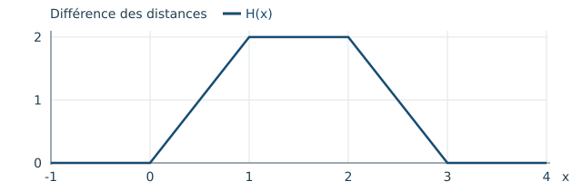
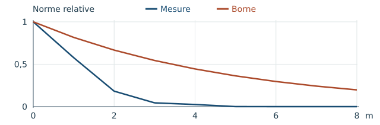

# X-ENS · PC · Mathématiques 2013 — corrigé guidé

*Corrigé rédigé par IA, non officiel. Signalez toute erreur.*

**Rédaction** · GPT-6.2 Astra Ultra · vitesse non renseignée · 25 novembre 2026

Une rotation modifie un bloc de deux lignes et deux colonnes. Le premier dessin explique comment les deux diagonales s’écartent ; le second suit la norme hors diagonale pendant l’algorithme. Les multiplicités et le cas d’égalité des deux diagonales sont traités explicitement.

## Partie 1 · Rotations et norme de Frobenius

### Question 1 · Interprétation géométrique

Repérez la colonne que la matrice laisse intacte : elle donne l'axe fixe. Dans les deux autres directions on lit la matrice usuelle de rotation. Le sens de l'angle se lit en suivant l'image de $e_p$ vers $e_q$ pour les petits angles positifs.

### Question 2 · Orthogonalité

Les colonnes hors du plan choisi sont celles de l'identité et orthogonales aux deux colonnes modifiées. Les deux colonnes modifiées ont chacune norme un et leur produit scalaire est nul. Or $R^{\mathsf T}R$ rassemble tous ces produits.

### Question 3 · Conjugaison orthogonale

Pour tester la symétrie, transposez les trois facteurs dans l'ordre inverse. Pour la similitude, reconnaissez la transposée de la rotation comme son inverse. Ce deuxième argument explique la conservation ultérieure du spectre.

### Question 4 · Isométrie à gauche et à droite

La norme au carré est la somme des carrés des normes des colonnes. Multiplier à gauche par une matrice orthogonale conserve chacune de ces normes. En transposant, la même justification traite la multiplication à droite, car la somme des carrés des entrées est inchangée par transposition.

### Question 5 · Fonction à quatre valeurs absolues

À gauche de $a$, les quatre valeurs absolues s'ouvrent vers la gauche et les constantes se compensent. En franchissant $a,b,c,d$, la pente change de $+2,-2,-2,+2$ respectivement. Le graphe monte donc de $0$ à $2(b-a)$, reste horizontal, puis redescend jusqu'à zéro puisque les deux rampes ont même largeur. Cela couvre aussi les intervalles réduits à un point.

## Partie 2 · Suppression d'un coefficient hors diagonale

### Question 6 · Somme des deux diagonales

Regardez les directions que la rotation fixe. Sur ces vecteurs de base la forme quadratique garde sa valeur, donc toutes les diagonales sauf deux restent pareilles. La trace totale étant conservée, les deux termes restants gardent leur somme.

### Question 7 · Formules de mise à jour

Écrivez $s'_{ij}=\langle Re_i,SRe_j\rangle$. Hors des indices $p,q$, rien ne bouge. Une seule colonne modifiée remplace la paire $(s_{ip},s_{iq})$ par $(c s_{ip}+s s_{iq},-s s_{ip}+c s_{iq})$. Pour les deux colonnes modifiées, développez la forme sur $(c,s)$ et $(-s,c)$. Les deux carrés donnent $ac^2+2bcs+ds^2$ et $as^2-2bcs+dc^2$, le croisé donne $b(c^2-s^2)+(d-a)cs$. La symétrie fournit la moitié inférieure.

### Question 8a · Équation pour la tangente

Commencez par l'entrée croisée trouvée en 7. Les trois groupes $c^2,s^2,cs$ deviennent $1,t^2,t$ après division par $c^2$. Déplacez les termes et divisez par le pivot $b$ pour obtenir le trinôme annoncé.

### Question 8b · Choix de la rotation

Le terme constant du trinôme donne immédiatement $t_1=-1/t_0$. Les deux choix représentent donc deux directions perpendiculaires dans le plan. Au cas limite $a=d$, les angles sont $\pi/4$ et $-\pi/4$, et la convention semi-ouverte retient la racine positive.

### Question 8c · Déplacements diagonaux

Après suppression du terme mixte, la première colonne de la rotation définit une direction propre du bloc. Appliquez $\left(\begin{smallmatrix}a&b\\b&d\end{smallmatrix}\right)$ au vecteur $(1,t)$ et regardez seulement la première coordonnée. L'autre valeur diagonale est alors imposée par la trace.

### Question 8d · Énergie hors diagonale

Regroupez les entrées hors diagonale par paires qui tournent ensemble. Leur carré de norme est conservé. Le seul terme que ces paires ne comptent pas est le pivot, présent deux fois par symétrie et remplacé par zéro.

### Question 8e · Énergie diagonale

La conjugaison orthogonale conserve la somme des carrés de toutes les entrées. La décomposition par positions distingue exactement deux parts. Tout ce que perd la partie hors diagonale, soit $2b^2$, est gagné par l'autre part.

### Question 9 · Calcul à partir du seul pivot

La tangente à elle seule laisse en général un choix de signe pour le cosinus. Ici l'angle est compris entre $-\pi/2$ et $\pi/2$, ce qui lève ce choix. Posez $c=1/\sqrt{1+t^2}$ et $s=t/\sqrt{1+t^2}$ puis mettez à jour les paires de 7.

### Question 10a · Contraction du pivot maximal

Chaque carré hors diagonale est au plus le carré du pivot maximal. La perte $2b^2$ représente ainsi au moins la fraction $2/[n(n-1)]$ du total. Le facteur de contraction de la norme est la racine carrée de la fraction restante et dépend seulement de la dimension.

### Question 10b · Variation de la diagonale

Seuls deux termes de la diagonale se déplacent, de quantités opposées $bt_0$ et $-bt_0$. Leur coût en norme de Frobenius est $\sqrt2|bt_0|$. La norme hors diagonale contient déjà $\sqrt2|b|$.

### Question 11 · Écart des deux diagonales

Pour deux nombres, connaître la somme et la somme des carrés suffit à connaître le carré de la différence. La somme est fixe et la somme des carrés augmente de $2b^2$ par 8e. La différence au carré augmente donc de $4b^2$.

### Question 12a · Sens des déplacements

La petite racine protège l'ordre des deux diagonales dès qu'elles sont distinctes. Multipliez son équation par le carré du pivot pour obtenir le signe du produit $(a-d)b t_0$. Il est strictement positif si $a\ne d$. À égalité, le choix $t_0=1$ ouvre la paire symétriquement autour de l'ancienne valeur ; les déplacements non nuls ne peuvent avoir le même signe que zéro au sens strict de l'énoncé.

### Question 12b · Élargissement de l'intervalle

Les deux nouvelles diagonales encadrent toutes deux l'ancien intervalle au sens où leur minimum descend et leur maximum monte, sans changer leur centre. Placez ces quatre nombres dans l'ordre sur le dessin de 5. La hauteur de ce dessin au point $s_{ii}$ est exactement la différence à montrer positive.

### Question 13 · Dispersion des termes diagonaux

Séparez les distances dans la somme double. Les points fixes ne modifient pas leurs distances mutuelles. Pour chacun d'eux, la somme des distances aux deux points mobiles ne diminue pas grâce à 12b. La distance entre les deux points mobiles gagne exactement les deux déplacements absolus et elle est comptée deux fois.

## Partie 3 · Choix des pivots encore libre

### Question 14 · Variation totale finie

La dispersion additionne des distances positives mais ne peut dépasser une constante : la norme de la matrice ne change jamais. En sommant les gains successifs de dispersion, tous les termes intermédiaires s'annulent. La somme des variations diagonales est ainsi finie, sans supposer que les pivots sont maximaux.

### Question 15 · Limite des diagonales

Une suite peut encore osciller avec des pas tendant vers zéro ; ici la somme de toutes les amplitudes restantes tend vers zéro. Cette borne uniforme sur les variations futures est le critère de Cauchy. Appliquez-le séparément à chaque case diagonale.

## Partie 4 · Identification spectrale d'une limite diagonale

### Question 16 · Transitivité de la similitude

Composez les changements de base successifs dans leur ordre d'application. Un produit de matrices inversibles reste inversible. La similitude à la matrice de départ suit ainsi à chaque étape.

### Question 17 · Continuité des coefficients

Développez le déterminant comme une somme finie sur les permutations. Extraire une puissance de $X$ n'utilise que des additions et multiplications d'entrées. Cela justifie le passage à la limite pour chaque coefficient. Or cette suite de coefficients était constante par similitude.

### Question 18 · Multiplicités

Pour lire la multiplicité d'une valeur $\lambda$, comptez ses occurrences sur la diagonale limite. C'est l'exposant du facteur $X-\lambda$ dans le polynôme commun. Il s'agit de multiplicité algébrique ; dans l'application à des matrices symétriques, le théorème spectral donne également la multiplicité géométrique correspondante.

## Partie 5 · Méthode de Jacobi à pivot maximal

### Question 19 · Convergence de la matrice entière

La preuve de 15 ne contrôlait que les cases diagonales. Le pivot maximal garantit maintenant que l'on retire à chaque étape une proportion fixe de l'énergie résiduelle. En itérant, le hors-diagonale disparaît et la matrice rejoint la limite déjà connue des diagonales.

### Question 20 · Valeurs propres obtenues

La convergence donne une matrice diagonale ; l'identification de ses termes nécessite la conservation du polynôme caractéristique. Les deux conditions de la partie 4 sont à présent satisfaites. On obtient toutes les valeurs propres, sans imposer d'ordre de tri.

### Question 21 · Contrôle d'erreur

Une diagonale déjà proche de sa limite peut encore se déplacer. Additionnez l'amplitude maximale de tous ses déplacements à venir. La question 10b les borne par les normes hors diagonale, elles-mêmes dominées par la suite géométrique de 19. La somme de sa queue donne exactement le facteur indiqué.

### Question 22 · Vitesse garantie

La borne multiplie son majorant par $\rho<1$ à chaque itération. À dimension fixée, obtenir des chiffres supplémentaires demande donc au plus un nombre d'étapes proportionnel à leur nombre. Le graphe de l'exemple descend plus vite que cette enveloppe. L'estimation démontrée ne permet pas à elle seule de conclure au régime quadratique mentionné dans la remarque finale du sujet.
