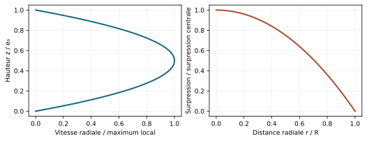
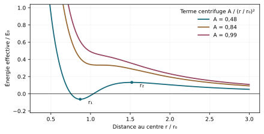

# X–ENS PC 2013 — Physique B (XELC) · Corrigé guidé

*Corrigé rédigé par IA, non officiel. Signalez toute erreur.*

**Lecture du rapport du jury** · GPT-6.2 Astra Ultra · vitesse non renseignée

**Rédaction** · GPT-6.2 Astra Ultra · vitesse non renseignée

## Gouttes en caléfaction

## 1. Forme de la goutte et épaisseur du film

### Question 1.a — Énergie des interfaces

**Indication.** Compter la face inférieure, séparée de la plaque par de la vapeur, aussi bien que la face supérieure.

L’unité de $\gamma$ est $\mathrm{J\,m^{-2}}=\mathrm{N\,m^{-1}}$, de dimension $M T^{-2}$. Pour un cylindre, l’aire des deux faces et du bord vaut $2\pi R^2+2\pi Rh$. En éliminant $R$ à volume fixé, $E_s=2\gamma[\Omega/h+\sqrt{\pi\Omega h}]$.

### Question 1.b — Énergie de pesanteur

**Indication.** Placer le centre de masse du cylindre à mi-hauteur.

La masse vaut $\rho_l\Omega$. En prenant pour origine d’altitude la base du palet, on obtient $E_g=\rho_l\Omega gh/2$. Prendre la plaque comme origine ajouterait $\rho_l\Omega g e_0$, indépendant de $h$ pour un film fixé.

### Question 1.c — Épaisseur d’équilibre

**Indication.** Minimiser à volume fixé en négligeant la surface latérale devant les deux grandes faces.

Le rapport de la surface latérale à celle des deux faces est $h/R\ll1$, d’où $E_p\simeq\rho_l\Omega gh/2+2\gamma\Omega/h$. La dérivée s’annule pour $h_e^2=4\gamma/(\rho_lg)$ et la dérivée seconde est positive. Avec les données $\ell_c=\sqrt{\gamma/(\rho_lg)}\simeq2{,}5\ \mathrm{mm}$ et $h_e=2\ell_c\simeq5\ \mathrm{mm}$.

### Question 1.d — Origine du motif optique

**Indication.** Identifier la direction dans laquelle l’ouverture limite le faisceau.

Le passage de faible hauteur entre goutte et plaque tronque le front d’onde. Les contributions cohérentes de ses différents points interfèrent et produisent une figure de diffraction qui s’étale verticalement, perpendiculairement à la fente.

### Question 1.e — Intensité diffractée

**Indication.** Additionner les amplitudes des sources secondaires sur toute la hauteur $e_0$.

À l’angle $\theta$, deux points d’altitudes séparées de $z$ ont une différence de marche $z\sin\theta$. En champ lointain $A(\theta)\propto\int_{-e_0/2}^{e_0/2}\exp(2\pi i z\sin\theta/\lambda_L)dz$. Ainsi $I=I(0)[\sin u/u]^2$ avec $u=\pi e_0\sin\theta/\lambda_L\simeq\pi e_0 y/(\lambda_L X)$, où $y$ est l’ordonnée par rapport au centre de la figure. L’écart entre deux minima successifs d’un même côté est $\delta y=\lambda_L X/e_0$.

### Question 1.f — Lecture de la figure 2b

**Indication.** Étalonner le cliché à l’aide du segment de 10 mm puis mesurer l’espacement des minima secondaires.

La distance indiquée entre deux franges voisines vaut environ le tiers du segment de $10\ \mathrm{mm}$, soit $\delta y\simeq3\ \mathrm{mm}$. Il vient $e_0\sim(6{,}33\times10^{-7})(0{,}50)/(3\times10^{-3})\sim10^{-4}\ \mathrm m$. La lecture au millimètre suffit à fixer cet ordre de grandeur.

### Question 1.g — Autres mesures de l’épaisseur

**Indication.** Rechercher une grandeur géométrique ou une différence de marche directement sensible à la hauteur.

Une image latérale agrandie et étalonnée en longueur fournit la distance entre le bas de la goutte et le plan de la plaque. Une analyse interférométrique des réflexions aux deux interfaces fournit une différence de marche proche de $2n_v e_0$ à incidence normale. Dans ce dernier cas, un spectre en plusieurs longueurs d’onde permet de lever l’ambiguïté d’ordre.

## 2. Énergie, écoulement et temps de vie

### Question 2.a — Direction du gradient thermique

**Indication.** Comparer l’épaisseur du film à la longueur de variation horizontale.

Les faces isothermes sont séparées de $e_0\ll R$. Loin du bord la géométrie et les températures présentent une invariance horizontale locale. Les dérivées verticales dominent et on écrit $T=T(z)$ à l’ordre principal.

### Question 2.b — Bilan local d’énergie

**Indication.** Soustraire le flux sortant d’une tranche au flux entrant par sa base.

Sur une section $A$, la conservation donne $\rho_v c_p A\,dz\,\partial_tT=A[q_z(z)-q_z(z+dz)]$ dans le modèle conductif. Avec $q_z=-\lambda\partial_zT$ et $\lambda$ uniforme, $\rho_vc_p\partial_tT=\lambda\partial_z^2T$. En régime stationnaire $T''=0$.

### Question 2.c — Température dans le film

**Indication.** Raccorder la solution affine aux deux températures imposées.

La goutte est en équilibre local avec sa vapeur à une pression voisine de l’atmosphère, donc $T_e\simeq100\,^\circ\mathrm C$. Avec $z=0$ sur la plaque et $z=e_0$ sous le liquide, $T(z)=T_p-(T_p-T_e)z/e_0$.

### Question 2.d — Puissance transmise au liquide

**Indication.** Multiplier la densité de flux de Fourier par l’aire de la base.

Le flux surfacique dirigé vers le haut vaut $q_z=\lambda\Delta T/e_0$. La puissance thermique reçue est $\Phi=q_z\pi R^2=\pi R^2\lambda\Delta T/e_0$, exprimée en watts.

### Question 2.e — Débit d’évaporation et premier temps caractéristique

**Indication.** Employer le débit de masse positif de vapeur et l’enthalpie de vaporisation.

À température constante $L\dot m=\Phi$, donc $\dot m=\pi R^2\lambda\Delta T/(Le_0)$. Pour $R=1\ \mathrm{cm}$, $\Delta T=200\ \mathrm K$ et $e_0\sim100\ \mu\mathrm m$, $\dot m\simeq7\times10^{-6}\ \mathrm{kg\,s^{-1}}$. La masse initiale $\rho_l\pi R^2h_e\simeq1{,}5\ \mathrm g$ donne $\tau_{\rm est}=m(0)/\dot m(0)\sim2\times10^2\ \mathrm s$, quelques minutes en supposant le débit initial constant.

### Question 2.f — Termes de Navier–Stokes

**Indication.** Identifier des forces ou variations de quantité de mouvement par unité de volume.

Le terme $\rho_v\partial_t\mathbf v$ mesure l’accélération locale et $\rho_v(\mathbf v\cdot\nabla)\mathbf v$ l’accélération due au transport dans un champ non uniforme. À droite $\rho_v\mathbf g$ représente le poids volumique, $-\nabla p$ la résultante volumique des pressions, et $\eta\Delta\mathbf v$ la diffusion visqueuse de quantité de mouvement.

### Question 2.g — Composante orthoradiale

**Indication.** Appliquer une réflexion dans un plan vertical passant par l’axe.

Le forçage, les interfaces immobiles et l’alimentation en vapeur sont invariants par cette réflexion, alors que la composante azimutale changerait de signe. En l’absence de rotation imposée et pour l’écoulement symétrique étudié, $v_\theta=0$.

### Question 2.h — Composantes radiale et verticale

**Indication.** Écrire la continuité cylindrique et identifier une longueur horizontale et une verticale.

Avec $v_\theta=0$, $(1/r)\partial_r(rv_r)+\partial_z v_z=0$. En ordre de grandeur $V/R\sim V_z/e_0$, donc $V_z/V\sim e_0/R\ll1$. La faible composante verticale reste nécessaire pour alimenter l’écoulement radial.

### Question 2.i — Échelle de vitesse de fuite

**Indication.** Ne pas confondre le volume de liquide évaporé et le volume de vapeur produit.

Si la masse $m\sim\rho_l\pi R^2h_e$ s’évapore en un temps $\tau$, le débit volumique sortant est $m/(\rho_v\tau)$. Le passage périphérique ayant l’aire $2\pi R e_0$, $V\sim\rho_l R h_e/(2\rho_v e_0\tau)$. Pour $R=10^{-2}\ \mathrm m$, $h_e\sim5\ \mathrm{mm}$, $e_0=10^{-4}\ \mathrm m$ et quelques centaines de secondes, $V$ est de l’ordre du mètre par seconde.

### Question 2.j — Inertie dans le film

**Indication.** Conserver les dérivées radiale et verticale du terme convectif.

Les deux termes $v_r\partial_rv_r$ et $v_z\partial_zv_r$ ont respectivement pour échelles $V^2/R$ et $(Ve_0/R)(V/e_0)=V^2/R$. La force d’inertie volumique est donc d’ordre $\rho_vV^2/R$.

### Question 2.k — Dissipation visqueuse dominante

**Indication.** Comparer les dérivées secondes sur les échelles $R$ et $e_0$.

Les variations de $v_r$ entre les faces donnent $\partial_z^2v_r\sim V/e_0^2$, contre $V/R^2$ pour les variations radiales. Comme $e_0\ll R$, la force visqueuse volumique a pour échelle $\eta V/e_0^2$.

### Question 2.l — Rapport inertie sur viscosité

**Indication.** Former le rapport des deux forces calculées pour cette géométrie mince.

Le rapport pertinent vaut $\mathrm{Re}_{\rm film}=\rho_v V e_0^2/(\eta R)$, soit environ $5\times10^{-2}$ pour $V\sim1\ \mathrm{m\,s^{-1}}$. C’est le Reynolds fondé sur $e_0$ multiplié par $e_0/R$. L’inertie est faible et le terme instationnaire est nul. En absorbant la pression hydrostatique de vapeur dans $p$, ou en négligeant sa variation sur le film, on obtient $\nabla p=\eta\Delta\mathbf v$.

### Question 2.m — Indépendance en azimut

**Indication.** Examiner cette fois les rotations autour de l’axe et la forme des conditions aux limites.

Le contour circulaire, l’épaisseur et la production homogène de vapeur demeurent identiques après toute rotation autour de $z$. Les composantes cylindriques de la solution symétrique sont donc indépendantes de $\theta$, même si la direction du vecteur $\mathbf e_r$ varie avec l’azimut.

### Question 2.n — Projection radiale de Stokes

**Indication.** Le laplacien vectoriel de la composante radiale contient aussi un terme de courbure.

Le membre visqueux radial est $\eta[\partial_z^2v_r+(1/r)\partial_r(r\partial_rv_r)-v_r/r^2]$. À l’échelle de la goutte, les deux derniers termes sont petits dans la limite de lubrification $e_0/R\ll1$. Il reste $\partial_rp=\eta\partial_z^2v_r$.

### Question 2.o — Profil de vitesse

**Indication.** Intégrer deux fois en $z$ et utiliser l’adhérence aux deux faces assimilées à des solides.

Pour $\partial_rp$ indépendant de $z$, $v_r=(\partial_rp)z^2/(2\eta)+Az+B$. L’adhérence $v_r(0)=v_r(e_0)=0$ donne $v_r=-(\partial_rp)z(e_0-z)/(2\eta)$. La vitesse est maximale à mi-épaisseur et dirigée vers l’extérieur lorsque $\partial_rp<0$.

### Question 2.p — Débit traversant un cylindre

**Indication.** Intégrer la vitesse radiale sur la surface latérale à rayon fixé.

On trouve $Q(r)=2\pi r\int_0^{e_0}v_r\,dz$. L’intégrale du facteur $z(e_0-z)$ vaut $e_0^3/6$, ce qui donne $Q=-\pi r e_0^3\partial_rp/(6\eta)$.

### Question 2.q — Source de vapeur répartie

**Indication.** Appliquer la conservation de masse à un anneau entre $r$ et $r+dr$.

La production uniforme correspond à $j_v=\dot m/(\rho_v\pi R^2)$. L’anneau produit $2\pi r\,dr\,j_v$, donc $Q'=2\dot m r/(\rho_v R^2)$. En substituant le débit précédent, $(rp')'=-12\eta\dot m r/(\pi\rho_v R^2 e_0^3)$.

### Question 2.r — Pression sous la goutte

**Indication.** Exiger la régularité au centre et imposer la pression de l’air au bord.

L’intégration régulière donne $p'=-6\eta\dot m r/(\pi\rho_v R^2e_0^3)$, sans terme en $1/r$. Avec $p(R)=p_a$, $p(r)=p_a+[3\eta\dot m/(\pi\rho_v e_0^3)](1-r^2/R^2)$. La surpression maximale est au centre.

### Question 2.s — Pression au centre sous le palet

**Indication.** Écrire la loi hydrostatique dans le liquide entre les deux faces presque planes au centre.

La face supérieure est au contact de l’air à $p_a$. Au centre les courbures sont négligées, donc la pression y est continue à chacune des deux interfaces. En descendant de $h_e$ dans le liquide on trouve $p(0)\simeq p_a+\rho_lg h_e=p_a+2\rho_lg\ell_c$. À l’échelle recherchée la surpression est donc de l’ordre de $\rho_lg\ell_c$.

### Question 2.t — Épaisseur prédite

**Indication.** Combiner portance, débit d’évaporation et perte de charge visqueuse.

Avec $A=3\eta\dot m/(\pi\rho_v e_0^3)$ et $\dot m=\pi R^2\lambda\Delta T/(Le_0)$, on trouve $e_0=C\sqrt R$, où $C=[3\eta\lambda\Delta T/(2\rho_lg\ell_c L\rho_v)]^{1/4}$. En ne retenant que les ordres de grandeur, on retrouve la loi demandée. Pour $R=10\ \mathrm{mm}$, $e_0\simeq1{,}3\times10^{-4}\ \mathrm m$, cohérent avec la diffraction.

### Question 2.u — Perte de masse en fonction de $R$

**Indication.** Garder l’épaisseur d’équilibre constante tant que la forme de palet est valable.

À partir de $m_l=2\pi\rho_l\ell_cR^2$, on obtient $dm_l/dt=4\pi\rho_l\ell_c R\dot R$. Cette dérivée est négative et s’oppose au débit positif de vapeur $\dot m$.

### Question 2.v — Équation du rayon

**Indication.** Remplacer $e_0$ par $C\sqrt R$ dans le bilan de masse.

En égalant $-4\pi\rho_l\ell_cR\dot R$ à $\pi\lambda\Delta T R^{3/2}/(LC)$, on obtient $\dot R/\sqrt R=-\alpha$, avec $\alpha=\lambda\Delta T/(4\rho_l\ell_cLC)$. Le coefficient a la dimension $\mathrm{m^{1/2}\,s^{-1}}$.

### Question 2.w — Durée de vie et décroissance quadratique

**Indication.** Intégrer l’équation sous la forme $2\,d\sqrt R/dt=-\alpha$.

Il vient $\sqrt R=\sqrt{R_0}-\alpha t/2$ et $R=R_0(1-t/\tau)^2$ pour $0\le t\le\tau$, avec $\tau=2\sqrt{R_0}/\alpha$. Les paramètres précédents donnent $\alpha\sim1{,}7\times10^{-4}\ \mathrm{m^{1/2}\,s^{-1}}$ et $\tau\sim10^3\ \mathrm s$. Le résultat est plus long que les $2\times10^2\ \mathrm s$ de 2.e. Le débit diminue avec le rayon et, si on utilise le même film initial, la solution donne exactement $\tau=4m(0)/\dot m(0)$.

### Question 2.x — Confrontation aux points mesurés

**Indication.** Distinguer l’accord de forme aux grands rayons de l’extrapolation jusqu’à $R=0$.

Les branches expérimentales décroissent avec une pente qui s’atténue d’abord, comme le modèle. La goutte à $380\,^\circ\mathrm C$ disparaît vers $375\ \mathrm s$, plus tôt que celle à $300\,^\circ\mathrm C$ qui dure environ $470\ \mathrm s$. Les derniers points chutent en dessous des extrapolations. Lorsque $R$ devient comparable à $\ell_c$, la goutte s’arrondit, sa base et ses surfaces d’échange changent. La loi dérivée pour un palet large ne décrit plus cette fin de vie.

## 3. Mouvement d’une goutte paramagnétique

### Question 3.a — Énergie d’un petit volume

**Indication.** Intégrer la densité d’énergie en traitant le champ comme uniforme dans la goutte.

L’intégrale sur la goutte donne $E_{\rm mag}=-\chi\Omega B^2/(2\mu_0)$. Cette approximation exige une taille petite devant la longueur de variation spatiale de $B$.

### Question 3.b — Direction de la force

**Indication.** Prendre l’opposé du gradient de l’énergie potentielle.

La force est $\mathbf F=(\chi\Omega/2\mu_0)\nabla B^2$. Pour l’oxygène paramagnétique, $\chi>0$ et la goutte est attirée vers la région de champ le plus intense, quel que soit le signe du champ.

### Question 3.c — Champ équatorial de l’aimant

**Indication.** Placer la goutte dans le plan équatorial du dipôle idéal.

Dans ce plan $\mathbf M\cdot\mathbf e_r=0$. La formule dipolaire donne $\mathbf B=-\mu_0 M\mathbf e_z/(4\pi r^3)$, opposé au moment, de norme décroissant comme $r^{-3}$. Il s’agit d’un modèle de champ lointain. Le décalage vertical entre la plaque et l’aimant est négligé dans cette expression.

### Question 3.d — Énergie dans l’approximation dipolaire

**Indication.** L’énergie d’un dipôle induit est proportionnelle au carré du champ extérieur.

La substitution donne $E_{\rm mag}(r)=-\chi\Omega\mu_0M^2/(32\pi^2r^6)$. La force associée est attractive et décroît en $r^{-7}$.

### Question 3.e — Régularisation aux petites distances

**Indication.** Comparer les limites $r\ll r_0$ et $r\gg r_0$ de la loi empirique.

Un aimant réel a des dimensions finies et reste à une distance verticale non nulle de la goutte. Le champ et l’énergie sont finis en $r=0$. La loi $-E_0/[1+(r/r_0)^6]$ vaut alors $-E_0$ et retrouve en champ lointain $-E_0r_0^6/r^6$, en accord avec le dipôle.

### Question 3.f — Énergie mécanique

**Indication.** Écrire la vitesse en coordonnées polaires et choisir l’énergie magnétique nulle à l’infini.

À une constante verticale près, $E_m=\tfrac12m(\dot r^2+r^2\dot\theta^2)+E_{\rm mag}(r)$. Au départ très loin, le champ est négligeable, donc $E_m=mV_0^2/2$.

### Question 3.g — Pourquoi l’énergie est conservée

**Indication.** Examiner séparément le travail de la force magnétique et celui des efforts non conservatifs.

Le champ est fixe et la force magnétique dérive d’un potentiel. La réaction de sustentation et le poids sont verticaux tandis que le déplacement est horizontal. Le film limite les frottements et la masse varie peu pendant le mouvement considéré. Dans ces approximations $E_m$ est constante.

### Question 3.h — Conservation du moment cinétique

**Indication.** Prendre le moment des forces par rapport au centre de l’aimant dans le plan horizontal.

La résultante horizontale est centrale et son moment est nul. Le moment cinétique normal au plan vaut $L_z=mr^2\dot\theta$, constant et initialement de module $mbV_0$, car le bras de levier à grande distance est $b$. Son signe dépend du côté par lequel la goutte passe.

### Question 3.i — Potentiel effectif radial

**Indication.** Éliminer $\dot\theta$ de l’énergie avec le moment cinétique conservé.

En remplaçant $\dot\theta=L_z/(mr^2)$, $E_m=\tfrac12m\dot r^2+U_{\rm eff}(r)$ avec $U_{\rm eff}=mb^2V_0^2/(2r^2)+E_{\rm mag}(r)$. Le mouvement n’est possible que si $U_{\rm eff}\le E_m$.

### Question 3.j — Allure des courbes

**Indication.** Comparer le terme centrifuge et le puits magnétique, puis augmenter $b$ à vitesse fixée.

Pour $b>0$ le terme centrifuge diverge à l’origine et domine aussi en champ lointain, où le potentiel tend vers zéro par valeurs positives. Pour $b$ petit la compétition avec l’attraction crée un minimum interne puis un maximum externe. Augmenter $b$ élève la barrière centrifuge. Au seuil $b^\star$ les deux extrema fusionnent en un point stationnaire d’inflexion, puis la courbe devient monotone.

### Question 3.k — États liés

**Indication.** Tracer le niveau d’énergie et repérer la composante accessible depuis l’infini.

Une trajectoire lancée depuis l’infini est déjà non bornée. Elle diffuse normalement vers l’infini après un point de rebroussement, avec une séparatrice critique qui s’approche asymptotiquement d’une orbite circulaire. D’autres conditions initiales, dans le puits interne entre deux points de rebroussement, donnent des mouvements liés. Un niveau sous le sommet de la barrière peut confiner la goutte même si son énergie est positive.

### Question 3.l — Orbites circulaires

**Indication.** Exiger à la fois une vitesse radiale nulle et une force radiale effective nulle.

Pour un moment fixé, un cercle exige $E_m=U_{\rm eff}(r_c)$ et $U_{\rm eff}'(r_c)=0$. Sous le seuil, la figure 6 donne un rayon interne $r_1$ stable (minimum) et un rayon externe $r_2$ instable (maximum). À la fusion il reste un cas critique sans minimum stable et au-dessus du seuil il n’existe aucun rayon circulaire.

### Question 3.m — Plusieurs tours avant l’éloignement

**Indication.** Rechercher où la vitesse radiale peut rester petite alors que la vitesse angulaire demeure finie.

Pour une énergie incidente très proche de $U_{\rm eff}(r_2)$, le mouvement radial ralentit longtemps près du maximum externe car $\dot r^2=2(E_m-U_{\rm eff})/m$ et la pente du potentiel s’annule. La vitesse angulaire $L_z/(mr_2^2)$ reste finie. La goutte effectue ainsi plusieurs tours près de $r_2$ avant de repartir. L’ajustement exact donne la limite asymptotique de l’orbite instable.
