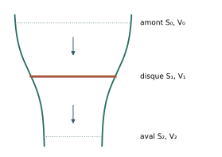
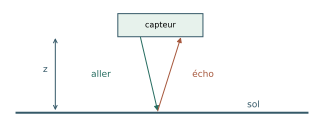
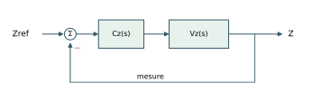
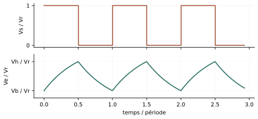
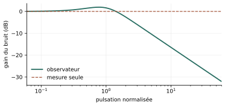

# X-ENS PSI · Modélisation 2013 · Corrigé brut

*Corrigé rédigé par IA, non officiel. Signalez toute erreur.*

**Rédaction** · GPT-6.2 Astra Ultra · vitesse non renseignée · 25 novembre 2026

**Modélisation et contrôle d’un mini-quadrirotor.** Les résultats portent sur le prototype universitaire simulé du cahier CX3612. La norme de vitesse d’une hélice est positive ; son sens de rotation est porté par $\varepsilon_i$. La variable de Laplace est $s$. La puissance demandée à la batterie est comptée positivement.

## 1 · Architecture

### Question 1 · Neuf cases du document-réponse

Dans la chaîne d’information, le champ magnétique est acquis par le magnétomètre, la position et la vitesse linéaire par le récepteur GPS, l’altitude par le capteur à ultrasons, les accélérations linéaires par l’accéléromètre et les vitesses angulaires par le gyromètre. Le libellé manquant devant les ultrasons est donc « distance au sol ». La carte électronique **traite** les informations. Dans la chaîne d’énergie, la batterie **alimente**, les variateurs **distribuent** et les moteurs **convertissent l’énergie électrique en énergie mécanique de rotation**. Les caméras et la liaison de consigne sont déjà placées sur DR1.

## 2 · Énergie au vol stationnaire

### Question 2 · Quantité de mouvement de la veine

Le débit $Q=\rho S_1V_1$ est un débit massique. Les pressions lointaines se compensent. Le bilan permanent projeté selon la verticale donne $-F=Q(-V_2+V_0)$, donc $F=Q(V_2-V_0)$. Pour $F>0$, l’air accélère vers le bas. La continuité $S_0V_0=S_2V_2$ donne $S_2<S_0$ lorsque $V_0>0$. Au stationnaire, l’amont au repos est compris comme la limite d’une surface de capture qui s’élargit.

### Question 3 · Puissance et énergie cinétique

La variation du flux d’énergie cinétique est $\tfrac12Q(V_2^2-V_0^2)$. C’est la puissance **reçue par l’air**. La puissance algébrique de l’air sur l’hélice a le signe opposé. Le sujet réutilise $P_{\rm air}$ comme quantité positive dans le bilan énergétique de la batterie. Nous notons donc $P=\lvert P_{\rm air}\rvert=\tfrac12Q(V_2^2-V_0^2)$.

### Question 4 · Vitesse dans le plan du disque

Le disque communique à l’air une force de module $F$ à la vitesse $V_1$. Ainsi $P=FV_1$. En utilisant $F=Q(V_2-V_0)$ dans le résultat précédent, on obtient $V_1=(V_2+V_0)/2$ pour une poussée non nulle. La vitesse au disque est la moyenne de celles de l’amont et de l’aval lointains.

### Question 5 · Vitesse de Froude

Avec $V_f=V_1-V_0$, on a $V_2-V_0=2V_f$ et $Q=\rho S_1(V_0+V_f)$. Par conséquent,

$$
F=2\rho S_1(V_0+V_f)V_f .
$$

En montée stationnaire dans l’air au repos au loin, au sens de la géométrie choisie, $V_0$ représente la vitesse de translation dans le référentiel du disque.

### Question 6 · Loi en puissance trois demis

Au vol stationnaire, $V_0=0$, donc $F=2\rho S_1V_f^2$. Comme $P=FV_f$, on trouve

$$
P=\frac{F^{3/2}}{\sqrt{2\rho S_1}},\qquad K=\frac1{\sqrt{2\rho S_1}} .
$$

La dépendance en $F^{3/2}$ provient du produit de la poussée par une vitesse qui croît comme sa racine carrée.

### Question 7 · Intégration sur deux pales

À la distance $\lambda$, $V^2=\lambda^2\omega_i^2$. Les traînées opposées s’annulent en résultante et les portances donnent un moment transversal total nul. Le bras de levier ajoute un facteur $\lambda$ au moment de traînée. Avec

$$
a=2\int_{r_1}^{r_2} C_z(\lambda)\lambda^2\,d\lambda,\qquad
b=2\int_{r_1}^{r_2} C_y(\lambda)\lambda^3\,d\lambda ,
$$

la résultante vaut $\operatorname{sgn}(\alpha)\operatorname{sgn}(V)a\omega_i^2\mathbf z$ et le couple $-\operatorname{sgn}(V)b\omega_i^2\mathbf z$. Les coefficients sont positifs.

### Question 8 · Sens de la figure 6

Sur la coupe, le bord d’attaque est du côté où va $\mathbf V$, l’incidence est positive et $\mathbf V$ pointe dans le sens de $\mathbf y_i$. Il s’agit du **pas à droite** dans la convention de l’énoncé. Au point $\lambda\mathbf x_i$, $\boldsymbol\Omega\times\lambda\mathbf x_i$ doit être dirigé vers $+\mathbf y_i$. Ainsi $\boldsymbol\Omega$ est dirigée selon $+\mathbf z$. Le sujet appelle ce sens « horaire » pour le choix $\varepsilon=+1$. Vu depuis le côté vers lequel pointe $+\mathbf z$, le sens positif d’une base directe apparaît antihoraire. Préciser le côté d’observation lève cette ambiguïté.

### Question 9 · Inversion du pas

Changer le pas inverse $\operatorname{sgn}(\alpha)$. Pour garder la portance ascendante, il faut aussi changer le signe de $V$, donc inverser le sens de rotation. Le signe du moment de traînée s’inverse alors, tandis que le module de la poussée pour une même vitesse reste inchangé dans ce modèle.

### Question 10 · Torseur au centre d’une hélice

Avec la convention de signe du sujet, $\boldsymbol\Omega_{i/S}=\varepsilon_i\omega_i\mathbf z$ et le pas associé donne une force ascendante. Le torseur de l’action de l’air au centre $G_i$ a pour résultante $a\omega_i^2\mathbf z$ et pour moment $-\varepsilon_i b\omega_i^2\mathbf z$. Le couple de traînée s’oppose à la rotation.

### Question 11 · Comparer les deux modèles de puissance

Au stationnaire, la puissance algébrique de l’air sur la pale vaut $(-\varepsilon_i b\omega_i^2)(\varepsilon_i\omega_i)=-b\omega_i^3$. Sa valeur absolue est $P=b(F/a)^{3/2}$. Les deux modèles donnent donc le même exposant. Le coefficient empirique $b/a^{3/2}$ s’identifie au coefficient idéal $1/\sqrt{2\rho S_1}$ seulement si les mêmes pertes et hypothèses sont retenues.

### Question 12 · Autonomie énergétique théorique

La poussée d’une hélice est $Mg/4=2{,}25\ \mathrm N$. Le cahier donne $P=(F/K')^{3/2}$ avec $K'=0{,}16$. Les quatre hélices consomment donc environ $4(2{,}25/0{,}16)^{3/2}=211\ \mathrm W$. L’énergie nominale vaut $0{,}220\times200=44\ \mathrm{Wh}$ et la durée $44/211=0{,}209\ \mathrm h$, soit **12,5 min**. L’objectif de 10 min est compatible avec ce bilan idéal. Les auxiliaires électriques et les réserves d’exploitation réduisent la durée disponible.

## 3 · Modèle mécanique et électrique

### Question 13 · Centre global et symétries

Avec $M=m_s+4m$ et $\overrightarrow{OG_s}=-h\mathbf z$, le barycentre vérifie $\overrightarrow{OG}=-(m_s/M)h\mathbf z$. Les deux plans verticaux de symétrie rendent nuls les produits d’inertie au point $G$ de cet axe. L’équivalence des bras $x,y$ par quart de tour donne $A=B$. La matrice du corps dans la base $R$ est donc $\operatorname{diag}(A,A,C)$ sous les symétries de la figure 7.

### Question 14 · Bilans extérieurs de l’ensemble

Notons $W_i=\omega_i^2$. Les deux théorèmes dynamiques au centre $G$ s’écrivent

$$
\mathbf R_D=M\mathbf g+a\sum_iW_i\mathbf z,\qquad
\boldsymbol\delta_G=al(W_2-W_4)\mathbf x+al(W_3-W_1)\mathbf y-b\sum_i\varepsilon_iW_i\mathbf z .
$$

Le décalage vertical de $G$ vis-à-vis du plan des hélices ne contribue pas au moment de leurs poussées verticales. Le poids appliqué en $G$ n’a pas de moment en ce point.

### Question 15 · Équilibre stationnaire

Les moments transversaux imposent $W_1=W_3$ et $W_2=W_4$. Avec $\varepsilon_1=\varepsilon_3=+1$, le moment axial peut être nul si les deux autres signes sont négatifs. En effet, un seul signe négatif se compenserait exactement avec le positif du même couple d’hélices opposées, laissant la contribution positive de 1 et 3. Donc $\varepsilon_2=\varepsilon_4=-1$ (pas à gauche), puis $W_1=W_2$. L’équilibre vertical donne enfin $4a\bar\omega^2=Mg$, soit $\bar\omega=\sqrt{Mg/(4a)}=375\ \mathrm{rad/s}$.

### Question 16 · Moment cinétique instantané d’une hélice

Pour $c_i=\cos\theta_i$, $s_i=\sin\theta_i$, la vitesse de rotation exprimée dans la base mobile du corps est $(p,q,r+\varepsilon_i\omega_i)$. Le moment cinétique en $G_i$ a pour composantes

$$
\begin{aligned}
\sigma_x&=(A_ic_i^2+B_is_i^2)p+(A_i-B_i)c_is_iq,\\
\sigma_y&=(A_i-B_i)c_is_ip+(A_is_i^2+B_ic_i^2)q,\\
\sigma_z&=C_i(r+\varepsilon_i\omega_i).
\end{aligned}
$$

Les termes croisés proviennent de la rotation du tenseur dans le plan des pales.

### Question 17 · Moyenne sur une révolution

Quand le corps et la norme $\omega_i$ changent peu pendant un tour, on peut les tenir constants dans la moyenne. Alors $\langle c_i^2\rangle=\langle s_i^2\rangle=1/2$ et $\langle c_i s_i\rangle=0$. On obtient $\langle\boldsymbol\sigma\rangle=I_rp\mathbf x+I_rq\mathbf y+J_r(r+\varepsilon_i\omega_i)\mathbf z$ avec $I_r=(A_i+B_i)/2$ et $J_r=C_i$. À l’équilibre de l’annexe, une révolution dure environ $17\ \mathrm{ms}$.

### Question 18 · Six équations dans la base du corps

Posons $S=\sum_i\varepsilon_i\omega_i$ et $\mathbf g=g_1\mathbf x+g_2\mathbf y+g_3\mathbf z$. La projection du bilan de translation donne

$$
\begin{aligned}
\dot u+qw-rv&=g_1,\\
\dot v+ru-pw&=g_2,\\
\dot w+pv-qu&=g_3+(a/M)\sum_i\omega_i^2 .
\end{aligned}
$$

Le moment cinétique global imprimé est $(Ip,Iq,Jr+J_rS)$, où $Jr$ désigne ici le produit $J\,r$. Sa dérivée absolue se développe en

$$
\begin{aligned}
I\dot p+(J-I)qr+J_rqS&=al(\omega_2^2-\omega_4^2),\\
I\dot q+(I-J)pr-J_rpS&=al(\omega_3^2-\omega_1^2),\\
J\dot r+J_r\dot S&=-b\sum_i\varepsilon_i\omega_i^2 .
\end{aligned}
$$

Les trois membres de droite sont les moments extérieurs de la question 14.

### Question 19 · Quatre équations de rotation des hélices

Pour une liaison idéale, le pivot ne fournit pas de moment selon son axe. Avec le moment cinétique moyen de la question 17, la projection axiale donne $J_r(\dot r+\varepsilon_i\dot\omega_i)=\varepsilon_i(\Gamma_i-b\omega_i^2)$, donc

$$
\Gamma_i=b\omega_i^2+J_r(\dot\omega_i+\varepsilon_i\dot r).
$$

L’entraînement absolu contient $\dot r$ puisque $\omega_i$ est défini relativement au corps. L’équation moteur simplifiée introduite explicitement plus loin néglige cet entraînement et retient $J_r\dot\omega_i=\Gamma_i-b\omega_i^2$. C’est le modèle employé aux questions de transfert.

### Question 20 · Quatre sous-systèmes du modèle linéarisé

Notons $d_i=\widetilde\omega_i$, $t_i=\widetilde\Gamma_i$, $S_\varepsilon=\sum_i\varepsilon_i d_i$. La contribution variable d’un carré vaut $2\bar\omega d_i$. Les produits de deux perturbations disparaissent, de même que $\sum_i\varepsilon_i\bar\omega$. La projection du poids au premier ordre donne les équations longitudinales et latérales

$$
\dot u=g\theta,\quad \dot\theta=q,\quad I\dot q=2al\bar\omega(d_3-d_1),\qquad
\dot v=-g\varphi,\quad \dot\varphi=p,\quad I\dot p=2al\bar\omega(d_2-d_4).
$$

L’équation du moteur fournit $J_r(\dot d_j-\dot d_k)=t_j-t_k-2b\bar\omega(d_j-d_k)$ pour les paires $(3,1)$ et $(2,4)$. Pour le mode vertical, $\dot w=(2a\bar\omega/M)\sum_i d_i$, $w=\dot z$ et $J_r\sum_i\dot d_i=\sum_i t_i-2b\bar\omega\sum_i d_i$. Pour le lacet, le sous-système spécifié dans le tableau est

$$
\dot\psi=r,\qquad J_c\dot r=-J_r\dot S_\varepsilon-2b\bar\omega S_\varepsilon,\qquad J_c=J-4J_r .
$$

Une précision d’inertie est nécessaire. La dérivée du moment global tel qu’il est imprimé en question 17 conduit directement à $J$ devant $\dot r$. En isolant le corps et en reportant les réactions de couple des moteurs, on obtient $(J-4J_r)\dot r=-\sum_i\varepsilon_i\Gamma_i$ ; la loi moteur simplifiée de la page 10 donne alors la forme du tableau. Le terme d’entraînement $\varepsilon_iJ_r\dot r$ de la question 19 est précisément celui qui distingue les deux conventions. Nous utilisons le tableau fourni pour la suite. Les quatre combinaisons indépendantes expliquent le découplage au premier ordre.

### Question 21 · Les quatre déplacements de la figure 9

Dans le modèle linéaire, les vecteurs $d=(d_1,d_2,d_3,d_4)$ ne sont déterminés qu’à un facteur positif près. Pour la flèche verticale ascendante, prendre $(1,1,1,1)$ : seule la somme verticale varie. Pour accélérer vers $+x$, il faut une inclinaison $\theta>0$ ; le mode $(-1,0,1,0)$ amorce cet angle. Pour accélérer vers $+y$, il faut $\varphi<0$ ; le mode $(0,-1,0,1)$ amorce cet angle. Enfin, pour le lacet positif de la figure, $\sum_i\varepsilon_i d_i<0$ et l’on peut utiliser $(-1,1,-1,1)$. Les deux translations horizontales exigent ainsi une rotation préalable ; tant qu’un différentiel de couple persiste, l’inclinaison continue d’évoluer. Un changement commun de signe inverse le sens du mode. Ces résultats sont les directions modales du modèle local.

### Question 22 · Point d’équilibre électrique

Le couple équilibre la traînée : $\bar\Gamma=b\bar\omega^2$, d’où $\bar I=b\bar\omega^2/K_m$. La tension vaut

$$
\bar u=K_m\bar\omega+\frac{R_m b}{K_m}\bar\omega^2 .
$$

Le premier terme est la force contre-électromotrice et le second la chute ohmique.

### Question 23 · Compatibilité de la tension

Avec $b=10^{-4}/375$, $\bar\Gamma=0{,}0375\ \mathrm{N\,m}$ et $\bar I=3{,}75\ \mathrm A$. Ainsi $K_m\bar\omega=3{,}75\ \mathrm V$ et $R_m\bar I=2{,}25\ \mathrm V$. Le total, $6{,}0\ \mathrm V$, est inférieur aux $11\ \mathrm V$ de l’annexe. Il s’agit des valeurs stationnaires prévues par le modèle.

### Question 24 · Équations des petites variations

Avec $d_i=\widetilde\omega_i$, $t_i=\widetilde\Gamma_i$ et $v_i=\widetilde u_i$, l’équation électrique exacte en variations et l’équation mécanique linéarisée sont

$$
L_m\dot t_i+R_m t_i=K_m(v_i-K_m d_i),\qquad
J_r\dot d_i=t_i-2b\bar\omega d_i .
$$

Le facteur $2$ est la dérivée de $b\omega^2$ en $\bar\omega$.

### Question 25 · Deux constantes de temps

À vitesse imposée, $\tau_{\rm el}=L_m/R_m=40\,10^{-6}/0{,}6\simeq66{,}7\ \mathrm{\mu s}$. À couple imposé, $\tau_m=J_r/(2b\bar\omega)=3{,}4\,10^{-5}/(2\,10^{-4})=0{,}17\ \mathrm s$. Ces constantes sont définies avant fermeture du couplage électrique par la force contre-électromotrice.

### Question 26 · Élimination de la dynamique électrique rapide

Le rapport $\tau_{\rm el}/\tau_m$ est voisin de $3{,}9\,10^{-4}$. Aux temps mécaniques, hors transitoire électrique initial, on peut poser $t_i\simeq(K_m/R_m)(v_i-K_m d_i)$. Il reste

$$
J_r\dot d_i=\frac{K_m}{R_m}v_i-\left(2b\bar\omega+\frac{K_m^2}{R_m}\right)d_i .
$$

## 4 · Sous-système vertical

### Question 27 · Transfert vertical

Posons $D_m=2b\bar\omega+K_m^2/R_m$. La somme $d_\Sigma=\sum_i d_i$ vérifie $J_r\dot d_\Sigma+D_m d_\Sigma=(K_m/R_m)u_z$. De plus $\ddot z=(2a\bar\omega/M)d_\Sigma$. Pour des conditions initiales nulles,

$$
\frac{Z(s)}{U_z(s)}=\frac{\alpha_z}{s^2(s+\beta_z)},\qquad
\alpha_z=\frac{2a\bar\omega K_m}{M R_mJ_r},\qquad
\beta_z=\frac{D_m}{J_r}.
$$

Les deux intégrations traduisent la conversion de la poussée en accélération puis en position.

### Question 28 · Temps de vol ultrasonore

Pour un sol plan, une visée sensiblement normale et des émetteur et récepteur proches, la distance parcourue par l’écho est $2z_{\rm mes}$. Ainsi $z_{\rm mes}=v_s\Delta t/2$. C’est la hauteur du capteur au-dessus de la surface réfléchissante. Une inclinaison importante ou un relief modifie la distance de propagation.

### Question 29 · Boucle de position

Le comparateur fournit $e_z=Z_{\rm ref}-Z_{\rm mes}$, le correcteur fournit $U_z=C_z e_z$, le modèle vertical fournit $Z=V_zU_z$. Le capteur parfait en retour a le gain unitaire, donc $Z_{\rm mes}=Z$ et $Z/Z_{\rm ref}=C_zV_z/(1+C_zV_z)$.

### Question 30 · Critère de stabilité cubique

Pour un gain proportionnel $K_z>0$, le polynôme caractéristique est $s^3+\beta_zs^2+\alpha_zK_z$. Sa première colonne de Routh a les signes $+,+,-,+$ ; deux racines sont dans le demi-plan droit. Avec $C_z=K_z(1+\tau_zs)$, le dénominateur devient $s^3+\beta_zs^2+\alpha_zK_z\tau_zs+\alpha_zK_z$. Pour des constantes positives, Routh donne $\beta_z\alpha_zK_z\tau_z>\alpha_zK_z$, soit **$\tau_z>1/\beta_z$**. À l’égalité, le polynôme se factorise et possède deux racines imaginaires pures.

### Question 31 · Avance de phase réalisable

Le dérivateur idéal amplifie indéfiniment le bruit de mesure et son transfert est impropre. Le correcteur $K_z(1+\tau_zs)/(1+a_c\tau_zs)$ possède un gain haute fréquence fini $K_z/a_c$. Pour une avance de phase, le zéro agit à plus basse pulsation que le pôle : **$0<a_c<1$**. Le symbole $a_c$ désigne ici le coefficient noté $a$ dans la question, distinct du coefficient de poussée.

### Question 32 · Lecture du suivi vertical

La figure 11 tend vers $1\ \mathrm m$ pour la consigne unitaire. Le maximum est proche de $1{,}05$ à $1{,}06\ \mathrm m$, soit environ 5 à 6 % de dépassement. Le dernier passage dans la bande $[0{,}95\,;\,1{,}05]$ se situe vers $0{,}6\ \mathrm s$ à la résolution du dessin, avant $0{,}8\ \mathrm s$. Le suivi en régime établi, la limite de 10 % et la rapidité sont compatibles avec le tableau 1.

## 5 · Sous-système de cap

### Question 33 · Transfert du mode de lacet

Avec $u_\psi=\sum_i\varepsilon_i v_i$ et $d_\psi=\sum_i\varepsilon_i d_i$, le moteur donne $(J_rs+D_m)d_\psi=(K_m/R_m)U_\psi$. Le tableau fournit $J_cs^2\Psi=-(J_rs+2b\bar\omega)d_\psi$. D’où

$$
\frac{\Psi}{U_\psi}
=K_0\frac{1+\tau_1s}{1+\tau_2s}\frac1{s^2},\qquad
K_0=-\frac{K_m}{R_mJ_c}\frac{2b\bar\omega}{D_m},\quad
\tau_1=\frac{J_r}{2b\bar\omega},\quad \tau_2=\frac{J_r}{D_m}.
$$

On a $\tau_1>\tau_2>0$. Le signe négatif découle des sens choisis pour les réactions de couple et $u_\psi$. Le signe du gain de retour doit tenir compte de cette convention.

### Question 34 · Oscillation du circuit de mesure

Posons $R=R_b$ et $\tau=L/R$. L’entrée du trigger n’absorbe pas de courant, donc $V_e=RI$ et $\tau\dot V_e+V_e=V_s$. Prenons pour origine le passage sous $V_b$, qui fait monter $V_s$ de $0$ à $V_r$. Alors $V_e=V_r-(V_r-V_b)e^{-t/\tau}$ jusqu’à $V_h$. La sortie retombe à zéro ; $V_e=V_h e^{-(t-t_h)/\tau}$ décroît jusqu’à $V_b$. Cette alternance recommence. $V_s$ est rectangulaire, $V_e$ continu et composé de deux arcs exponentiels, $I=V_e/R$ de même forme.

### Question 35 · Période de l’oscillateur

Pour $0<V_b<V_h<V_r$, le créneau haut a pour durée $t_h=(L/R)A$ avec $A=\ln[(V_r-V_b)/(V_r-V_h)]$. Le créneau bas dure $t_b=(L/R)B$ avec $B=\ln(V_h/V_b)$. Par conséquent

$$
T_0=\frac{L}{R_b}K_{\rm osc},\qquad K_{\rm osc}=A+B.
$$

Cette constante est le $K_0$ de la question 35, distinct de celui du transfert de lacet.

### Question 36 · Champ déduit de la période

En régime périodique, $\langle L\dot I\rangle=0$, donc $\langle I\rangle=V_rA/(R_bK_{\rm osc})$. D’autre part $L=R_bT_0/K_{\rm osc}=L_0\exp[-(H_0+H_{\rm ext})^2/\sigma^2]$, avec $H_0=k_0\langle I\rangle$. Par conséquent

$$
H_{\rm ext}=-\frac{k_0V_rA}{R_bK_{\rm osc}}
\ \pm\ \sigma\sqrt{\ln\!\left(\frac{L_0K_{\rm osc}}{R_bT_0}\right)} .
$$

Le logarithme doit être positif ou nul. La branche est choisie d’après le signe connu du champ total dans la plage étalonnée. Une mesure isolée d’une fonction paire ne peut sélectionner ce signe sur tout l’axe réel.

### Question 37 · Mesure différentielle et résistance inconnue

Les deux configurations inversent le sens du courant relativement à l’enroulement, donc le champ propre change de signe. Sur deux cycles proches, $R_b$ conserve la même valeur. Si les deux triggers sont identiques, posons $x=1/R_b$, $d=k_0V_rA/K_{\rm osc}$ et $C=K_{\rm osc}L_0$. Les deux périodes sont $T_\pm=Cx\exp[-(H_{\rm ext}\pm dx)^2/\sigma^2]$. Leur rapport donne $H_{\rm ext}\,x=\sigma^2\ln(T_-/T_+)/(4d)=B_*$ et leur moyenne géométrique donne

$$
\sqrt{T_+T_-}=Cx\exp[-((B_*/x)^2+d^2x^2)/\sigma^2].
$$

La seconde équation détermine $x$ sur la branche de fonctionnement étalonnée ; on en déduit $H_{\rm ext}=B_*/x$. Les deux mesures permettent donc d’estimer la résistance en même temps que le champ, sans fixer sa valeur par une mesure de température. Le rapport seul ne suffit pas car le champ propre dépend aussi de $R_b$.

### Question 38 · Direction d’un champ horizontal

Les deux magnétomètres horizontaux mesurent $H_x=H_{Tx}\cos\psi+H_{Ty}\sin\psi$ et $H_y=-H_{Tx}\sin\psi+H_{Ty}\cos\psi$. Pour une projection horizontale non nulle,

$$
\psi=\operatorname{atan2}(H_{Ty},H_{Tx})-\operatorname{atan2}(H_y,H_x)\pmod{2\pi}.
$$

L’usage conjoint des deux composantes lève l’ambiguïté de quadrant qu’aurait une seule mesure.

### Question 39 · Pourquoi la mesure du cap se dégrade

Le magnétomètre détecte le champ total. Des masses ferromagnétiques, les moteurs ou des courants électriques proches peuvent modifier sa direction locale. L’hypothèse d’un champ horizontal connu et inchangé cesse alors d’être valable. Une inclinaison significative couple aussi le champ vertical terrestre aux axes de mesure.

### Question 40 · Choix parmi les quatre réponses de l’annexe

Pour une rétroaction stabilisante, la double intégration en boucle ouverte impose un gain statique fermé égal à un. La dynamique fermée reste de degré relatif deux, donc la réponse à l’échelon part de zéro avec une pente nulle. La courbe 1 diverge ; la courbe 2 se stabilise sensiblement au-dessus de 1 ; la courbe 4 part avec une pente nettement positive. Il reste **la courbe 3**. Sa valeur finale convient, mais sa pointe voisine de $1{,}6$ donne un dépassement d’environ 60 %, très supérieur à 15 %. Le dernier retour dans la bande à 5 % est également postérieur à $1\ \mathrm s$. Le cahier de cap n’est pas satisfait.

## 6 · Mesures inertielles et observateur

### Question 41 · Projection de la pesanteur

L’accéléromètre horizontal voit la projection de $g\mathbf z_0$ sur $\mathbf x$, soit $a_x=-g\sin\theta\simeq-g\theta$ dans la convention de la figure 8. Il fournit donc $\theta\simeq-a_x/g$ pour les petits angles. Une mesure sur $\mathbf z$ serait approximativement $g\cos\theta\cos\varphi$, égale à $g$ au premier ordre et insensible au signe de $\theta$. Cette identification suppose l’accélération de translation négligeable devant $g$.

### Question 42 · Limites de chaque mesure isolée

L’accéléromètre seul donne $-a_m/g=\theta-\epsilon_a/g$. Le bruit contamine l’angle ; dériver cette mesure pour obtenir $q$ amplifierait ses hautes fréquences. Le gyromètre donne $q_m=q+q_b$. Sans connaître le biais, $q$ ne peut être isolé exactement, et l’intégration donne une erreur d’angle croissant comme $q_b t$, à laquelle s’ajoute l’inconnue sur l’angle initial. Les deux mesures ont donc des défauts complémentaires.

### Question 43 · Convergence de l’observateur

Notons $e_\theta=\hat\theta-\theta$ et $e_b=\hat q_b-q_b$. En absence de bruit et pour un biais constant, $a_m+g\hat\theta=g e_\theta$. Il vient

$$
\dot e_\theta=-g l_1 e_\theta-e_b,\qquad \dot e_b=g l_2e_\theta .
$$

Le polynôme caractéristique est $s^2+g l_1s+g l_2$. Comme $g,l_1,l_2>0$, ses deux racines ont une partie réelle strictement négative. Les erreurs d’angle et de biais tendent vers zéro pour toute condition initiale. Puis $\hat q-q=q_m-\hat q_b-q=-e_b$ tend aussi vers zéro.

### Question 44 · Filtrage du bruit accélérométrique

Rétablissons $\epsilon_a$ dans le modèle. Pour les seules réponses forcées par ce bruit,

$$
\frac{E_\theta(s)}{\mathcal E_a(s)}
=-\frac{l_1s+l_2}{s^2+g l_1s+g l_2}.
$$

Le transfert statique vaut $-1/g$, comme pour la mesure accélérométrique seule. Sa norme décroît en revanche comme $l_1/\lvert s\rvert$ aux hautes fréquences, tandis que celle de $-a_m/g$ reste égale à $1/g$. L’observateur atténue donc les fluctuations rapides. Cette conclusion de filtrage ne suppose pas un gain inférieur à $1/g$ à toute fréquence pour tout réglage.

## 7 · Synthèse du modèle linéaire

### Question 45 · Compléter les blocs sur DR2

Dans la ligne de $\theta$, placer le correcteur d’angle $C_\theta$, le comparateur avec $\hat q$ en retour négatif, puis le correcteur de vitesse $C_q$. La ligne de $\varphi$ contient de même $C_\varphi$, le comparateur avec $\hat p$ puis $C_p$. Les mesures inertielles alimentent $\mathrm{Obs}_\theta$ et $\mathrm{Obs}_\varphi$, fournissant respectivement $(\hat\theta,\hat q)$ et $(\hat\varphi,\hat p)$. Les branches d’altitude et de cap portent $C_z$ et $C_\psi$ après leurs comparateurs. À droite de $P^{-1}$, le signal constant commun ajouté à chaque terme de variation est $\bar u$.
La matrice de changement de coordonnées de l’exercice a pour lignes les deux différences opposées, la somme, puis la somme alternée. Avec l’ordre des entrées et sorties de la question,

$$
P=\begin{pmatrix}
-1&0&1&0\\ 0&1&0&-1\\ 1&1&1&1\\ 1&-1&1&-1
\end{pmatrix}.
$$

Les lignes sont deux à deux orthogonales et ont pour normes carrées $2,2,4,4$. On peut donc vérifier le bloc inverse par $P^{-1}=P^{\mathsf T}\operatorname{diag}(1/2,1/2,1/4,1/4)$.

### Question 46 · Deux boucles de position dans le modèle linéaire

Sur le rectangle pointillé de DR2, deux comparateurs forment les écarts des coordonnées de référence à celles mesurées. Les correcteurs symboliques $C_x,C_y$ les transforment en deux demandes horizontales $a_x^*,a_y^*$ dans le repère du sol. Pour les exprimer dans le repère linéarisé du corps, on utilise le cap d’équilibre $\bar\psi$. Les relations $\dot u=g\theta$, $\dot v=-g\varphi$ conduisent au changement de coordonnées

$$
\theta_{\rm ref}=\frac{\cos\bar\psi\,a_x^*+\sin\bar\psi\,a_y^*}{g},\qquad
\varphi_{\rm ref}=\frac{\sin\bar\psi\,a_x^*-\cos\bar\psi\,a_y^*}{g}.
$$

Ces deux sorties se raccordent aux deux entrées d’angle déjà dessinées. Au cap nul, les deux chemins sont indépendants, avec des signes opposés. Les facteurs de conversion peuvent être absorbés dans les correcteurs selon les unités de leurs sorties. La construction répond au problème de schéma-bloc dans le voisinage de l’équilibre.
