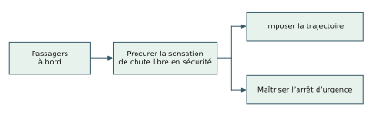
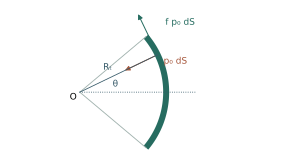
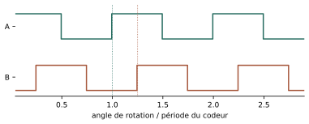
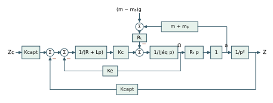
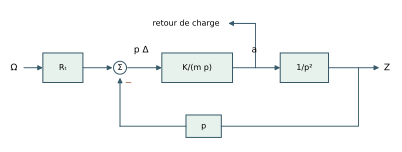

# X-ENS PSI · Sciences industrielles 2013 · Corrigé brut

*Corrigé rédigé par IA, non officiel. Signalez toute erreur.*

**Rédaction** · GPT-6.2 Astra Ultra · vitesse non renseignée · 25 novembre 2026

**Révision** · GPT-6.2 Astra Ultra · vitesse non renseignée · 26 novembre 2026

**La Tour de la Terreur.** L’axe vertical est orienté vers le haut. Les valeurs lues sur les courbes des pages 8 à 11 et 17 à 18 sont approximatives. Les schémas DR1 et DR2 sont reproduits sous forme de constructions originales aux questions 25 et 34.

## A · Fonctions et guidage

### Question 1 · Qui bénéficie de la prestation ?

Les bénéficiaires sont les passagers de la cabine. L’ascenseur agit sur leur mouvement vertical pour leur faire éprouver une sensation de chute libre tout en assurant leur sécurité, y compris à l’arrêt d’urgence. La chaîne de service comporte deux branches simultanées : produire le mouvement demandé et maîtriser sa fin. Le moteur, les câbles, les rails et les freins sont des solutions techniques au service de ces branches.

### Question 2 · Rôle de la liaison inférieure

Le brin inférieur tire la cabine vers le bas, alors que le brin porteur la tire vers le haut. Le bouclage par les poulies permet d’imposer les accélérations, notamment de la cabine en descente et du contrepoids en montée ou en freinage, en maintenant la transmission sous tension. Une simple suspension supérieure pourrait se détendre dès qu’un brin est déchargé.

### Question 3 · Mobilité des quatre guidages

En chaque point de contact actif, la composante normale de la vitesse de la cabine sur le rail est nulle. Les normales sont horizontales, de deux directions distinctes. La séparation en largeur interdit la rotation autour de la verticale. La séparation en hauteur interdit les deux basculements. Les deux translations horizontales sont également bloquées. Le mouvement permis est donc une **glissière d’axe vertical**. Les rotations propres de roulement des galets n’ajoutent aucun mouvement de la cabine.

### Question 4 · Sept compatibilités de montage

Douze contacts ponctuels donnent douze réactions scalaires. La glissière transmet deux forces transversales et trois moments indépendants, donc $h=12-5=7$. Quatre compatibilités imposent localement que l’écartement des deux galets opposés corresponde à l’épaisseur de la face de rail prise en pince, en A, B, C et D. Deux autres concernent l’entraxe des guidages de gauche et de droite, à l’étage haut AB et à l’étage bas CD. La dernière interdit le gauchissement des quatre appuis, qui doivent conserver le plan commun de référence. Ces conditions doivent subsister sur toute la course, d’où la rectitude, le parallélisme et la constance de section nécessaires. Les nombreux appuis rigidifient le guidage, répartissent les réactions et limitent les mouvements parasites.

### Question 5 · Accommoder les défauts sur la longueur

Une platine réglable par excentrique ou vis de réglage permet de placer chaque axe de galet au montage, puis de le bloquer. Des galets opposés montés sur bras préchargés élastiquement absorbent ensuite les faibles variations locales d’épaisseur ou d’entraxe tout en conservant l’appui. Le réglage des supports de tronçons de rail sur cales complète la maîtrise de la géométrie le long des 50 m.

## B · Freinage d’urgence

### Question 6 · Couple des huit garnitures

Supposons la pression uniforme $p_0$ sur une semelle de largeur $e$ et de demi-angle $\alpha$. Sur l’arc, $dS=eR_t\,d\theta$. Les composantes normales latérales s’annulent par symétrie. L’effort presseur suivant la bissectrice vaut

$$
N=p_0 eR_t\int_{-\alpha}^{\alpha}\cos\theta\,d\theta=2p_0eR_t\sin\alpha .
$$

Le moment élémentaire de frottement a pour module $R_t f p_0\,dS$. En sommant les huit semelles, on trouve

$$
|M_f|=8fNR_t\frac{\alpha}{\sin\alpha}\simeq 2{,}74\,10^5\ \mathrm{N\,m}.
$$

Pour le calcul, $\alpha=40\pi/180$ radian. Le couple s’oppose à la vitesse angulaire. La suite retient la valeur arrondie de $270\,000\ \mathrm{N\,m}$.

### Question 7 · Domaine du premier freinage simulé

Le frein reçoit son couple à $t=0$. La vitesse de la cabine, initialement $-17{,}5\ \mathrm{m/s}$, s’annule vers $0{,}7$ à $0{,}8$ s, au minimum de la courbe de position. L’intervalle pertinent pour l’arrêt est donc approximativement $[0\,;\,0{,}7]\ \mathrm{s}$. La remontée prolongée tracée ensuite provient notamment du maintien d’un couple de signe fixe ; le frein réel ne fournit pas d’énergie à la remontée. Le modèle a également supprimé la liaison inférieure.

### Question 8 · Contrepoids en trajectoire balistique

Le contrepoids monte par inertie lorsque le tambour ralentit. Son brin supérieur devient lâche et le brin inférieur est absent du modèle. Le poids seul donne $\ddot z_{\rm cont}=-g$. Le graphe de vitesse est ainsi une droite de pente $-9{,}81\ \mathrm{m/s^2}$. Le contrepoids ne transmet alors aucun couple au tambour. La reprise de tension ultérieure peut provoquer un choc, puis des sollicitations répétées du câble.

### Question 9 · Vitesse ondulée de la cabine

La vitesse moyenne croît à partir d’une valeur négative, car l’effort de freinage ramené à la cabine excède le poids pendant la majeure partie de la phase. L’élasticité fait osciller la tension autour de sa valeur moyenne. La pente instantanée de la vitesse change donc avec l’allongement du brin. L’amortissement réduit les ondulations.

### Question 10 · Accélération à la fin du transitoire

Une fois l’oscillation relative amortie, l’allongement est pratiquement constant et $v=R_t\omega$, avec $v$ positif vers le haut. Le contrepoids libre n’exerce aucun travail sur l’ensemble cabine–tambour. La puissance du couple de signe positif et celle du poids donnent

$$
\frac{d}{dt}\left[\frac12\left(M_{\rm cab}+\frac{J_{\rm eq}}{R_t^2}\right)v^2\right]
=\left(\frac{M_f}{R_t}-M_{\rm cab}g\right)v .
$$

Ainsi $a_\infty=(M_f/R_t-M_{\rm cab}g)/(M_{\rm cab}+J_{\rm eq}/R_t^2)\simeq25{,}8\ \mathrm{m/s^2}$ avec les données de la page 7. La force généralisée est non nulle. La valeur est celle du bilan idéal après transitoire ; la simulation de la page 8 donne un ordre de grandeur d’une vingtaine de $\mathrm{m/s^2}$. Un arrêt effectivement maintenu correspond à un autre régime de frottement.

### Question 11 · Accélération avec le câble inférieur

Les brins porteurs et secondaires stockent puis restituent de l’énergie. Leur raideur varie avec leur longueur et les poulies ont de l’inertie. L’accélération de la cabine présente des pics, dont le premier dépasse $60\ \mathrm{m/s^2}$, soit environ $6g$, et des retours en sens opposé. La succession de secousses et la pointe supérieure à la limite de $5g$ du graphe sont défavorables aux passagers.

### Question 12 · Au voisinage de l’arrêt

Vers le premier voisinage de $v=0$, la vitesse varie peu pendant un bref intervalle. L’accélération se rapproche donc de zéro par instants, avec de petites oscillations lors des transferts de tension entre brins. Le bilan instantané est $M_{\rm cab}a=T_A-T_D-M_{\rm cab}g$. Lorsque les forces se compensent, la vitesse a une tangente presque horizontale. Une vitesse nulle à un instant n’impose pas en général une accélération nulle.

### Question 13 · Changements de régime du contrepoids

Au voisinage des plateaux à $-g$, la résultante des tensions verticales est faible. Les creux nettement inférieurs à $-g$ correspondent à une traction inférieure dominante. Pendant les pics positifs, la traction supérieure l’emporte même sur le poids et la traction inférieure. L’alternance des mises en charge, des décharges et des reprises brusques sollicite les câbles en fatigue. Le seul tracé de l’accélération détermine la différence des tensions, pas chacune séparément.

### Question 14 · Cahier des charges sans amortisseur de support

L’essai commence bien à $-30\ \mathrm m$ et $-63\ \mathrm{km/h}$. La position atteint environ $-37\ \mathrm m$, soit une course de freinage de l’ordre de $7\ \mathrm m$, inférieure à $8\ \mathrm m$ à la précision de lecture. En revanche, dès le premier pic, l’accélération dépasse le plafond de $5g$ admis même pour une faible durée. Le critère de décélération échoue et la validation globale est négative.

### Question 15 · Support inférieur souple et dissipatif

Le support mobile donne aux poulies une course lors d’une variation de tension. Le ressort emmagasine provisoirement une part de l’énergie, puis la rend. L’amortisseur dissipe une autre part et atténue les rebonds. Cette combinaison réduit les pointes de tension et d’accélération sans supprimer la liaison inférieure.

### Question 16 · Lecture de la simulation modifiée

Sur la page 11, le pic initial atteint environ $42\ \mathrm{m/s^2}$, soit $4{,}3g$, brièvement vers $0{,}15$ s, sous le plafond initial de $5g$. Les pics ultérieurs diminuent, puis l’accélération se situe autour de $2{,}2g$. La cabine descend d’environ $7\ \mathrm m$ avant le premier arrêt, pour les mêmes vitesse et position initiales. Le modèle satisfait les critères de freinage étudiés. La partie de courbe postérieure au premier arrêt ne décrit pas le maintien de la cabine.

## C1 · Mesure de position

### Question 17 · Deux mesures de vitesse

Les deux tachymètres observent la même vitesse d’arbre. Leur comparaison permet de détecter une incohérence ou une défaillance et de fournir un signal de surveillance redondant. Une panne mécanique commune aux deux chaînes demanderait un contrôle indépendant.

### Question 18 · Lecture de l’angle et de son sens

Une source lumineuse et un détecteur sont séparés par un disque muni de fenêtres périodiques, ou associés à un disque réfléchissant. La rotation produit un train d’impulsions dont le compte mesure l’angle parcouru. Avec deux sorties A et B en quadrature, l’ordre des fronts distingue les deux sens. Le compteur s’incrémente ou se décrémente en conséquence.

### Question 19 · Résolution de la bande

Le pas spatial est $\delta=\pi D_p/5000=\pi(0{,}50)/5000\simeq0{,}314\ \mathrm{mm}$. Une lecture par comptage entier depuis le dernier front laisse une incertitude de moins d’un pas. Un codage par arrondi au front le plus proche donne une erreur maximale d’un demi-pas, soit $0{,}157\ \mathrm{mm}$. Ces valeurs caractérisent la quantification seule.

### Question 20 · Taille du mot de position

La course contient $50/\delta \simeq159\,155$ intervalles. Or $2^{17}=131\,072$ et $2^{18}=262\,144$. L’information utile requiert donc **18 bits, soit trois octets** si le message transporte un nombre entier d’octets. Les bits de protocole éventuels s’ajoutent au mot de position.

### Question 21 · Pourquoi une bande perforée ?

Les ergots imposent le déplacement de la poulie par engagement dans les trous, ce qui évite l’accumulation d’erreurs par glissement d’une transmission lisse. La bande de mesure suit la cabine indépendamment de l’allongement des câbles porteurs. Son pas, sa tension et sa propre dilatation interviennent encore dans l’exactitude réelle.

### Question 22 · Origine du comptage

Le capteur de présence fournit une information tout ou rien à la position basse connue. Il permet de référencer ou de recaler le compteur et de confirmer la présence de la cabine au niveau du débarquement. Les déplacements comptés ensuite deviennent des positions rapportées à cette origine.

## C2 · Asservissement avec transmission rigide

### Question 23 · Bilan des efforts verticaux

Notons $m=M_{\rm cab}$, $m_b=M_{\rm cont}$, $z=z_{\rm cab}$, $z_b=z_{\rm cont}$. Pour les câbles tendus et sans masse, dans le repère du bâti et en négligeant les frottements de guidage,

$$
m\ddot z=T_A-T_D-mg,\qquad m_b\ddot z_b=T_B-T_C-m_b g .
$$

La transmission rigide impose $\ddot z_b=-\ddot z$. Avec $T_C=T_D$ (inertie et frottements des poulies inférieures négligés), il vient $T_A-T_B=(m-m_b)g+(m+m_b)\ddot z$. L’identité des tensions ne suppose pas l’identité des tensions supérieures.

### Question 24 · Équation du tambour

Avec $\dot z=R_t\omega$, le théorème du moment dynamique donne $J_{\rm eq}\dot\omega=C_{\rm mot}-R_t(T_A-T_B)$. Après substitution,

$$
J_*\dot\omega=C_{\rm mot}-R_t(m-m_b)g,\qquad
J_*=J_{\rm eq}+(m+m_b)R_t^2 .
$$

En position cabine, on peut aussi écrire $(J_*/R_t)\ddot z=C_{\rm mot}-R_t(m-m_b)g$. $J_*\simeq7{,}05\,10^3\ \mathrm{kg\,m^2}$.

### Question 25 · Remplissage de DR1

En lisant DR1 de gauche à droite, le conditionneur et le retour de position portent $K_{\rm capt}$. Le premier sommateur délivre $u=K_{\rm capt}(Z_{\rm cons}-Z)$. Le deuxième soustrait $e=K_e\Omega$. Viennent $1/(R+Lp)$ puis $K_c$. Au troisième sommateur, retrancher au couple moteur le couple de charge. La suite est $1/(J_{\rm eq}p)$ (sortie $\Omega$), $R_t p$, l’unité du document (sortie $a$), puis $1/p^2$ vers $Z$. En branche haute, additionner $(m+m_b)a$ et la perturbation $(m-m_b)g$, multiplier par $R_t$ et revenir à l’entrée négative du sommateur des couples. À la mise en équations, la composante constante de pesanteur a une transformée comportant $1/p$ si elle est appliquée en échelon.

### Question 26 · Bloc de gain unitaire

Il représente la transmission mécanique rigide, en particulier le câble porteur supposé inextensible et tendu. L’accélération linéaire périphérique du tambour est alors celle de la cabine. La conversion entre grandeurs angulaire et linéaire a déjà été faite à l’aide de $R_t$.

### Question 27 · Deux boucles pour le suivi de consigne

Pour le modèle linéaire ou les écarts à un équilibre chargé, la réponse est la somme du suivi de consigne et de la réponse à la charge. Pour le premier transfert, l’entrée gravitaire incrémentale vaut zéro. Incorporons la charge d’inertie dans $J_*$ et le gain de mesure dans la chaîne directe. La boucle extérieure compare $Z_{\rm cons}$ et $Z$ avec retour unitaire. L’erreur, multipliée par $K_{\rm capt}$, arrive à la boucle interne de vitesse : soustraction de $K_e\Omega$, chaîne $K_c/[(R+Lp)J_*p]$, sortie $\Omega$. Le bloc final est $R_t/p$ vers $Z$. La pesanteur demeure une perturbation pour l’étude distincte de son rejet.

### Question 28 · Trois constantes de la boucle fermée

Dans la boucle interne, $\Omega/u=K_c/[J_*p(R+Lp)+K_cK_e]$. Avec le retour extérieur unitaire, le numérateur de la FTBF vaut $N_0=K_{\rm capt}R_t K_c$ et son dénominateur vaut $N_0+K_cK_ep+J_*Rp^2+J_*Lp^3$. Par identification,

$$
A_1=\frac{K_e}{K_{\rm capt}R_t},\qquad
B_1=\frac{J_* R}{N_0},\qquad C_1=\frac{J_* L}{N_0}.
$$

Ces coefficients ont respectivement les dimensions d’un temps, d’un temps au carré et d’un temps au cube.

### Question 29 · Retour à la boucle ouverte

Si $F=G/(1+G)$, alors $G=F/(1-F)$. On obtient donc

$$
G(p)=\frac{1}{A_1p+B_1p^2+C_1p^3}
=\frac{1}{p(174+24p+0{,}81p^2)} .
$$

Le pôle à l’origine traduit l’intégration de vitesse en position.

## C3 · Élasticité des câbles

### Question 30 · Deux porteurs à raideur variable

Reprenons les deux bilans de la question 23 sans imposer aux câbles porteurs d’être inextensibles. Pour les longueurs verticales positives $L_A,L_B$ et les allongements $\delta_A,\delta_B$ comptés depuis la longueur libre, $T_A=k_u\delta_A/L_A$, $T_B=k_u\delta_B/L_B$. L’élimination de la tension inférieure donne

$$
m\ddot z-m_b\ddot z_b+(m-m_b)g
=k_u\left(\frac{\delta_A}{L_A}-\frac{\delta_B}{L_B}\right).
$$

L’origine verticale se trouve en haut. Dans la géométrie idéale sans longueur morte, $L_A=-z$, $L_B=-z_b$. Si le câble inférieur et le support fixe imposent $z+z_b=-h$, alors $L_B=h+z$ et le membre d’inertie se réduit à $(m+m_b)\ddot z$. Les raccords et tronçons fixes imposeraient d’ajouter leurs longueurs. Les expressions idéalisées ne s’emploient pas à longueur nulle.

### Question 31 · De l’équation au schéma-bloc

Une simulation temporelle peut calculer $L_A,L_B$ et diviser chaque allongement par sa longueur instantanée, former le bilan des forces puis intégrer l’accélération deux fois. Pour un schéma de fonctions de transfert linéaires, choisir un point de fonctionnement et développer $k_u\delta/L$ au premier ordre :

$$
\widetilde T=\frac{k_u}{L_0}\widetilde\delta-
\frac{k_u\delta_0}{L_0^2}\widetilde L .
$$

Utiliser ce bloc pour chacun des deux brins et la relation du câble inférieur. Une raideur gelée à $k_u/L_0$ convient seulement si la variation de longueur est suffisamment faible.

### Question 32 · Association des deux câbles

La force totale vaut $k_1\delta+k_1\delta$. La raideur globale est donc $K=K_{\rm câble}=2k_1=1\,230\,000\ \mathrm{N/m}$. L’association partage les efforts et offre une redondance mécanique. La tenue en cas de défaillance d’un brin nécessite que l’autre et ses attaches supportent la charge reportée.

### Question 33 · Dérivée de l’allongement dynamique

Dans cette étape, la tension inférieure est négligée. Le choix d’origine fixe $T_A=mg+K\delta$. Le bilan sur la cabine donne $m\ddot z=K\delta$. En dérivant,

$$
\dot\delta=\frac mK\frac{d\ddot z}{dt}.
$$

Une variation d’accélération correspond à une variation d’allongement. Dans cette relation, $\delta$ peut être négatif par rapport à l’équilibre choisi, tandis que la tension physique reste positive dans le domaine étudié.

### Question 34 · Compléter DR2 avec la déformation

Pour des écarts à l’équilibre et des conditions initiales nulles, $\dot\delta=R_t\omega-\dot z$. Sitôt après $\Omega$, placer $R_t$, puis un sommateur qui retranche la vitesse $pZ$ renvoyée depuis la sortie. Le résultat est $p\Delta$. Le bloc $K/(mp)$ transforme ce signal en accélération $a=p^2Z$ d’après la question 33. Le dernier bloc $1/p^2$ donne $Z$. La branche supérieure de charge de DR2 prélève toujours l’accélération avant ce double intégrateur.

### Question 35 · Ordre et classe du modèle élastique

Posons $b=m/K$ et $M=m+m_b$. La cinématique et l’élasticité donnent $R_t\Omega=p(1+bp^2)Z$. L’équation des couples de DR2 sans perturbation donne $K_ci=J_{\rm eq}p\Omega+R_tMp^2Z$. Injectons ces deux relations dans $u=(R+Lp)i+K_e\Omega$. La boucle ouverte de position, toutes les boucles internes fermées, vaut

$$
G_{\rm el}(p)=\frac{K_{\rm capt}R_tK_c}
{(R+Lp)p^2[J_{\rm eq}(1+bp^2)+R_t^2 M]+K_cK_ep(1+bp^2)} .
$$

Le coefficient de $p^5$ est $LJ_{\rm eq}b\ne0$ et celui de $p$ vaut $K_cK_e\ne0$. Le numérateur est constant. L’**ordre est cinq** et la **classe un**. L’élasticité ajoute deux degrés au dénominateur et conserve l’intégration cinématique à basse fréquence. Pour $b=0$, on retrouve exactement la question 29.

## C4 · Support de poulies

### Question 36 · Équilibre dynamique du support inférieur

Notons $y$ le déplacement du support, positif vers le haut, $M_a$ sa masse, $K_a=K_{\rm amort}$ et $f_v$ l’amortissement. Les composantes du brin horizontal sont intérieures à l’ensemble des deux poulies. Les deux brins verticaux, pris à même tension, fournissent $2T_C$. En prenant l’origine des forces de ressort à sa longueur libre,

$$
2T_C=M_a\ddot y+f_v\dot y+K_a y+M_ag
$$

à une constante de précharge près. En écarts à l’équilibre, la formule exploitable est $2\widetilde T_C=M_a\ddot y+f_v\dot y+K_a y$. La longueur constante du câble inférieur impose $2y=\widetilde z+\widetilde z_b$.

### Question 37 · Rapport entre allongement et position

Notons $\Delta_A,\Delta_B$ les variations d’allongement des deux porteurs. Leurs enroulements ont des signes opposés, d’où $2Y=-(\Delta_A+\Delta_B)$. Dans le modèle symétrique à un allongement, $\Delta_B=\Delta_A=\Delta$ et $Y=-\Delta$. Avec $M_a$ négligeable, $2\widetilde T_C=-(K_a+f_vp)\Delta$. Le bilan de cabine $mp^2Z=K\Delta-\widetilde T_C$ donne

$$
H(p)=\frac{\Delta}{Z}=\frac{mp^2}{K+K_a/2+f_vp/2}.
$$

Le numérateur contient $p^2$ car l’allongement dynamique répond à l’accélération. Le dessin ne fixe pas de loi entre les deux allongements. Si l’autre porteur est pris rigide, $\Delta_B=0$, les coefficients $K_a/2$ et $f_v/2$ deviennent $K_a/4$ et $f_v/4$. Si les deux porteurs évoluent indépendamment, il faut conserver la deuxième équation de masse au lieu de déduire un rapport unique de la seule géométrie.

## C5 · Performances corrigées

### Question 38 · Identification sur les courbes de Black

Les deux lieux gardent la même forme et les mêmes abscisses de phase. Vers $-180^\circ$, le gain passe approximativement de $-75$ à $-15\ \mathrm{dB}$. Cette translation verticale d’environ $60\ \mathrm{dB}$ correspond à un correcteur proportionnel positif $C(p)=K_P$, avec $20\log_{10}K_P\simeq60$, soit $K_P\simeq10^3$. L’accélération marquée de la réponse à l’échelon est cohérente avec l’augmentation du gain.

### Question 39 · Performances corrigées

À $-180^\circ$, le gain vaut environ $-15\ \mathrm{dB}$, soit une marge de gain d’environ $15\ \mathrm{dB}$. Le passage à $0\ \mathrm{dB}$ est voisin de $-105^\circ$, d’où une marge de phase d’environ $75^\circ$. La réponse indicielle monotone entre dans la bande à 5 % vers $0{,}6$ à $0{,}7\ \mathrm s$. Les trois seuils ($10\ \mathrm{dB}$, $45^\circ$, $1\ \mathrm s$) sont donc satisfaits. Le gain statique unitaire garantit le suivi final d’un échelon dans le modèle. La trajectoire de $0$ à $-32\ \mathrm m$ et l’accélération de $-10\pm0{,}5\ \mathrm{m/s^2}$ demandent la consigne et la simulation du mouvement correspondant.

### Question 40 · Hiérarchiser les approximations

Un classement défendable, de l’approximation la plus fragile à la plus locale, est le suivant. Premièrement, une raideur portante constante sur toute la course masque sa forte dépendance à la longueur. Deuxièmement, le câble inférieur inextensible et la tension identique aux deux extrémités négligent l’élasticité du câble et l’inertie des poulies, visibles dans les transitoires. Troisièmement, l’arbre et son accouplement rigides sont plausibles aux basses fréquences de suivi, avant les modes torsionnels. Ce classement concerne la course et la bande de fréquence considérées ; un choc modifie l’importance relative de ces effets.

## D · Dimensionnement du câble

### Question 41 · Diamètre imposé par la contrainte

Pour une traction maximale $T_{\max}$, la contrainte est $4T_{\max}/(\pi D^2)$. La limite stricte de résistance impose

$$
D>\sqrt{\frac{4T_{\max}}{\pi\sigma_{\max}}}.
$$

En prenant la traction en newtons et la contrainte en $\mathrm{N/mm^2}$, on obtient $D$ en millimètres. Si l’on traite chaque brin séparément, il faut employer la traction effectivement supportée par ce brin.

### Question 42 · Diamètre imposé par la raideur

Avec $S=\pi D^2/4$ et une longueur tendue $h=30\ \mathrm m$, la loi de traction donne $T=ES\Delta L/h$. Ainsi $k=E\pi D^2/(4h)$. Le critère $k<k_{\max}$ impose

$$
D<\sqrt{\frac{4hk_{\max}}{\pi E}} .
$$

Toutes les longueurs doivent être exprimées dans le même système d’unités. Le premier critère établit une borne inférieure, le deuxième une borne supérieure.

### Question 43 · Rendre la résistance et la souplesse compatibles

On peut dimensionner la section porteuse pour la traction, puis placer en série un élément élastique, de raideur $k_s$, muni d’une course suffisante et d’un amortissement. La raideur équivalente devient $k_{\rm eff}=(1/k+1/k_s)^{-1}$. Elle peut ainsi être rendue inférieure à $k_{\max}$ alors que la section continue de satisfaire la limite de contrainte. Dans cette solution, le critère de décélération porte sur la raideur de la chaîne. Si le cahier impose la raideur du câble lui-même, une autre possibilité est un câble dont le rapport résistance admissible/module effectif est plus élevé, ou une longueur élastique effective plus grande. La condition d’existence d’un diamètre est $T_{\max}/\sigma_{\max}<hk_{\max}/E$.

Lorsque le ressort et le câble sont en série, ils portent la même tension. Pour un câble déjà choisi de raideur $k>k_{\max}$, l’inégalité précédente donne la plage de réglage $0<k_s<kk_{\max}/(k-k_{\max})$. Il faut également que la course élastique disponible atteigne au moins $T_{\max}/k_s$ en l’absence de précharge.

### Question 44 · Hypothèse la plus sévère

Le blocage instantané du tambour demanderait une impulsion de couple pour annuler sa quantité de mouvement malgré $J_{\rm eq}>0$. Les freins fournissent un couple fini. La figure 9 montre précisément une variation de vitesse qui prend du temps. Un calcul plus représentatif couple la loi de freinage, l’inertie et l’élasticité pendant la descente. Le blocage idéal sert à explorer un choc sévère ; il ne fixe pas à lui seul le maximum réel de tension de tous les régimes.
