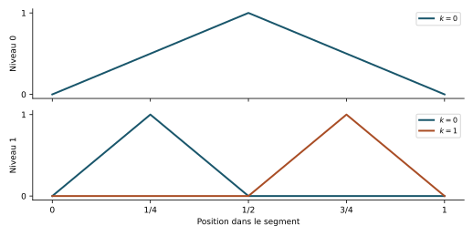
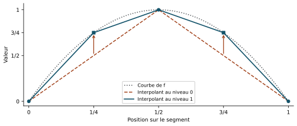

# École polytechnique MP — Mathématiques B 2013 · Corrigé guidé

*Corrigé rédigé par IA, non officiel. Signalez toute erreur.*

**Rédaction** · GPT-6.2 Astra Ultra · vitesse non renseignée · 25 novembre 2026

**Révision** · GPT-6.2 Astra Ultra · vitesse non renseignée · 26 novembre 2026

**Exposant de Hölder ponctuel.** Les coefficients de Schauder mesurent l’écart entre la valeur au milieu d’une maille et la moyenne aux extrémités. L’interpolation sur les grilles successives permet de remonter de ces coefficients à la régularité ponctuelle.

## I. Exposant de Hölder ponctuel

### Question 1.a

> [!INDICATION]
> Écrire une majoration pour la combinaison de deux accroissements.

#### Solution

La fonction nulle appartient à $\Gamma^s(x_0)$. Si les accroissements de $f,g$ sont majorés en module par $A|x-x_0|^s,B|x-x_0|^s$, ceux de $uf+vg$ le sont par $(|u|A+|v|B)|x-x_0|^s$. Cela donne un sous-espace. Pour $0<d=|x-x_0|\le1$ et $s_1\le s_2$ on a $d^{s_2}\le d^{s_1}$, donc $\Gamma^{s_2}(x_0)\subset\Gamma^{s_1}(x_0)$. Enfin tout $f\in C$ est borné et ses accroissements sont au plus $2\|f\|_\infty$, d’où $\Gamma^0(x_0)=C$.

### Question 1.b

> [!INDICATION]
> Prolonger le taux d’accroissement par sa limite au point considéré.

#### Solution

La fonction $(f(x)-f(x_0))/(x-x_0)$ se prolonge continûment en $x_0$ par la dérivée, unilatérale aux extrémités. Elle est donc bornée par $M$ sur le compact. Pour $0<d\le1$, $|f(x)-f(x_0)|\le Md\le Md^s$ pour tout $0\le s<1$.

### Question 1.c

> [!INDICATION]
> Chercher une fonction lipschitzienne avec deux pentes différentes au point intérieur.

#### Solution

La fonction $x\mapsto|x-x_0|$ a pour dérivées à gauche et à droite $-1$ et $1$ au point intérieur $x_0$. Son accroissement par rapport à $x_0$ a module $d\le d^s$ pour chaque $s<1$, donc elle a la propriété demandée.

### Question 2

> [!INDICATION]
> Factoriser l’expression sous la racine au voisinage de son zéro.

#### Solution

On a $p(x)=2\sqrt{x+1/2}\,|x-1/2|^{1/2}$. Le premier facteur est borné sur $[0,1]$ et tend vers 2 en $1/2$. Le quotient par $|x-1/2|^s$ est borné si $s\le1/2$ et diverge vers $+\infty$ en $1/2$ si $s>1/2$. Ainsi $\alpha_p(1/2)=1/2$.

### Question 3.a

> [!INDICATION]
> Comparer les ensembles de couples admis puis utiliser la continuité uniforme.

#### Solution

L’ensemble des couples à distance au plus $h$ croît avec $h$, donc son supremum $\omega_f(h)$ croît. On a $\omega_f(0)=0$. Par continuité uniforme de $f$ sur $[0,1]$, pour tout $\varepsilon>0$ il existe $\delta>0$ tel que $|x-y|\le\delta$ entraîne $|f(x)-f(y)|\le\varepsilon$. Ainsi $0\le\omega_f(h)\le\varepsilon$ pour $0\le h\le\delta$.

### Question 3.b

> [!INDICATION]
> Couper le segment entre les deux points en deux morceaux de longueurs contrôlées.

#### Solution

Supposons $x\le y$ et $y-x\le h'$. Posons $z=\min(y,x+h)$. Alors $0\le z-x\le h$ et $0\le y-z\le h'-h$. Par inégalité triangulaire, $|f(y)-f(x)|\le\omega_f(h)+\omega_f(h'-h)$. Le supremum sur les couples donne le résultat.

### Question 3.c

> [!INDICATION]
> Combiner monotonie et sous-additivité en ordonnant les deux arguments.

#### Solution

Pour $h\le h'$, $0\le\omega_f(h')-\omega_f(h)\le\omega_f(h'-h)$ par 3.a et 3.b. Par échange des réels, $|\omega_f(h')-\omega_f(h)|\le\omega_f(|h'-h|)$ pour tout couple. La continuité en zéro donne même la continuité uniforme de $\omega_f$.

### Question 4.a

> [!INDICATION]
> Prendre pour h la distance exacte au point fixé.

#### Solution

Si $\omega_f(h)\le Mh^s$ pour $0<h\le1$, alors, pour $x\ne x_0$, $|f(x)-f(x_0)|\le\omega_f(|x-x_0|)\le M|x-x_0|^s$. C’est la définition de $f\in\Gamma^s(x_0)$.

### Question 4.b

> [!INDICATION]
> Près de 0, distinguer l’accroissement depuis 0 et l’écart entre deux pics consécutifs.

#### Solution

Pour $x_0>0$, $q$ est dérivable en $x_0$, donc $\alpha_q(x_0)=1$ par 1.b. En 0, $|q(x)|\le x$, d’où le même exposant. Prenons $u_n=1/(2n)$, $v_n=1/(2n+1)$, $n\ge1$. Alors $q(u_n)=u_n$ et $q(v_n)=-v_n$. Pour $h_n=u_n-v_n=1/(2n(2n+1))\downarrow0$,
$$\frac{\omega_q(h_n)}{\sqrt{h_n}}\ge\frac{u_n+v_n}{\sqrt{h_n}}=\frac{4n+1}{\sqrt{2n(2n+1)}}\longrightarrow2.$$
Ainsi ce quotient ne tend pas vers zéro.

## II. Système de Schauder et interpolation

### Question 5.a

> [!INDICATION]
> Examiner les deux enfants d’un même intervalle dyadique.

#### Solution

Par division euclidienne $k=2k'+r$ avec $r\in\{0,1\}$ et $k'=\lfloor k/2\rfloor\in T_j$. Le petit intervalle est la moitié gauche ou droite du grand intervalle d’indice $k'$, selon $r$. Son intérieur non vide est contenu dans l’intérieur de ce grand intervalle et les intérieurs des grands intervalles sont disjoints. Cela prouve l’unicité.

### Question 5.b

> [!INDICATION]
> Le nœud est-il le milieu du support, une extrémité ou un point extérieur ?

#### Solution

Lorsque $x=\ell 2^{-j-1}$ se trouve dans le support, la formule vaut $1-|\ell-2k-1|$. Elle vaut donc 1 pour $\ell=2k+1$ et 0 aux deux extrémités $\ell=2k,2k+2$. Elle vaut également 0 à tout nœud extérieur. Ainsi $\theta_{j,k}(\ell 2^{-j-1})=\mathbf1_{\{\ell=2k+1\}}$.

### Question 5.c

> [!INDICATION]
> Localiser les trois points où la pente peut changer.

#### Solution

La tente est nulle hors de $[k2^{-j},(k+1)2^{-j}]$, affine croissante jusqu’au milieu et affine décroissante ensuite. Les valeurs de raccord valent $0,1,0$, donc elle est continue. Ces trois points sont des nœuds de la grille $2^{-j-1}$, donc de toute grille $2^{-n}$ pour $n>j$. Chaque maille fine reste dans un seul morceau affine.

### Question 5.d

> [!INDICATION]
> Décomposer le segment en morceaux sur lesquels la pente est constante.

#### Solution

Les pentes sont $0$, $2^{j+1}$ ou $-2^{j+1}$. En coupant $[x,y]$ aux points de raccord, chaque accroissement a module au plus $2^{j+1}$ fois la longueur du morceau. Leur somme en module est donc au plus $2^{j+1}|x-y|$.

### Question 6

> [!INDICATION]
> Exprimer le coefficient comme la moyenne de deux différences à la même échelle.

#### Solution

Pour la maille de bornes $a,b$ et de milieu $m$, on a $c_{j,k}(f)=\frac12[(f(m)-f(a))+(f(m)-f(b))]$. Chaque différence a module au plus $\omega_f(2^{-j-1})$. Le maximum sur $k$ respecte cette même borne, qui tend vers zéro par 3.a.

### Question 7.a

> [!INDICATION]
> Distinguer les tentes plus grossières, de même niveau et plus fines que la maille de mesure.

#### Solution

Si $i<j$, la fonction $\theta_{i,\ell}$ est affine sur la maille de niveau $j$ par 5.c, donc sa valeur au milieu égale la moyenne des valeurs aux extrémités. Si $i=j$, tous les bouts ont valeur 0 et le milieu a valeur $\mathbf1_{k=\ell}$ par 5.b. Si $i>j$, les trois points d’évaluation sont des multiples de $2^{-i}$, où toute tente de niveau $i$ s’annule. Finalement $c_{j,k}(\theta_{i,\ell})=\mathbf1_{i=j}\mathbf1_{k=\ell}$.

### Question 7.b

> [!INDICATION]
> À une abscisse fixée, combien de tentes d’un même niveau peuvent être non nulles ?

#### Solution

Les intérieurs des supports des tentes d’un niveau sont disjoints, et les valeurs aux bords sont nulles. Ainsi $\|f_j^a\|_\infty\le b_j$ et la convergence de $\sum b_j$ donne la convergence normale, donc uniforme de $\sum_j f_j^a$. Sa somme $f^a$ est continue et s’annule en 0 et 1, comme chaque terme. Le coefficient $c_{j,k}$ est linéaire et continu car $|c_{j,k}(g)|\le2\|g\|_\infty$. Par passage à la limite dans les sommes finies et 7.a, $c_{j,k}(f^a)=a_{j,k}$.

### Question 8.a

> [!INDICATION]
> Majorer l’erreur entre milieu et extrémités à l’aide de la dérivée bornée.

#### Solution

Pour $f\in C^1$, l’inégalité des accroissements finis donne $|c_{j,k}(f)|\le\|f'\|_\infty 2^{-j-1}$ d’après la décomposition de 6. On peut prendre $M=\|f'\|_\infty/2$. La série des majorants en $j$ est géométrique, donc les $S_nf$ convergent uniformément par 7.b.

### Question 8.b

> [!INDICATION]
> Développer aux deux extrémités autour du milieu et faire disparaître les termes de degré un.

#### Solution

Posons $t=2^{-j-1}$. Pour $f\in C^2$, $f(m\pm t)=f(m)\pm tf'(m)+r_\pm$ où $|r_\pm|\le t^2\|f''\|_\infty/2$. Dans la moyenne, les termes de degré un disparaissent, donc $|c_{j,k}(f)|\le t^2\|f''\|_\infty/2=4^{-j}\|f''\|_\infty/8$.

### Question 9.a

> [!INDICATION]
> Appliquer à chaque terme la relation entre sa maille et celle de niveau n+1.

#### Solution

Chaque terme de $S_nf$ est un multiple d’une tente de niveau $j\le n$, affine sur toute maille de niveau $n+1$ par 5.c. Leur somme finie partage cette propriété.

### Question 9.b

> [!INDICATION]
> Les nœuds pairs étaient déjà présents. Aux nœuds impairs, identifier l’unique nouvelle tente non nulle.

#### Solution

Au rang $n=0$, la somme vide définit $S_{-1}f=0$. Comme $f(0)=f(1)=0$, $S_0f=f(1/2)\theta_{0,0}$ interpole bien $f$ aux nœuds $0,1/2,1$. Pour $n\ge1$, $S_nf=S_{n-1}f+\sum_{k\in T_n}c_{n,k}(f)\theta_{n,k}$. Aux anciens nœuds (indices pairs), les tentes de niveau $n$ s’annulent et l’égalité est conservée. La valeur en 1 est également correcte puisque toutes les fonctions y sont nulles. Au nouvel indice $2k+1$, le nœud est le milieu $m$ de la maille $[a,b]$ de niveau $n$. Par 9.a et l’hypothèse, $S_{n-1}f(m)=(f(a)+f(b))/2$. La seule tente nouvelle qui vaille 1 est celle d’indice $k$. Son coefficient $f(m)-(f(a)+f(b))/2$ fournit donc exactement la correction nécessaire.

Dans l’exemple $f(x)=4x(1-x)$, l’ancienne ligne brisée vaut $1/2$ en $1/4$ et en $3/4$, où $f$ vaut $3/4$. Les deux coefficients du niveau 1 sont donc égaux à $1/4$.

### Question 9.c

> [!INDICATION]
> Initialiser au niveau zéro en exploitant les valeurs de f aux bords.

#### Solution

Le cas initial de 9.b donne l’égalité aux trois nœuds du niveau 0. Son étape d’hérédité donne alors, pour tout $n\ge0$ et tout $\ell\in T_{n+1}$, $(S_nf)(\ell 2^{-n-1})=f(\ell 2^{-n-1})$. L’égalité vaut aussi à l’extrémité droite $1$.

### Question 10.a

> [!INDICATION]
> Entre deux nœuds, écrire l’interpolant comme moyenne pondérée des valeurs aux extrémités.

#### Solution

Si $x$ appartient à une maille $[a,b]$ de longueur $2^{-n-1}$, avec $t=(x-a)/(b-a)$, les questions 9.a et 9.c donnent $S_nf(x)=(1-t)f(a)+tf(b)$. La somme des deux poids vaut un. Il en résulte
$$|f(x)-S_nf(x)|\le(1-t)|f(x)-f(a)|+t|f(x)-f(b)|\le\omega_f(2^{-n-1}).$$
Cette majoration uniforme tend vers zéro.

### Question 10.b

> [!INDICATION]
> Un second passage sur la même grille peut-il modifier le premier interpolant ?

#### Solution

L’application $S_n$ est linéaire par linéarité des coefficients. Les valeurs de $S_nf$ et $f$ coïncident aux nœuds, donc leurs interpolants coïncident sur chaque maille par 9.a. Ainsi $S_n^2=S_n$. La moyenne convexe en 10.a donne $\|S_nf\|_\infty\le\|f\|_\infty$. En prenant $f=\theta_{0,0}$, déjà affine par morceaux sur cette grille et de norme 1, on obtient $S_nf=f$. La norme subordonnée est donc exactement 1.

### Question 11.a

> [!INDICATION]
> Appliquer la concavité à la moyenne de deux nombres positifs.

#### Solution

La fonction $t\mapsto t^s$ est concave sur $[0,+\infty[$ pour $0<s<1$, par le signe de sa dérivée seconde sur $]0,+\infty[$ et la continuité en 0. Donc $(a^s+b^s)/2\le((a+b)/2)^s$, ce qui donne la majoration demandée.

### Question 11.b

> [!INDICATION]
> Retrancher la constante f(x₀) aux trois termes du coefficient.

#### Solution

Soit $|f(y)-f(x_0)|\le M|y-x_0|^s$. Avec $a=k2^{-j}$ et $b=a+2^{-j}$, chacun des trois points $a,(a+b)/2,b$ est à distance au plus $|a-x_0|+2^{-j}$ de $x_0$. Le coefficient annule les fonctions constantes, et la somme des valeurs absolues des trois poids est 2. D’où $|c_{j,k}(f)|\le2M(2^{-j}+|k2^{-j}-x_0|)^s$. On peut prendre $c_1=2M+1>0$.

## III. Minoration de l’exposant ponctuel

### Question 12

> [!INDICATION]
> Placer la distance dans la partition dyadique de l’intervalle ]0,1].

#### Solution

Posons $d=|x-x_0|\in]0,1]$. L’unique entier vérifiant la double inégalité est $n_0=\lfloor-\log_2 d\rfloor$. En effet $n_0\le-\log_2 d<n_0+1$ équivaut précisément à $2^{-n_0-1}<d\le2^{-n_0}$.

### Question 13

> [!INDICATION]
> Conserver les indices des cellules contenant les deux points. Que se passe-t-il à l’extrémité 1 ?

#### Solution

Écrivons $k_j(y)=\min(\lfloor2^j y\rfloor,2^j-1)$. Cette précision traite $y=1$, où l’indice imprimé $\widetilde k_j(1)=2^j$ sort de $T_j$. Toutes les tentes y sont nulles, donc choisir la dernière cellule est licite. Ailleurs $k_j$ est l’indice imprimé. Pour qu’un terme contribue à $W_j$, sa tente doit être non nulle en $x$ ou en $x_0$. Ainsi seuls $k_j(x)$ et $k_j(x_0)$ peuvent intervenir. Par 5.d chaque différence absolue de tentes est au plus $2^{j+1}d$. Ainsi
$$ W_j\le (|c_{j,k_j(x)}|+|c_{j,k_j(x_0)}|)2^{j+1}d.$$
Si les indices coïncident, la borne compte deux fois le même coefficient et reste valide. Dans toute cette partie, $c_{j,k}$ désigne $c_{j,k}(f)$.

### Question 14.a

> [!INDICATION]
> Aux niveaux grossiers, la distance entre les deux points ne dépasse pas la largeur d’une cellule.

#### Solution

Notons $h_j=2^{-j}$. Pour $y=x,x_0$, l’extrémité gauche $a=k_j(y)h_j$ vérifie $|a-y|\le h_j$. Si $j\le n_0$, alors $d\le h_j$, d’où $|a-x_0|\le h_j+d\le2h_j$. L’hypothèse P1 donne $|c_{j,k_j(y)}|\le c_1(3h_j)^s$. Reportons ces deux majorations dans 13, ce qui donne $W_j\le4c_1 3^s2^{(1-s)j}d$.

### Question 14.b

> [!INDICATION]
> Sommer la progression géométrique et éliminer n₀ grâce à la borne supérieure sur d.

#### Solution

Écrivons $r=2^{1-s}>1$. La somme de 14.a est majorée par $4c_1 3^s d\,r^{n_0+1}/(r-1)$. Or $2^{n_0}\le d^{-1}$. Ainsi $dr^{n_0}\le d^s$ et
$$\sum_{j=0}^{n_0}W_j\le \frac{8(3/2)^s c_1}{2^{1-s}-1}d^s=c_2d^s.$$

### Question 15

> [!INDICATION]
> Au point de référence, la base de la cellule est à distance inférieure ou égale à sa largeur.

#### Solution

Par P1, $|c_{j,k_j(x_0)}|\le c_1(2h_j)^s=c_1 2^{s(1-j)}$. Au plus une tente de niveau $j$ est non nulle en $x_0$ et sa hauteur est au plus 1. On obtient
$$\sum_{j>n_0}\sum_k|c_{j,k}|\,|\theta_{j,k}(x_0)|\le c_1 2^s\frac{2^{-s(n_0+1)}}{1-2^{-s}}\le c_3d^s,$$
car $2^{-n_0-1}<d$.

### Question 16

> [!INDICATION]
> Prendre le dernier indice pour lequel le module atteint encore le seuil.

#### Solution

Posons $a_j=\omega_f(2^{-j})$ et $b=2^{-n_0s}>0$. La suite $a_j$ est décroissante au sens large et tend vers 0 par 3.a. Comme $\|f\|_\infty=1$ et $f(0)=0$, un point où $|f|$ vaut 1 donne $a_0\ge1\ge b$. L’ensemble des $j$ tels que $a_j\ge b$ est donc un segment initial fini non vide. Son maximum est l’unique $n_1$ pour lequel $a_{n_1+1}<b\le a_{n_1}$. Cette définition admet les paliers éventuels du module.

### Question 17

> [!INDICATION]
> Utiliser la majoration uniforme d’interpolation au pas du niveau n.

#### Solution

Par 10.a, pour $n\ge n_1$,
$$\|f-S_nf\|_\infty\le\omega_f(2^{-n-1})\le\omega_f(2^{-n_1-1})<2^{-n_0s}<2^s d^s.$$
La dernière inégalité suit de $2^{-n_0}<2d$. Ceci donne en particulier la borne imprimée $2^{s+1}d^s$.

### Question 18.a

> [!INDICATION]
> Aux niveaux intermédiaires, la largeur de la cellule est désormais inférieure à la distance étudiée.

#### Solution

Pour $n_0<j\le n_1$, $h_j=2^{-j}<d$. Avec $a=k_j(x)h_j$, on a $h_j+|a-x_0|\le2h_j+d\le3d$. Par P1, $|c_{j,k_j(x)}|\le c_1 3^s d^s$. À $x$, les autres tentes du niveau sont nulles et la hauteur de celle-ci est au plus 1. Chacun des $n_1-n_0$ niveaux contribue donc au plus $c_1 3^s d^s$, ce qui donne la majoration demandée.

### Question 18.b

> [!INDICATION]
> Combiner la lente décroissance autorisée pour le module et la définition de son dernier franchissement.

#### Solution

P2 au pas $2^{-n_1}$ donne $\omega_f(2^{-n_1})\le c_4(N)(1+n_1)^{-N}$. De plus ce module est au moins $2^{-n_0s}>0$. Il vient
$$n_1-n_0\le 1+n_1\le\left(\frac{c_4(N)}{\omega_f(2^{-n_1})}\right)^{1/N}\le c_4(N)^{1/N}2^{n_0s/N}\le c_4(N)^{1/N}d^{-s/N}.$$
En 18.a cela donne $c_5(N)d^{(1-1/N)s}$ avec $c_5(N)=3^s c_1c_4(N)^{1/N}$. Si la plage de sommation est vide, la majoration de la somme reste valable.

### Question 19

> [!INDICATION]
> Arrêter l’interpolation au plus grand des deux niveaux et séparer l’écart en ses deux restes et sa partie interpolée.

#### Solution

Fixons $N\ge2$ et posons $m=\max(n_0,n_1)$. Dans l’accroissement $f(x)-f(x_0)$, les deux erreurs de remplacement de $f$ par $S_mf$ ont somme des modules au plus $2^{s+2}d^s$ par 17. Pour $j\le n_0$, la différence des deux sommes de tentes est majorée par $\sum_{j\le n_0}W_j\le c_2d^s$ d’après 14.b. Si $n_0\ge n_1$ cela traite tous les termes. Si $n_0<n_1$, il reste les niveaux $n_0<j\le n_1$. En $x_0$ leur somme des modules est majorée par $c_3d^s$ d’après 15, et en $x$ par $c_5(N)d^{(1-1/N)s}$ d’après 18.b.

Ainsi, pour chaque $N\ge2$, une constante indépendante de $x$ majore $|f(x)-f(x_0)|/d^{(1-1/N)s}$, puisque $0<d\le1$. On a $f\in\Gamma^{(1-1/N)s}(x_0)$ pour tout $N$. Le supremum des exposants admissibles est donc au moins $s$.
