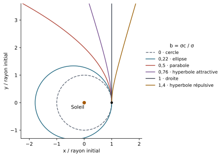
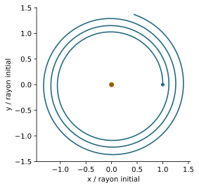
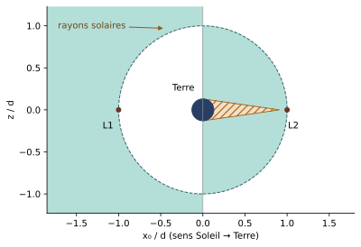

# École polytechnique et ESPCI PC 2013 — Physique A · Corrigé guidé

*Corrigé rédigé par IA, non officiel. Signalez toute erreur.*

**Lecture du rapport du jury** · GPT-6.2 Astra Ultra · vitesse non renseignée

**Rédaction** · GPT-6.2 Astra Ultra · vitesse non renseignée

## Le rayonnement solaire pour la navigation spatiale

## I. La pression exercée par la lumière

### Question I.1 — Relaxation des charges libres

**Indication.** Prendre la divergence de la loi d’Ohm et utiliser le théorème de Gauss local.

Dans un conducteur homogène immobile, $\partial_t\rho+\nabla\cdot\mathbf j=0$ et $\mathbf j=\gamma\mathbf E$ où $\gamma$ est la conductivité. Comme $\nabla\cdot\mathbf E=\rho/\varepsilon_0$, on obtient $\partial_t\rho=-\gamma\rho/\varepsilon_0$. En chaque point intérieur, $\rho(t)=\rho(0)e^{-t/\tau}$ avec $\tau=\varepsilon_0/\gamma$. Il s’agit de la densité volumique nette. Des charges peuvent subsister en surface.

### Question I.2 — Équations de Maxwell

**Indication.** La densité de charge peut être nulle tout en laissant circuler un courant.

Dans le modèle du sujet, en volume neutre,

$$
\nabla\cdot\mathbf E=0,\quad\nabla\cdot\mathbf B=0,\quad
\nabla\times\mathbf E=-\partial_t\mathbf B,\quad
\nabla\times\mathbf B=\mu_0\gamma\mathbf E+\mu_0\varepsilon_0\partial_t\mathbf E.
$$

### Question I.3 — Origine de l’onde réfléchie

**Indication.** Partir de la force sur les porteurs mobiles et décrire le champ qu’ils produisent à leur tour.

Le champ électrique incident met les électrons mobiles en mouvement. Le courant oscillant ainsi induit émet un champ secondaire. À l’extérieur apparaît l’onde réfléchie. À l’intérieur du bon conducteur, le champ induit s’oppose au champ incident. Le champ total et le courant décroissent sur l’épaisseur de peau. Une conductivité finie autorise une dissipation par effet Joule dans cette couche.

### Question I.4 — Limite du conducteur parfait

**Indication.** Relier la faible pénétration à la fréquence de la lumière et à la conductivité.

Pour un bon conducteur $\gamma\gg\varepsilon_0\omega$, l’épaisseur de peau $\delta=\sqrt{2/(\mu_0\gamma\omega)}$ est très petite devant la longueur d’onde extérieure $2\pi c/\omega$. Un miroir doit aussi être épais devant $\delta$. Dans la limite idéale, la réflexion est totale, le champ électrique tangent s’annule à la surface et la puissance absorbée tend vers zéro.

### Question I.5 — Courant de déplacement

**Indication.** Former le rapport des amplitudes des deux courants présents dans Maxwell-Ampère à l’intérieur du métal.

$|\varepsilon_0\partial_t\mathbf E|/|\gamma\mathbf E|=\varepsilon_0\omega/\gamma\ll1$. Dans la couche conductrice on peut donc écrire $\nabla\times\mathbf B\simeq\mu_0\mathbf j$ avant de prendre la limite d’épaisseur nulle.

### Question I.6 — Force volumique

**Indication.** Remplacer le courant dans le produit vectoriel de la force de Laplace.

La force par unité de volume est $\mathbf f=\mathbf j\times\mathbf B= (\nabla\times\mathbf B)\times\mathbf B/\mu_0$. Elle s’exprime en $\mathrm{N\,m^{-3}}$. Le terme électrique volumique $\rho\mathbf E$ est nul dans le modèle neutre.

### Question I.7 — Intégration dans la couche de peau

**Indication.** Orienter l’axe normal vers l’intérieur du métal. Intégrer la densité de force avant de faire tendre l’épaisseur de peau vers zéro.

Posons $x=0$ à la surface, $x>0$ dans le métal et $\mathbf B=B_y(x,t)\mathbf e_y$. Alors $\nabla\times\mathbf B=\partial_xB_y\,\mathbf e_z$, donc $f_x=-B_y\partial_xB_y/\mu_0=-\partial_x(B_y^2)/(2\mu_0)$. Dans un conducteur épais $B_y$ tend vers zéro en profondeur. La force par unité de surface vaut donc $P=\int_0^\infty f_xdx=B_y^2(0,t)/(2\mu_0)$. Elle pousse le métal dans le sens incident. Le champ de surface s’entend comme sa limite du côté vide du miroir parfait.

### Question I.8 — Addition des champs magnétiques

**Indication.** Réfléchir le sens de propagation et imposer l’annulation du champ électrique tangent.

À la surface $\mathbf E_r=-\mathbf E_i$. Pour chaque onde plane $\mathbf B=\mathbf e_k\times\mathbf E/c$. Le vecteur de propagation et le champ électrique changent tous deux de signe à la réflexion normale. Ainsi $\mathbf B_r=\mathbf B_i$ à la surface et $\mathbf B_{\rm tot}=2\mathbf B_i$.

### Question I.9 — Densité d’énergie incidente

**Indication.** L’onde progressive dans le vide a des densités électrique et magnétique égales.

$u=\varepsilon_0E_i^2/2+B_i^2/(2\mu_0)=B_i^2/\mu_0$. Les deux questions précédentes donnent $P=(2B_i)^2/(2\mu_0)=2u$. L’égalité vaut pour les grandeurs instantanées au miroir et aussi pour leurs moyennes temporelles.

### Question I.10 — Flux électromagnétique

**Indication.** Utiliser la vitesse de transport de l’énergie de l’onde progressive.

$|\vec{\Pi}_i|=|\mathbf E_i\times\mathbf B_i|/\mu_0=c B_i^2/\mu_0=cu$. On en déduit $P=2|\vec{\Pi}_i|/c$. Un flux surfacique d’énergie divisé par une vitesse a bien l’unité d’une pression.

### Question I.11 — Pression au voisinage de la Terre

**Indication.** La constante solaire est une puissance par unité de surface. Employer la relation précédente pour les moyennes.

$P_0=2\Phi_0/c=2\times1350/(3\times10^8)=9\times10^{-6}\,\mathrm{Pa}$. Pour un mètre carré de voile, cela représente environ neuf micronewtons, d’où l’intérêt d’une grande surface et d’une action prolongée dans l’espace.

### Question I.12 — Variation avec la distance

**Indication.** Comparer deux sphères centrées sur le Soleil traversées par la même puissance.

Hors absorption, une luminosité solaire constante se répartit sur $4\pi r^2$. Le flux et la pression normale suivent donc $\Phi(r)=\Phi_0(D/r)^2$ et $P(r)=P_0(D/r)^2$.

### Question I.13 — Chocs des photons à incidence normale

**Indication.** Compter les photons franchissant une surface donnée en un temps donné, puis calculer leur impulsion cédée.

Dans le vide, $\omega=c|\mathbf k|$. En un temps $dt$, $ncS\,dt$ photons heurtent $S$. Chacun, de quantité de mouvement $p=\hbar\omega/c$, inverse celle-ci et cède $2p$ au miroir. Le taux de transfert normal par aire est $P=2pnc=2n\hbar\omega=2u$ avec $u=n\hbar\omega$.

### Question I.14 — Incidence oblique

**Indication.** Projeter sur la normale à la fois le flux de photons et le changement de quantité de mouvement par photon.

Pour un angle $\alpha$ avec la normale, le nombre d’impacts est $nc\cos\alpha\,Sdt$. La réflexion spéculaire conserve l’impulsion tangentielle et transfère $2p\cos\alpha$ par impact. Ainsi $P=2u\cos^2\alpha$, normale à la voile au sens où la force est $PS\mathbf n$. La pression tend vers zéro à incidence rasante.

### Question I.15 — Vérification sur IKAROS

**Indication.** Tester d’une part la dynamique sur un mois, d’autre part la prédiction de force pour la surface de voile donnée.

La mesure $F=1,12\times10^{-3}\,\mathrm N$ pour $m=315\,\mathrm{kg}$ donne $a\simeq3,6\times10^{-6}\,\mathrm{m\,s^{-2}}$. Sur $30\times86400\,\mathrm s$, elle représente $\Delta v\simeq9\,\mathrm{m\,s^{-1}}$, cohérent avec la dizaine annoncée. Au voisinage de l’orbite terrestre, le miroir idéal normal de $173\,\mathrm{m^2}$ recevrait $P_0S\simeq1,6\times10^{-3}\,\mathrm N$. Le rapport mesure/prédiction est proche de 0,7, compatible en ordre de grandeur avec une orientation et une réflectivité réelles. L’épaisseur ne figure pas dans ce calcul de force.

## II. Orbites autour du Soleil

### Question II.1 — Vitesse circulaire

**Indication.** Projeter l’accélération d’un mouvement circulaire uniforme sur la direction du centre.

La gravitation donne $mv^2/r=GMm/r^2$, d’où $v=\sqrt{GM/r}$. Pour la Terre on a donc $GM=v_0^2D$.

### Question II.2 — Force de rayonnement

**Indication.** Le flux décroît comme l’inverse du carré de la distance. Choisir un vecteur radial orienté vers l’extérieur.

Sous incidence normale $\mathbf F_R=SP_0D^2\mathbf e_r/r^2$. La surface reçoit une poussée dirigée du Soleil vers l’extérieur.

### Question II.3 — Masse surfacique critique

**Indication.** Comparer les modules des actions sur le satellite entier en divisant l’équation par sa surface.

L’équilibre des deux forces impose $GMm=P_0 S D^2$. Ainsi $\sigma_c=P_0D^2/(GM)=P_0D/v_0^2$. Le facteur $r^{-2}$ commun rend cette valeur indépendante du rayon orbital. La masse $m$ comprend voile et charge transportée.

### Question II.4 — Valeur et épaisseur correspondante

**Indication.** Employer les mètres pour $D$ et une masse volumique représentative pour convertir en épaisseur.

$D=1,5\times10^{11}\,\mathrm m$ et $v_0=3\times10^4\,\mathrm{m\,s^{-1}}$ donnent $\sigma_c=1,5\times10^{-3}\,\mathrm{kg\,m^{-2}}$. Pour une feuille seule de masse volumique $\rho\sim10^3\,\mathrm{kg\,m^{-3}}$, $e=\sigma_c/\rho\sim1\,\mathrm{\mu m}$. Une charge utile accroît la masse surfacique totale de l’engin.

### Question II.5 — Potentiel et familles de trajectoires

**Indication.** Regrouper les deux forces radiales dans un seul coefficient et examiner son signe.

Posons $b=\sigma_c/\sigma$. La résultante est $\mathbf F=-GMm(1-b)\mathbf e_r/r^2$ et $U=-GMm(1-b)/r$ si $U(\infty)=0$. Pour $\sigma>\sigma_c$, l’attraction képlérienne autorise les ellipses (dont le cercle) pour $E<0$, la parabole pour $E=0$ et l’hyperbole pour $E>0$, avec mouvement radial dégénéré si le moment cinétique est nul. Pour $\sigma=\sigma_c$, la trajectoire est une droite parcourue uniformément ou un point au repos. Pour $\sigma<\sigma_c$, la force répulsive donne une branche d’hyperbole tournée à l’opposé du centre, ou un mouvement radial si le moment cinétique est nul.

### Question II.6 — Déploiement depuis une orbite circulaire

**Indication.** La vitesse et le moment cinétique sont continus à l’instant du déploiement. Recalculer l’énergie avec le nouveau potentiel.

Notons $r_i$ le rayon initial. Après déploiement, $v(t_0^+)=\sqrt{GM/r_i}$, donc $E=GMm(b-1/2)/r_i$, conservée par la suite. Si $0<b<1/2$ (soit $\sigma/\sigma_c>2$), le satellite parcourt une ellipse dont le point de départ est le périhélie. Pour $b=1/2$, c’est une parabole. Pour $1/2<b<1$, une hyperbole attractive. Pour $b=1$, il suit la tangente initiale en ligne droite. Pour $b>1$, l’hyperbole est répulsive. La limite $b=0$ est le cercle initial.

Toutes les courbes ont la même tangente initiale. Pour vérifier leur géométrie, avec $\theta=0$ au déploiement et le moment cinétique spécifique $h=\sqrt{GMr_i}$, l’équation de Binet donne $r_i/r=(1-b)+b\cos\theta$. La branche physique part de $\theta=0$ avec $r>0$.

### Question II.7 — Composante de la poussée oblique

**Indication.** Conserver la direction normale de la force après avoir corrigé son module par l’angle d’incidence.

$\mathbf F_R=SP_0(D/r)^2\cos^2\alpha\,\mathbf n=\beta F_G\mathbf n$, avec $F_G=GMm/r^2$ et $\beta=(\sigma_c/\sigma)\cos^2\alpha$. Le signe de la projection tangentielle dépend du côté vers lequel la voile est inclinée.

### Question II.8 — Dérive radiale en orbite quasi circulaire

**Indication.** Le bras de levier vaut $r$. Dans $rv_\theta$, la vitesse varie elle aussi avec le rayon.

Comptons $\alpha$ depuis $\mathbf e_r$ vers $\mathbf e_\theta$. Autour du Soleil, $d(mrv_\theta)/dt=r\beta F_G\sin\alpha$. En employant $v_\theta\simeq\sqrt{GM/r}$, le membre de gauche vaut $m\sqrt{GM/r}\,\dot r/2$. D’où

$$
\dot r=2\beta\sin\alpha\sqrt{GM/r},\qquad \frac{v_r}{v_\theta}=2\beta\sin\alpha.
$$

Le rapport est constant et doit rester petit dans l’approximation adoptée.

### Question II.9 — Forme de la trajectoire

**Indication.** Exprimer le rapport de vitesses dans les coordonnées polaires du satellite.

$v_r/v_\theta=dr/(r\,d\theta)$. À incidence constante, $r=r_i\exp[2\beta\sin\alpha\,(\theta-\theta_i)]$. Cette spirale logarithmique est serrée pour une faible perturbation, divergente pour $\sin\alpha>0$ et convergente pour $\sin\alpha<0$. L’incidence normale maintient un rayon constant dans cette description.

### Question II.10 — Orientation pour une montée rapide

**Indication.** La projection tangentielle augmente avec le sinus de l’inclinaison, tandis que le module de la poussée diminue.

À rayon donné, maximiser $v_r$ revient à maximiser $g(\alpha)=\sin\alpha\cos^2\alpha$ sur $[0,\pi/2]$. Comme $g'=\cos\alpha(1-3\sin^2\alpha)$ et que $g$ s’annule aux deux extrémités, le maximum est atteint pour $\alpha=\arcsin(1/\sqrt3)$, la normale étant inclinée dans le sens du mouvement.

## III. Équilibre d’un statite au voisinage de la Terre

### Question III.1 — Attraction solaire et force centrifuge

**Indication.** La distance à l’axe de rotation diffère de la distance au Soleil hors du plan de l’orbite.

Au repos dans le référentiel tournant, aucune force de Coriolis n’intervient. Posons $\mathbf R=(D+x_0)\mathbf e_x+y\mathbf e_y+z\mathbf e_z$. La somme exacte est $m\omega^2[(D+x_0)\mathbf e_x+y\mathbf e_y]-GMm\mathbf R/|\mathbf R|^3$. La Terre circulaire impose $\omega^2=GM/D^3$. Au premier ordre $|\mathbf R|^{-3}\simeq D^{-3}(1-3x_0/D)$. Les termes constants et ceux en $y$ s’annulent, ce qui laisse $\mathbf F_{\rm cf+S}\simeq m\omega^2(3x_0\mathbf e_x-z\mathbf e_z)$.

### Question III.2 — Deux points d’équilibre colinéaires

**Indication.** Conserver le signe de $x_0$ dans le vecteur d’attraction terrestre.

Sur l’axe, la force terrestre vaut $-GM_\oplus m\,x_0\mathbf e_x/|x_0|^3$. L’équilibre impose $x_0[3\omega^2-GM_\oplus/|x_0|^3]=0$, en excluant le centre de la Terre. Ainsi $x_0=-d$ pour $L_1$ et $x_0=d$ pour $L_2$ avec $d=D(M_\oplus/(3M))^{1/3}$. Le petit rapport des masses rend $d/D\ll1$, ce qui justifie le développement initial.

### Question III.3 — Distance à la Terre

**Indication.** Prendre la racine cubique du rapport des masses après division par trois.

$d/D=(10^{-6})^{1/3}=10^{-2}$. On trouve $d=1,5\times10^6\,\mathrm{km}$, aussi bien vers le Soleil que dans la direction opposée, à l’ordre de calcul retenu.

### Question III.4 — Régions accessibles à la poussée d’une voile

**Indication.** La condition décisive porte sur la composante de la poussée requise dans le sens des rayons. Une voile parfaitement de profil a une poussée nulle.

Notons $s=\sqrt{x_0^2+y^2+z^2}$ la distance au centre terrestre. La poussée requise est l’opposée de la somme de l’attraction terrestre et de III.1. Sa composante solaire est

$$
F_{R,x}=m x_0\left(\frac{GM_\oplus}{s^3}-3\omega^2\right)
=3m\omega^2x_0[(d/s)^3-1].
$$

Si $F_{R,x}>0$, on oriente la normale selon la force requise puis on ajuste la surface pour obtenir son module. Le modèle autorise donc la région $x_0<0,\ s>d$ et la région $x_0>0,\ s<d$, à l’extérieur de la Terre. À la frontière $F_{R,x}=0$, une poussée transverse non nulle est impossible avec une surface finie. Seuls $L_1$ et $L_2$ satisfont alors le bilan avec poussée nulle.

### Question III.5 — Longueur du cône d’ombre

**Indication.** Prolonger les tangentes communes aux deux disques apparents jusqu’au sommet du cône d’ombre.

À la limite de l’ombre totale sur l’axe, les deux astres ont le même rayon angulaire. Depuis ce point, $R_\oplus/\delta=R_\odot/(D+\delta)$, d’où $\delta=DR_\oplus/(R_\odot-R_\oplus)$. Les deux distances au membre de gauche et de droite sont mesurées depuis l’observateur jusqu’aux centres correspondants.

### Question III.6 — Comparaison avec le point extérieur

**Indication.** Utiliser $R_\oplus/R_\odot$ comme petit paramètre.

$\delta=D\times0,009/(1-0,009)\simeq1,36\times10^6\,\mathrm{km}$, soit environ $0,91d$. Le sommet de l’ombre est donc situé entre la Terre et $L_2$.

### Question III.7 — Influence de l’éclipse

**Indication.** Reprendre le bilan de forces là où la lumière solaire directe disparaît.

On retire de la demi-boule aval accessible en III.4 sa partie située dans le cône d’ombre totale, où la voile ne reçoit aucune poussée. Le cône s’achève avant $L_2$, lequel demeure un équilibre à poussée nulle. La partie amont est inchangée. En pénombre, le flux disponible est plus faible. Le contour du cône dans la figure 3 illustre la soustraction à effectuer, avec un rayon terrestre agrandi pour la lisibilité.
