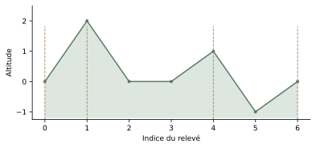
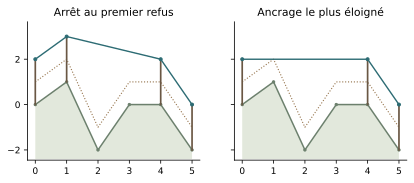
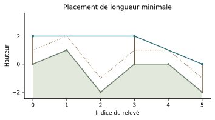

# École polytechnique · PSI et PT · Informatique 2013 · Corrigé guidé

*Corrigé rédigé par IA, non officiel. Signalez toute erreur.*

**Rédaction** · GPT-6.2 Astra Ultra · vitesse non renseignée · 25 novembre 2026

**Poteaux télégraphiques.** Le langage choisi est Python. Les tableaux du sujet sont globaux et préalloués. Les noms `ell` et `delta` codent la hauteur commune des poteaux et la garde verticale minimale.

## Repères

La distance au sol suit la ligne brisée du relief. Le fil, lui, parcourt un segment rectiligne entre les sommets de deux poteaux. Vérifier sa garde verticale et calculer sa longueur constituent deux opérations distinctes.

## I · Planter le paysage

### Question 1 · Cumuler les dénivelés

**Indication.** Le premier point a pour hauteur zéro. Le dénivelé d’indice i correspond au déplacement qui aboutit en ce point.

#### Solution

```python
def calculHauteurs(n):
    hauteurs[0] = 0.0
    for i in range(1, n + 1):
        hauteurs[i] = hauteurs[i - 1] + deniveles[i]
```

Après l’itération $i$, les hauteurs des points $0,\ldots,i$ vérifient la récurrence donnée. La case `deniveles[0]` n’intervient pas. Le coût est linéaire en $n$.

### Question 2 · Déterminer la fenêtre et les premiers extrema

**Indication.** À hauteur égale, conserver l’indice déjà enregistré.

#### Solution

```python
def calculFenetre(n):
    global hMin, hMax, iMin, iMax
    hMin = hMax = hauteurs[0]
    iMin = iMax = 0
    for i in range(1, n + 1):
        if hauteurs[i] < hMin:
            hMin, iMin = hauteurs[i], i
        if hauteurs[i] > hMax:
            hMax, iMax = hauteurs[i], i
```

Les tests sont stricts pour conserver le point le plus à gauche. L’initialisation au premier point traite également le paysage réduit à un point et les paysages dont toutes les autres altitudes sont négatives.

### Question 3 · Mesurer une distance au sol

**Indication.** La différence horizontale entre deux relevés successifs vaut toujours une unité.

#### Solution

```python
from math import sqrt

def distanceAuSol(i, j):
    if j < i:
        i, j = j, i
    longueur = 0.0
    for k in range(i + 1, j + 1):
        dh = hauteurs[k] - hauteurs[k - 1]
        longueur += sqrt(1 + dh * dh)
    return longueur
```

Le théorème de Pythagore donne la longueur de chaque pan du relief. La boucle les additionne une seule fois, en $O(|j-i|+1)$. Une distance d’un point à lui-même vaut zéro.

### Question 4 · Mesurer le plus long bassin

**Indication.** Fermer le bassin en cours à chaque pic strict et au bord droit. Un plateau ne constitue pas un pic.

#### Solution

```python
def longueurDuPlusLongBassin(n):
    debut = 0
    maximum = 0.0
    for i in range(1, n + 1):
        if i == n or (hauteurs[i - 1] < hauteurs[i] > hauteurs[i + 1]):
            maximum = max(maximum, distanceAuSol(debut, i))
            debut = i
    return maximum
```

Le test du bord droit est placé en premier pour éviter toute lecture à l’indice $n+1$. Les segments de sol visités par les différents appels sont disjoints et couvrent le paysage. Le coût total est donc $O(n)$, même si le calcul de la distance contient sa propre boucle. Pour un point isolé on convient de renvoyer zéro.



## II · Planter les poteaux

### Question 5 · Vérifier la garde verticale

**Indication.** Échanger les deux extrémités permet d’utiliser dans les deux sens la même inégalité de pente.

#### Solution

```python
def estDeltaAuDessusDuSol(i, j, ell, delta):
    if i == j:
        return ell >= delta
    if j < i:
        i, j = j, i
    pente = (hauteurs[j] - hauteurs[i]) / (j - i)
    for k in range(i + 1, j):
        seuil = (hauteurs[k] + delta - hauteurs[i] - ell) / (k - i)
        if pente < seuil:
            return False
    return True
```

Les sommets des deux poteaux sont translatés de la même hauteur $\ell$, ce qui explique son absence dans la pente du fil. L’égalité au seuil est autorisée. Sur chaque intervalle entre deux abscisses entières, la garde verticale est affine, donc son minimum est atteint à une extrémité. Les deux poteaux eux-mêmes conviennent puisque $\ell\geqslant\Delta$. Des points voisins sont toujours raccordables. Le coût est $O(|j-i|+1)$.

### Question 6 · Avancer jusqu’au premier échec

**Indication.** Depuis l’ancrage courant, le premier voisin est toujours possible. Tester chaque point suivant et s’arrêter au premier qui échoue.

#### Solution

```python
def placementGloutonEnAvant(n, ell, delta):
    poteaux[0], poteaux[1] = 1, 0
    i = 0
    while i < n:
        j = i + 1
        while j < n and estDeltaAuDessusDuSol(i, j + 1, ell, delta):
            j += 1
        poteaux[0] += 1
        poteaux[poteaux[0]] = j
        i = j
```

La case zéro contient un nombre de poteaux, les suivantes leurs indices, y compris 0 et $n$. Le tableau réserve donc $n+2$ cases pour le cas où tous les points sont retenus. L’ancrage augmente à chaque passage de boucle, ce qui garantit la terminaison. Un fil vers une destination plus lointaine peut redevenir admissible après un premier échec.

### Question 7 · Obtenir un temps linéaire pour le glouton en avant

**Indication.** Pour un même départ, un nouveau sommet intermédiaire ajoute une seule contrainte au maximum des pentes déjà calculées.

#### Solution

Le code de la question 6 coûte $O(n^2)$ dans le pire cas. Depuis un ancrage $i$, si le prochain poteau retenu est à distance $d$, les appels contrôlent des segments de longueurs au plus $2,3,\ldots,d+1$. Le coût est $O(d^2+d)$, et la somme des distances entre ancrages vaut $n$. Sur un paysage plat, tous les candidats passent depuis 0 et les vérifications complètes donnent bien un temps quadratique pour ce code.

Pour obtenir $O(n)$, initialiser un maximum $M=-\infty$ au nouvel ancrage. Avant de tester le candidat $j>i$, $M$ vaut le maximum des $\alpha_{i,k}$ pour $i<k<j$. Le candidat est accepté si $\beta_{i,j}\geqslant M$. S’il est accepté, incorporer $\alpha_{i,j}$ dans $M$ pour le candidat suivant. En cas d’échec, fixer le poteau précédent et réinitialiser le maximum pour le nouveau départ. Chaque candidat accepté fait avancer l’abscisse et chaque échec entraîne un nouvel ancrage. Il y a donc $O(n)$ tests et un nombre constant de calculs de pente par test.

### Question 8 · Choisir le poteau admissible le plus éloigné

**Indication.** La faisabilité en fonction de la destination peut revenir après un échec. Mettre à jour le seuil à chaque point, même quand ce point ne peut pas servir d’arrivée.

#### Solution

```python
def placementGloutonAuPlusLoin(n, ell, delta):
    poteaux[0], poteaux[1] = 1, 0
    i = 0
    while i < n:
        dernier = i + 1
        seuil = float("-inf")
        for j in range(i + 1, n + 1):
            dh = hauteurs[j] - hauteurs[i]
            if dh / (j - i) >= seuil:
                dernier = j
            seuil = max(seuil, (dh + delta - ell) / (j - i))
        poteaux[0] += 1
        poteaux[poteaux[0]] = dernier
        i = dernier
```

À l’entrée de chaque itération, le seuil contient exactement les contraintes des points strictement intermédiaires. Le dernier candidat accepté est le plus éloigné. Au plus $n$ ancrages inspectent chacun au plus $n$ points, donc le temps est $O(n^2)$. Les deux stratégies diffèrent déjà pour les hauteurs $(0,1,-2,0,0,-2)$ et $\ell-\Delta=1$. Le premier glouton place des poteaux aux indices $(0,1,4,5)$, le second aux indices $(0,4,5)$.



## III · Minimiser la longueur du fil

### Question 9 · Établir la récurrence du plus court fil

**Indication.** Décomposer un placement optimal à son dernier poteau précédant i. La translation verticale conserve les longueurs des segments.

#### Solution

Notons $D[i]$ la longueur minimale pour relier 0 à $i$. On a $D[0]=0$. Si $j$ est le dernier poteau avant $i$ dans un placement optimal, le dernier fil a pour longueur

$$
L_{i,j}=\sqrt{(i-j)^2+(h_i-h_j)^2}.
$$

Le préfixe jusqu’à $j$ est optimal, car un préfixe plus court pourrait le remplacer en conservant le dernier fil. Réciproquement, tout placement optimal jusqu’à un prédécesseur admissible $j$ se prolonge par le fil $j,i$. Par conséquent,

$$
D[i]=\min_{\substack{0\leqslant j<i\\ j\text{ raccordable à } i}}
       \{D[j]+L_{i,j}\}.
$$

Le minimum porte sur un ensemble non vide puisque $j=i-1$ est toujours admissible. Ces prédécesseurs ont tous été traités si l’on parcourt les destinations dans l’ordre croissant.

### Question 10 · Évaluer la longueur optimale

**Indication.** Balayer les prédécesseurs de droite à gauche pour une destination fixe. Dans ce sens, la borne pertinente est le minimum des pentes vers les sommets intermédiaires.

#### Solution

```python
def longueurMinimale(n, ell, delta):
    optL[0] = 0.0
    for i in range(1, n + 1):
        meilleur = float("inf")
        plafond = float("inf")
        for j in range(i - 1, -1, -1):
            dx = j - i
            dy = hauteurs[j] - hauteurs[i]
            if dy / dx <= plafond:
                candidat = optL[j] + sqrt(dx * dx + dy * dy)
                if candidat < meilleur:
                    meilleur = candidat
            plafond = min(plafond, (dy + delta - ell) / dx)
        optL[i] = meilleur
    return optL[n]
```

Pour le candidat $j<i$, `plafond` est le minimum des $\alpha_{i,k}$ pour $j<k<i$. On teste $\beta_{i,j}\leqslant\text{plafond}$ avant d’incorporer la pente au point $j$ qui servira aux candidats plus éloignés. Le signe de l’inégalité tient à $j-i<0$. Les $n(n+1)/2$ couples sont traités en temps constant chacun, soit $O(n^2)$ en temps et $O(n)$ pour le tableau.

### Question 11 · Enregistrer un prédécesseur optimal

**Indication.** Mémoriser l’indice au moment précis où le meilleur coût change.

#### Solution

Au début de `longueurMinimale`, juste après l’initialisation de `optL[0]`, écrire `precOptL[0] = -1`. Dans la boucle sur les prédécesseurs, remplacer la mise à jour du meilleur par les deux affectations suivantes.

```python
if candidat < meilleur:
    meilleur = candidat
    precOptL[i] = j
```

Ce test se situe à l’intérieur de la condition de raccordement. Le premier candidat, $i-1$, est admissible et améliore la valeur infinie initiale, de sorte que chaque case reçoit une valeur. En cas d’égalité, le parcours décroissant conserve le plus grand indice parmi les prédécesseurs optimaux. Le temps reste $O(n^2)$.

### Question 12 · Reconstruire le placement dans le bon sens

**Indication.** La chaîne des prédécesseurs va de n à zéro. Enregistrer cette chaîne puis inverser les positions utiles en laissant le compteur en place.

#### Solution

```python
def placementOptimal(n):
    nombre = 0
    i = n
    while i != -1:
        nombre += 1
        poteaux[nombre] = i
        i = precOptL[i]
    poteaux[0] = nombre
    gauche, droite = 1, nombre
    while gauche < droite:
        poteaux[gauche], poteaux[droite] = poteaux[droite], poteaux[gauche]
        gauche += 1
        droite -= 1
```

Les prédécesseurs décroissent strictement avant la sentinelle $-1$. Après inversion, on lit le bord gauche, les ancrages intermédiaires et le bord droit dans l’ordre requis. Pour $p$ poteaux la reconstruction coûte $\Theta(p)$, donc $O(n+1)$ au pire, et utilise un espace auxiliaire constant. Sur l’exemple de la question 8, un optimum est $(0,3,5)$, de longueur $3+\sqrt{8}$, inférieure à la longueur $4+\sqrt{5}$ du glouton au plus loin.


