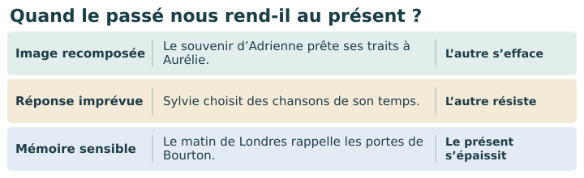

# Banque PT — Français A 2014 · Corrigé guidé

*Corrigé rédigé par IA, non officiel. Signalez toute erreur.*

**Rédaction** · GPT-6.2 Astra Ultra · vitesse non renseignée

**Révision (tour 1)** · GPT-6.2 Astra Ultra · vitesse non renseignée

[Énoncé officiel](https://www.banquept.fr/documents/2014/fr_a_2014_pt.pdf) · [Rapport du jury](https://www.banquept.fr/documents/ecrit/rapport/2014/rapport_fra_a_ecrit_2014.pdf) · [Programme officiel](https://www.education.gouv.fr/bo/13/Hebdo26/ESRS1300172A.htm) · [Grille de la session](https://www.banquept.fr/documents/livret/2014/Livret_PT_2014.pdf#page=12)

Épreuve de quatre heures sur « Le temps vécu ». Gérard de Nerval, Sylvie · Virginia Woolf, Mrs Dalloway (traduction de Marie-Claire Pasquier) · Henri Bergson, Essai sur les données immédiates de la conscience, chapitre II.

## Sujet

Louis Lavelle, La conscience de soi (1933).

« On s’ennuie du présent, on désire languissamment une situation où l’on n’est pas et dont on s’ennuie, quand on y est, comme de l’autre. Celle-ci à son tour fait l’objet du regret, tant il est vrai que l’imagination se nourrit de l’irréel du passé ou de l’avenir, au lieu que le présent est l’austère rempart d’une forte pensée, la colonne de l’esprit. »

Dans quelle mesure votre lecture des œuvres au programme sur le thème Le temps vécu vous permet-elle de souscrire à ces propos du philosophe Louis Lavelle (La conscience de soi 1933) ?

## Préparer la dissertation

**Quelle différence entre le constat et le jugement de Lavelle ?**

Reconstituez dans l’ordre les deux situations et le désir qui se déplace. Relisez ensuite les deux images architecturales. Ce que protège le rempart, ce qui repose sur la colonne, c’est la force de la pensée.

**Comment le chapitre II de Bergson déplace-t-il la question ?**

Distinguez le souvenir qu’on se représente à distance et la conservation du son précédent dans une mélodie actuelle. Celle-ci deviendrait inaudible sans la pénétration réciproque de ses moments.

**Que fait le roman de la mémoire ?**

Confrontez une reconnaissance imaginaire, Aurélie prise pour l’image d’Adrienne, et une réminiscence sensible, l’ouverture des portes à Bourton. Le premier rapprochement peut masquer la personne présente, le second approfondit une sensation actuelle.

## Dissertation

Dans Sylvie, une nouvelle lue dans un journal suffit à faire changer le narrateur de lieu et d’époque. Une fête va se tenir dans le Valois. Il quitte Paris, porté par l’espoir d’y retrouver ce que des années d’éloignement semblent avoir placé hors d’atteinte. Mais retrouver quoi, et retrouver qui ? Sylvie n’a pas arrêté de vivre pendant qu’il rêvait d’elle. Selon Lavelle, nous désirons volontiers dans le passé ou l’avenir ce qui nous ennuierait au présent. Nous regrettons ensuite la situation que nous venons de quitter. Le philosophe oppose à ce mouvement sans progrès le présent comme « austère rempart d’une forte pensée ». Comment le temps dont on s’ennuie peut-il aussi soutenir l’effort de l’esprit ? Tout dépend de ce qui, dans notre désir d’ailleurs, nous distrait des êtres et de ce qui nous rend au contraire capables de les rencontrer.

Il y a une facilité propre aux choses absentes. Nous pouvons en changer les traits, en retrancher un détail qui nous déplaît, ou reporter sur elles une autre image. Le narrateur de Nerval admire au théâtre Aurélie, qu’il connaît à peine et dont la figure se détache dans la lumière de la scène. Son souvenir d’Adrienne, autrefois entrevue durant une ronde, donne à l’actrice une profondeur mystérieuse. Ce rapprochement doit précisément sa force à ce qu’aucune de ces figures ne vient d’abord le démentir. Au lieu d’apprendre qui est Aurélie, l’amoureux peut croire reconnaître en elle celle qu’il a déjà perdue. Le désir « languissamment » entretenu que décrit Lavelle trouve ici son régime. Il se prolonge de lui-même tant qu’il peut se dispenser d’une réponse.

La métamorphose du désir en regret est encore plus sensible dans Mrs Dalloway. La visite de Peter Walsh, de retour à Londres, rend à Clarissa le passé de Bourton, jusque dans le geste familier du canif qu’il manie en conversant. Chacun peut, devant l’autre, imaginer la vie qu’aurait ouverte une réponse différente à l’ancienne demande en mariage. Mais la présence de Peter fait aussi revivre ce qui inquiétait Clarissa dans leur intimité. Il juge, interroge, voudrait savoir ce qu’elle éprouve. Un passé que l’éloignement pouvait rendre désirable reprend, au contact d’une personne réelle, quelque chose de sa difficulté première. Lavelle explique ainsi pourquoi changer de situation ne nous guérit pas nécessairement de l’insatisfaction. La distance embellit jusqu’à ce que la rencontre oblige à préciser ce que nous voulions.

Est-ce alors d’une défense contre l’imagination que nous aurions besoin ? Le rempart de Lavelle protège l’esprit en lui donnant un objet qui résiste à ses fantaisies. Dans Sylvie, la jeune femme a ses occupations, ses goûts, ses projets. Le narrateur voudrait l’entendre reprendre des airs anciens. Elle connaît des chansons nouvelles. Ce désaccord modeste importe davantage, pour la connaître, que bien des tableaux composés en son absence. Si la pensée a pour tâche de rendre justice à un être, son premier effort sera de lui laisser ce droit de changer. L’austérité du présent désigne ici le renoncement qu’il faut consentir pour entendre une réponse qu’on n’avait pas écrite d’avance.

Il serait pourtant bien difficile de se tenir dans un présent que l’on aurait vidé du passé. Le deuxième chapitre de l’Essai sur les données immédiates de la conscience permet de mesurer cette difficulté. Dans une mélodie, nous n’entendrions aucun rapport entre deux sons si le premier disparaissait entièrement quand survient le second. Nous pouvons certes écrire les notes les unes à côté des autres. Mais pour les entendre en mélodie, il faut que celle qui passe modifie l’ensemble qui se poursuit, sans se maintenir à part comme un objet immobile. Le passé qui demeure actif ici n’a rien de la situation imaginaire dont parle Lavelle. Il n’est même pas nécessaire de se rappeler distinctement la première note. On entend sa persistance à la manière dont la suivante prend, dans cette phrase musicale, une valeur qu’elle n’aurait pas isolément. Le rempart s’écroulerait si on voulait le bâtir d’instants parfaitement séparés.

Woolf donne à cette objection une évidence sensible dès la première sortie de Clarissa. Elle va acheter des fleurs. En éprouvant la fraîcheur du matin londonien, elle retrouve jusque dans son corps le geste de pousser les portes-fenêtres à Bourton. On chercherait vainement le moment où l’héroïne décide de quitter le présent pour un séjour imaginaire à la campagne. Le mouvement matinal a une profondeur telle que des sensations éloignées s’y font écho. Clarissa continue de traverser Londres, parmi les voitures et les passants. C’est la romancière qui nous fait éprouver ce que cette simple course contient d’une vie entière. Une pensée fidèle au présent devra donc parfois convoquer ce qui a été, sous peine de donner une idée appauvrie de ce qui est.

Il en va de même de l’avenir. Attendre des invités pourrait signifier que l’on traite la journée comme un délai vide avant la soirée désirée. Pourtant Clarissa passe aussi cette journée à ménager les conditions dans lesquelles d’autres pourront se rencontrer. Mettre en relation des êtres séparés donne un sens présent aux préparatifs les plus ordinaires. De même, si Nerval avait seulement voulu opposer réalité et songe, il aurait pu terminer son récit sur un retour au calme du Valois. Or il construit un récit qui distingue, après coup, les temps et les personnes que le désir du narrateur avait mêlés. Le travail de remémoration peut défaire une illusion entretenue par le souvenir. Il est alors un acte de pensée accompli maintenant.

On peut donc souscrire à l’exigence de Lavelle plus aisément qu’à une condamnation de l’imagination en général. Le regret et l’attente stériles ont en commun de priver autrui du pouvoir de nous surprendre. Le présent rend ce pouvoir à Sylvie lorsqu’elle refuse de se conformer à son ancienne image. Mais la durée dont parle Bergson et la matinée de Clarissa montrent tout ce qui survit et s’annonce dans l’attention la plus exacte. La colonne de l’esprit tient à la force de soutenir cette rencontre, y compris lorsque ce qui vient à notre rencontre est un passé que nous n’avions pas encore compris.

