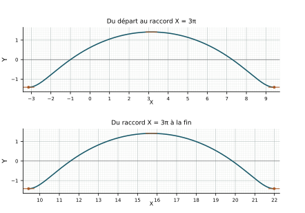
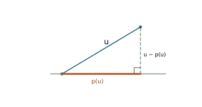

# Banque PT — Mathématiques A 2014 · Corrigé guidé

*Corrigé rédigé par IA, non officiel. Signalez toute erreur.*

**Rédaction** · GPT-6.2 Astra Ultra · vitesse non renseignée · 26 novembre 2026

Le calendrier du livret fixe l’épreuve au lundi 12 mai 2014, de 14 h à 18 h. La garde porte le code 098 et interdit la calculatrice. Les questions occupent les pages 2 à 4 du PDF de cinq pages. La garde demande de rendre une feuille de papier millimétré. Le PDF institutionnel ne fournit aucune grille préimprimée. Le tracé est reproduit sur une grille originale. [Sujet de la Banque PT](https://www.banquept.fr/documents/2014/math_a_2014_pt.pdf) · [Rapport du jury](https://www.banquept.fr/documents/ecrit/rapport/2014/rapport_math_a_ecrit_2014.pdf) · [Livret annuel, p. 8 et 9](https://www.banquept.fr/documents/livret/2014/Livret_PT_2014.pdf)

## I. Étude d’une projection orthogonale

### Question I.1.a

> [!INDICATION]
> Que devient un vecteur appartenant déjà à la droite ?

#### Solution

Le projeté $p_D(u)$ appartient à $D$. La projection fixe tout vecteur de $D$, donc $p_D^2=p_D$ et $A^2=A$.

### Question I.1.b

> [!INDICATION]
> Utiliser le caractère orthogonal de la projection.

#### Solution

Le vecteur $u-p_D(u)$ appartient au plan $F=D^\perp$. Comme $n=(i+k)/\sqrt2$ dirige $D$, on a $\langle u-p_D(u),n\rangle=0$ pour tout $u$.

### Question I.1.c

> [!INDICATION]
> Écrire le projeté comme un multiple de la normale unitaire.

#### Solution

Il existe $\alpha$ tel que $p_D(u)=\alpha n$. D’après I.1.b, $\langle u,n\rangle=\langle p_D(u),n\rangle=\alpha\|n\|^2=\alpha$. Ainsi $p_D(u)=\langle u,n\rangle n$.

### Question I.1.d

> [!INDICATION]
> Se rappeler que n appartient à l’image du projecteur.

#### Solution

Le vecteur $n$ appartient à $D$ et y est unitaire. La formule précédente donne $p_D(n)=n$.

### Question I.1.e

> [!INDICATION]
> Distinguer le vecteur de son coefficient multiplicatif.

#### Solution

Un vecteur propre d’un endomorphisme $T$ est un vecteur $v\ne0$ tel que $T(v)=\lambda v$ pour un scalaire $\lambda$, sa valeur propre associée.

### Question I.1.f

> [!INDICATION]
> Appliquer deux fois un projecteur à un vecteur propre.

#### Solution

Si $p_D(v)=\lambda v$ avec $v\ne0$, l’idempotence impose $(\lambda^2-\lambda)v=0$, donc $\lambda\in\{0,1\}$. Par I.1.c, son noyau est $F=\{(x,y,z):x+z=0\}$ et il fixe exactement son image $D=\mathbb R(1,0,1)$. Les vecteurs propres pour zéro sont ceux de $F\setminus\{0\}$, ceux pour un sont ceux de $D\setminus\{0\}$. Les deux valeurs existent.

### Question I.1.g

> [!INDICATION]
> Réunir des bases de l’image et du noyau.

#### Solution

La décomposition orthogonale $\mathbb R^3=D\oplus F$ est une somme de sous-espaces propres. Une base de $D$ réunie à une base de $F$ est donc une base propre, ce qui rend $p_D$ diagonalisable.

### Question I.1.h

> [!INDICATION]
> Calculer le produit extérieur de la colonne n et de sa transposée.

#### Solution

Par I.1.c, $A=n n^{\mathsf T}$. Avec $n=(1,0,1)^{\mathsf T}/\sqrt2$, on obtient
$$A=\tfrac12\begin{pmatrix}1&0&1\\0&0&0\\1&0&1\end{pmatrix}.$$
Les première et troisième colonnes sont identiques car les projections de ces deux vecteurs canoniques coïncident.

### Question I.2.a

> [!INDICATION]
> Exprimer le projecteur complémentaire de p_D.

#### Solution

La question I.2 reprend les huit demandes de I.1 pour $p_F$ et sa matrice $B$. La décomposition $u=p_D(u)+p_F(u)$ donne $p_F=\mathrm{Id}-p_D$. Ainsi $p_F^2=\mathrm{Id}-2p_D+p_D^2=p_F$ et $B^2=B$.

### Question I.2.b

> [!INDICATION]
> Le résidu est cette fois dirigé selon D.

#### Solution

Pour tout $u$, $u-p_F(u)=p_D(u)\in D$. Le résidu est orthogonal à tout $v\in F$. En particulier, le produit avec $n$ demandé littéralement en I.1.b vaudrait ici $\langle u-p_F(u),n\rangle=\langle u,n\rangle$.

### Question I.2.c

> [!INDICATION]
> Soustraire la composante selon la normale.

#### Solution

Le projeté sur $F$ est $p_F(u)=u-\langle u,n\rangle n$. Son produit scalaire avec $n$ est nul et le vecteur soustrait est bien orthogonal au plan.

### Question I.2.d

> [!INDICATION]
> Calculer le projeté de n sur son plan orthogonal.

#### Solution

Par I.2.c et $\|n\|=1$, on a $p_F(n)=0$. Chaque vecteur de $F$ est, au contraire, fixé.

### Question I.2.e

> [!INDICATION]
> Reprendre la définition en I.1.e.

#### Solution

Un vecteur propre pour $p_F$ est un $v\ne0$ tel que $p_F(v)=\lambda v$. En particulier un vecteur propre peut avoir une image nulle si sa valeur propre est zéro.

### Question I.2.f

> [!INDICATION]
> Échanger les rôles des espaces fixes et annulés.

#### Solution

L’idempotence assure que les seules valeurs possibles sont zéro et un. Le noyau vaut $D$, car $p_F(u)=0$ équivaut à $u=p_D(u)$. L’espace des vecteurs fixes est $F$. Les vecteurs non nuls de ces deux espaces sont exactement les vecteurs propres de valeurs respectives zéro et un.

### Question I.2.g

> [!INDICATION]
> Identifier deux espaces propres supplémentaires.

#### Solution

La réunion d’une base de $D$ et d’une base de $F$ est encore une base propre de $p_F$, cette fois associée aux valeurs $0,1,1$. Le projecteur est donc diagonalisable.

### Question I.2.h

> [!INDICATION]
> Passer à la matrice de l’identité moins A.

#### Solution

En soustrayant la matrice de I.1.h à l’identité, on obtient
$$B=I_3-A=\tfrac12\begin{pmatrix}1&0&-1\\0&2&0\\-1&0&1\end{pmatrix}.$$

## II. Changement de base et orientation indirecte

### Question II.1

> [!INDICATION]
> Décomposer k en une composante dans F et une composante dans D.

#### Solution

On a $I=p_F(k)/\|p_F(k)\|$. Ce dénominateur est non nul puisque $k$ n’est pas colinéaire à $n$. La définition de la base orthonormée $(I,J,n)$ impose $J\perp n$, donc $J\in F$, et $J\perp I$. Comme $k=\|p_F(k)\|I+p_D(k)$ avec $p_D(k)\in D$, on a aussi $J\perp k$. Ainsi $J\in F\cap\operatorname{Vect}(i,j)$. Ce raisonnement n’utilise pas les coordonnées de $I,J$.

### Question II.2

> [!INDICATION]
> Fixer le signe du vecteur J par l’orientation.

#### Solution

On utilise la convention où les colonnes de $P$ donnent les nouveaux vecteurs dans l’ancienne base. I.2.h donne $p_F(k)=(-i+k)/2$, donc $I=(-i+k)/\sqrt2$. Par II.1, $J$ est dans le plan horizontal et orthogonal à $n$, donc vaut $j$ ou $-j$. Comme $I\times j=-n$, le choix indirect requis est $J=j$. Ainsi
$$P=\begin{pmatrix}-1/\sqrt2&0&1/\sqrt2\\0&1&0\\1/\sqrt2&0&1/\sqrt2\end{pmatrix}.$$
On vérifie $\det P=-1$ et $P^{-1}=P^{\mathsf T}=P$.

### Question II.3

> [!INDICATION]
> Résoudre les deux relations définissant I et n.

#### Solution

Puisque $I=(-i+k)/\sqrt2$ et $n=(i+k)/\sqrt2$, on obtient $i=(-I+n)/\sqrt2$, $j=J$ et $k=(I+n)/\sqrt2$. La projection sur $F$ conserve les composantes selon $I,J$ et supprime celle selon $n$. Donc $p_F(i)=-I/\sqrt2$, $p_F(j)=J$ et $p_F(k)=I/\sqrt2$.

### Question II.4

> [!INDICATION]
> Appliquer p_F à la combinaison linéaire des trois vecteurs canoniques.

#### Solution

Pour $u=x i+y j+z k$, II.3 donne $p_F(u)=(z-x)I/\sqrt2+yJ$. Ses coordonnées sont donc $X=(z-x)/\sqrt2$ et $Y=y$.

## III. Projection d’une hélice

### Question III.1.a

> [!INDICATION]
> Insérer les coordonnées de l’hélice dans II.4.

#### Solution

L’hélice est donnée par $x=\sqrt2\cos t$, $y=\sqrt2\sin t$, $z=2\sqrt2 t$. Le plan passe par l’origine, si bien que le projeté affine s’obtient avec le projecteur vectoriel. II.4 donne $X(t)=2t-\cos t$ et $Y(t)=\sqrt2\sin t$ pour $t\in\mathbb R$.

### Question III.1.b

> [!INDICATION]
> Tester la composante horizontale du vecteur vitesse.

#### Solution

Le vecteur vitesse vaut $(2+\sin t,\sqrt2\cos t)$. Sa première composante est au moins un, donc il ne s’annule jamais. Tous les points paramétrés sont réguliers.

### Question III.1.c

> [!INDICATION]
> Comparer les paramètres t, π−t et t+2π.

#### Solution

On a $X(\pi-t)=2\pi-X(t)$ et $Y(\pi-t)=Y(t)$. L’arc pour $\pi/2\le t\le3\pi/2$ se déduit donc de celui pour $-\pi/2\le t\le\pi/2$ par réflexion d’axe $X=\pi$. En outre $X(t+2\pi)=X(t)+4\pi$, $Y(t+2\pi)=Y(t)$. Toutes les translations de vecteur $(4k\pi,0)$, $k\in\mathbb Z$, de l’arc construit sur $[-\pi/2,3\pi/2]$ donnent la courbe entière.

### Question III.1.d

> [!INDICATION]
> Étudier les dérivées et calculer les trois positions caractéristiques.

#### Solution

Sur $[-\pi/2,\pi/2]$, $X'=2+\sin t>0$ et $Y'=\sqrt2\cos t>0$ à l’intérieur. Les deux coordonnées sont strictement croissantes. Aux paramètres $-\pi/2,0,\pi/2$, on obtient respectivement $(-\pi,-\sqrt2)$, $(-1,0)$ et $(\pi,\sqrt2)$. Les tangentes aux extrémités sont horizontales. Au paramètre zéro, la pente est $Y'/X'=1/\sqrt2$.

### Question III.1.e

> [!INDICATION]
> Construire le premier arc, puis son symétrique, puis translater la période entière.

#### Solution

L’intervalle imprimé va de $-\pi/2$ à $\pi/2+3\pi=7\pi/2$. Dans l’ordre du parcours, les extrema de $Y$ ont pour abscisses $-\pi,\pi,3\pi,5\pi,7\pi$ et pour ordonnées $-\sqrt2,\sqrt2,-\sqrt2,\sqrt2,-\sqrt2$. Les intersections avec l’axe horizontal ont pour abscisses $-1,2\pi+1,4\pi-1,6\pi+1$. Le tracé croît toujours en abscisse, même aux tangentes horizontales. Sa largeur est $8\pi$ unités. Sur la feuille A4, les deux bandes conservent l’échelle 1 et se raccordent en $(3\pi,-\sqrt2)$. Le feuillet institutionnel mentionne un document-réponse joint qui ne figure pas dans le PDF de cinq pages. La disposition de la feuille originale reste à vérifier. La grille de cette figure respecte la consigne d’échelle.

## IV. Caractérisations des projecteurs orthogonaux

### Question IV.1

> [!INDICATION]
> Appliquer Pythagore à la décomposition selon l’image et son orthogonal.

#### Solution

Par définition, $u=p(u)+(u-p(u))$ avec $p(u)$ orthogonal à $u-p(u)$. Donc $\|u\|^2=\|p(u)\|^2+\|u-p(u)\|^2\ge\|p(u)\|^2$. Les normes étant positives ou nulles, $\|p(u)\|\le\|u\|$.

### Question IV.2.a

> [!INDICATION]
> Montrer que la décomposition est toujours possible et que l’intersection est nulle.

#### Solution

Pour tout $u$, $p(u)\in\operatorname{Im}p$ et $p(u-p(u))=p(u)-p^2(u)=0$. Si $v=p(w)$ appartient aussi au noyau, $v=p^2(w)=p(v)=0$. Ainsi $\mathbb R^n=\operatorname{Im}p\oplus\ker p$.

### Question IV.2.b

> [!INDICATION]
> Décrire l’action sur les deux termes de la somme directe.

#### Solution

Sur son image, $p$ est l’identité puisque $p^2=p$. Sur son noyau, il est nul. Pour $x\in\operatorname{Im}p$ et $y\in\ker p$, $p(x+y)=x$. C’est la projection sur son image parallèlement à son noyau.

### Question IV.3.a

> [!INDICATION]
> Développer le carré pour u = x+λy puis utiliser tous les λ réels.

#### Solution

Pour $x\in\operatorname{Im}p$ et $y\in\ker p$, $p(x+\lambda y)=x$. L’hypothèse de contraction donne, par élévation au carré, $0\le2\lambda\langle x,y\rangle+\lambda^2\|y\|^2$ pour tout réel $\lambda$. Si $y=0$, le produit scalaire est nul. Sinon, choisir $\lambda=-\langle x,y\rangle/\|y\|^2$ donne $0\le-\langle x,y\rangle^2/\|y\|^2$, d’où $\langle x,y\rangle=0$.

### Question IV.3.b

> [!INDICATION]
> Réunir orthogonalité et somme directe.

#### Solution

Par IV.3.a, $\ker p\subset(\operatorname{Im}p)^\perp$. Les deux espaces ont même dimension $n-\operatorname{rg}p$ par le théorème du rang, donc ils sont égaux. La description de IV.2.b identifie $p$ à la projection orthogonale.

### Question IV.4.a

> [!INDICATION]
> Examiner chacun des coefficients sur la base canonique.

#### Solution

Posons $f^*(x)=\sum_i\langle f(e_i),x\rangle e_i$. Chaque coefficient est une forme linéaire de la variable réelle $x$. La somme définit donc une application linéaire de $\mathbb R^n$ dans lui-même, c’est-à-dire un endomorphisme.

### Question IV.4.b

> [!INDICATION]
> Développer x dans la base orthonormée canonique.

#### Solution

Pour $x=\sum_i x_i e_i$, on a $\langle f(x),y\rangle=\sum_i x_i\langle f(e_i),y\rangle$. D’autre part $\langle x,f^*(y)\rangle=\sum_i\langle x,e_i\rangle\langle f(e_i),y\rangle$, de même valeur puisque $\langle x,e_i\rangle=x_i$. L’identité est établie pour tous $x,y$.

### Question IV.4.c

> [!INDICATION]
> Fixer y et choisir le vecteur test dans la direction de la différence.

#### Solution

Si $g$ vérifie la même identité, $\langle x,g(y)-f^*(y)\rangle=0$ pour tout $x$. Prendre $x=g(y)-f^*(y)$ donne une norme au carré nulle. Ainsi $g(y)=f^*(y)$ pour tout $y$ et $g=f^*$.

### Question IV.5.a

> [!INDICATION]
> Décomposer le second vecteur selon l’image et le noyau.

#### Solution

Écrivons $y=p(y)+(y-p(y))$. Le second terme est dans $\ker p$, orthogonal à $p(x)\in\operatorname{Im}p$. Donc $\langle p(x),y\rangle=\langle p(x),p(y)\rangle$.

### Question IV.5.b

> [!INDICATION]
> Permuter x et y dans l’identité précédente.

#### Solution

La symétrie du produit scalaire et IV.5.a donnent $\langle p(x),y\rangle=\langle p(x),p(y)\rangle=\langle x,p(y)\rangle$. Par l’unicité de IV.4.c, $p=p^*$.

### Question IV.6.a

> [!INDICATION]
> Tester un vecteur de l’image sur chaque vecteur du noyau.

#### Solution

Si $v=p^*(u)$ et $z\in\ker p$, alors $\langle z,v\rangle=\langle p(z),u\rangle=0$ par IV.4.b. Ainsi $\operatorname{Im}p^*\subset(\ker p)^\perp$.

### Question IV.6.b

> [!INDICATION]
> Le résidu appartient toujours au noyau, même pour une projection oblique.

#### Solution

Pour $y\in(\ker p)^\perp$ et tout $x$, le vecteur $x-p(x)$ est dans $\ker p$ par IV.2.a. Donc $\langle x-p(x),y\rangle=0$, soit $\langle x,y-p^*(y)\rangle=0$ pour tout $x$. Tester $x=y-p^*(y)$ donne $y=p^*(y)\in\operatorname{Im}p^*$. Avec IV.6.a, il vient $\operatorname{Im}p^*=(\ker p)^\perp$.

### Question IV.6.c

> [!INDICATION]
> Identifier l’image de p à l’orthogonal du noyau.

#### Solution

Si $p=p^*$, IV.6.b donne $\operatorname{Im}p=(\ker p)^\perp$. Par IV.2, $p$ projette sur son image parallèlement au noyau, et ces deux espaces sont orthogonaux. C’est donc le projecteur orthogonal sur $\operatorname{Im}p$.
