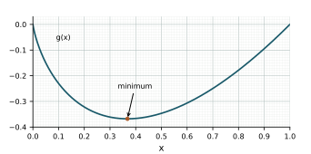
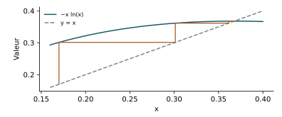

# Banque PT — Mathématiques C 2014 · Corrigé brut

*Corrigé rédigé par IA, non officiel. Signalez toute erreur.*

**Rédaction** · GPT-6.2 Astra Ultra · vitesse non renseignée · 26 novembre 2026

Le calendrier du livret fixe l’épreuve au mardi 6 mai 2014, de 14 h à 18 h. La garde porte le code 100 et interdit la calculatrice. Les questions occupent les pages 2 à 5 du PDF de cinq pages. La garde demande de rendre une feuille de papier millimétré. Le PDF institutionnel ne fournit aucune grille préimprimée. Le tracé est reproduit sur une grille originale. [Sujet de la Banque PT](https://www.banquept.fr/documents/2014/math_c_2014_pt.pdf) · [Rapport du jury](https://www.banquept.fr/documents/ecrit/rapport/2014/rapport_math_c_ecrit_2014.pdf) · [Livret annuel, p. 8 et 9](https://www.banquept.fr/documents/livret/2014/Livret_PT_2014.pdf)

## I. Reste de la série exponentielle

### Question I.1.a

Notons $S_n(t)=\sum_{k=0}^nt^k/k!$ et $R_n=e^t-S_n$. Pour $n\ge1$, $S_n'=S_{n-1}$, d’où $R_n'-R_n=S_n-S_{n-1}=t^n/n!$. Pour $n=0$, $R_0=e^t-1$ donne directement $R_0'-R_0=1$. L’égalité vaut sur $\mathbb R$.

### Question I.1.b

L’équation $y'-y=0$ équivaut à $(e^{-t}y)'=0$. Sur l’intervalle $\mathbb R$, les solutions sont donc $y(t)=c e^t$ pour un réel $c$.

### Question I.1.c

On a $(e^{-t}y(t))'=t^ne^{-t}/n!$. Par intégration depuis zéro, les solutions sont
$$y(t)=e^t\left(c+\frac1{n!}\int_0^t s^n e^{-s}\,ds\right),\qquad c\in\mathbb R.$$
L’intégrale est orientée pour $t<0$. La dérivation de l’expression redonne l’équation, ce qui vérifie la réciproque.

### Question I.1.d

Comme $S_n(0)=1$, on a $R_n(0)=0$. La constante de I.1.c est donc nulle pour cette solution. Ainsi $R_n(t)=\frac1{n!}\int_0^t s^n e^{t-s}\,ds$ sur tout $\mathbb R$.

### Question I.1.e

Pour $t\ge0$, $0\le e^{t-s}s^n\le e^t s^n$ lorsque $0\le s\le t$. L’intégration dans I.1.d donne $0\le R_n(t)\le e^t t^{n+1}/(n+1)!$, soit aussi la majoration du module.

### Question I.1.f

Fixons $t$. Pour $t\ge0$, I.1.e tend vers zéro car le quotient de deux majorants successifs est $t/(n+2)\to0$. Pour $t<0$ et $t\le s\le0$, $e^{t-s}\le1$. Par I.1.d, $|R_n(t)|\le |t|^{n+1}/(n+1)!$, qui tend aussi vers zéro. Ainsi $e^t=\sum_{k\ge0}t^k/k!$ pour chaque $t\in\mathbb R$. Le quotient des modules de deux termes successifs vaut $|t|/(k+1)$ pour $t\ne0$ et tend vers zéro. Le rayon de convergence est infini.

### Question I.2.a

Posons $u_n=\sum_{k=0}^n1/k!$ et $v_n=u_n+1/(n\,n!)$, $n\ge1$. Alors $u_{n+1}-u_n=1/(n+1)!>0$, tandis que
$$v_{n+1}-v_n=\frac1{(n+1)!}\left(1+\frac1{n+1}-\frac{n+1}{n}\right)=-\frac1{n(n+1)(n+1)!}<0.$$
La première suite croît donc strictement tandis que la seconde décroît strictement.

### Question I.2.b

On a $v_n-u_n=1/(n\,n!)>0$ et cette différence tend vers zéro. Avec les monotonies de I.2.a, ces propriétés établissent l’adjacence et l’existence d’une limite commune.

### Question I.2.c

Par I.1.f en $t=1$, $u_n\to e$. Les suites adjacentes ont la même limite, donc $v_n\to e$ également. Pour tout $q\ge1$, $u_q<u_{q+1}\le e\le v_{q+1}<v_q$.

### Question I.2.d

Si $e=p/q$ avec $p,q$ entiers positifs, $q!e=(q-1)!p$ est entier. Le nombre $m=q!u_q=\sum_{k=0}^q q!/k!$ l’est également. Or I.2.c donne $m<q!e<m+1/q\le m+1$. Aucun entier ne satisfait ces inégalités strictes. Donc $e$ est irrationnel, y compris après examen du cas $q=1$.

### Question I.2.e.i

Comme $u_n\to e$, pour tout $\varepsilon>0$ il existe un rang $n_0$ tel que $n\ge n_0$ entraîne $|u_n-e|\le\varepsilon/2$.

### Question I.2.e.ii

Posons $C=\sum_{k=1}^{n_0-1}|u_k-e|$, avec somme vide nulle. Pour $n\ge n_0$,
$$|w_n-e|\le\frac{C}{n}+\frac{n-n_0+1}{n}\frac{\varepsilon}{2}\le C/n+\varepsilon/2.$$
Il suffit de prendre $n_1\ge n_0$ avec $n_1\ge2C/\varepsilon$ pour obtenir $|w_n-e|\le\varepsilon$ lorsque $n\ge n_1$.

### Question I.2.e.iii

La borne de I.2.e.ii est valable pour tout $\varepsilon>0$ à partir d’un rang dépendant de $\varepsilon$. Par définition, $w_n\to e$.

### Question I.3

Pour $n>1$, $\log e_n=-n\log(1-1/n)$ tend vers $1$ car $\log(1+h)/h\to1$ en zéro. Par continuité de l’exponentielle, $e_n\to e$.

## II. Itération de −x ln(x) et intégration de x puissance −x

### Question II.1

Pour $0<x\le1$, $g(x)=x\ln x$, et $g(0)=0$. Comme $x\ln x\to0$ en $0^+$, $g$ est continue sur $[0,1]$. Sa dérivée $1+\ln x$ s’annule seulement en $e^{-1}$. La fonction décroît strictement de zéro à $-e^{-1}$, puis croît strictement jusqu’à $g(1)=0$. Au minimum la tangente est horizontale, tandis qu’en zéro $g(x)/x=\ln x\to-\infty$ donne une demi-tangente verticale. Le tracé utilise 10 cm par unité sur chacun des deux axes.

### Question II.2

La fonction $|g|$ est continue sur le compact $[0,1]$, donc son supremum est atteint. Comme $g$ y est négative ou nulle, son minimum de II.1 fournit $M=\max |g|=e^{-1}$.

### Question II.3

Posons $a=e^{-1}$ et $F(x)=-x\ln x$. Pour $x\in[t_0,a]$, $\ln x\le-1$ donc $F(x)\ge x$. Comme $F$ est croissante sur ce segment, $F(x)\le F(a)=a$. Dès le rang zéro on a donc $t_0\le t_1\le a$. Si $t_n\in[t_0,a]$, la même propriété donne $t_0\le t_n\le t_{n+1}\le a$. L’induction prouve tout l’encadrement.

### Question II.4

Si $f$ est de classe $C^{m+1}$ sur le segment de $a$ à $x$ et $|f^{(m+1)}|\le K$ sur ce segment, alors
$$\left|f(x)-\sum_{j=0}^m\frac{f^{(j)}(a)}{j!}(x-a)^j\right|\le\frac{K|x-a|^{m+1}}{(m+1)!}.$$
Cette majoration suit de la formule de Taylor avec reste de Lagrange, ou de sa forme intégrale.

### Question II.5

Sur $[t_0,a]$, $g$ est deux fois continûment dérivable, $g'(a)=0$ et $|g''(x)|=1/x\le1/t_0$. II.4 à l’ordre un donne donc $|g(x)-g(a)|\le|x-a|^2/(2t_0)$.

### Question II.6

Avec $d_n=|t_n-a|$, II.3 et II.5 donnent $d_{n+1}\le d_n^2/(2t_0)$. En posant $u_n^*=d_n/(2t_0)$, on obtient $u_{n+1}^*\le(u_n^*)^2$. Une récurrence donne $u_n^*\le(u_0^*)^{2^n}$, donc
$$|t_n-a|\le2t_0\left(\frac{a-t_0}{2t_0}\right)^{2^n}.$$

### Question II.7

L’hypothèse $a/3<t_0<a$ donne $0<(a-t_0)/(2t_0)<1$. Puisque $2^n\to\infty$, le membre de droite de II.6 tend vers zéro. Par conséquent $t_n\to e^{-1}$.

### Question II.8.a

Sur $(0,1]$, $x^{-x}=e^{-g(x)}$. Ce membre tend vers $1$ en zéro puisque $g(x)\to0$. L’intégrande admet donc un prolongement continu sur $[0,1]$, ce qui assure l’existence de $I$.

### Question II.8.b

Posons $\widetilde R_n(x)=R_n(-x\ln x)$ pour $x>0$ et $\widetilde R_n(0)=0$. L’identité de définition de $R_n$ donne $x^{-x}=\sum_{k=0}^n(-1)^kx^k(\ln x)^k/k!+\widetilde R_n(x)$. Chaque terme se prolonge continûment en zéro (valeur un pour $k=0$, zéro sinon). L’intégration de cette somme finie donne
$$I=\sum_{k=0}^n\frac{(-1)^k}{k!}\int_0^1x^k(\ln x)^k\,dx+\int_0^1\widetilde R_n(x)\,dx.$$

### Question II.8.c

Par II.2, $0\le -g(x)\le1/e$. D’après I.1.e,
$$|\widetilde R_n(x)|\le\frac{e^{1/e}}{(n+1)!\,e^{n+1}}\le\frac{e^{1/e}}{e^{n+1}}.$$
En intégrant sur un intervalle de longueur un et en utilisant l’inégalité triangulaire, on obtient la borne imprimée pour le module de l’intégrale.

### Question II.8.d.i

Pour $p,q\ge0$, le seul point singulier éventuel de $x^p(\ln x)^q$ est zéro. Avec $x=e^{-t}$, l’intégrale du module devient $\int_0^\infty e^{-(p+1)t}t^q\,dt$. Elle converge car l’exponentielle domine tout polynôme à l’infini, et l’intégrande est continue à l’autre borne.

### Question II.8.d.ii

Pour $q\ge1$, intégrons par parties sur $[\varepsilon,1]$ avec primitive $x^{p+1}/(p+1)$ de $x^p$. Le terme en $1$ est nul et $\varepsilon^{p+1}(\ln\varepsilon)^q\to0$. La convergence précédente permet alors le passage à la limite et donne $I_{p,q}=-qI_{p,q-1}/(p+1)$.

### Question II.8.d.iii

On a $I_{p,0}=1/(p+1)$. En appliquant $q$ fois la relation précédente, $I_{p,q}=(-1)^q q!/(p+1)^{q+1}$, formule également valable pour $q=0$.

### Question II.8.e

Pour $p=q=k$, $\frac{(-1)^k}{k!} I_{k,k}=1/(k+1)^{k+1}$. La somme finie de II.8.b est donc $\sum_{j=1}^{n+1} j^{-j}$. Le reste tend vers zéro par II.8.c. Il vient $I=\sum_{j=1}^\infty j^{-j}$.

## III. Sommes de Riemann et limite factorielle

### Question III.1

Pour $\varphi$ continue sur $[a,b]$ avec $a<b$, les sommes $\frac{b-a}{n}\sum_{k=0}^{n-1}\varphi(a+k(b-a)/n)$ tendent vers $\int_a^b\varphi(t)\,dt$. Le même résultat vaut en choisissant n’importe quel point dans chaque sous-intervalle de la subdivision régulière.

### Question III.2

La fonction $t\mapsto\ln(1+t)$ est continue sur $[0,1]$. La limite vaut donc $\int_0^1\ln(1+t)\,dt=[(1+t)\ln(1+t)-(1+t)]_0^1=2\ln2-1$.

### Question III.3

Notons $L_n$ l’expression positive du sujet. Comme $(2n)!/n!=\prod_{k=1}^n(n+k)$, son logarithme vaut
$$\ln L_n=\ln4-\frac1n\sum_{k=1}^n\ln(1+k/n).$$
La somme à droite emploie les extrémités droites. Elle diffère de la somme de III.2 de $\ln2/n$, qui tend vers zéro. Par suite $\ln L_n\to\ln4-(2\ln2-1)=1$, puis $L_n\to e$.
