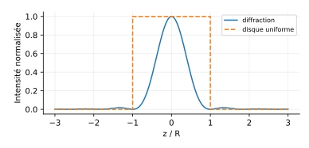
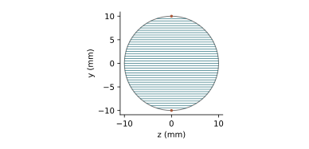
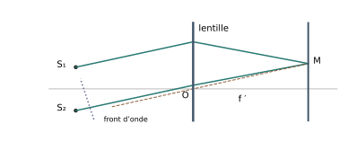
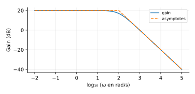
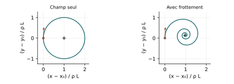
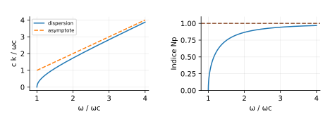

# Banque PT — Physique A 2014 · Corrigé guidé

*Corrigé rédigé par IA, non officiel. Signalez toute erreur.*

**Rédaction** · GPT-6.2 Astra Ultra · vitesse non renseignée · 26 novembre 2026

La Banque PT a programmé cet écrit le mercredi 7 mai 2014, de 8 h à 12 h. La garde interdit la calculatrice. Le code imprimé est 106. Les questions figurent aux pages 2 à 11 du PDF de 12 pages. En admissibilité, le coefficient de Physique A est de 3 pour chacune des ENS de Cachan et de Rennes et de 6 pour l’École polytechnique. [Sujet](https://www.banquept.fr/documents/2014/ph_a_2014_pt.pdf) · [Rapport du jury](https://www.banquept.fr/documents/ecrit/rapport/2014/rapport_phys_a_ecrit_2014.pdf) · [Livret de la Banque PT, p. 8, 9 et 12](https://www.banquept.fr/documents/livret/2014/Livret_PT_2014.pdf)

## A. Mesures interférométriques

### Question A.I.1.a

> [!INDICATION]
> Identifier le nombre d’ouvertures éclairées.

#### Solution

Un seul trou circulaire étale le faisceau et donne une tache centrale entourée d’anneaux. C’est la diffraction par une ouverture circulaire, observée ici en champ lointain.

### Question A.I.1.b

> [!INDICATION]
> Utiliser les dimensions puis le sens de variation avec le diamètre.

#### Solution

La longueur d’onde dans l’air vaut $\lambda_0/N_a$. L’étalement angulaire est proportionnel à la longueur d’onde et inversement proportionnel au diamètre du trou. Le rayon augmente avec la distance d’observation, d’où $R=\kappa\lambda_0D/(N_a d)$ avec $\kappa\simeq1,2$. L’expression en $D/d^2$ n’est pas une longueur et celle en $d/D$ a les variations géométriques opposées.

### Question A.I.2.a

> [!INDICATION]
> Préciser si l’angle est mesuré depuis l’axe ou entre les deux bords.

#### Solution

Le demi-angle au sommet est $\alpha=\arctan(R/D)\simeq\kappa\lambda_0/(N_a d)$. Si $\theta$ désigne l’ouverture totale du cône, $\theta=2\alpha\simeq2\kappa\lambda_0/(N_a d)$. Pour la convention d’un angle d’ouverture mesuré à l’axe, on obtient simplement $\theta=\alpha$.

### Question A.I.2.b

> [!INDICATION]
> Tracer la coupe diamétrale d’un disque uniformément éclairé.

#### Solution

Le modèle impose $I(z)=I_c$ pour $|z|<R$ et $I(z)=0$ pour $|z|>R$. Le profil possède deux discontinuités idéales en $-R$ et $+R$.

### Question A.I.2.c

> [!INDICATION]
> Comparer séparément le support, le sommet et les anneaux.

#### Solution

Le disque uniforme conserve l’extension de la tache centrale. La figure 2 présente un maximum axial arrondi, des zéros et des maxima secondaires. Le modèle convient pour situer le recouvrement de deux faisceaux ; il perd la répartition réelle de l’intensité.

### Question A.II.1

> [!INDICATION]
> Distinguer fréquence et stabilité de la phase relative.

#### Solution

Deux sources synchrones émettent à la même fréquence. Elles sont mutuellement cohérentes si leur déphasage relatif est stable pendant la mesure, ce qui fait subsister les interférences dans l’intensité moyennée. Des trous éclairés par une même onde incidente réalisent ici cette condition.

### Question A.II.2.a

> [!INDICATION]
> Lire le signe de l’ordonnée de la source supérieure.

#### Solution

Avec $S_1$ à $y=b/2$ et $S_2$ à $y=-b/2$, le théorème de Pythagore donne $d_1=\sqrt{D^2+(y-b/2)^2+z^2}$ et $d_2=\sqrt{D^2+(y+b/2)^2+z^2}$.

### Question A.II.2.b

> [!INDICATION]
> Rationaliser la différence des racines.

#### Solution

Le numérateur de $d_2-d_1=(d_2^2-d_1^2)/(d_2+d_1)$ vaut $2by$. Si $|y|,|z|,b\ll D$, le dénominateur est voisin de $2D$, donc $\Delta\simeq by/D$.

### Question A.II.2.c

> [!INDICATION]
> Pondérer les distances par l’indice du milieu.

#### Solution

Dans l’air homogène, chaque chemin optique est $N_a d_i$. Ainsi $\delta_{21}=N_a(d_2-d_1)\simeq N_a by/D$.

### Question A.II.3

> [!INDICATION]
> Additionner les amplitudes complexes avant d’en prendre le module carré.

#### Solution

Les trous émettent en phase avec la même intensité individuelle $I_s$. La différence de phase de propagation vaut $2\pi\delta_{21}/\lambda_0$ au signe près. L’intensité moyenne est donc $I=2I_s[1+\cos(2\pi\delta_{21}/\lambda_0)]$. Dans la notation du sujet $A=2I_s$ et $B=2\pi\delta_{21}/\lambda_0$.

### Question A.II.4

> [!INDICATION]
> Fixer un ordre entier et faire varier la coordonnée libre.

#### Solution

Les maxima vérifient $\delta_{21}=p\lambda_0$, d’où $y_p=p\lambda_0D/(N_ab)$ pour $p$ entier. Ce sont des cordes parallèles à l’axe des $z$, horizontales dans la vue 3b, espacées de l’interfrange $i=\lambda_0D/(N_ab)$.

### Question A.II.5

> [!INDICATION]
> Distinguer ordre maximal, intervalles et franges.

#### Solution

Les données donnent $i=0,50$ mm et $R/i=20$. Les ordres $-20$ à $+20$ rencontrent le disque fermé, soit 41 positions dont deux tangentes réduites à des points sur le bord. Strictement à l’intérieur on distingue 39 cordes de longueur non nulle. L’estimation expérimentale est donc d’environ 40 franges sur le diamètre.

### Question A.III

> [!INDICATION]
> Tracer un front d’onde normal aux rayons qui convergent vers M.

#### Solution

Les rayons parallèles avant la lentille, dirigés à l’angle $\alpha$ avec l’axe, se réunissent en un même point focal $M$, où $\tan\alpha=y/f$. Un rayon auxiliaire passant par le centre optique fixe sa position. Entre un plan orthogonal aux rayons et le point $M$, le stigmatisme rend les chemins optiques égaux. En amont de ce plan, la différence de distance issue des deux ouvertures est la projection $b\sin\alpha$. Donc $\delta_{\rm geo}=N_a b\sin\alpha\simeq N_a by/f$ dans les conditions de Gauss. Elle est positive pour $y>0$ et pour le trajet du trou inférieur moins celui du trou supérieur.

### Question A.IV.1

> [!INDICATION]
> Ajouter la contribution de longueur L à la différence géométrique.

#### Solution

La première lentille collimate la source placée à son foyer et crée des phases égales à l’entrée des cuves. Sur la longueur $L$, le trajet inférieur par C2 acquiert $N_aL$ et le supérieur par C1 acquiert $N_1L$. À la sortie, la seconde lentille ajoute la différence calculée en A.III. Ainsi $\delta_{\rm tot}=(N_a-N_1)L+N_a by/f$.

### Question A.IV.2

> [!INDICATION]
> Calculer la variation d’ordonnée pour ajouter un ordre.

#### Solution

Entre deux franges brillantes, $\Delta\delta_{\rm tot}=\lambda_0$. Le terme constant des cuves disparaît, donc $i'=\lambda_0 f/(N_a b)$.

### Question A.IV.3.a

> [!INDICATION]
> Prendre deux cuves identiques et une ordonnée nulle.

#### Solution

Au départ les chemins optiques sont égaux en $O$. Ainsi $\delta_{\rm tot}(0)=0$ et $p_0=0$, au centre d’une frange brillante.

### Question A.IV.3.b

> [!INDICATION]
> Suivre une frange d’ordre fixé et, séparément, le point fixe O.

#### Solution

En $O$, l’ordre $p=(N_a-N_1)L/\lambda_0$ décroît : après $k$ passages, l’ordre de la dernière frange brillante en ce point est $-k$. Si l’état final y est brillant, c’est aussi l’ordre final. Pour une frange donnée, $y_p=f[p\lambda_0+(N_1-N_a)L]/(N_a b)$ augmente ; le système se déplace vers les $y$ positifs. Un simple comptage entre deux états arbitraires laisse une fraction de frange indéterminée.

### Question A.IV.3.c

> [!INDICATION]
> Isoler l’excès d’indice dans le déphasage central.

#### Solution

Pour un déplacement de $k$ ordres entiers, $N_1=N_a+k\lambda_0/L$. Si le compteur indique uniquement le nombre entier franchi, la même expression donne une estimation à une frange près, soit $\lambda_0/L$ en indice.

### Question A.IV.3.d

> [!INDICATION]
> Propager les erreurs absolues annoncées sans confondre indice et excès d’indice.

#### Solution

L’excès d’indice vaut $5,00\,10^{-5}$. Sa borne d’erreur relative au premier ordre est $1/100+1/500+0,01/1=0,022$. En ajoutant l’erreur sur l’air, $\Delta N_1\lesssim10^{-7}+5\,10^{-5}(0,022)=1,2\,10^{-6}$. On peut publier $N_1=1,000343\pm0,000002$ avec un dernier chiffre incertain. Si l’on ne donne que des chiffres dont l’arrondi est garanti pour toute la plage, les extrêmes s’arrondissent tous les deux à $1,00034$, soit six chiffres significatifs.

### Question A.V.1

> [!INDICATION]
> Compter l’aller et le retour sur chaque bras.

#### Solution

Les trajets optiques diffèrent de $2x(t)$ pour $N_a=1$. Avec deux faisceaux de même intensité $I_s$ et la séparatrice idéale, $I(t)=2I_s[1+\cos(4\pi x(t)/\lambda)]$. Le premier terme est constant, le second code le déplacement ; $\lambda$ est la longueur d’onde dans l’air indiquée ici.

### Question A.V.2

> [!INDICATION]
> Appliquer la loi de conversion fournie après suppression du continu.

#### Solution

Si $g$ est le coefficient de conversion de la composante variable, $U_d=U_0\cos\Phi$ avec $U_0=2gI_s$ et $\Phi=4\pi x/\lambda$. Aucun courant électrique de détecteur n’est nécessaire pour obtenir ce résultat.

### Question A.V.3.a

> [!INDICATION]
> Déterminer la distance entre deux maxima successifs.

#### Solution

Une augmentation de $\lambda/2$ du déplacement fait varier $\Phi$ de $2\pi$. Sur $L=200\lambda$, le compteur, initialisé à zéro, enregistre donc $2L/\lambda=400$ passages.

### Question A.V.3.b

> [!INDICATION]
> Distinguer distance parcourue et abscisse finale.

#### Solution

L’aller de $100\lambda$ puis le retour de $100\lambda$ ramènent la cible à $x=0$. Le compteur incrémente dans les deux sens et affiche $200+200=400$.

### Question A.V.3.c

> [!INDICATION]
> Comparer les indications des deux expériences.

#### Solution

Le nombre de passages mesure la longueur cumulée parcourue en unités de $\lambda/2$, à la résolution d’une frange pour des extrémités ou retournements quelconques. Cette voie seule perd le sens du déplacement.

### Question A.V.4

> [!INDICATION]
> Examiner le signe de la phase du bras fixe dans la différence des bras.

#### Solution

La lame remplace deux fois l’air sur l’épaisseur $e$ et ajoute $2(N-1)e$ au bras fixe. La nouvelle phase mobile moins fixe vaut $\Phi-4\pi(N-1)e/\lambda$. Pour obtenir $+\sin\Phi$ il faut $4\pi(N-1)e/\lambda=\pi/2+2\pi k$. Ainsi $e=(4k+1)\lambda/[8(N-1)]$, avec $k=0,1,\ldots$ pour $N>1$.

### Question A.V.5.a

> [!INDICATION]
> Suivre les liaisons franchissant un fil sans contact.

#### Solution

Posons $c=\cos\Phi$, $s=\sin\Phi$. Le tableau des entrées 1 et 2 et de la sortie est
$$
\begin{array}{c|ccc}&e_1&e_2&u_x\\ \hline
 X1&U_0c&K_d U_0\dot\Phi c&K_mK_dU_0^2\dot\Phi c^2\\
 X2&-K_d U_0\dot\Phi s&U_0s&-K_mK_dU_0^2\dot\Phi s^2
\end{array}.
$$
X1 multiplie la première tension par la dérivée de la deuxième. X2 multiplie la dérivée de la première par la deuxième.

### Question A.V.5.b

> [!INDICATION]
> Soustraire les produits en respectant les entrées positive et négative.

#### Solution

La figure relie X1 à l’entrée positive et X2 à la négative. Ainsi $U_a=K_a(U_{x1}-U_{x2})=K_aK_mK_d U_0^2\dot\Phi$, car $c^2+s^2=1$.

### Question A.V.5.c

> [!INDICATION]
> Conserver la constante qui dépend de l’initialisation.

#### Solution

En intégrant depuis zéro, $U_s(t)-U_s(0)=K_iK_aK_mK_dU_0^2[\Phi(t)-\Phi(0)]$. Comme $\Phi=4\pi x/\lambda$, la sortie relative est proportionnelle à $x(t)-x(0)$ avec le facteur $4\pi K_iK_aK_mK_dU_0^2/\lambda$.

### Question A.V.5.d

> [!INDICATION]
> Examiner le signe de la vitesse de déplacement.

#### Solution

Les deux tensions en quadrature fournissent une grandeur proportionnelle à la vitesse signée puis, après intégration, au déplacement algébrique. Les inversions de mouvement sont conservées, sous réserve d’initialiser l’origine de position.

### Question A.VI.1.a

> [!INDICATION]
> Combiner les admittances de la résistance et du condensateur de contre-réaction.

#### Solution

L’amplificateur inverseur idéal donne $H=-Z_f/R$. Comme $1/Z_f=1/r+j\omega C$, on obtient $H=-(r/R)/(1+j\omega r C)$.

### Question A.VI.1.b

> [!INDICATION]
> Calculer d’abord le gain statique et la pulsation de coupure.

#### Solution

Pour $R=10$ k$\Omega$, $r=100$ k$\Omega$, $C=100$ nF, $\omega_c=1/(rC)=100\ {\rm rad\,s^{-1}}$. Le gain en dB vaut $20-10\log_{10}[1+(\omega/100)^2]$. Les asymptotes sont $20$ dB pour $\omega\ll100$ et $60-20\log_{10}(\omega/[1\ {\rm rad\,s^{-1}}])$ pour $\omega\gg100$. Au coude le gain est d’environ $17$ dB.

### Question A.VI.2.a

> [!INDICATION]
> Négliger le courant capacitif face au courant résistif.

#### Solution

Pour $\omega rC\ll1$, $H\simeq-r/R$. En régime établi à basse fréquence $u_s(t)\simeq-(r/R)u_e(t)$.

### Question A.VI.2.b

> [!INDICATION]
> Multiplier le transfert approché par la fréquence complexe.

#### Solution

Pour $\omega rC\gg1$, $H\simeq-1/(j\omega RC)$. Ainsi $\dot u_s\simeq-u_e/(RC)$, avec une constante d’intégration fixée par l’état initial.

### Question A.VI.2.c

> [!INDICATION]
> Comparer la pulsation de travail à la pulsation de coupure.

#### Solution

Le montage réalise $u_s\simeq K_i\int u_e\,dt$ pour $\omega\gg1/(rC)=100\ {\rm rad\,s^{-1}}$, tant que l’ALI reste linéaire et dans sa bande de fonctionnement. Le coefficient est $K_i=-1/(RC)=-10^3\ {\rm s^{-1}}$.

### Question A.VI.3.a

> [!INDICATION]
> Calculer le courant fourni par le générateur.

#### Solution

L’entrée inverseuse est au potentiel de masse virtuelle. Le générateur fournit $i_e=u_e/R$, donc $Z_{\rm entrée}=R=10$ k$\Omega$ dans ce modèle.

### Question A.VI.3.b

> [!INDICATION]
> Intercaler un étage possédant un très faible courant d’entrée.

#### Solution

Un suiveur de tension placé entre la source et la résistance $R$ présente une très grande impédance d’entrée et une faible impédance de sortie. Il reproduit la tension qui attaque l’intégrateur et évite de charger la source.

## B. Mouvement dans le champ magnétique

### Question B.I.1

> [!INDICATION]
> Conserver l’angle entre la vitesse et le champ.

#### Solution

Si $\alpha$ est l’angle entre $\mathbf v$ et $\mathbf B$, la force magnétique a pour module $qvB|\sin\alpha|=qBv_\perp$. La condition est $v_\perp\gg mg/(qB)$. Pour une vitesse strictement parallèle au champ, la force magnétique s’annule : on peut alors étudier le mouvement en l’absence de pesanteur comme le demande la suite, mais la comparaison précédente ne justifie plus de l’écarter.

### Question B.I.2

> [!INDICATION]
> Calculer la puissance de la force magnétique.

#### Solution

La puissance $q(\mathbf v\times\mathbf B)\cdot\mathbf v$ est nulle à chaque instant. Dans le modèle où seul le champ magnétique agit, $E_c=mv^2/2$ est constante.

### Question B.I.3

> [!INDICATION]
> Examiner le produit vectoriel initial.

#### Solution

Pour $\mathbf v_0=v_0\mathbf u_z$, la vitesse reste parallèle au champ et la force reste nulle. Le mouvement est rectiligne uniforme : $x=x_0$, $y=y_0$, $z=z_0+v_0t$.

### Question B.I.4.a

> [!INDICATION]
> Développer le produit vectoriel avec le champ axial.

#### Solution

Avec $\omega_0=qB/m>0$, Newton donne $\dot v_x=\omega_0v_y$, $\dot v_y=-\omega_0v_x$ et $\dot v_z=0$. Pour cette question, $(v_x,v_y,v_z)(0)=(0,v_0,0)$.

### Question B.I.4.b

> [!INDICATION]
> Intégrer la composante suivant le champ.

#### Solution

Puisque $v_z(0)=0$ et $\dot v_z=0$, le mouvement reste dans le plan $z=z_0$.

### Question B.I.4.c

> [!INDICATION]
> Ajouter la première équation à i fois la deuxième.

#### Solution

Avec $U=v_x+iv_y$, $\dot U=\omega_0v_y-i\omega_0v_x=-i\omega_0U$. Le facteur imaginaire pur traduit la rotation à norme constante.

### Question B.I.4.d

> [!INDICATION]
> Déterminer l’amplitude complexe initiale.

#### Solution

On a $U(0)=iv_0$. L’équation du premier ordre donne $U(t)=iv_0e^{-i\omega_0t}$.

### Question B.I.4.e

> [!INDICATION]
> Intégrer la vitesse avec une borne inférieure nulle.

#### Solution

Notons $M=x+iy$ et $M_0=x_0+iy_0$. Comme $\dot M=U$, on trouve $M(t)=M_0+(v_0/\omega_0)(1-e^{-i\omega_0t})$.

### Question B.I.4.f

> [!INDICATION]
> Séparer partie réelle et partie imaginaire.

#### Solution

En posant $\rho_L=v_0/\omega_0=mv_0/(qB)$, on lit $x=x_0+\rho_L(1-\cos\omega_0t)$ et $y=y_0+\rho_L\sin\omega_0t$. Le rayon de Larmor $\rho_L$ est homogène à une longueur.

### Question B.I.4.g

> [!INDICATION]
> Éliminer le temps par la relation trigonométrique fondamentale.

#### Solution

La somme $(x-x_0-\rho_L)^2+(y-y_0)^2$ vaut $\rho_L^2$. Le centre est donc $(x_0+\rho_L,y_0)$ et le rayon $\rho_L$.

### Question B.I.4.h

> [!INDICATION]
> Examiner la vitesse au point le plus à gauche.

#### Solution

La particule part du bord gauche du cercle avec une vitesse suivant $+y$. Vue depuis $+z$, elle tourne dans le sens horaire. Sa force initiale, dirigée vers $+x$, pointe vers le centre.

### Question B.I.5

> [!INDICATION]
> Superposer le cercle transverse et la translation axiale.

#### Solution

La projection transverse est un cercle de rayon $v_{0\perp}/\omega_0$. En même temps $z=z_0+v_{0\parallel}t$. La trajectoire est une hélice circulaire, dont le pas, distance axiale parcourue pendant un tour, vaut $2\pi v_{0\parallel}/\omega_0$.

### Question B.II.1.a

> [!INDICATION]
> Ajouter la même relaxation à chaque composante.

#### Solution

La force dissipative vaut $-h\mathbf v$. Pour le mouvement plan précédent, $\dot U=-(h/m+i\omega_0)U$, avec $U(0)=iv_0$.

### Question B.II.1.b

> [!INDICATION]
> Distinguer décroissance et rotation.

#### Solution

Avec $a_1=h/m$ et $a_2=\omega_0=qB/m$, la solution est $U=U_0e^{-(a_1+ia_2)t}$, où $U_0=iv_0$. Son module décroît sur la durée $m/h$.

### Question B.II.1.c

> [!INDICATION]
> Conserver le facteur complexe au dénominateur.

#### Solution

En intégrant entre zéro et $t$, $M(t)=M_0+[iv_0/(a_1+ia_2)](1-e^{-(a_1+ia_2)t})$. Sa dérivée restitue exactement la vitesse précédente.

### Question B.II.1.d

> [!INDICATION]
> Exploiter la positivité de a1.

#### Solution

Le facteur exponentiel tend vers zéro en module. Ainsi $U(\infty)=0$ et $M(\infty)=M_0+iv_0/(a_1+ia_2)$. La distance à ce point décroît exponentiellement.

### Question B.II.1.e

> [!INDICATION]
> Multiplier par le conjugué du dénominateur.

#### Solution

En séparant les composantes de $iv_0(a_1-ia_2)/(a_1^2+a_2^2)$, on obtient $x_\infty=x_0+v_0a_2/(a_1^2+a_2^2)$ et $y_\infty=y_0+v_0a_1/(a_1^2+a_2^2)$. Quand $h$ tend vers zéro, ce point tend vers le centre du cercle non amorti.

### Question B.II.1.f

> [!INDICATION]
> Demander quelles propriétés la courbure et une photographie non chronométrée permettent d’inférer.

#### Solution

Les deux spirales de la figure 10 ont des courbures de sens opposés quand on les suit de leur grande extrémité vers la fin ralentie. Dans le même champ, cela indique des charges opposées. L’interprétation usuelle en paire électron-positon donne pour l’autre particule un positon, $q=+e\simeq+1,6\,10^{-19}$ C et $m=m_e\simeq9\,10^{-31}$ kg. L’égalité des masses et celle des modules de charge supposent cette identification de paire : une photographie sans étalonnage temporel ni vitesses initiales ne mesure pas séparément $m$ et $|q|$, le rayon contenant $mv_\perp/(|q|B)$.

### Question B.II.2.a

> [!INDICATION]
> Orienter le vecteur surface par la règle de la main droite.

#### Solution

Une spire de rayon $\rho_L$ parcourue par un courant $I$ possède le moment $\boldsymbol{\mathcal M}=I\pi\rho_L^2\mathbf n$, la normale $\mathbf n$ étant fixée par le sens du courant.

### Question B.II.2.b

> [!INDICATION]
> Calculer la charge passant devant un point en un tour.

#### Solution

Le passage d’une charge $q$ par période $T=2\pi\rho_L/v_0$ équivaut en moyenne à $I=q/T=qv_0/(2\pi\rho_L)$. Pour $q>0$ le courant conventionnel suit le mouvement horaire vu depuis $+z$.

### Question B.II.2.c

> [!INDICATION]
> Orienter la surface suivant le sens effectif de la charge positive.

#### Solution

La normale de la boucle est $-\mathbf u_z$. Par conséquent $\boldsymbol{\mathcal M}=-I\pi\rho_L^2\mathbf u_z=-qv_0\rho_L\mathbf u_z/2=-(E_c/B)\mathbf u_z$, puisque $\rho_L=mv_0/(qB)$. Le moment est opposé au champ imposé.

## C. Propagation électromagnétique dans le plasma

### Question C.1

> [!INDICATION]
> Employer les charges d’un noyau deutérium et d’un électron.

#### Solution

La charge volumique est $e n_D-e n_e$. La neutralité du gaz de noyaux simplement chargés et d’électrons impose $n_e=n_D=n$. Ce sont des nombres de particules par unité de volume.

### Question C.2

> [!INDICATION]
> Additionner densité de charge fois vitesse pour chaque espèce.

#### Solution

Chaque espèce transporte sa charge avec sa vitesse propre. Ainsi $\mathbf j=ne(\mathbf v_D-\mathbf v_e)$, exprimé en ampères par mètre carré.

### Question C.3

> [!INDICATION]
> Orienter les trois directions de propagation et de polarisation.

#### Solution

Posons $\psi=\omega t-kz$. Le champ électrique du feuillet est $\mathbf E=E_0\cos\psi\,\mathbf u_x$. La composante $y$ de $\nabla\times\mathbf E$ est $\partial_z E_x=kE_0\sin\psi$. Maxwell-Faraday donne alors, en l’absence de champ statique, $\mathbf B=(k/\omega)E_0\cos\psi\,\mathbf u_y$.

### Question C.4.a

> [!INDICATION]
> Appliquer la charge signée dans le second principe.

#### Solution

Au premier ordre, la force électrique domine. Les équations sont $m_e\dot{\mathbf v}_e=-eE_0\cos\psi\,\mathbf u_x$ et $m_D\dot{\mathbf v}_D=+eE_0\cos\psi\,\mathbf u_x$. La phase est évaluée à la position d’équilibre, conformément à la linéarisation.

### Question C.4.b

> [!INDICATION]
> Intégrer au temps à position fixée et écarter la composante constante.

#### Solution

Pour une réponse périodique de moyenne nulle, $\mathbf v_e=-eE_0\sin\psi\,\mathbf u_x/(m_e\omega)$ et $\mathbf v_D=+eE_0\sin\psi\,\mathbf u_x/(m_D\omega)$.

### Question C.5.a

> [!INDICATION]
> Substituer les deux vitesses dans la densité de courant.

#### Solution

La différence des vitesses et les charges de signes opposés font s’ajouter les contributions au courant : $\mathbf j=(ne^2E_0/\omega)(1/m_e+1/m_D)\sin\psi\,\mathbf u_x$.

### Question C.5.b

> [!INDICATION]
> Comparer les contributions par leur rapport indépendant de la densité.

#### Solution

Le rapport du courant nucléaire au courant électronique vaut $m_e/m_D\ll1$, d’ordre $10^{-4}$ pour l’isotope lourd de l’hydrogène. Il vient $\mathbf j\simeq ne^2E_0\sin\psi\,\mathbf u_x/(m_e\omega)$. Pour estimer ce rapport, une masse par particule s’obtient en divisant la masse molaire par la constante d’Avogadro.

### Question C.6

> [!INDICATION]
> Multiplier les quantités instantanées avant de moyenner.

#### Solution

La puissance reçue par la matière par unité de volume est $\mathbf j\cdot\mathbf E\simeq ne^2 E_0^2\sin(2\psi)/(2m_e\omega)$. Sa moyenne sur une période est nulle. Dans ce modèle sans collision, la matière emmagasine puis restitue de l’énergie à chaque période.

### Question C.7

> [!INDICATION]
> Insérer les champs et le courant dans Maxwell-Ampère.

#### Solution

Pour les champs précédents, $(\nabla\times\mathbf B)_x=-k^2 E_0\sin\psi/\omega$ et $\partial_t E_x=-\omega E_0\sin\psi$. Maxwell-Ampère, $\nabla\times\mathbf B=\mu_0\mathbf j+c^{-2}\partial_t\mathbf E$, donne après identification $k^2=\omega^2/c^2-\mu_0ne^2/m_e$. Avant l’approximation électronique, le dernier facteur $1/m_e$ devient $1/m_e+1/m_D$.

### Question C.8

> [!INDICATION]
> Identifier le seuil où le nombre d’onde s’annule.

#### Solution

En posant $\omega_c^2=\mu_0 c^2ne^2/m_e=ne^2/(m_e\varepsilon_0)$, on a $c^2 k^2=\omega^2-\omega_c^2$. Pour une onde progressive de nombre d’onde réel non nul il faut $\omega>\omega_c$. À l’égalité $k=0$ et en dessous la solution spatiale est évanescente.

### Question C.9

> [!INDICATION]
> Développer la racine à grande pulsation.

#### Solution

Sur la branche progressive, $k=\sqrt{\omega^2-\omega_c^2}/c$. La courbe part de $(\omega_c,0)$ avec une tangente verticale et vérifie $k=\omega/c-\omega_c^2/(2c\omega)+O(\omega^{-3})$. L’asymptote de haute fréquence $k=\omega/c$ est approchée par-dessous.

### Question C.10.a

> [!INDICATION]
> Déterminer la vitesse d’un point de phase constante.

#### Solution

Sur une surface de phase $\omega t-kz$ constante, $dz/dt=\omega/k$. On a donc $v_\varphi=c/\sqrt{1-\omega_c^2/\omega^2}$ pour $\omega>\omega_c$. C’est la vitesse de phase ; la vitesse de groupe de ce modèle est $c^2/v_\varphi$.

### Question C.10.b

> [!INDICATION]
> Regarder comment varie la phase pour deux fréquences voisines.

#### Solution

La vitesse de phase dépend de la pulsation. Le plasma de ce modèle est un milieu dispersif.

### Question C.11.a

> [!INDICATION]
> Exprimer le quotient de la célérité du vide par la vitesse de phase.

#### Solution

L’indice vaut $N_p=c/v_\varphi=\sqrt{1-\omega_c^2/\omega^2}$. Il appartient à $]0,1[$ sur la branche propagative de fréquence finie, tend vers zéro au seuil et vers un à haute fréquence.

### Question C.11.b

> [!INDICATION]
> Dériver la racine en gardant les unités de la pulsation.

#### Solution

La dérivée $dN_p/d\omega=\omega_c^2/[\omega^3\sqrt{1-\omega_c^2/\omega^2}]$ est positive. Elle tend vers $+\infty$ lorsque $\omega$ décroît vers $\omega_c$ et vers zéro à haute fréquence. La courbe de C.9 montre la tangente verticale au seuil et l’asymptote horizontale à un.

### Question C.12

> [!INDICATION]
> Remplacer le milieu d’un bras par une longueur connue de plasma.

#### Solution

À $\omega>\omega_c$, comparer à vide puis avec plasma le chemin de longueur $L$ dans un bras. À simple passage, le décalage d’ordre signé donne $N_p=1+\Delta p\,\lambda_0/L$ pour la différence bras d’essai moins référence. Le comptage doit suivre la variation de phase depuis le vide. On en déduit $n=\varepsilon_0m_e\omega^2(1-N_p^2)/e^2$.

### Question C.13

> [!INDICATION]
> Repérer la transition entre propagation et réflexion.

#### Solution

Balayer la pulsation et mesurer le signal réfléchi ainsi que le retour de la transmission. Le seuil séparant propagation et réflexion du milieu homogène fixe $\omega_c$. La densité est alors $n=\varepsilon_0 m_e\omega_c^2/e^2$.
