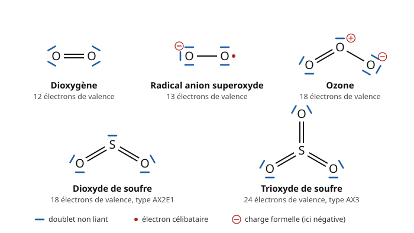
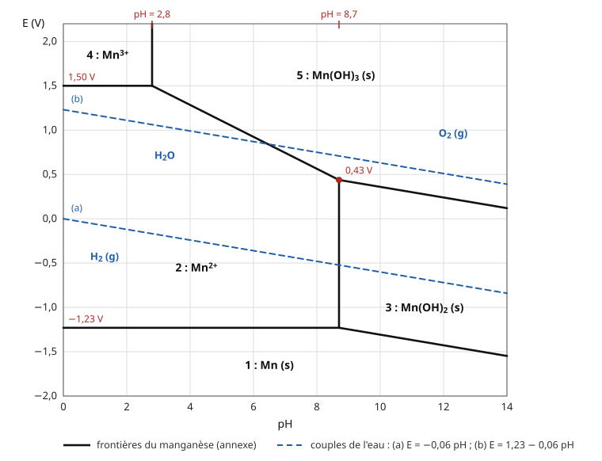
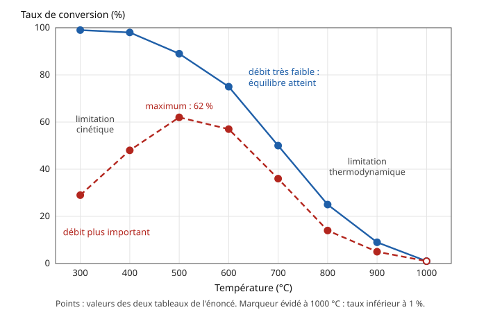

# Banque PT PT — Physique C - Chimie 2014 · Corrigé brut

*Corrigé rédigé par IA, non officiel. Signalez toute erreur.*

**Rédaction** · modèle exact non renseigné (famille Claude) · effort non renseigné · vitesse non renseignée

**Révision (tour 2)** · modèle exact non renseigné (famille Claude) · effort non renseigné · vitesse non renseignée · 28 novembre 2026

Épreuve de 2 heures, sans calculatrice, autour de l'oxygène et du soufre : 45 questions numérotées de Q1 à Q45, en quatre parties indépendantes (approche structurale, dosage du dioxygène dissous par la méthode de Winkler, cinétique de la décomposition de l'ozone, procédé de contact), avec une feuille annexe à rendre (diagramme potentiel-pH simplifié du manganèse). Les 45 questions sont traitées. Les valeurs lues sur l'annexe et sur le réseau de courbes cinétiques sont signalées à l'endroit où elles servent. Les applications numériques sont menées à la main, comme le jour de l'épreuve ; les constantes d'équilibre sont données en puissances de 10, éventuellement décimales, comme l'autorise l'énoncé.

[Sujet officiel (archive des deux parties de Physique C ; la partie chimie est le fichier `ph_c_2014_pt_ch.pdf`)](https://www.banquept.fr/documents/2014/ph_c_2014_pt.zip) · [Rapport du jury](https://www.banquept.fr/documents/ecrit/rapport/2014/rapport_phys_c_ecrit_2014.pdf)

## Partie 1 — Approche structurale

### Question 1 — Configurations électroniques et place dans la classification

En remplissant les sous-couches par énergie croissante (règle de Klechkowski), avec au plus deux électrons par orbitale (principe de Pauli) :

$$\boxed{\mathrm{O}\ (Z = 8) : 1s^2\,2s^2\,2p^4 \qquad \mathrm{S}\ (Z = 16) : 1s^2\,2s^2\,2p^6\,3s^2\,3p^4}$$

- Oxygène : la couche de valence est $n = 2$, donc **deuxième ligne** ; la configuration de valence $2s^2\,2p^4$ place l'élément dans la quatrième colonne du bloc $p$, soit la colonne $12 + 4 = 16$.
- Soufre : la couche de valence est $n = 3$, donc **troisième ligne** ; la configuration de valence $3s^2\,3p^4$ donne aussi la colonne 16.

$$\boxed{\mathrm{O} : \text{ligne 2, colonne 16} \qquad \mathrm{S} : \text{ligne 3, colonne 16}}$$

Les deux éléments ont la même configuration de valence $ns^2\,np^4$ (6 électrons de valence) : ils appartiennent à la même famille, celle des chalcogènes, le soufre étant juste sous l'oxygène.

### Question 2 — Nombres d'oxydation extrêmes du soufre

Le soufre possède 6 électrons de valence ($3s^2\,3p^4$).

- Il peut au plus les céder tous les six et atteindre la configuration du néon : nombre d'oxydation maximal $+\mathrm{VI}$ (comme dans $\mathrm{SO_3}$, $\mathrm{H_2SO_4}$ ou l'ion sulfate $\mathrm{SO_4^{2-}}$).
- Il peut au plus capter deux électrons pour saturer la sous-couche $3p$ et atteindre la configuration de l'argon : nombre d'oxydation minimal $-\mathrm{II}$ (comme dans $\mathrm{H_2S}$).

$$\boxed{-\mathrm{II} \leqslant \text{n.o.}(\mathrm{S}) \leqslant +\mathrm{VI}}$$

L'anion usuel correspondant au nombre d'oxydation minimal est l'**ion sulfure** $\mathrm{S^{2-}}$, isoélectronique de l'argon ($1s^2\,2s^2\,2p^6\,3s^2\,3p^6$).

### Question 3 — Énergie de première ionisation

L'énergie de première ionisation $E_i$ est l'énergie minimale à fournir à un atome **isolé, à l'état gazeux et dans son état fondamental**, pour lui arracher un électron, l'ion et l'électron obtenus étant séparés et au repos :

$$\boxed{\mathrm{X_{(g)}} \longrightarrow \mathrm{X^+_{(g)}} + e^-_{(g)} \qquad E_i > 0}$$

L'électron arraché est le moins lié (électron de valence). Les valeurs du tableau, comprises entre 5 et 22, sont manifestement exprimées en électronvolts, unité que l'énoncé ne précise pas.

### Question 4 — Évolution de l'énergie d'ionisation sur la deuxième période

**Évolution générale.** De $\mathrm{Li}$ à $\mathrm{Ne}$, l'énergie de première ionisation augmente globalement (de 5,32 à 21,56). Le long de la période, le numéro atomique augmente d'une unité à chaque élément alors que les électrons ajoutés occupent la même couche $n = 2$ : ils s'écrantent mal les uns les autres. La charge effective ressentie par les électrons de valence augmente donc, le rayon atomique diminue, et les électrons de valence sont de plus en plus fortement liés au noyau : il faut de plus en plus d'énergie pour en arracher un.

**Singularité de l'oxygène.** L'énergie d'ionisation de l'oxygène (13,62) est inférieure à celle de l'azote (14,53), contrairement à la tendance générale.

- L'azote, $2s^2\,2p^3$, a une sous-couche $2p$ à demi remplie : d'après la règle de Hund, ses trois électrons $2p$ occupent trois orbitales différentes avec des spins parallèles, situation particulièrement stable.
- L'oxygène, $2s^2\,2p^4$, possède un quatrième électron $2p$ obligé de s'apparier dans une orbitale déjà occupée. La répulsion entre les deux électrons de cette orbitale rend cet électron plus facile à arracher, et l'ion $\mathrm{O^+}$ formé retrouve la sous-couche à demi remplie $2p^3$.

L'ionisation de l'oxygène est ainsi facilitée par rapport à ce que prévoit la seule augmentation de la charge effective.

### Question 5 — Représentations de Lewis

Chaque atome d'oxygène ou de soufre apporte 6 électrons de valence. On place les doublets en respectant la règle de l'octet pour l'oxygène (deuxième période) ; le soufre (troisième période) peut s'entourer de plus de huit électrons. Les charges formelles s'obtiennent en comparant le nombre d'électrons attribués à l'atome (un par liaison, deux par doublet non liant, un par électron célibataire) à ses 6 électrons de valence.

- **Dioxygène $\mathrm{O_2}$** : $2 \times 6 = 12$ électrons, soit 6 doublets. Une liaison double et deux doublets non liants par atome ; chaque atome respecte l'octet, aucune charge formelle.
- **Radical anion superoxyde $\mathrm{O_2^-}$** : $12 + 1 = 13$ électrons, soit 6 doublets et un électron célibataire. Une liaison simple ; un atome porte trois doublets non liants et la charge formelle $-1$ ($6 + 1 = 7$ électrons attribués), l'autre porte deux doublets non liants et l'électron célibataire ($4 + 1 + 1 = 6$ électrons attribués, charge nulle, sept électrons autour de lui). Le nombre impair d'électrons interdit que les deux atomes vérifient l'octet ; la forme symétrique, où les rôles des deux atomes sont échangés, est équivalente.
- **Ozone $\mathrm{O_3}$** : $3 \times 6 = 18$ électrons, soit 9 doublets. L'atome central est lié à l'un de ses voisins par une liaison double, à l'autre par une liaison simple, et porte un doublet non liant : charge formelle $+1$ ($2 + 3 = 5$ électrons attribués). L'atome terminal simplement lié porte trois doublets non liants et la charge $-1$ ; l'autre, deux doublets non liants et aucune charge. Deux formes mésomères équivalentes échangent les deux atomes terminaux : les deux liaisons sont identiques. La molécule est globalement neutre.
- **Dioxyde de soufre $\mathrm{SO_2}$** : $18$ électrons, soit 9 doublets. Le soufre est lié aux deux atomes d'oxygène par deux liaisons doubles et porte un doublet non liant ; chaque oxygène porte deux doublets non liants. Aucune charge formelle ; le soufre est hypervalent (10 électrons). L'écriture calquée sur celle de l'ozone (une liaison double, une liaison simple, charges $+1$ sur le soufre et $-1$ sur un oxygène) respecte l'octet et est également recevable.
- **Trioxyde de soufre $\mathrm{SO_3}$** : $4 \times 6 = 24$ électrons, soit 12 doublets. Le soufre est lié aux trois atomes d'oxygène par trois liaisons doubles et ne porte aucun doublet non liant ; chaque oxygène porte deux doublets non liants. Aucune charge formelle ; le soufre est hypervalent (12 électrons). L'écriture respectant l'octet (une liaison double, deux liaisons simples, charge $+2$ sur le soufre et $-1$ sur deux oxygènes) est recevable aussi.

Vérification du décompte sur la figure : 6 doublets pour $\mathrm{O_2}$ ; 6 doublets et 1 électron pour $\mathrm{O_2^-}$ ; 9 doublets pour $\mathrm{O_3}$ et $\mathrm{SO_2}$ ; 12 doublets pour $\mathrm{SO_3}$.

### Question 6 — Géométries du dioxyde et du trioxyde de soufre

On applique la méthode VSEPR à l'atome central de soufre, en comptant une liaison multiple comme une seule direction de répulsion.

- **$\mathrm{SO_2}$** : deux atomes liés et un doublet non liant, type $\mathrm{AX_2E_1}$. Les trois directions se placent dans un plan à environ 120° ; l'une étant occupée par le doublet non liant, la molécule est **coudée** (en V). Le doublet non liant étant plus répulsif qu'un doublet liant, l'angle $\widehat{\mathrm{OSO}}$ est un peu inférieur à 120°.
- **$\mathrm{SO_3}$** : trois atomes liés et aucun doublet non liant, type $\mathrm{AX_3E_0}$. La molécule est **trigonale plane** (triangle équilatéral, soufre au centre), avec des angles $\widehat{\mathrm{OSO}}$ de 120°.

$$\boxed{\mathrm{SO_2} : \mathrm{AX_2E_1},\ \text{coudée} \qquad \mathrm{SO_3} : \mathrm{AX_3},\ \text{trigonale plane}}$$

Le type VSEPR ne dépend pas de l'écriture de Lewis retenue à la question 5 (avec ou sans hypervalence).

## Partie 2 — Dosage du dioxygène dissous par la méthode de Winkler

### Question 7 — Attribution des domaines du diagramme du manganèse

Nombres d'oxydation du manganèse : $0$ dans $\mathrm{Mn_{(s)}}$ ; $+\mathrm{II}$ dans $\mathrm{Mn^{2+}}$ et $\mathrm{Mn(OH)_{2(s)}}$ ; $+\mathrm{III}$ dans $\mathrm{Mn^{3+}}$ et $\mathrm{Mn(OH)_{3(s)}}$.

- Plus le potentiel est élevé, plus le nombre d'oxydation de l'espèce stable est grand : le métal occupe le bas du diagramme, le manganèse(II) la bande intermédiaire, le manganèse(III) le haut.
- À nombre d'oxydation donné, les frontières verticales séparent le cation (à gauche, milieu acide) de l'hydroxyde solide (à droite, milieu basique), puisque l'hydroxyde précipite quand la concentration en ions hydroxyde augmente.

| Domaine | Espèce | Nombre d'oxydation | Nature du domaine |
|---|---|---|---|
| 1 | $\mathrm{Mn_{(s)}}$ | $0$ | existence |
| 2 | $\mathrm{Mn^{2+}_{(aq)}}$ | $+\mathrm{II}$ | prédominance |
| 3 | $\mathrm{Mn(OH)_{2(s)}}$ | $+\mathrm{II}$ | existence |
| 4 | $\mathrm{Mn^{3+}_{(aq)}}$ | $+\mathrm{III}$ | prédominance |
| 5 | $\mathrm{Mn(OH)_{3(s)}}$ | $+\mathrm{III}$ | existence |

Contrôles sur l'annexe : la frontière horizontale entre les domaines 1 et 2 est à $E_1^\circ + 0{,}03\,\log(1{,}0\cdot10^{-2}) = -1{,}17 - 0{,}06 = -1{,}23\ \mathrm{V}$, ce qu'on lit bien ; la frontière verticale entre les domaines 4 et 5 correspond à $[\mathrm{HO^-}]^3 = K_{s2}/(1{,}0\cdot10^{-2}) = 10^{-33{,}7}$, soit $\mathrm{pH} = 14 - 11{,}2 = 2{,}8$, ce qu'on lit aussi.

### Question 8 — Produit de solubilité de l'hydroxyde de manganèse(II)

Sur la frontière verticale entre les domaines 2 et 3, le premier grain de $\mathrm{Mn(OH)_{2(s)}}$ apparaît alors que la concentration en ions manganèse(II) vaut encore la concentration de tracé $c = 1{,}0\cdot10^{-2}\ \mathrm{mol\cdot L^{-1}}$. La condition d'équilibre de précipitation s'écrit, les concentrations étant rapportées à $c^\circ = 1\ \mathrm{mol\cdot L^{-1}}$ :

$$K_{s1} = [\mathrm{Mn^{2+}}]\,[\mathrm{HO^-}]^2 = c\,\frac{K_e^2}{[\mathrm{H_3O^+}]^2}$$

soit

$$\boxed{\mathrm{p}K_{s1} = -\log c + 2\,(\mathrm{p}K_e - \mathrm{pH_{front}})}$$

**Lecture graphique.** Sur l'annexe, la frontière verticale entre les domaines 2 et 3 se situe entre les traits du quadrillage d'abscisses 8 et 9, aux deux tiers environ de cet intervalle : $\mathrm{pH_{front}} \approx 8{,}7$, à 0,1 près.

$$\mathrm{p}K_{s1} = 2 + 2 \times (14 - 8{,}7) = 2 + 10{,}6 = 12{,}6$$

$$\boxed{K_{s1} \approx 10^{-12{,}6} \approx 2{,}5\cdot10^{-13}}$$

Une incertitude de lecture de 0,1 unité de $\mathrm{pH}$ entraîne 0,2 unité sur $\mathrm{p}K_{s1}$.

### Question 9 — Potentiel standard du couple manganèse(III)/manganèse(II)

On associe à chaque demi-équation de réduction l'enthalpie libre standard $\Delta_r G^\circ = -n F E^\circ$ :

$$\begin{aligned}
(1)\quad & \mathrm{Mn^{2+}} + 2\,e^- = \mathrm{Mn_{(s)}} & \Delta_r G_1^\circ &= -2 F E_1^\circ \\
(2)\quad & \mathrm{Mn^{3+}} + 3\,e^- = \mathrm{Mn_{(s)}} & \Delta_r G_2^\circ &= -3 F E_2^\circ \\
(3)\quad & \mathrm{Mn^{3+}} + e^- = \mathrm{Mn^{2+}} & \Delta_r G_3^\circ &= -F E_3^\circ
\end{aligned}$$

Comme $(3) = (2) - (1)$, on a $\Delta_r G_3^\circ = \Delta_r G_2^\circ - \Delta_r G_1^\circ$, d'où

$$\boxed{E_3^\circ = 3\,E_2^\circ - 2\,E_1^\circ}$$

Application numérique :

$$E_3^\circ = 3 \times (-0{,}28) - 2 \times (-1{,}17) = -0{,}84 + 2{,}34$$

$$\boxed{E_3^\circ = 1{,}50\ \mathrm{V}}$$

**Comparaison.** Sur la frontière entre les domaines 4 et 2, les deux espèces dissoutes ont la même concentration, donc $E = E_3^\circ + 0{,}06\,\log\dfrac{[\mathrm{Mn^{3+}}]}{[\mathrm{Mn^{2+}}]} = E_3^\circ$ : la frontière est horizontale et son ordonnée donne directement $E_3^\circ$. On lit sur l'annexe $E = 1{,}5\ \mathrm{V}$, en accord avec la valeur calculée (et avec la valeur $1{,}50\ \mathrm{V}$ donnée plus loin dans l'énoncé).

### Question 10 — Pente de la frontière entre les deux hydroxydes

Demi-équation du couple $\mathrm{Mn(OH)_{3(s)}/Mn(OH)_{2(s)}}$, écrite en milieu acide :

$$\mathrm{Mn(OH)_{3(s)}} + \mathrm{H^+_{(aq)}} + e^- = \mathrm{Mn(OH)_{2(s)}} + \mathrm{H_2O_{(\ell)}}$$

Les activités des solides et du solvant valent 1. La relation de Nernst donne, avec $\alpha = \dfrac{RT}{F}\ln 10 = 0{,}060\ \mathrm{V}$ :

$$E = E^\circ\big(\mathrm{Mn(OH)_3/Mn(OH)_2}\big) + \alpha\,\log[\mathrm{H^+}] = E^\circ\big(\mathrm{Mn(OH)_3/Mn(OH)_2}\big) - \alpha\,\mathrm{pH}$$

$$\boxed{\frac{\mathrm{d}E}{\mathrm{dpH}} = -\alpha = -0{,}060\ \mathrm{V\ par\ unité\ de\ pH}}$$

Vérification sur l'annexe : la frontière passe de $0{,}43\ \mathrm{V}$ à $\mathrm{pH} = 8{,}7$ à environ $0{,}11\ \mathrm{V}$ à $\mathrm{pH} = 14$, soit une pente de $-0{,}32/5{,}3 \approx -0{,}06\ \mathrm{V}$ par unité de $\mathrm{pH}$.

### Question 11 — Structure cristalline du manganèse à haute température

On modélise les atomes par des sphères dures de rayon $r$ dans une maille cubique d'arête $a$ ; la compacité est $C = \dfrac{N \times \frac{4}{3}\pi r^3}{a^3}$, où $N$ est le nombre d'atomes par maille.

**Cubique à faces centrées.** $N = 8 \times \dfrac{1}{8} + 6 \times \dfrac{1}{2} = 4$. Le contact a lieu le long de la diagonale d'une face : $4r = a\sqrt{2}$.

$$C_{\mathrm{CFC}} = \frac{4 \times \frac{4}{3}\pi r^3}{a^3} = \frac{16\pi}{3}\left(\frac{\sqrt{2}}{4}\right)^3 = \frac{\pi\sqrt{2}}{6} = 0{,}74$$

**Cubique centrée.** $N = 8 \times \dfrac{1}{8} + 1 = 2$. Le contact a lieu le long de la grande diagonale du cube : $4r = a\sqrt{3}$.

$$C_{\mathrm{CC}} = \frac{2 \times \frac{4}{3}\pi r^3}{a^3} = \frac{8\pi}{3}\left(\frac{\sqrt{3}}{4}\right)^3 = \frac{\pi\sqrt{3}}{8} = 0{,}68$$

La compacité mesurée, 0,74, est celle de l'empilement compact :

$$\boxed{\text{la structure est cubique à faces centrées}}$$

### Question 12 — Diagramme potentiel-pH de l'eau

L'eau appartient à deux couples.

**Couple $\mathrm{H^+_{(aq)}/H_{2(g)}}$** (l'eau, ou ses ions $\mathrm{H^+}$, joue le rôle d'oxydant) :

$$2\,\mathrm{H^+_{(aq)}} + 2\,e^- = \mathrm{H_{2(g)}}$$

$$E_a = E_4^\circ + \frac{\alpha}{2}\,\log\frac{[\mathrm{H^+}]^2\,P^\circ}{P_{\mathrm{H_2}}}$$

Avec $P_{\mathrm{H_2}} = P^\circ$ sur la frontière :

$$\boxed{E_a = -0{,}06\,\mathrm{pH}\quad(\mathrm{V})}$$

**Couple $\mathrm{O_{2(g)}/H_2O_{(\ell)}}$** (l'eau joue le rôle de réducteur) :

$$\mathrm{O_{2(g)}} + 4\,\mathrm{H^+_{(aq)}} + 4\,e^- = 2\,\mathrm{H_2O_{(\ell)}}$$

$$E_b = E_5^\circ + \frac{\alpha}{4}\,\log\frac{P_{\mathrm{O_2}}\,[\mathrm{H^+}]^4}{P^\circ}$$

Avec $P_{\mathrm{O_2}} = P^\circ$ sur la frontière :

$$\boxed{E_b = 1{,}23 - 0{,}06\,\mathrm{pH}\quad(\mathrm{V})}$$

**Construction.** Ce sont deux droites parallèles de pente $-0{,}06\ \mathrm{V}$ par unité de $\mathrm{pH}$ : la droite (a) passe par $(0\ ;\ 0\ \mathrm{V})$ et $(14\ ;\ -0{,}84\ \mathrm{V})$, la droite (b) par $(0\ ;\ 1{,}23\ \mathrm{V})$ et $(14\ ;\ 0{,}39\ \mathrm{V})$. Elles sont tracées en tirets sur la figure 2.

- Au-dessus de la droite (b) : domaine du dioxygène $\mathrm{O_{2(g)}}$ (l'eau y est oxydée).
- Entre les deux droites : domaine de stabilité thermodynamique de l'eau, large de $1{,}23\ \mathrm{V}$ à tout $\mathrm{pH}$.
- Au-dessous de la droite (a) : domaine du dihydrogène $\mathrm{H_{2(g)}}$ (l'eau y est réduite).

### Question 13 — Première étape : oxydation du manganèse(II) par le dioxygène dissous

**Avant oxydation.** La soude rend le milieu basique : le manganèse(II) précipite sous forme d'**hydroxyde de manganèse(II)** (domaine 3 du diagramme) :

$$\mathrm{Mn^{2+}_{(aq)}} + 2\,\mathrm{HO^-_{(aq)}} = \mathrm{Mn(OH)_{2(s)}}$$

Bilan de matière, avec des masses molaires que l'énoncé ne fournit pas ($40\ \mathrm{g\cdot mol^{-1}}$ pour la soude, $126\ \mathrm{g\cdot mol^{-1}}$ pour le chlorure de manganèse anhydre, $198\ \mathrm{g\cdot mol^{-1}}$ s'il est tétrahydraté) : 1,4 g de soude apportent $0{,}035\ \mathrm{mol}$ d'ions hydroxyde ; 4,0 g de chlorure de manganèse apportent $0{,}032\ \mathrm{mol}$ d'ions $\mathrm{Mn^{2+}}$ ($0{,}020\ \mathrm{mol}$ pour le sel hydraté), dont la précipitation complète demanderait $0{,}064\ \mathrm{mol}$ ($0{,}040\ \mathrm{mol}$) d'ions hydroxyde. La soude est donc en défaut : elle est presque entièrement consommée, il se forme $0{,}035/2 \approx 0{,}018\ \mathrm{mol}$ d'hydroxyde de manganèse(II) et le reste du manganèse(II) demeure dissous sous forme $\mathrm{Mn^{2+}}$. Le $\mathrm{pH}$ s'établit sur la frontière de précipitation, entre 8 et 9 (elle est à 8,7 pour la concentration de tracé) : le milieu est basique, sans excès d'ions hydroxyde.

**Après oxydation.** Le dioxygène dissous oxyde le manganèse(II) en manganèse(III), dont la forme stable en milieu basique est l'hydroxyde : le précipité brun est l'**hydroxyde de manganèse(III)** $\mathrm{Mn(OH)_{3(s)}}$ (domaine 5).

**Équation.** En milieu basique :

$$\begin{aligned}
\mathrm{Mn(OH)_{2(s)}} + \mathrm{HO^-_{(aq)}} &= \mathrm{Mn(OH)_{3(s)}} + e^- & (\times 4) \\
\mathrm{O_{2(aq)}} + 2\,\mathrm{H_2O_{(\ell)}} + 4\,e^- &= 4\,\mathrm{HO^-_{(aq)}} & (\times 1)
\end{aligned}$$

$$\boxed{4\,\mathrm{Mn(OH)_{2(s)}} + \mathrm{O_{2(aq)}} + 2\,\mathrm{H_2O_{(\ell)}} = 4\,\mathrm{Mn(OH)_{3(s)}}}$$

Une mole de dioxygène dissous produit quatre moles d'hydroxyde de manganèse(III). L'erlenmeyer est rempli à ras bord et bouché pour que seul le dioxygène initialement dissous dans l'eau réagisse, sans apport par l'air ; l'agitation de 30 minutes laisse le temps à cette réaction, qui met en jeu un solide, d'être complète.

### Question 14 — Choix d'un pH basique

On superpose le diagramme du manganèse et la droite (b) du couple $\mathrm{O_2/H_2O}$, $E_b = 1{,}23 - 0{,}06\,\mathrm{pH}$ (figure 2).

- **En milieu acide** ($\mathrm{pH} < 2{,}8$), la frontière $\mathrm{Mn^{3+}/Mn^{2+}}$ est à $1{,}50\ \mathrm{V}$, au-dessus de la droite (b) (au plus $1{,}23\ \mathrm{V}$). Le dioxygène et l'ion $\mathrm{Mn^{2+}}$ ont un domaine commun : le dioxygène n'oxyde pas le manganèse(II). La situation reste la même tant que la droite (b) est sous la frontière $\mathrm{Mn(OH)_3/Mn^{2+}}$, c'est-à-dire, par lecture de la figure 2, jusqu'à $\mathrm{pH} \approx 6{,}5$.
- **En milieu basique** ($\mathrm{pH} > 8{,}7$), la frontière $\mathrm{Mn(OH)_3/Mn(OH)_2}$ est parallèle à la droite (b) et située nettement au-dessous : à $\mathrm{pH} = 8{,}7$, elle est à $0{,}43\ \mathrm{V}$ alors que $E_b = 1{,}23 - 0{,}52 = 0{,}71\ \mathrm{V}$, soit un écart d'environ $0{,}28\ \mathrm{V}$ qui se conserve jusqu'à $\mathrm{pH} = 14$. Les domaines de $\mathrm{O_2}$ et de $\mathrm{Mn(OH)_{2(s)}}$ sont disjoints : la réaction de la question 13 est thermodynamiquement très favorable, avec une constante de l'ordre de $10^{4 \times 0{,}28/0{,}06} = 10^{18{,}7}$, soit près de $10^{19}$.

Le milieu basique est donc nécessaire pour que **tout le dioxygène dissous soit consommé** (réaction quantitative), condition indispensable à un dosage.

### Question 15 — Deuxième étape : dissolution du précipité

En milieu acide ($\mathrm{pH} < 2{,}8$), le manganèse(III) est stable sous forme d'ion $\mathrm{Mn^{3+}}$ (domaine 4). Le précipité brun se dissout selon une réaction acido-basique, sans changement du nombre d'oxydation :

$$\boxed{\mathrm{Mn(OH)_{3(s)}} + 3\,\mathrm{H^+_{(aq)}} = \mathrm{Mn^{3+}_{(aq)}} + 3\,\mathrm{H_2O_{(\ell)}}}$$

L'hydroxyde de manganèse(II) qui n'a pas réagi (le dioxygène est le réactif limitant de la première étape) se dissout de même : $\mathrm{Mn(OH)_{2(s)}} + 2\,\mathrm{H^+_{(aq)}} = \mathrm{Mn^{2+}_{(aq)}} + 2\,\mathrm{H_2O_{(\ell)}}$.

Une fois le milieu acide, le dioxygène n'oxyde plus le manganèse(II) (question 14) : on peut ouvrir l'erlenmeyer sans fausser le dosage, le dioxygène de l'air ne produisant plus de manganèse(III).

### Question 16 — Choix d'un acide sulfurique concentré

Il faut apporter beaucoup d'ions $\mathrm{H^+}$ : dissoudre les deux hydroxydes (ce qui revient à neutraliser toute la soude introduite), puis amener le $\mathrm{pH}$ sous 2,8 environ pour que le manganèse(III) soit entièrement sous forme $\mathrm{Mn^{3+}}$.

Avec une solution **concentrée**, cette quantité est apportée par quelques gouttes, donc par un **volume négligeable** :

- l'erlenmeyer est rempli à ras bord ; un ajout volumineux le ferait déborder, avec perte de matière ;
- le volume de la solution reste pratiquement celui de l'eau analysée : il n'y a pas de dilution à prendre en compte, et la concentration $C_0$ se rapporte directement au volume $V_0$ prélevé à la quatrième étape.

L'ajout se fait goutte à goutte et sous agitation parce que la dilution de l'acide sulfurique concentré et la neutralisation sont fortement exothermiques.

### Question 17 — Troisième étape : oxydation des ions iodure

L'ion $\mathrm{Mn^{3+}}$ ($E_3^\circ = 1{,}50\ \mathrm{V}$) est un oxydant plus fort que le diiode ($E_6^\circ = 0{,}62\ \mathrm{V}$) : il oxyde les ions iodure.

$$\begin{aligned}
\mathrm{Mn^{3+}_{(aq)}} + e^- &= \mathrm{Mn^{2+}_{(aq)}} & (\times 2) \\
2\,\mathrm{I^-_{(aq)}} &= \mathrm{I_{2(aq)}} + 2\,e^- & (\times 1)
\end{aligned}$$

$$\boxed{2\,\mathrm{Mn^{3+}_{(aq)}} + 2\,\mathrm{I^-_{(aq)}} = 2\,\mathrm{Mn^{2+}_{(aq)}} + \mathrm{I_{2(aq)}}}$$

**Constante d'équilibre.** À l'équilibre, les potentiels des deux couples sont égaux :

$$E_3^\circ + \alpha\,\log\frac{[\mathrm{Mn^{3+}}]}{[\mathrm{Mn^{2+}}]} = E_6^\circ + \frac{\alpha}{2}\,\log\frac{[\mathrm{I_2}]}{[\mathrm{I^-}]^2}$$

En multipliant par $2/\alpha$ et en regroupant :

$$\log K^\circ = \log\frac{[\mathrm{Mn^{2+}}]^2\,[\mathrm{I_2}]}{[\mathrm{Mn^{3+}}]^2\,[\mathrm{I^-}]^2} = \frac{2\,(E_3^\circ - E_6^\circ)}{\alpha}$$

$$\log K^\circ = \frac{2 \times (1{,}50 - 0{,}62)}{0{,}060} = \frac{1{,}76}{0{,}060} = 29{,}3$$

$$\boxed{K^\circ = 10^{29{,}3} \approx 2\cdot10^{29}}$$

$K^\circ \gg 1$ : la réaction est **quantitative**. Les ions iodure étant en excès, tout le manganèse(III) est réduit, ce qui explique la disparition de la coloration brune au profit de la teinte jaune orangé du diiode.

### Question 18 — Quatrième étape : réaction de dosage

Le diiode ($E_6^\circ = 0{,}62\ \mathrm{V}$) oxyde les ions thiosulfate ($E_7^\circ = 0{,}08\ \mathrm{V}$) en ions tétrathionate :

$$\begin{aligned}
\mathrm{I_{2(aq)}} + 2\,e^- &= 2\,\mathrm{I^-_{(aq)}} \\
2\,\mathrm{S_2O_3^{2-}}_{(aq)} &= \mathrm{S_4O_6^{2-}}_{(aq)} + 2\,e^-
\end{aligned}$$

$$\boxed{\mathrm{I_{2(aq)}} + 2\,\mathrm{S_2O_3^{2-}}_{(aq)} = 2\,\mathrm{I^-_{(aq)}} + \mathrm{S_4O_6^{2-}}_{(aq)}}$$

Les charges sont équilibrées ($-4$ de chaque côté). La constante vaut $10^{2 \times (0{,}62 - 0{,}08)/0{,}060} = 10^{18}$ : la réaction est quantitative, et rapide, ce qui convient à un dosage. L'équivalence est repérée par la décoloration de la solution, rendue nette par l'empois d'amidon (bleu foncé en présence de diiode, incolore après l'équivalence).

### Question 19 — Exploitation du volume équivalent

Toutes les quantités ci-dessous se rapportent à la prise d'essai de volume $V_0 = 50{,}0\ \mathrm{mL}$. Les ajouts des étapes 1 à 3 (solides, quelques gouttes d'acide concentré) ne modifient pas sensiblement le volume : ces $50{,}0\ \mathrm{mL}$ correspondent à $50{,}0\ \mathrm{mL}$ de l'eau analysée.

**Quantité de diiode titrée.** À l'équivalence de la réaction de la question 18, $n_{\mathrm{S_2O_3^{2-}}} = 2\,n_{\mathrm{I_2}}$ :

$$\boxed{n_{\mathrm{I_2}} = \frac{C_1\,V_{eq}}{2}}$$

$$n_{\mathrm{I_2}} = \frac{1{,}00\cdot10^{-3} \times 20{,}0\cdot10^{-3}}{2} = 1{,}00\cdot10^{-5}\ \mathrm{mol}$$

**Quantité d'ions manganèse(III).** D'après l'équation de la question 17, les ions iodure étant en excès, $n_{\mathrm{Mn^{3+}}} = 2\,n_{\mathrm{I_2}}$ :

$$\boxed{n_{\mathrm{Mn^{3+}}} = C_1\,V_{eq} = 2{,}00\cdot10^{-5}\ \mathrm{mol}}$$

**Quantité d'hydroxyde de manganèse(III).** D'après l'équation de la question 15, chaque $\mathrm{Mn(OH)_3}$ donne un ion $\mathrm{Mn^{3+}}$ :

$$\boxed{n_{\mathrm{Mn(OH)_3}} = n_{\mathrm{Mn^{3+}}} = 2{,}00\cdot10^{-5}\ \mathrm{mol}}$$

**Concentration en dioxygène dissous.** D'après l'équation de la question 13, le dioxygène étant le réactif limitant, $n_{\mathrm{O_2}} = \dfrac{n_{\mathrm{Mn(OH)_3}}}{4} = 5{,}00\cdot10^{-6}\ \mathrm{mol}$ dans le volume $V_0$ :

$$\boxed{C_0 = \frac{n_{\mathrm{O_2}}}{V_0} = \frac{C_1\,V_{eq}}{4\,V_0}}$$

$$C_0 = \frac{1{,}00\cdot10^{-3} \times 20{,}0}{4 \times 50{,}0} = 1{,}00\cdot10^{-4}\ \mathrm{mol\cdot L^{-1}}$$

$$\boxed{C_0 = 1{,}00\cdot10^{-4}\ \mathrm{mol\cdot L^{-1}}}$$

L'énoncé ne dit pas dans quel volume compter les deux quantités intermédiaires. Rapportées à l'erlenmeyer entier, elles sont multipliées par le rapport du volume de l'erlenmeyer à $V_0$ : environ dix fois plus, soit de l'ordre de $2\cdot10^{-4}\ \mathrm{mol}$, si l'on assimile son contenu à 500 mL (rempli à ras bord, il en contient en réalité un peu plus, ce qui interdit trois chiffres significatifs). La concentration $C_0$ n'en dépend pas. Avec une masse molaire du dioxygène de $32\ \mathrm{g\cdot mol^{-1}}$ (valeur non fournie par l'énoncé), $C_0$ correspond à environ $3\ \mathrm{mg\cdot L^{-1}}$, ordre de grandeur plausible pour une eau naturelle ou résiduaire, inférieur à la saturation (une dizaine de milligrammes par litre).

## Partie 3 — Étude cinétique de la décomposition de l'ozone en solution aqueuse

### Question 20 — Ordre 1 : loi d'évolution et temps de demi-réaction

Pour l'équation $\mathrm{O_3} = \tfrac{3}{2}\,\mathrm{O_2}$, la vitesse volumique de réaction est $v = -\dfrac{\mathrm{d}[\mathrm{O_3}]}{\mathrm{d}t}$, et la loi de vitesse s'écrit $v = k\,[\mathrm{O_3}]^{\alpha}$. Pour $\alpha = 1$ :

$$\boxed{\frac{\mathrm{d}[\mathrm{O_3}]}{\mathrm{d}t} + k\,[\mathrm{O_3}] = 0}$$

C'est une équation linéaire du premier ordre ; avec la condition initiale $[\mathrm{O_3}](0) = [\mathrm{O_3}]_0$ :

$$\boxed{[\mathrm{O_3}](t) = [\mathrm{O_3}]_0\,e^{-kt}}$$

Le temps de demi-réaction $t_{1/2}$ est la durée au bout de laquelle la moitié de l'ozone initial a disparu : $[\mathrm{O_3}](t_{1/2}) = [\mathrm{O_3}]_0/2$, soit $e^{-k t_{1/2}} = \tfrac{1}{2}$ :

$$\boxed{t_{1/2} = \frac{\ln 2}{k}}$$

Il est **indépendant de la concentration initiale**. La constante $k$ est homogène à l'inverse d'un temps.

### Question 21 — Ordre 2 : loi d'évolution et temps de demi-réaction

Pour $\alpha = 2$ :

$$\boxed{-\frac{\mathrm{d}[\mathrm{O_3}]}{\mathrm{d}t} = k\,[\mathrm{O_3}]^2}$$

On sépare les variables :

$$-\frac{\mathrm{d}[\mathrm{O_3}]}{[\mathrm{O_3}]^2} = k\,\mathrm{d}t \quad\text{soit}\quad \mathrm{d}\!\left(\frac{1}{[\mathrm{O_3}]}\right) = k\,\mathrm{d}t$$

En intégrant entre $0$ et $t$ :

$$\boxed{\frac{1}{[\mathrm{O_3}](t)} = \frac{1}{[\mathrm{O_3}]_0} + k\,t \quad\text{soit}\quad [\mathrm{O_3}](t) = \frac{[\mathrm{O_3}]_0}{1 + k\,[\mathrm{O_3}]_0\,t}}$$

À $t = t_{1/2}$, $\dfrac{2}{[\mathrm{O_3}]_0} = \dfrac{1}{[\mathrm{O_3}]_0} + k\,t_{1/2}$ :

$$\boxed{t_{1/2} = \frac{1}{k\,[\mathrm{O_3}]_0}}$$

Il est cette fois **inversement proportionnel à la concentration initiale**. La constante $k$ est homogène à l'inverse du produit d'une concentration par un temps.

### Question 22 — Ordre de la réaction et constante de vitesse à 20 °C

**Lecture graphique.** Pour chacune des cinq courbes, on lit la date à laquelle la concentration atteint la moitié de sa valeur initiale :

| Concentration initiale ($\mathrm{mg\cdot L^{-1}}$) | 500 | 400 | 300 | 200 | 100 |
|---|---|---|---|---|---|
| Demi-concentration ($\mathrm{mg\cdot L^{-1}}$) | 250 | 200 | 150 | 100 | 50 |
| $t_{1/2}$ lu (min) | 7 | 7 | 7 | 7 | 7 |

Les lectures se font à une demi-minute près : chaque courbe coupe l'horizontale de sa demi-concentration un peu avant le milieu de l'intervalle compris entre 5 et 10 min. On vérifie aussi que la courbe partie de 500 atteint 125 vers 14 min : deux temps de demi-réaction successifs sont égaux.

Le temps de demi-réaction est **indépendant de la concentration initiale** alors que celle-ci varie d'un facteur 5 (pour un ordre 2, il serait cinq fois plus long pour la courbe partie de 100 que pour celle partie de 500). D'après les questions 20 et 21 :

$$\boxed{\alpha = 1}$$

**Constante de vitesse.**

$$k(T_1) = \frac{\ln 2}{t_{1/2}} = \frac{0{,}69}{7}$$

$$\boxed{k(T_1) \approx 0{,}10\ \mathrm{min^{-1}}}$$

soit environ $1{,}6\cdot10^{-3}\ \mathrm{s^{-1}}$. La précision de la lecture ne justifie pas plus de deux chiffres significatifs. Contrôle : avec cette valeur, la courbe partie de 500 doit passer par $500\,e^{-1} \approx 184$ à 10 min, ce qu'on observe.

### Question 23 — Rôle du charbon actif

À la même température et au même $\mathrm{pH}$, le temps de demi-réaction passe de 13,1 min sans charbon actif à environ 7 min avec : la réaction est à peu près deux fois plus rapide (constante de vitesse $0{,}69/13{,}1 \approx 0{,}053\ \mathrm{min^{-1}}$ sans charbon, contre $0{,}10\ \mathrm{min^{-1}}$ avec).

Le charbon actif accélère la réaction sans figurer dans son équation : c'est un **catalyseur**. Comme il est solide alors que l'ozone est dissous, il s'agit d'une **catalyse hétérogène**, favorisée par la très grande surface spécifique du charbon actif. Il ne modifie pas l'état final, seulement la vitesse à laquelle il est atteint.

### Question 24 — Énergie d'activation

D'après la loi d'Arrhenius, $k(T) = A\,\exp\!\left(-\dfrac{E_a}{RT}\right)$, où le facteur préexponentiel $A$ et l'énergie d'activation $E_a$ sont supposés indépendants de la température. En écrivant la loi à $T_1$ et à $T_2$ et en faisant le rapport :

$$\ln\frac{k(T_2)}{k(T_1)} = -\frac{E_a}{R}\left(\frac{1}{T_2} - \frac{1}{T_1}\right) = \frac{E_a}{R}\,\frac{T_2 - T_1}{T_1\,T_2}$$

$$\boxed{E_a = \frac{R\,T_1\,T_2}{T_2 - T_1}\,\ln\frac{k(T_2)}{k(T_1)}}$$

avec $T_1 = 293\ \mathrm{K}$ et $T_2 = 303\ \mathrm{K}$. Le résultat est positif puisque $k(T_2) > k(T_1)$. Contrôle de l'ordre de grandeur : $\dfrac{8{,}31 \times 293 \times 303}{10} \times \ln\dfrac{0{,}18}{0{,}10} \approx 7{,}4\cdot10^{4} \times 0{,}59 \approx 4{,}3\cdot10^{4}\ \mathrm{J\cdot mol^{-1}}$, en accord avec la valeur de $43\ \mathrm{kJ\cdot mol^{-1}}$ annoncée.

### Question 25 — Nature du mécanisme photochimique

Les radicaux $\mathrm{HO^\bullet}$ et $\mathrm{HO_2^\bullet}$ sont des intermédiaires réactionnels. Le radical $\mathrm{HO^\bullet}$ consommé par l'acte (2) est régénéré par l'acte (3), qui consomme le radical $\mathrm{HO_2^\bullet}$ formé par l'acte (2) : la séquence (2) + (3) peut se répéter un grand nombre de fois à partir d'un seul radical. Il s'agit d'un **mécanisme en chaîne** (en séquence fermée).

| Acte | Nature | Justification |
|---|---|---|
| (1) | initiation (amorçage), ici photochimique | création de radicaux à partir d'espèces stables |
| (2) | propagation | un porteur de chaîne $\mathrm{HO^\bullet}$ est consommé, un autre, $\mathrm{HO_2^\bullet}$, est formé |
| (3) | propagation | $\mathrm{HO_2^\bullet}$ est consommé, $\mathrm{HO^\bullet}$ est régénéré |
| (4) | terminaison (rupture) | deux radicaux se recombinent en une molécule stable |

### Question 26 — Bilan de matière principal

Dans un mécanisme en chaîne, le maillon de propagation se répète un grand nombre de fois pour chaque acte d'initiation : le bilan principal est la somme des actes de propagation, dans laquelle les porteurs de chaîne se simplifient.

$$\begin{aligned}
(2)\quad & \mathrm{O_3} + \mathrm{HO^\bullet} \to \mathrm{HO_2^\bullet} + \mathrm{O_2} \\
(3)\quad & \mathrm{O_3} + \mathrm{HO_2^\bullet} \to \mathrm{HO^\bullet} + 2\,\mathrm{O_2}
\end{aligned}$$

$$\boxed{2\,\mathrm{O_3} = 3\,\mathrm{O_2} \quad\text{soit}\quad \mathrm{O_3} = \tfrac{3}{2}\,\mathrm{O_2}}$$

On retrouve l'équation de la dégradation de l'ozone donnée par l'énoncé. L'initiation et la terminaison, beaucoup moins fréquentes, ne contribuent qu'à un bilan secondaire, qui produit un peu de peroxyde d'hydrogène : $(1) + (4)$ donne $\mathrm{O_3} + \mathrm{H_2O} = \mathrm{H_2O_2} + \mathrm{O_2}$.

### Question 27 — Loi de vitesse du mécanisme

On note $v_i$ la vitesse de l'acte élémentaire $(i)$. D'après la loi de Van't Hoff pour les actes (2) à (4), et d'après l'énoncé pour l'acte (1) :

$$v_1 = k_1[\mathrm{O_3}] \qquad v_2 = k_2[\mathrm{O_3}][\mathrm{HO^\bullet}] \qquad v_3 = k_3[\mathrm{O_3}][\mathrm{HO_2^\bullet}] \qquad v_4 = k_4[\mathrm{HO^\bullet}]^2$$

L'ozone est consommé par les actes (1), (2) et (3) :

$$v = -\frac{\mathrm{d}[\mathrm{O_3}]}{\mathrm{d}t} = v_1 + v_2 + v_3$$

Les radicaux, très réactifs, restent en concentration très faible : on leur applique l'approximation des états quasi stationnaires.

$$\begin{aligned}
\frac{\mathrm{d}[\mathrm{HO_2^\bullet}]}{\mathrm{d}t} &= v_2 - v_3 \approx 0 \\
\frac{\mathrm{d}[\mathrm{HO^\bullet}]}{\mathrm{d}t} &= 2\,v_1 - v_2 + v_3 - 2\,v_4 \approx 0
\end{aligned}$$

La première relation donne $v_2 = v_3$ ; reportée dans la seconde, elle donne $v_1 = v_4$ (la vitesse d'initiation égale la vitesse de terminaison), soit

$$k_1[\mathrm{O_3}] = k_4[\mathrm{HO^\bullet}]^2 \quad\text{d'où}\quad [\mathrm{HO^\bullet}] = \sqrt{\frac{k_1}{k_4}}\,[\mathrm{O_3}]^{1/2}$$

Alors $v = v_1 + 2\,v_2 = k_1[\mathrm{O_3}] + 2\,k_2[\mathrm{O_3}][\mathrm{HO^\bullet}]$ :

$$\boxed{v = k_1[\mathrm{O_3}] + 2\,k_2\sqrt{\frac{k_1}{k_4}}\,[\mathrm{O_3}]^{3/2}}$$

### Question 28 — Simplification de la loi de vitesse et ordre

Le premier terme, $k_1[\mathrm{O_3}] = v_1$, est la vitesse de l'acte d'initiation ; le second, $2\,v_2 = v_2 + v_3$, est la vitesse de consommation de l'ozone par les actes de propagation.

Dans une réaction en chaîne, les chaînes sont longues : chaque radical créé par l'initiation provoque un très grand nombre de maillons de propagation avant d'être détruit par la terminaison. L'ozone est donc consommé presque exclusivement par la propagation, $v_2 \gg v_1$ (c'est d'ailleurs ce qui justifie le bilan principal de la question 26), et le premier terme est négligeable devant le second :

$$\boxed{v \approx 2\,k_2\sqrt{\frac{k_1}{k_4}}\,[\mathrm{O_3}]^{3/2} = k\,[\mathrm{O_3}]^{3/2}}$$

Lorsque la réaction est initiée par voie photochimique, elle admet donc un **ordre $\tfrac{3}{2}$** par rapport à l'ozone, différent de l'ordre 1 observé pour l'initiation thermique en présence de charbon actif : l'ordre dépend bien du mode d'initiation.

### Question 29 — Énergie d'activation de la réaction

La constante de vitesse apparente est $k = 2\,k_2\,k_1^{1/2}\,k_4^{-1/2}$, d'où

$$\ln k = \ln 2 + \ln k_2 + \tfrac{1}{2}\ln k_1 - \tfrac{1}{2}\ln k_4$$

Chaque constante suit la loi d'Arrhenius sous sa forme différentielle, $\dfrac{\mathrm{d}\ln k_i}{\mathrm{d}T} = \dfrac{E_{a(i)}}{RT^2}$, et l'énergie d'activation de la réaction est définie de même par $\dfrac{\mathrm{d}\ln k}{\mathrm{d}T} = \dfrac{E_a}{RT^2}$. En dérivant par rapport à $T$ :

$$\frac{E_a}{RT^2} = \frac{E_{a2}}{RT^2} + \frac{1}{2}\,\frac{E_{a1}}{RT^2} - \frac{1}{2}\,\frac{E_{a4}}{RT^2}$$

$$\boxed{E_a = E_{a2} + \frac{E_{a1} - E_{a4}}{2}}$$

L'acte de terminaison, recombinaison de deux radicaux, a en général une énergie d'activation très faible : $E_a \approx E_{a2} + E_{a1}/2$.

### Question 30 — Nature de l'acte élémentaire supplémentaire

L'acte (5) consomme deux radicaux, les deux porteurs de chaîne $\mathrm{HO^\bullet}$ et $\mathrm{HO_2^\bullet}$, et ne forme que des molécules stables ($\mathrm{H_2O}$ et $\mathrm{O_2}$) : c'est un **acte de terminaison** (rupture de chaîne), bimoléculaire. Il s'ajoute à l'acte (4) : c'est une terminaison croisée, entre deux porteurs de chaîne différents, qui modifie la relation de quasi-stationnarité et donc la loi de vitesse.

## Partie 4 — Oxydoréduction en voie sèche : rôle du dioxygène dans le procédé de contact

### Question 31 — Approximation d'Ellingham

L'approximation d'Ellingham consiste à considérer que l'enthalpie standard de réaction $\Delta_r H^\circ$ et l'entropie standard de réaction $\Delta_r S^\circ$ sont **indépendantes de la température** dans tout intervalle où aucun constituant ne change d'état physique. L'enthalpie libre standard de réaction est alors une fonction affine de la température :

$$\boxed{\Delta_r G^\circ(T) = \Delta_r H^\circ - T\,\Delta_r S^\circ}$$

### Question 32 — Enthalpie et entropie standard de réaction

Par identification de $\Delta_r G^\circ = aT + b$ avec $\Delta_r G^\circ = \Delta_r H^\circ - T\,\Delta_r S^\circ$ :

$$\boxed{\Delta_r H^\circ = b = -2{,}0\cdot10^{2}\ \mathrm{kJ\cdot mol^{-1}} \qquad \Delta_r S^\circ = -a = -1{,}9\cdot10^{2}\ \mathrm{J\cdot K^{-1}\cdot mol^{-1}}}$$

- $\Delta_r H^\circ < 0$ : la réaction est **exothermique**, comme la plupart des oxydations par le dioxygène.
- $\Delta_r S^\circ < 0$ : la réaction s'accompagne d'une **diminution du désordre**. C'est attendu, car la quantité de matière gazeuse diminue : 3 moles de gaz donnent 2 moles de gaz, soit $\sum_i \nu_{i,\mathrm{gaz}} = -1$.

### Question 33 — Domaine de température où la constante dépasse 1

La constante d'équilibre est définie par $\Delta_r G^\circ(T) = -RT\,\ln K^\circ(T)$. Donc

$$K^\circ \geqslant 1 \iff \Delta_r G^\circ \leqslant 0 \iff aT + b \leqslant 0$$

Comme $a > 0$ :

$$\boxed{T \leqslant T_i = -\frac{b}{a}}$$

$$T_i = \frac{2{,}0\cdot10^{5}}{1{,}9\cdot10^{2}} \approx 1{,}05\cdot10^{3}\ \mathrm{K}$$

$$\boxed{K^\circ \geqslant 1 \ \text{pour}\ T \leqslant T_i \approx 1{,}05\cdot10^{3}\ \mathrm{K}\ (\text{environ } 780\ \mathrm{°C})}$$

$T_i$ est la température d'inversion de l'équilibre : en dessous, la formation de $\mathrm{SO_3}$ est thermodynamiquement favorisée ; au-dessus, c'est sa dissociation.

### Question 34 — Affinité chimique et critère d'évolution

**Définition.** L'affinité chimique d'un système siège d'une réaction d'avancement $\xi$ est l'opposé de l'enthalpie libre de réaction :

$$\boxed{\mathcal{A} = -\Delta_r G = -\left(\frac{\partial G}{\partial \xi}\right)_{T,P} = -\sum_i \nu_i\,\mu_i}$$

où $\nu_i$ est le coefficient stœchiométrique algébrique et $\mu_i$ le potentiel chimique du constituant $i$. Elle s'exprime en $\mathrm{J\cdot mol^{-1}}$.

**Critère d'évolution.** Pour un système fermé, en équilibre mécanique et thermique avec l'extérieur, lorsque seules les forces de pression travaillent, le second principe impose pour toute évolution élémentaire spontanée :

$$\boxed{\mathcal{A}\,\mathrm{d}\xi = T\,\delta S_{\text{créée}} \geqslant 0}$$

- Si $\mathcal{A} > 0$, alors $\mathrm{d}\xi > 0$ : évolution dans le sens direct.
- Si $\mathcal{A} < 0$, alors $\mathrm{d}\xi < 0$ : évolution dans le sens inverse.
- Si $\mathcal{A} = 0$ : le système est à l'équilibre chimique.

### Question 35 — Influence d'une élévation de température

D'après la loi de Van't Hoff :

$$\frac{\mathrm{d}\ln K^\circ}{\mathrm{d}T} = \frac{\Delta_r H^\circ}{RT^2}$$

Ici $\Delta_r H^\circ < 0$ : $K^\circ$ est une fonction **décroissante** de la température. Partant d'un état d'équilibre ($Q = K^\circ$), une élévation de température à pression et composition fixées diminue $K^\circ$ sans modifier $Q$ : on a alors $Q > K^\circ$, donc $\mathcal{A} < 0$.

$$\boxed{\text{L'équilibre est déplacé dans le sens inverse, celui de la dissociation de } \mathrm{SO_3}}$$

C'est le sens endothermique, conformément à la loi de modération de Van't Hoff. Une température élevée est donc défavorable au rendement.

### Question 36 — Quotient de réaction

Les gaz sont supposés parfaits : l'activité de chacun est $a_i = \dfrac{P_i}{P^\circ}$ avec $P_i = \dfrac{n_i}{n_{tot}}\,P$. Pour l'équation $2\,\mathrm{SO_{2(g)}} + \mathrm{O_{2(g)}} = 2\,\mathrm{SO_{3(g)}}$ :

$$Q = \frac{a_{\mathrm{SO_3}}^2}{a_{\mathrm{SO_2}}^2\,a_{\mathrm{O_2}}} = \frac{P_{\mathrm{SO_3}}^2\,P^\circ}{P_{\mathrm{SO_2}}^2\,P_{\mathrm{O_2}}}$$

$$\boxed{Q = \frac{n_{\mathrm{SO_3}}^2\,n_{tot}}{n_{\mathrm{SO_2}}^2\,n_{\mathrm{O_2}}}\,\frac{P^\circ}{P}}$$

La quantité totale de gaz $n_{tot}$ comprend les gaz inertes éventuels (diazote).

### Question 37 — Affinité chimique et quotient de réaction

L'enthalpie libre de réaction s'écrit $\Delta_r G = \Delta_r G^\circ + RT\,\ln Q$, donc

$$\boxed{\mathcal{A} = -\Delta_r G^\circ - RT\,\ln Q}$$

Avec $\Delta_r G^\circ = -RT\,\ln K^\circ$, cela s'écrit aussi

$$\boxed{\mathcal{A} = RT\,\ln\frac{K^\circ}{Q}}$$

À l'équilibre, $\mathcal{A} = 0$ et $Q = K^\circ$ ; si $Q < K^\circ$, $\mathcal{A} > 0$ et le système évolue dans le sens direct ; si $Q > K^\circ$, il évolue dans le sens inverse.

### Question 38 — Déplacements d'équilibre à température fixée

On part d'un état d'équilibre : $Q = K^\circ$ et $\mathcal{A} = 0$. Dans les trois cas la température est fixée, donc $K^\circ$ ne varie pas, et juste après la perturbation $\mathcal{A} = RT\,\ln\dfrac{K^\circ}{Q}$ a le signe opposé à celui de la variation de $Q$. On utilise

$$\ln Q = 2\,\ln n_{\mathrm{SO_3}} - 2\,\ln n_{\mathrm{SO_2}} - \ln n_{\mathrm{O_2}} + \ln n_{tot} - \ln\frac{P}{P^\circ}$$

**a. Augmentation de la pression** (température et composition fixées). Seul le dernier terme varie :

$$\mathrm{d}\ln Q = -\frac{\mathrm{d}P}{P} < 0$$

$Q$ diminue, donc $Q < K^\circ$ et $\mathcal{A} > 0$ : **l'équilibre est déplacé dans le sens direct**, celui de la formation de $\mathrm{SO_3}$. C'est le sens d'une diminution de la quantité de gaz, conformément à la loi de modération de Le Chatelier.

**b. Introduction de dioxygène pur** à $T$ et $P$ fixées. On ajoute $\mathrm{d}n > 0$ de dioxygène : $\mathrm{d}n_{\mathrm{O_2}} = \mathrm{d}n$ et $\mathrm{d}n_{tot} = \mathrm{d}n$, les autres quantités étant inchangées.

$$\mathrm{d}\ln Q = \frac{\mathrm{d}n}{n_{tot}} - \frac{\mathrm{d}n}{n_{\mathrm{O_2}}} = \mathrm{d}n\,\frac{n_{\mathrm{O_2}} - n_{tot}}{n_{tot}\,n_{\mathrm{O_2}}} < 0$$

car $n_{\mathrm{O_2}} < n_{tot}$ dans tous les cas. $Q$ diminue, $\mathcal{A} > 0$ : **l'équilibre est toujours déplacé dans le sens direct**, celui de la consommation du dioxygène ajouté.

**c. Introduction d'air** à $T$ et $P$ fixées. On ajoute $\mathrm{d}n > 0$ d'air : $\mathrm{d}n_{\mathrm{O_2}} = 0{,}20\,\mathrm{d}n$ et $\mathrm{d}n_{tot} = \mathrm{d}n$ (le diazote n'apparaît que dans $n_{tot}$). En notant $x_{\mathrm{O_2}} = n_{\mathrm{O_2}}/n_{tot}$ la fraction molaire du dioxygène dans le mélange à l'équilibre :

$$\mathrm{d}\ln Q = \frac{\mathrm{d}n}{n_{tot}} - \frac{0{,}20\,\mathrm{d}n}{n_{\mathrm{O_2}}} = \frac{\mathrm{d}n}{n_{tot}}\left(1 - \frac{0{,}20}{x_{\mathrm{O_2}}}\right)$$

Le sens du déplacement dépend de la composition :

- si $x_{\mathrm{O_2}} < 0{,}20$ (mélange moins riche en dioxygène que l'air), $Q$ diminue et $\mathcal{A} > 0$ : **déplacement dans le sens direct** ;
- si $x_{\mathrm{O_2}} > 0{,}20$, $Q$ augmente et $\mathcal{A} < 0$ : déplacement dans le sens inverse, l'effet de dilution par le diazote l'emportant ;
- si $x_{\mathrm{O_2}} = 0{,}20$, l'ajout est sans effet sur l'équilibre.

Dans le procédé industriel, le dioxygène provient de l'air et une partie a été consommée : on est dans le premier cas (par exemple $x_{\mathrm{O_2}} = 15/115 \approx 0{,}13$ à la sortie du premier réacteur de la question 43), et l'ajout d'air favorise la formation de $\mathrm{SO_3}$, mais moins efficacement que le dioxygène pur.

### Question 39 — Influence de la température et de la pression sur la cinétique

- **Température.** D'après la loi d'Arrhenius, la constante de vitesse augmente avec la température : une élévation de température **accélère** la réaction (davantage de chocs efficaces). La température est donc un facteur cinétique favorable, alors qu'elle est défavorable du point de vue thermodynamique (question 35) : il faudra un compromis.
- **Pression.** À température fixée, la concentration d'un gaz est $c_i = \dfrac{P_i}{RT}$ : une augmentation de pression augmente les concentrations des réactifs, donc la fréquence des chocs et la vitesse de réaction. La pression est favorable à la fois à la cinétique et à la thermodynamique (question 38 a).

### Question 40 — Choix de la pression de travail

Une pression élevée favoriserait à la fois le rendement et la vitesse. Mais à 1 bar, la conversion à l'équilibre est déjà presque totale aux températures de travail (98 à 99 % entre 300 et 400 °C d'après le premier tableau) : le gain qu'apporterait une compression serait marginal. Il ne justifie ni la dépense d'énergie nécessaire pour comprimer de grands débits de gaz, ni le surcoût et les contraintes de sécurité d'installations résistant à la pression et à des gaz chauds et corrosifs.

On travaille donc à la **pression atmosphérique** pour des raisons économiques et de sécurité, la vitesse étant assurée par le catalyseur plutôt que par la pression.

### Question 41 — Taux de conversion à débit très faible

Lorsque le débit est très faible, les gaz séjournent longtemps dans le réacteur : le système a le temps d'atteindre l'**équilibre chimique**. Le taux de conversion mesuré est le taux à l'équilibre : la transformation est sous **contrôle thermodynamique**.

Le taux de conversion décroît de façon monotone quand la température augmente : presque total à basse température (99 % à 300 °C), il chute à 50 % vers 700 °C et devient négligeable à 1000 °C. C'est la conséquence directe du caractère exothermique de la réaction : $K^\circ$ diminue quand $T$ augmente (question 35). Les valeurs sont cohérentes avec la température d'inversion calculée à la question 33 (environ 780 °C), au-delà de laquelle $K^\circ < 1$ et où la conversion devient faible.

Du seul point de vue thermodynamique, il faudrait donc travailler à la température la plus basse possible.

### Question 42 — Taux de conversion à débit plus important

Avec un débit plus important, le temps de séjour est court : l'équilibre n'est plus nécessairement atteint. De 300 à 900 °C, le taux de conversion est inférieur au taux d'équilibre du premier tableau (à 1000 °C, les deux sont inférieurs à 1 % et ne peuvent pas être comparés), et il passe par un **maximum (62 %) vers 500 °C**.

- **Aux basses températures** (300 à 500 °C), le taux est très inférieur au taux d'équilibre (29 % contre 99 % à 300 °C) : la réaction est trop lente pour atteindre l'équilibre pendant le temps de séjour. La transformation est sous **contrôle cinétique**, et le taux augmente avec la température parce que la vitesse augmente (question 39).
- **Aux hautes températures** (au-delà de 600 °C), la réaction est rapide et le taux obtenu se rapproche du taux d'équilibre (36 % contre 50 % à 700 °C, 5 % contre 9 % à 900 °C) : c'est la **thermodynamique** qui limite la conversion, et le taux diminue quand la température augmente, comme à la question 41.

Une élévation de température a donc deux effets antagonistes, augmentation de la vitesse et diminution de la constante d'équilibre : il existe une **température optimale de compromis**, de l'ordre de 500 °C dans ces conditions. Cela justifie l'emploi d'un catalyseur, qui permet d'obtenir une vitesse suffisante à une température où l'équilibre reste favorable.

### Question 43 — Avancement et composition à la sortie du premier réacteur

Tableau d'avancement (quantités en moles) :

| | $2\,\mathrm{SO_{2(g)}}$ | $\mathrm{O_{2(g)}}$ | $2\,\mathrm{SO_{3(g)}}$ | $\mathrm{N_{2(g)}}$ | total gaz |
|---|---|---|---|---|---|
| État initial | 20 | 20 | 0 | 80 | 120 |
| Avancement $\xi$ | $20 - 2\xi$ | $20 - \xi$ | $2\xi$ | 80 | $120 - \xi$ |
| État final | 10 | 15 | 10 | 80 | 115 |

Le taux de conversion final vaut $\theta = \dfrac{n^f_{\mathrm{SO_3}}}{n^i_{\mathrm{SO_2}}} = \dfrac{2\,\xi_f}{20} = 0{,}50$, d'où

$$\boxed{\xi_f = \frac{\theta\,n^i_{\mathrm{SO_2}}}{2} = 5{,}0\ \mathrm{mol}}$$

Composition à la sortie du premier réacteur :

$$\boxed{n_{\mathrm{SO_2}} = 10\ \mathrm{mol} \qquad n_{\mathrm{O_2}} = 15\ \mathrm{mol} \qquad n_{\mathrm{SO_3}} = 10\ \mathrm{mol} \qquad n_{\mathrm{N_2}} = 80\ \mathrm{mol}}$$

soit 115 mol de gaz au total. Le mélange initial correspond à du dioxyde de soufre dilué dans de l'air (20 mol de dioxygène pour 80 mol de diazote) ; le dioxygène est bien en excès.

### Question 44 — Température à la sortie du réacteur

Le système est le mélange gazeux contenu dans le réacteur. La transformation est **adiabatique et isobare** : $\Delta H = Q_P = 0$.

L'enthalpie étant une fonction d'état, on calcule sa variation sur un chemin fictif en deux étapes :

- **étape 1** : réaction chimique à température $T_i$ et pression constantes, de l'avancement 0 à $\xi_f$ ; les gaz étant parfaits, $\Delta H_1 = \xi_f\,\Delta_r H^\circ(T_i)$ ;
- **étape 2** : échauffement isobare du mélange final (composition de la question 43) de $T_i$ à $T_s$, les capacités thermiques étant indépendantes de la température :

$$\Delta H_2 = \Big[n^f_{\mathrm{SO_2}}\,C^\circ_P(\mathrm{SO_2}) + n^f_{\mathrm{SO_3}}\,C^\circ_P(\mathrm{SO_3}) + n^f_{\mathrm{O_2}}\,C^\circ_P(\mathrm{O_2}) + n_{\mathrm{N_2}}\,C^\circ_P(\mathrm{N_2})\Big]\,(T_s - T_i)$$

La condition $\Delta H_1 + \Delta H_2 = 0$ donne

$$\boxed{T_s = T_i - \frac{\xi_f\,\Delta_r H^\circ}{n^f_{\mathrm{SO_2}}\,C^\circ_P(\mathrm{SO_2}) + n^f_{\mathrm{SO_3}}\,C^\circ_P(\mathrm{SO_3}) + n^f_{\mathrm{O_2}}\,C^\circ_P(\mathrm{O_2}) + n_{\mathrm{N_2}}\,C^\circ_P(\mathrm{N_2})}}$$

avec $\xi_f = 5{,}0\ \mathrm{mol}$, $n^f_{\mathrm{SO_2}} = n^f_{\mathrm{SO_3}} = 10\ \mathrm{mol}$, $n^f_{\mathrm{O_2}} = 15\ \mathrm{mol}$ et $n_{\mathrm{N_2}} = 80\ \mathrm{mol}$.

Comme $\Delta_r H^\circ < 0$, on a bien $T_s > T_i$ : la chaleur dégagée par la réaction exothermique échauffe les gaz, le diazote jouant le rôle de ballast thermique.

**Cohérence avec la valeur annoncée.** Avec $\Delta_r H^\circ = -2{,}0\cdot10^{2}\ \mathrm{kJ\cdot mol^{-1}}$, la chaleur dégagée vaut $1{,}0\cdot10^{6}\ \mathrm{J}$ ; l'élévation $T_s - T_i = 633 - 400 = 233\ \mathrm{K}$ correspond à une capacité thermique totale de $4{,}3\cdot10^{3}\ \mathrm{J\cdot K^{-1}}$, soit en moyenne $37\ \mathrm{J\cdot K^{-1}\cdot mol^{-1}}$ pour les 115 mol de gaz, ordre de grandeur réaliste pour des gaz diatomiques et triatomiques.

### Question 45 — Intérêt du refroidissement entre deux réacteurs

À la sortie du premier réacteur, les gaz sont à 633 °C. À cette température, le taux de conversion à l'équilibre est limité : d'après le premier tableau, il est compris entre 75 % (600 °C) et 50 % (700 °C). Poursuivre la réaction dans les mêmes conditions adiabatiques échaufferait encore le mélange et abaisserait davantage cette limite : la conversion plafonnerait rapidement.

En **refroidissant les gaz** (vers 400 °C) avant le réacteur suivant :

- on augmente la constante d'équilibre (réaction exothermique, question 35) : le taux de conversion accessible remonte vers 98 %, ce qui permet de convertir une nouvelle fraction du dioxyde de soufre restant ;
- on reste à une température où, grâce au catalyseur, la vitesse est encore suffisante (question 42) ;
- l'échangeur permet de récupérer la chaleur dégagée par la réaction, par exemple pour préchauffer les gaz entrants, et évite d'exposer le catalyseur à des températures excessives.

En répétant la séquence réaction adiabatique puis refroidissement dans les quatre réacteurs, on concilie une vitesse élevée, chaque étage démarrant à une température où la cinétique est favorable, et une conversion finale presque totale, que la thermodynamique n'autorise qu'à basse température. C'est la traduction industrielle du compromis entre contrôle cinétique et contrôle thermodynamique.
