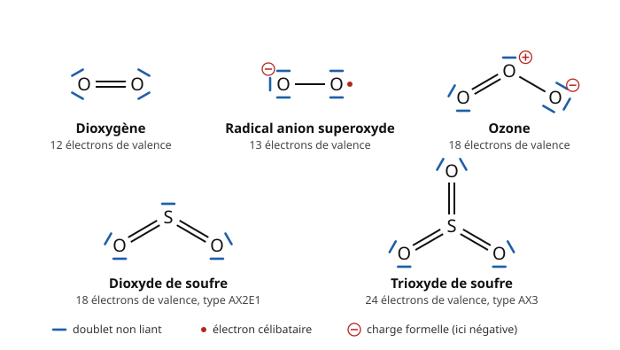
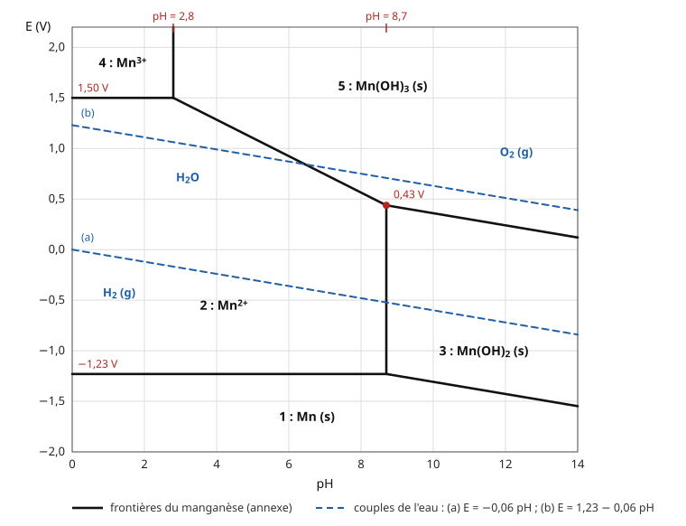
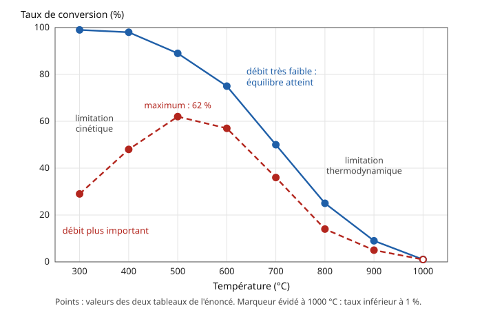

# Banque PT PT — Physique C - Chimie 2014 · Corrigé guidé

*Corrigé rédigé par IA, non officiel. Signalez toute erreur.*

**Rédaction** · modèle exact non renseigné (famille Claude) · effort non renseigné · vitesse non renseignée

## Présentation du sujet

**Thème.** L'oxygène et le soufre, deux éléments de la famille des chalcogènes : structure des atomes et de quelques édifices, dosage du dioxygène dissous dans une eau d'épuration, décomposition de l'ozone utilisé comme désinfectant, synthèse du trioxyde de soufre par le procédé de contact. L'épreuve dure 2 heures, **sans calculatrice**, et comporte 45 questions numérotées de Q1 à Q45, réparties en quatre parties indépendantes. Une feuille annexe est à rendre avec la copie : le diagramme potentiel-pH simplifié du manganèse, sur lequel on porte les domaines et, utilement, les droites de l'eau.

- *Partie 1 (questions 1 à 6)* : configurations électroniques et classification, nombres d'oxydation du soufre, énergie de première ionisation, représentations de Lewis, géométries VSEPR.
- *Partie 2 (questions 7 à 19)* : diagrammes potentiel-pH du manganèse et de l'eau (questions 7 à 12, avec une question de cristallographie), puis les quatre étapes du dosage de Winkler (questions 13 à 19).
- *Partie 3 (questions 20 à 30)* : cinétique formelle, temps de demi-réaction, catalyse et énergie d'activation (questions 20 à 24), puis mécanisme en chaîne de l'initiation photochimique (questions 25 à 30).
- *Partie 4 (questions 31 à 45)* : thermodynamique de l'équilibre $2\,\mathrm{SO_2} + \mathrm{O_2} = 2\,\mathrm{SO_3}$ et déplacements d'équilibre (questions 31 à 38), cinétique et données industrielles (questions 39 à 42), bilan énergétique d'un réacteur adiabatique (questions 43 à 45).

**Notions mobilisées.** Configuration électronique et classification périodique, schémas de Lewis et méthode VSEPR, compacité d'un cristal métallique, diagrammes potentiel-pH, précipitation, relation de Nernst et constante d'équilibre d'oxydoréduction, dosage indirect, lois de vitesse d'ordre 1 et 2, loi d'Arrhenius, mécanisme en chaîne et approximation des états quasi stationnaires, approximation d'Ellingham, affinité chimique et déplacement d'équilibre, température de fin de réaction adiabatique. Le programme est celui en vigueur à la session 2014, dernière session de l'ancien programme de deuxième année (antérieur à la réforme de 2013-2014) : l'affinité chimique, la méthode VSEPR et les mécanismes en chaîne y figurent.

**Difficulté.** Les questions sont proches du cours et les calculs volontairement simples. La difficulté tient à la longueur (45 questions en 2 heures), à l'enchaînement des quatre étapes du dosage, à la rigueur demandée par l'étude du mécanisme et par celle de l'ajout d'un constituant actif, et au commentaire final sur les contrôles cinétique et thermodynamique.

**Gestion du temps.** Environ 15 minutes pour la partie 1, 35 minutes pour la partie 2, 30 minutes pour la partie 3 et 35 minutes pour la partie 4, en gardant 5 minutes pour relire et compléter l'annexe. Les parties étant indépendantes, commencer par celle que l'on maîtrise le mieux et ne pas s'attarder sur une question bloquante.

> [!JURY]
> Le rapport 2014 dit avoir souvent apprécié la présentation (résultats numériques soulignés, expressions littérales encadrées, usage de couleurs) et la rédaction, et rappelle que seule une réponse justifiée reçoit l'intégralité des points. Il souligne que le sujet couvre assez largement les programmes de chimie de première et de deuxième année et privilégie des notions simples, de façon à valoriser un travail régulier. Bien que le sujet soit assez long, quelques candidats l'ont traité en entier grâce à une rédaction succincte mais efficace.

[Sujet officiel (archive des deux parties de Physique C ; la partie chimie est le fichier `ph_c_2014_pt_ch.pdf`)](https://www.banquept.fr/documents/2014/ph_c_2014_pt.zip) · [Rapport du jury](https://www.banquept.fr/documents/ecrit/rapport/2014/rapport_phys_c_ecrit_2014.pdf)

*Mode d'emploi* : chercher chaque question seul, lire la première indication en cas de blocage, réessayer, puis la seconde, et seulement ensuite la solution.

## Partie 1 — Approche structurale

### Question 1

> [!INDICATION]
> Remplir les sous-couches par énergie croissante (règle de Klechkowski) : $1s$, $2s$, $2p$, $3s$, $3p$, en respectant le principe de Pauli.

> [!INDICATION]
> Le numéro de ligne est la plus grande valeur de $n$ occupée. Pour un élément du bloc $p$, la colonne vaut $12$ plus le nombre d'électrons $p$ de la couche externe.

#### Solution

En remplissant les sous-couches par énergie croissante (règle de Klechkowski), avec au plus deux électrons par orbitale (principe de Pauli) :

$$\boxed{\mathrm{O}\ (Z = 8) : 1s^2\,2s^2\,2p^4 \qquad \mathrm{S}\ (Z = 16) : 1s^2\,2s^2\,2p^6\,3s^2\,3p^4}$$

- Oxygène : la couche de valence est $n = 2$, donc **deuxième ligne** ; la configuration de valence $2s^2\,2p^4$ place l'élément dans la quatrième colonne du bloc $p$, soit la colonne $12 + 4 = 16$.
- Soufre : la couche de valence est $n = 3$, donc **troisième ligne** ; la configuration de valence $3s^2\,3p^4$ donne aussi la colonne 16.

$$\boxed{\mathrm{O} : \text{ligne 2, colonne 16} \qquad \mathrm{S} : \text{ligne 3, colonne 16}}$$

Les deux éléments ont la même configuration de valence $ns^2\,np^4$ (6 électrons de valence) : ils appartiennent à la même famille, celle des chalcogènes, le soufre étant juste sous l'oxygène.

> [!JURY]
> Le rapport note que de nombreux candidats savent écrire les configurations électroniques fondamentales et en déduisent correctement la position des éléments dans la classification.

> [!METHODE]
> Contrôle immédiat : la somme des exposants vaut $Z$ ($2 + 2 + 4 = 8$ et $2 + 2 + 6 + 2 + 4 = 16$). Noter tout de suite le nombre d'électrons de valence (6 pour chacun), qui sert aux questions 2 et 5.

### Question 2

> [!INDICATION]
> Combien d'électrons le soufre peut-il perdre au plus sans toucher aux couches internes ? Combien peut-il en gagner pour saturer sa couche de valence ?

#### Solution

Le soufre possède 6 électrons de valence ($3s^2\,3p^4$).

- Il peut au plus les céder tous les six et atteindre la configuration du néon : nombre d'oxydation maximal $+\mathrm{VI}$ (comme dans $\mathrm{SO_3}$, $\mathrm{H_2SO_4}$ ou l'ion sulfate $\mathrm{SO_4^{2-}}$).
- Il peut au plus capter deux électrons pour saturer la sous-couche $3p$ et atteindre la configuration de l'argon : nombre d'oxydation minimal $-\mathrm{II}$ (comme dans $\mathrm{H_2S}$).

$$\boxed{-\mathrm{II} \leqslant \text{n.o.}(\mathrm{S}) \leqslant +\mathrm{VI}}$$

L'anion usuel correspondant au nombre d'oxydation minimal est l'**ion sulfure** $\mathrm{S^{2-}}$, isoélectronique de l'argon ($1s^2\,2s^2\,2p^6\,3s^2\,3p^6$).

> [!PIEGE]
> Les nombres d'oxydation extrêmes se justifient par la configuration de valence, pas par une liste d'exemples. L'oxygène, plus électronégatif et sans orbitale disponible au-delà de $2p$, n'atteint pas $+\mathrm{VI}$ : c'est une différence entre les deux éléments malgré leur parenté.

### Question 3

> [!INDICATION]
> Préciser l'état physique de l'atome, son état électronique et l'équation de la transformation.

#### Solution

L'énergie de première ionisation $E_i$ est l'énergie minimale à fournir à un atome **isolé, à l'état gazeux et dans son état fondamental**, pour lui arracher un électron, l'ion et l'électron obtenus étant séparés et au repos :

$$\boxed{\mathrm{X_{(g)}} \longrightarrow \mathrm{X^+_{(g)}} + e^-_{(g)} \qquad E_i > 0}$$

L'électron arraché est le moins lié (électron de valence). Les valeurs du tableau, comprises entre 5 et 22, sont manifestement exprimées en électronvolts, unité que l'énoncé ne précise pas.

### Question 4

> [!INDICATION]
> Sur une ligne, le nombre de protons augmente alors que les électrons ajoutés occupent la même couche : que devient l'attraction ressentie par un électron de valence ?

> [!INDICATION]
> Comparer les sous-couches $2p$ de l'azote ($2p^3$) et de l'oxygène ($2p^4$) en dessinant les cases quantiques : quel électron arrache-t-on à l'oxygène ?

#### Solution

**Évolution générale.** De $\mathrm{Li}$ à $\mathrm{Ne}$, l'énergie de première ionisation augmente globalement (de 5,32 à 21,56). Le long de la période, le numéro atomique augmente d'une unité à chaque élément alors que les électrons ajoutés occupent la même couche $n = 2$ : ils s'écrantent mal les uns les autres. La charge effective ressentie par les électrons de valence augmente donc, le rayon atomique diminue, et les électrons de valence sont de plus en plus fortement liés au noyau : il faut de plus en plus d'énergie pour en arracher un.

**Singularité de l'oxygène.** L'énergie d'ionisation de l'oxygène (13,62) est inférieure à celle de l'azote (14,53), contrairement à la tendance générale.

- L'azote, $2s^2\,2p^3$, a une sous-couche $2p$ à demi remplie : d'après la règle de Hund, ses trois électrons $2p$ occupent trois orbitales différentes avec des spins parallèles, situation particulièrement stable.
- L'oxygène, $2s^2\,2p^4$, possède un quatrième électron $2p$ obligé de s'apparier dans une orbitale déjà occupée. La répulsion entre les deux électrons de cette orbitale rend cet électron plus facile à arracher, et l'ion $\mathrm{O^+}$ formé retrouve la sous-couche à demi remplie $2p^3$.

L'ionisation de l'oxygène est ainsi facilitée par rapport à ce que prévoit la seule augmentation de la charge effective.

> [!PIEGE]
> Deux réponses sont attendues : la tendance et l'exception. Invoquer seulement « la stabilité des couches à demi remplies » sans dire quel électron est arraché à l'oxygène (celui qui est apparié) reste insuffisant. Le tableau montre une seconde anomalie, entre $\mathrm{Be}$ ($2s^2$) et $\mathrm{B}$ ($2s^2\,2p^1$), qui n'est pas demandée.

### Question 5

> [!INDICATION]
> Compter d'abord les électrons de valence de chaque édifice (6 par atome d'oxygène ou de soufre, un de plus par charge négative), puis en déduire le nombre de doublets.

> [!INDICATION]
> L'oxygène, élément de la deuxième période, ne dépasse jamais l'octet. Le soufre, élément de la troisième période, peut être hypervalent. Terminer par les charges formelles ; un nombre impair d'électrons impose un électron célibataire.

#### Solution

Chaque atome d'oxygène ou de soufre apporte 6 électrons de valence. On place les doublets en respectant la règle de l'octet pour l'oxygène (deuxième période) ; le soufre (troisième période) peut s'entourer de plus de huit électrons. Les charges formelles s'obtiennent en comparant le nombre d'électrons attribués à l'atome (un par liaison, deux par doublet non liant, un par électron célibataire) à ses 6 électrons de valence.

- **Dioxygène $\mathrm{O_2}$** : $2 \times 6 = 12$ électrons, soit 6 doublets. Une liaison double et deux doublets non liants par atome ; chaque atome respecte l'octet, aucune charge formelle.
- **Radical anion superoxyde $\mathrm{O_2^-}$** : $12 + 1 = 13$ électrons, soit 6 doublets et un électron célibataire. Une liaison simple ; un atome porte trois doublets non liants et la charge formelle $-1$ ($6 + 1 = 7$ électrons attribués), l'autre porte deux doublets non liants et l'électron célibataire ($4 + 1 + 1 = 6$ électrons attribués, charge nulle, sept électrons autour de lui). Le nombre impair d'électrons interdit que les deux atomes vérifient l'octet ; la forme symétrique, où les rôles des deux atomes sont échangés, est équivalente.
- **Ozone $\mathrm{O_3}$** : $3 \times 6 = 18$ électrons, soit 9 doublets. L'atome central est lié à l'un de ses voisins par une liaison double, à l'autre par une liaison simple, et porte un doublet non liant : charge formelle $+1$ ($2 + 3 = 5$ électrons attribués). L'atome terminal simplement lié porte trois doublets non liants et la charge $-1$ ; l'autre, deux doublets non liants et aucune charge. Deux formes mésomères équivalentes échangent les deux atomes terminaux : les deux liaisons sont identiques. La molécule est globalement neutre.
- **Dioxyde de soufre $\mathrm{SO_2}$** : $18$ électrons, soit 9 doublets. Le soufre est lié aux deux atomes d'oxygène par deux liaisons doubles et porte un doublet non liant ; chaque oxygène porte deux doublets non liants. Aucune charge formelle ; le soufre est hypervalent (10 électrons). L'écriture calquée sur celle de l'ozone (une liaison double, une liaison simple, charges $+1$ sur le soufre et $-1$ sur un oxygène) respecte l'octet et est également recevable.
- **Trioxyde de soufre $\mathrm{SO_3}$** : $4 \times 6 = 24$ électrons, soit 12 doublets. Le soufre est lié aux trois atomes d'oxygène par trois liaisons doubles et ne porte aucun doublet non liant ; chaque oxygène porte deux doublets non liants. Aucune charge formelle ; le soufre est hypervalent (12 électrons). L'écriture respectant l'octet (une liaison double, deux liaisons simples, charge $+2$ sur le soufre et $-1$ sur deux oxygènes) est recevable aussi.

Vérification du décompte sur la figure : 6 doublets pour $\mathrm{O_2}$ ; 6 doublets et 1 électron pour $\mathrm{O_2^-}$ ; 9 doublets pour $\mathrm{O_3}$ et $\mathrm{SO_2}$ ; 12 doublets pour $\mathrm{SO_3}$.

> [!JURY]
> Le rapport demande un soin particulier pour les représentations de Lewis : calcul du nombre d'électrons de valence, respect de la règle de l'octet pour les éléments des deux premières périodes, présence des doublets non liants et des charges formelles.

> [!METHODE]
> Ordre de travail : nombre d'électrons de valence, nombre de doublets, squelette, doublets non liants sur les atomes terminaux puis sur l'atome central, liaisons multiples pour compléter l'octet, charges formelles, vérification de la charge totale.

> [!PIEGE]
> Dans l'ozone, l'atome central est un oxygène : il ne peut pas porter deux liaisons doubles et un doublet non liant (10 électrons). Les charges formelles $+1$ et $-1$ y sont donc inévitables, alors que le soufre de $\mathrm{SO_2}$ peut les éviter par hypervalence.

### Question 6

> [!INDICATION]
> Autour du soufre, compter les atomes liés (X) et les doublets non liants (E) ; une liaison multiple compte pour une seule direction.

> [!INDICATION]
> Trois directions autour de l'atome central se répartissent dans un plan, à 120° les unes des autres. La géométrie de la molécule ne décrit que la position des atomes.

#### Solution

On applique la méthode VSEPR à l'atome central de soufre, en comptant une liaison multiple comme une seule direction de répulsion.

- **$\mathrm{SO_2}$** : deux atomes liés et un doublet non liant, type $\mathrm{AX_2E_1}$. Les trois directions se placent dans un plan à environ 120° ; l'une étant occupée par le doublet non liant, la molécule est **coudée** (en V). Le doublet non liant étant plus répulsif qu'un doublet liant, l'angle $\widehat{\mathrm{OSO}}$ est un peu inférieur à 120°.
- **$\mathrm{SO_3}$** : trois atomes liés et aucun doublet non liant, type $\mathrm{AX_3E_0}$. La molécule est **trigonale plane** (triangle équilatéral, soufre au centre), avec des angles $\widehat{\mathrm{OSO}}$ de 120°.

$$\boxed{\mathrm{SO_2} : \mathrm{AX_2E_1},\ \text{coudée} \qquad \mathrm{SO_3} : \mathrm{AX_3},\ \text{trigonale plane}}$$

Le type VSEPR ne dépend pas de l'écriture de Lewis retenue à la question 5 (avec ou sans hypervalence).

> [!JURY]
> Le rapport étend à la prévision des géométries VSEPR sa demande de soin formulée pour les représentations de Lewis.

> [!PIEGE]
> Ne pas confondre la figure de répulsion (triangle pour trois directions) et la géométrie de la molécule, qui ne prend en compte que les atomes : $\mathrm{SO_2}$ est coudée, pas « triangulaire ».

## Partie 2 — Dosage du dioxygène dissous par la méthode de Winkler

### Question 7

> [!INDICATION]
> Calculer le nombre d'oxydation du manganèse dans chaque espèce : il croît quand le potentiel augmente.

> [!INDICATION]
> À nombre d'oxydation égal, l'hydroxyde solide occupe le domaine des $\mathrm{pH}$ les plus élevés.

#### Solution

Nombres d'oxydation du manganèse : $0$ dans $\mathrm{Mn_{(s)}}$ ; $+\mathrm{II}$ dans $\mathrm{Mn^{2+}}$ et $\mathrm{Mn(OH)_{2(s)}}$ ; $+\mathrm{III}$ dans $\mathrm{Mn^{3+}}$ et $\mathrm{Mn(OH)_{3(s)}}$.

- Plus le potentiel est élevé, plus le nombre d'oxydation de l'espèce stable est grand : le métal occupe le bas du diagramme, le manganèse(II) la bande intermédiaire, le manganèse(III) le haut.
- À nombre d'oxydation donné, les frontières verticales séparent le cation (à gauche, milieu acide) de l'hydroxyde solide (à droite, milieu basique), puisque l'hydroxyde précipite quand la concentration en ions hydroxyde augmente.

| Domaine | Espèce | Nombre d'oxydation | Nature du domaine |
|---|---|---|---|
| 1 | $\mathrm{Mn_{(s)}}$ | $0$ | existence |
| 2 | $\mathrm{Mn^{2+}_{(aq)}}$ | $+\mathrm{II}$ | prédominance |
| 3 | $\mathrm{Mn(OH)_{2(s)}}$ | $+\mathrm{II}$ | existence |
| 4 | $\mathrm{Mn^{3+}_{(aq)}}$ | $+\mathrm{III}$ | prédominance |
| 5 | $\mathrm{Mn(OH)_{3(s)}}$ | $+\mathrm{III}$ | existence |

Contrôles sur l'annexe : la frontière horizontale entre les domaines 1 et 2 est à $E_1^\circ + 0{,}03\,\log(1{,}0\cdot10^{-2}) = -1{,}17 - 0{,}06 = -1{,}23\ \mathrm{V}$, ce qu'on lit bien ; la frontière verticale entre les domaines 4 et 5 correspond à $[\mathrm{HO^-}]^3 = K_{s2}/(1{,}0\cdot10^{-2}) = 10^{-33{,}7}$, soit $\mathrm{pH} = 14 - 11{,}2 = 2{,}8$, ce qu'on lit aussi.

> [!JURY]
> Le rapport juge l'analyse des diagrammes potentiel-pH souvent bien menée : les candidats savent attribuer les domaines d'existence et de prédominance.

> [!METHODE]
> Classer d'abord les espèces par nombre d'oxydation (axe vertical), puis par caractère acide ou basique (axe horizontal). Dire « existence » pour un solide et « prédominance » pour une espèce dissoute.

### Question 8

> [!INDICATION]
> Sur la frontière verticale entre $\mathrm{Mn^{2+}}$ et $\mathrm{Mn(OH)_{2(s)}}$, le solide commence juste à exister alors que $[\mathrm{Mn^{2+}}]$ vaut encore la concentration de tracé.

> [!INDICATION]
> Écrire $K_{s1} = [\mathrm{Mn^{2+}}]\,[\mathrm{HO^-}]^2$ avec $[\mathrm{HO^-}] = K_e/[\mathrm{H_3O^+}]$ et lire le $\mathrm{pH}$ de la frontière sur l'annexe.

#### Solution

Sur la frontière verticale entre les domaines 2 et 3, le premier grain de $\mathrm{Mn(OH)_{2(s)}}$ apparaît alors que la concentration en ions manganèse(II) vaut encore la concentration de tracé $c = 1{,}0\cdot10^{-2}\ \mathrm{mol\cdot L^{-1}}$. La condition d'équilibre de précipitation s'écrit, les concentrations étant rapportées à $c^\circ = 1\ \mathrm{mol\cdot L^{-1}}$ :

$$K_{s1} = [\mathrm{Mn^{2+}}]\,[\mathrm{HO^-}]^2 = c\,\frac{K_e^2}{[\mathrm{H_3O^+}]^2}$$

soit

$$\boxed{\mathrm{p}K_{s1} = -\log c + 2\,(\mathrm{p}K_e - \mathrm{pH_{front}})}$$

**Lecture graphique.** Sur l'annexe, la frontière verticale entre les domaines 2 et 3 se situe entre les traits du quadrillage d'abscisses 8 et 9, aux deux tiers environ de cet intervalle : $\mathrm{pH_{front}} \approx 8{,}7$, à 0,1 près.

$$\mathrm{p}K_{s1} = 2 + 2 \times (14 - 8{,}7) = 2 + 10{,}6 = 12{,}6$$

$$\boxed{K_{s1} \approx 10^{-12{,}6} \approx 2{,}5\cdot10^{-13}}$$

Une incertitude de lecture de 0,1 unité de $\mathrm{pH}$ entraîne 0,2 unité sur $\mathrm{p}K_{s1}$.

> [!JURY]
> Le rapport cite la détermination d'une constante d'équilibre par lecture graphique parmi les points que les candidats réussissent souvent.

> [!PIEGE]
> La concentration à prendre sur la frontière est la concentration de tracé, $1{,}0\cdot10^{-2}\ \mathrm{mol\cdot L^{-1}}$, et non $1\ \mathrm{mol\cdot L^{-1}}$ : l'oublier décale $\mathrm{p}K_{s1}$ de deux unités. L'énoncé autorise les puissances de 10 décimales : $10^{-12{,}6}$ est une réponse recevable telle quelle.

### Question 9

> [!INDICATION]
> Les potentiels standard ne s'ajoutent pas : ce sont les enthalpies libres standard des demi-équations, $\Delta_r G^\circ = -n F E^\circ$, qui s'ajoutent.

> [!INDICATION]
> Écrire la demi-équation du couple $\mathrm{Mn^{3+}/Mn^{2+}}$ comme différence de celles des couples $\mathrm{Mn^{3+}/Mn}$ et $\mathrm{Mn^{2+}/Mn}$.

#### Solution

On associe à chaque demi-équation de réduction l'enthalpie libre standard $\Delta_r G^\circ = -n F E^\circ$ :

$$\begin{aligned}
(1)\quad & \mathrm{Mn^{2+}} + 2\,e^- = \mathrm{Mn_{(s)}} & \Delta_r G_1^\circ &= -2 F E_1^\circ \\
(2)\quad & \mathrm{Mn^{3+}} + 3\,e^- = \mathrm{Mn_{(s)}} & \Delta_r G_2^\circ &= -3 F E_2^\circ \\
(3)\quad & \mathrm{Mn^{3+}} + e^- = \mathrm{Mn^{2+}} & \Delta_r G_3^\circ &= -F E_3^\circ
\end{aligned}$$

Comme $(3) = (2) - (1)$, on a $\Delta_r G_3^\circ = \Delta_r G_2^\circ - \Delta_r G_1^\circ$, d'où

$$\boxed{E_3^\circ = 3\,E_2^\circ - 2\,E_1^\circ}$$

Application numérique :

$$E_3^\circ = 3 \times (-0{,}28) - 2 \times (-1{,}17) = -0{,}84 + 2{,}34$$

$$\boxed{E_3^\circ = 1{,}50\ \mathrm{V}}$$

**Comparaison.** Sur la frontière entre les domaines 4 et 2, les deux espèces dissoutes ont la même concentration, donc $E = E_3^\circ + 0{,}06\,\log\dfrac{[\mathrm{Mn^{3+}}]}{[\mathrm{Mn^{2+}}]} = E_3^\circ$ : la frontière est horizontale et son ordonnée donne directement $E_3^\circ$. On lit sur l'annexe $E = 1{,}5\ \mathrm{V}$, en accord avec la valeur calculée (et avec la valeur $1{,}50\ \mathrm{V}$ donnée plus loin dans l'énoncé).

> [!PIEGE]
> Écrire $E_3^\circ = E_2^\circ - E_1^\circ = 0{,}89\ \mathrm{V}$ est l'erreur classique : il faut pondérer chaque potentiel par le nombre d'électrons échangés.

### Question 10

> [!INDICATION]
> Écrire la demi-équation entre $\mathrm{Mn(OH)_{3(s)}}$ et $\mathrm{Mn(OH)_{2(s)}}$ en milieu acide, avec des ions $\mathrm{H^+}$.

> [!INDICATION]
> Les deux solides ont une activité égale à 1 : seul $[\mathrm{H^+}]$ subsiste dans la relation de Nernst.

#### Solution

Demi-équation du couple $\mathrm{Mn(OH)_{3(s)}/Mn(OH)_{2(s)}}$, écrite en milieu acide :

$$\mathrm{Mn(OH)_{3(s)}} + \mathrm{H^+_{(aq)}} + e^- = \mathrm{Mn(OH)_{2(s)}} + \mathrm{H_2O_{(\ell)}}$$

Les activités des solides et du solvant valent 1. La relation de Nernst donne, avec $\alpha = \dfrac{RT}{F}\ln 10 = 0{,}060\ \mathrm{V}$ :

$$E = E^\circ\big(\mathrm{Mn(OH)_3/Mn(OH)_2}\big) + \alpha\,\log[\mathrm{H^+}] = E^\circ\big(\mathrm{Mn(OH)_3/Mn(OH)_2}\big) - \alpha\,\mathrm{pH}$$

$$\boxed{\frac{\mathrm{d}E}{\mathrm{dpH}} = -\alpha = -0{,}060\ \mathrm{V\ par\ unité\ de\ pH}}$$

Vérification sur l'annexe : la frontière passe de $0{,}43\ \mathrm{V}$ à $\mathrm{pH} = 8{,}7$ à environ $0{,}11\ \mathrm{V}$ à $\mathrm{pH} = 14$, soit une pente de $-0{,}32/5{,}3 \approx -0{,}06\ \mathrm{V}$ par unité de $\mathrm{pH}$.

> [!JURY]
> Le rapport rappelle qu'il faut écrire la demi-équation d'oxydoréduction en milieu acide pour pouvoir appliquer la relation de Nernst avec le potentiel standard habituel.

> [!METHODE]
> Pour une demi-équation échangeant $m$ protons et $n$ électrons entre espèces d'activité fixée, la pente vaut $-0{,}06\,m/n$ volt par unité de $\mathrm{pH}$. Ici $m = n = 1$. La même règle donne $-0{,}18\ \mathrm{V}$ pour la frontière entre $\mathrm{Mn(OH)_{3(s)}}$ et $\mathrm{Mn^{2+}}$ ($m = 3$, $n = 1$), ce que confirme l'annexe.

### Question 11

> [!INDICATION]
> Dans chaque structure, compter les atomes par maille et trouver la direction selon laquelle les atomes, sphères dures, sont en contact.

> [!INDICATION]
> La compacité est le rapport du volume des atomes de la maille au volume de la maille ; comparer aux deux valeurs numériques fournies.

#### Solution

On modélise les atomes par des sphères dures de rayon $r$ dans une maille cubique d'arête $a$ ; la compacité est $C = \dfrac{N \times \frac{4}{3}\pi r^3}{a^3}$, où $N$ est le nombre d'atomes par maille.

**Cubique à faces centrées.** $N = 8 \times \dfrac{1}{8} + 6 \times \dfrac{1}{2} = 4$. Le contact a lieu le long de la diagonale d'une face : $4r = a\sqrt{2}$.

$$C_{\mathrm{CFC}} = \frac{4 \times \frac{4}{3}\pi r^3}{a^3} = \frac{16\pi}{3}\left(\frac{\sqrt{2}}{4}\right)^3 = \frac{\pi\sqrt{2}}{6} = 0{,}74$$

**Cubique centrée.** $N = 8 \times \dfrac{1}{8} + 1 = 2$. Le contact a lieu le long de la grande diagonale du cube : $4r = a\sqrt{3}$.

$$C_{\mathrm{CC}} = \frac{2 \times \frac{4}{3}\pi r^3}{a^3} = \frac{8\pi}{3}\left(\frac{\sqrt{3}}{4}\right)^3 = \frac{\pi\sqrt{3}}{8} = 0{,}68$$

La compacité mesurée, 0,74, est celle de l'empilement compact :

$$\boxed{\text{la structure est cubique à faces centrées}}$$

> [!METHODE]
> Sans calcul, l'argument tient en une phrase : 0,74 est la compacité maximale d'un empilement de sphères identiques, atteinte par la structure cubique à faces centrées, alors que la structure cubique centrée n'est pas compacte (0,68). Le calcul, court, sécurise la réponse.

### Question 12

> [!INDICATION]
> L'eau intervient comme oxydant dans un couple (elle donne du dihydrogène) et comme réducteur dans un autre (elle donne du dioxygène).

> [!INDICATION]
> Écrire chaque demi-équation avec des ions $\mathrm{H^+}$, prendre les pressions partielles égales à $P^\circ$ et appliquer la relation de Nernst : les deux frontières sont des droites parallèles.

#### Solution

L'eau appartient à deux couples.

**Couple $\mathrm{H^+_{(aq)}/H_{2(g)}}$** (l'eau, ou ses ions $\mathrm{H^+}$, joue le rôle d'oxydant) :

$$2\,\mathrm{H^+_{(aq)}} + 2\,e^- = \mathrm{H_{2(g)}}$$

$$E_a = E_4^\circ + \frac{\alpha}{2}\,\log\frac{[\mathrm{H^+}]^2\,P^\circ}{P_{\mathrm{H_2}}}$$

Avec $P_{\mathrm{H_2}} = P^\circ$ sur la frontière :

$$\boxed{E_a = -0{,}06\,\mathrm{pH}\quad(\mathrm{V})}$$

**Couple $\mathrm{O_{2(g)}/H_2O_{(\ell)}}$** (l'eau joue le rôle de réducteur) :

$$\mathrm{O_{2(g)}} + 4\,\mathrm{H^+_{(aq)}} + 4\,e^- = 2\,\mathrm{H_2O_{(\ell)}}$$

$$E_b = E_5^\circ + \frac{\alpha}{4}\,\log\frac{P_{\mathrm{O_2}}\,[\mathrm{H^+}]^4}{P^\circ}$$

Avec $P_{\mathrm{O_2}} = P^\circ$ sur la frontière :

$$\boxed{E_b = 1{,}23 - 0{,}06\,\mathrm{pH}\quad(\mathrm{V})}$$

**Construction.** Ce sont deux droites parallèles de pente $-0{,}06\ \mathrm{V}$ par unité de $\mathrm{pH}$ : la droite (a) passe par $(0\ ;\ 0\ \mathrm{V})$ et $(14\ ;\ -0{,}84\ \mathrm{V})$, la droite (b) par $(0\ ;\ 1{,}23\ \mathrm{V})$ et $(14\ ;\ 0{,}39\ \mathrm{V})$. Elles sont tracées en tirets sur la figure 2.

- Au-dessus de la droite (b) : domaine du dioxygène $\mathrm{O_{2(g)}}$ (l'eau y est oxydée).
- Entre les deux droites : domaine de stabilité thermodynamique de l'eau, large de $1{,}23\ \mathrm{V}$ à tout $\mathrm{pH}$.
- Au-dessous de la droite (a) : domaine du dihydrogène $\mathrm{H_{2(g)}}$ (l'eau y est réduite).

> [!PIEGE]
> Un diagramme sans domaines n'est pas terminé : l'oxydant de chaque couple est au-dessus de sa frontière, le réducteur au-dessous. L'eau est donc entre les deux droites, et non de part et d'autre.

### Question 13

> [!INDICATION]
> Situer le milieu réactionnel (basique, manganèse au nombre d'oxydation $+\mathrm{II}$) sur le diagramme de l'annexe.

> [!INDICATION]
> Le dioxygène oxyde le manganèse(II) en manganèse(III) : quelle est l'espèce du manganèse(III) stable en milieu basique ? Équilibrer avec les deux demi-équations.

#### Solution

**Avant oxydation.** La soude rend le milieu basique : le $\mathrm{pH}$ dépasse 8,7 et le manganèse(II) se trouve dans le domaine 3 du diagramme. Il précipite sous forme d'**hydroxyde de manganèse(II)** :

$$\mathrm{Mn^{2+}_{(aq)}} + 2\,\mathrm{HO^-_{(aq)}} = \mathrm{Mn(OH)_{2(s)}}$$

**Après oxydation.** Le dioxygène dissous oxyde le manganèse(II) en manganèse(III), dont la forme stable en milieu basique est l'hydroxyde : le précipité brun est l'**hydroxyde de manganèse(III)** $\mathrm{Mn(OH)_{3(s)}}$ (domaine 5).

**Équation.** En milieu basique :

$$\begin{aligned}
\mathrm{Mn(OH)_{2(s)}} + \mathrm{HO^-_{(aq)}} &= \mathrm{Mn(OH)_{3(s)}} + e^- & (\times 4) \\
\mathrm{O_{2(aq)}} + 2\,\mathrm{H_2O_{(\ell)}} + 4\,e^- &= 4\,\mathrm{HO^-_{(aq)}} & (\times 1)
\end{aligned}$$

$$\boxed{4\,\mathrm{Mn(OH)_{2(s)}} + \mathrm{O_{2(aq)}} + 2\,\mathrm{H_2O_{(\ell)}} = 4\,\mathrm{Mn(OH)_{3(s)}}}$$

Une mole de dioxygène dissous produit quatre moles d'hydroxyde de manganèse(III). L'erlenmeyer est rempli à ras bord et bouché pour que seul le dioxygène initialement dissous dans l'eau réagisse, sans apport par l'air ; l'agitation de 30 minutes laisse le temps à cette réaction, qui met en jeu un solide, d'être complète.

> [!JURY]
> Le rapport insiste sur la compréhension du rôle de chaque étape du protocole, chaque transformation devant être modélisée par une équation de réaction.

> [!PIEGE]
> En milieu basique, écrire la réaction avec $\mathrm{Mn^{2+}}$ et $\mathrm{Mn^{3+}}$ contredit le diagramme : les espèces présentes sont les deux hydroxydes solides. Ne pas faire apparaître d'ions $\mathrm{H^+}$ dans une équation en milieu basique.

### Question 14

> [!INDICATION]
> Superposer les diagrammes du manganèse et de l'eau : comparer la position de la droite du couple $\mathrm{O_2/H_2O}$ et celle de la frontière manganèse(III)/manganèse(II), en milieu acide puis en milieu basique.

> [!INDICATION]
> Deux espèces réagissent quantitativement si leurs domaines sont disjoints ; elles coexistent si elles ont un domaine commun.

#### Solution

On superpose le diagramme du manganèse et la droite (b) du couple $\mathrm{O_2/H_2O}$, $E_b = 1{,}23 - 0{,}06\,\mathrm{pH}$ (figure 2).

- **En milieu acide** ($\mathrm{pH} < 2{,}8$), la frontière $\mathrm{Mn^{3+}/Mn^{2+}}$ est à $1{,}50\ \mathrm{V}$, au-dessus de la droite (b) (au plus $1{,}23\ \mathrm{V}$). Le dioxygène et l'ion $\mathrm{Mn^{2+}}$ ont un domaine commun : le dioxygène n'oxyde pas le manganèse(II). La situation reste la même tant que la droite (b) est sous la frontière $\mathrm{Mn(OH)_3/Mn^{2+}}$, c'est-à-dire, par lecture de la figure 2, jusqu'à $\mathrm{pH} \approx 6{,}5$.
- **En milieu basique** ($\mathrm{pH} > 8{,}7$), la frontière $\mathrm{Mn(OH)_3/Mn(OH)_2}$ est parallèle à la droite (b) et située nettement au-dessous : à $\mathrm{pH} = 8{,}7$, elle est à $0{,}43\ \mathrm{V}$ alors que $E_b = 1{,}23 - 0{,}52 = 0{,}71\ \mathrm{V}$, soit un écart d'environ $0{,}28\ \mathrm{V}$ qui se conserve jusqu'à $\mathrm{pH} = 14$. Les domaines de $\mathrm{O_2}$ et de $\mathrm{Mn(OH)_{2(s)}}$ sont disjoints : la réaction de la question 13 est thermodynamiquement très favorable, avec une constante de l'ordre de $10^{4 \times 0{,}28/0{,}06} \approx 10^{18}$.

Le milieu basique est donc nécessaire pour que **tout le dioxygène dissous soit consommé** (réaction quantitative), condition indispensable à un dosage.

> [!METHODE]
> Raisonner sur la superposition des deux diagrammes plutôt que sur les seuls potentiels standard : c'est la position relative des frontières au $\mathrm{pH}$ de travail qui décide.

### Question 15

> [!INDICATION]
> En milieu acide, quelle est l'espèce du manganèse(III) stable d'après l'annexe ?

#### Solution

En milieu acide ($\mathrm{pH} < 2{,}8$), le manganèse(III) est stable sous forme d'ion $\mathrm{Mn^{3+}}$ (domaine 4). Le précipité brun se dissout selon une réaction acido-basique, sans changement du nombre d'oxydation :

$$\boxed{\mathrm{Mn(OH)_{3(s)}} + 3\,\mathrm{H^+_{(aq)}} = \mathrm{Mn^{3+}_{(aq)}} + 3\,\mathrm{H_2O_{(\ell)}}}$$

L'hydroxyde de manganèse(II) qui n'a pas réagi (le dioxygène est le réactif limitant de la première étape) se dissout de même : $\mathrm{Mn(OH)_{2(s)}} + 2\,\mathrm{H^+_{(aq)}} = \mathrm{Mn^{2+}_{(aq)}} + 2\,\mathrm{H_2O_{(\ell)}}$.

Une fois le milieu acide, le dioxygène n'oxyde plus le manganèse(II) (question 14) : on peut ouvrir l'erlenmeyer sans fausser le dosage, le dioxygène de l'air ne produisant plus de manganèse(III).

> [!PIEGE]
> Cette étape n'est pas une oxydoréduction : le manganèse reste au nombre d'oxydation $+\mathrm{III}$. Aucun électron ne doit apparaître.

### Question 16

> [!INDICATION]
> Quelle quantité d'ions $\mathrm{H^+}$ faut-il apporter, et quel volume l'erlenmeyer peut-il encore recevoir ?

#### Solution

Il faut apporter beaucoup d'ions $\mathrm{H^+}$ : neutraliser les ions hydroxyde en excès, dissoudre les deux hydroxydes, puis amener le $\mathrm{pH}$ sous 2,8 environ pour que le manganèse(III) soit entièrement sous forme $\mathrm{Mn^{3+}}$.

Avec une solution **concentrée**, cette quantité est apportée par quelques gouttes, donc par un **volume négligeable** :

- l'erlenmeyer est rempli à ras bord ; un ajout volumineux le ferait déborder, avec perte de matière ;
- le volume de la solution reste pratiquement celui de l'eau analysée : il n'y a pas de dilution à prendre en compte, et la concentration $C_0$ se rapporte directement au volume $V_0$ prélevé à la quatrième étape.

L'ajout se fait goutte à goutte et sous agitation parce que la dilution de l'acide sulfurique concentré et la neutralisation sont fortement exothermiques.

### Question 17

> [!INDICATION]
> Identifier l'oxydant le plus fort et le réducteur le plus fort présents ; équilibrer en électrons les deux demi-équations.

> [!INDICATION]
> À l'équilibre, les potentiels de Nernst des deux couples sont égaux : en déduire $\log K^\circ$ en fonction de l'écart des potentiels standard et du nombre d'électrons échangés.

#### Solution

L'ion $\mathrm{Mn^{3+}}$ ($E_3^\circ = 1{,}50\ \mathrm{V}$) est un oxydant plus fort que le diiode ($E_6^\circ = 0{,}62\ \mathrm{V}$) : il oxyde les ions iodure.

$$\begin{aligned}
\mathrm{Mn^{3+}_{(aq)}} + e^- &= \mathrm{Mn^{2+}_{(aq)}} & (\times 2) \\
2\,\mathrm{I^-_{(aq)}} &= \mathrm{I_{2(aq)}} + 2\,e^- & (\times 1)
\end{aligned}$$

$$\boxed{2\,\mathrm{Mn^{3+}_{(aq)}} + 2\,\mathrm{I^-_{(aq)}} = 2\,\mathrm{Mn^{2+}_{(aq)}} + \mathrm{I_{2(aq)}}}$$

**Constante d'équilibre.** À l'équilibre, les potentiels des deux couples sont égaux :

$$E_3^\circ + \alpha\,\log\frac{[\mathrm{Mn^{3+}}]}{[\mathrm{Mn^{2+}}]} = E_6^\circ + \frac{\alpha}{2}\,\log\frac{[\mathrm{I_2}]}{[\mathrm{I^-}]^2}$$

En multipliant par $2/\alpha$ et en regroupant :

$$\log K^\circ = \log\frac{[\mathrm{Mn^{2+}}]^2\,[\mathrm{I_2}]}{[\mathrm{Mn^{3+}}]^2\,[\mathrm{I^-}]^2} = \frac{2\,(E_3^\circ - E_6^\circ)}{\alpha}$$

$$\log K^\circ = \frac{2 \times (1{,}50 - 0{,}62)}{0{,}060} = \frac{1{,}76}{0{,}060} = 29{,}3$$

$$\boxed{K^\circ = 10^{29{,}3} \approx 2\cdot10^{29}}$$

$K^\circ \gg 1$ : la réaction est **quantitative**. Les ions iodure étant en excès, tout le manganèse(III) est réduit, ce qui explique la disparition de la coloration brune au profit de la teinte jaune orangé du diiode.

> [!PIEGE]
> Le nombre d'électrons à utiliser dans $\log K^\circ$ est celui de l'équation telle qu'elle est écrite : 2 ici. Avec l'équation divisée par deux ($\mathrm{Mn^{3+}} + \mathrm{I^-} = \mathrm{Mn^{2+}} + \tfrac{1}{2}\,\mathrm{I_2}$), on trouverait $10^{14{,}7}$ : toujours préciser l'équation associée à la constante.

### Question 18

> [!INDICATION]
> Le diiode est l'oxydant, l'ion thiosulfate le réducteur ; l'ion tétrathionate contient quatre atomes de soufre.

#### Solution

Le diiode ($E_6^\circ = 0{,}62\ \mathrm{V}$) oxyde les ions thiosulfate ($E_7^\circ = 0{,}08\ \mathrm{V}$) en ions tétrathionate :

$$\begin{aligned}
\mathrm{I_{2(aq)}} + 2\,e^- &= 2\,\mathrm{I^-_{(aq)}} \\
2\,\mathrm{S_2O_3^{2-}}_{(aq)} &= \mathrm{S_4O_6^{2-}}_{(aq)} + 2\,e^-
\end{aligned}$$

$$\boxed{\mathrm{I_{2(aq)}} + 2\,\mathrm{S_2O_3^{2-}}_{(aq)} = 2\,\mathrm{I^-_{(aq)}} + \mathrm{S_4O_6^{2-}}_{(aq)}}$$

Les charges sont équilibrées ($-4$ de chaque côté). La constante vaut $10^{2 \times (0{,}62 - 0{,}08)/0{,}060} = 10^{18}$ : la réaction est quantitative, et rapide, ce qui convient à un dosage. L'équivalence est repérée par la décoloration de la solution, rendue nette par l'empois d'amidon (bleu foncé en présence de diiode, incolore après l'équivalence).

### Question 19

> [!INDICATION]
> À l'équivalence, les réactifs de la réaction de dosage ont été introduits dans les proportions stœchiométriques : deux ions thiosulfate par molécule de diiode.

> [!INDICATION]
> Remonter les étapes une à une avec les coefficients des équations : 2 $\mathrm{Mn^{3+}}$ par $\mathrm{I_2}$ (étape 3), 1 $\mathrm{Mn(OH)_3}$ par $\mathrm{Mn^{3+}}$ (étape 2), 4 $\mathrm{Mn(OH)_3}$ par $\mathrm{O_2}$ (étape 1). Toutes les quantités se rapportent au volume $V_0$ dosé.

#### Solution

Toutes les quantités ci-dessous se rapportent à la prise d'essai de volume $V_0 = 50{,}0\ \mathrm{mL}$. Les ajouts des étapes 1 à 3 (solides, quelques gouttes d'acide concentré) ne modifient pas sensiblement le volume : ces $50{,}0\ \mathrm{mL}$ correspondent à $50{,}0\ \mathrm{mL}$ de l'eau analysée.

**Quantité de diiode titrée.** À l'équivalence de la réaction de la question 18, $n_{\mathrm{S_2O_3^{2-}}} = 2\,n_{\mathrm{I_2}}$ :

$$\boxed{n_{\mathrm{I_2}} = \frac{C_1\,V_{eq}}{2}}$$

$$n_{\mathrm{I_2}} = \frac{1{,}00\cdot10^{-3} \times 20{,}0\cdot10^{-3}}{2} = 1{,}00\cdot10^{-5}\ \mathrm{mol}$$

**Quantité d'ions manganèse(III).** D'après l'équation de la question 17, les ions iodure étant en excès, $n_{\mathrm{Mn^{3+}}} = 2\,n_{\mathrm{I_2}}$ :

$$\boxed{n_{\mathrm{Mn^{3+}}} = C_1\,V_{eq} = 2{,}00\cdot10^{-5}\ \mathrm{mol}}$$

**Quantité d'hydroxyde de manganèse(III).** D'après l'équation de la question 15, chaque $\mathrm{Mn(OH)_3}$ donne un ion $\mathrm{Mn^{3+}}$ :

$$\boxed{n_{\mathrm{Mn(OH)_3}} = n_{\mathrm{Mn^{3+}}} = 2{,}00\cdot10^{-5}\ \mathrm{mol}}$$

**Concentration en dioxygène dissous.** D'après l'équation de la question 13, le dioxygène étant le réactif limitant, $n_{\mathrm{O_2}} = \dfrac{n_{\mathrm{Mn(OH)_3}}}{4} = 5{,}00\cdot10^{-6}\ \mathrm{mol}$ dans le volume $V_0$ :

$$\boxed{C_0 = \frac{n_{\mathrm{O_2}}}{V_0} = \frac{C_1\,V_{eq}}{4\,V_0}}$$

$$C_0 = \frac{1{,}00\cdot10^{-3} \times 20{,}0}{4 \times 50{,}0} = 1{,}00\cdot10^{-4}\ \mathrm{mol\cdot L^{-1}}$$

$$\boxed{C_0 = 1{,}00\cdot10^{-4}\ \mathrm{mol\cdot L^{-1}}}$$

Rapportées à l'erlenmeyer entier (500 mL, soit dix prises d'essai), les quantités de manganèse(III) formées aux étapes 1 et 2 valent dix fois plus, $2{,}00\cdot10^{-4}\ \mathrm{mol}$ ; la concentration $C_0$ n'en dépend pas. Avec une masse molaire du dioxygène de $32\ \mathrm{g\cdot mol^{-1}}$ (valeur non fournie par l'énoncé), $C_0$ correspond à environ $3\ \mathrm{mg\cdot L^{-1}}$, ordre de grandeur plausible pour une eau naturelle ou résiduaire, inférieur à la saturation (une dizaine de milligrammes par litre).

> [!JURY]
> D'après le rapport, l'exploitation du volume équivalent n'a que trop rarement été menée à son terme ; une réponse juste, qui demande des compétences simples mais de la rigueur, a été valorisée.

> [!METHODE]
> Bilan en une ligne : une mole de $\mathrm{O_2}$ donne 4 moles de $\mathrm{Mn(OH)_3}$, donc 4 moles de $\mathrm{Mn^{3+}}$, donc 2 moles de $\mathrm{I_2}$, qui consomment 4 moles de thiosulfate : $n_{\mathrm{O_2}} = n_{\mathrm{S_2O_3^{2-}}}/4$. C'est un dosage indirect : le thiosulfate ne réagit jamais avec le dioxygène lui-même.

> [!PIEGE]
> Convertir $V_{eq}$ en litres pour les quantités de matière ; dans le quotient final $C_1 V_{eq}/(4 V_0)$, les deux volumes peuvent rester en millilitres. Donner trois chiffres significatifs, comme les données.

## Partie 3 — Étude cinétique de la décomposition de l'ozone en solution aqueuse

### Question 20

> [!INDICATION]
> Égaler les deux expressions de la vitesse : $-\mathrm{d}[\mathrm{O_3}]/\mathrm{d}t$ (définition, coefficient 1 pour l'ozone) et $k\,[\mathrm{O_3}]$ (loi de vitesse).

> [!INDICATION]
> C'est une équation différentielle linéaire du premier ordre à coefficients constants. Le temps de demi-réaction est la date à laquelle la concentration a été divisée par deux.

#### Solution

Pour l'équation $\mathrm{O_3} = \tfrac{3}{2}\,\mathrm{O_2}$, la vitesse volumique de réaction est $v = -\dfrac{\mathrm{d}[\mathrm{O_3}]}{\mathrm{d}t}$, et la loi de vitesse s'écrit $v = k\,[\mathrm{O_3}]^{\alpha}$. Pour $\alpha = 1$ :

$$\boxed{\frac{\mathrm{d}[\mathrm{O_3}]}{\mathrm{d}t} + k\,[\mathrm{O_3}] = 0}$$

C'est une équation linéaire du premier ordre ; avec la condition initiale $[\mathrm{O_3}](0) = [\mathrm{O_3}]_0$ :

$$\boxed{[\mathrm{O_3}](t) = [\mathrm{O_3}]_0\,e^{-kt}}$$

Le temps de demi-réaction $t_{1/2}$ est la durée au bout de laquelle la moitié de l'ozone initial a disparu : $[\mathrm{O_3}](t_{1/2}) = [\mathrm{O_3}]_0/2$, soit $e^{-k t_{1/2}} = \tfrac{1}{2}$ :

$$\boxed{t_{1/2} = \frac{\ln 2}{k}}$$

Il est **indépendant de la concentration initiale**. La constante $k$ est homogène à l'inverse d'un temps.

> [!JURY]
> Le rapport signale que l'écriture et la résolution des équations différentielles régissant l'évolution des concentrations ont souvent posé problème, et rappelle que les candidats sont évalués sur l'ensemble des connaissances acquises pendant les années de classe préparatoire.

### Question 21

> [!INDICATION]
> L'équation n'est plus linéaire : séparer les variables, c'est-à-dire regrouper $[\mathrm{O_3}]$ d'un côté et $t$ de l'autre.

> [!INDICATION]
> Reconnaître que $-\mathrm{d}[\mathrm{O_3}]/[\mathrm{O_3}]^2$ est la différentielle de $1/[\mathrm{O_3}]$.

#### Solution

Pour $\alpha = 2$ :

$$\boxed{-\frac{\mathrm{d}[\mathrm{O_3}]}{\mathrm{d}t} = k\,[\mathrm{O_3}]^2}$$

On sépare les variables :

$$-\frac{\mathrm{d}[\mathrm{O_3}]}{[\mathrm{O_3}]^2} = k\,\mathrm{d}t \quad\text{soit}\quad \mathrm{d}\!\left(\frac{1}{[\mathrm{O_3}]}\right) = k\,\mathrm{d}t$$

En intégrant entre $0$ et $t$ :

$$\boxed{\frac{1}{[\mathrm{O_3}](t)} = \frac{1}{[\mathrm{O_3}]_0} + k\,t \quad\text{soit}\quad [\mathrm{O_3}](t) = \frac{[\mathrm{O_3}]_0}{1 + k\,[\mathrm{O_3}]_0\,t}}$$

À $t = t_{1/2}$, $\dfrac{2}{[\mathrm{O_3}]_0} = \dfrac{1}{[\mathrm{O_3}]_0} + k\,t_{1/2}$ :

$$\boxed{t_{1/2} = \frac{1}{k\,[\mathrm{O_3}]_0}}$$

Il est cette fois **inversement proportionnel à la concentration initiale**. La constante $k$ est homogène à l'inverse du produit d'une concentration par un temps.

> [!METHODE]
> Retenir la signature de chaque ordre : temps de demi-réaction indépendant de la concentration initiale pour l'ordre 1, inversement proportionnel pour l'ordre 2 (et proportionnel pour l'ordre 0). C'est ce critère qu'exploite la question suivante.

### Question 22

> [!INDICATION]
> Pour chaque courbe, repérer la date à laquelle la concentration vaut la moitié de sa valeur initiale.

> [!INDICATION]
> Si ce temps est le même pour les cinq courbes, quel ordre retenir d'après les questions 20 et 21 ? Utiliser alors la relation correspondante entre $k$ et $t_{1/2}$.

#### Solution

**Lecture graphique.** Pour chacune des cinq courbes, on lit la date à laquelle la concentration atteint la moitié de sa valeur initiale :

| Concentration initiale ($\mathrm{mg\cdot L^{-1}}$) | 500 | 400 | 300 | 200 | 100 |
|---|---|---|---|---|---|
| Demi-concentration ($\mathrm{mg\cdot L^{-1}}$) | 250 | 200 | 150 | 100 | 50 |
| $t_{1/2}$ lu (min) | 7 | 7 | 7 | 7 | 7 |

Les lectures se font à une demi-minute près : chaque courbe coupe l'horizontale de sa demi-concentration un peu avant le milieu de l'intervalle compris entre 5 et 10 min. On vérifie aussi que la courbe partie de 500 atteint 125 vers 14 min : deux temps de demi-réaction successifs sont égaux.

Le temps de demi-réaction est **indépendant de la concentration initiale** alors que celle-ci varie d'un facteur 5 (pour un ordre 2, il serait cinq fois plus long pour la courbe partie de 100 que pour celle partie de 500). D'après les questions 20 et 21 :

$$\boxed{\alpha = 1}$$

**Constante de vitesse.**

$$k(T_1) = \frac{\ln 2}{t_{1/2}} = \frac{0{,}69}{7}$$

$$\boxed{k(T_1) \approx 0{,}10\ \mathrm{min^{-1}}}$$

soit environ $1{,}6\cdot10^{-3}\ \mathrm{s^{-1}}$. La précision de la lecture ne justifie pas plus de deux chiffres significatifs. Contrôle : avec cette valeur, la courbe partie de 500 doit passer par $500\,e^{-1} \approx 184$ à 10 min, ce qu'on observe.

> [!PIEGE]
> Donner l'unité de $k$ ($\mathrm{min^{-1}}$), qui dépend de l'ordre, et s'en tenir à l'unité de temps du graphique : la valeur de $k(T_2)$ fournie ensuite est aussi en $\mathrm{min^{-1}}$.

### Question 23

> [!INDICATION]
> Comparer les temps de demi-réaction avec et sans charbon actif, à la même température et au même $\mathrm{pH}$. Le charbon actif figure-t-il dans l'équation de la réaction ?

#### Solution

À la même température et au même $\mathrm{pH}$, le temps de demi-réaction passe de 13,1 min sans charbon actif à environ 7 min avec : la réaction est à peu près deux fois plus rapide (constante de vitesse $0{,}69/13{,}1 \approx 0{,}053\ \mathrm{min^{-1}}$ sans charbon, contre $0{,}10\ \mathrm{min^{-1}}$ avec).

Le charbon actif accélère la réaction sans figurer dans son équation : c'est un **catalyseur**. Comme il est solide alors que l'ozone est dissous, il s'agit d'une **catalyse hétérogène**, favorisée par la très grande surface spécifique du charbon actif. Il ne modifie pas l'état final, seulement la vitesse à laquelle il est atteint.

### Question 24

> [!INDICATION]
> Écrire la loi d'Arrhenius aux deux températures et faire le rapport des deux constantes de vitesse pour éliminer le facteur préexponentiel.

> [!INDICATION]
> Les températures sont en kelvins. Vérifier le signe : $k$ augmente avec $T$ et $E_a$ est positive.

#### Solution

D'après la loi d'Arrhenius, $k(T) = A\,\exp\!\left(-\dfrac{E_a}{RT}\right)$, où le facteur préexponentiel $A$ et l'énergie d'activation $E_a$ sont supposés indépendants de la température. En écrivant la loi à $T_1$ et à $T_2$ et en faisant le rapport :

$$\ln\frac{k(T_2)}{k(T_1)} = -\frac{E_a}{R}\left(\frac{1}{T_2} - \frac{1}{T_1}\right) = \frac{E_a}{R}\,\frac{T_2 - T_1}{T_1\,T_2}$$

$$\boxed{E_a = \frac{R\,T_1\,T_2}{T_2 - T_1}\,\ln\frac{k(T_2)}{k(T_1)}}$$

avec $T_1 = 293\ \mathrm{K}$ et $T_2 = 303\ \mathrm{K}$. Le résultat est positif puisque $k(T_2) > k(T_1)$. Contrôle de l'ordre de grandeur : $\dfrac{8{,}31 \times 293 \times 303}{10} \times \ln\dfrac{0{,}18}{0{,}10} \approx 7{,}4\cdot10^{4} \times 0{,}59 \approx 4{,}3\cdot10^{4}\ \mathrm{J\cdot mol^{-1}}$, en accord avec la valeur de $43\ \mathrm{kJ\cdot mol^{-1}}$ annoncée.

> [!PIEGE]
> Les températures doivent être exprimées en kelvins dans le produit $T_1 T_2$ ; seule la différence $T_2 - T_1$ a la même valeur en degrés Celsius.

### Question 25

> [!INDICATION]
> Suivre le sort des radicaux $\mathrm{HO^\bullet}$ et $\mathrm{HO_2^\bullet}$ : où sont-ils créés, régénérés, détruits ?

#### Solution

Les radicaux $\mathrm{HO^\bullet}$ et $\mathrm{HO_2^\bullet}$ sont des intermédiaires réactionnels. Le radical $\mathrm{HO^\bullet}$ consommé par l'acte (2) est régénéré par l'acte (3), qui consomme le radical $\mathrm{HO_2^\bullet}$ formé par l'acte (2) : la séquence (2) + (3) peut se répéter un grand nombre de fois à partir d'un seul radical. Il s'agit d'un **mécanisme en chaîne** (en séquence fermée).

| Acte | Nature | Justification |
|---|---|---|
| (1) | initiation (amorçage), ici photochimique | création de radicaux à partir d'espèces stables |
| (2) | propagation | un porteur de chaîne $\mathrm{HO^\bullet}$ est consommé, un autre, $\mathrm{HO_2^\bullet}$, est formé |
| (3) | propagation | $\mathrm{HO_2^\bullet}$ est consommé, $\mathrm{HO^\bullet}$ est régénéré |
| (4) | terminaison (rupture) | deux radicaux se recombinent en une molécule stable |

### Question 26

> [!INDICATION]
> Dans une réaction en chaîne, les actes de propagation se produisent beaucoup plus souvent que l'initiation et la terminaison.

#### Solution

Dans un mécanisme en chaîne, le maillon de propagation se répète un grand nombre de fois pour chaque acte d'initiation : le bilan principal est la somme des actes de propagation, dans laquelle les porteurs de chaîne se simplifient.

$$\begin{aligned}
(2)\quad & \mathrm{O_3} + \mathrm{HO^\bullet} \to \mathrm{HO_2^\bullet} + \mathrm{O_2} \\
(3)\quad & \mathrm{O_3} + \mathrm{HO_2^\bullet} \to \mathrm{HO^\bullet} + 2\,\mathrm{O_2}
\end{aligned}$$

$$\boxed{2\,\mathrm{O_3} = 3\,\mathrm{O_2} \quad\text{soit}\quad \mathrm{O_3} = \tfrac{3}{2}\,\mathrm{O_2}}$$

On retrouve l'équation de la dégradation de l'ozone donnée par l'énoncé. L'initiation et la terminaison, beaucoup moins fréquentes, ne contribuent qu'à un bilan secondaire, qui produit un peu de peroxyde d'hydrogène : $(1) + (4)$ donne $\mathrm{O_3} + \mathrm{H_2O} = \mathrm{H_2O_2} + \mathrm{O_2}$.

### Question 27

> [!INDICATION]
> Exprimer $-\mathrm{d}[\mathrm{O_3}]/\mathrm{d}t$ à l'aide des vitesses $v_1$, $v_2$, $v_3$ des actes qui consomment l'ozone, puis appliquer l'approximation des états quasi stationnaires aux deux radicaux.

> [!INDICATION]
> La somme des deux relations de quasi-stationnarité donne $v_1 = v_4$ ; l'une d'elles donne $v_2 = v_3$. Attention au facteur 2 devant $v_1$ et $v_4$ dans le bilan de $\mathrm{HO^\bullet}$.

#### Solution

On note $v_i$ la vitesse de l'acte élémentaire $(i)$. D'après la loi de Van't Hoff pour les actes (2) à (4), et d'après l'énoncé pour l'acte (1) :

$$v_1 = k_1[\mathrm{O_3}] \qquad v_2 = k_2[\mathrm{O_3}][\mathrm{HO^\bullet}] \qquad v_3 = k_3[\mathrm{O_3}][\mathrm{HO_2^\bullet}] \qquad v_4 = k_4[\mathrm{HO^\bullet}]^2$$

L'ozone est consommé par les actes (1), (2) et (3) :

$$v = -\frac{\mathrm{d}[\mathrm{O_3}]}{\mathrm{d}t} = v_1 + v_2 + v_3$$

Les radicaux, très réactifs, restent en concentration très faible : on leur applique l'approximation des états quasi stationnaires.

$$\begin{aligned}
\frac{\mathrm{d}[\mathrm{HO_2^\bullet}]}{\mathrm{d}t} &= v_2 - v_3 \approx 0 \\
\frac{\mathrm{d}[\mathrm{HO^\bullet}]}{\mathrm{d}t} &= 2\,v_1 - v_2 + v_3 - 2\,v_4 \approx 0
\end{aligned}$$

La première relation donne $v_2 = v_3$ ; reportée dans la seconde, elle donne $v_1 = v_4$ (la vitesse d'initiation égale la vitesse de terminaison), soit

$$k_1[\mathrm{O_3}] = k_4[\mathrm{HO^\bullet}]^2 \quad\text{d'où}\quad [\mathrm{HO^\bullet}] = \sqrt{\frac{k_1}{k_4}}\,[\mathrm{O_3}]^{1/2}$$

Alors $v = v_1 + 2\,v_2 = k_1[\mathrm{O_3}] + 2\,k_2[\mathrm{O_3}][\mathrm{HO^\bullet}]$ :

$$\boxed{v = k_1[\mathrm{O_3}] + 2\,k_2\sqrt{\frac{k_1}{k_4}}\,[\mathrm{O_3}]^{3/2}}$$

> [!JURY]
> Le rapport indique que l'étude du mécanisme en séquence fermée a souvent posé problème, au même titre que les équations différentielles de la cinétique formelle.

> [!PIEGE]
> L'acte (1) crée deux radicaux $\mathrm{HO^\bullet}$ et l'acte (4) en détruit deux : les termes correspondants dans $\mathrm{d}[\mathrm{HO^\bullet}]/\mathrm{d}t$ sont $+2v_1$ et $-2v_4$. Ici les deux facteurs se compensent, mais leur oubli partiel fausserait le résultat. Ne pas appliquer l'approximation à l'ozone, qui est un réactif.

### Question 28

> [!INDICATION]
> Interpréter chaque terme : lequel est la vitesse de l'initiation, lequel celle de la propagation ?

#### Solution

Le premier terme, $k_1[\mathrm{O_3}] = v_1$, est la vitesse de l'acte d'initiation ; le second, $2\,v_2 = v_2 + v_3$, est la vitesse de consommation de l'ozone par les actes de propagation.

Dans une réaction en chaîne, les chaînes sont longues : chaque radical créé par l'initiation provoque un très grand nombre de maillons de propagation avant d'être détruit par la terminaison. L'ozone est donc consommé presque exclusivement par la propagation, $v_2 \gg v_1$ (c'est d'ailleurs ce qui justifie le bilan principal de la question 26), et le premier terme est négligeable devant le second :

$$\boxed{v \approx 2\,k_2\sqrt{\frac{k_1}{k_4}}\,[\mathrm{O_3}]^{3/2} = k\,[\mathrm{O_3}]^{3/2}}$$

Lorsque la réaction est initiée par voie photochimique, elle admet donc un **ordre $\tfrac{3}{2}$** par rapport à l'ozone, différent de l'ordre 1 observé pour l'initiation thermique en présence de charbon actif : l'ordre dépend bien du mode d'initiation.

### Question 29

> [!INDICATION]
> Écrire la constante de vitesse apparente $k$ en fonction de $k_1$, $k_2$, $k_4$, puis prendre le logarithme.

> [!INDICATION]
> Chaque constante suit la loi d'Arrhenius, $\dfrac{\mathrm{d}\ln k_i}{\mathrm{d}T} = \dfrac{E_{a(i)}}{RT^2}$ : dériver $\ln k$ par rapport à $T$.

#### Solution

La constante de vitesse apparente est $k = 2\,k_2\,k_1^{1/2}\,k_4^{-1/2}$, d'où

$$\ln k = \ln 2 + \ln k_2 + \tfrac{1}{2}\ln k_1 - \tfrac{1}{2}\ln k_4$$

Chaque constante suit la loi d'Arrhenius sous sa forme différentielle, $\dfrac{\mathrm{d}\ln k_i}{\mathrm{d}T} = \dfrac{E_{a(i)}}{RT^2}$, et l'énergie d'activation de la réaction est définie de même par $\dfrac{\mathrm{d}\ln k}{\mathrm{d}T} = \dfrac{E_a}{RT^2}$. En dérivant par rapport à $T$ :

$$\frac{E_a}{RT^2} = \frac{E_{a2}}{RT^2} + \frac{1}{2}\,\frac{E_{a1}}{RT^2} - \frac{1}{2}\,\frac{E_{a4}}{RT^2}$$

$$\boxed{E_a = E_{a2} + \frac{E_{a1} - E_{a4}}{2}}$$

L'acte de terminaison, recombinaison de deux radicaux, a en général une énergie d'activation très faible : $E_a \approx E_{a2} + E_{a1}/2$.

> [!METHODE]
> Un produit de constantes de vitesse élevées à des puissances donne une somme d'énergies d'activation pondérées par ces mêmes puissances : les exposants $1$, $\tfrac{1}{2}$ et $-\tfrac{1}{2}$ de $k_2$, $k_1$ et $k_4$ se retrouvent tels quels devant $E_{a2}$, $E_{a1}$ et $E_{a4}$.

### Question 30

> [!INDICATION]
> Compter les radicaux de part et d'autre de la flèche.

#### Solution

L'acte (5) consomme deux radicaux, les deux porteurs de chaîne $\mathrm{HO^\bullet}$ et $\mathrm{HO_2^\bullet}$, et ne forme que des molécules stables ($\mathrm{H_2O}$ et $\mathrm{O_2}$) : c'est un **acte de terminaison** (rupture de chaîne), bimoléculaire. Il s'ajoute à l'acte (4) : c'est une terminaison croisée, entre deux porteurs de chaîne différents, qui modifie la relation de quasi-stationnarité et donc la loi de vitesse.

## Partie 4 — Oxydoréduction en voie sèche : rôle du dioxygène dans le procédé de contact

### Question 31

> [!INDICATION]
> Elle porte sur la dépendance en température de deux grandeurs standard de réaction.

#### Solution

L'approximation d'Ellingham consiste à considérer que l'enthalpie standard de réaction $\Delta_r H^\circ$ et l'entropie standard de réaction $\Delta_r S^\circ$ sont **indépendantes de la température** dans tout intervalle où aucun constituant ne change d'état physique. L'enthalpie libre standard de réaction est alors une fonction affine de la température :

$$\boxed{\Delta_r G^\circ(T) = \Delta_r H^\circ - T\,\Delta_r S^\circ}$$

### Question 32

> [!INDICATION]
> Identifier $\Delta_r G^\circ = aT + b$ à $\Delta_r H^\circ - T\,\Delta_r S^\circ$, en surveillant le signe de la pente et les unités.

> [!INDICATION]
> Le signe de $\Delta_r S^\circ$ se prévoit à partir de la variation de la quantité de gaz ; celui de $\Delta_r H^\circ$ dit si la réaction dégage ou absorbe de la chaleur.

#### Solution

Par identification de $\Delta_r G^\circ = aT + b$ avec $\Delta_r G^\circ = \Delta_r H^\circ - T\,\Delta_r S^\circ$ :

$$\boxed{\Delta_r H^\circ = b = -2{,}0\cdot10^{2}\ \mathrm{kJ\cdot mol^{-1}} \qquad \Delta_r S^\circ = -a = -1{,}9\cdot10^{2}\ \mathrm{J\cdot K^{-1}\cdot mol^{-1}}}$$

- $\Delta_r H^\circ < 0$ : la réaction est **exothermique**, comme la plupart des oxydations par le dioxygène.
- $\Delta_r S^\circ < 0$ : la réaction s'accompagne d'une **diminution du désordre**. C'est attendu, car la quantité de matière gazeuse diminue : 3 moles de gaz donnent 2 moles de gaz, soit $\sum_i \nu_{i,\mathrm{gaz}} = -1$.

> [!JURY]
> Le rapport juge souvent satisfaisante l'interprétation des signes de l'enthalpie standard et de l'entropie standard de réaction.

> [!PIEGE]
> La pente de $\Delta_r G^\circ(T)$ est $-\Delta_r S^\circ$ : une pente positive signifie une entropie standard de réaction négative. Garder les unités distinctes, $a$ en $\mathrm{J\cdot K^{-1}\cdot mol^{-1}}$ et $b$ en $\mathrm{kJ\cdot mol^{-1}}$.

### Question 33

> [!INDICATION]
> Relier $K^\circ$ à $\Delta_r G^\circ$ : que vaut $\Delta_r G^\circ$ quand $K^\circ = 1$ ?

> [!INDICATION]
> Convertir $b$ en joules par mole avant de diviser par $a$, et surveiller le sens de l'inégalité ($a$ est positif).

#### Solution

La constante d'équilibre est définie par $\Delta_r G^\circ(T) = -RT\,\ln K^\circ(T)$. Donc

$$K^\circ \geqslant 1 \iff \Delta_r G^\circ \leqslant 0 \iff aT + b \leqslant 0$$

Comme $a > 0$ :

$$\boxed{T \leqslant T_i = -\frac{b}{a}}$$

$$T_i = \frac{2{,}0\cdot10^{5}}{1{,}9\cdot10^{2}} \approx 1{,}05\cdot10^{3}\ \mathrm{K}$$

$$\boxed{K^\circ \geqslant 1 \ \text{pour}\ T \leqslant 1{,}1\cdot10^{3}\ \mathrm{K}\ (\text{environ } 780\ \mathrm{°C})}$$

$T_i$ est la température d'inversion de l'équilibre : en dessous, la formation de $\mathrm{SO_3}$ est thermodynamiquement favorisée ; au-dessus, c'est sa dissociation.

> [!PIEGE]
> Erreur d'unités classique : $b$ est en kilojoules par mole et $a$ en joules par kelvin et par mole. Sans conversion, on trouverait une température de l'ordre du kelvin, résultat qui doit alerter.

### Question 34

> [!INDICATION]
> L'affinité se définit à partir de la dérivée de l'enthalpie libre par rapport à l'avancement, ou des potentiels chimiques.

> [!INDICATION]
> Le critère d'évolution traduit le second principe : il porte sur le signe du produit de l'affinité par la variation élémentaire de l'avancement.

#### Solution

**Définition.** L'affinité chimique d'un système siège d'une réaction d'avancement $\xi$ est l'opposé de l'enthalpie libre de réaction :

$$\boxed{\mathcal{A} = -\Delta_r G = -\left(\frac{\partial G}{\partial \xi}\right)_{T,P} = -\sum_i \nu_i\,\mu_i}$$

où $\nu_i$ est le coefficient stœchiométrique algébrique et $\mu_i$ le potentiel chimique du constituant $i$. Elle s'exprime en $\mathrm{J\cdot mol^{-1}}$.

**Critère d'évolution.** Pour un système fermé, en équilibre mécanique et thermique avec l'extérieur, lorsque seules les forces de pression travaillent, le second principe impose pour toute évolution élémentaire spontanée :

$$\boxed{\mathcal{A}\,\mathrm{d}\xi = T\,\delta S_{\text{créée}} \geqslant 0}$$

- Si $\mathcal{A} > 0$, alors $\mathrm{d}\xi > 0$ : évolution dans le sens direct.
- Si $\mathcal{A} < 0$, alors $\mathrm{d}\xi < 0$ : évolution dans le sens inverse.
- Si $\mathcal{A} = 0$ : le système est à l'équilibre chimique.

### Question 35

> [!INDICATION]
> Comment la constante d'équilibre varie-t-elle avec la température ? La loi de Van't Hoff relie cette variation au signe de $\Delta_r H^\circ$.

#### Solution

D'après la loi de Van't Hoff :

$$\frac{\mathrm{d}\ln K^\circ}{\mathrm{d}T} = \frac{\Delta_r H^\circ}{RT^2}$$

Ici $\Delta_r H^\circ < 0$ : $K^\circ$ est une fonction **décroissante** de la température. Partant d'un état d'équilibre ($Q = K^\circ$), une élévation de température à pression et composition fixées diminue $K^\circ$ sans modifier $Q$ : on a alors $Q > K^\circ$, donc $\mathcal{A} < 0$.

$$\boxed{\text{L'équilibre est déplacé dans le sens inverse, celui de la dissociation de } \mathrm{SO_3}}$$

C'est le sens endothermique, conformément à la loi de modération de Van't Hoff. Une température élevée est donc défavorable au rendement.

### Question 36

> [!INDICATION]
> L'activité d'un gaz parfait dans un mélange est le rapport de sa pression partielle à $P^\circ$, et la pression partielle s'écrit $P_i = \dfrac{n_i}{n_{tot}}\,P$.

#### Solution

Les gaz sont supposés parfaits : l'activité de chacun est $a_i = \dfrac{P_i}{P^\circ}$ avec $P_i = \dfrac{n_i}{n_{tot}}\,P$. Pour l'équation $2\,\mathrm{SO_{2(g)}} + \mathrm{O_{2(g)}} = 2\,\mathrm{SO_{3(g)}}$ :

$$Q = \frac{a_{\mathrm{SO_3}}^2}{a_{\mathrm{SO_2}}^2\,a_{\mathrm{O_2}}} = \frac{P_{\mathrm{SO_3}}^2\,P^\circ}{P_{\mathrm{SO_2}}^2\,P_{\mathrm{O_2}}}$$

$$\boxed{Q = \frac{n_{\mathrm{SO_3}}^2\,n_{tot}}{n_{\mathrm{SO_2}}^2\,n_{\mathrm{O_2}}}\,\frac{P^\circ}{P}}$$

La quantité totale de gaz $n_{tot}$ comprend les gaz inertes éventuels (diazote).

> [!PIEGE]
> Ne pas oublier $P^\circ$ (le quotient est sans dimension) ni $n_{tot}$ : c'est par $n_{tot}$ qu'un gaz inerte comme le diazote agit sur l'équilibre, ce qui sert à la question 38.

### Question 37

> [!INDICATION]
> Partir de $\Delta_r G = \Delta_r G^\circ + RT\,\ln Q$.

#### Solution

L'enthalpie libre de réaction s'écrit $\Delta_r G = \Delta_r G^\circ + RT\,\ln Q$, donc

$$\boxed{\mathcal{A} = -\Delta_r G^\circ - RT\,\ln Q}$$

Avec $\Delta_r G^\circ = -RT\,\ln K^\circ$, cela s'écrit aussi

$$\boxed{\mathcal{A} = RT\,\ln\frac{K^\circ}{Q}}$$

À l'équilibre, $\mathcal{A} = 0$ et $Q = K^\circ$ ; si $Q < K^\circ$, $\mathcal{A} > 0$ et le système évolue dans le sens direct ; si $Q > K^\circ$, il évolue dans le sens inverse.

### Question 38

> [!INDICATION]
> Partir d'un état d'équilibre ($Q = K^\circ$, $\mathcal{A} = 0$). À température fixée, $K^\circ$ ne change pas : il suffit de chercher comment la perturbation modifie $Q$.

> [!INDICATION]
> Pour un ajout de matière à $T$ et $P$ fixées, différentier $\ln Q$ : seuls $n_{\mathrm{O_2}}$ et $n_{tot}$ varient. Pour l'air, le diazote augmente $n_{tot}$ sans augmenter $n_{\mathrm{O_2}}$ : le résultat dépend de la fraction molaire en dioxygène du mélange.

#### Solution

On part d'un état d'équilibre : $Q = K^\circ$ et $\mathcal{A} = 0$. Dans les trois cas la température est fixée, donc $K^\circ$ ne varie pas, et juste après la perturbation $\mathcal{A} = RT\,\ln\dfrac{K^\circ}{Q}$ a le signe opposé à celui de la variation de $Q$. On utilise

$$\ln Q = 2\,\ln n_{\mathrm{SO_3}} - 2\,\ln n_{\mathrm{SO_2}} - \ln n_{\mathrm{O_2}} + \ln n_{tot} - \ln\frac{P}{P^\circ}$$

**a. Augmentation de la pression** (température et composition fixées). Seul le dernier terme varie :

$$\mathrm{d}\ln Q = -\frac{\mathrm{d}P}{P} < 0$$

$Q$ diminue, donc $Q < K^\circ$ et $\mathcal{A} > 0$ : **l'équilibre est déplacé dans le sens direct**, celui de la formation de $\mathrm{SO_3}$. C'est le sens d'une diminution de la quantité de gaz, conformément à la loi de modération de Le Chatelier.

**b. Introduction de dioxygène pur** à $T$ et $P$ fixées. On ajoute $\mathrm{d}n > 0$ de dioxygène : $\mathrm{d}n_{\mathrm{O_2}} = \mathrm{d}n$ et $\mathrm{d}n_{tot} = \mathrm{d}n$, les autres quantités étant inchangées.

$$\mathrm{d}\ln Q = \frac{\mathrm{d}n}{n_{tot}} - \frac{\mathrm{d}n}{n_{\mathrm{O_2}}} = \mathrm{d}n\,\frac{n_{\mathrm{O_2}} - n_{tot}}{n_{tot}\,n_{\mathrm{O_2}}} < 0$$

car $n_{\mathrm{O_2}} < n_{tot}$ dans tous les cas. $Q$ diminue, $\mathcal{A} > 0$ : **l'équilibre est toujours déplacé dans le sens direct**, celui de la consommation du dioxygène ajouté.

**c. Introduction d'air** à $T$ et $P$ fixées. On ajoute $\mathrm{d}n > 0$ d'air : $\mathrm{d}n_{\mathrm{O_2}} = 0{,}20\,\mathrm{d}n$ et $\mathrm{d}n_{tot} = \mathrm{d}n$ (le diazote n'apparaît que dans $n_{tot}$). En notant $x_{\mathrm{O_2}} = n_{\mathrm{O_2}}/n_{tot}$ la fraction molaire du dioxygène dans le mélange à l'équilibre :

$$\mathrm{d}\ln Q = \frac{\mathrm{d}n}{n_{tot}} - \frac{0{,}20\,\mathrm{d}n}{n_{\mathrm{O_2}}} = \frac{\mathrm{d}n}{n_{tot}}\left(1 - \frac{0{,}20}{x_{\mathrm{O_2}}}\right)$$

Le sens du déplacement dépend de la composition :

- si $x_{\mathrm{O_2}} < 0{,}20$ (mélange moins riche en dioxygène que l'air), $Q$ diminue et $\mathcal{A} > 0$ : **déplacement dans le sens direct** ;
- si $x_{\mathrm{O_2}} > 0{,}20$, $Q$ augmente et $\mathcal{A} < 0$ : déplacement dans le sens inverse, l'effet de dilution par le diazote l'emportant ;
- si $x_{\mathrm{O_2}} = 0{,}20$, l'ajout est sans effet sur l'équilibre.

Dans le procédé industriel, le dioxygène provient de l'air et une partie a été consommée : on est dans le premier cas (par exemple $x_{\mathrm{O_2}} = 15/115 \approx 0{,}13$ à la sortie du premier réacteur de la question 43), et l'ajout d'air favorise la formation de $\mathrm{SO_3}$, mais moins efficacement que le dioxygène pur.

> [!JURY]
> Le rapport constate que l'étude de l'introduction d'un constituant actif n'est que très rarement rédigée correctement ; il juge en revanche satisfaisante la connaissance des lois de Van't Hoff et de Le Chatelier.

> [!METHODE]
> Rédaction type pour un ajout de constituant : état initial d'équilibre, grandeurs maintenues constantes, différentielle de $\ln Q$ en ne faisant varier que les quantités modifiées, signe, puis conclusion par le signe de l'affinité. Invoquer la seule « loi de modération » ne suffit pas pour un ajout à pression constante, où l'effet de dilution par $n_{tot}$ peut l'emporter.

> [!PIEGE]
> Au cas c, répondre « sens direct puisqu'on ajoute du dioxygène » oublie le diazote, constituant inerte qui augmente $n_{tot}$ et joue en sens contraire. La réponse correcte passe par la comparaison de $x_{\mathrm{O_2}}$ à 0,20.

### Question 39

> [!INDICATION]
> Penser à la loi d'Arrhenius pour la température, et au lien entre pression et concentrations des gaz pour la pression.

#### Solution

- **Température.** D'après la loi d'Arrhenius, la constante de vitesse augmente avec la température : une élévation de température **accélère** la réaction (davantage de chocs efficaces). La température est donc un facteur cinétique favorable, alors qu'elle est défavorable du point de vue thermodynamique (question 35) : il faudra un compromis.
- **Pression.** À température fixée, la concentration d'un gaz est $c_i = \dfrac{P_i}{RT}$ : une augmentation de pression augmente les concentrations des réactifs, donc la fréquence des chocs et la vitesse de réaction. La pression est favorable à la fois à la cinétique et à la thermodynamique (question 38 a).

### Question 40

> [!INDICATION]
> Une pression élevée est favorable sur les deux plans. Quel taux de conversion obtient-on déjà à 1 bar d'après le premier tableau, et que coûte une compression ?

#### Solution

Une pression élevée favoriserait à la fois le rendement et la vitesse. Mais à 1 bar, la conversion à l'équilibre est déjà presque totale aux températures de travail (98 à 99 % entre 300 et 400 °C d'après le premier tableau) : le gain qu'apporterait une compression serait marginal. Il ne justifie ni la dépense d'énergie nécessaire pour comprimer de grands débits de gaz, ni le surcoût et les contraintes de sécurité d'installations résistant à la pression et à des gaz chauds et corrosifs.

On travaille donc à la **pression atmosphérique** pour des raisons économiques et de sécurité, la vitesse étant assurée par le catalyseur plutôt que par la pression.

### Question 41

> [!INDICATION]
> Un débit très faible signifie un long temps de séjour des gaz dans le réacteur : quel état le système a-t-il le temps d'atteindre ?

#### Solution

Lorsque le débit est très faible, les gaz séjournent longtemps dans le réacteur : le système a le temps d'atteindre l'**équilibre chimique**. Le taux de conversion mesuré est le taux à l'équilibre : la transformation est sous **contrôle thermodynamique**.

Le taux de conversion décroît de façon monotone quand la température augmente : presque total à basse température (99 % à 300 °C), il chute à 50 % vers 700 °C et devient négligeable à 1000 °C. C'est la conséquence directe du caractère exothermique de la réaction : $K^\circ$ diminue quand $T$ augmente (question 35). Les valeurs sont cohérentes avec la température d'inversion calculée à la question 33 (environ 780 °C), au-delà de laquelle $K^\circ < 1$ et où la conversion devient faible.

Du seul point de vue thermodynamique, il faudrait donc travailler à la température la plus basse possible.

### Question 42

> [!INDICATION]
> Le temps de séjour est maintenant court : comparer, à chaque température, le taux obtenu au taux d'équilibre du premier tableau.

> [!INDICATION]
> Expliquer séparément la partie croissante (basses températures) et la partie décroissante (hautes températures) de la courbe, puis conclure sur l'existence d'une température optimale.

#### Solution

Avec un débit plus important, le temps de séjour est court : l'équilibre n'est plus nécessairement atteint. À toute température, le taux de conversion est inférieur au taux d'équilibre du premier tableau, et il passe par un **maximum (62 %) vers 500 °C**.

- **Aux basses températures** (300 à 500 °C), le taux est très inférieur au taux d'équilibre (29 % contre 99 % à 300 °C) : la réaction est trop lente pour atteindre l'équilibre pendant le temps de séjour. La transformation est sous **contrôle cinétique**, et le taux augmente avec la température parce que la vitesse augmente (question 39).
- **Aux hautes températures** (au-delà de 600 °C), la réaction est rapide et le taux obtenu se rapproche du taux d'équilibre (36 % contre 50 % à 700 °C, 5 % contre 9 % à 900 °C) : c'est la **thermodynamique** qui limite la conversion, et le taux diminue quand la température augmente, comme à la question 41.

Une élévation de température a donc deux effets antagonistes, augmentation de la vitesse et diminution de la constante d'équilibre : il existe une **température optimale de compromis**, de l'ordre de 500 °C dans ces conditions. Cela justifie l'emploi d'un catalyseur, qui permet d'obtenir une vitesse suffisante à une température où l'équilibre reste favorable.

> [!JURY]
> Le rapport félicite les candidats qui, par une rédaction succincte mais efficace, ont montré leur maîtrise des notions délicates de contrôle cinétique et de contrôle thermodynamique. Il présente cette partie comme la mise en évidence des deux rôles antagonistes d'une élévation de température : augmentation de la vitesse, diminution de la constante d'équilibre.

> [!METHODE]
> Commenter un tableau, c'est le comparer : ici au premier tableau, colonne par colonne. L'écart entre les deux taux mesure l'éloignement de l'équilibre.

### Question 43

> [!INDICATION]
> Dresser un tableau d'avancement avec l'équation $2\,\mathrm{SO_2} + \mathrm{O_2} = 2\,\mathrm{SO_3}$ et traduire la définition du taux de conversion.

#### Solution

Tableau d'avancement (quantités en moles) :

| | $2\,\mathrm{SO_{2(g)}}$ | $\mathrm{O_{2(g)}}$ | $2\,\mathrm{SO_{3(g)}}$ | $\mathrm{N_{2(g)}}$ | total gaz |
|---|---|---|---|---|---|
| État initial | 20 | 20 | 0 | 80 | 120 |
| Avancement $\xi$ | $20 - 2\xi$ | $20 - \xi$ | $2\xi$ | 80 | $120 - \xi$ |
| État final | 10 | 15 | 10 | 80 | 115 |

Le taux de conversion final vaut $\theta = \dfrac{n^f_{\mathrm{SO_3}}}{n^i_{\mathrm{SO_2}}} = \dfrac{2\,\xi_f}{20} = 0{,}50$, d'où

$$\boxed{\xi_f = \frac{\theta\,n^i_{\mathrm{SO_2}}}{2} = 5{,}0\ \mathrm{mol}}$$

Composition à la sortie du premier réacteur :

$$\boxed{n_{\mathrm{SO_2}} = 10\ \mathrm{mol} \qquad n_{\mathrm{O_2}} = 15\ \mathrm{mol} \qquad n_{\mathrm{SO_3}} = 10\ \mathrm{mol} \qquad n_{\mathrm{N_2}} = 80\ \mathrm{mol}}$$

soit 115 mol de gaz au total. Le mélange initial correspond à du dioxyde de soufre dilué dans de l'air (20 mol de dioxygène pour 80 mol de diazote) ; le dioxygène est bien en excès.

> [!PIEGE]
> L'avancement n'est pas la quantité de $\mathrm{SO_3}$ formée : avec les coefficients 2 de l'équation, $n_{\mathrm{SO_3}} = 2\,\xi$. Ne pas oublier le diazote, inerte mais présent, dans la composition : il comptera dans le bilan thermique de la question 44.

### Question 44

> [!INDICATION]
> Transformation adiabatique et isobare : quelle fonction d'état se conserve ? Comme sa variation ne dépend pas du chemin suivi, décomposer en deux étapes fictives.

> [!INDICATION]
> Première étape : réaction à la température $T_i$ jusqu'à l'avancement $\xi_f$. Seconde étape : échauffement de tous les gaz présents à la fin, diazote compris, de $T_i$ à $T_s$.

#### Solution

Le système est le mélange gazeux contenu dans le réacteur. La transformation est **adiabatique et isobare** : $\Delta H = Q_P = 0$.

L'enthalpie étant une fonction d'état, on calcule sa variation sur un chemin fictif en deux étapes :

- **étape 1** : réaction chimique à température $T_i$ et pression constantes, de l'avancement 0 à $\xi_f$ ; les gaz étant parfaits, $\Delta H_1 = \xi_f\,\Delta_r H^\circ(T_i)$ ;
- **étape 2** : échauffement isobare du mélange final (composition de la question 43) de $T_i$ à $T_s$, les capacités thermiques étant indépendantes de la température :

$$\Delta H_2 = \Big[n^f_{\mathrm{SO_2}}\,C^\circ_P(\mathrm{SO_2}) + n^f_{\mathrm{SO_3}}\,C^\circ_P(\mathrm{SO_3}) + n^f_{\mathrm{O_2}}\,C^\circ_P(\mathrm{O_2}) + n_{\mathrm{N_2}}\,C^\circ_P(\mathrm{N_2})\Big]\,(T_s - T_i)$$

La condition $\Delta H_1 + \Delta H_2 = 0$ donne

$$\boxed{T_s = T_i - \frac{\xi_f\,\Delta_r H^\circ}{n^f_{\mathrm{SO_2}}\,C^\circ_P(\mathrm{SO_2}) + n^f_{\mathrm{SO_3}}\,C^\circ_P(\mathrm{SO_3}) + n^f_{\mathrm{O_2}}\,C^\circ_P(\mathrm{O_2}) + n_{\mathrm{N_2}}\,C^\circ_P(\mathrm{N_2})}}$$

avec $\xi_f = 5{,}0\ \mathrm{mol}$, $n^f_{\mathrm{SO_2}} = n^f_{\mathrm{SO_3}} = 10\ \mathrm{mol}$, $n^f_{\mathrm{O_2}} = 15\ \mathrm{mol}$ et $n_{\mathrm{N_2}} = 80\ \mathrm{mol}$.

Comme $\Delta_r H^\circ < 0$, on a bien $T_s > T_i$ : la chaleur dégagée par la réaction exothermique échauffe les gaz, le diazote jouant le rôle de ballast thermique.

**Cohérence avec la valeur annoncée.** Avec $\Delta_r H^\circ = -2{,}0\cdot10^{2}\ \mathrm{kJ\cdot mol^{-1}}$, la chaleur dégagée vaut $1{,}0\cdot10^{6}\ \mathrm{J}$ ; l'élévation $T_s - T_i = 633 - 400 = 233\ \mathrm{K}$ correspond à une capacité thermique totale de $4{,}3\cdot10^{3}\ \mathrm{J\cdot K^{-1}}$, soit en moyenne $37\ \mathrm{J\cdot K^{-1}\cdot mol^{-1}}$ pour les 115 mol de gaz, ordre de grandeur réaliste pour des gaz diatomiques et triatomiques.

> [!JURY]
> Le rapport indique que ce calcul de température de flamme, placé en fin de problème, a souvent été laissé de côté, et que les copies proposant une résolution détaillée ont été valorisées.

> [!METHODE]
> Rédaction en quatre lignes : système, nature de la transformation et grandeur conservée ($\Delta H = 0$), chemin fictif (réaction à $T_i$ puis échauffement des produits), équation et résultat littéral. Préciser que l'on chauffe le mélange final, espèces inertes et réactifs en excès compris.

> [!PIEGE]
> Chauffer les réactifs initiaux au lieu du mélange final, ou oublier le diazote, sont les deux erreurs classiques. Si l'on préfère chauffer d'abord les réactifs puis faire la réaction à $T_s$, il faut alors $\Delta_r H^\circ(T_s)$, que l'approximation d'Ellingham permet de confondre avec $\Delta_r H^\circ(T_i)$.

### Question 45

> [!INDICATION]
> Situer la température de sortie, 633 °C, dans le premier tableau : quel taux de conversion maximal l'équilibre autorise-t-il à cette température ?

> [!INDICATION]
> Que devient cette limite si l'on ramène les gaz vers 400 °C, et la réaction reste-t-elle assez rapide ?

#### Solution

À la sortie du premier réacteur, les gaz sont à 633 °C. À cette température, le taux de conversion à l'équilibre est limité : d'après le premier tableau, il est compris entre 75 % (600 °C) et 50 % (700 °C). Poursuivre la réaction dans les mêmes conditions adiabatiques échaufferait encore le mélange et abaisserait davantage cette limite : la conversion plafonnerait rapidement.

En **refroidissant les gaz** (vers 400 °C) avant le réacteur suivant :

- on augmente la constante d'équilibre (réaction exothermique, question 35) : le taux de conversion accessible remonte vers 98 %, ce qui permet de convertir une nouvelle fraction du dioxyde de soufre restant ;
- on reste à une température où, grâce au catalyseur, la vitesse est encore suffisante (question 42) ;
- l'échangeur permet de récupérer la chaleur dégagée par la réaction, par exemple pour préchauffer les gaz entrants, et évite d'exposer le catalyseur à des températures excessives.

En répétant la séquence réaction adiabatique puis refroidissement dans les quatre réacteurs, on concilie une vitesse élevée, chaque étage démarrant à une température où la cinétique est favorable, et une conversion finale presque totale, que la thermodynamique n'autorise qu'à basse température. C'est la traduction industrielle du compromis entre contrôle cinétique et contrôle thermodynamique.

> [!JURY]
> Le rapport résume l'enjeu de cette fin de problème : la température devant être maîtrisée, le sujet conduit au calcul de la température de sortie d'un réacteur puis à la discussion du choix industriel de plusieurs réacteurs avec refroidissement du milieu réactionnel à la sortie de chacun d'eux.

## Bilan

**Ce qu'il faut retenir.**

- *Atomistique* : la configuration de valence donne la ligne, la colonne et les nombres d'oxydation extrêmes ; l'énergie de première ionisation croît le long d'une période, avec une exception entre l'azote et l'oxygène due à l'appariement du quatrième électron $2p$ ; un schéma de Lewis commence par le décompte des électrons de valence et se termine par les charges formelles ; la géométrie VSEPR se lit sur le type $\mathrm{AX}_n\mathrm{E}_m$.
- *Diagrammes potentiel-pH* : classer les espèces par nombre d'oxydation puis par caractère acide ou basique ; sur une frontière, utiliser la concentration de tracé ; pente $-0{,}06\,m/n$ pour $m$ protons et $n$ électrons ; deux espèces sans domaine commun réagissent quantitativement.
- *Potentiels standard* : ce sont les $\Delta_r G^\circ = -nFE^\circ$ qui s'ajoutent ; $\log K^\circ = n\,\Delta E^\circ/0{,}06$ pour l'équation écrite avec $n$ électrons.
- *Dosage indirect* : écrire une équation par étape et remonter la chaîne des proportions stœchiométriques, ici $n_{\mathrm{O_2}} = n_{\mathrm{S_2O_3^{2-}}}/4$.
- *Cinétique* : $t_{1/2} = \ln 2/k$ pour l'ordre 1, $t_{1/2} = 1/(k\,c_0)$ pour l'ordre 2 ; un catalyseur accélère sans figurer dans le bilan ; deux constantes de vitesse à deux températures donnent l'énergie d'activation ; pour un mécanisme en chaîne, approximation des états quasi stationnaires sur les porteurs de chaîne, bilan principal donné par la propagation, chaînes longues.
- *Thermodynamique chimique* : $\Delta_r G^\circ = \Delta_r H^\circ - T\,\Delta_r S^\circ$ dans l'approximation d'Ellingham ; $\mathcal{A} = RT\,\ln(K^\circ/Q)$ ; pour un déplacement d'équilibre, chercher le sens de variation de $Q$ (ou de $K^\circ$ si la température change) ; l'ajout d'un constituant actif à $T$ et $P$ fixées se traite par la différentielle de $\ln Q$.
- *Procédé industriel* : compromis entre vitesse (température élevée) et rendement (température basse pour une réaction exothermique), d'où le catalyseur et les réacteurs adiabatiques séparés par des refroidissements ; pour un réacteur adiabatique isobare, $\Delta H = 0$ sur un chemin fictif réaction puis échauffement.

**Résultats numériques.** $\mathrm{p}K_{s1} \approx 12{,}6$ (lecture à $\mathrm{pH} = 8{,}7$) ; $E_3^\circ = 1{,}50\ \mathrm{V}$ ; pente de la frontière $\mathrm{Mn(OH)_3/Mn(OH)_2}$ : $-0{,}060\ \mathrm{V}$ par unité de $\mathrm{pH}$ ; droites de l'eau $E = -0{,}06\,\mathrm{pH}$ et $E = 1{,}23 - 0{,}06\,\mathrm{pH}$ ; $K^\circ = 10^{29{,}3}$ pour l'oxydation des ions iodure ; $n_{\mathrm{I_2}} = 1{,}00\cdot10^{-5}\ \mathrm{mol}$, $n_{\mathrm{Mn^{3+}}} = n_{\mathrm{Mn(OH)_3}} = 2{,}00\cdot10^{-5}\ \mathrm{mol}$ et $C_0 = 1{,}00\cdot10^{-4}\ \mathrm{mol\cdot L^{-1}}$ ; $t_{1/2} \approx 7\ \mathrm{min}$, ordre 1, $k(T_1) \approx 0{,}10\ \mathrm{min^{-1}}$ ; ordre $\tfrac{3}{2}$ et $E_a = E_{a2} + (E_{a1} - E_{a4})/2$ pour l'initiation photochimique ; $\Delta_r H^\circ = -2{,}0\cdot10^{2}\ \mathrm{kJ\cdot mol^{-1}}$, $\Delta_r S^\circ = -1{,}9\cdot10^{2}\ \mathrm{J\cdot K^{-1}\cdot mol^{-1}}$, $K^\circ \geqslant 1$ pour $T \leqslant 1{,}1\cdot10^{3}\ \mathrm{K}$ ; $\xi_f = 5{,}0\ \mathrm{mol}$ et 10, 15, 10 et 80 mol de $\mathrm{SO_2}$, $\mathrm{O_2}$, $\mathrm{SO_3}$ et $\mathrm{N_2}$ à la sortie du premier réacteur.

**Points signalés par le jury.** Représentations de Lewis à soigner (décompte des électrons de valence, octet pour les deux premières périodes, doublets non liants, charges formelles) et géométries VSEPR ; demi-équation à écrire en milieu acide avant d'appliquer la relation de Nernst ; rôle de chaque étape du dosage à traduire par une équation, exploitation du volume équivalent rarement menée à son terme ; équations différentielles de la cinétique et mécanisme en séquence fermée mal maîtrisés ; introduction d'un constituant actif très rarement bien rédigée ; calcul de la température de sortie souvent non traité ; seule une réponse justifiée reçoit tous les points.

**Pour s'entraîner.** Refaire sans aide la question 5, puis l'enchaînement 13 à 19 en écrivant les quatre équations de mémoire, la question 27 en posant soi-même les relations de quasi-stationnarité, la question 38 c, et enfin les questions 43 et 44.
