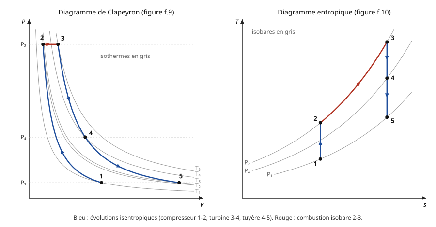
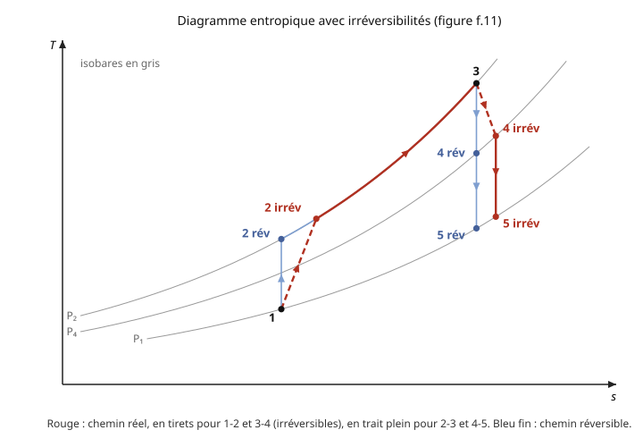

# Banque PT PT — Physique C - Thermodynamique 2014 · Corrigé brut

*Corrigé rédigé par IA, non officiel. Signalez toute erreur.*

**Rédaction** · modèle exact non renseigné (famille Claude) · effort non renseigné · vitesse non renseignée

**Révision (tour 2)** · modèle exact non renseigné (famille Claude) · effort non renseigné · vitesse non renseignée · 28 novembre 2026

Épreuve de 2 heures, sans calculatrice : étude de trois modèles de turboréacteurs, en 18 questions numérotées de 1 à 18, dont plusieurs à sous-questions, soit 33 réponses demandées, toutes traitées. Les repères sont ceux de l'énoncé (3.1, 6.2.1, etc.). Le sujet ne comporte ni table ni abaque : toutes les valeurs numériques viennent du texte de l'énoncé, et les seules figures à exploiter sont les trois diagrammes à compléter de la feuille annexe (figures f.9, f.10 et f.11, questions 8 et 9.2). L'énoncé ne chiffre pas $\gamma$ : les applications numériques n'en ont pas besoin, et la valeur $\gamma \approx 1{,}40$ qui sert aux contrôles se déduit des données (question 4.1). Dans tout le corrigé, « premier principe des systèmes ouverts » désigne la relation établie à la question 1, et chaque simplification est justifiée, comme l'exige l'énoncé. Les vitesses d'éjection et les poussées citées aux questions 6.2.1, 11.2, 16 et 18 sont des compléments calculés par le corrigé, que l'énoncé ne demande pas.

[Sujet officiel](https://www.banquept.fr/documents/2014/ph_c_2014_pt.zip) (archive réunissant les deux parties de Physique C ; la partie thermodynamique est le fichier `ph_c_2014_pt_th.pdf`) · [Rapport du jury](https://www.banquept.fr/documents/ecrit/rapport/2014/rapport_phys_c_ecrit_2014.pdf)

## I. Généralités

### Question 1 — Premier principe des systèmes ouverts

**Système.** Le système fermé $\Omega$ : à l'instant $t$, le fluide contenu dans $\Sigma$ et la masse $dm_e$ qui va entrer ; à l'instant $t+dt$, le fluide contenu dans $\Sigma$ et la masse $dm_s$ qui est sortie. On note $u$, $v$, $P$ l'énergie interne massique, le volume massique et la pression, avec l'indice $e$ à l'entrée et $s$ à la sortie.

**Conservation de la masse.** Si $M_\Sigma$ est la masse de fluide dans $\Sigma$, la masse de $\Omega$ s'écrit $M_\Sigma(t) + dm_e = M_\Sigma(t+dt) + dm_s$. En régime permanent, $M_\Sigma(t+dt) = M_\Sigma(t)$, donc

$$dm_e = dm_s = dm .$$

**Variation d'énergie.** L'énergie totale de $\Omega$ est $E = U + E_c + E_p$. Si $E_\Sigma$ désigne celle du fluide contenu dans $\Sigma$ :

$$E(t) = E_\Sigma(t) + dm\,(u_e + e_{c,e} + e_{p,e}) ,$$

$$E(t+dt) = E_\Sigma(t+dt) + dm\,(u_s + e_{c,s} + e_{p,s}) .$$

En régime permanent, $E_\Sigma(t+dt) = E_\Sigma(t)$, d'où

$$dE = dm\,\big[(u_s + e_{c,s} + e_{p,s}) - (u_e + e_{c,e} + e_{p,e})\big] .$$

**Échanges d'énergie pendant $dt$.** Le poids est déjà compté dans $E_p$. Il reste :

- le travail des forces de pression exercées par le fluide situé en amont, qui pousse le volume $dV_e = v_e\,dm$ dans $\Sigma$ : $+P_e\,v_e\,dm$ ;
- le travail des forces de pression exercées par le fluide situé en aval, que la masse sortante repousse sur le volume $dV_s = v_s\,dm$ : $-P_s\,v_s\,dm$ ;
- le travail indiqué $\delta W_i$ fourni par les parties mobiles de la machine ;
- le transfert thermique $\delta Q$ reçu à travers les parois.

**Premier principe appliqué à $\Omega$.** $dE = \delta W + \delta Q$ donne

$$dm\,\big[(u_s + e_{c,s} + e_{p,s}) - (u_e + e_{c,e} + e_{p,e})\big] = P_e v_e\,dm - P_s v_s\,dm + \delta W_i + \delta Q .$$

On regroupe les termes de transvasement avec l'énergie interne, en reconnaissant l'enthalpie massique $h = u + Pv$ :

$$dm\,\big[(h_s + e_{c,s} + e_{p,s}) - (h_e + e_{c,e} + e_{p,e})\big] = \delta W_i + \delta Q .$$

**Passage aux grandeurs massiques.** On divise par la masse $dm$ qui a traversé la machine pendant $dt$, en posant $w_i = \delta W_i/dm$ et $q = \delta Q/dm$ (travail indiqué et transfert thermique reçus par kilogramme de fluide traversant la machine) :

$$\boxed{(h_s - h_e) + (e_{c,s} - e_{c,e}) + (e_{p,s} - e_{p,e}) = w_i + q}$$

soit $\Delta h + \Delta e_c + \Delta e_p = w_i + q$, avec $e_c = c^2/2$ et $e_p = gz$.

### Question 2 — Vitesse en sortie de tuyère

On applique le premier principe des systèmes ouverts au fluide qui traverse la tuyère, en régime permanent, entre la section d'entrée et la section de sortie. Simplifications, chacune justifiée :

- $w_i = 0$ : la tuyère ne contient aucune paroi mobile ;
- $q = 0$ : la conduite est calorifugée ;
- $\Delta e_p = 0$ : les variations d'énergie potentielle sont négligées (hypothèse générale de l'énoncé) ;
- $\Delta e_c$ est **conservé** : c'est le rôle de la tuyère d'accélérer le gaz ; avec $c_e \approx 0$, $\Delta e_c = c_s^2/2$.

Il reste $h_s - h_e + \dfrac{c_s^2}{2} = 0$. L'air est un gaz parfait de capacité $c_p$ constante, donc $h_s - h_e = c_p\,(T_s - T_e)$ et

$$\boxed{c_s = \sqrt{2\,c_p\,(T_e - T_s)}}$$

Le gaz se refroidit en s'accélérant : $T_s < T_e$. La formule est homogène si $c_p$ est en $\mathrm{J\cdot kg^{-1}\cdot K^{-1}}$ : $\mathrm{J\cdot kg^{-1}} = \mathrm{m^2\cdot s^{-2}}$.

## II.A. Turboréacteur d'avion de chasse sans post-combustion

### Question 3.1 — Température en sortie du compresseur

Dans le compresseur, l'air, gaz parfait de coefficient $\gamma$ constant, subit une évolution isentropique : la loi de Laplace s'applique, sous la forme $T^{\gamma}P^{1-\gamma} = \text{cste}$, soit $T\,P^{-(\gamma-1)/\gamma} = \text{cste}$. Entre (1) et (2) :

$$\boxed{T_2 = T_1\left(\frac{P_2}{P_1}\right)^{\frac{\gamma-1}{\gamma}} = T_1\,\tau_{1\text{-}2}^{\,\frac{\gamma-1}{\gamma}}}$$

L'exposant est positif : la compression échauffe le gaz ($T_2 > T_1$).

### Question 3.2 — Travail indiqué du compresseur

Premier principe des systèmes ouverts appliqué à l'air qui traverse le compresseur, en régime permanent :

- $q = 0$ : l'évolution est isentropique, donc adiabatique (et réversible) ;
- $\Delta e_c = 0$ et $\Delta e_p = 0$ : négligées d'après les hypothèses de l'énoncé (on n'est pas dans une tuyère).

Il reste $w_{i,1\text{-}2} = h_2 - h_1$, et pour un gaz parfait :

$$\boxed{w_{i,1\text{-}2} = c_p\,(T_2 - T_1) = c_p\,T_1\left(\tau_{1\text{-}2}^{\,\frac{\gamma-1}{\gamma}} - 1\right)}$$

Ce travail est positif : l'air reçoit du travail de la part du compresseur.

### Question 4.1 — Valeur de $T_2$

D'après la question 3.2, $w_{i,1\text{-}2} = c_p\,(T_2 - T_1)$, donc

$$T_2 = T_1 + \frac{w_{i,1\text{-}2}}{c_p} = 300 + \frac{279}{1{,}00} .$$

$$\boxed{T_2 = 579\ \mathrm{K}}$$

*Contrôle.* L'énoncé ne donne pas la valeur de $\gamma$. Les données l'imposent pourtant : la question 3.1 donne, en logarithmes décimaux ($\log \tau_{1\text{-}2} = \log 10 = 1$), $\dfrac{\gamma-1}{\gamma} = \dfrac{\log(T_2/T_1)}{\log \tau_{1\text{-}2}} = \log(1{,}93) \approx 0{,}286$, soit $\gamma \approx 1{,}40$, valeur usuelle pour l'air.

### Question 4.2 — Valeur de $T_4$

Dans la turbine (isentropique, donc adiabatique ; $\Delta e_c$ et $\Delta e_p$ négligées), le premier principe des systèmes ouverts donne $w_{i,3\text{-}4} = h_4 - h_3 = c_p\,(T_4 - T_3) < 0$ : l'air cède du travail à la turbine.

La puissance mécanique cédée à la turbine est intégralement transmise au compresseur (pas de pertes sur l'arbre), et le même débit $D_m$ traverse les deux machines :

$$D_m\,w_{i,1\text{-}2} + D_m\,w_{i,3\text{-}4} = 0 \quad\Longrightarrow\quad w_{i,3\text{-}4} = -\,w_{i,1\text{-}2} .$$

D'où $c_p\,(T_4 - T_3) = -\,c_p\,(T_2 - T_1)$ :

$$T_4 = T_3 - (T_2 - T_1) = T_3 - \frac{w_{i,1\text{-}2}}{c_p} = 1200 - 279 .$$

$$\boxed{T_4 = 921\ \mathrm{K}}$$

### Question 5.1 — Pression en sortie de turbine

La détente dans la turbine est isentropique ; la loi de Laplace entre (3) et (4), avec $P_3 = P_2 = \tau_{1\text{-}2}\,P_1$, donne

$$\boxed{P_4 = P_3\left(\frac{T_4}{T_3}\right)^{\frac{\gamma}{\gamma-1}} = \tau_{1\text{-}2}\,P_1\left(\frac{T_4}{T_3}\right)^{\frac{\gamma}{\gamma-1}}}$$

*Contrôle.* Avec $\gamma = 1{,}40$ (valeur déduite des données à la question 4.1), $\dfrac{\gamma}{\gamma-1} = 3{,}5$ et $P_4 = 10{,}0\times(921/1200)^{3{,}5} = 3{,}96\ \mathrm{bar}$ : c'est la valeur annoncée par l'énoncé.

### Question 5.2 — Température en sortie de tuyère

La détente dans la tuyère est isentropique, de $(T_4, P_4)$ à $P_5 = P_1$ :

$$\boxed{T_5 = T_4\left(\frac{P_5}{P_4}\right)^{\frac{\gamma-1}{\gamma}} = T_4\left(\frac{P_1}{P_4}\right)^{\frac{\gamma-1}{\gamma}}}$$

*Forme équivalente.* Les états (3), (4) et (5) sont sur la même isentropique, donc $T_5 = T_3\,(P_1/P_2)^{(\gamma-1)/\gamma}$. Comme $(P_2/P_1)^{(\gamma-1)/\gamma} = T_2/T_1$ (question 3.1) :

$$T_5 = \frac{T_1\,T_3}{T_2} = \frac{300\times 1200}{579} \approx 622\ \mathrm{K} ,$$

en accord, à l'arrondi près, avec la valeur $621\ \mathrm{K}$ fournie à la question 6.2.

### Question 6.1 — Puissance cinétique

Pendant $dt$, la masse $dm = D_m\,dt$ traverse la section considérée en emportant l'énergie cinétique $e_c\,dm$. La puissance cinétique est cette énergie rapportée à la durée :

$$\boxed{P_{cin} = D_m\,e_c}$$

Homogénéité : $\mathrm{kg\cdot s^{-1}} \times \mathrm{J\cdot kg^{-1}} = \mathrm{W}$.

### Question 6.2.1 — Puissance cinétique en sortie de tuyère (A)

Dans la tuyère 4-5 ($w_i = 0$, $q = 0$, $\Delta e_p$ négligée, vitesse d'entrée négligée : question 2), $e_{c,5} = \dfrac{c_5^2}{2} = c_p\,(T_4 - T_5)$. Avec la question 6.1 :

$$\boxed{P_{cin,A} = D_m\,c_p\,(T_4 - T_5)}$$

Application numérique, avec $c_p = 1{,}00\times 10^{3}\ \mathrm{J\cdot kg^{-1}\cdot K^{-1}}$ :

$$P_{cin,A} = 50{,}0\times 1{,}00\times 10^{3}\times(921 - 621) = 1{,}50\times 10^{7}\ \mathrm{W} .$$

$$\boxed{P_{cin,A} = 15{,}0\ \mathrm{MW}}$$

*Complément non demandé.* Cela correspond à une vitesse d'éjection $c_5 = \sqrt{2\times 10^{3}\times 300} \approx 775\ \mathrm{m\cdot s^{-1}}$ (question 2, vitesse d'entrée négligée).

### Question 6.2.2 — Puissance thermique reçue en chambre de combustion (A)

Dans la chambre de combustion 2-3 : $w_i = 0$ (aucune partie mobile), $\Delta e_c$ et $\Delta e_p$ négligées. Le premier principe des systèmes ouverts se réduit à $q_{2\text{-}3} = h_3 - h_2 = c_p\,(T_3 - T_2)$, soit $621\ \mathrm{kJ\cdot kg^{-1}}$. En multipliant par le débit :

$$\boxed{P_{th,A} = D_m\,c_p\,(T_3 - T_2)}$$

$$P_{th,A} = 50{,}0\times 1{,}00\times 10^{3}\times(1200 - 579) = 3{,}105\times 10^{7}\ \mathrm{W} .$$

$$\boxed{P_{th,A} \approx 31{,}1\ \mathrm{MW}}$$

### Question 6.2.3 — Débit de kérosène (A)

La combustion d'un débit $D_{k,A}$ de kérosène libère la puissance $D_{k,A}\,p_k$, intégralement reçue par l'air (chambre sans pertes) :

$$\boxed{D_{k,A} = \frac{P_{th,A}}{p_k} = \frac{D_m\,c_p\,(T_3 - T_2)}{p_k}}$$

$$D_{k,A} = \frac{3{,}105\times 10^{7}}{50{,}0\times 10^{6}} .$$

$$\boxed{D_{k,A} = 0{,}621\ \mathrm{kg\cdot s^{-1}}}$$

Ce débit est faible devant celui de l'air ($50{,}0\ \mathrm{kg\cdot s^{-1}}$), ce qui justifie d'assimiler le mélange à de l'air. On retrouve la valeur $0{,}62$ du tableau de la question 16.

### Question 7 — Rendement thermique (A)

$$\eta_{th,A} = \frac{P_{cin,A}}{P_{th,A}} = \frac{T_4 - T_5}{T_3 - T_2} = \frac{300}{621} .$$

$$\boxed{\eta_{th,A} \approx 0{,}48}$$

*Contrôle.* Avec $T_4 = T_3 - T_2 + T_1$ et $T_5 = T_1T_3/T_2$, on trouve $T_4 - T_5 = (T_3 - T_2)(1 - T_1/T_2)$, donc $\eta_{th,A} = 1 - \dfrac{T_1}{T_2} = 1 - \dfrac{300}{579} \approx 0{,}48$ : le rendement ne dépend que du taux de compression. C'est la valeur du tableau de la question 16.

### Question 8 — Diagrammes de Clapeyron et entropique

**Repérage des états.** $T_1 = 300\ \mathrm{K} < T_2 = 579\ \mathrm{K} < T_5 = 621\ \mathrm{K} < T_4 = 921\ \mathrm{K} < T_3 = 1200\ \mathrm{K}$, ce qui est bien l'ordre des isothermes de la figure f.9. Pressions : $P_1 = P_5 = 1{,}00\ \mathrm{bar} < P_4 = 3{,}96\ \mathrm{bar} < P_2 = P_3 = 10{,}0\ \mathrm{bar}$.

**Diagramme de Clapeyron (figure f.9).**

- (1) : intersection de l'isotherme $T_1$ et de l'horizontale $P_1$.
- 1-2 : compression isentropique. La courbe monte vers la gauche, plus raide que les isothermes ($Pv^{\gamma} = \text{cste}$ avec $\gamma > 1$) : elle les coupe et aboutit sur l'isotherme $T_2$, à la pression $P_2$.
- 2-3 : combustion isobare. Segment horizontal à $P_2$, parcouru vers la droite ($v$ augmente avec $T$), de l'isotherme $T_2$ à l'isotherme $T_3$.
- 3-4 puis 4-5 : détentes isentropiques. Une seule et même courbe isentropique, qui descend vers la droite en coupant les isothermes : elle passe par (4) sur l'isotherme $T_4$ (pression $P_4$) et se termine en (5) sur l'isotherme $T_5$, à la pression $P_1$.

**Diagramme entropique (figure f.10).**

- (1) est sur l'isobare $P_1$.
- 1-2 : segment vertical montant ($s$ constante) de l'isobare $P_1$ à l'isobare $P_2$.
- 2-3 : le point suit l'isobare $P_2$ vers la droite et vers le haut (sur une isobare, $ds = c_p\,dT/T$ : $s$ croît avec $T$).
- 3-4 : segment vertical descendant de l'isobare $P_2$ à l'isobare $P_4$ ; 4-5 : il se prolonge sur la même verticale jusqu'à l'isobare $P_1$.

Le point (5) est sur la même isobare que (1) mais à plus haute température : le chemin n'est pas fermé, l'air chaud étant rejeté dans l'atmosphère.

### Question 9.1 — Température atteinte avec une compression irréversible

La compression irréversible reste adiabatique : le fluide n'échange pas d'entropie, et il s'en crée. Le second principe, appliqué à l'unité de masse qui traverse le compresseur, donne

$$s_2^{\text{irrév}} - s_1 = s_{\text{créée}} > 0 ,$$

alors que $s_2^{\text{rév}} = s_1$ dans le cas réversible.

L'énoncé précise que les pressions ne sont pas modifiées : l'état de sortie est encore sur l'isobare $P_2$. Dans le diagramme $T(s)$, le point réversible est à la verticale de (1) sur cette isobare ; le point irréversible, d'entropie plus grande, est **à sa droite sur la même isobare**. Or les isobares sont croissantes dans ce diagramme (à pression fixée, $ds = c_p\,dT/T$) : un point situé plus à droite est aussi plus haut.

$$\boxed{T_2^{\text{irrév}} > T_2^{\text{rév}}}$$

Conséquence : $w_{i,1\text{-}2} = c_p\,(T_2 - T_1)$ est plus grand, le compresseur réel consomme plus de travail pour le même taux de compression.

### Question 9.2 — Diagramme entropique avec irréversibilités

On garde les isobares $P_1$, $P_4$ et $P_2$ (pressions inchangées) et l'état (1).

- **Compresseur 1-2, irréversible.** Trait pointillé partant de (1) et montant en s'inclinant vers la droite, jusqu'au point $2^{\text{irrév}}$ de l'isobare $P_2$, à droite et au-dessus de $2^{\text{rév}}$. Le tracé en pointillé rappelle que les états intermédiaires ne sont pas des états d'équilibre connus.
- **Combustion 2-3, réversible.** Trait plein le long de l'isobare $P_2$, de $2^{\text{irrév}}$ jusqu'à (3), que l'on garde ici à $T_3 = 1200\ \mathrm{K}$ (l'énoncé ne le précise pas).
- **Turbine 3-4, irréversible.** Même argument qu'à la question 9.1 : $s_4 > s_3$, et l'état de sortie reste sur l'isobare $P_4$. Trait pointillé descendant de (3) en s'inclinant vers la droite, jusqu'à $4^{\text{irrév}}$, à droite de $4^{\text{rév}}$, donc à une température plus élevée : la turbine réelle refroidit moins le gaz.
- **Tuyère 4-5, réversible.** Segment vertical en trait plein, de $4^{\text{irrév}}$ à l'isobare $P_1$ : le point $5^{\text{irrév}}$ est à droite de $5^{\text{rév}}$ et plus chaud.

Sur la figure ci-dessous, le chemin réel est en rouge, avec la convention de l'énoncé (tirets pour les évolutions irréversibles 1-2 et 3-4, trait plein pour les évolutions réversibles 2-3 et 4-5) ; le chemin entièrement réversible de la question 8 est rappelé en trait fin bleu. La position exacte des points $2^{\text{irrév}}$ et $4^{\text{irrév}}$ sur leur isobare est un choix d'illustration : l'énoncé ne chiffre pas l'irréversibilité.

*Remarque.* Ce tracé suit la consigne de l'énoncé : l'irréversibilité modifie les températures sans modifier, « en première approximation », les pressions. Avec $T_3$ inchangée, il n'est plus compatible avec le bilan sur l'arbre de la question 4.2 : le compresseur réel demande $c_p\,(T_2^{\text{irrév}} - T_1) > 279\ \mathrm{kJ\cdot kg^{-1}}$, alors que la turbine réelle, entre les mêmes pressions, ne cède que $c_p\,(T_3 - T_4^{\text{irrév}}) < 279\ \mathrm{kJ\cdot kg^{-1}}$, puisque $T_4^{\text{irrév}} > 921\ \mathrm{K}$. Pour que la turbine entraîne encore le compresseur, il faudrait que la détente s'y poursuive jusqu'à une pression $P_4$ plus basse, ou que $T_3$ soit plus élevée. L'allure du chemin (tirets inclinés vers la droite, isobare, verticale) resterait la même.

## II.B. Turboréacteur d'avion de chasse : activation de la post-combustion

### Question 10 — Température en sortie de tuyère (B)

La détente 6-7 dans la tuyère est isentropique, de $P_6 = P_4$ à $P_7 = P_1$. Loi de Laplace :

$$\boxed{T_7 = T_6\left(\frac{P_7}{P_6}\right)^{\frac{\gamma-1}{\gamma}} = T_6\left(\frac{P_1}{P_4}\right)^{\frac{\gamma-1}{\gamma}}}$$

Le rapport de pressions est celui de la tuyère du réacteur (A), pour laquelle $(P_1/P_4)^{(\gamma-1)/\gamma} = T_5/T_4$ (question 5.2). Donc

$$T_7 = T_6\,\frac{T_5}{T_4} = 2000\times\frac{621}{921} \approx 1{,}35\times 10^{3}\ \mathrm{K} ,$$

ce qui est la valeur $1350\ \mathrm{K}$ de l'énoncé.

### Question 11.1 — Transfert thermique de la post-combustion

Dans la chambre de post-combustion 4-6 : pas de partie mobile ($w_i = 0$), $\Delta e_c$ et $\Delta e_p$ négligées. Le premier principe des systèmes ouverts donne

$$\boxed{q_{4\text{-}6} = h_6 - h_4 = c_p\,(T_6 - T_4)}$$

$$q_{4\text{-}6} = 1{,}00\times(2000 - 921) .$$

$$\boxed{q_{4\text{-}6} = 1079\ \mathrm{kJ\cdot kg^{-1}} \approx 1{,}08\times 10^{3}\ \mathrm{kJ\cdot kg^{-1}}}$$

### Question 11.2 — Puissance cinétique en sortie de tuyère (B)

Dans la tuyère 6-7 (question 2) : $e_{c,7} = c_p\,(T_6 - T_7)$, et avec la question 6.1 :

$$\boxed{P_{cin,B} = D_m\,c_p\,(T_6 - T_7)}$$

$$P_{cin,B} = 50{,}0\times 1{,}00\times 10^{3}\times(2000 - 1350) = 3{,}25\times 10^{7}\ \mathrm{W} .$$

$$\boxed{P_{cin,B} = 32{,}5\ \mathrm{MW}}$$

*Complément non demandé.* La vitesse d'éjection passe à $c_7 = \sqrt{2\times 10^{3}\times 650} \approx 1{,}14\times 10^{3}\ \mathrm{m\cdot s^{-1}}$.

### Question 11.3 — Puissance thermique totale (B)

L'air reçoit de la chaleur dans les deux chambres : $q_{2\text{-}3} = c_p\,(T_3 - T_2)$ comme dans le réacteur (A), puis $q_{4\text{-}6}$.

$$\boxed{P_{th,B} = D_m\,(q_{2\text{-}3} + q_{4\text{-}6}) = D_m\,c_p\,\big[(T_3 - T_2) + (T_6 - T_4)\big]}$$

$$P_{th,B} = 50{,}0\times 1{,}00\times 10^{3}\times(621 + 1079) = 8{,}50\times 10^{7}\ \mathrm{W} .$$

$$\boxed{P_{th,B} = 85{,}0\ \mathrm{MW}}$$

### Question 11.4 — Débit total de kérosène (B)

$$\boxed{D_{k,B} = \frac{P_{th,B}}{p_k}}$$

$$D_{k,B} = \frac{8{,}50\times 10^{7}}{50{,}0\times 10^{6}} .$$

$$\boxed{D_{k,B} = 1{,}70\ \mathrm{kg\cdot s^{-1}}}$$

dont $0{,}62\ \mathrm{kg\cdot s^{-1}}$ dans la chambre principale et $1{,}08\ \mathrm{kg\cdot s^{-1}}$ pour la post-combustion.

### Question 12.1 — Rendement thermique (B)

$$\eta_{th,B} = \frac{P_{cin,B}}{P_{th,B}} = \frac{T_6 - T_7}{(T_3 - T_2) + (T_6 - T_4)} = \frac{650}{1700} = \frac{32{,}5}{85{,}0} .$$

$$\boxed{\eta_{th,B} \approx 0{,}38}$$

### Question 12.2 — Comparaison des rendements

$\eta_{th,A} \approx 0{,}48$ et $\eta_{th,B} \approx 0{,}38$ :

$$\boxed{\frac{\eta_{th,B}}{\eta_{th,A}} = \frac{0{,}38}{0{,}48} \approx 0{,}79}$$

La post-combustion fait perdre environ un cinquième du rendement thermique.

**Conclusion.** La post-combustion multiplie la puissance cinétique du jet par $32{,}5/15{,}0 \approx 2{,}2$, donc augmente fortement la poussée, mais au prix d'une consommation de kérosène multipliée par $1{,}70/0{,}62 \approx 2{,}7$. Le supplément de chaleur est apporté à basse pression ($P_4 \approx 4\ \mathrm{bar}$ au lieu de $10\ \mathrm{bar}$), où il est moins bien converti en énergie cinétique : les gaz sortent très chauds ($1350\ \mathrm{K}$ au lieu de $621\ \mathrm{K}$). C'est un surcroît de puissance coûteux, à réserver à des phases brèves.

### Question 12.3 — Circonstances d'emploi de la post-combustion

Le pilote active la post-combustion quand il lui faut, pendant un temps court, une poussée bien supérieure à la poussée normale :

- au **décollage**, surtout sur piste courte, depuis un porte-avions ou à pleine charge ;
- en **combat aérien** : accélération brutale, montée rapide, manœuvres serrées, interception ou dégagement ;
- pour franchir le mur du son et accélérer en vol supersonique.

Elle n'est **pas** utilisée en vol de croisière à vitesse constante : la poussée nécessaire y est modérée, et le rendement plus faible réduirait le rayon d'action.

### Question 12.4 — Limitation de la durée de la post-combustion

Deux raisons principales :

1. **La consommation.** Le débit de kérosène est multiplié par $2{,}7$ (de $0{,}62$ à $1{,}70\ \mathrm{kg\cdot s^{-1}}$ dans ce modèle) pour un rendement plus faible : les réservoirs se vident vite et l'autonomie de l'avion s'effondre.
2. **La tenue thermique des matériaux.** Les gaz atteignent $T_6 = 2000\ \mathrm{K}$ dans le canal de post-combustion et sortent encore à $1350\ \mathrm{K}$ : ces températures dépassent ce que les parois du canal et de la tuyère supportent durablement. Un usage prolongé les endommagerait.

## III. Turboréacteur d'avion de transport

### Question 13.1 — Travaux indiqués de la soufflante et du compresseur

Soufflante et compresseur sont isentropiques (donc adiabatiques), et les variations d'énergie cinétique et potentielle y sont négligées. Comme à la question 3.2 :

$$\boxed{w_{i,1\text{-}2} = c_p\,(T_2 - T_1) \qquad w_{i,2\text{-}3} = c_p\,(T_3 - T_2)}$$

$$w_{i,1\text{-}2} = 1{,}00\times(366 - 300) \qquad w_{i,2\text{-}3} = 1{,}00\times(706 - 366) .$$

$$\boxed{w_{i,1\text{-}2} = 66\ \mathrm{kJ\cdot kg^{-1}} \qquad w_{i,2\text{-}3} = 340\ \mathrm{kJ\cdot kg^{-1}}}$$

Ce sont des travaux par kilogramme d'air traversant chaque machine ; les débits qui les traversent ne sont pas les mêmes.

### Question 13.2 — Température en sortie de turbine (C)

La turbine fournit intégralement à l'ensemble soufflante et compresseur la puissance que lui cède l'écoulement. Il faut raisonner en **puissances**, car les débits diffèrent :

- la soufflante 1-2 est traversée par les deux flux, de débit $D_{m,I} + D_{m,II} = 5\,D_{m,I}$ ;
- le compresseur 2-3 et la turbine 4-5 ne sont traversés que par le flux primaire, de débit $D_{m,I}$.

Avec $w_{i,4\text{-}5} = c_p\,(T_5 - T_4) < 0$ (turbine isentropique, $\Delta e_c$ et $\Delta e_p$ négligées), le bilan sur l'arbre s'écrit

$$5\,D_{m,I}\,w_{i,1\text{-}2} + D_{m,I}\,w_{i,2\text{-}3} + D_{m,I}\,w_{i,4\text{-}5} = 0 .$$

Après simplification par $D_{m,I}$ : $c_p\,(T_4 - T_5) = 5\,w_{i,1\text{-}2} + w_{i,2\text{-}3}$, d'où

$$\boxed{T_5 = T_4 - \frac{5\,w_{i,1\text{-}2} + w_{i,2\text{-}3}}{c_p} = T_4 - 5\,(T_2 - T_1) - (T_3 - T_2)}$$

$$T_5 = 1325 - 5\times 66 - 340 = 1325 - 670 .$$

$$\boxed{T_5 = 655\ \mathrm{K}}$$

### Question 14.1 — Puissance cinétique du flux primaire

Dans la tuyère primaire 5-6 ($w_i = 0$, $q = 0$, vitesse d'entrée négligée) : $e_{c,6} = c_p\,(T_5 - T_6)$, pour le débit $D_{m,I}$.

$$\boxed{P_{cin,I} = D_{m,I}\,c_p\,(T_5 - T_6)}$$

$$P_{cin,I} = 50{,}0\times 1{,}00\times 10^{3}\times(655 - 563) = 4{,}6\times 10^{6}\ \mathrm{W} .$$

$$\boxed{P_{cin,I} = 4{,}6\ \mathrm{MW}}$$

### Question 14.2 — Puissance cinétique du flux secondaire

Le flux secondaire se détend dans la tuyère secondaire 2-7, de $T_2$ à $T_7$ : $e_{c,7} = c_p\,(T_2 - T_7)$, pour le débit $D_{m,II} = 4\,D_{m,I} = 200\ \mathrm{kg\cdot s^{-1}}$.

$$\boxed{P_{cin,II} = 4\,D_{m,I}\,c_p\,(T_2 - T_7)}$$

$$P_{cin,II} = 200\times 1{,}00\times 10^{3}\times(366 - 300) = 1{,}32\times 10^{7}\ \mathrm{W} .$$

$$\boxed{P_{cin,II} = 13{,}2\ \mathrm{MW}}$$

On retrouve $T_7 = T_1$ : le flux secondaire subit une compression puis une détente isentropiques entre les mêmes pressions, il revient à sa température initiale. Toute la puissance reçue de la soufflante ($200\times 66\ \mathrm{kW}$) est convertie en énergie cinétique. Le flux secondaire porte à lui seul les trois quarts de la puissance cinétique totale.

### Question 15 — Rendement thermique (C)

**Puissance cinétique totale.** $P_{cin,C} = P_{cin,I} + P_{cin,II} = 4{,}6 + 13{,}2 = 17{,}8\ \mathrm{MW}$.

**Puissance thermique.** Seul le flux primaire traverse la chambre de combustion 3-4 (isobare, sans partie mobile) :

$$P_{th,C} = D_{m,I}\,c_p\,(T_4 - T_3) = 50{,}0\times 1{,}00\times 10^{3}\times(1325 - 706) = 3{,}095\times 10^{7}\ \mathrm{W} \approx 31{,}0\ \mathrm{MW} .$$

**Rendement.**

$$\eta_{th,C} = \frac{P_{cin,I} + P_{cin,II}}{P_{th,C}} = \frac{17{,}8}{30{,}95} .$$

$$\boxed{\eta_{th,C} \approx 0{,}58}$$

*Contrôle.* Le débit de kérosène correspondant est $D_{k,C} = P_{th,C}/p_k = 0{,}62\ \mathrm{kg\cdot s^{-1}}$ : on retrouve les trois valeurs du tableau de la question 16 ($0{,}62\ \mathrm{kg\cdot s^{-1}}$, $18\times 10^{6}\ \mathrm{W}$, $0{,}58$).

## IV. Comparaison des caractéristiques des moteurs de types (A) et (C)

### Question 16 — Commentaire du tableau

**Lecture du tableau.** Les deux réacteurs brûlent le même débit de kérosène ($0{,}62\ \mathrm{kg\cdot s^{-1}}$), donc reçoivent la même puissance thermique (environ $31\ \mathrm{MW}$). Pour cette même dépense, le réacteur (C) fournit une puissance cinétique de $18\ \mathrm{MW}$ contre $15\ \mathrm{MW}$ pour (A), soit $20\ \%$ de plus ; son rendement thermique est $0{,}58$ contre $0{,}48$, dans le même rapport $1{,}2$.

**Interprétation.** Le rendement de (A) vaut $1 - T_1/T_2$ et ne dépend que du taux de compression global. Dans (C), le flux primaire est comprimé jusqu'à $20\ \mathrm{bar}$ (soufflante puis compresseur) au lieu de $10\ \mathrm{bar}$ : la chaleur est apportée à plus haute pression, et les gaz sont rejetés moins chauds ($563\ \mathrm{K}$ et $300\ \mathrm{K}$ au lieu de $621\ \mathrm{K}$). On vérifie d'ailleurs que $1 - T_1/T_3 = 1 - 300/706 \approx 0{,}58$ avec la température $T_3$ du réacteur (C).

**Conséquence sur la poussée.** L'énergie cinétique est répartie différemment : (A) éjecte $50\ \mathrm{kg\cdot s^{-1}}$ à environ $775\ \mathrm{m\cdot s^{-1}}$ (question 6.2.1) ; (C) éjecte $250\ \mathrm{kg\cdot s^{-1}}$ à des vitesses bien plus faibles, $\sqrt{2c_p(T_5 - T_6)} \approx 430\ \mathrm{m\cdot s^{-1}}$ pour le flux primaire et $\sqrt{2c_p(T_2 - T_7)} \approx 360\ \mathrm{m\cdot s^{-1}}$ pour le flux secondaire. Pour un avion presque à l'arrêt, la poussée est de l'ordre du débit de quantité de mouvement $D_m\,c$ : environ $39\ \mathrm{kN}$ pour (A), contre $50\times 430 + 200\times 360 \approx 94\ \mathrm{kN}$ pour (C). À consommation égale, le réacteur à double flux pousse donc plus de deux fois plus fort : il vaut mieux accélérer peu une grande masse d'air que beaucoup une petite. C'est le réacteur économe, adapté au transport.

### Question 17 — Raison supplémentaire en faveur du type (C)

Dans les réacteurs (A) et (B), les gaz sortent de la tuyère à une vitesse supérieure à celle du son dans le jet ($c/c_{son} > 1{,}50$) : l'écoulement est supersonique, il s'accompagne d'ondes de choc et d'un bruit très intense. Dans le réacteur (C), l'énoncé annonce un rapport plus faible ($c/c_{son} < 1{,}00$) : les jets sont bien plus lents et le flux secondaire, froid, enveloppe le jet primaire chaud. Le moteur est **beaucoup moins bruyant**.

*Complément non demandé.* Avec $c_{son} = \sqrt{(\gamma-1)\,c_p\,T}$ et $\gamma \approx 1{,}40$, les températures et les vitesses d'éjection de ce corrigé donnent $c/c_{son} \approx 775/498 \approx 1{,}55$ pour (A) et $1140/735 \approx 1{,}55$ pour (B). Pour (C), on trouve $430/475 \approx 0{,}9$ pour le jet primaire ($563\ \mathrm{K}$), mais $363/346 \approx 1{,}05$ pour le jet secondaire ($300\ \mathrm{K}$) : dans ce modèle, celui-ci est tout juste sonique, et non franchement subsonique comme l'annonce l'énoncé. La conclusion sur le bruit n'en dépend pas.

La raison supplémentaire est donc la **réduction des nuisances sonores**, décisive pour des avions de transport qui décollent et atterrissent près de zones habitées, et pour le confort des passagers.

### Question 18 — Pourquoi pas de type (C) sur les avions de chasse

Plusieurs raisons, liées aux résultats précédents :

- **Vitesse d'éjection trop faible.** La poussée vient de l'accélération de l'air : elle diminue quand la vitesse de l'avion se rapproche de la vitesse d'éjection. Avec des jets lents (de l'ordre de $400\ \mathrm{m\cdot s^{-1}}$, calculés avion à l'arrêt), la poussée du réacteur (C) s'effondre aux grandes vitesses : il ne convient pas au vol supersonique que l'on exige d'un avion de chasse, alors que (A), et plus encore (B), éjectent les gaz à $775$ et $1140\ \mathrm{m\cdot s^{-1}}$.
- **Encombrement.** Le taux de dilution de 4 impose une soufflante de grand diamètre (figures f.6 à f.8) : la section frontale, donc la traînée à grande vitesse, et la masse sont trop importantes pour un avion compact et maniable, dont les réacteurs sont logés dans le fuselage.
- **Besoin de sur-poussée.** Le chasseur a besoin de pointes de poussée brèves (question 12.3), que fournit la post-combustion sur un réacteur à simple flux, à gaz chauds ; l'économie de carburant, point fort de (C), n'est pas son critère principal.
