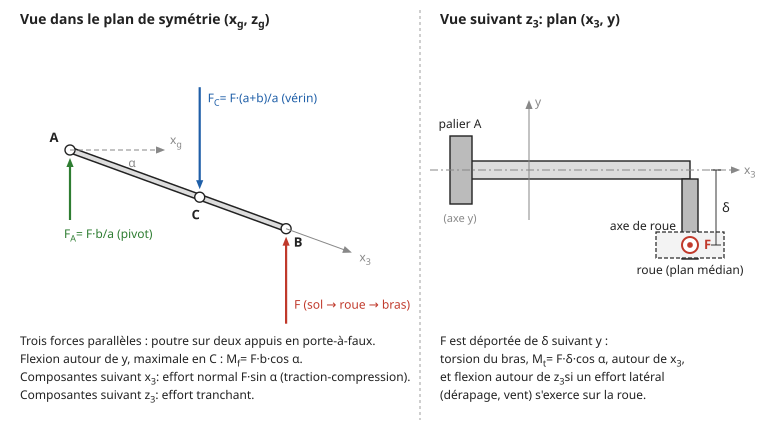
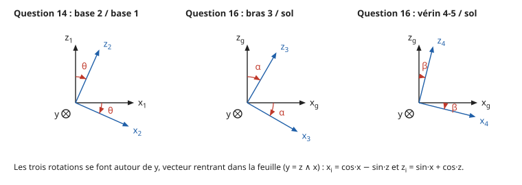
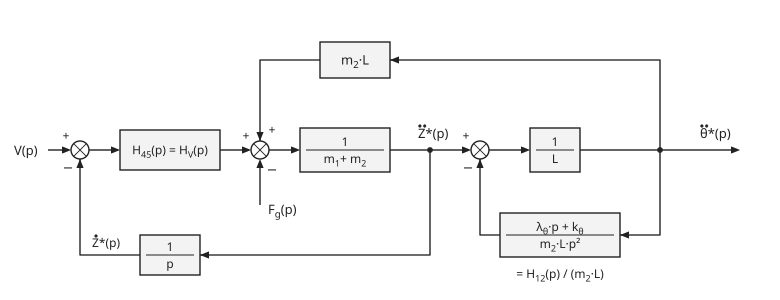
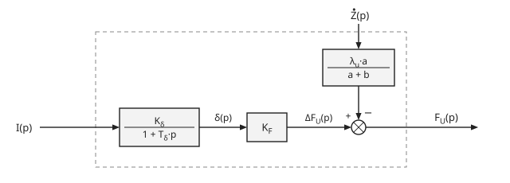
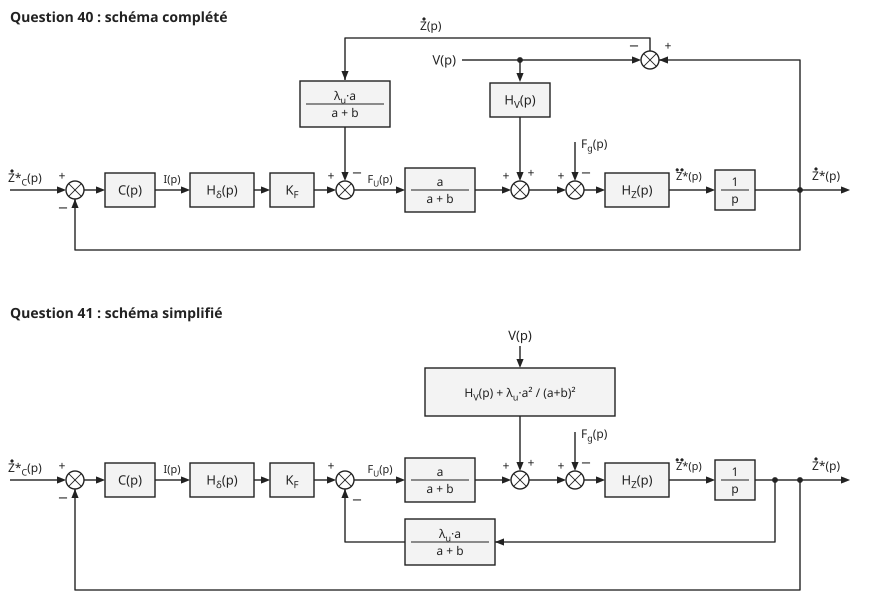
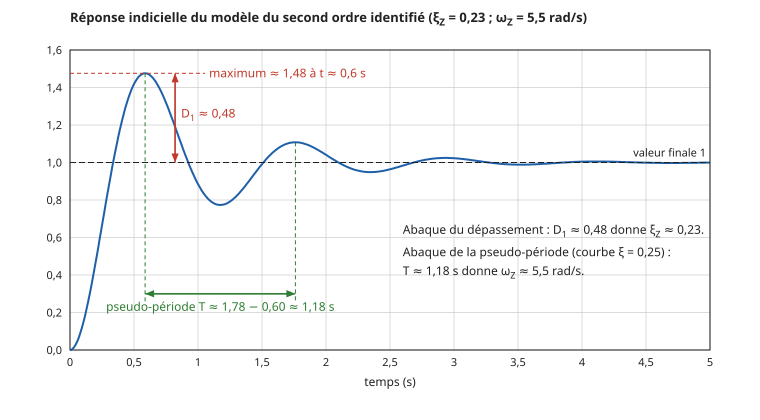
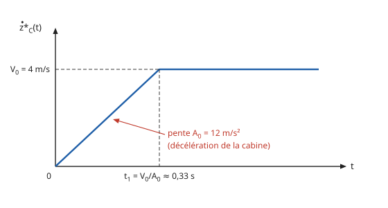
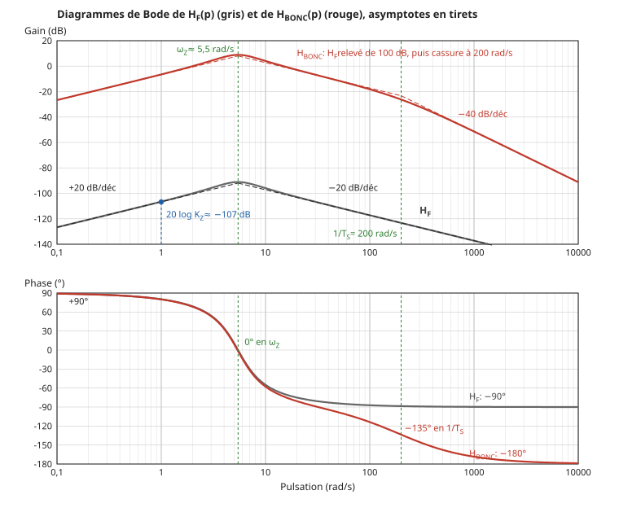
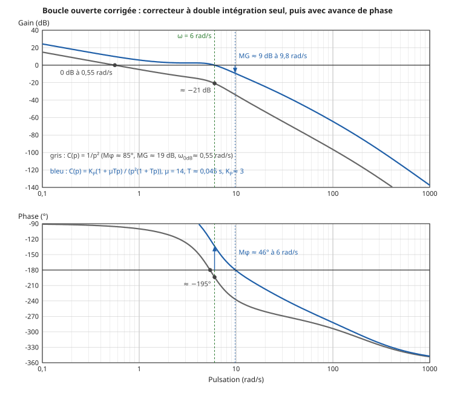

# Banque PT 2014 — Sciences industrielles A · Corrigé brut

*Corrigé rédigé par IA, non officiel. Signalez toute erreur.*

**Rédaction** · modèle exact non renseigné (famille Claude) · effort non renseigné · vitesse non renseignée

Épreuve de 5 h, sans calculatrice ni document. Support : train d'atterrissage principal d'un hélicoptère lourd de transport et son amortisseur semi-actif, destiné à limiter l'accélération angulaire du pylône de queue à l'impact. Les 54 questions sont traitées dans l'ordre. Les cadres à compléter du cahier réponse sont donnés en tableaux, les schémas blocs et les tracés en figures originales ; les valeurs lues sur les courbes de l'énoncé sont accompagnées de leur origine.

[Sujet et cahier réponse officiels](https://www.banquept.fr/documents/2014/si_a_2014_pt.pdf) · [Rapport du jury](https://www.banquept.fr/documents/ecrit/rapport/2014/rapport_si_a_ecrit_2014.pdf)

Données principales : $a = 0{,}6\ \mathrm m$, $b = 0{,}4\ \mathrm m$, $c = 0{,}54\ \mathrm m$, $d = 1{,}8\ \mathrm m$, $L = 4\ \mathrm m$, $m_2 = 600\ \mathrm{kg}$, $k = 6\cdot10^5\ \mathrm{N\cdot m^{-1}}$, $\lambda = 15\cdot10^4\ \mathrm{N\cdot s\cdot m^{-1}}$, $\lambda_\theta = 12\cdot10^4\ \mathrm{N\cdot m\cdot s\cdot rad^{-1}}$ ; à partir de la partie D, $m_1 = 6700\ \mathrm{kg}$, $k_\theta = 20\cdot10^6\ \mathrm{N\cdot m\cdot rad^{-1}}$ et $\lambda_u = 5\cdot10^4\ \mathrm{N\cdot s\cdot m^{-1}}$.

---

## Partie A — Analyse fonctionnelle et structurelle

Les questions 1 à 3 se remplissent sur le cahier réponse : les tableaux ci-dessous donnent, case par case, ce qu'il faut y porter. Les questions 4 à 8 portent sur le schéma cinématique d'une jambe du train principal (annexe 1, figure 2).

### Question 1 — Diagramme SADT de niveau A0
Le niveau A0 décompose la fonction globale en deux activités. On porte sous chaque boîte le support de l'activité, et on légende la flèche d'entrée restée vide.

| Élément du diagramme | À porter sur le cahier |
|---|---|
| Mécanisme de la boîte A0 (flèche épaisse du bas) | Train d'atterrissage |
| Flèche d'entrée non légendée, vers A1 | Poids de l'hélicoptère |
| Support de A1, supporter le poids à l'équilibre | Structure porteuse des trains : roues et pneumatiques, bras oscillants, tube coulissant, vérins amortisseurs à l'équilibre statique (azote sous pression) |
| Support de A2, absorber et accumuler l'énergie cinétique | Vérins amortisseurs oléopneumatiques (et, en cas de crash, vérins de rétraction) |

La sortie « énergie potentielle de soutien » de A2 devient une entrée de A1 : l'azote comprimé pendant l'impact est ce qui porte ensuite l'appareil.

### Question 2 — Diagramme SADT de niveau A2
Le niveau A2 détaille le vérin amortisseur (annexe 2, figure 4).

| Boîte | Fonction | Composant ou élément à porter |
|---|---|---|
| A2 (mécanisme) | Absorber et accumuler l'énergie | Vérin amortisseur (piston et cylindre) |
| A21 | Stocker l'énergie cinétique | Chambre supérieure remplie d'azote, comprimée par le piston (ressort pneumatique) |
| A22 | Restituer l'énergie potentielle | La même chambre d'azote, qui se détend et repousse le piston |
| A23 | Dissiper l'énergie cinétique | Huile de la chambre inférieure laminée à travers l'orifice, dont la section est réglée par la tige de calibrage |

### Question 3 — Diagramme FAST
| Fonction technique | Composant ou élément |
|---|---|
| Réaliser une liaison appui-plan | Les roues des trois atterrisseurs (deux roues du train principal, roues jumelées du train auxiliaire) : trois zones de contact avec le sol |
| Résister aux actions mécaniques transitoires d'atterrissage | Bras oscillants, tube coulissant, compas, corps des vérins |
| Maintenir l'hélicoptère en équilibre statique par rapport au sol | Chambre d'azote des vérins amortisseurs (ressort pneumatique) |
| Adapter la décélération aux caractéristiques de la structure | Orifice de laminage et tige de calibrage, qui font varier l'amortissement avec la course |
| Absorber l'énergie cinétique d'atterrissage | Vérins amortisseurs (laminage de l'huile) ; vérins de rétraction en cas de crash |
| Réaliser un espace de logement du train | Caissons du fuselage |
| Assurer la rétractation du train en vol | Vérins de rétraction (piston rétractable et cylindre) |
| Réduire la résistance au mouvement au sol | Roues munies de pneumatiques, montées en pivot sur leur axe |
| Assurer la manœuvrabilité | Roues jumelées directrices du train auxiliaire et support principal pivotant autour de l'axe vertical |
| Réaliser une surface de contact suffisante à la stabilité | Disposition en tricycle : train auxiliaire à l'avant, deux roues du train principal écartées de part et d'autre du fuselage |

### Question 4 — Degrés de mobilité et d'hyperstatisme
On garde la numérotation de l'annexe 1 (le dessin du cahier réponse renumérote les mêmes solides).

**Liaisons.** Le modèle comporte cinq solides et cinq liaisons supposées parfaites, entre solides indéformables.

| Liaison | Nature | Inconnues cinématiques | Inconnues statiques |
|---|---|---|---|
| 1–3 | pivot d'axe $(A,\vec y)$ | 1 | 5 |
| 3–4 | pivot d'axe $(C,\vec y)$ | 1 | 5 |
| 4–5 | pivot glissant d'axe $(D,\vec z_5)$ | 2 | 4 |
| 5–1 | pivot d'axe $(D,\vec y)$ | 1 | 5 |
| 3–6 | pivot d'axe $(B,\vec y)$ | 1 | 5 |

**Mobilités.** Les trois pivots de la chaîne fermée 1–3–4–5 ont des axes parallèles à $\vec y$ et l'axe du vérin est dans le plan perpendiculaire : c'est un mécanisme plan à une mobilité, le débattement du bras lié à la course $\ell$ du vérin. La rotation propre de 4 par rapport à 5 autour de $\vec z_5$ est bloquée par les pivots en C et en D : il n'y a aucune mobilité interne dans la chaîne. La roue 6 tourne librement autour de $(B,\vec y)$.

$$\boxed{m = 2,\qquad m_u = 2 \text{ (débattement du bras, rotation de la roue)},\qquad m_i = 0}$$

Si l'on ne retient comme utile que la fonction d'amortissement, la rotation de la roue se classe comme mobilité indépendante de la chaîne ; le total reste 2.

**Hyperstatisme.** Il y a une seule boucle indépendante.

$$\gamma = N_L - N_S + 1 = 5 - 5 + 1 = 1$$

$$h = m + 6\gamma - I_c = 2 + 6 - (1+1+2+1+1)$$

$$\boxed{h = 2}$$

Contrôle par la statique : $h = m + I_s - 6(N_S - 1) = 2 + 24 - 24 = 2$. Le même résultat s'obtient sur la seule chaîne fermée 1–3–4–5, où $m = 1$ et $I_c = 5$ : $h = 1 + 6 - 5 = 2$. La roue, montée en chaîne ouverte, n'apporte ni mobilité contrainte ni hyperstatisme.

### Question 5 — Modifications pour rendre le modèle isostatique
Dans la fermeture cinématique de la chaîne 1–3–4–5, deux équations scalaires sont identiquement vérifiées :

- la résultante des vitesses suivant $\vec y$, puisque tous les mouvements sont dans le plan $(\vec x,\vec z)$ ;
- le moment des vitesses de rotation suivant la direction du plan perpendiculaire à l'axe du vérin, notée $\vec x_5$, puisque les rotations se font autour de $\vec y$ ou de $\vec z_5$.

Les deux inconnues hyperstatiques sont donc un effort suivant $\vec y$ et un moment autour de $\vec x_5$. Elles traduisent deux conditions géométriques : les axes des pivots en A, C et D doivent être parallèles, et les chapes doivent être alignées suivant $\vec y$.

**Il faut relâcher une translation suivant $\vec y$ et une rotation autour d'un axe du plan $(\vec x,\vec z)$ perpendiculaire à l'axe du vérin.**

Deux réalisations possibles :

- remplacer le pivot en D par une liaison sphère-cylindre (linéaire annulaire) d'axe $(D,\vec y)$ : $I_c = 1+1+2+4 = 8$, la rotation de 5 autour de $\vec z_5$ devient une mobilité interne, $m = 2$ et $h = 2 + 6 - 8 = 0$ ;
- remplacer les pivots en C et en D par deux rotules, montage usuel d'un vérin : $I_c = 1+3+2+3 = 9$, les rotations propres de 4 et de 5 autour de la droite (CD) sont deux mobilités internes, $m = 3$ et $h = 3 + 6 - 9 = 0$. Le vérin ne transmet plus qu'un effort porté par (CD).

### Question 6 — Sollicitations du bras oscillant
Le bras 3 reçoit l'action de la roue en B (charge du sol, verticale, notée $F$), celle du vérin en C et celle du pivot en A. Dans le plan de symétrie, avec le vérin vertical, l'équilibre des moments en A donne $F_C = F\,(a+b)/a$ et $F_A = F\,b/a$.

- **Flexion** autour de $\vec y$ : le bras est une poutre sur deux appuis (A et C) chargée en porte-à-faux en B. Le moment fléchissant est maximal en C et vaut $F\,b\cos\alpha$. C'est la sollicitation principale, accompagnée d'un **effort tranchant**.
- **Traction-compression** : le bras étant incliné de $\alpha$, les efforts verticaux ont une composante suivant $\vec x_3$, de l'ordre de $F\sin\alpha$.
- **Torsion** autour de $\vec x_3$ : la roue est montée en porte-à-faux sur un axe latéral, la charge $F$ est déportée d'une distance $\delta$ suivant $\vec y$ par rapport à la ligne moyenne du bras, d'où un moment de torsion $F\,\delta\cos\alpha$.
- **Flexion latérale** autour de $\vec z_3$, lorsque la roue reçoit un effort transversal (dérapage, vent de travers, appontage).

**Le bras travaille donc en flexion, torsion, effort tranchant et traction-compression combinés.**

### Question 7 — Intérêt de l'hyperstatisme
Non : un modèle totalement isostatique ne serait pas judicieux ici. L'hyperstatisme a un coût (parallélisme des axes en A, C et D, alignement des chapes), mais il apporte de la rigidité à un guidage très chargé.

Le moment hyperstatique autour de $\vec x_5$, direction voisine de $\vec x_3$, est précisément celui qui permet au vérin, par ses chapes d'axe $\vec y$ en C et en D, de reprendre une partie de la torsion du bras due au déport de la roue. Sans lui, toute la torsion passerait par le seul pivot en A, et le bras se vrillerait davantage.

**Il est préférable de conserver le degré d'hyperstatisme en rotation (moment autour de l'axe du plan perpendiculaire au vérin) et de relâcher seulement la translation suivant $\vec y$**, par exemple avec un jeu axial ou un pivot glissant d'axe $\vec y$ en C. Le modèle devient hyperstatique d'ordre 1 : la seule contrainte de fabrication qui reste est le parallélisme des axes d'articulation, et le positionnement axial des chapes n'a plus à être ajusté.

Cette réponse est un choix argumenté ; une copie qui justifierait autrement le degré conservé, avec la même cohérence entre les questions 5 et 6, serait recevable.

### Question 8 — Bras oscillant ou tube coulissant
**Différence.** Dans le train auxiliaire, le tube coulissant est à la fois guidage et amortisseur : la course de l'amortisseur est égale au débattement vertical de la roue, et le tube reprend les efforts de flexion. Dans le train principal, le bras oscillant guide la roue et le vérin, articulé à ses deux extrémités, n'est sollicité que suivant son axe. Le bras forme un levier : la course du vérin vaut $a/(a+b)$ fois le débattement de la roue, soit 0,6 ici. On obtient un grand débattement de roue avec un vérin court, sans risque d'arc-boutement.

**Analyse énergétique.** Lors d'un atterrissage cabré, le train principal touche le premier. Placé près du centre de gravité, il doit absorber l'essentiel de l'énergie cinétique verticale $\tfrac12 m_1 V_0^2$, soit environ 54 kJ pour 6700 kg à 4 m/s. Cette énergie est le travail de l'effort transmis à la structure sur le débattement de la cabine. À énergie donnée, plus le débattement est grand, plus l'effort moyen est faible, donc plus la décélération de la cabine est faible. Or l'accélération angulaire du pylône de queue est proportionnelle à cette décélération (critère 2, 3 rad/s² au plus).

Le train auxiliaire ne touche qu'ensuite, lors du basculement vers l'avant : l'énergie résiduelle est faible, il est loin du pylône de queue, et il doit surtout être orientable. Un tube coulissant coaxial à l'axe de direction, compact et simple, suffit.

## Partie B — Modélisation structurelle et comportementale

Trois études indépendantes fixent les paramètres du modèle : la masse réduite du fuselage, la raideur de la liaison élastique du pylône de queue, puis l'inclinaison du vérin, que l'on négligera ensuite.

### Question 9 — Relation entre l'accélération verticale et l'accélération angulaire
K est fixe dans le repère galiléen et, d'après la figure 6 de l'annexe 4, $\overrightarrow{KG} = -e\,\vec x_g + h_G\,\vec z_g$ au premier ordre en $\psi$, avec $h_G$ la hauteur de G.

$$\vec V(G) = \vec V(K) + \dot\psi\,\vec y_g \wedge \overrightarrow{KG} = \dot\psi\left(e\,\vec z_g + h_G\,\vec x_g\right)$$

La composante verticale est $\dot z = e\,\dot\psi$. En dérivant, et en négligeant les termes du second ordre en $\dot\psi^2$ :

$$\boxed{\ddot z = e\,\ddot\psi}$$

### Question 10 — Théorème de la résultante dynamique
On isole l'hélicoptère. Bilan des actions mécaniques extérieures : la pesanteur, $-Mg\,\vec z_g$ en G, et l'action du sol, $F\,\vec z_g$ en K. Le théorème de la résultante dynamique en projection sur $\vec z_g$ donne :

$$M\,\ddot z = F - M g$$

Avec la question 9 :

$$\boxed{F = M\left(g + e\,\ddot\psi\right)}$$

### Question 11 — Théorème du moment dynamique en G
Le mouvement étant plan et $\vec y_g$ étant direction principale d'inertie, $\vec\delta(G)\cdot\vec y_g = I_{yy}\,\ddot\psi$. Le poids a un moment nul en G. Pour le sol :

$$\overrightarrow{GK}\wedge F\,\vec z_g = \left(e\,\vec x_g - h_G\,\vec z_g\right)\wedge F\,\vec z_g = -e\,F\,\vec y_g$$

$$I_{yy}\,\ddot\psi = -e\,F$$

$$\boxed{\ddot\psi = -\dfrac{e\,F}{I_{yy}}}$$

Le signe est cohérent : l'effort du sol, appliqué en arrière de G, fait piquer l'appareil et réduit l'angle de cabré.

### Question 12 — Masse réduite
En reportant $\ddot\psi$ dans l'expression de $F$ :

$$F = M g - \dfrac{M e^2}{I_{yy}}\,F$$

$$F = \dfrac{M g}{1 + \dfrac{M e^2}{I_{yy}}}$$

Par définition $F = m_1 g$, d'où :

$$\boxed{m_1 = \dfrac{M\,I_{yy}}{I_{yy} + M e^2}}$$

Application numérique : $M e^2 = 10^4\times 4 = 4\cdot10^4\ \mathrm{kg\cdot m^2}$.

$$m_1 = \dfrac{10^4\times 8\cdot10^4}{8\cdot10^4 + 4\cdot10^4} = \dfrac{2}{3}\times10^4$$

$$\boxed{m_1 \approx 6{,}7\cdot10^3\ \mathrm{kg}}$$

La masse réduite est inférieure à $M$ : une partie de l'inertie de l'appareil est « vue » en rotation autour de K et ne charge pas le train au premier instant. C'est la valeur de 6700 kg reprise dans la suite du sujet.

### Question 13 — Choix de l'équation
On isole le solide 2 (tige sans masse et masse ponctuelle $m_2$ en $G_2$), dans le repère 1 supposé galiléen. Il est soumis à la pesanteur en $G_2$, à l'action de la liaison pivot d'axe $(H,\vec y_1)$ et au couple de rappel élastique $C_\theta$ exercé par 1.

La liaison pivot, parfaite, ne transmet aucun moment autour de son axe. **Le théorème du moment dynamique appliqué à 2, au point H, en projection sur $\vec y_1$**, ne contient donc aucune inconnue de liaison : il donne directement l'équation du mouvement en $\theta$.

### Question 14 — Équation du mouvement et pulsation propre

Avec $\vec x_2 = \cos\theta\,\vec x_1 - \sin\theta\,\vec z_1$ et $\vec z_2 = \sin\theta\,\vec x_1 + \cos\theta\,\vec z_1$, on a $\dfrac{\mathrm d\vec x_2}{\mathrm dt} = -\dot\theta\,\vec z_2$.

$$\vec a(G_2) = -L\,\ddot\theta\,\vec z_2 - L\,\dot\theta^2\,\vec x_2$$

$$\vec\delta(H,2/1) = L\,\vec x_2\wedge m_2\,\vec a(G_2) = m_2 L^2\,\ddot\theta\,\vec y_1$$

Moments en H, en projection sur $\vec y_1$ :

- pesanteur : $\left(L\,\vec x_2\wedge(-m_2 g\,\vec z_1)\right)\cdot\vec y_1 = m_2\,g\,L\cos\theta \approx m_2\,g\,L$ ;
- rappel élastique : $-C_\theta = -\left(C_{\theta0} + k_\theta\,\theta\right)$ ;
- liaison pivot : 0.

$$m_2 L^2\,\ddot\theta = m_2\,g\,L - C_{\theta0} - k_\theta\,\theta$$

L'équilibre en $\theta = 0$ impose $C_{\theta0} = m_2\,g\,L$. Il reste :

$$\ddot\theta + \dfrac{k_\theta}{m_2 L^2}\,\theta = 0$$

$$\boxed{\omega_0^2 = \dfrac{k_\theta}{m_2 L^2}}$$

### Question 15 — Valeur de la raideur
$$k_\theta = m_2 L^2\left(2\pi f_0\right)^2$$

Avec $2\pi f_0 \approx 44\ \mathrm{rad\cdot s^{-1}}$, soit $\left(2\pi f_0\right)^2 \approx 1{,}93\cdot10^3\ \mathrm{s^{-2}}$, et $m_2 L^2 = 600\times16 = 9600\ \mathrm{kg\cdot m^2}$ :

$$\boxed{k_\theta \approx 1{,}9\cdot10^7\ \mathrm{N\cdot m\cdot rad^{-1}}}$$

Cet ordre de grandeur justifie la valeur $20\cdot10^6\ \mathrm{N\cdot m\cdot rad^{-1}}$ adoptée à partir de la partie D.

### Question 16 — Fermeture géométrique
La chaîne fermée 1–3–4–5 donne (annexe 3, figure 5) :

$$\overrightarrow{AC} + \overrightarrow{CD} + \overrightarrow{DA} = \vec 0$$

$$a\,\vec x_3 + \ell\,\vec z_4 - c\,\vec x_g - d\,\vec z_g = \vec 0$$

Les figures de changement de base (figure 2 de ce corrigé) donnent $\vec x_3 = \cos\alpha\,\vec x_g - \sin\alpha\,\vec z_g$ et $\vec z_4 = \sin\beta\,\vec x_g + \cos\beta\,\vec z_g$. En projection :

$$\boxed{\begin{aligned}
\text{sur } \vec x_g &: \quad a\cos\alpha + \ell\sin\beta - c = 0\\
\text{sur } \vec z_g &: \quad -a\sin\alpha + \ell\cos\beta - d = 0\\
\text{sur } \vec y_g &: \quad 0 = 0
\end{aligned}}$$

### Question 17 — Expression de tan β
$$\ell\sin\beta = c - a\cos\alpha$$

$$\ell\cos\beta = d + a\sin\alpha$$

$$\boxed{\tan\beta \approx \beta = \dfrac{c - a\cos\alpha}{d + a\sin\alpha}}$$

### Question 18 — Variation de l'angle β
Pour $\alpha = 45°$ : $a\cos\alpha = a\sin\alpha \approx 0{,}424\ \mathrm m$.

$$\beta_{45} \approx \dfrac{0{,}54 - 0{,}424}{1{,}8 + 0{,}424} \approx 0{,}052\ \mathrm{rad} \approx 3{,}0°$$

Pour $\alpha = 0°$ :

$$\beta_{0} \approx \dfrac{0{,}54 - 0{,}60}{1{,}8} \approx -0{,}033\ \mathrm{rad} \approx -1{,}9°$$

$$\boxed{\Delta\beta = \beta_0 - \beta_{45} \approx -0{,}085\ \mathrm{rad} \approx -4{,}9°}$$

Sur tout le débattement, $|\beta|$ reste inférieur à 3°, soit $\cos\beta > 0{,}998$ et $\sin\beta < 0{,}053$. **L'hypothèse d'un vérin constamment vertical ($\beta = 0$) est légitime** : l'erreur commise sur la course et sur la projection de l'effort du vérin est de quelques pour mille à quelques pour cent.

## Partie C — Modélisation du comportement du train principal

Le modèle est celui de la figure 8 de l'annexe 5 : fuselage 1 en translation verticale, pylône 2 articulé en H, vérin vertical, roue fixe. On établit deux équations couplées en $z$ et $\theta$, puis leur schéma bloc.

### Question 19 — Cote de la cabine en fonction de la course du vérin
$$\overrightarrow{OG_1} = \overrightarrow{OK} + \overrightarrow{KB} + \overrightarrow{BC} + \overrightarrow{CD} + \overrightarrow{DG_1}$$

En projection sur $\vec z_g$, avec $\overrightarrow{BC} = -b\,\vec x_3$ et $\vec x_3\cdot\vec z_g = -\sin\alpha$ :

$$z = R + b\sin\alpha + \ell + h$$

La projection verticale de la fermeture avec $\beta = 0$ donne $\ell = d + a\sin\alpha$, donc $\sin\alpha = (\ell - d)/a$.

$$\boxed{z = \dfrac{a+b}{a}\,\ell - \dfrac{b}{a}\,d + R + h}$$

### Question 20 — Raideur équivalente
Pour $\ell = \ell_0$, $z = z_0$. Par différence :

$$z - z_0 = \dfrac{a+b}{a}\left(\ell - \ell_0\right)$$

$$F_r = -k\left(\ell - \ell_0\right) = -\dfrac{a}{a+b}\,k\left(z - z_0\right)$$

$$\boxed{k_{eq} = \dfrac{a}{a+b}\,k}$$

Application numérique avec la raideur $k = 6\cdot10^5\ \mathrm{N\cdot m^{-1}}$ de l'annexe 5 :

$$\boxed{k_{eq} = 0{,}6\times 6\cdot10^5 = 3{,}6\cdot10^5\ \mathrm{N\cdot m^{-1}}}$$

Le cadre du cahier parle de la raideur équivalente « d'un vérin ». La valeur de l'annexe 5 est celle du modèle plan, où $k$ représente les deux vérins ; si l'on rapporte le résultat à un seul vérin, on obtient la moitié, $1{,}8\cdot10^5\ \mathrm{N\cdot m^{-1}}$.

### Question 21 — Facteur d'amortissement équivalent
$$\dot\ell = \dfrac{a}{a+b}\,\dot z$$

$$F_v = -\lambda\,\dot\ell = -\dfrac{a}{a+b}\,\lambda\,\dot z$$

$$\boxed{\lambda_{eq} = \dfrac{a}{a+b}\,\lambda = 0{,}6\times15\cdot10^4 = 9\cdot10^4\ \mathrm{N\cdot s\cdot m^{-1}}}$$

### Question 22 — Moment dynamique du solide 2 en H
Le solide 2 se réduit à la masse ponctuelle $m_2$ en $G_2$. Le point H, lié à 1, a l'accélération $\ddot z\,\vec z_g$.

$$\vec a(G_2/R_g) = \ddot z\,\vec z_g - L\,\ddot\theta\,\vec z_2 - L\,\dot\theta^2\,\vec x_2$$

$$\vec\delta(H,2/R_g) = L\,\vec x_2\wedge m_2\,\vec a(G_2/R_g)$$

Avec $\vec x_2\wedge\vec z_g = -\cos\theta\,\vec y_g$ et $\vec x_2\wedge\vec z_2 = -\vec y_g$ :

$$\vec\delta(H,2/R_g) = m_2 L\left(L\,\ddot\theta - \ddot z\cos\theta\right)\vec y_g$$

Avec $\cos\theta\approx1$ :

$$\boxed{\vec\delta(H,2/R_g) = m_2 L\left(L\,\ddot\theta - \ddot z\right)\vec y_g}$$

### Question 23 — Équation du mouvement du pylône
On isole 2. Actions mécaniques extérieures et moments en H, en projection sur $\vec y_g$ :

| Action | Moment en H sur $\vec y_g$ |
|---|---|
| Pesanteur, $-m_2 g\,\vec z_g$ en $G_2$ | $m_2\,g\,L\cos\theta \approx m_2\,g\,L$ |
| Liaison pivot parfaite 1→2 d'axe $(H,\vec y_g)$ | 0 |
| Rappel élastique 1→2 | $C_r = -k_\theta\,\theta$ |
| Amortissement 1→2 | $C_v = -\lambda_\theta\,\dot\theta$ |

Théorème du moment dynamique en H sur $\vec y_g$ :

$$m_2 L\left(L\,\ddot\theta - \ddot z\right) = m_2\,g\,L - k_\theta\,\theta - \lambda_\theta\,\dot\theta$$

$$\boxed{m_2 L^2\,\ddot\theta + \lambda_\theta\,\dot\theta + k_\theta\,\theta = m_2 L\,\ddot z + m_2 L\,g}\qquad(❶)$$

### Question 24 — Puissance des actions extérieures
Actions extérieures à $\Sigma$ : pesanteur sur 1, pesanteur sur 2, action du sol sur la roue 6. La roue est fixe dans $R_g$ : la puissance du sol est nulle. Les masses de 3, 4, 5 et 6 sont négligées.

$$\vec V(G_2/R_g) = \dot z\,\vec z_g - L\,\dot\theta\,\vec z_2$$

$$P_{pes\to2} = -m_2 g\,\vec z_g\cdot\vec V(G_2/R_g) = -m_2 g\left(\dot z - L\,\dot\theta\cos\theta\right)$$

Avec $\cos\theta\approx1$ et $P_{pes\to1} = -m_1 g\,\dot z$ :

$$\boxed{P_{ext\to\Sigma/R_g} = -\left(m_1+m_2\right)g\,\dot z + m_2\,g\,L\,\dot\theta}$$

### Question 25 — Puissance des interactions internes
Les liaisons étant énergétiquement parfaites, il reste deux inter-efforts.

Entre 1 et 2, la vitesse relative est $\dot\theta$ autour de $\vec y_g$ :

$$P_{1\leftrightarrow2} = \left(C_r + C_v\right)\dot\theta = -k_\theta\,\theta\,\dot\theta - \lambda_\theta\,\dot\theta^2$$

Entre 4 et 5, la vitesse relative de 5 par rapport à 4 est $\dot\ell\,\vec z_g$ :

$$P_{4\leftrightarrow5} = \left(F_r + F_v\right)\dot\ell = -\dfrac{a}{a+b}\left[k_{eq}\left(z - z_0\right) + \lambda_{eq}\,\dot z\right]\dot z$$

$$\boxed{P_{int} = -k_\theta\,\theta\,\dot\theta - \lambda_\theta\,\dot\theta^2 - \dfrac{a}{a+b}\left[k_{eq}\left(z - z_0\right) + \lambda_{eq}\,\dot z\right]\dot z}$$

### Question 26 — Énergie cinétique
$$\vec V(G_2/R_g)^2 = \dot z^2 + L^2\dot\theta^2 - 2L\,\dot z\,\dot\theta\cos\theta$$

Avec $\cos\theta\approx1$ :

$$\boxed{E_c(\Sigma/R_g) = \tfrac12\left(m_1+m_2\right)\dot z^2 + \tfrac12\,m_2 L^2\dot\theta^2 - m_2 L\,\dot z\,\dot\theta}$$

### Question 27 — Théorème de l'énergie puissance
$$\dfrac{\mathrm dE_c}{\mathrm dt} = P_{ext\to\Sigma/R_g} + P_{int}$$

$$\boxed{\begin{aligned}
&\left(m_1+m_2\right)\dot z\,\ddot z + m_2 L^2\,\dot\theta\,\ddot\theta - m_2 L\left(\ddot z\,\dot\theta + \dot z\,\ddot\theta\right)\\
&\quad= -\left(m_1+m_2\right)g\,\dot z + m_2\,g\,L\,\dot\theta - k_\theta\,\theta\,\dot\theta - \lambda_\theta\,\dot\theta^2 - \dfrac{a}{a+b}\left[k_{eq}\left(z-z_0\right)+\lambda_{eq}\,\dot z\right]\dot z
\end{aligned}}\qquad(❷)$$

### Question 28 — Combinaison des équations
L'équation ❶ multipliée par $\dot\theta$ s'écrit :

$$m_2 L^2\,\ddot\theta\,\dot\theta - m_2 L\,\ddot z\,\dot\theta - m_2\,g\,L\,\dot\theta + k_\theta\,\theta\,\dot\theta + \lambda_\theta\,\dot\theta^2 = 0$$

Ces cinq termes sont exactement les termes en facteur de $\dot\theta$ de ❷. Il reste :

$$\left(m_1+m_2\right)\dot z\,\ddot z - m_2 L\,\dot z\,\ddot\theta = -\left(m_1+m_2\right)g\,\dot z - \dfrac{a}{a+b}\left[k_{eq}\left(z-z_0\right)+\lambda_{eq}\,\dot z\right]\dot z$$

Le mouvement étudié a $\dot z\neq0$ : on simplifie par $\dot z$.

$$\boxed{\left(m_1+m_2\right)\ddot z + \dfrac{a}{a+b}\left[\lambda_{eq}\,\dot z + k_{eq}\left(z-z_0\right)\right] = m_2 L\,\ddot\theta - \left(m_1+m_2\right)g}\qquad(❸)$$

### Question 29 — Équation autour de la position d'équilibre
À l'équilibre, ❶ se réduit à $k_\theta\,\theta_0 = m_2 L\,g$.

$$\boxed{\theta_0 = \dfrac{m_2\,L\,g}{k_\theta}}$$

Alors $k_\theta\,\theta - m_2 L\,g = k_\theta\left(\theta-\theta_0\right)$ et ❶ devient :

$$\boxed{m_2 L^2\,\ddot\theta + \lambda_\theta\,\dot\theta + k_\theta\left(\theta-\theta_0\right) = m_2 L\,\ddot z}$$

Ordre de grandeur : $\theta_0 \approx 600\times4\times9{,}81/(2\cdot10^7) \approx 1{,}2\cdot10^{-3}\ \mathrm{rad}$, ce qui valide l'hypothèse des petits angles.

### Question 30 — Équations dans le domaine de Laplace
**Conditions initiales.** À l'impact ($t = 0$), le ressort est à vide, $z(0) = z_0$, et $\dot z(0) = -V_0$ ; la queue est à l'équilibre, sans oscillation. Avec $z^* = z + V_0 t - z_0$ et $\theta^* = \theta-\theta_0$, on a donc $z^*(0) = \dot z^*(0) = 0$ et $\theta^*(0) = \dot\theta^*(0) = 0$. Par ailleurs $\ddot z^* = \ddot z$ et $\ddot\theta^* = \ddot\theta$.

**Équation ❶.**

$$m_2 L^2\,\ddot\theta^* + \lambda_\theta\,\dot\theta^* + k_\theta\,\theta^* = m_2 L\,\ddot z^*$$

$$\boxed{\left(m_2 L^2 p^2 + \lambda_\theta\,p + k_\theta\right)\theta^*(p) = m_2 L\,p^2 Z^*(p)}$$

**Équation ❸.** Avec $\dot z = \dot z^* - V_0$ et $z - z_0 = z^* - V_0 t$ :

$$\left(m_1+m_2\right)\ddot z^* + \dfrac{a}{a+b}\left[\lambda_{eq}\,\dot z^* + k_{eq}\,z^*\right] = m_2 L\,\ddot\theta^* - \left(m_1+m_2\right)g + \dfrac{a}{a+b}\left[\lambda_{eq}V_0 + k_{eq}V_0\,t\right]$$

La transformée de $V_0$ est $V(p) = V_0/p$, celle de $V_0 t$ est $V(p)/p$, et $F_g(p) = (m_1+m_2)\,g/p$.

$$\boxed{\left[\left(m_1+m_2\right)p^2 + \dfrac{a}{a+b}\left(\lambda_{eq}\,p + k_{eq}\right)\right]Z^*(p) = m_2 L\,p^2\theta^*(p) - F_g(p) + \dfrac{a}{a+b}\left(\lambda_{eq} + \dfrac{k_{eq}}{p}\right)V(p)}$$

### Question 31 — Schéma bloc du train
Les transformées des dérivées sont $\dot Z^*(p) = p\,Z^*(p)$, $\ddot Z^*(p) = p^2Z^*(p)$ et $\ddot\theta^*(p) = p^2\theta^*(p)$.

**Première équation.** $\lambda_\theta\,p\,\theta^* + k_\theta\,\theta^* = \left(\dfrac{\lambda_\theta}{p}+\dfrac{k_\theta}{p^2}\right)\ddot\theta^*(p)$, d'où la forme demandée avec :

$$\boxed{H_{12}(p) = \dfrac{\lambda_\theta\,p + k_\theta}{p^2}}$$

**Seconde équation.** $\dfrac{a}{a+b}\left(\lambda_{eq}\,p + k_{eq}\right)Z^* = \dfrac{a}{a+b}\left(\lambda_{eq}+\dfrac{k_{eq}}{p}\right)\dot Z^*(p)$, d'où :

$$\boxed{H_{45}(p) = H_V(p) = \dfrac{a}{a+b}\left(\lambda_{eq}+\dfrac{k_{eq}}{p}\right) = \dfrac{a^2}{(a+b)^2}\,\dfrac{\lambda\,p + k}{p}}$$

Comme $H_{45} = H_V$, la seconde équation s'écrit $\left(m_1+m_2\right)\ddot Z^* = m_2L\,\ddot\theta^* + H_{45}\left(V - \dot Z^*\right) - F_g$ : c'est le premier comparateur du schéma. La première, divisée par $m_2L$, s'écrit $L\,\ddot\theta^* = \ddot Z^* - \dfrac{H_{12}}{m_2 L}\,\ddot\theta^*$ : c'est le dernier comparateur.

| Bloc du cahier réponse | Contenu |
|---|---|
| Retour de $\ddot Z^*$ vers le premier comparateur | $1/p$ (on compare $V$ et $\dot Z^*$) |
| Bloc après le premier comparateur | $H_{45}(p) = H_V(p)$ |
| Bloc du haut, de $\ddot\theta^*$ vers le sommateur | $m_2 L$ |
| Bloc après le sommateur (entrées $+$, $+$, $-F_g$) | $1/(m_1+m_2)$ |
| Bloc direct vers $\ddot\theta^*$ | $1/L$ |
| Retour de $\ddot\theta^*$ vers le dernier comparateur | $H_{12}(p)/(m_2 L) = (\lambda_\theta\,p+k_\theta)/(m_2 L\,p^2)$ |

### Question 32 — Analyse de la simulation
Lecture de la courbe du cahier réponse (page 15 du cahier, vitesse d'impact de 4 m/s) :

| Grandeur lue | Valeur |
|---|---|
| Valeur à $t = 0$ | environ $-10{,}7\ \mathrm{rad\cdot s^{-2}}$ (ordonnée entre les graduations $-10$ et $-12$) |
| Premier maximum | environ $+7{,}1\ \mathrm{rad\cdot s^{-2}}$ vers $t\approx0{,}06\ \mathrm s$ |
| Premier minimum | environ $-4{,}4\ \mathrm{rad\cdot s^{-2}}$ vers $t\approx0{,}13\ \mathrm s$ |
| Maxima suivants | $2{,}7$ vers $0{,}195\ \mathrm s$, puis $1{,}0$ vers $0{,}335\ \mathrm s$ |
| Extinction | oscillations négligeables après $0{,}6$ à $0{,}7\ \mathrm s$ |

**Critère 2.** Le pic d'accélération angulaire vaut environ $10{,}7\ \mathrm{rad\cdot s^{-2}}$ en valeur absolue, plus de trois fois la limite de $3\ \mathrm{rad\cdot s^{-2}}$ (flexibilité $0{,}2$) : **le critère n'est pas respecté**.

**Critère 3.** La pseudo-période vaut $(0{,}335-0{,}06)/2\approx0{,}14\ \mathrm s$, soit une pulsation d'environ $46\ \mathrm{rad\cdot s^{-1}}$ (7,3 Hz). C'est la pulsation propre du pylône ($2\pi\times7\approx44\ \mathrm{rad\cdot s^{-1}}$) : la queue est excitée sur son propre mode de flexion, alors que le cahier des charges exige une pulsation forcée strictement inférieure. **Le critère 3 n'est pas respecté non plus.**

Le seul critère 1 est tenu, puisque la simulation est faite à 4 m/s. **Le train passif ne satisfait pas le cahier des charges** : il faut maîtriser la décélération de la cabine, objet des parties D et E.

## Partie D — Modélisation d'une commande semi-active de l'amortisseur

Un amortisseur piloté par une servovalve est ajouté en parallèle du vérin. On modélise l'actionneur, on justifie le choix de piloter la décélération de la cabine, puis on simplifie la fonction de transfert du train.

### Question 33 — Constante de temps de la servovalve
Sur la figure 11 de l'annexe 7, la courbe de gain repérée 100 % coupe la droite horizontale « −3 dB » entre les graduations verticales 25 Hz et 30 Hz de l'échelle logarithmique, vers $f_c\approx27\ \mathrm{Hz}$.

$$T_\delta = \dfrac{1}{2\pi f_c} \approx \dfrac{1}{170} \approx 5{,}9\cdot10^{-3}\ \mathrm s$$

$$\boxed{T_\delta \approx 6\ \mathrm{ms}}$$

La lecture est délicate (figure de petite taille) : une lecture à 30 Hz donne 5 ms, valeur que l'énoncé retient à la partie E pour $T_S$. Les deux réponses, justifiées par la lecture, sont cohérentes avec la figure.

### Question 34 — Gain statique de la servovalve
Sur la figure 12 de l'annexe 7, la caractéristique est une droite passant par l'origine pour $|i|\leq800\ \mathrm{mA}$ : elle passe par les points (400 mA ; 6 mm) et (800 mA ; 12 mm), puis s'infléchit (14 mm à 1000 mA).

$$\boxed{K_\delta = \dfrac{12\ \mathrm{mm}}{800\ \mathrm{mA}} = 15\ \mathrm{mm\cdot A^{-1}} = 1{,}5\cdot10^{-2}\ \mathrm{m\cdot A^{-1}}}$$

### Question 35 — Schéma bloc de l'amortisseur piloté
L'énoncé donne $F_U = -\lambda_u\,\dfrac{a}{a+b}\,\dot z + \Delta F_U$ avec $\Delta F_U(p) = K_F\,\delta(p)$ et $\delta(p) = H_\delta(p)\,I(p)$.

| Élément du cahier réponse | Contenu |
|---|---|
| Premier bloc de la chaîne directe | $H_\delta(p) = \dfrac{K_\delta}{1+T_\delta\,p}$ |
| Grandeur intermédiaire | $\delta(p)$ |
| Second bloc | $K_F$, de sortie $\Delta F_U(p)$ |
| Bloc recevant $\dot Z(p)$ | $\lambda_u\,\dfrac{a}{a+b}$ |
| Signes du sommateur | $+$ pour $\Delta F_U$, $-$ pour la branche venant de $\dot Z$ |

### Question 36 — Fonction de transfert du pylône
$$\left(m_2L^2p^2 + \lambda_\theta\,p + k_\theta\right)\theta^*(p) = m_2 L\,\ddot Z(p)$$

Avec $\ddot\theta^*(p) = p^2\theta^*(p)$ :

$$\boxed{H_\theta(p) = \dfrac{\ddot\theta^*(p)}{\ddot Z(p)} = \dfrac{\dfrac{m_2 L}{k_\theta}\,p^2}{1 + \dfrac{\lambda_\theta}{k_\theta}\,p + \dfrac{m_2 L^2}{k_\theta}\,p^2}}$$

C'est la forme $\dfrac{K_\theta\,p^2}{1+\dfrac{2\xi_\theta}{\omega_0}p+\dfrac{p^2}{\omega_0^2}}$ avec :

$$K_\theta = \dfrac{m_2 L}{k_\theta},\qquad \omega_0 = \sqrt{\dfrac{k_\theta}{m_2L^2}},\qquad \xi_\theta = \dfrac{\lambda_\theta}{2L\sqrt{k_\theta\,m_2}}$$

Valeurs numériques avec $k_\theta = 20\cdot10^6\ \mathrm{N\cdot m\cdot rad^{-1}}$ : $K_\theta = 1{,}2\cdot10^{-4}\ \mathrm{s^2\cdot m^{-1}}$, $\omega_0\approx46\ \mathrm{rad\cdot s^{-1}}$ et $\xi_\theta\approx0{,}14$.

### Question 37 — Réponse à une décélération constante
Une décélération constante $A_0$ de la cabine est un échelon : $\ddot Z(p) = A_0/p$. Le dénominateur de $H_\theta$ est du second ordre à coefficients tous positifs : ses pôles sont à partie réelle négative, le théorème de la valeur finale s'applique.

$$\lim_{t\to\infty}\ddot\theta^*(t) = \lim_{p\to0}\,p\,H_\theta(p)\,\dfrac{A_0}{p} = A_0\,H_\theta(0)$$

$$\boxed{\lim_{t\to\infty}\ddot\theta^*(t) = 0}$$

Le numérateur en $p^2$ annule le gain statique : en régime établi, la queue prend une flèche constante et ne subit plus d'accélération angulaire.

### Question 38 — Accélération maximale de la queue
$$\ddot\theta^*(0^+) = \lim_{p\to\infty}\,p\,H_\theta(p)\,\dfrac{A_0}{p} = A_0\lim_{p\to\infty}H_\theta(p) = A_0\,\dfrac{m_2L}{m_2L^2}$$

$$\boxed{\ddot\theta_{max} = \dfrac{A_0}{L}}$$

Le pic d'accélération angulaire de la queue est proportionnel à la décélération de la cabine, et ne dépend ni de la raideur ni de l'amortissement du pylône. **Limiter la décélération de la cabine suffit donc à borner l'accélération de la queue : le choix du constructeur est validé.**

### Question 39 — Décélération maximale de la cabine
Le critère 2 impose $\ddot\theta_{max}\leq3\ \mathrm{rad\cdot s^{-2}}$.

$$A_{0\,max} = L\,\ddot\theta_{max} = 4\times3$$

$$\boxed{A_{0\,max} = 12\ \mathrm{m\cdot s^{-2}}}$$

Soit environ $1{,}2\,g$ (et $12{,}8\ \mathrm{m\cdot s^{-2}}$ en utilisant toute la flexibilité de $0{,}2\ \mathrm{rad\cdot s^{-2}}$).

### Question 40 — Schéma bloc de la commande
La chaîne directe enchaîne le correcteur, la servovalve (question 35), puis la relation $\ddot Z = H_Z\left[\dfrac{a}{a+b}F_U + H_V\,V - F_g\right]$ et une intégration. La vitesse absolue vaut $\dot Z(p) = \dot Z^*(p) - V(p)$ : c'est le sommateur à ajouter en haut à droite, entre le trait issu de la sortie et celui issu de $V(p)$.

| Bloc ou élément (de gauche à droite) | Contenu |
|---|---|
| Bloc après $I(p)$ | $H_\delta(p)$ |
| Bloc suivant | $K_F$ |
| Bloc du haut, vers le sommateur donnant $F_U$ | $\lambda_u\,\dfrac{a}{a+b}$, entrée $\dot Z(p)$, signe $-$ |
| Sommateur à tracer en haut | $\dot Z(p) = \dot Z^*(p) - V(p)$ |
| Bloc après $F_U(p)$ | $\dfrac{a}{a+b}$ |
| Bloc sous $V(p)$ | $H_V(p)$, signe $+$ |
| Entrée $F_g(p)$ | signe $-$ |
| Bloc avant $\ddot Z^*(p)$ | $H_Z(p)$ |
| Dernier bloc | $\dfrac1p$ |

### Question 41 — Schéma bloc simplifié
$$F_U = \Delta F_U - \lambda_u\,\dfrac{a}{a+b}\,\dot Z^* + \lambda_u\,\dfrac{a}{a+b}\,V$$

Le terme en $\dot Z^*$ est un retour interne, de gain $\lambda_u\,\dfrac{a}{a+b}$, soustrait avant le bloc $\dfrac{a}{a+b}$. Le terme en $V$, déplacé en aval de ce bloc, est multiplié par $\dfrac{a}{a+b}$ et s'ajoute à $H_V\,V$.

| Cadre du cahier réponse | Contenu |
|---|---|
| Deux blocs après $C(p)$ | $H_\delta(p)$ puis $K_F$ |
| Bloc après le sommateur | $\dfrac{a}{a+b}$ |
| Bloc sous $V(p)$ | $H_V(p) + \lambda_u\,\dfrac{a^2}{(a+b)^2}$ |
| Bloc avant $\ddot Z^*(p)$, puis dernier bloc | $H_Z(p)$, puis $\dfrac1p$ |
| Bloc de retour interne | $\lambda_u\,\dfrac{a}{a+b}$ |

Le schéma est celui du bas de la figure 5. En regroupant $\dfrac{a}{a+b}$ avec la servovalve, on retrouve le schéma de la partie E, où $K_S = K_\delta\,K_F\,\dfrac{a}{a+b}$ et $\lambda_a = \lambda_u\,\dfrac{a^2}{(a+b)^2}$.

### Question 42 — Stabilité de la fonction de transfert du train
Les quatre pôles de $H_Z(p)$ ont une partie réelle strictement négative ($-6{,}9$ et $-1{,}23$) : **$H_Z(p)$ est stable, il n'y a pas de risque d'instabilité.** Les zéros n'interviennent pas dans la stabilité.

En revanche les deux modes sont peu amortis : pour $p_{3,4}$, $\omega\approx5{,}4\ \mathrm{rad\cdot s^{-1}}$ et $\xi\approx1{,}23/5{,}44\approx0{,}23$ ; pour $p_{1,2}$, $\omega\approx46\ \mathrm{rad\cdot s^{-1}}$ et $\xi\approx6{,}9/46{,}4\approx0{,}15$. La réponse est oscillante.

### Question 43 — Modèle simplifié et gain
**Justification.** Les zéros $z_{1,2} = -6{,}25\pm44\,j$ sont très proches des pôles $p_{1,2} = -6{,}9\pm45{,}9\,j$ : leurs effets se compensent presque exactement. De plus les pôles $p_{3,4}$, cinq à six fois plus proches de l'axe imaginaire, sont dominants. On conserve donc le facteur $p^2$ du numérateur et le seul mode $p_{3,4}$ : c'est un second ordre de pulsation $\omega_Z = |p_3|\approx5{,}4\ \mathrm{rad\cdot s^{-1}}$ et d'amortissement $\xi_Z\approx0{,}23$.

**Gain.** Quand $p\to0$, l'expression complète est équivalente à $\dfrac{k_\theta}{q_0}\,p^2$ et le modèle simplifié à $K_Z\,p^2$.

$$\boxed{K_Z = \dfrac{k_\theta}{q_0} = \dfrac{(a+b)^2}{a^2\,k}}$$

Application numérique : $K_Z = 1/(0{,}36\times6\cdot10^5)\approx4{,}6\cdot10^{-6}\ \mathrm{m\cdot N^{-1}}$. C'est la souplesse statique de la suspension ramenée à la cabine.

### Question 44 — Identification des paramètres
**Validation.** La fonction tracée est $H_Z(p)/(K_Z\,p^2)$, de gain statique $k_\theta/(K_Z\,q_0) = 1$. Si le modèle simplifié est correct, sa réponse à un échelon unitaire doit être celle d'un second ordre fondamental de gain 1. C'est ce que montre la courbe du cahier (page 19) : valeur finale 1, tangente horizontale à l'origine, une seule pseudo-période visible, enveloppe exponentielle ; le mode rapide à $46\ \mathrm{rad\cdot s^{-1}}$ n'apparaît pas.

**Lectures sur la courbe du cahier.**

| Grandeur | Lecture |
|---|---|
| Premier maximum | $1{,}48$ à $t\approx0{,}6\ \mathrm s$, soit $D_1\approx0{,}48$ |
| Premier minimum | $0{,}77$ à $t\approx1{,}2\ \mathrm s$ |
| Deuxième maximum | $1{,}11$ à $t\approx1{,}78\ \mathrm s$ |
| Pseudo-période | $T\approx1{,}78-0{,}60\approx1{,}18\ \mathrm s$ |

**Abaques.** Sur l'abaque du premier dépassement, l'horizontale $D_1 = 0{,}48$ coupe la courbe entre $\xi = 0{,}2$ (où $D_1\approx0{,}52$) et $\xi = 0{,}3$ (où $D_1\approx0{,}37$), vers $0{,}23$. Sur l'abaque de la pseudo-période, l'horizontale $T = 1{,}18\ \mathrm s$ coupe la courbe $\xi = 0{,}25$ vers $5{,}5\ \mathrm{rad\cdot s^{-1}}$.

$$\boxed{\xi_Z\approx0{,}23\qquad\omega_Z\approx5{,}5\ \mathrm{rad\cdot s^{-1}}}$$

Contrôle par les formules : $e^{-\pi\xi/\sqrt{1-\xi^2}} = 0{,}48$ pour $\xi = 0{,}227$, et $\omega_Z = 2\pi/(T\sqrt{1-\xi^2})\approx5{,}5\ \mathrm{rad\cdot s^{-1}}$. Ces valeurs coïncident avec le module et l'amortissement des pôles $p_{3,4}$.

## Partie E — Optimisation du correcteur de la commande de l'amortisseur

Le réglage se fait sur le schéma réduit de l'énoncé : correcteur, servovalve $H_S$, train $H_Z$ bouclé par l'amortissement passif $\lambda_a$, intégration.

### Question 45 — Forme de la consigne
Par définition $\dot z^* = \dot z + V_0$. À l'impact $\dot z = -V_0$, donc $\dot z^* = 0$ ; à l'arrêt $\dot z = 0$, donc $\dot z^* = V_0$. La consigne part de 0 et se stabilise à $V_0$.

Sa pente est $\ddot z^* = \ddot z$, la décélération de la cabine. Une rampe impose une **décélération constante** $A_0$ : c'est le profil qui arrête la cabine le plus vite sans dépasser la valeur admissible. **Le paramètre contrôlé est la décélération de la cabine**, donc, par la question 38, l'accélération angulaire de la queue (critère 2).

Valeurs caractéristiques à porter sur le tracé, pour $V_0 = 4\ \mathrm{m\cdot s^{-1}}$ et $A_0 = A_{0\,max} = 12\ \mathrm{m\cdot s^{-2}}$ :

$$\boxed{\text{palier } V_0 = 4\ \mathrm{m\cdot s^{-1}},\qquad\text{pente } A_0 = 12\ \mathrm{m\cdot s^{-2}},\qquad t_1 = \dfrac{V_0}{A_0}\approx0{,}33\ \mathrm s}$$

### Question 46 — Fonction de transfert de la boucle interne
$$H_F(p) = \dfrac{\dfrac{H_Z(p)}{p}}{1+\lambda_a\,\dfrac{H_Z(p)}{p}}$$

Avec $\dfrac{H_Z(p)}{p} = \dfrac{K_Z\,p}{1+\dfrac{2\xi_Z}{\omega_Z}p+\dfrac{p^2}{\omega_Z^2}}$ :

$$\boxed{H_F(p) = \dfrac{K_Z\,p}{1+\left(\dfrac{2\xi_Z}{\omega_Z}+\lambda_a K_Z\right)p+\dfrac{p^2}{\omega_Z^2}}}$$

Forme canonique : dérivateur de gain $K_Z$ et second ordre de pulsation propre inchangée $\omega_Z$, d'amortissement augmenté :

$$\xi_F = \xi_Z + \dfrac{\lambda_a\,K_Z\,\omega_Z}{2}$$

Avec $\lambda_a = \lambda_u\,a^2/(a+b)^2 = 1{,}8\cdot10^4\ \mathrm{N\cdot s\cdot m^{-1}}$ (question 41), $\lambda_aK_Z\approx0{,}083\ \mathrm s$ et $\xi_F\approx0{,}23+0{,}23\approx0{,}45$ : l'amortisseur passif double l'amortissement du mode.

### Question 47 — Boucle ouverte non corrigée
$$H_{BONC}(p) = H_S(p)\,H_F(p)$$

$$\boxed{H_{BONC}(p) = \dfrac{K_S\,K_Z\,p}{\left(1+T_S\,p\right)\left(1+\dfrac{2\xi_F}{\omega_Z}p+\dfrac{p^2}{\omega_Z^2}\right)}}$$

Le retour est unitaire. Cette boucle ouverte est de classe $-1$ (un dérivateur) et d'ordre 3.

### Question 48 — Diagrammes de Bode
**Forme du diagramme de $H_F$.**

- Basses pulsations : $H_F\approx K_Z\,p$. Asymptote de pente $+20\ \mathrm{dB/décade}$, phase $+90°$. Cette asymptote vaut $20\log K_Z$ à $\omega = 1\ \mathrm{rad\cdot s^{-1}}$ : on lit environ $-107\ \mathrm{dB}$ sur le cahier (page 21), soit $K_Z\approx10^{-107/20}\approx4{,}5\cdot10^{-6}\ \mathrm{m\cdot N^{-1}}$, en accord avec la question 43.
- Hautes pulsations : $H_F\approx K_Z\,\omega_Z^2/p$. Asymptote de pente $-20\ \mathrm{dB/décade}$, phase $-90°$.
- Les deux asymptotes se coupent en $\omega = \omega_Z$ : on lit $\omega_Z\approx5{,}5\ \mathrm{rad\cdot s^{-1}}$, pulsation où la phase passe par $0°$. Le maximum réel, $20\log\left(K_Z\,\omega_Z/(2\xi_F)\right)\approx-91\ \mathrm{dB}$, est au voisinage du point de concours ($-92\ \mathrm{dB}$) car $2\xi_F\approx0{,}9$.

**Tracé de $H_{BONC}$ (en rouge).** $H_{BONC} = K_S\,H_F/(1+T_Sp)$ avec $20\log K_S\approx100\ \mathrm{dB}$ et $1/T_S = 200\ \mathrm{rad\cdot s^{-1}}$.

- Gain : la courbe de $H_F$ est relevée de $100\ \mathrm{dB}$ (environ $-27\ \mathrm{dB}$ à $0{,}1\ \mathrm{rad\cdot s^{-1}}$, $-7\ \mathrm{dB}$ à $1\ \mathrm{rad\cdot s^{-1}}$, maximum vers $+9\ \mathrm{dB}$ en $\omega_Z$), puis la pente passe de $-20$ à $-40\ \mathrm{dB/décade}$ au-delà de $200\ \mathrm{rad\cdot s^{-1}}$, avec $-3\ \mathrm{dB}$ d'écart à la cassure.
- Phase : identique à celle de $H_F$ jusque vers $20\ \mathrm{rad\cdot s^{-1}}$, puis retard supplémentaire $-\arctan(T_S\,\omega)$ : $-135°$ à $200\ \mathrm{rad\cdot s^{-1}}$, asymptote à $-180°$.

### Question 49 — Classe minimale du correcteur
L'erreur statique est nulle si la boucle ouverte corrigée comporte au moins une intégration (classe 1). Or $H_{BONC}$ est de classe $-1$ : son dérivateur consomme une intégration du correcteur.

**Le correcteur doit être au moins de classe 2** : une intégration compense le facteur $p$ du numérateur, la seconde assure l'erreur statique nulle. C'est la structure $K_P/p^2$ proposée ensuite.

### Question 50 — Performances avec la double intégration seule
**Marges pour $K_P = 1$** (diagrammes du cahier, page 22).

| Lecture | Valeur |
|---|---|
| Gain nul | $\omega\approx0{,}55\ \mathrm{rad\cdot s^{-1}}$ |
| Phase à cette pulsation | environ $-95°$ |
| Phase égale à $-180°$ | $\omega\approx5{,}4\ \mathrm{rad\cdot s^{-1}}$ |
| Gain à cette pulsation | environ $-19\ \mathrm{dB}$ |

$$\boxed{M\varphi\approx85°\qquad MG\approx19\ \mathrm{dB}\qquad\text{pour }K_P = 1}$$

Le système est stable et bien amorti, mais dix fois trop lent : $\omega_{0\,\mathrm{dB}}\approx0{,}55\ \mathrm{rad\cdot s^{-1}}$ au lieu de $6\ \mathrm{rad\cdot s^{-1}}$.

**Valeur de $K_P$ pour $\omega_{0\,\mathrm{dB}} = 6\ \mathrm{rad\cdot s^{-1}}$.** À $6\ \mathrm{rad\cdot s^{-1}}$ on lit un gain d'environ $-21\ \mathrm{dB}$ : il faut relever la courbe de $21\ \mathrm{dB}$.

$$\boxed{K_P = 10^{21/20}\approx11}$$

**Conclusion.** À $6\ \mathrm{rad\cdot s^{-1}}$ la phase lue est d'environ $-195°$, au-delà de $-180°$ : la marge de phase serait de $-15°$ et la marge de gain de $19-21 = -2\ \mathrm{dB}$. La boucle fermée serait instable. **Ce correcteur ne peut pas satisfaire à la fois la pulsation de coupure et les marges de stabilité** ; seul le critère de précision est tenu. Il faut apporter de la phase autour de $6\ \mathrm{rad\cdot s^{-1}}$.

Contrôle par le calcul avec $\omega_Z = 5{,}45\ \mathrm{rad\cdot s^{-1}}$ et $\xi_F = 0{,}45$ : gain de $-20{,}8\ \mathrm{dB}$ et phase de $-194°$ à $6\ \mathrm{rad\cdot s^{-1}}$.

### Question 51 — Nom de la correction
Le terme $K_P\,\dfrac{1+\mu T p}{1+Tp}$ avec $\mu>1$ apporte une phase positive, maximale en $\omega = 1/(T\sqrt\mu)$ : c'est une **correction à avance de phase** (action proportionnelle et dérivée filtrée).

### Question 52 — Réglage du coefficient μ
On place le maximum d'avance de phase à la pulsation de coupure souhaitée, $6\ \mathrm{rad\cdot s^{-1}}$. La phase y vaut environ $-195°$ sans avance ; une marge de $45°$ demande $-135°$.

$$\varphi_{max} = -135° - (-195°) = 60°$$

Sur l'abaque « déphasage maxi » de l'annexe 8, l'ordonnée $60°$ correspond à $\mu\approx14$, ce que confirme $\mu = \dfrac{1+\sin\varphi_{max}}{1-\sin\varphi_{max}} = \dfrac{1{,}866}{0{,}134}\approx13{,}9$.

$$\boxed{\mu\approx14}$$

### Question 53 — Réglage de T et de K_P, précision
**Constante de temps.** Le maximum de phase doit se trouver à $6\ \mathrm{rad\cdot s^{-1}}$. L'abaque « fonction racine » donne $\sqrt{14}\approx3{,}74$.

$$\dfrac{1}{T\sqrt\mu} = 6\ \mathrm{rad\cdot s^{-1}}$$

$$\boxed{T = \dfrac{1}{6\sqrt\mu}\approx\dfrac{1}{22{,}4}\approx0{,}045\ \mathrm s}$$

**Gain.** À $\omega = 1/(T\sqrt\mu)$, le terme d'avance a pour module $K_P\sqrt\mu$. Le gain total doit être nul à $6\ \mathrm{rad\cdot s^{-1}}$, où la courbe tracée pour $K_P = 1$ vaut $-21\ \mathrm{dB}$ :

$$20\log K_P + 10\log\mu - 21 = 0$$

L'abaque « décibels » donne $20\log14\approx23\ \mathrm{dB}$, donc $10\log\mu\approx11{,}5\ \mathrm{dB}$ et $20\log K_P\approx9{,}5\ \mathrm{dB}$. Le même abaque donne $20\log30\approx29{,}5\ \mathrm{dB}$, soit $20\log3\approx9{,}5\ \mathrm{dB}$.

$$\boxed{K_P\approx3}$$

**Vérification des marges.** La marge de phase vaut $45°$ par construction, à $\omega_{0\,\mathrm{dB}} = 6\ \mathrm{rad\cdot s^{-1}}$. La phase corrigée atteint $-180°$ vers $9{,}8\ \mathrm{rad\cdot s^{-1}}$, où le gain vaut environ $-9\ \mathrm{dB}$ : $MG\approx9\ \mathrm{dB}>6\ \mathrm{dB}$. Un calcul direct avec ces réglages donne $M\varphi\approx46°$ et $MG\approx9{,}3\ \mathrm{dB}$.

**Précision.** Le terme d'avance de phase a un gain statique fini $K_P$ et ne change pas la classe : la boucle ouverte corrigée reste de classe 1 ($p^{-2}$ du correcteur, $p$ du train). **L'erreur statique est nulle, le critère de précision est validé.** Pendant la rampe de consigne subsiste une erreur de traînage constante, égale à $A_0/(K_P\,K_S\,K_Z)$, qui disparaît sur le palier.

### Question 54 — Validation du cahier des charges
Lecture de la simulation du cahier (page 24 du cahier, accélération de la queue, impact à 4 m/s) :

| Grandeur lue | Valeur |
|---|---|
| Valeur à $t = 0$ | environ $-1{,}2\ \mathrm{rad\cdot s^{-2}}$ |
| Premier maximum | environ $+1{,}04\ \mathrm{rad\cdot s^{-2}}$ vers $0{,}05\ \mathrm s$ |
| Premier minimum | environ $-0{,}8\ \mathrm{rad\cdot s^{-2}}$ vers $0{,}13\ \mathrm s$ |
| Extremums suivants | $+0{,}17$ vers $0{,}20\ \mathrm s$, $-0{,}29$ vers $0{,}26\ \mathrm s$, $+0{,}28$ vers $0{,}34\ \mathrm s$ |
| Après $0{,}5\ \mathrm s$ | ondulation lente d'amplitude inférieure à $0{,}1\ \mathrm{rad\cdot s^{-2}}$ |

- **Critère 1** : la simulation est conduite à la vitesse d'impact maximale de 4 m/s.
- **Critère 2** : l'accélération angulaire reste comprise entre $-1{,}2$ et $+1{,}04\ \mathrm{rad\cdot s^{-2}}$, soit moins de la moitié de la limite de $3\ \mathrm{rad\cdot s^{-2}}$ et près de neuf fois moins qu'avec le train passif ($10{,}7\ \mathrm{rad\cdot s^{-2}}$, question 32). **Le critère est validé.**
- **Critère 3** : après l'impact, la queue vibre brièvement sur son mode propre (pseudo-période d'environ $0{,}15\ \mathrm s$) avec une faible amplitude vite amortie. L'ondulation entretenue par le train asservi est lente : les changements de signe vers $0{,}53$ et $0{,}77\ \mathrm s$ donnent une demi-période d'environ $0{,}23\ \mathrm s$, soit une pulsation d'environ $14\ \mathrm{rad\cdot s^{-1}}$, trois fois plus faible que la pulsation propre du pylône ($44$ à $46\ \mathrm{rad\cdot s^{-1}}$). **Le critère est validé** : le pylône n'est plus excité à sa résonance.

**La commande semi-active réglée en partie E permet donc de satisfaire les critères 1, 2 et 3 de la fonction FP1**, sous réserve de la validité des modèles simplifiés utilisés pour le réglage.
