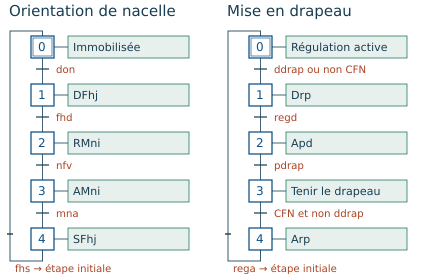
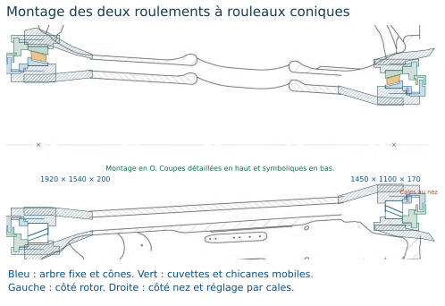
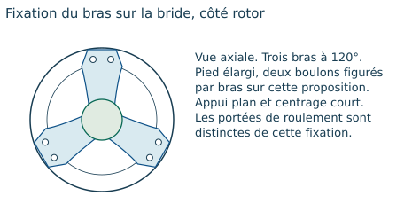

# Banque PT 2014 — Sciences industrielles C · Corrigé brut

*Corrigé rédigé par IA, non officiel. Signalez toute erreur.*

**Rédaction** · GPT-6.2 Astra Ultra · vitesse non renseignée · 27 novembre 2026

**Révision (tour 1)** · GPT-6.2 Astra Ultra · vitesse non renseignée · 27 novembre 2026

**Éolienne en mer Alstom Haliade 150.** Épreuve de six heures. Les 48 questions sont réparties en cinq parties, pondérées à 10 %, 25 %, 30 %, 20 % et 15 %. Les points de chaque question ne sont pas publiés.

[Sujet et planches](https://www.banquept.fr/documents/2014/si_c_2014_pt.pdf) · [Rapport du jury](https://www.banquept.fr/documents/ecrit/rapport/2014/rapport_si_c_ecrit_2014.pdf)

## I · Démarrage, orientation et arrêt

### I.1 · Vitesse du vent

Un anémomètre à coupelles entraîne un rotor. Un capteur magnétique fournit une impulsion à chaque passage d’un aimant. Compter les impulsions durant une fenêtre connue donne la fréquence, puis la vitesse du vent par l’étalonnage du capteur. Un signal impulsionnel peut donc servir à mesurer une grandeur continue. Une girouette renseigne séparément sur la direction.

### I.2 · Conditions climatiques

Avec les informations binaires de la ressource III, $CFN=vent\land vraf\land text$. Le premier signal traduit le critère de vent moyen sur dix minutes consécutives, avec le seuil de 25 m/s. Le second prend en compte les deux critères de rafale, 50 m/s pendant 10 s ou 70 m/s pendant 3 s. Le dernier impose une température comprise entre −10 et 40 °C. Une seule condition hors limites suffit à retirer l’autorisation.

### I.3 · Réorientation de la nacelle

Étape initiale, la nacelle est immobilisée, moteurs arrêtés et freins serrés. Sur demande $don$, commander $DFhj$ jusqu’à $fhd$, puis $RMni$ pour les sept moteurs jusqu’à $nfv$. Commander $AMni$ et attendre $mna$ avant de commander $SFhj$ sur les huit freins. Le retour initial exige $fhs$. Une nouvelle demande doit être acquittée ou disparaître avant sa réutilisation. Pendant la réorientation, les freins restent desserrés.

### I.4 · Mise en drapeau et reprise

À partir de la régulation active, la demande $ddrap$ ou la perte de CFN déclenche $Drp$. Après confirmation $regd$, commander $Apd$ jusqu’à $pdrap$. Tenir la position drapeau tant que les conditions sont défavorables ou la demande reste active. Lorsque $CFN\land\neg ddrap$ est vraie, commander $Arp$ et attendre $rega$. La reprise de rotation dépend ensuite de la présence d’un vent suffisant.

## II · Vent, pales et choix du matériau

### II.1 · Débit massique

Pendant $\mathrm dt$, l’air de vitesse V parcourt $V\mathrm dt$. Face au rotor, le volume traversant le disque de surface S vaut donc $SV\mathrm dt$. Pour un écoulement uniforme, le débit massique amont est $\dot m=\rho SV$ en kg/s.

### II.2 · Puissance maximale

La puissance cinétique incidente vaut $P_{th}=\dot mV^2/2=\rho SV^3/2$. La limite de Betz est $P_{max}=(16/27)P_{th}=8\rho SV^3/27$. Le facteur de Betz exprime le fait que l’air doit conserver une vitesse en aval.

### II.3 · Influence du site

À même vitesse et même surface, l’air froid et dense des sites de faible altitude offre une puissance plus élevée. Le coefficient de Betz lui-même est indépendant du lieu. Avec les données, $P_{th}=0{,}5\times1{,}25\times17\,000\times10^3=10{,}625$ MW. Le texte principal demande $P_{max}$, soit environ 6,30 MW, ou 6,38 MW avec 0,6. Le cahier réponses nomme $P_{th}$, d’où l’intérêt d’indiquer les deux résultats.

### II.4 · Vitesse de la section

La vitesse est tangentielle au cercle décrit par M, dans le sens de rotation de la figure. À 12 tr/min, $\omega=2\pi\times12/60=1{,}257$ rad/s. À 20 m de l’axe, $V_{p/s}=\omega l=25{,}13$ m/s, dirigée vers la droite sur la coupe A–A.

### II.5 · Triangle des vitesses

À l’échelle imprimée, tracer en M le vent absolu vertical vers le haut sur 2 cm, puis la vitesse de pale horizontale vers la droite sur 5,03 cm. La vitesse relative est $\mathbf V_{v/p}=\mathbf V_{v/s}-\mathbf V_{p/s}$, dirigée vers le haut et la gauche. Le triangle donne 5,41 cm, soit $\sqrt{10^2+25{,}13^2}=27{,}05$ m/s. Sa direction fait environ 21,7° avec l’horizontale gauche.

### II.6 · Forces lues sur la coupe

Reporter 6 cm sur le support imprimé de F en M, vers le haut et la droite. La projection horizontale motrice vaut environ 1,1 cm, la projection axiale dans le sens du vent environ 5,9 cm. Sur les directions du vent apparent et de sa perpendiculaire tracées sur ce second fond, le parallélogramme donne environ 2 cm de traînée et 5,6 cm de portance. Il s’agit de longueurs graphiques, car l’échelle de force en newtons n’est pas donnée.

### II.7 · Projections de portance et de traînée

Poser $\phi=\alpha+\beta$, angle du vent apparent avec la tangente orientée à l’opposé du déplacement. La portance a une composante motrice positive, tandis que la traînée la diminue. En prenant l’axe axial dans le sens du vent, les modules algébriques positifs sur la figure sont $F_c=F_p\sin\phi-F_t\cos\phi$ et $F_a=F_p\cos\phi+F_t\sin\phi$.

### II.8 · Vrillage

Le triangle des vitesses donne $\tan\phi=V_{v/s}/(\omega l)$. Pour conserver une incidence de 5°, il faut $\beta(l)=\arctan[V_{v/s}/(\omega l)]-5°$. Au point étudié, cela donne environ 16,7°. La vitesse tangentielle croît avec le rayon, donc la vrille nécessaire diminue en allant vers l’extrémité. Cette loi de section est établie hors du voisinage du pied réel.

### II.9 · Masse et inertie

Pour la poutre circulaire pleine de rayon constant r, $m=\rho\pi r^2L$ et $I_{Gz}=\pi r^4/4$. Le second résultat s’obtient aussi en partageant le moment quadratique polaire également entre deux diamètres perpendiculaires.

### II.10 · Séparer les trois facteurs

La charge $F_a$ du modèle de poutre est répartie, en N/m. Le moment à l’encastrement vaut $F_aL^2/2$, d’où $r^3=2F_aL^2/(\pi\sigma_{max})$ à la limite. En substituant dans la masse, on obtient $m=(4\pi)^{1/3}(\rho/\sigma_{max}^{2/3})L^{7/3}F_a^{2/3}$. On peut prendre les trois facteurs dans cet ordre et rattacher la constante numérique au facteur géométrique.

### II.11 · Lecture de l’indice

Minimiser la masse revient à maximiser $I_p=\sigma_{max}^{2/3}/\rho$. Sur le diagramme double logarithmique, les iso-indices sont des droites de pente 3/2 dans le plan $(\log\rho,\log\sigma_{max})$. Les translater vers le haut et la gauche jusqu’au dernier domaine rencontré. Parmi les matériaux représentés, les composites renforcés de fibres de carbone atteignent le meilleur indice dans la direction résistante des fibres.

### II.12 · Fabrication de la pale

Mouler sous vide des demi-coquilles constituées de tissus et renforts en carbone, puis les imprégner par infusion de résine et polymériser. Orienter une part importante des fibres le long de la pale pour les contraintes de flexion. Des couches transverses ou obliques reprennent le cisaillement. L’assemblage autour de longerons permet de reproduire un profil creux et vrillé de grande longueur. La poutre pleine de l’étude servait au classement des matériaux.

## III · Efforts transmis à l’alternateur

### III.1 · Premier modèle et mobilités

Le bâti est relié à la nacelle par un pivot vertical. La nacelle porte deux pivots coaxiaux distincts, l’un pour le hub en A, l’autre pour le rotor en B. Chacune des trois pales pivote sur le hub. Un seul contact ponctuel tangentiel C1 relie le hub au rotor. Les six pivots imposent 30 conditions scalaires, le contact en impose une. Avec six solides mobiles et cinq mobilités indépendantes, $h=31-36+5=0$. Les mobilités sont le lacet, trois pas de pale et la rotation commune hub-rotor lorsque le contact est actif.

### III.2 · Effet d’un contact unique

Sur le rotor isolé, le contact en C1 applique $F_1\mathbf t_1$ à la distance r de l’axe. Son moment axial vaut $rF_1$ et entraîne la génératrice. Sa résultante vaut également $F_1\mathbf t_1$. En régime permanent le pivot de la nacelle doit donc reprendre cette force transversale, en plus des éventuels moments liés au déport axial. Cette charge peut déplacer le rotor et faire varier l’entrefer.

### III.3 · Trois contacts ponctuels

Les trois contacts de la ressource VII imposent deux conditions de plus sans changer les mobilités utiles. Le degré d’hyperstatisme devient $h=2$. Ces deux redondances expliquent pourquoi la géométrie seule ne garantit pas la répartition des efforts.

### III.4 · Condition de couple pur

Les trois tangentes sont espacées de 120° et vérifient $\sum\mathbf t_i=0$. Pour ces trois directions, $\sum F_i\mathbf t_i=0$ impose $F_1=F_2=F_3$. Les moments suivant l’axe s’ajoutent alors en $3rF_1$. La résultante s’annule et le moment axial subsiste.

### III.5 · Défaut d’alignement

Un décentrage ou un défaut de coaxialité modifie les jeux et les déplacements requis aux trois contacts. Une ou plusieurs zones peuvent se décharger, les autres prennent des forces différentes. La transmission rigide hyperstatique ne garantit plus l’égalité des efforts ni une résultante nulle. Les déformations réelles décideront de la distribution.

### III.6 · Transmission articulée

La ressource VIII représente un double joint de Cardan et une partie coulissante. Chaque croisillon fournit deux axes de pivotement perpendiculaires et les deux parties de l’arbre intermédiaire coulissent en transmettant le couple. Cette architecture accepte un défaut d’alignement et une variation de distance.

### III.7 · Degré d’hyperstatisme du double joint

Par rapport à la première solution, retirer le contact et ajouter deux croisillons et deux demi-arbres. Les nouveaux organes sont liés par quatre pivots et une glissière. Au total, dix solides sont mobiles, dix pivots et une glissière imposent 55 conditions. Avec les cinq mobilités précédentes, $h=55-60+5=0$. Le calcul suppose les axes et la disposition représentés.

### III.8 · Torseur transmis par les cardans

En négligeant poids et inerties, les solides intermédiaires transmettent le même torseur transporté d’un centre à l’autre. La glissière parfaite suivant x interdit un effort axial, donc $R_x=0$. Les deux axes de pivot de chaque croisillon imposent $M_y=M_z=0$ à son centre, en A′ comme en B′ dans la position du dessin. Or $\mathbf M_{A'}-\mathbf M_{B'}=\overrightarrow{A'B'}\times\mathbf R$ et $\overrightarrow{A'B'}=d\mathbf x$. Les composantes transversales donnent $dR_y=dR_z=0$. Il reste le seul moment $M_x$.

### III.9 · Équilibrage hydraulique

Les trois poussoirs d’un même circuit ont une surface s et une pression commune. Au point i, le couple des deux circuits donne une force tangentielle de module algébrique $s(p_+-p_-)$. Les trois résultantes orientées à 120° se compensent. Chaque bras fournit le même moment suivant x et $C=3rs(p_+-p_-)$, au signe près selon le solide isolé. L’équilibrage des pressions réalise ici la condition de la question III.4.

### III.10 · Longueurs des poussoirs

Avec $\mathbf x$ vers l’observateur, $\mathbf y$ vers la droite et $\mathbf z$ vers le haut, le déplacement du point de hub $B_i$ vaut $u\mathbf y+v\mathbf z+\alpha\mathbf x\times\overrightarrow{AB_i}$. Compter positivement un allongement de la chambre +. La chambre se raccourcit lorsque le point du hub avance vers sa butée positive. En projetant sur les tangentes du dessin, on obtient $\Delta l_{1+}=-v-r\alpha$, $\Delta l_{2+}=\sqrt3u/2+v/2-r\alpha$ et $\Delta l_{3+}=-\sqrt3u/2+v/2-r\alpha$. Un choix de signe de course opposé change les trois signes ensemble.

### III.11 · Fluide incompressible et ressorts rigides

La somme des variations de volume des trois chambres reliées est nulle, soit $s\sum\Delta l_{i+}=0$. Les termes en u et v s’annulent, si bien que $-3sr\alpha=0$. On a donc $\alpha=0$ avec des translations encore possibles. La raideur de torsion du modèle idéal est infinie.

### III.12 · Écrasements sur un circuit

Les trois poussoirs ont même pression, même surface et même raideur. Par équilibre local, la variation d’effort de chaque ressort vaut $k\Delta u_{i+}=s(p_+-p_0)$. Les trois variations d’écrasement du circuit + sont donc égales. Il en va de même pour le circuit −.

### III.13 · Deux poussoirs opposés

Les circuits sont fermés et incompressibles. Un déplacement moyen d’une face de hub vers le poussoir + l’éloigne d’autant du poussoir −. Comme les écrasements sont uniformes dans chaque circuit, leurs variations sont opposées pour chaque paire, $\Delta u_{i-}=-\Delta u_{i+}$. L’un des ressorts se décharge autour de la précharge initiale.

### III.14 · Raideur de torsion finie

La rotation fait varier de $r\alpha$ en moyenne le rapprochement de chaque côté. Les translations s’annulent à la moyenne et le volume d’huile ne change pas. Ainsi $\Delta u_+=r\alpha$ et $\Delta u_-=-r\alpha$. La différence d’effort par paire vaut $2kr\alpha$. Les trois bras donnent $C=6kr^2\alpha$, soit $K_\theta=6kr^2$ en N·m/rad, en module dans l’approximation des petits déplacements.

### III.15 · Pression moyenne

À partir de l’équilibre des ressorts, $s(p_+-p_0)=k\Delta u_+$ et $s(p_--p_0)=k\Delta u_-$. La somme des deux variations étant nulle, $p_++p_-=2p_0$, quelle que soit la valeur du couple dans le domaine linéaire.

### III.16 · Précharge optimale du modèle

Imposer $0\leq p_+,p_-\leq p_{max}$. L’écart maximal autour de la moyenne est limité par la plus petite des deux marges, $p_0$ et $p_{max}-p_0$. On exploite toute la plage symétrique en réglant $p_0=p_{max}/2$. Une pression minimale de service positive remplacerait zéro dans cette construction.

### III.17 · Dimensionnement du bras hydraulique

Au réglage précédent, la différence maximale de pression atteint $p_{max}$ dans le modèle idéal. De $|C|=3rs|p_+-p_-|$, on déduit $sr\geq C_{max}/(3p_{max})$. Avec des pressions en pascals, s en mètres carrés et r en mètres, le couple est en N·m.

## IV · Fabrication et contrôle du moyeu

### IV.1 · Désignation EN-GJS-400

Il s’agit d’une fonte à graphite sphéroïdal selon la désignation européenne. Le nombre 400 désigne la résistance minimale à la traction de la classe, en MPa. Une valeur d’allongement ou une condition d’essai supplémentaire demanderait un suffixe ou une spécification complémentaire.

### IV.2 · Essai Brinell

Appliquer une bille normalisée de carbure de diamètre D sur une surface préparée, avec une force F maintenue durant le temps prescrit. Mesurer le diamètre moyen d de l’empreinte suivant deux directions. La dureté HBW est proportionnelle au rapport de la force à la surface courbe de l’empreinte. Pour F en N et les longueurs en mm, $HBW=0{,}102\,2F/[\pi D(D-\sqrt{D^2-d^2})]$. Le sujet indique 180 HB.

### IV.3 · Obtention du brut

Le moyeu est une grande pièce creuse à trois ouvertures et à parois nervurées. Un moulage en sable à noyaux permet d’obtenir la géométrie intérieure en fonte sphéroïdale. Prévoir portées de noyaux, dépouilles, alimentation des zones épaisses et surépaisseurs pour les trois brides. Le coût d’un moule perdu et de son modèle est compatible avec la taille et une production limitée. Les portées fonctionnelles et les trous sont repris en usinage.

### IV.4 · Trois spécifications du plan

Pour la planéité 0,3, tous les points extraits de la face d’appui sont entre deux plans parallèles distants de 0,3 mm, libres en position et orientation. Pour la perpendicularité, le tableau demande d’ignorer ici le modificateur de matière. La ligne médiane du centrage B est alors contenue dans un cylindre de diamètre 0,5 mm, dont l’axe est normal au plan associé A. Sa position dans le plan A reste libre.

Pour les 150 taraudages M36, les axes nominaux sont normaux à A et répartis sur le cercle théorique de diamètre 3 580 mm, centré sur B. Le pas de répartition uniforme vaut 2,4°. La localisation imprimée indique 0,5 sans symbole de diamètre. Une lecture directionnelle définit deux plans parallèles distants de 0,5 mm dans la direction spécifiée. Pour imposer dans toutes les directions un cylindre de diamètre 0,5 mm autour de chacun des axes nominaux, il faudrait inscrire le signe de diamètre dans le cadre. Les références A et B seules laissent libre le calage angulaire global du motif.

### IV.5 · Maximum de matière

Le centrage intérieur coté $3725^{+1{,}5}_{0}$ est au maximum de matière à son diamètre minimal de 3 725 mm. À cette limite, la tolérance de perpendicularité vaut 0,5 mm. Si le diamètre s’agrandit, le jeu disponible peut compenser un défaut d’orientation supplémentaire pour préserver l’assemblage. Pour une taille idéale de 3 726,5 mm, le bonus peut atteindre 1,5 mm. La condition virtuelle intérieure est alors représentée par un cylindre parfait de diamètre 3 724,5 mm normal à A.

### IV.6 · Choix du foret

Le point de travail est $D_c=32$ mm et $L/D_c=160/32=5$. Sur la carte, le CoroDrill 880 atteint cette profondeur, avec une version cinq diamètres. Le CoroDrill 805 couvre aussi cette dimension et accepte des profondeurs supérieures. Le Coromant Delta se trouve à la limite de son domaine de diamètre sur la carte. Le T-Max U et le trépan commencent bien au-dessus de 32 mm. La suite impose le 880.

### IV.7 · Débit de copeaux

Le volume percé par minute est la section du trou multipliée par l’avance axiale $V_f=fN$. Avec $N=1000V_c/(\pi D_c)$, on trouve $Q=(\pi D_c^2/4)fN=250D_cfV_c$ en mm³/min. Pour obtenir les m³/s demandés, $Q=D_cfV_c/(240\times10^6)$ avec $D_c$ en mm, f en mm/tr et $V_c$ en m/min.

### IV.8 · Paramètres de coupe

La fonte sphéroïdale de 180 HB relève de la ligne ferritique 09.1. Le dessin d’outil nomme la plaquette périphérique 4044. Pour diamètre 30–35,99 mm et longueur $5D_c$, choisir $V_c=135$ m/min et $f=0{,}20$ mm/tr, valeurs hautes de leurs plages. Ainsi $N=1000\times135/(32\pi)=1343$ tr/min, $V_f=269$ mm/min et $Q=3{,}60\times10^{-6}$ m³/s. Si l’on autorise le changement de nuance périphérique, la ligne 4014 monte à 235 m/min et 468 mm/min. Cette seconde hypothèse modifie aussi la puissance et le temps.

### IV.9 · Puissance de perçage

Pour une lèvre de longueur $D_c/2$, une bande de largeur radiale $\mathrm dr$ coupe la section $f\,\mathrm dr$. Elle exerce $\mathrm dF=K_cf\,\mathrm dr$. L’intégration du moment de 0 à $D_c/2$ donne $M_c=K_cfD_c^2/8$ en N·mm. En multipliant par $2\pi N/60$ puis en convertissant en kW, $P_c=fV_cD_cK_c/(120\times10^3)$. Avec la 4044 et $K_c=2000$ MPa, on trouve 14,4 kW. L’hypothèse de plaquette 4014 de la question précédente donnerait 25,1 kW.

### IV.10 · Temps et consommables

Pour une bride, le temps de coupe sur les 150 perçages de profondeur 160 mm est $T_u=150\times160/V_f=89{,}4$ min environ. Les trois brides totalisent environ 268 min de coupe, hors approches, débourrages et indexations. À 15 minutes par arête, il faut 18 positions d’arête sur chacun des deux sièges. Chaque plaquette offre quatre arêtes. Prévoir cinq plaquettes centrales et cinq périphériques, soit dix si les arêtes restantes sont reportées d’une bride à l’autre. Avec l’option 4014, on obtient environ 154 min pour trois brides et trois plaquettes de chaque type.

### IV.11 · Outil à deux diamètres

Un foret étagé ou un corps porte-plaquettes combiné perce le diamètre 32 en tête. L’épaulement coupe au diamètre 38 et se trouve 80 mm en retrait du point de référence de la pointe. À la fin de l’avance, la partie pilote atteint 160 mm et le lamage 80 mm. Ajuster le positionnement des arêtes à la convention de profondeur de pointe et prévoir des goujures permettant l’évacuation des copeaux. Un seul positionnement et une seule entrée par trou limitent les temps auxiliaires.

## V · Guidage du moyeu et fixation du bras

### V.1 · Montage des roulements

Monter les deux roulements à rouleaux coniques en opposition, avec les lignes de pression divergentes vers les appuis extérieurs pour un montage en O. L’entraxe de leurs centres de poussée est accru, ce qui favorise la tenue au moment de renversement, tout en reprenant l’effort axial dans les deux sens. Le moyeu tourne autour de l’arbre fixe de la nacelle. Les bagues extérieures sont ajustées pour résister à la charge tournante dans le moyeu et les portées de l’arbre sont cylindriques.

### V.2 · Coupe et réglage

Le fond A3 donne les centres géométriques. Au centre gauche, côté rotor, inscrire $D=1920$, $d=1540$, $B=200$ mm. Au centre droit, côté nez, inscrire $D=1450$, $d=1100$, $B=170$ mm. La coupe supérieure détaille cônes, cuvettes et rouleaux. La moitié inférieure donne la représentation conventionnelle. Des épaulements et des flasques annulaires démontables retiennent séparément les bagues de chaque solide. Une couronne vissée sur le bout d’arbre et des cales sélectionnées règlent le jeu axial des cônes. Aux extrémités, des chicanes sans contact sont formées par des profils emboîtés du moyeu et de l’arbre, avec dégagement axial et radial. Les gros diamètres justifient des couronnes boulonnées en éléments manipulables.

### V.3 · Appui et fixation du bras

La roue à trois bras se pose sur la face arrière du moyeu, côté alternateur. Un appui plan transmet les efforts de serrage et un centrage court de la couronne évite un désaxage. Les fixations précontraintes, distribuées autour de la bride, maintiennent les surfaces en contact et permettent la transmission tangentielle par frottement. Vérifier la capacité de frottement sous le couple en service. La forme du bras s’évase au pied et ménage l’accès des outils de serrage.

### V.4 · Vue de la liaison vissée

La vue de face restitue trois bras à 120° correspondant à la ressource I et localise sur un bras les fixations représentées en coupe. La bride mobile du bras s’appuie sur la face mobile du moyeu et se centre sur sa portée courte. Les boulons traversent les deux parties, avec tête et écrou accessibles pour la dépose. Le support fixe du roulement reste distinct de cette liaison tournante.

