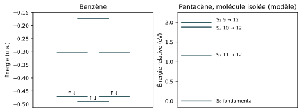
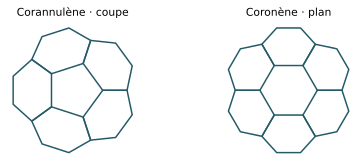
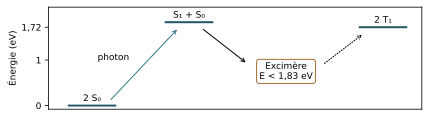
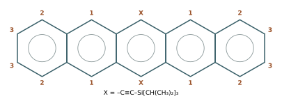
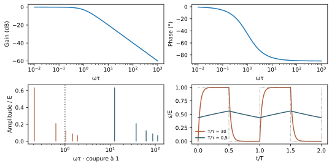
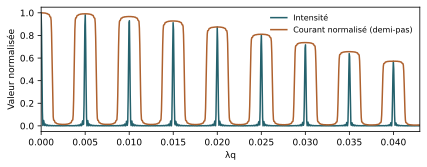
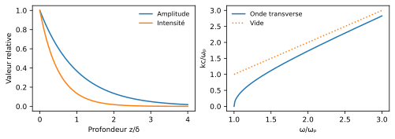

# ENS de Lyon PC 2014 — Physique-chimie · Corrigé brut partiel

*Corrigé rédigé par IA, non officiel. Signalez toute erreur.*

**Lecture du rapport du jury** · GPT-6.2 Astra Ultra · vitesse non renseignée

**Rédaction** · GPT-6.2 Astra Ultra · vitesse non renseignée

## États électroniques, réponse linéaire et plasmons

Cette édition résout 106 rubriques. Les rubriques suivantes restent à traiter dans ce corrigé : C44, C45, C46, C47, C48, C49, C51, C52, C53, C54, C56, C57, C58, C59, C65.

## Chimie I. Énergies et structures électroniques

### Question C1 — Électrons du benzène

Chaque carbone trigonal fournit un électron dans une orbitale $2p_z$. Les six orbitales atomiques portent donc six électrons $\pi$.

### Question C2 — Découverte et appellation

Faraday isole le benzène en 1825. Le nom passe par l’acide benzoïque et la résine de benjoin, dont le nom remonte à une expression arabe désignant un encens. Berthelot décrit en 1866 la formation de benzène à partir d’acétylène. C’est formellement une cyclotrimérisation $3\,\mathrm{C_2H_2}\to\mathrm{C_6H_6}$. La barrière cinétique est importante, même si la formation du cycle aromatique est énergétiquement favorable.

### Question C3 — Paramètres de Hückel simple

Sur un squelette fixé, former une combinaison linéaire d’une orbitale $p_z$ par carbone, avec recouvrements $S_{ij}=\delta_{ij}$. L’intégrale coulombienne $H_{ii}=\alpha$ est commune, l’intégrale de résonance $H_{ij}=\beta<0$ est commune aux voisins liés, et les autres termes sont nuls. Les niveaux s’écrivent $\alpha+\lambda_j\beta$, où les $\lambda_j$ sont les valeurs propres de la matrice d’adjacence.

### Question C4 — Intérêt d’un modèle étendu

Hückel simple assimile toutes les liaisons entre voisins et néglige les recouvrements. Le modèle étendu emploie des orbitales de valence et des termes de recouvrement dépendant de la géométrie. Il permet de tabuler en unités absolues des niveaux de molécules dont les distances et les torsions diffèrent. Les valeurs restent des estimations orbitalaires.

### Question C5 — Remplissage du diagramme du benzène

Les six niveaux sont $-0,490$, $-0,471$ (double), $-0,304$ (double), $-0,172$ u.a. Placer deux électrons de spins opposés dans chacun des trois premiers. Remplissage par énergie croissante, principe de Pauli et règle de Hund à l’intérieur d’un groupe dégénéré conduisent au singulet à couche fermée.

### Question C6 — Énergie du système cyclique

$E_\pi=2[-0,490+2(-0,471)]=-2,864$ u.a. par molécule dans l’approximation de somme des énergies orbitalaires.

### Question C7 — Référence de Dewar

Le polyène de référence défini par l’énoncé est l’hexatriène $\mathrm{C_6H_8}$. Il reste conjugué, mais n’est pas cyclique. Sa somme d’énergies occupées vaut $2(-0,491-0,482-0,450)=-2,846$ u.a.

### Question C8 — Valeur et signe de la stabilisation

$E_{\rm cyclique}-E_{\rm référence}=-0,018$ u.a., soit $-47,3\ \mathrm{kJ\,mol^{-1}}$. La stabilisation, prise comme énergie gagnée positive suivant la convention demandée dans le rapport, vaut $E_{\rm référence}-E_{\rm cyclique}=+47,3\ \mathrm{kJ\,mol^{-1}}$.

### Question C9 — Formes de Kekulé du naphtalène

Appeler $X,Y$ les carbones de fusion et numéroter les deux chemins $X,1,2,3,4,Y$ et $X,5,6,7,8,Y$. Les trois ensembles de doubles liaisons sont $\{XY,12,34,56,78\}$, $\{X1,23,4Y,56,78\}$ et $\{12,34,X5,67,8Y\}$. Les autres liaisons sont simples dans chaque forme. Certaines liaisons sont doubles dans deux formes, d’autres dans une seule. Les premières sont plus courtes (environ 1,36 Å), les secondes plus longues (1,42 Å).

### Question C10 — Comparer les énergies orbitalaires d’isomères

Pour l’anthracène et le phénanthrène, les sommes doublées des sept premières valeurs sont $-6,542$ et $-6,532$ u.a. La différence linéaire moins coudé vaut $-0,010$ u.a., soit $-26,3\ \mathrm{kJ\,mol^{-1}}$. Pour le pentacène et le pentahélicène les onze niveaux occupés donnent tous deux $-10,204$ u.a. Ce sont des isomères de constitution. Le seul terme $\pi$ favorise l’anthracène dans le premier calcul, et ne départage pas la seconde paire à la précision affichée. La stabilité de la molécule entière engage aussi son squelette et ses interactions.

### Question C11 — Accéder aux données thermodynamiques

Une calorimétrie de combustion, complétée par des enthalpies de formation connues et un cycle de Hess, permet de déduire l’enthalpie de formation. Pour la référence gazeuse, inclure l’enthalpie de sublimation si la mesure porte sur le solide. La capacité thermique à pression constante se mesure par le rapport entre la chaleur réversible reçue et l’élévation de température d’une mole, hors transition de phase.

### Question C12 — Enthalpie libre d’isomérisation

Pour anthracène moins phénanthrène, $\Delta H^\circ=+20,8\ \mathrm{kJ\,mol^{-1}}$. À 298,15 K, $\Delta G^\circ=20,8-298,15\Delta S^\circ$ si l’entropie est exprimée en kJ par mole et par kelvin. Le tableau donne $c_p$ et non $S^\circ$ : une valeur de $c_p$ en un point ne donne pas $\Delta S^\circ$. Si l’on suppose négligeable la différence d’entropie des deux isomères, on estime $\Delta G^\circ\simeq+21$ kJ par mole et le phénanthrène est favorisé, en sens opposé au seul bilan $\pi$. La contribution enthalpique totale domine sous cette hypothèse ; les données seules ne fixent pas exactement $\Delta G^\circ$.

### Question C13 — Sextets de Clar

Dans le phénanthrène, on peut placer un sextet dans chacun des cycles terminaux tout en conservant une liaison double dans le cycle central. L’anthracène possède un sextet migrant entre les cycles. La règle privilégie donc le phénanthrène, en accord avec les enthalpies mesurées, même si la somme d’orbitales de C10 ne reproduit pas cet ordre.

### Question C14 — Allure de l’interaction entre deux atomes

Le potentiel tend vers zéro par valeurs négatives à grande distance, présente un minimum à la séparation d’équilibre, puis monte fortement vers $+\infty$ à courte distance. La dispersion abaisse l’énergie à longue portée ; le recouvrement des nuages électroniques rend la répulsion dominante à courte portée.

### Question C15 — Potentiel de Lennard-Jones

Le potentiel 12–6 est $U(R)=A/R^{12}-B/R^6$, avec $A,B>0$. Le terme négatif décrit la dispersion de London et le terme positif modélise la répulsion de courte portée.

### Question C16 — De deux atomes à deux molécules

Dans l’approximation additive, $U_{12}=\sum_{i\in1}\sum_{j\in2}(A_{ij}R_{ij}^{-12}-B_{ij}R_{ij}^{-6})$. Chaque paire intermoléculaire est comptée une fois. La géométrie relative des deux molécules détermine tous les $R_{ij}$.

### Question C17 — Séparations d’équilibre

$U'(R)=-12A/R^{13}+6B/R^7$ s’annule à $R_*=(2A/B)^{1/6}$, où $U$ est minimal et vaut $-B^2/(4A)$. On obtient $2,00$ Å pour H···H et $4,00$ Å pour C···C. Ces distances non covalentes dépassent nettement les longueurs H–H (environ 0,74 Å) et C–C (environ 1,4 à 1,5 Å).

### Question C18 — Contact entre les hydrogènes de baie

Avec des hexagones réguliers plans de côté $s\simeq1,40$ Å et des liaisons C–H radiales de longueur $d\simeq1,08$ Å, la géométrie des deux carbones de baie donne $R\simeq2s-d=1,72$ Å (les directions C–H se projettent chacune avec un facteur $1/2$ sur la droite de séparation). Le tableau 4 donne $U\simeq+0,10\ \mathrm{kJ\,mol^{-1}}$. Un relâchement autour de $2,00$ Å donne au mieux $-0,084\ \mathrm{kJ\,mol^{-1}}$. Le petit gain possible est sans commune mesure avec les dizaines de kJ par mole des bilans électroniques ; l’approximation géométrique ne permet pas d’établir une liaison H···H stabilisante.

### Question C19 — Encombrement des hydrogènes terminaux

Les hydrogènes dirigés vers l’intérieur se superposeraient ou seraient anormalement proches dans un dessin plan du pentahélicène. Pour diminuer la répulsion, les cycles terminaux se décalent de part et d’autre d’un plan moyen. La chaîne de cycles se tord en hélice.

### Question C20 — Énergie à la distance cristallographique

Pour $R=1,55$ Å, $U=(81,920/1,55^{12}-2,560/1,55^6)\times4,184\simeq+1,01\ \mathrm{kJ\,mol^{-1}}$. Le contact est répulsif dans ce modèle. La géométrie totale résulte d’un compromis entre plusieurs contributions.

### Question C21 — Hélicités de signes opposés

Une représentation des deux lignes moyennes est $\mathbf r_\pm(t)=(R\cos t,\pm R\sin t,ht)$, $R,h>0$. Les cycles fusionnés suivent ces lignes : l’hélice droite est P et son image miroir est M. Ce sont deux énantiomères. Le dichroïsme circulaire électronique donne des bandes de signes opposés aux mêmes longueurs d’onde pour les énantiomères purs.

### Question C22 — Stabilisation des spires

Le rapprochement de cycles aromatiques de spires différentes permet des interactions intramoléculaires d’empilement $\pi$–$\pi$, avec une contribution de dispersion. Elles peuvent compenser une fraction du coût de torsion et des répulsions locales.

### Question C23 — Fermer les couronnes aromatiques

Pour $n=3$, fermer la chaîne de cinq cycles en une couronne de cinq hexagones fusionnés entourant un pentagone : c’est le corannulène, en forme de coupe. Pour $n=4$, six hexagones entourent un hexagone central : c’est le coronène, plan. Le schéma fournit les connectivités vues de dessus.

### Question C24 — Bilan formel de fermeture

Les extrémités s’unissent par une nouvelle liaison C–C avec perte formelle de deux hydrogènes, soit hélicène → circulène + $\mathrm H_2$. C’est une cyclodéshydrogénation. La conjugaison nouvelle et la libération d’une molécule gazeuse peuvent favoriser la fermeture, tandis que la rupture de liaisons C–H et la contrainte de courbure la pénalisent. Sans données thermodynamiques ni pression de l’hydrogène, la spontanéité n’est pas garantie.

### Question C25 — Piégeage de cations

La face concave d’un circulène courbé, en particulier du corannulène, offre plusieurs surfaces $\pi$ au même ion. L’interaction cation–$\pi$ associe attraction électrostatique et polarisation ; une géométrie accueillante améliore le confinement par rapport à une surface aromatique simplement plane.

### Question C26 — Transition singulet–singulet

Dans $S_0$ la HO contient $\uparrow\downarrow$ et la BV est vide. Pour $S_1$ on place un électron dans chacune. Leur combinaison de spin $(\uparrow\downarrow-\downarrow\uparrow)/\sqrt2$ est singulet, de spin total nul ; les orbitales plus profondes restent doublement occupées.

### Question C27 — Écart HO–BV du pentacène

La HO est l’OM 11 à $-0,417$ u.a. et la BV l’OM 12 à $-0,374$ u.a. La promotion simple coûte $0,043\times27,2116=1,17$ eV dans ce modèle.

### Question C28 — Premières promotions singulets

En prenant $S_0$ à zéro et en négligeant l’interaction de configurations, les trois plus petits écarts sont $11\to12$ à 1,17 eV, $10\to12$ à $0,069$ u.a. soit 1,88 eV, puis $9\to12$ à $0,073$ u.a. soit 1,99 eV. La promotion $11\to13$ est plus haute ($0,081$ u.a.). Ces étiquettes décrivent le modèle orbitalaire ; elles ne déterminent pas à elles seules les intensités optiques.

### Question C29 — Abaissement du premier état excité dans le cristal

La polarisation des molécules voisines, le couplage entre excitations de sites proches et leur délocalisation modifient l’énergie de l’exciton. Le bord optique observé passe de 2,30 eV à 1,83 eV, soit un décalage vers le rouge de 0,47 eV. La suite emploie la valeur cristalline.

### Question C30 — Allonger la conjugaison

Avec une longueur de conjugaison accrue les niveaux proches de la frontière tendent à se resserrer. L’écart $S_0$–$S_1$ diminue et l’absorption limite se déplace vers les grandes longueurs d’onde, sous réserve de conserver une structure électronique comparable.

### Question C31 — Ionisation et affinité électroniques

À orbitales gelées, $I\simeq-\varepsilon_{11}=11,35$ eV et l’affinité comptée comme énergie libérée à la capture vaut $A\simeq-\varepsilon_{12}=10,18$ eV. Ce sont des estimations à partir des paramètres de la table.

### Question C32 — Comparer avec la photoémission

L’ionisation réelle est une différence d’énergies totales entre système neutre et ion. La relaxation de toutes les orbitales, la corrélation électronique, la polarisation du milieu et l’approximation semi-empirique affectent cette différence. Le modèle à orbitales gelées surestime ici nettement les 4,85 eV mesurés.

### Question C33 — Estimer l’énergie du dimère empilé

Le pentacène comporte 22 carbones. À 4 Å, distance de minimum du potentiel C···C, une paire donne $-0,150$ kcal par mole. Pour les 22 paires verticales, $U\simeq-3,30$ kcal par mole, soit $-13,8\ \mathrm{kJ\,mol^{-1}}$ de dimères. Les paires obliques sont écartées comme demandé.

### Question C34 — Bilan de la fission de singulet

En prenant le couple de molécules fondamentales comme zéro, l’état initial photoexcité a l’énergie $E_S=E(S_1)-E(S_0)$ et les deux triplets l’énergie $2E_T=2[E(T_1)-E(S_0)]$. Le bilan vaut $2E_T-E_S$. Le processus est énergétiquement accessible sans apport supplémentaire si $E_S\ge2E_T$. Un couplage et un chemin cinétique restent nécessaires.

### Question C35 — Application au pentacène cristallin

$2E_T=2\times0,86=1,72$ eV, contre $E_S=1,83$ eV. Le bilan est $-0,11$ eV par événement. Le critère énergétique est satisfait.

### Question C36 — Intermédiaire dimérique excité

Il s’agit d’un excimère, associé à un recouvrement des systèmes $\pi$ et à un mélange des configurations où l’une ou l’autre molécule porte l’excitation, avec un possible caractère de transfert de charge. Le glissement règle les interactions orbitalaires et stabilise le dimère excité par rapport à la paire excitée non relaxée.

### Question C37 — Diagramme de la fission

La figure situe $2S_0$ à 0, $S_1+S_0$ à 1,83 eV et $2T_1$ à 1,72 eV. L’excimère intermédiaire est abaissé par rapport à $S_1+S_0$. Son énergie précise et sa position par rapport à $2T_1$ ne sont pas données. L’absorption d’un photon prépare la paire excitée, qui évolue vers les deux triplets.

### Question C38 — Numéroter les sites du TIPS-pentacène

Le dessin distingue les sites aromatiques par leurs numéros. Le groupe 1 (quatre protons des deux cycles intérieurs voisins du centre) est le plus déblindé, vers 9,1–9,34 ppm. Le groupe 2 (quatre sites des extrémités voisins des jonctions) correspond au massif vers 7,97 ppm et le groupe 3 (quatre sites les plus extérieurs) au massif vers 7,4 ppm. Les deux éthynylsilyles occupent les positions centrales opposées et ne portent pas de proton acétylénique. Leurs six isopropyles donnent six CH et 36 H de méthyles, soit 42 H aliphatiques autour de 1,36–1,60 ppm. L’intégrale totale est $12+42=54$ H.

### Question C39 — Symétrie et spectres des hydrocarbures aromatiques

Dans le coronène, les douze protons périphériques sont équivalents par symétrie : une seule résonance aromatique, d’intégrale 12. Dans l’hexahélicène, les seize protons sont répartis en paires reliées par la symétrie d’ordre deux. On attend jusqu’à huit ensembles aromatiques de deux protons, avec couplages et recouvrements possibles.

### Question C40 — Courant annulaire du benzène

Pour un champ extérieur sortant de la feuille, le courant conventionnel induit circule dans le sens horaire vu de face. Son champ au centre entre dans la feuille et s’oppose au champ appliqué. À l’extérieur du cycle, près des protons périphériques, la contribution est de sens opposé au champ induit central et déblinde les protons.

### Question C41 — Déplacements chimiques et courants locaux

Le benzène sert de repère à 7,71 ppm. Dans le pentacène les positions centrales $\alpha,\gamma$ donnent 9,57 et 9,18 ppm, les positions périphériques $\epsilon,\zeta$ 8,35 et 7,67 ppm. Le champ induit est la somme de courants de plusieurs cycles ; sa composante locale dépend à la fois de la position et des chemins disponibles dans le système conjugué. L’anthracène présente $\alpha=7,70$, $\gamma=8,18$, $\delta=8,38$ ppm. L’inéquivalence est compatible avec la délocalisation et les formes mésomères d’un sextet mobile. Une mesure de déplacement isolée n’attribue pas à elle seule un sextet permanent à un cycle.

### Question C42 — Domaine visible

Le visible s’étend approximativement de 400 nm (violet) à 750–800 nm (rouge). Les limites dépendent de la sensibilité retenue.

### Question C43 — Prédire les bandes accessibles

Pour le TIPS-pentacène du tableau, 13 des 26 OM du système $\pi$ modélisé sont occupées. Chaque promotion $i\le13<j$ donne $\lambda_{ij}=1239,84/[27,2116(\varepsilon_j-\varepsilon_i)]$ en nm lorsque les énergies tabulées sont en u.a. Pour une fenêtre explicitement choisie de 200 à 800 nm, ce calcul donne 135 promotions, regroupées en 80 écarts distincts à la précision des valeurs imprimées. Dans le seul visible 400–800 nm, on en compte 21 pour 18 écarts. Ces nombres sont des candidats énergétiques. Les intensités, règles de sélection, largeurs et couplages manquent pour prédire le nombre de bandes réellement observables.

### Question C50 — Définir un acte élémentaire

Un acte élémentaire relie les réactifs à des produits en une seule étape microscopique, sans intermédiaire réactionnel et avec un seul état de transition le long du chemin élémentaire. La transformation globale de la figure 5 fait intervenir la formation d’intermédiaires puis plusieurs cycloadditions. Son bilan n’est donc pas un acte élémentaire unique.

### Question C55 — Structure électronique de $\mathrm{SO_3}$

La représentation à charges formelles nulles comporte trois liaisons doubles S=O et deux doublets libres sur chaque oxygène. Le soufre est au centre d’un triangle plan, sans doublet non liant dans cette formule. Dans une représentation à octet limité, trois formes mésomères équivalentes redistribuent les charges ; les trois liaisons réelles sont équivalentes.

### Question C60 — Suivre l’évolution d’un chromophore

Les bandes d’absorption UV-visible changent quand le système conjugué du pentacène apparaît. À longueur d’onde où sa contribution domine, la loi de Beer–Lambert donne $A=\epsilon\ell c$, à condition de tenir compte d’un éventuel fond et de rester dans le domaine linéaire. Le suivi spectral distingue la croissance de la bande du produit de la disparition d’un réactif.

### Question C61 — Photodimérisation

Deux unités diène de deux pentacènes s’associent par cycloaddition photochimique $[4+4]$. Deux liaisons $\sigma$ intermoléculaires se forment. La connectivité des deux centres est symétrique entre les partenaires.

### Question C62 — Localiser les liaisons du photodimère

Les OM 11 et 12 ont simultanément de forts coefficients sur C11 et C12, de valeurs absolues 0,37 et 0,38. Ce sont les deux centres du cycle médian les plus aptes à former les liaisons nouvelles. Numérotons la seconde molécule avec des primes. Le dimère comprend les deux liaisons nouvelles C11–C11′ et C12–C12′ (l’autre orientation est reliée par symétrie). Chaque cycle médian perd son caractère aromatique local et ses deux centres liés deviennent tétraédriques, ce qui replie les deux moitiés.

### Question C63 — Réversibilité du photodimère

L’adduit peut se redissocier en deux pentacènes par rétrocycloaddition, en particulier sous activation thermique, et certaines excitations optiques favorisent également la dissociation. Les deux molécules retrouvent leur conjugaison étendue ; l’irradiation qui forme l’adduit et son retour relèvent de bilans d’activation différents.

### Question C64 — Reconnaître un endoperoxyde

L’addition de dioxygène au motif diène central construit un pont C11–O–O–C12. La liaison O–O est conservée et les deux carbones de raccordement deviennent tétraédriques. L’endoperoxyde obtenu perd la conjugaison continue du pentacène.

### Question C66 — Voie électronique de la photo-oxydation

Une voie plausible est la photosensibilisation du dioxygène. Après excitation du chromophore et passage intersystème, un transfert d’énergie au dioxygène triplet peut former du dioxygène singulet. Celui-ci s’additionne au diène médian par cycloaddition $[4+2]$, avec formation de deux liaisons C–O et conservation du pont O–O. Les seuls produits ne permettent pas de trancher toutes les étapes microscopiques possibles.

## Physique I. Signaux, diffraction et transformation de Fourier

### Question P1 — Deux réalisations d’un filtre du premier ordre

Une résistance et un condensateur en série, tension d’entrée aux bornes de l’ensemble et sortie aux bornes du condensateur, donnent $H=1/(1+jRC\omega)$. En mécanique, une masse $m$ freinée par $-b v$, soumise à la force $b e(t)$ et observée par sa vitesse $s=v$, vérifie $(m/b)\dot s+s=e$. La constante de temps est $\tau=m/b$ et la fonction de transfert est identique.

### Question P2 — Diagramme de Bode

Avec $u=\omega\tau$, $G_{\rm dB}=-10\log_{10}(1+u^2)$ et $\phi=-\arctan u$. Le gain tend vers 0 dB en basses fréquences puis décroît de 20 dB par décade. La phase va de 0 à $-90^\circ$ et passe par $-45^\circ$ à $u=1$ ($-3,01$ dB). Pour $u\gg1$, $H\simeq1/(j\omega\tau)$, soit un intégrateur à un facteur $1/\tau$ près.

### Question P3.a — Spectre du créneau dans les deux limites

La composante moyenne vaut $E/2$. Aux pulsations positives $(2p+1)\omega_F$, les amplitudes sinusoïdales sont $2E/[\pi(2p+1)]$. Les harmoniques paires sont absentes. Si $T\gg\tau$, les premières raies tombent sur le plateau, les plus hautes finissant sur la pente. Si $T\ll\tau$, toutes les raies non nulles sont dans le domaine intégrateur.

### Question P3.b — Forme temporelle de la sortie

Lorsque $T\gg\tau$, la sortie approche les deux plateaux 0 et $E$, en se raccordant par des exponentielles de constante $\tau$. Lorsque $T\ll\tau$, la moyenne reste $E/2$ et l’ondulation est presque triangulaire. Les pentes sont environ $\pm E/(2\tau)$, soit une ondulation crête à crête $ET/(4\tau)$.

### Question P3.c — Série dans le régime intégrateur

Pour $T\ll\tau$, $s(t)\simeq E/2-[2E/(\pi\tau\omega_F)]\sum_{p=0}^\infty \cos[(2p+1)\omega_Ft]/(2p+1)^2$. On ne doit pas intégrer la moyenne par la formule asymptotique de haute fréquence : elle est transmise par $H(0)=1$.

### Question P3.d — Isoler une raie

Intercaler un filtre passe-bande centré sur $\omega_k=(2k+1)\omega_F$, de bande passante bien inférieure à $2\omega_F$. Mesurer l’amplitude de la sinusoïde en sortie et la diviser par le gain connu à la résonance. Choisir une sélectivité suffisante vis-à-vis des raies voisines plus fortes ; attendre l’établissement du régime permanent.

### Question P3.e — Accorder le circuit RLC

Le maximum est à $\omega_0=1/\sqrt{LC}=2\pi\times3000\ \mathrm{s^{-1}}$, d’où $C=1/(L\omega_0^2)=2,81\ \mu\mathrm F$. La largeur à mi-puissance en pulsation est $R_{\rm tot}/L$. Demander $R_{\rm tot}\ll2L\omega_F=12,6\ \Omega$ (par exemple 0,5 Ω dans le modèle idéal). La résistance totale inclut celle de la bobine et du générateur, et le gain mesuré doit intégrer la résistance effectivement lue.

### Question P3.f — Supprimer la composante continue

$e_F(t)=e(t)-E/2$ est un créneau symétrique entre $+E/2$ et $-E/2$, de moyenne nulle et de même période. Aux instants de discontinuité sa valeur conventionnelle vaut zéro.

### Question P4 — Dimension du coefficient d’intégration

L’amplitude au point M a la même dimension que l’amplitude transmise au point P. L’intégrale introduit une longueur $\mathrm dx$ et l’exponentielle est sans dimension. Donc $[C]=\mathrm m^{-1}$ dans cette description invariante selon $y$.

### Question P5 — Transparence de phase pure

Une lame transparente à deux faces localement parallèles, d’épaisseur variable $h(x)$ et d’indice $n$, impose un retard optique $(n-1)h(x)$. En négligeant réflexions et absorption, $T(x)=\exp[-jk(n-1)h(x)]$ est complexe, de module un.

### Question P6 — Amplitude uniforme sur l’objet

Une source quasi ponctuelle au foyer d’une lentille correctement collimatée donne un front d’onde plan et une phase uniforme dans un plan normal à l’axe. L’objet doit être compris dans une zone du faisceau où l’éclairement varie négligeablement. Une source assez peu étendue et une largeur spectrale faible assurent la cohérence sur l’objet et sur les différences de chemins considérées.

### Question P7 — Phase relative des rayons diffractés

Les rayons issus de O et P vers le même M sont parallèles avant la lentille. Depuis le plan d’onde perpendiculaire à leur direction $\mathbf u$ jusqu’au point conjugué M, leurs chemins optiques sont égaux. La différence restante est la projection signée $[PM]-[OM]=-\mathbf u\cdot\overrightarrow{OP}$ dans l’air. Insérer $\psi^+(P)=\psi^-T(x)$ dans (10) donne $\psi(M)=C\psi^- e^{-jk[OM]}\int T(x)e^{j\mathbf k\cdot\overrightarrow{OP}}\,\mathrm dx$.

### Question P8 — Fréquence spatiale

Avec $k_x=(2\pi/\lambda)\sin\theta$, le facteur $e^{jk_xx}$ impose $q=-k_x/(2\pi)=-\sin\theta/\lambda\simeq-X/(\lambda f'_2)$. Ainsi $\psi=C\psi^-e^{-jk[OM]}\widetilde T(q)$. La dimension de $q$ est l’inverse d’une longueur : une structure de période $b$ contribue notamment aux fréquences $p/b$.

### Question P9.a — Chemin dans la lentille matérialisée

Au niveau $u$, la face arrière est reculée de $h=R-\sqrt{R^2-u^2}\simeq u^2/(2R)$ relativement au sommet axial. Le trajet physique de A à B dans le verre vaut donc $[AB]\simeq ne-nu^2/(2R)=[A_0B_0]-nu^2/(2R)$ en lentille mince. S’il est calculé entre deux plans de référence fixes, le trajet comporte le petit complément d’air $h$, et la correction nette est $-(n-1)u^2/(2R)$.

### Question P9.b — Distance focale image

Du plan avant au foyer, la différence de marche entre ces rayons vaut $-(n-1)u^2/(2R)+u^2/(2f'_2)$ à l’ordre deux. Le théorème de Malus impose son annulation pour tout $u$, soit $f'_2=R/(n-1)$.

### Question P9.c — Hauteur du rayon issu de O

Dans l’air $u\simeq dX/f'_2=\alpha X$. Le chemin dans le verre devient $[AB]\simeq[A_0B_0]-n\alpha^2X^2/(2R)=[A_0B_0]-n\alpha^2X^2/[2(n-1)f'_2]$. Entre plans fixes, correction nette $-\alpha^2X^2/(2f'_2)$.

### Question P9.d — Condition de plan de Fourier

À une constante près, le chemin O–M est $u^2/(2d)-u^2/(2f'_2)+(X-u)^2/(2f'_2)$. Pour $u=dX/f'_2$, cela donne $(1-d/f'_2)X^2/(2f'_2)$. Le terme quadratique disparaît si $d=f'_2$. L’objet est dans le plan focal objet et $\psi(M)=C\psi^- e^{-jk[OF'_2]}\widetilde T[-X/(\lambda f'_2)]$. La phase restante est globale.

### Question P10 — Intensité dans le plan focal

L’intensité est le flux moyen d’énergie par unité de surface normale, en $\mathrm{W\,m^{-2}}$. Pour une amplitude électrique complexe de crête dans l’air, $I=\epsilon_0 c|\psi|^2/2$. Plus généralement $I(M)=I_*|\widetilde T(q)|^2$, avec $I_*$ déterminé par la normalisation de l’amplitude et l’éclairement.

### Question P11 — Sens de la fréquence nulle

$q=0$ correspond à $X=0$ et au rayon axial, donc à l’ordre central. $\widetilde T(0)=\int T(x)\,\mathrm dx$ donne la composante continue ; divisée par la largeur de la zone considérée, elle donne sa transparence moyenne.

### Question P12 — Effet d’un obturateur focal

L’obturateur retire la composante continue et, du fait de sa taille finie, les très basses fréquences. Le fond uniforme est fortement atténué. Les variations rapides, bords et détails deviennent plus visibles sur fond sombre. L’intensité finale est le module carré de l’amplitude ainsi filtrée.

### Question P13.a — Transformée d’une fente

$\widetilde T_0(q)=\int_{-a/2}^{a/2}e^{-2j\pi qx}\,\mathrm dx=a\,\operatorname{sinc}(\pi aq)$, avec $\operatorname{sinc}u=\sin(u)/u$ et $\widetilde T_0(0)=a$.

### Question P13.b — Translation de la fente

La translation multiplie la transformée par $e^{-2j\pi qmb}$. On a donc $A(q)=e^{-2j\pi bq}$ de module un et $\widetilde T_m=A^m\widetilde T_0$.

### Question P13.c — Facteur du réseau

Avec $Q=\pi bq$, $S_Z=\sum_{m=-N}^Ne^{-2jmQ}=\sin(ZQ)/\sin Q$, avec prolongement par continuité aux pics. L’amplitude se factorise en transformée d’une fente et facteur du réseau. L’intensité comporte des pics d’interférence modulés par l’enveloppe de diffraction d’une fente.

### Question P13.d — Mesurer largeur et pas

La figure 8 donne entre deux pics $\Delta(\lambda q)\simeq0,005$, donc $b=\lambda/0,005\simeq100\ \mu\mathrm m$. Le premier zéro d’enveloppe est vers $|\lambda q|=0,10$, donc $a\simeq5\ \mu\mathrm m$ avec $\lambda=500$ nm. Pour obtenir $Zb$, il faut résoudre la largeur d’un pic : la distance du sommet au premier zéro du facteur de réseau vaut $1/(Zb)$ en fréquence spatiale.

### Question P13.e — Écart sur le détecteur

$|\delta X|=\lambda f'_2/b=f'_2\Delta(\lambda q)\simeq0,5\times0,005=2,5\ \mathrm{mm}$ entre maxima voisins.

### Question P13.f — Signal d’une photodiode de largeur finie

À largeur constante selon $y$, $i(X_D)=K\int_{X_D-c/2}^{X_D+c/2}I(X)\,\mathrm dX$ ; il s’agit d’une convolution avec une porte. Pour des pics fins et $c=|\delta X|/2$, le courant présente des créneaux de largeur voisine de $c$, séparés par des creux. Leurs hauteurs suivent l’enveloppe. Une petite fenêtre améliore la résolution des pics mais réduit le courant. Pour mesurer la largeur intrinsèque, prendre $c$ inférieur à cette largeur.

### Question P13.g.1 — Positions des pics réguliers

La condition est $2Q=2\pi p$ avec $p\in\mathbb Z$, soit $q=p/b$. L’amplitude de structure y vaut $Z$ pour des positions parfaites.

### Question P13.g.2 — Effet perturbatif des écarts de position

Au pic $p$, $S_Z^{\rm pic}=\sum_m e^{-2j\pi p\epsilon_m}$. Avec $\sum\epsilon_m=0$ et $\sum\epsilon_m^2=Z\Delta^2/12$, on obtient $S_Z^{\rm pic}\simeq Z[1-\pi^2p^2\Delta^2/6]$, valable pour $|p|\Delta\ll1$. Pour une distribution uniforme continue la moyenne correspond à $Z\operatorname{sinc}(\pi p\Delta)$.

### Question P13.g.3 — Mesurer l’amplitude du désordre

Le pic central demeure identique ; les ordres supérieurs sont d’autant plus atténués que $|p|$ augmente. Diviser les hauteurs mesurées par l’enveloppe de fente et par les hauteurs régulières. La pente de $1-I_p/I_p^{(0)}$ selon $p^2$ vaut alors $\pi^2\Delta^2/3$ dans le domaine perturbatif, d’où $\Delta$.

## Physique II. Conductivité et oscillations de charge

### Question P14 — Équations de champ et réponse matérielle

En unités SI, $\nabla\cdot\mathbf E=\rho/\epsilon_0$, $\nabla\cdot\mathbf B=0$, $\nabla\times\mathbf E=-\partial_t\mathbf B$ et $\nabla\times\mathbf B=\mu_0\mathbf J+\mu_0\epsilon_0\partial_t\mathbf E$. Les charges et le courant se modifient sous l’action du champ. Une loi de matière telle que la dynamique de Drude ferme donc le système en reliant $\mathbf J$ et $\rho$ aux champs.

### Question P15 — Échelle de moyennage

Les densités continues sont des moyennes sur un volume de dimension $\ell$ contenant de nombreux ions et électrons. On demande $n^{-1/3}\ll\ell\ll L$, où $L$ est la plus petite longueur macroscopique significative, par exemple la longueur d’onde, l’épaisseur de peau ou une taille géométrique. Une loi locale de conduction demande également que les variations spatiales du champ soient faibles sur le libre parcours.

### Question P16 — Loi d’Ohm dynamique

Sur les électrons contenus dans un petit volume homogène, moyenner $m\dot{\mathbf v}=-e\mathbf E-m\mathbf v/\tau$. Le terme magnétique lié à la dérive est d’ordre supérieur en réponse linéaire en l’absence de champ statique. Avec $\mathbf J=-ne\mathbf v$, on obtient $\tau\dot{\mathbf J}+\mathbf J=(ne^2\tau/m)\mathbf E$. Pour $e^{j\omega t}$, $\sigma=\sigma_0/(1+j\omega\tau)$ avec $\sigma_0=ne^2\tau/m$.

### Question P17 — Temps de relaxation des électrons

L’ordre de grandeur métallique est $n\sim10^{29}\ \mathrm{m^{-3}}$, approximativement un électron de conduction par atome pour le cuivre. Avec $\sigma_0=6\,10^7\ \mathrm{S\,m^{-1}}$, $\tau=m\sigma_0/(ne^2)\simeq2,1\,10^{-14}$ s. Utiliser $8,5\,10^{28}\ \mathrm{m^{-3}}$ donne $2,5\,10^{-14}$ s.

### Question P18 — Puissance moyenne absorbée

Pour des amplitudes de crête, $\langle\mathbf J\cdot\mathbf E\rangle=\tfrac12\operatorname{Re}(\sigma)|\widetilde{\mathbf E}|^2=\sigma_0|\widetilde{\mathbf E}|^2/[2(1+\omega^2\tau^2)]$ en watts par mètre cube. À $\omega\tau\ll1$, le courant est ohmique et principalement dissipatif ; à $\omega\tau\gg1$, $\sigma\simeq\sigma_0/(j\omega\tau)$ et la dissipation moyenne diminue comme $\omega^{-2}$.

### Question P19.a — Équation de retour à la neutralité

La divergence de $\tau\dot{\mathbf J}+\mathbf J=\sigma_0\mathbf E$, avec $\nabla\cdot\mathbf J=-\dot\rho$ et $\nabla\cdot\mathbf E=\rho/\epsilon_0$, donne $\ddot\rho+\dot\rho/\tau+\omega_p^2\rho=0$, $\omega_p^2=ne^2/(m\epsilon_0)$ et $Q=\tau\omega_p$. Ici $\rho$ est la perturbation de densité nette par rapport au fond cationique stationnaire, donc la variation de densité électronique.

### Question P19.b — Régime libre et suivi d’une excitation

Pour $n=10^{29}\ \mathrm{m^{-3}}$, $\omega_p\simeq1,78\,10^{16}\ \mathrm{rad\,s^{-1}}$ et $Q\simeq3,8\,10^2$. Le régime libre est oscillatoire amorti, de pulsation voisine de $\omega_p$, avec enveloppe $e^{-t/(2\tau)}$. À l’échelle macroscopique et en régime forcé établi, le rappel peut suivre une sollicitation lente pour $\omega\ll\omega_{\rm EN}\sim\omega_p$. L’enveloppe décrit la disparition d’un transitoire initial et correspond à une autre échelle de temps.

### Question P20.a — ARQS magnétique

On néglige $\epsilon_0\partial_t\mathbf E$ devant $\mathbf J$ dans Maxwell–Ampère et les retards à l’échelle du dispositif, tout en conservant l’induction. Alors $\nabla\times\mathbf B\simeq\mu_0\mathbf J$, $\nabla\times\mathbf E=-\partial_t\mathbf B$, $\nabla\cdot\mathbf B=0$ et $\nabla\cdot\mathbf E=\rho/\epsilon_0$. En particulier $\nabla\cdot\mathbf J\simeq0$ à cet ordre.

### Question P20.b — Critère quantitatif

L’inégalité est $\omega\epsilon_0/|\sigma(\omega)|\ll1$. Son carré vaut $(\omega\epsilon_0/\sigma_0)^2(1+\omega^2\tau^2)=\Omega^2(1+\beta^2\Omega^2)$, avec $\Omega=\omega/\omega^*$, $\omega^*=\sigma_0/\epsilon_0$ et $\beta=\tau\omega^*$.

### Question P20.c — Calculer le seuil quasi stationnaire

À la limite $F=1$, $\Omega_s^2=[-1+\sqrt{1+4\beta^2}]/(2\beta^2)\simeq1/\beta$ car $\beta\gg1$. Ainsi $\omega_s\simeq\omega^*/\sqrt\beta\simeq1,8\,10^{16}\ \mathrm{rad\,s^{-1}}$. On retrouve $\sqrt{\sigma_0/(\epsilon_0\tau)}=\omega_p$. Les fréquences ordinaires inférieures à $10^{14}$ Hz satisfont largement le critère retenu par le sujet.

### Question P21 — Dispersion électromagnétique

Comme $\nabla\cdot\mathbf B=0$, $\nabla^2\mathbf B=\mu_0\sigma\partial_t\mathbf B+c^{-2}\partial_t^2\mathbf B$ à pulsation fixée. Pour la convention $e^{j(\omega t-\mathbf k\cdot\mathbf r)}$, $k^2=\omega^2/c^2-j\mu_0\omega\sigma$. Avec cette fois $\Omega=\omega/\omega_p$ et $Q=\omega_p\tau$, il vient $K^2=k^2c^2/\omega^2=1-jQ/[\Omega(1+jQ\Omega)]$.

### Question P22 — Épaisseur de peau

Pour $Q\Omega=\omega\tau\ll1$, $K^2\simeq1-jQ/\Omega\simeq-jQ/\Omega$ dans le bon conducteur. Ainsi $k^2\simeq-j\mu_0\sigma_0\omega$, soit $k=\pm(1-j)/\delta$, $\delta=\sqrt{2/(\mu_0\sigma_0\omega)}$. Pour une propagation vers $+z$, la branche positive donne $e^{-z/\delta}$ dans l’amplitude et $e^{-2z/\delta}$ dans l’intensité.

### Question P23.a — Sous le seuil plasma

Lorsque $Q\Omega\gg1$, $K^2\simeq1-1/\Omega^2$ et $k^2\simeq(\omega^2-\omega_p^2)/c^2$. Pour $\omega<\omega_p$, $k$ est imaginaire pur dans cette approximation. Le champ pénétrant est évanescent avec longueur $c/\sqrt{\omega_p^2-\omega^2}$ ; il n’y a pas d’onde transverse progressive dans le volume.

### Question P23.b — Au-dessus du seuil plasma

Pour $\omega>\omega_p$, $k=\pm\sqrt{\omega^2-\omega_p^2}/c$. La branche positive part avec tangente verticale au seuil puis tend vers $k=\omega/c$. La dispersion est forte près du seuil ; pour $\omega\gg\omega_p$, $v_g=c\sqrt{1-(\omega_p/\omega)^2}$ tend vers $c$. La longueur d’onde vide de seuil est $2\pi c/\omega_p\sim10^{-7}$ m. Le modèle de Drude prévoit une transparence croissante à des longueurs d’onde suffisamment inférieures, abstraction faite des transitions interbandes réelles.

### Question P24 — Champ de la perturbation à symétrie plane

Pour une surdensité électronique uniforme $\delta n$ dans $[-u,u]$, la charge excédentaire vaut $-e\delta n$. Par invariance transverse le champ est axial, et par symétrie il est opposé aux deux frontières. Au bord droit $\mathbf E_D=-eu\delta n\,\mathbf e_x/\epsilon_0$. Pour une perturbation non uniforme remplacer $u\delta n$ par l’intégrale du demi-profil ; le sujet raisonne à l’échelle caractéristique.

### Question P25 — Vitesse de sortie et bilan de charge

Si $v$ est la vitesse des électrons au bord droit, positive vers l’extérieur, alors $2u\,\dot{\delta n}\simeq-2nv$ car le bord gauche fournit le même flux sortant. Ainsi $v\simeq-(u/n)\dot{\delta n}$ au premier ordre, pour un profil de largeur fixe.

### Question P26 — Pulsation des oscillations de densité

Au bord droit et sans frottement, $m\dot v=-eE_D=e^2u\delta n/\epsilon_0$. En remplaçant $\dot v$ par $-(u/n)\ddot{\delta n}$, on trouve $\ddot{\delta n}+[ne^2/(m\epsilon_0)]\delta n=0$. La pulsation est celle du plasma.

### Question P27 — Nature du rappel

Un excès repousse les électrons vers l’extérieur, un déficit les attire vers l’intérieur. Leur inertie provoque un dépassement de l’équilibre. Le mode est collectif et longitudinal. La largeur caractéristique s’élimine entre le champ et le bilan de flux ; le modèle avec collisions de P19 redonne cette oscillation avec amortissement.

### Question P28 — Polarisation associée

Si le gaz électronique se déplace de $\mathbf s$ par rapport au réseau positif, $\mathbf P=-ne\mathbf s$ au premier ordre et $\partial_t\mathbf P=\mathbf J$. À chaque bord se crée une séparation locale de charges. La polarisation locale oscille avec le mouvement et peut être antisymétrique même si le dipôle total de l’ensemble symétrique est nul.

### Question P29 — Permittivité de Drude

Pour $\omega\ne0$, $\widetilde{\mathbf P}=\widetilde{\mathbf J}/(j\omega)=\epsilon_0\chi\widetilde{\mathbf E}$ avec $\chi=\sigma_0/[j\omega\epsilon_0(1+j\omega\tau)]=-\omega_p^2/(\omega^2-j\omega/\tau)$. Ainsi $\epsilon_r=1+\chi$. Le signe de la partie imaginaire dépend de la convention temporelle adoptée.

### Question P30 — Lien avec l’indice complexe

Pour $\mu_r=1$, l’indice complexe vérifie $\widetilde n^2=\epsilon_r$, et $k=(\omega/c)\widetilde n$. Avec la convention du sujet, l’atténuation vers $+z$ sélectionne la branche physique dont la partie imaginaire de $k$ est négative.

### Question P31 — Écriture de Maxwell–Ampère avec $\mathbf D$

Comme $\mathbf J=\partial_t\mathbf P$ dans cette description, $\nabla\times(\mathbf B/\mu_0)=\partial_t(\epsilon_0\mathbf E+\mathbf P)=\partial_t\mathbf D$. Il ne reste pas de courant extérieur imposé dans le volume.

### Question P32 — Dispersion vectorielle

Les relations de Fourier donnent $\mathbf k\times\mathbf E=\omega\mathbf B$ et $\mathbf k\times\mathbf B=-\mu_0\omega\mathbf D$. Donc $\mathbf k\times(\mathbf k\times\mathbf E)=-\epsilon_r\omega^2\mathbf E/c^2$. En développant, $\epsilon_r\omega^2\mathbf E/c^2=k^2\mathbf E-\mathbf k(\mathbf k\cdot\mathbf E)$.

### Question P33 — Séparer les deux polarisations

Le produit scalaire avec $\mathbf k$ impose $\epsilon_r\mathbf k\cdot\mathbf E_\parallel=0$ pour $\omega\ne0$. Le produit vectoriel puis la projection transverse donnent $(k^2-\epsilon_r\omega^2/c^2)\mathbf E_\perp=0$. Une composante longitudinale non nulle exige $\epsilon_r=0$ ; une composante transverse non nulle impose sa propre dispersion. Dans le milieu homogène, pour $k\ne0$, ces deux branches sont distinctes.

### Question P34 — Condition d’existence du mode longitudinal

Sans dissipation, $\epsilon_r\simeq1-\omega_p^2/\omega^2$. Le mode longitudinal de P33 impose $\omega=\omega_p$ pour une pulsation positive. Dans ce modèle local, cette pulsation ne dépend pas de $k$.

### Question P35 — Densité de charge du plasmon

$\widetilde\rho=\epsilon_0\nabla\cdot\widetilde{\mathbf E}=-j\epsilon_0\mathbf k\cdot\widetilde{\mathbf E}_\parallel$. Seule la composante parallèle contribue. Une onde longitudinale de vecteur d’onde non nul s’accompagne donc à $\omega_p$ d’une modulation de densité oscillante.
