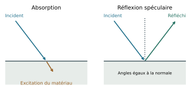
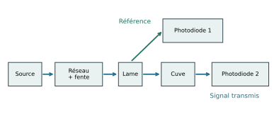
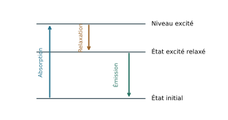
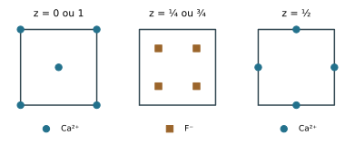
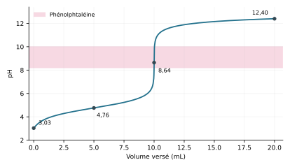
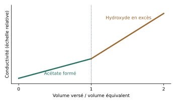

# ENS de Lyon — Second concours, Chimie 2014 · Corrigé guidé

*Corrigé rédigé par IA, non officiel.*

**Rédaction (tour 1)** · GPT-6.2 Astra Ultra · vitesse non renseignée

Ces éditions traitent 52 des 68 questions. Les parties A à C et D.1 sont couvertes. En D.2 et D.3 sont traitées les lectures indépendantes D.2.1, D.2.4, D.3.2, D.3.3 et D.3.5 (familles, groupes protecteurs, infrarouge, oxydation et nomenclature). Les autres questions sur la réalisation de la synthèse sont hors couverture. Le rapport du jury décrit les thèmes et les exigences de rigueur. Les valeurs usuelles de pKa et de pKe employées au dosage sont précisées dans les réponses.

## A.1. Couleur des objets

### Question A.1.1 — Lumière

> [!INDICATION]
> Relier la description ondulatoire à la description quantique.

#### Solution

La lumière est un rayonnement électromagnétique. Sa fréquence $
u$ et sa longueur d’onde dans le vide vérifient $c=\lambda
u$. Elle échange de l’énergie par photons, chacun d’énergie $h
u$. L’œil humain ne perçoit qu’une bande de ce rayonnement.

### Question A.1.2 — Énergie dans le visible

> [!INDICATION]
> Faire le calcul aux deux extrémités du visible. Une mole de photons contient $N_A$ photons.

#### Solution

Prenons $400$ et $800\,\mathrm{nm}$ comme bornes arrondies. À $400\,\mathrm{nm}$, $hc/\lambda=4{,}97\times10^{-19}\,\mathrm J$, soit $3{,}11\,\mathrm{eV}$ par photon. À $800\,\mathrm{nm}$, l’énergie est divisée par deux. Le domaine représente donc environ **1,55 à 3,11 eV**. En multipliant les énergies en joules par $N_A$, on trouve **150 à 299 kJ par mole de photons**. Le violet est le plus énergétique.

### Question A.1.3 — Absorption et réflexion

> [!INDICATION]
> Suivre l’énergie du faisceau à la surface et dans le matériau.

#### Solution

Dans l’absorption, de l’énergie quitte le faisceau et passe dans la matière, par exemple sous forme d’excitation électronique. Dans la réflexion, de la lumière repart dans le milieu d’incidence. Sur une face plane lisse, la réflexion est spéculaire, avec des angles incident et réfléchi égaux par rapport à la normale. Sur un objet rugueux, la lumière peut repartir dans de multiples directions. Les deux phénomènes peuvent coexister.

### Question A.1.4 — Couleur perçue

> [!INDICATION]
> Penser à la fois au spectre de la source et aux longueurs d’onde qui atteignent l’œil.

#### Solution

Sous lumière blanche, une feuille verte diffuse plus efficacement vers l’œil une partie du vert et absorbe davantage d’autres longueurs d’onde. Pour un filtre observé par transmission, c’est le spectre transmis qui fixe la teinte. Un objet peut donc changer d’aspect selon l’illuminant. La fluorescence peut aussi ajouter une composante émise par l’objet.

## A.2. Spectrophotométrie

### Question A.2.1 — Deux domaines de source

> [!INDICATION]
> Comparer les spectres continus disponibles en UV et dans le visible.

#### Solution

La lampe au deutérium fournit le continuum utile dans l’ultraviolet. La lampe à filament de tungstène, souvent halogène, couvre surtout le visible et le proche infrarouge. Une zone de recouvrement permet le changement de source.

### Question A.2.2 — Sélection spectrale

> [!INDICATION]
> Distinguer la dispersion du choix de la bande transmise.

#### Solution

Le monochromateur disperse la lumière polychromatique, couramment grâce à un réseau de diffraction. Une fente de sortie sélectionne une bande étroite centrée sur la longueur d’onde choisie. En changeant l’angle du réseau, on balaie le spectre.

### Question A.2.3 — Deux photodiodes

> [!INDICATION]
> Sur le dessin, repérer quelle diode reçoit la lumière après la cuve.

#### Solution

La photodiode 1 suit une fraction du faisceau avant l’échantillon. Son signal sert de référence pour corriger les fluctuations d’éclairement. La photodiode 2 reçoit la lumière transmise par la cuve. Une mesure de blanc permet de retrancher l’effet de la cuve, du solvant et des différences instrumentales entre les deux voies.

### Question A.2.4 — Choisir une cuve

> [!INDICATION]
> Examiner la fenêtre spectrale, le milieu et la résistance matérielle.

#### Solution

Le verre courant convient au visible, coûte moins que la silice fondue, mais absorbe dans l’UV court et peut casser. La silice fondue dite quartz couvre aussi l’UV, résiste à de nombreux solvants, coûte davantage et reste cassante. Les plastiques sont peu coûteux et moins cassants, souvent jetables, mais se rayent et leur compatibilité avec les solvants dépend du polymère. Beaucoup conviennent au visible seulement, certains plastiques spéciaux s’emploient dans une partie de l’UV. La transparence se vérifie à la longueur d’onde de mesure.

### Question A.2.5 — Signal du détecteur

> [!INDICATION]
> Quelle grandeur optique crée le courant mesuré ?

#### Solution

Une photodiode convertit le flux lumineux reçu en photocourant. À une longueur d’onde fixée, après correction du courant d’obscurité, ce courant est proportionnel à la puissance rayonnante reçue dans la bande sélectionnée. Sa sensibilité dépend de la longueur d’onde. Une absorbance résulte d’une comparaison de signaux.

### Question A.2.6 — Du blanc à l’absorbance

> [!INDICATION]
> Normaliser le rapport des deux signaux par celui obtenu pour le blanc.

#### Solution

Avec $S_1$ et $S_2$ corrigés de l’obscurité, posons $R=S_2/S_1$. La transmittance de l’échantillon est $T=R_{\rm éch}/R_{\rm blanc}$ et l’appareil affiche $A=-\log_{10}T$. Ainsi, si la cuve d’échantillon laisse passer le dixième du flux transmis par le blanc, $T=0{,}10$ et $A=1$.

### Question A.2.7 — Loi de Beer–Lambert

> [!INDICATION]
> Repérer les grandeurs que l’on peut faire varier indépendamment.

#### Solution

À longueur d’onde fixée, pour une seule espèce absorbante, $A=\varepsilon(\lambda)\,\ell c$. Si $\ell$ est en cm et $c$ en mol par litre, $\varepsilon$ est en $\mathrm{L\,mol^{-1}\,cm^{-1}}$ et $A$ est sans dimension. Des espèces indépendantes contribuent par addition de leurs absorbances.

### Question A.2.8 — Limites de la proportionnalité

> [!INDICATION]
> Distinguer les écarts de solution et ceux de l’instrument.

#### Solution

La proportionnalité s’observe pour une solution suffisamment diluée, homogène, sans diffusion importante, sous une bande spectrale étroite. Les interactions entre solutés ou un déplacement d’équilibre peuvent modifier les espèces absorbantes. Un signal transmis trop faible, la lumière parasite et une bande trop large entraînent aussi des écarts. La zone linéaire se contrôle sur une gamme étalon propre à l’expérience.

## A.3. Fluorescence

### Question A.3.1 — Bilan d’un cycle

> [!INDICATION]
> Choisir le même état de référence avant l’excitation et après relaxation.

#### Solution

Pour un cycle simple retournant à son état initial, $h
u_{\rm abs}=h
u_{\rm ém}+E_{\rm diss}$ avec $E_{\rm diss}\geq0$. L’absorption élève le système, une partie de l’énergie passe en relaxation non radiative, puis une transition radiative fournit le photon fluorescent. Le bilan inclut la relaxation finale des éventuels niveaux vibrationnels peuplés.

### Question A.3.2 — Décalage des longueurs d’onde

> [!INDICATION]
> Exprimer la longueur d’onde en fonction de l’énergie du photon.

#### Solution

Si la relaxation dissipe de l’énergie, $E_{\rm ém}<E_{\rm abs}$. Comme $E=hc/\lambda$, on obtient $\lambda_{\rm ém}>\lambda_{\rm abs}$. C’est le décalage de Stokes dans le modèle considéré.

### Question A.3.3 — Domaine d’émission

> [!INDICATION]
> Un déplacement vers les grandes longueurs d’onde suffit-il à franchir la limite du visible ?

#### Solution

Pour les exemples colorés du sujet, l’excitation est ultraviolette et la fluorescence observée à l’œil est dans le **visible**. Le seul bilan d’énergie impose un déplacement vers les grandes longueurs d’onde. Une émission restant dans l’UV est possible si le déplacement est faible. Le terme « proton » imprimé désigne ici le photon émis.

### Question A.3.4 — Devenir de l’énergie

> [!INDICATION]
> Regarder où passe l’énergie au cours des processus non radiatifs.

#### Solution

Elle excite d’abord des vibrations du système et de son environnement. La redistribution entre de nombreux degrés de liberté apporte finalement de l’énergie thermique au milieu. Dans un cristal, les vibrations collectives du réseau peuvent y participer.

## B.1. Cristallographie

### Question B.1.1 — Formule de la fluorine

> [!INDICATION]
> Combiner la neutralité électrique et les populations des sites.

#### Solution

La neutralité associe deux ions fluorure $\mathrm{F^-}$ à un ion $\mathrm{Ca^{2+}}$, d’où $\mathrm{CaF_2}$. Le réseau cristallin donne le même rapport, quatre cations pour huit anions dans la maille conventionnelle.

### Question B.1.2 — Maille cubique

> [!INDICATION]
> Compter les contributions d’un sommet, d’une face et d’un site intérieur.

#### Solution

Le calcium occupe les huit sommets et les six centres de face. Cela donne $8/8+6/2=4$ ions calcium. Les huit fluorures se placent aux positions dont chacune des trois coordonnées réduites vaut $1/4$ ou $3/4$, toutes intérieures. La maille cubique conventionnelle contient donc **quatre motifs $\mathrm{CaF_2}$**. Les coupes de la figure permettent de reconstruire les cinq plans.

### Question B.1.3 — Coordinences

> [!INDICATION]
> Compter les voisins immédiats de signe opposé et vérifier le comptage des contacts.

#### Solution

Chaque fluorure a quatre calcium au sommet d’un tétraèdre. Chaque calcium a huit fluorures aux sommets d’un cube. Les coordinences valent respectivement **4 pour F** et **8 pour Ca**. Dans la maille, $8\times4=4\times8$ donne bien le même nombre de contacts.

### Question B.1.4 — Compacité ionique

> [!INDICATION]
> Faire le calcul en ångströms de bout en bout pour obtenir un rapport sans dimension.

#### Solution

Dans le modèle des sphères de rayons donnés, $C=\frac{4\pi}{3a^3}(4r_{\rm Ca}^3+8r_{\rm F}^3)$. Avec $a=5{,}463$, $r_{\rm Ca}=1{,}12$ et $r_{\rm F}=1{,}31$ en ångströms, on trouve $C=0{,}606$, soit environ **61 %** du volume. Les rayons ioniques tabulés représentent ici des valeurs approchées.

### Question B.1.5 — Masse volumique

> [!INDICATION]
> Diviser la masse de quatre unités de formule par le volume d’une maille.

#### Solution

Avec les masses molaires usuelles, $M(\mathrm{CaF_2})=40{,}08+2\times19{,}00=78{,}08\,\mathrm{g\,mol^{-1}}$. Alors $\rho=4M/(N_A a^3)$. En prenant $a=5{,}463\times10^{-8}\,\mathrm{cm}$, on obtient **$3{,}18\,\mathrm{g\,cm^{-3}}$**, soit $3{,}18\times10^3\,\mathrm{kg\,m^{-3}}$.

## B.2. Fluorescence du minéral

### Question B.2.1 — Nature des impuretés

> [!INDICATION]
> Distinguer un atome étranger d’un défaut intrinsèque.

#### Solution

Un ion étranger peut remplacer un ion du réseau ou occuper un site interstitiel. Des ions de terres rares peuvent ainsi être incorporés dans une fluorine. Un écart de charge peut être compensé par d’autres défauts locaux. Une lacune isolée est un défaut du cristal, mais n’est pas à elle seule une espèce chimique étrangère.

### Question B.2.2 — Centres émetteurs

> [!INDICATION]
> Suivre l’énergie de l’UV jusqu’au centre luminescent.

#### Solution

L’impureté crée des états électroniques localisés. Ceux-ci peuvent absorber l’énergie incidente directement ou la recevoir du réseau. Une transition radiative depuis un état excité relaxé émet ensuite un photon. Si les voies non radiatives dominent ou si les centres appropriés sont absents, la fluorescence observée est faible ou indécelable.

### Question B.2.3 — Diversité des teintes

> [!INDICATION]
> Relier l’écart entre deux niveaux à la longueur d’onde émise.

#### Solution

L’ion étranger et son environnement local déterminent l’écart $\Delta E$ des niveaux impliqués. Comme $\lambda=hc/\Delta E$, des centres différents peuvent produire du violet ou du jaune. Le violet correspond à un écart d’énergie plus grand. Plusieurs centres peuvent contribuer simultanément au spectre.

## B.3. Solubilité

### Question B.3.1 — Équilibre de dissolution

> [!INDICATION]
> Écrire la stœchiométrie avant d’utiliser la concentration en fluorure.

#### Solution

Pour $\mathrm{CaF_2(s)\rightleftharpoons Ca^{2+}+2F^-}$, en eau pure et dans le modèle dilué, $[\mathrm{F^-}]=2s=2{,}0\times10^{-4}$ et $[\mathrm{Ca^{2+}}]=s=1{,}0\times10^{-4}\,\mathrm{mol\,L^{-1}}$. Avec l’état standard à $1\,\mathrm{mol\,L^{-1}}$, le produit des activités donne **$K_s\simeq4{,}0\times10^{-12}$** à 25 °C.

### Question B.3.2 — Masse dissoute

> [!INDICATION]
> Employer la concentration en unités de formule.

#### Solution

Dans $0{,}250\,\mathrm L$, la quantité de fluorine dissoute est $sV=2{,}5\times10^{-5}\,\mathrm{mol}$. Avec $M=78{,}08\,\mathrm{g\,mol^{-1}}$, on obtient $1{,}95\times10^{-3}\,\mathrm g$, soit environ **2 mg**.

### Question B.3.3 — Effet d’ion commun

> [!INDICATION]
> Tester la taille du fluorure libéré devant le fluorure déjà présent.

#### Solution

Si les concentrations sont exprimées en mol par litre, $s(1{,}0\times10^{-4}+2s)^2=4{,}0\times10^{-12}$. Pour $s=x\,10^{-4}$, l’équation se réduit à $x(1+2x)^2=4$. Le membre de gauche croît pour $x\geq0$ et sa racine positive vaut $0{,}6974$. On obtient **$s\simeq7{,}0\times10^{-5}\,\mathrm{mol\,L^{-1}}$**. La solubilité diminue. Ici $2s$ est comparable au fluorure initial, ce qui imposait de le conserver.

## C.1. Titrages et indicateurs

### Question C.1.1 — Principe d’un titrage

> [!INDICATION]
> Chercher la grandeur connue qui permet de remonter à la quantité inconnue.

#### Solution

On fait réagir l’espèce à doser avec un réactif de concentration connue. À l’équivalence, les quantités introduites respectent les coefficients stœchiométriques. Le volume mesuré permet de déduire la quantité initiale de l’espèce dosée. La réaction support doit être suffisamment rapide, quantitative et sélective.

### Question C.1.2 — Repérage colorimétrique

> [!INDICATION]
> Distinguer l’équivalence théorique de la fin de titrage observée.

#### Solution

La fin du titrage est repérée par une variation de couleur, apportée par une espèce de la réaction ou par un indicateur. L’équivalence est définie par la stœchiométrie. Pour que le dosage soit juste, le changement de teinte doit avoir lieu à un volume très proche de ce point.

### Question C.1.3 — Choix de l’indicateur

> [!INDICATION]
> Examiner le contraste et les conséquences de la présence de l’indicateur.

#### Solution

Il faut un changement rapide, visible et reproductible au voisinage immédiat de l’équivalence. Une faible quantité d’indicateur doit suffire afin de ne pas modifier sensiblement la quantité de titrant requise.

## C.2. Acide acétique

### Question C.2.1 — Indicateur acido-basique

> [!INDICATION]
> Regarder quelles espèces dominent dans les deux milieux de pH.

#### Solution

C’est un couple acide–base dont les deux formes ont des teintes distinctes. Sa zone de virage doit se situer dans la partie raide du saut de pH. Le volume où le virage est observé fournit alors une bonne approximation du volume équivalent.

### Question C.2.2 — Équilibre de l’indicateur

> [!INDICATION]
> Écrire une dissociation et examiner le rapport entre les formes.

#### Solution

Pour $\mathrm{IndH+H_2O\rightleftharpoons Ind^-+H_3O^+}$, $[\mathrm{Ind^-}]/[\mathrm{IndH}]=10^{\mathrm{pH}-\mathrm pK_a}$. En dessous de $\mathrm pK_a-1$ domine généralement la couleur de $\mathrm{IndH}$ et au-dessus de $\mathrm pK_a+1$ celle de $\mathrm{Ind^-}$. La perception réelle dépend de l’intensité colorante des deux formes.

### Question C.2.3 — Neutralisation du vinaigre

> [!INDICATION]
> Éliminer l’ion spectateur.

#### Solution

Le bilan est $\mathrm{CH_3COOH+OH^-\longrightarrow CH_3COO^-+H_2O}$. Les coefficients de l’acide acétique et des ions hydroxyde sont égaux, ce qui donne une stœchiométrie de dosage de un pour un.

### Question C.2.4 — Concentration du vinaigre

> [!INDICATION]
> Remonter de l’aliquote au vinaigre de départ une fois l’équivalence exploitée.

#### Solution

La prise d’essai contient $n_0=C_b V_E=0{,}100\times0{,}0100=1{,}00\times10^{-3}\,\mathrm{mol}$. Dans $20{,}0\,\mathrm{mL}$, la solution diluée est donc à $0{,}0500\,\mathrm{mol\,L^{-1}}$. Le facteur de dilution 20 donne une concentration initiale de **$1{,}00\,\mathrm{mol\,L^{-1}}$**.

### Question C.2.5 — Indice d’acide

> [!INDICATION]
> Convertir les 100 g de vinaigre en volume avec la densité imposée.

#### Solution

Cent grammes occupent environ $0{,}100\,\mathrm L$ et contiennent $0{,}100\,\mathrm{mol}$ d’acide acétique. Avec $M\simeq60{,}05\,\mathrm{g\,mol^{-1}}$, cela représente **6,0 g d’acide pour 100 g de vinaigre**, soit un indice de 6 selon la définition du sujet.

### Question C.2.6 — pH à l’équivalence

> [!INDICATION]
> Quelle espèce subsiste et à quelle concentration après mélange ?

#### Solution

À l’équivalence il reste l’acétate, base faible, à $C'=1{,}00\times10^{-3}/0{,}0300=0{,}0333\,\mathrm{mol\,L^{-1}}$. Avec les valeurs usuelles à 25 °C, $\mathrm pK_a(\mathrm{CH_3COOH})\simeq4{,}76$ et $\mathrm pK_e\simeq14{,}00$, $K_b=K_e/K_a$. L’hydrolyse donne $[\mathrm{OH^-}]\simeq\sqrt{K_b C'}=4{,}4\times10^{-6}\,\mathrm{mol\,L^{-1}}$, donc **$\mathrm{pH}_E\simeq8{,}64$**. Les deux constantes utilisées ici ne sont pas chiffrées dans l’annexe.

### Question C.2.7 — Demi- et double équivalence

> [!INDICATION]
> Au premier point, comparer acide et base conjuguée. Au second, calculer l’excès de titrant.

#### Solution

À $5{,}00\,\mathrm{mL}$, les quantités d’acide et d’acétate sont égales et $\mathrm{pH}\simeq\mathrm pK_a=4{,}76$. À $20{,}0\,\mathrm{mL}$, il reste $1{,}00\times10^{-3}\,\mathrm{mol}$ d’ions hydroxyde dans $40{,}0\,\mathrm{mL}$, d’où $[\mathrm{OH^-}]=0{,}0250\,\mathrm{mol\,L^{-1}}$. On trouve **$\mathrm{pH}\simeq12{,}40$**.

### Question C.2.8 — Tracer le dosage

> [!INDICATION]
> Établir d’abord le point initial, puis placer les trois volumes particuliers.

#### Solution

Avant tout ajout, $[\mathrm{H_3O^+}]\simeq\sqrt{K_a C_0}$ donne un pH initial de $3{,}03$. La courbe croît doucement dans la zone tampon, passe par $(5{,}00\,;4{,}76)$, présente un saut près de $(10{,}0\,;8{,}64)$ et rejoint $(20{,}0\,;12{,}40)$, les volumes étant en mL. La figure utilise le bilan de charge complet pour représenter aussi le voisinage de l’équivalence.

### Question C.2.9 — Indicateurs adaptés

> [!INDICATION]
> Comparer le saut de la courbe et les intervalles de l’annexe.

#### Solution

La **phénolphtaléine**, dont l’intervalle est $8{,}2$ à $10{,}0$, convient. Le **rouge de crésol** ($7{,}2$ à $8{,}8$) fournit aussi une bonne localisation de l’équivalence. La sensibilité du volume de virage se juge à la pente de la courbe. Un virage vers pH 4 à 5 surviendrait dans la zone tampon.

### Question C.2.10 — Lecture du virage

> [!INDICATION]
> Suivre de gauche à droite les deux bords de la bande colorée tracée.

#### Solution

Avec la phénolphtaléine, la solution est initialement incolore. Elle prend une teinte rose pâle au voisinage immédiat de $10{,}0\,\mathrm{mL}$ puis apparaît plus rose après le saut. La bande ombrée sur la courbe couvre les pH $8{,}2$ à $10{,}0$. Avec le rouge de crésol, la transition indiquée dans l’annexe est du jaune au rouge.

### Question C.2.11 — Conductivité

> [!INDICATION]
> Identifier les nouveaux porteurs de charge puis comparer leurs mobilités.

#### Solution

À dilution négligeable, avant l’équivalence chaque mole de titrant forme de l’acétate et apporte du sodium. L’acide initial est peu dissocié. La conductivité croît donc, en première approximation, avec une pente proportionnelle à $\lambda_{\rm Na^+}+\lambda_{\rm Ac^-}$. Après l’équivalence, le sodium et l’hydroxyde s’accumulent, avec une pente proportionnelle à $\lambda_{\rm Na^+}+\lambda_{\rm OH^-}$, plus grande car l’hydroxyde est très mobile. La cassure de pente repère $V_E$. La dissociation initiale de l’acide et les très premiers ajouts peuvent arrondir le départ.

## C.3. Complexation du zinc

### Question C.3.1 — Indicateur métallochromique

> [!INDICATION]
> Comparer la forme libre, sa forme liée et la stabilité du complexe de dosage.

#### Solution

L’indicateur forme avec le métal un complexe dont la couleur diffère de sa couleur libre. Au pH du dosage, le complexe métal–EDTA doit être suffisamment plus stable pour que l’EDTA capte le métal de l’indicateur au voisinage de l’équivalence.

### Question C.3.2 — Déplacement de l’indicateur

> [!INDICATION]
> Écrire symboliquement la libération d’Ind par l’EDTA.

#### Solution

Notons $Y$ l’EDTA et omettons ici les charges, qui dépendent de la protonation. Avant l’équivalence, une fraction du zinc est sous forme $\mathrm{ZnInd}$. Lorsque le zinc libre devient rare, $\mathrm{ZnInd+Y\rightleftharpoons ZnY+Ind}$. Avec le noir ériochrome T dans son domaine de pH approprié, la forme métallique rouge vineux cède la place à la forme libre bleue.

### Question C.3.3 — Bilan du dosage du zinc

> [!INDICATION]
> Employer l’écriture usuelle du ligand déprotoné pour faire apparaître la stœchiométrie.

#### Solution

Le bilan de référence est $\mathrm{Zn^{2+}+Y^{4-}\rightleftharpoons ZnY^{2-}}$. Si le ligand est écrit sous forme protonée, des protons figurent aussi au bilan. Dans les deux écritures, une mole d’EDTA correspond à une mole de zinc.

### Question C.3.4 — Masse estimée de zinc

> [!INDICATION]
> Vérifier quel volume a réellement été titré avant de conclure sur la masse annoncée.

#### Solution

La prise de $10{,}0\,\mathrm{mL}$ contient $0{,}0100\times0{,}0200=2{,}00\times10^{-4}\,\mathrm{mol}$ de zinc. Le volume total est 25 fois plus grand, soit $5{,}00\times10^{-3}\,\mathrm{mol}$. Avec $M(\mathrm{Zn})\simeq65{,}38\,\mathrm{g\,mol^{-1}}$, on trouve **$0{,}327\,\mathrm g$**, ou 327 mg. Le résultat est du même ordre que les « environ 300 mg » annoncés. Une pureté ne peut être calculée sans masse pesée précise. En prenant 300 mg comme masse exacte, on trouverait 109 %, ce qui révélerait une incohérence.

## D.1. Structure de la quinine

### Question D.1.1 — Chiralité de la quinine

> [!INDICATION]
> Repérer les carbones tétraédriques qui portent quatre chemins distincts.

#### Solution

La quinine dessinée est chirale. Elle possède quatre carbones stéréogènes, dont celui portant le groupe hydroxyle et trois dans le squelette bicyclique. L’absence de symétrie interne permettant de superposer l’image miroir au modèle exclut une forme méso.

### Question D.1.2 — Groupes caractéristiques

> [!INDICATION]
> Parcourir successivement le cycle aromatique, la liaison entre les deux squelettes et le système bicyclique.

#### Solution

On reconnaît un éther aryle–méthyle, un alcool secondaire, une double liaison terminale et une amine tertiaire aliphatique dans le squelette quinuclidine. Le noyau quinoléine est un hétérocycle aromatique fusionné dont un azote est de type pyridinique. Cet azote se distingue de l’amine tertiaire bicyclique.

## D.2. Lecture des premiers composés

### Question D.2.1 — Famille du composé 1

> [!INDICATION]
> Suivre les deux liaisons simples du carbone carbonylé.

#### Solution

Le composé 1 est une **lactone**, c’est-à-dire un ester cyclique. Le carbone carbonylé et l’atome d’oxygène de l’ester appartiennent au même cycle à cinq chaînons, caractéristique d’une γ-lactone.

*Question D.2.2 hors couverture.*

*Question D.2.3 hors couverture.*

### Question D.2.4 — Lire les abréviations de structure

> [!INDICATION]
> Dessiner trois substituants autour de Si et garder la quatrième liaison vers l’oxygène.

#### Solution

En notant $\mathrm{Ph=C_6H_5}$, les deux fragments liés à un oxygène s’écrivent $\mathrm{O{-}Si(CH_3)_2{-}C(CH_3)_3}$ pour TBS et $\mathrm{O{-}Si(Ph)_2{-}C(CH_3)_3}$ pour TBDPS. Ce sont des groupes protecteurs d’alcool. Le groupement hydroxyle apparaît sous forme d’éther silylé.

*Question D.2.5 hors couverture.*

*Question D.2.6 hors couverture.*

*Question D.2.7 hors couverture.*

## D.3. Lecture spectroscopique et fonctionnelle

*Question D.3.1 hors couverture.*

### Question D.3.2 — Indices dans le spectre infrarouge

> [!INDICATION]
> Comparer les liaisons C=O et O–H aux plages de l’annexe.

#### Solution

Dans 8, on attend la bande carbonyle d’un aldéhyde vers $1720$ à $1740\,\mathrm{cm^{-1}}$ d’après l’annexe. Dans 10, cette bande disparaît et une bande O–H d’alcool apparaît, généralement large vers $3200$ à $3500\,\mathrm{cm^{-1}}$ en présence de liaisons hydrogène. Ces indices s’interprètent ensemble.

### Question D.3.3 — Lecture des fonctions de 10 et 11

> [!INDICATION]
> Observer le même atome de carbone sur les deux dessins.

#### Solution

Dans 10, le carbone qui porte OH est un carbone d’alcool secondaire. Dans 11, le même site porte un carbonyle lié à deux carbones, caractéristique d’une cétone. Le changement de fonction correspond à une oxydation.

*Question D.3.4 hors couverture.*

### Question D.3.5 — Nomenclature

> [!INDICATION]
> Distinguer un substituant azoté à trois atomes d’un nitrile.

#### Solution

Le fragment $\mathrm{{-}N_3}$ est le **groupe azido**. Un composé organique qui le porte est un azoture organique.

*Question D.3.6 hors couverture.*

*Question D.3.7 hors couverture.*

*Question D.3.8 hors couverture.*

*Question D.3.9 hors couverture.*

*Question D.3.10 hors couverture.*

*Question D.3.11 hors couverture.*

*Question D.3.12 hors couverture.*

*Question D.3.13 hors couverture.*

*Question D.3.14 hors couverture.*
