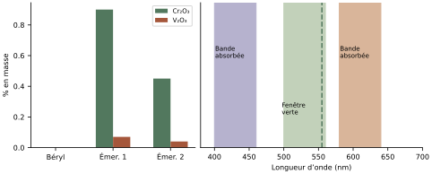
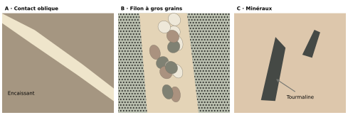
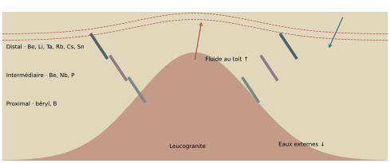
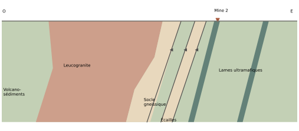
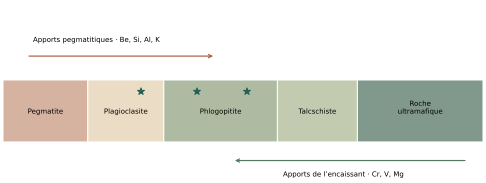
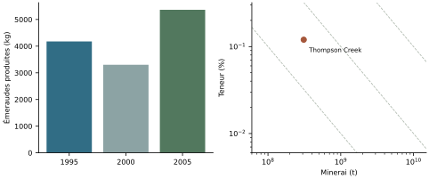

# ENS de Lyon, second concours 2014 — Géosciences · Corrigé brut

*Corrigé rédigé par IA, non officiel. Signalez toute erreur.*

**Rédaction** · GPT-6.2 Astra Ultra · vitesse non renseignée

## A — Une variété gemme du béryl

### Question A1 — Origine de la couleur verte

Le béryl et les deux émeraudes du document 2 ont des teneurs voisines en SiO₂, autour de 64 %, et en BeO, autour de 13 %. Le changement de couleur se joue dans des constituants minoritaires. Le béryl de Suède présente des valeurs reportées nulles pour Cr₂O₃ et V₂O₃. Les deux émeraudes brésiliennes contiennent respectivement 0,90 et 0,45 % de Cr₂O₃, ainsi que 0,07 et 0,04 % de V₂O₃. Les ions Cr³⁺ et V³⁺ peuvent remplacer une partie de Al³⁺ dans le réseau du béryl. Leur environnement cristallin détermine des transitions électroniques qui absorbent certaines longueurs d’onde.
Le document 4 place deux domaines de forte absorption vers 400–460 nm et 580–640 nm. Entre les deux, près de 500–560 nm, l’absorption est moindre. La lumière transmise dans cette fenêtre comporte beaucoup de vert, région où la sensibilité diurne de l’œil est grande, avec un maximum proche de 555 nm sur le document 3. L’intensité de cette couleur dépend aussi de la concentration, du trajet de la lumière et de la transparence. Les teneurs totales en fer du tableau varient également, mais ne suffisent pas seules à expliquer ces deux bandes.

### Question A2 — Qualité gemme et rareté

La photographie oppose un béryl pâle et trouble à un cristal d’un vert intense qui laisse passer la lumière. Une émeraude prisée combine qualité de couleur, transparence, taille exploitable et intégrité suffisante pour la taille et le polissage. Une pierre fortement fracturée peut avoir la bonne composition sans fournir une grande gemme. Il faut également réunir une source de Be, les éléments colorants et des conditions de croissance favorables. La rareté des cristaux réunissant ces qualités aide à expliquer la forte dispersion du prix par carat donnée en partie E.

## B — Gisements dans le monde

### Question B1 — Répartition mondiale des gisements

Le document 5 ne présente qu’une trentaine de localités à l’échelle de la planète. La distribution est discontinue, par exemple en Amérique du Sud, en Afrique orientale et australe, en Eurasie et en Australie. Les symboles distinguent des gisements granitiques, pegmatitiques et hydrothermaux, et des gisements tectoniques et hydrothermaux. Les encaissants varient, depuis les roches mafiques et ultramafiques jusqu’aux terrains sédimentaires. Les gisements colombiens rappellent qu’un unique modèle fondé sur les pegmatites brésiliennes ne couvre pas toute la carte. Le nombre de points ne mesure ni le tonnage ni la production de chaque pays. Le jury souligne d’abord la rareté des sites représentés.

## C — Les pegmatites

### Question C1 — Définition d’une pegmatite

Une pegmatite est une roche magmatique à cristaux exceptionnellement grossiers. La taille des cristaux est un critère de texture. Dans le contexte présenté, la pegmatite est de composition globalement granitique, avec feldspaths, quartz et minéraux accessoires. Elle se met fréquemment en place en filon sécant à partir d’un liquide résiduel granitique. Le document 6B permet de comparer directement la texture très grenue du filon avec celle du granite encaissant à petits grains.

### Question C2 — Intérêt économique

Les liquides tardifs peuvent concentrer des éléments rares et former des minéraux dont la taille facilite la récupération. Le document 7 signale notamment Be, Li, Ta, Rb, Cs et Sn dans les filons les plus évolués. Les béryls, tourmalines et autres cristaux bien formés peuvent intéresser la joaillerie ou la collection. Une composition favorable ne détermine pas à elle seule la rentabilité, qui dépend de la teneur, du volume exploitable, des inclusions et des coûts.

### Question C3 — Deux processus d’enrichissement au moins

Premièrement, une fusion partielle de faible degré d’une source fertile peut enrichir le liquide en éléments incompatibles avec les phases solides résiduelles. Deuxièmement, la cristallisation fractionnée d’un magma granitique retire surtout les éléments compatibles dans les cristaux précoces. Le liquide résiduel s’enrichit alors en éléments de partage global inférieur à un, jusqu’à ce que des phases capables de les incorporer cristallisent. Troisièmement, l’exsolution et la circulation d’un fluide aqueux peuvent remobiliser certains éléments, puis les concentrer là où température, pression ou chimie changent. Le transport effectif dépend de la solubilité et des ligands. Le liquide silicaté et le fluide aqueux sont deux phases différentes, distinction rappelée par le jury.

### Question C4 — Annoter les photographies du document 6

Sur A, placer « filon pegmatitique clair » dans la bande qui recoupe obliquement l’encaissant plus sombre et souligner son contact. Sur B, placer « granite encaissant à grain fin » hors du ruban central et « pegmatite à grands cristaux » à l’intérieur. L’objet noir fournit l’échelle. Sur C, la loupe indique celle des grands prismes sombres de tourmaline et des cristaux clairs, notamment feldspaths et quartz. Les limites de grains et les contacts du filon justifient les légendes. Une identification certaine de chacun des grains clairs demanderait davantage que cette seule photographie.

### Question C5 — Annoter la zonation du document 7

Dans la coupe, le leucogranite occupe le cœur. Les filons les plus proches sont stériles ou à béryl et B. Vers l’extérieur apparaissent des pegmatites à Be, Nb et P, puis les filons les plus évolués à Be, Li, Ta, Rb, Cs et Sn. Une flèche générale du pluton vers la périphérie traduit la différenciation des liquides successifs. Cette zonation idéale ne date pas seule chacun des filons.
Au moment de l’intrusion, les isothermes sont bombées autour du corps chaud et la température décroît généralement vers l’encaissant. Schématiser l’ascension de fluides chauds au toit et dans les fractures, avec une recharge possible par des eaux météoriques plus froides en périphérie. La décompression et la cristallisation libèrent également de l’eau magmatique. Le jury évoque un magma silicaté proche de 650 °C et la circulation distincte de l’eau sous l’effet de l’anomalie thermique.

## D — Carnaíba, Brésil

### Question D1 — Coupe ouest–est au droit de la mine 2

Tracer sur le document 8 un segment ouest–est passant par le symbole 2, puis reporter chaque contact dans l’ordre. On traverse à l’ouest les volcano-sédiments océaniques, le grand leucogranite, une bande de socle gneissique et des écailles chevauchantes étroites. À l’est, les volcano-sédiments contiennent des lames de serpentinite et de péridotite. Le symbole de la mine 2 se place au voisinage de la lame la plus proche du faisceau central. Une deuxième lame se trouve plus à l’est. Les dents de chevauchement repèrent les bords de certaines écailles. Elles ne définissent pas à elles seules le pendage de toutes les couches. La coupe jointe illustre une géométrie en profondeur compatible avec la carte. La surface de la carte et son échelle contraignent mieux les affleurements que les prolongements profonds.

### Question D2 — Réaction de contact et bilan chimique

Au document 10, une pegmatite et ses ramifications recoupent des péridotites serpentinisées. Depuis le filon vers l’est, se succèdent des domaines riches en plagioclase, de la phlogopitite, un talcschiste et l’encaissant ultramafique. Les étoiles de la coupe et les photographies du document 9 situent les cristaux dans la plagioclasite et la phlogopitite. La zonation manifeste un métasomatisme avec transferts de matière par un fluide et réactions avec l’encaissant.
La pegmatite analysée contient 3 491 ppm de Be contre 75 ppm pour le granite et une valeur sous le seuil de détection pour les péridotites. Harzburgite et lherzolite contiennent 2 340 et 2 420 ppm de Cr et 49 et 75 ppm de V. Le Cr et le V sont sous le seuil de détection dans les roches felsiques du tableau. Le registre minéralogique précise les échanges. Le fluide lié à la pegmatite peut fournir Be, Si, Al et K. L’encaissant magnésien fournit Mg, ainsi que les chromophores Cr et V par déstabilisation de minéraux porteurs. Le remplacement par du talc implique hydratation et apport de silice dans une roche magnésienne. La phlogopite fixe K, Mg, Al et Si en présence d’eau. Les plagioclases fixent Na ou Ca avec Al et Si. La croissance du béryl requiert également Be. Les zones observées placent des gains et pertes relatifs, mais leur bilan absolu nécessiterait des volumes ou un élément de référence immobile.

### Question D3 — Modèle génétique de Carnaíba

Une intrusion leucogranitique se met en place dans un ensemble crustal contenant des lames ultramafiques. La différenciation concentre Be et d’autres éléments incompatibles dans les derniers liquides. Des filons pegmatitiques envahissent les fractures et recoupent les roches magnésiennes. L’eau libérée par le magma et de possibles eaux externes circulent sous l’effet du gradient thermique. À proximité du filon, le fluide réagit avec les serpentinites et péridotites, modifie les assemblages et mobilise une partie du Cr et du V. L’arrivée conjointe du Be et des chromophores dans des zones riches en Al et Si permet la cristallisation d’un béryl vert. Les zones productives localisées sur le document 10 rendent ce modèle testable par cartographie des auréoles, analyses minérales et traçage des fluides. Des inclusions fluides et des isotopes permettraient de mieux contraindre leur origine et les conditions de dépôt.

## E — Production et potentiel économique

### Question E1 — Production mondiale en 1995, 2000 et 2005

La production mondiale passe de 4 178 kg en 1995 à 3 302 kg en 2000, soit une baisse d’environ 21 %. Elle atteint 5 363 kg en 2005, soit une hausse d’environ 62 % depuis 2000 et 28 % depuis 1995. L’ordre de grandeur mondial est donc de quelques tonnes par an. La Colombie occupe une place majeure, particulièrement dominante en 2000. Le Brésil figure dans les trois diagrammes. Le Mozambique apparaît avec une part visible en 1995. En 2005, la Zambie, le Brésil et la Russie contribuent à une distribution plus partagée. Une part relative plus faible n’implique pas nécessairement la même évolution de la masse produite lorsque le total change. Le document donne des productions en masse, sans ventilation par qualité ni par valeur.

### Question E2 — Potentiel économique de Thompson Creek

Sur le graphique logarithmique, le centre du symbole de Thompson Creek est voisin de $3{,}1\times10^8$ tonnes de minerai et de $0{,}12\,\%$, soit une fraction massique de $1{,}2\times10^{-3}$. La masse de substance payée est alors de l’ordre de $3{,}7\times10^5$ tonnes. Au prix donné de 14 euros pour 0,45 kg, la valeur brute par tonne vaut environ $3{,}11\times10^4$ euros. Avec la convention de l’énoncé, qui définit la teneur comme celle de l’oxyde, le potentiel brut est d’environ **11 à 12 milliards d’euros**. La lecture du point et le caractère conventionnel du prix ne justifient pas plus de chiffres.
Il existe une ambiguïté d’unité de substance. L’axe du document 13 porte « teneur Mo (%) ». Si la teneur y est exprimée en métal Mo et si le prix donné s’applique à MoO₃ pur, la masse d’oxyde équivalente est supérieure d’un facteur $M(\mathrm{MoO_3})/M(\mathrm{Mo})\simeq144/96=1{,}50$. Cette lecture porterait l’ordre de grandeur brut vers 17 milliards d’euros. Il ne s’agit dans aucun des deux cas d’un bénéfice ou d’une valeur actuelle nette. Récupération métallurgique, dilution, teneur de coupure, coûts et actualisation manquent.

### Question E3 — Comparer les gisements

Le document 13 concerne des porphyres associés au magmatisme de subduction de la marge ouest-américaine. Un très grand tonnage à faible teneur peut y contenir des centaines de milliers de tonnes de Mo. La valeur dépend surtout de la teneur récupérable, du tonnage et du prix du métal ou de l’oxyde. À Carnaíba, la minéralisation gemme est beaucoup plus sélective, en petites zones au contact de filons avec les ultramafites. La valeur par carat varie fortement avec la taille, la couleur et les défauts. Un kilogramme de petits fragments d’émeraude n’a pas la valeur d’un kilogramme de gemmes majeures. Ces deux ensembles peuvent relever de processus magmatiques et hydrothermaux, à des échelles et dans des encaissants différents.

### Question E4 — Comparer les exploitations

Pour un porphyre de Mo, on traite souvent de grands volumes en fosse à ciel ouvert, ou en mine souterraine si la géométrie et la profondeur le justifient. Après extraction, le minerai est concassé, broyé et concentré, typiquement par flottation de la molybdénite, avant conversion métallurgique. Une chaîne de grande capacité amortit les faibles teneurs. Pour les émeraudes, on suit des zones productives étroites en galeries ou en petites fosses selon l’affleurement. On dégage les cristaux avec précaution et on les trie individuellement. Préserver l’intégrité de chaque pierre prime sur le broyage fin. Il existe aussi des exploitations mécanisées de gemmes. La distinction fondamentale est le traitement d’un métal contenu dans un grand volume contre la récupération de cristaux dont la forme et la qualité font la valeur.

[Sujet officiel de l’ENS de Lyon](https://banques-ecoles.fr/cms/wp-content/uploads/2014/10/14_2clyon_suj_st.pdf) · [Rapport du jury](https://banques-ecoles.fr/cms/wp-content/uploads/2015/04/14_2clyon_rap_est.pdf)
