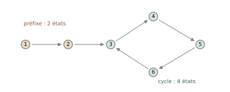
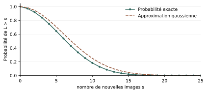

# ENS de Lyon · Second concours · Informatique 2014 · Corrigé brut

*Corrigé rédigé par IA, non officiel. Signalez toute erreur.*

**Rédaction** · GPT-6.2 Astra Ultra · vitesse non renseignée · 25 novembre 2026

**Révision** · GPT-6.2 Astra Ultra · vitesse non renseignée · 26 novembre 2026

**Langage choisi.** Python, autorisé par le sujet. Les exemples exécutables utilisent le groupe multiplicatif à seize éléments pour $p=17$. Les preuves combinatoires et les coûts utilisent le premier fixé $p$ du sujet, avec un produit de résidus compté pour une opération.

## I · Exponentiation discrète

### Question 1 · Tabuler les puissances successives

```python
p = 17  # Groupe fini de l'exemple de calcul

def mul(a, b):
    return (a * b) % p

def puissances(g, x):
    t = [0] * x
    if x:
        t[0] = 1
    if x >= 2:
        t[1] = g
    for i in range(2, x):
        t[i] = mul(t[i - 1], g)
    return t
```

Pour $i\geq2$, la récurrence $g^i=g^{i-1}g$ établit par induction le contenu de la case $i$. Le tableau est vide pour $x=0$ et réduit à $[1]$ pour $x=1$. Cette version effectue exactement $\max(0,x-2)$ multiplications du groupe. Une variante qui calcule également $g$ comme $1\cdot g$ en ferait une de plus pour $x\geq2$.

### Question 2 · Former une puissance indicée par une puissance de deux

```python
def carres(g, k):
    h = g
    for _ in range(k):
        h = mul(h, h)
    return h
```

Après $i$ passages, $h=g^{2^i}$. L’invariant est vrai initialement pour $i=0$ et se conserve par l’opération de carré. La fonction utilise exactement $k$ multiplications et une quantité constante de mémoire.

### Question 3 · Exponentiation binaire

Pour $x=2q+r$ avec $r\in\{0,1\}$, on a $g^x=(g^q)^2g^r$. Le quotient décroît strictement dès $x\geq2$, d’où le programme suivant.

```python
def puissance_binaire(g, x):
    if x == 0:
        return 1
    if x == 1:
        return g
    h = puissance_binaire(g, x // 2)
    h = mul(h, h)
    return mul(h, g) if x % 2 else h
```

Les cas $x=0,1$ ne demandent aucune multiplication. Si $s(x)=n\geq2$, $s(\lfloor x/2\rfloor)=n-1$ et l’étape coûte un carré, éventuellement suivi d’un produit. Ainsi $C(n)\leq C(n-1)+2$ pour $n\geq2$, avec $C(0)=C(1)=0$. On obtient $C(n)\leq\max(0,2n-2)$. Pour $x=2^n-1$, $n\geq1$, tous les bits traités sont des 1 et cette majoration est atteinte.

### Question 4 · Lire un bloc de k bits

Pour $k\geq1$, posons $B=2^k$. Le résultat est $g^x$. Si $x<B$, l’indice $x\bmod B=x$ permet de le lire dans $T$. Sinon écrivons $x=By+r$. Par récurrence l’appel renvoie $g^y$. La question 2 donne $(g^y)^{2^k}=g^{By}$ et la multiplication par $T[r]=g^r$ fournit $g^x$. La profondeur diminue puisque $y<x$. Le tableau $T$ et la valeur de $k$ sont des paramètres fixes transmis ou capturés pendant la récursion.


### Question 5 · Préparer la table et choisir la taille du bloc

```python
def puissance_par_blocs(g, x, k):
    base = 2 ** k
    table = puissances(g, base)

    def lire(y):
        q, r = divmod(y, base)
        if q == 0:
            return table[r]
        return mul(carres(lire(q), k), table[r])

    return lire(x)
```

On suppose $k\geq1$. La table coûte au plus $2^k$ produits. Pour $x>0$ de $n$ bits, il reste $\lceil n/k\rceil-1\leq n/k$ blocs après le chiffre de tête. Chacun coûte $k$ carrés et un produit. Donc $C_k(n)\leq 2^k+n(1+1/k)$. Le cas $x=0$ ne fait que préparer puis lire la table. Par exemple, pour les grands $n$, choisir $k=\max(1,\lfloor(\log_2 n)/2\rfloor)$ donne $2^k=O(\sqrt n)$ et $n/k=o(n)$. D’où $C_k(n)\leq n+o(n)$.

## II · Suites de résidus et coût des comparaisons

### Question 6 · Chercher un exposant dans la suite des puissances

```python
def exposant_dans_exemple(g, h):
    valeur = 1
    for y in range(p):
        if valeur == h:
            return y
        valeur = mul(valeur, g)
    return -1
```

Pour le groupe de l’exemple, la fonction inspecte exactement les exposants autorisés jusqu’au premier succès. La même justification vaut pour tout groupe de résidus du sujet. La valeur courante au début du tour $y$ est $g^y$, et chaque tour consomme au plus une multiplication. Le coût est $O(p)$ en temps, $O(1)$ en espace. Par exemple dans $E$ pour $p=17$, avec $g=4$ les valeurs du cycle sont $1,4,16,13$. L’exposant de 13 peut être 3, et 3 lui-même ne figure pas dans ce cycle.

### Question 7 · Découper les indices en blocs

Si $0\leq y\leq p-1$ vérifie $g^y=h$, posons $q=\lfloor y/k\rfloor+1$ et $r=qk-y$. Alors $1\leq r\leq k$, $1\leq q\leq\lfloor(p-1)/k\rfloor+1$ et $h g^r=g^{qk}$. L’égalité $qk-r=y$ assure la condition d’intervalle. Réciproquement, un couple $(q,r)$ satisfaisant ces conditions fournit $0\leq y=qk-r<p$, et l’annulation du facteur inversible $g^r$ dans le groupe donne $h=g^y$.

### Question 8 · Former les deux progressions du sujet

Les $k$ valeurs du premier tableau sont $hg,hg^2,\ldots,hg^k$. Partant de $h$, chaque terme exige un produit par $g$. Calculer $v=g^k$ en au plus $k$ produits, puis énumérer $v,v^2,\ldots,v^{\lfloor(p-1)/k\rfloor+1}$ en multipliant par $v$. Les deux progressions demandent au total $O(k+p/k)$ opérations pour $1\leq k\leq p$. Le programme de la question 1 permet de contrôler séparément chaque ligne dans le petit groupe de l’exemple.

### Question 9 · Réunir deux parcours sur des listes triées

```python
def intersection_triee(t1, n, t2, m):
    i = j = 0
    while i < n and j < m:
        if t1[i] == t2[j]:
            return t1[i]
        if t1[i] < t2[j]:
            i += 1
        else:
            j += 1
    return -1
```

Les préfixes abandonnés ne contiennent aucune intersection encore possible avec les suffixes restants. Lorsqu’une valeur est plus petite, toutes les valeurs futures du tableau opposé lui sont supérieures, ce qui justifie le pas. Une égalité termine avec une valeur commune, l’épuisement d’un tableau avec $-1$. Le nombre de pas est au plus $n+m$, donc $O(\max(n,m))$, et l’espace auxiliaire est constant. Les tableaux vides ou comportant des doublons sont couverts.

### Question 10 · Coût des comparaisons après tri

Notons $A=k$, $B=\lfloor(p-1)/k\rfloor+1$ et $H=\max(A,B)$. Les deux listes de la question 8 demandent $O(A+B)$ opérations et un tri par comparaisons demande $O(A\log(1+A)+B\log(1+B))$. La question 9 ajoute $O(A+B)$. D’où la borne $O(H\log(1+H))$, celle annoncée à un facteur constant près pour $H\geq2$.

Pour justifier que l’intersection suffit mathématiquement, une valeur commune représente $hg^r=g^{kq}$. Les indices associés identifient un exposant $kq-r\geq0$. Si le dernier bloc dépasse $p-1$, l’exposant se ramène dans $[0,p-2]$ modulo $p-1$, car $g^{p-1}=1$. Toute vraie solution assure l’existence d’une intersection par la question 7. Pour une restitution d’indice lors d’un tri, les couples (valeur, indice initial) conservent la provenance des valeurs égales.

### Question 11 · Évaluer l’espace auxiliaire

À la question 9, l’espace **en plus des entrées** est $O(1)$, tandis que les deux listes occupent $O(A+B)$ cases quand elles sont matérialisées. Pour le compromis demandé, notons $L=\min(A,B)$, $H=\max(A,B)$. Les $L$ éléments de la plus petite progression constituent une table triée, de taille $O(L)$. Pour une valeur de l’autre progression, le coût d’un test d’appartenance par dichotomie est $O(\log(1+L))$ et les valeurs de cette progression se succèdent avec une seule valeur courante. Le temps total est donc $O(H\log(1+L))$, préparation comprise, et l’espace $O(L)$. L’écriture $\log(1+L)$ donne un coût constant lorsque $L=1$.

### Question 12 · Comparer les budgets de mémoire

L’ordre optimal pour la borne par tri de la question 10 est $k$ de l’ordre de $\sqrt p$ puisque $\max(k,p/k)\geq\sqrt p$. Le temps est alors $O(\sqrt p\log p)$. Avec une capacité de $m\geq1$ cases à constante multiplicative près, posons $s=\min(m,\lceil\sqrt p\rceil)$ et prenons $k=s$. La question 11 donne $O((p/s+s)\log(1+s))$ opérations et $O(s)$ cases. Pour $m<\sqrt p$, cela donne $O((p/m)\log(1+m))$.

Dans le modèle particulier du sujet, les résidus servent directement d’indices dans un tableau de $p$ cases initialisées à zéro sans coût. Une table d’appartenance de $k$ valeurs demande alors $O(k)$ écritures, et $O(p/k)$ lectures suffisent pour les autres termes. À l’équilibre le temps est $O(\sqrt p)$, avec $O(p)$ places adressables. L’hypothèse d’initialisation est nécessaire à cette estimation précise.

## III · Orbites de fonctions finies

### Question 13 · Décrire l’orbite par des exposants

Initialement $x_0=1=g^0h^0$. Si $x_n=g^{a_n}h^{b_n}$, les trois transformations du sujet produisent respectivement les couples d’exposants $(a_n,b_n+1)$, $(2a_n,2b_n)$ et $(a_n+1,b_n)$. Ceci donne l’invariant par récurrence.

```python
def etat_exemple(g, h, n):
    x, a, b = 1, 0, 0
    for _ in range(n):
        if 3 * x < p:
            x, b = mul(h, x), (b + 1) % (p - 1)
        elif 3 * x < 2 * p:
            x, a, b = mul(x, x), (2*a) % (p - 1), (2*b) % (p - 1)
        else:
            x, a = mul(g, x), (a + 1) % (p - 1)
    return [x, a, b]
```

Le code choisit des représentants modulo $p-1$, ce qui est permis par $g^{p-1}=h^{p-1}=1$. Les comparaisons $3x<p$ et $3x<2p$ transcrivent les intervalles sans arrondi flottant. Il y a $n$ étapes de coût constant dans le modèle de mots du sujet, donc temps $O(n)$ et espace auxiliaire $O(1)$. Si l’on conserve les exposants entiers sans réduction, leurs tailles binaires peuvent croître avec $n$ et ces opérations ne sont plus toutes de coût constant en bits.

### Question 14 · Existence et coût d’une première répétition

Les $p$ valeurs $x_0,\ldots,x_{p-1}$ ne peuvent être distinctes. Il existe donc $0\leq n<n'<p$ avec $x_n=x_{n'}$. Une table indexée par les éléments du groupe peut mémoriser pour chaque état déjà vu ses deux exposants lors de sa première visite et un témoin de présence. Lorsque l’état revient, les deux couples fournissent directement $(a_n-a_{n'},b_{n'}-b_n)$. Dans le modèle du sujet à tableau initialement nul gratuit, un parcours jusqu’au premier retour demande $O(n')$ opérations, $O(p)$ places adressables et $O(n')$ entrées occupées. Un dictionnaire de taille $O(n')$ donne la même borne temporelle en moyenne sous l’hypothèse usuelle de hachage, et cette hypothèse doit être explicitée si on l’emploie.

Pour interpréter la différence dans l’exemple de groupe, si $h=g^y$ et $t$ est l’ordre de $g$, l’égalité des états donne $(b_{n'}-b_n)y\equiv a_n-a_{n'}\pmod t$. Les exposants réduits de la question 13 définissent la même congruence puisque $t$ divise $p-1$. Une différence non inversible modulo $t$ peut produire plusieurs valeurs compatibles ou une égalité sans information.

### Question 15 · Identifier le premier retour

Par définition de $\kappa$, $x_\kappa$ est le premier point de l’orbite qui sera revu. À partir de là, $T$ est le plus petit retour positif en ce point. Les $\kappa+T$ points d’indices $0,\ldots,\kappa+T-1$ sont distincts. En effet les points avant $\kappa$ ne peuvent être revus et, sur le cycle, une répétition plus précoce contredirait la période minimale. Puis $x_{\kappa+T}=x_\kappa$. Ainsi les indices $n=\kappa$ et $n'=\kappa+T$ conviennent à la question 14 et $n'\leq p-1$.



### Question 16 · Rencontre entre une progression simple et une progression double

Choisissons le premier **multiple positif** de $T$ qui est au moins $\kappa$. Il vérifie $\kappa\leq e\leq\kappa+T$ et $2e-e=e$ est un multiple de $T$. On a donc $x_e=x_{2e}$. Le qualificatif positif évite la coïncidence sans information $x_0=x_0$. Comparer, à chaque rang positif $i$, un état progressant d’un pas avec un état progressant de deux pas détecte une rencontre avant $\kappa+T+1$. Deux états et leurs coordonnées suffisent, d’où $O(1)$ cases et $O(\kappa+T)$ étapes pour **la rencontre**.

La conclusion sur l’exposant demande la condition algébrique de la page précédente du sujet. Si $h\in\langle g\rangle$ et si la différence des deux exposants de $h$ est inversible modulo $t$, l’égalité du rang de rencontre détermine une seule classe d’exposant par la congruence de la question 14. Une rencontre ne garantit ni cette inversibilité ni l’appartenance de $h$ au sous-groupe. L’exposant obtenu doit vérifier l’égalité du groupe. Le modèle de la dernière page porte précisément sur le temps de rencontre.

### Question 17 · Reconstruire une fonction à partir d’un vecteur

Notons $N=p-1$. Partons du point courant 1 et lisons $u_1,u_2,\ldots$. Tant qu’une image est nécessaire à ce parcours, affectons $\varphi(\text{point courant})$ à la prochaine valeur lue, puis avançons vers elle. Arrêtons-nous juste après la première valeur déjà rencontrée, en comptant 1 parmi les valeurs rencontrées. Cela arrive au plus tard à la $N$-ième lecture, puisque $N+1$ positions successives se répartissent sur $N$ points. Jusqu’alors, chaque point de départ de flèche est distinct et aucun conflit d’affectation n’est possible.

Si $L$ valeurs ont été lues, l’orbite a $L=\kappa+T$ points distincts et la dernière flèche ferme son cycle. Aux $N-L$ points encore sans image, pris par ordre croissant, attribuons successivement les $N-L$ dernières valeurs du vecteur. On construit ainsi la fonction demandée et son codage est bien $U$. Chaque flèche, dans le premier segment comme dans le second, était imposée par l’ordre de lecture, d’où l’unicité. Si $1,u_1,\ldots,u_s$ sont distincts, la fermeture intervient après la $s$-ième lecture, donc $L>s$.

### Question 18 · Compter les fonctions avec une longue orbite

Grâce à la bijection de la question 17 et en posant $N=p-1$, la condition $\kappa+T-1\geq s$ impose successivement $N-1,N-2,\ldots,N-s$ choix pour les $s$ premières cases. Chacune des $N-s$ autres cases est libre dans $E$. Le nombre de fonctions est donc

$$
\frac{(N-1)!}{(N-1-s)!}\,N^{N-s}
=\frac{(p-2)!}{(p-2-s)!}\,(p-1)^{p-1-s}
$$

pour $0\leq s\leq N-1$. Pour $s=0$, il s’agit des $N^N$ fonctions.

### Question 19 · Temps moyen d’entrée en collision

Soit $L=\kappa+T$ pour une fonction uniforme sur les $N^N$ possibilités, toujours avec $N=p-1$. La question 18 donne

$$
P_s=\mathbb P(L>s)=\prod_{j=1}^s(1-j/N),\qquad 0\leq s<N.
$$

Comme $L\in\{1,\ldots,N\}$, son espérance exacte est $\mathbb E L=\sum_{s=0}^{N-1}P_s$. Le $1+$ devant cette somme, imprimé à la question 19, compte une seconde fois le premier rang. L’expression **avec** ce 1 vaut donc $1+\mathbb E L$. En utilisant $P_s=\binom{N-1}{s}s!/N^s$ et l’intégrale de la factorielle, la formule du binôme donne

$$
\mathbb E L=\int_0^\infty (1+t/N)^{N-1}e^{-t}\,dt .
$$

On retrouve l’intégrale de l’énoncé avec le même décalage si l’on additionne 1 aux deux membres. Pour $N=2$, par exemple, les deux probabilités de queue valent 1 et $1/2$, d’où une moyenne exacte de $3/2$.

Pour $p=5$, le modèle uniforme porte sur $N=4$ états. Les probabilités de dépasser les rangs 0, 1, 2 et 3 sont $1$, $3/4$, $3/8$ et $3/32$. En ramenant au dénominateur 32, la moyenne vaut $71/32$. La première observation $x_0$ fait déjà partie des états visités lorsque la première image est tirée.

Pour $s=\lfloor x\sqrt N\rfloor$ et $x$ fixé, développer $\log(1-j/N)$ donne $\log P_s=-s(s+1)/(2N)+O(s^3/N^2)\to-x^2/2$. En outre $P_s\leq\exp[-s(s+1)/(2N)]$ par $1-u\leq e^{-u}$. Ainsi les sommes de Riemann de pas $1/\sqrt N$ convergent sur chaque intervalle borné, et leurs queues sont majorées par les queues d’une intégrale gaussienne (à un pas de grille près). Il vient

$$
\frac{\mathbb E L}{\sqrt N}\longrightarrow\int_0^\infty e^{-x^2/2}\,dx
=\sqrt{\pi/2},\qquad
\mathbb E L\sim\sqrt{\pi p/2}.
$$

La dernière intégrale est corrigée dans le rapport du jury. Le décalage additif de 1 ne change pas l’équivalent. Dans ce modèle de fonction uniforme, le temps moyen pour rencontrer le cycle par les deux vitesses est $\Theta(\sqrt p)$. En effet le premier indice de rencontre positif est au moins $\kappa$ et au moins $T$, donc au moins $L/2$, et au plus $L$. Cette moyenne décrit le modèle probabiliste. La fonction particulière du sujet est déterministe et le succès de l’interprétation algébrique relève aussi des conditions de la question 16.


