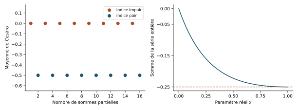

# ENS de Lyon, second concours — Mathématiques 2014 · Corrigé brut

*Corrigé rédigé par IA, non officiel. Signalez toute erreur.*

**Rédaction** · GPT-6.2 Astra Ultra · vitesse non renseignée

**Sommes de Cesàro et d’Abel.** Pour une série de terme général $a_n$, on note $s_n$ la somme de $a_0$ à $a_n$, et $\sigma_n$ la moyenne de $s_0$ à $s_{n-1}$. Ces indices interviennent dans les formules de décalage et de produit.

## 1. Moyennes de suites

### Question 1

Soit $\varepsilon>0$. Choisissons $M$ tel que $|u_k-\ell|\le\varepsilon$ pour $k\ge M$. Pour $n>M$,
$$|v_n-\ell|\le\frac1n\sum_{k<M}|u_k-\ell|+\frac{n-M}{n}\varepsilon.$$
La première somme a un numérateur fixe. La limite supérieure du membre gauche est donc au plus $\varepsilon$ pour tout $\varepsilon>0$, d’où $v_n\to\ell$.

### Question 2

La suite $u_n=(-1)^n$ ne converge pas, car ses deux sous-suites de parités différentes ont pour limites 1 et $-1$. Cependant $v_{2m}=0$ et $v_{2m+1}=1/(2m+1)$, donc sa limite de Cesàro est 0.

### Question 3

Pour $1\le j\le n$, $jv_j=\sum_{k=0}^{j-1}u_k$. Ainsi $n^2w_n=\sum_{j=1}^n jv_j$. La contribution de la constante $\ell$ vaut $\ell n(n+1)/(2n^2)$. Pour $v_j-\ell$, fixer $M$ après lequel le module ne dépasse pas $\varepsilon$. Les premiers termes pondérés contribuent $O_M(n^{-2})$ et la queue au plus $\varepsilon(n+1)/(2n)$. On obtient $w_n\to\ell/2$.

## 2. Séries et sommation de Cesàro

### Question 4

Posons $q=e^{iz}$, de module $e^{-\operatorname{Im} z}$. Si $\operatorname{Im} z>0$, la série géométrique converge de façon usuelle, donc aussi au sens de Cesàro, avec somme $1/(1-q)$. Si $q=1$, c’est-à-dire $z\in2\pi\mathbb Z$, ses sommes partielles $n+1$ et leurs moyennes $(n+1)/2$ divergent (la moyenne porte sur $s_0,\ldots,s_{n-1}$).

Pour $q\ne1$, $s_j=(1-q^{j+1})/(1-q)$ et
$$\sigma_n=\frac1{1-q}-\frac{q(1-q^n)}{n(1-q)^2}.$$
Pour $|q|=1$ le second terme tend vers zéro, mais le terme général de la série a module 1. Il y a donc seulement convergence de Cesàro. Pour $|q|>1$, le module du terme correctif croît comme $|q|^{n+1}/(n|1-q|^2)$ et aucune des deux convergences ne subsiste.

### Question 5

On a $s_j(d)=s_{j+1}(a)-a_0$. Il vient donc
$$\sigma_n(d)=\frac{n+1}{n}\sigma_{n+1}(a)-\frac{a_0}{n}-a_0.$$
Le coefficient de $\sigma_{n+1}(a)$ tend vers 1 et la correction vers $-a_0$. Cette égalité s’inverse, ce qui prouve l’équivalence des deux convergences et $S(a)=S(d)+a_0$.

### Question 6

La convergence usuelle entraîne la convergence de Cesàro par Q1. Réciproquement, si $a_k\ge0$, les $s_j$ croissent. Si elles étaient non bornées, pour tout $M>0$ on aurait $s_j\ge 2M$ à partir d’un rang $J$. Alors $\sigma_n\ge 2M(n-J)/n\ge M$ pour $n\ge 2J$. Les moyennes divergeraient vers $+\infty$. Donc les sommes partielles sont croissantes bornées et convergent. Les limites coïncident par Q1.

## 3. Produit de Cauchy et théorème de Cesàro

### Question 7

Les deux séries alternées convergent par décroissance de $1/\sqrt{n+1}$ vers zéro. Leur produit a pour coefficient
$$c_n=(-1)^n\sum_{k=0}^n\frac1{\sqrt{(k+1)(n-k+1)}}.$$
Or $(k+1)+(n-k+1)=n+2$ entraîne $\sqrt{(k+1)(n-k+1)}\le(n+2)/2$. Ainsi $|c_n|\ge2(n+1)/(n+2)$ et le terme général ne tend pas vers zéro.

### Question 8

Dans $n\sigma_n(c)=\sum_{h=0}^{n-1}s_h(c)$, le terme $a_i b_j$ apparaît $n-i-j$ fois si $i+j<n$, et jamais sinon. Dans $\sum_{k=0}^{n-1}s_k(a)s_{n-1-k}(b)$, il apparaît pour $i\le k\le n-1-j$, avec exactement la même multiplicité. Donc
$$\sigma_n(c)=\frac1n\sum_{k=0}^{n-1}s_k(a)s_{n-1-k}(b).$$

### Question 9

Notons $A,B$ les deux sommes et $M\ge1$ un majorant des modules de toutes les sommes partielles et de $A,B$. Choisir $J$ tel que pour $j\ge J$, $|s_j(a)-A|,|s_j(b)-B|\le\varepsilon$. Dans Q8, lorsque $k$ et $n-1-k$ sont au moins $J$, on a
$$|s_k(a)s_{n-1-k}(b)-AB|\le |s_k(a)|\,|s_{n-1-k}(b)-B|+|B|\,|s_k(a)-A|\le2M\varepsilon.$$
Les deux bords totalisent au plus $2J$ termes d’erreur au plus $2M^2$. Donc $|\sigma_n(c)-AB|\le4JM^2/n+2M\varepsilon$. Laisser $n$ tendre vers l’infini, puis $\varepsilon$ vers zéro. La somme de Cesàro du produit vaut $AB$.

## 4. Sommation d’Abel

### Question 10

Pour $z\in\Delta\cap D$, la série entière de $f$ et $\sum z^j$ convergent absolument. Le produit de Cauchy donne
$$\frac{f(z)}{1-z}=\sum_{n=0}^{\infty}\left(\sum_{k=0}^n a_k\right)z^n=\sum_{n=0}^{\infty}s_n(a)z^n.$$
La convergence absolue justifie ce regroupement.

### Question 11

Pour $|z|<1$, les séries entières des deux facteurs convergent absolument par hypothèse. Leur produit est $\sum c_nz^n=f_a(z)f_b(z)$ et converge dans $D$. Pour $x\uparrow1$ réel, le produit tend vers $A(a)A(b)$ par la règle des limites. La somme d’Abel du produit vaut donc $A(a)A(b)$.

### Question 12

Si $s_n\to S$, alors $(a_n)$ est bornée et sa série entière converge dans $D$. Par Q10,
$$f(x)-S=(1-x)\sum_{n\ge0}(s_n-S)x^n.$$
Pour $|s_n-S|\le\varepsilon$ dès $n\ge J$, la queue est majorée en module par $\varepsilon(1-x)\sum_{n\ge J}x^n\le\varepsilon$. La tête, polynôme multiplié par $1-x$, tend vers zéro. Donc $A(a)=S$.

### Question 13.1

Posons $T_k=\sum_{j=0}^k s_j=(k+1)\sigma_{k+1}$ et $T_{-1}=T_{-2}=0$. Comme $\sigma_n\to S$, $T_k=O(k+1)$. Or $s_k=T_k-T_{k-1}$ et $a_k=T_k-2T_{k-1}+T_{k-2}$. Cela donne $a_k=O(k+1)$ et garantit la convergence absolue dans $D$. En multipliant la série de $T_k$ par $(1-z)^2$ et en identifiant les coefficients, on obtient
$$f(z)=(1-z)^2\sum_{k\ge0}(k+1)\sigma_{k+1}z^k.$$

### Question 13.2

Pour $0<x<1$, $\sum_{k\ge0}(k+1)x^k=(1-x)^{-2}$. Les poids $(1-x)^2(k+1)x^k$ sont positifs et de somme 1. Pour $|\varepsilon_{k+1}|\le\eta$ dès $k\ge J$, leur queue pondérée par les $\varepsilon_{k+1}$ a module au plus $\eta$. La tête tend vers zéro car elle est finie et multipliée par $(1-x)^2$. La limite cherchée vaut 0.

### Question 13.3

Appliquer Q13.2 à $\varepsilon_{k+1}=\sigma_{k+1}-S$ dans Q13.1. La contribution de la constante $S$ est exactement $S$ car la masse des poids vaut 1. Ainsi $f(x)\to S$, et toute série convergente au sens de Cesàro a la même somme au sens d’Abel.

### Question 14

Ici $a_n=(-1)^n n$. Par groupement fini $s_{2m}=m$ et $s_{2m+1}=-(m+1)$. Donc $s_{2j}+s_{2j+1}=-1$ et $\sigma_{2m}=-1/2$, tandis que $\sigma_{2m+1}=0$. Les moyennes ne convergent pas. Pour $|x|<1$, la dérivation de la série géométrique donne $f(x)=-x/(1+x)^2$, d’où $A(a)=-1/4$.

### Question 15

L’identité $f_a(z)=a_0+zf_d(z)$ est valable sur le disque commun de convergence. Le décalage d’un rang conserve le rayon, comme on le voit dans les deux sens en divisant le reste par $z$ (valeur en 0 donnée par $a_1$). Pour $x\uparrow1$, la limite de l’une existe exactement si celle de l’autre existe, et $A(a)=a_0+A(d)$.

### Question 16

Pour $a_n=(-1)^n n$, $d_n=a_{n+1}=-a_n-(-1)^n$ et $a_0=0$. La série $\sum(-1)^n$ a somme de Cesàro $1/2$ par Q4 ($z=\pi$), donc somme d’Abel $1/2$ par Q13.3. Par linéarité et Q15, $A(a)=A(d)=-A(a)-1/2$. On retrouve $A(a)=-1/4$, son existence étant acquise en Q14.

## 5. Un théorème taubérien

### Question 17

Écrire
$$|s_N-f(x)|\le\sum_{k=1}^{N}|a_k|(1-x^k)+\sum_{k>N}|a_k|x^k.$$
Dans la première somme, $1-x^k=(1-x)(1+\cdots+x^{k-1})\le k(1-x)$. Pour $k>N$, $|a_k|\le N^{-1}\sup_{j>N}|ja_j|$ et $\sum_{k>N}x^k=x^{N+1}/(1-x)\le1/(1-x)$. On obtient la majoration demandée, également vraie au sens étendu si le supremum est infini.

### Question 18

Pour $N\ge2$, prenons $x_N=1-1/N$ dans Q17. Il vient
$$|s_N-f(x_N)|\le\frac1N\sum_{k=1}^N|ka_k|+\sup_{k>N}|ka_k|.$$
Le premier terme tend vers zéro par Q1 puisque $ka_k\to0$. Le second tend vers zéro par définition de cette limite. Enfin $x_N\uparrow1$, donc $f(x_N)\to A$ par la convergence d’Abel. Ainsi $s_N\to A$ au sens usuel.
