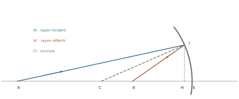
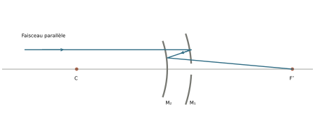
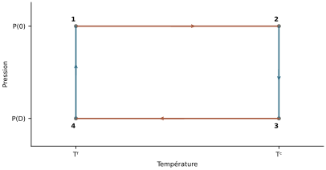
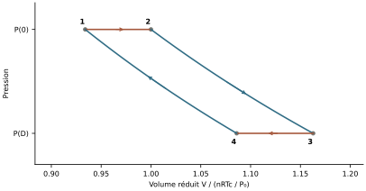

# ENS de Lyon, second concours 2014 — Physique · Corrigé guidé

*Corrigé rédigé par IA, non officiel. Signalez toute erreur.*

**Rédaction** · GPT-6.2 Astra Ultra · vitesse non renseignée

Le rapport souligne que la justification du stigmatisme approché a été rarement réussie. Dans le problème thermique, distinguer le travail de translation reçu par la roue et le travail de déformation reçu par l’hélium.

## I — Miroirs sphériques

### Question I.1 — Réflexion sur la normale

> [!INDICATION]
> Se placer au point où le rayon rencontre la sphère. La normale est un rayon de cette sphère.

#### Solution

La normale locale est la droite $CI$. Le rayon réfléchi est le symétrique du rayon incident par rapport à cette normale, en renversant le sens de propagation. Les angles d’incidence et de réflexion ont donc même valeur absolue. Avec des angles orientés comptés du même côté de la normale géométrique vers les deux supports, $i'=-i$. Si l’on mesure les deux ouvertures positives à la normale, elles sont égales.

### Question I.2 — Directions des trois droites

> [!INDICATION]
> Les directions de deux droites symétriques sont également écartées de celle de leur bissectrice.

#### Solution

Notons $\alpha,\gamma,\alpha'$ les inclinaisons des droites $AI,CI,A'I$ par rapport à l’axe orienté vers la droite. La normale bissecte l’angle entre les deux supports, si bien que $\gamma-\alpha=\alpha'-\gamma$. Par conséquent $\alpha+\alpha'=2\gamma$.

### Question I.3 — Tangentes

> [!INDICATION]
> Utiliser le même côté opposé pour les trois triangles.

#### Solution

En notant les longueurs axiales algébriques et en orientant $HI$ vers le haut, les trois triangles rectangles donnent $\tan\alpha=\overline{HI}/\overline{AH}$, $\tan\alpha'=\overline{HI}/\overline{A'H}$ et $\tan\gamma=\overline{HI}/\overline{CH}$. Sur la figure 1a, les trois dénominateurs sont positifs.

### Question I.4 — Conditions de Gauss

> [!INDICATION]
> Préciser à la fois la proximité de l’axe et la faible inclinaison.

#### Solution

Les rayons utiles sont peu inclinés sur l’axe et rencontrent le miroir à faible distance de cet axe. On se limite aux termes du premier ordre en angle ou en hauteur, avec les angles exprimés en radians. On a notamment $\tan\alpha\simeq\alpha$.

### Question I.5 — Origine au sommet

> [!INDICATION]
> Le décalage du projeté par rapport au sommet est d’ordre deux. Il disparaît dans le modèle paraxial.

#### Solution

Quand la hauteur $h=HI$ tend vers zéro, $H$ tend vers $S$. En effet, pour le miroir dessiné, $SH$ en valeur absolue vaut $R-\sqrt{R^2-h^2}\simeq h^2/(2R)$. Substituer les tangentes aux angles dans I.2, diviser par $h$ puis passer à la limite donne $1/\overline{AS}+1/\overline{A'S}=2/R$. Avec l’axe positif vers la droite et des longueurs issues de $S$, cela s’écrit $1/\overline{SA}+1/\overline{SA'}=-2/R$.

### Question I.6 — Relation de Descartes

> [!INDICATION]
> Remplacer le rayon géométrique par la longueur algébrique du sommet vers le centre.

#### Solution

Le miroir de la figure a $\overline{SC}=-R$. Sous forme orientée indépendante de la position des points, la conjugaison vaut
$$\frac1{\overline{SA}}+\frac1{\overline{SA'}}=\frac2{\overline{SC}}.$$
Un objet placé au centre se conjugue avec lui-même, comme le vérifie la formule.

### Question I.7 — Stigmatisme

> [!INDICATION]
> La propriété porte sur un couple de points et sur tout le faisceau.

#### Solution

Un système est rigoureusement stigmatique pour un couple $(A,A')$ si tous les rayons utiles issus de $A$ ou dirigés vers lui ressortent en passant par $A'$ ou avec des prolongements passant par $A'$. La définition inclut ainsi les objets et les images virtuels.

### Question I.8 — Stigmatisme du miroir

> [!INDICATION]
> Regarder à quel moment de la démonstration disparaît la hauteur d’incidence.

#### Solution

Pour un objet axial générique, l’intersection avec l’axe dépend de la hauteur d’incidence. Avec un faisceau largement ouvert, l’aberration sphérique empêche le stigmatisme rigoureux. Dans l’approximation de Gauss, la conjugaison obtenue ne dépend plus de $h$. Les rayons paraxiaux forment donc une image approximativement stigmatique. Le centre $C$ est un cas rigoureusement stigmatique car chaque rayon y est normal à la sphère et revient sur lui-même.

### Question I.9 — Passage de S à C

> [!INDICATION]
> Les distances d’un point au sommet et au centre diffèrent d’une translation commune.

#### Solution

Prenons désormais $C$ pour origine et conservons le sens vers la droite. Dans la figure, $S$ a pour abscisse $R$. Ainsi $\overline{SA}=x-R$ et $\overline{SA'}=x'-R$. Développer $(x+x'-2R)R=-2(x-R)(x'-R)$ et simplifier conduit à $2xx'=R(x+x')$.

### Question I.10 — Forme réciproque

> [!INDICATION]
> Diviser la relation précédente par le produit des deux abscisses.

#### Solution

Lorsque $x$ et $x'$ ne sont pas nuls, $1/x+1/x'=2/R$, soit $1/x=2/R-1/x'$. Le point $C$ conjugué à lui-même se traite par la forme non divisée, ou directement par la construction.

### Question I.11 — Deux réflexions de même centre

> [!INDICATION]
> Écrire les deux relations sur le même axe et soustraire membre à membre.

#### Solution

Le premier miroir donne $1/x+1/x'=2/R_1$. L’image intermédiaire sert d’objet au second et l’axe de coordonnées conserve sa direction malgré le changement de sens du trajet. La relation admise pour le second miroir donne $1/x'+1/x''=2/R_2$. Soustraire les deux équations élimine $x'$ :
$$\frac1{x''}-\frac1x=2\left(\frac1{R_2}-\frac1{R_1}\right)=\frac{2(1-k)}{kR_1}.$$
Le signe « moins » entre les deux abscisses réciproques provient des deux conjugaisons successives.

### Question I.12 — Foyer image

> [!INDICATION]
> Introduire un faisceau incident parallèle dans la conjugaison du système.

#### Solution

Pour un objet à l’infini sur l’axe, $1/x=0$. L’abscisse du foyer image est $\overline{CF''}=kR_1/[2(1-k)]>0$. À $k$ fixé, elle a bien la dimension d’une longueur.

### Question I.13 — Foyer derrière le premier miroir

> [!INDICATION]
> Comparer les positions du foyer et du sommet à partir d’une origine unique.

#### Solution

Le sommet de $M_1$ est à l’abscisse $R_1$. Il faut donc $k/[2(1-k)]>1$, soit $2/3<k<1$. À $k=2/3$, le foyer se trouve dans le plan du sommet. Quand $k$ tend vers 1 par valeurs inférieures, le foyer s’éloigne.

## II — Machine thermique à ballons

### Question II.1 — Frottements de l’air

> [!INDICATION]
> Examiner la limite de faible vitesse, sans annuler la poussée hydrostatique.

#### Solution

On étudie une roue en rotation suffisamment lente dans un air au repos. Les forces de traînée s’annulent avec la vitesse relative de chaque ballon, tandis que la différence des poussées hydrostatiques subsiste à vitesse arbitrairement faible. Le modèle idéal néglige aussi les pertes de palier. Une roue réelle ne produit de puissance qu’à vitesse finie.

### Question II.2 — Pression et altitude

> [!INDICATION]
> Commencer par la force de pression sur la face inférieure.

#### Solution

Sur un cube d’air de section horizontale $S$ et de hauteur $\mathrm dz$, la résultante verticale des pressions est $P_a(z)S-P_a(z+\mathrm dz)S$. Les pressions latérales se compensent. Le poids est $-\rho_a g S\,\mathrm dz$. L’équilibre donne $\mathrm dP_a/\mathrm dz=-\rho_a g$, ou $\nabla P_a=\rho_a\mathbf g$ avec $\mathbf g$ dirigé vers le bas.

### Question II.3 — Poussée sur un ballon

> [!INDICATION]
> Choisir comme système fictif l’air qui occuperait exactement le volume du ballon.

#### Solution

Si l’on remplace le ballon par l’air qu’il déplace, cette portion d’atmosphère est en équilibre sous l’action de son poids et des pressions du milieu extérieur. Celles-ci exercent la même résultante sur la surface du vrai ballon. Ainsi $\mathbf f_\Pi=-m_a\mathbf g$, où $m_a=\int_V\rho_a\,\mathrm dV$ est la masse d’air déplacée.

### Question II.4 — Travail de translation de la poussée

> [!INDICATION]
> Comparer les volumes des deux ballons à la même altitude donc à la même pression.

#### Solution

La résultante verticale de pression contribue au travail de translation lors de la montée $2\to3$ et de la descente $4\to1$. Son travail est positif en montée et négatif en descente. Au même niveau, le ballon chaud est plus volumineux et déplace plus d’air que le ballon froid. Le bilan sur le tour est donc positif. Les opérations à altitude constante n’ajoutent pas de travail de translation vertical.

### Question II.5 — Travail du poids

> [!INDICATION]
> Le poids dépend de la masse d’hélium et de l’enveloppe, qui restent les mêmes pendant le tour.

#### Solution

Le poids d’un ballon de masse constante travaille négativement à la montée et positivement à la descente. Les deux variations d’altitude ont même module $D$. La somme est nulle par conservation de l’énergie potentielle de pesanteur. Les branches à altitude constante ne contribuent pas.

### Question II.6 — Travail de déformation

> [!INDICATION]
> Distinguer la déformation du ballon de la translation de son centre.

#### Solution

Avec la convention du travail reçu par l’hélium, $\delta W_P=-P_a\,\mathrm dV$. Les quatre étapes font varier le volume, par changement de température sur les isobares et par changement de pression sur les isothermes. L’expansion à pression élevée et la contraction à pression plus basse ne compensent pas exactement les deux branches isothermes. L’aire du cycle, calculée en II.19, donne un travail reçu total négatif.

### Question II.7 — Travail transmis à l’axe

> [!INDICATION]
> Faire le bilan des forces qui peuvent exercer un couple autour de l’axe.

#### Solution

Le travail moteur idéal transmis à la roue vient de la différence des travaux de translation des poussées d’Archimède. Le poids retrouve son énergie potentielle initiale. Le travail de déformation des gaz intervient dans leur bilan thermodynamique. Son opposé est égal ici au travail moteur de la roue, comme le montrera le calcul. Additionner ces deux expressions positives compterait deux fois la même énergie.

### Question II.8 — Récupération pratique

> [!INDICATION]
> Placer la charge sur l’arbre de rotation.

#### Solution

Accoupler l’arbre à un treuil qui soulève une petite masse fournit directement un travail mécanique mesurable $mgh$. On peut aussi employer un générateur faiblement chargé. Le couple résistant doit rester inférieur au couple moteur pour que la roue se mette en mouvement.

## Atmosphère isotherme et bilan du cycle

### Question II.9 — Gaz parfait par unité de volume

> [!INDICATION]
> Remplacer la quantité de matière par la masse divisée par la masse molaire.

#### Solution

Avec la constante molaire $R$ et la masse molaire $M_{\rm air}$, on a $P_a=\rho_a RT_a/M_{\rm air}$. Les températures sont absolues. L’unité de $R$ est J·mol⁻¹·K⁻¹, ce qui corrige l’unité imprimée dans le tableau.

### Question II.10 — Équation barométrique

> [!INDICATION]
> La température uniforme rend constant le rapport masse volumique sur pression.

#### Solution

Substituer $\rho_a=M_{\rm air}P_a/(RT_a)$ dans l’équilibre hydrostatique. Il vient $\mathrm dP_a/\mathrm dz=-(M_{\rm air}g/RT_a)P_a$. La dérivée est négative pour $z$ croissant vers le haut.

### Question II.11 — Profil de pression

> [!INDICATION]
> Utiliser la pression à l’origine comme condition initiale avant de nommer la source.

#### Solution

Intégrer entre $0$ et $z$ donne $\ln[P_a(z)/P_0]=-z/H$ avec $H=RT_a/(M_{\rm air}g)$. Ainsi $P_a(z)=P_0\exp(-z/H)$. Nous conservons l’origine au niveau inférieur comme dans le cycle et la figure 2. La mention « source froide ($z=0$) » dans le paragraphe d’introduction contredit cette figure. Seul le rapport des pressions entre les altitudes intervient dans le rendement.

### Question II.12 — Échelle de hauteur

> [!INDICATION]
> Convertir les 29 g/mol de l’air en kilogrammes par mole.

#### Solution

$T_a=(313{,}15+293{,}15)/2=303{,}15$ K, d’où $H\simeq8{,}9\times10^3$ m. Sur $D=2$ m, $D/H\simeq2{,}26\times10^{-4}$ et la chute de pression vaut environ 23 Pa pour 1 bar à la base. Elle est faible, mais elle intervient au premier ordre dans le travail moteur.

### Question II.13 — Masse d’air approximée

> [!INDICATION]
> C’est la taille verticale du volume déplacé qu’il faut comparer à H.

#### Solution

On peut écrire $m_a\simeq\rho_a(z)V$ si la masse volumique varie peu sur la dimension verticale du ballon. Dans l’atmosphère isotherme il faut donc une taille de ballon très inférieure à $H$, avec $g$ aussi pratiquement uniforme. Les ballons étant petits à l’échelle d’une roue de 2 m et $H$ voisin de 9 km, cette approximation est excellente.

### Question II.14 — Poussée pendant la montée

> [!INDICATION]
> La pression locale se simplifie dans le produit de la masse volumique de l’air par le volume de l’hélium.

#### Solution

Pendant $2\to3$, le gaz est à $T_c$. À la même pression locale, $V=nRT_c/P_a$ tandis que $\rho_a=P_aM_{\rm air}/(RT_a)$. Leur produit est indépendant de $z$. Le module de la poussée vaut $nM_{\rm air}gT_c/T_a=2nM_{\rm air}gT_c/(T_c+T_f)$, dirigé vers le haut. Pendant la descente, remplacer $T_c$ par $T_f$.

### Question II.15 — Travail de la poussée

> [!INDICATION]
> Soustraire les poussées chaude et froide avant de multiplier par la hauteur.

#### Solution

Pour un ballon, $W_\Pi=nM_{\rm air}gD(T_c-T_f)/T_a=nR(T_c-T_f)D/H>0$. Tous les ballons suivent le même cycle déphasé, si bien que le travail de la roue sur un tour est $N W_\Pi$. Pour une mole d’hélium par ballon, le travail est d’environ $3{,}75\times10^{-2}$ J par tour et par ballon.

### Question II.16 — Cycle pression–température

> [!INDICATION]
> Identifier les deux branches à température constante et les deux branches à altitude constante.

#### Solution

Posons $P_b=P_0$, $P_h=P_0 e^{-D/H}$. Avec $T$ en abscisse et $P$ en ordonnée, les quatre sommets sont $(T_f,P_b)$, $(T_c,P_b)$, $(T_c,P_h)$ et $(T_f,P_h)$ dans l’ordre 1 à 4. Le parcours est un rectangle horaire. L’écart vertical est amplifié sur la figure pour rendre le cycle visible.

### Question II.17 — Cycle pression–volume

> [!INDICATION]
> Placer d’abord les deux états du bas de la roue sur l’isobare de pression la plus élevée.

#### Solution

Avec $V$ en abscisse, les branches $1\to2$ et $3\to4$ sont à pression constante. Les branches $2\to3$ et $4\to1$ sont des portions d’hyperboles $PV=nRT_c$ et $PV=nRT_f$. On a successivement $V_1=nRT_f/P_b$, $V_2=nRT_c/P_b$, $V_3=nRT_c/P_h$, $V_4=nRT_f/P_h$. L’isotherme chaude est à droite de la froide. Le parcours est horaire.

### Question II.18 — Aire orientée

> [!INDICATION]
> Fixer la convention du travail reçu ou fourni avant de donner le signe de l’aire.

#### Solution

Dans le plan $(V,P)$, $\oint P\,\mathrm dV$ est l’aire intérieure du cycle parcouru dans le sens horaire, donc positive. Le travail des forces de pression reçu par l’hélium est son opposé. Pour obtenir des joules, multiplier des pascals par des mètres cubes.

### Question II.19 — Travaux sur les quatre branches

> [!INDICATION]
> Sur la branche chaude, le ballon se dilate quand la pression atmosphérique diminue.

#### Solution

Posons $\Delta T=T_c-T_f$. Sur une isobare, $-P\Delta V=-nR\Delta T$ au chauffage. Sur une isotherme, $W=-nRT\ln(V_{\rm fin}/V_{\rm deb})$. Sachant que $P_b/P_h=e^{D/H}$, les travaux reçus par un ballon sont
$$W_{12}=-nR\Delta T,\quad W_{23}=-nRT_cD/H,\quad W_{34}=+nR\Delta T,\quad W_{41}=+nRT_fD/H.$$
La compression froide et la détente chaude ont le même rapport volumique en valeur multiplicative inverse.

### Question II.20 — Travail de pression sur un tour

> [!INDICATION]
> Conserver le nombre de ballons dans le bilan de la machine.

#### Solution

Les travaux isobares s’annulent. Il reste par ballon $W_P=-nR(T_c-T_f)D/H=-W_\Pi$. Sur un tour de la machine entière, le travail de déformation reçu par l’ensemble des gaz vaut $-NnR(T_c-T_f)D/H$. La résultante de l’air sur la translation a le signe inverse.

### Question II.21 — Travail utile et chaleur reçue

> [!INDICATION]
> Appliquer le premier principe sur chaque étape. Une isotherme de gaz parfait peut échanger de la chaleur même si son énergie interne ne varie pas.

#### Solution

Sur un tour, le travail idéal à l’axe vaut $W_u=NnR\Delta T D/H$. Le chauffage isobare au pied de la roue requiert $Q_{12}=NnM_{\rm He}C_p\Delta T$. Si l’isotherme chaude en montée est exacte, la détente exige aussi une chaleur $Q_{23}=NnRT_cD/H$ puisque l’énergie interne du gaz parfait reste constante. Le total des apports positifs à l’hélium est donc $Q_+=Q_{12}+Q_{23}$. Le dispositif décrit place la source chaude seulement au pied. Il faut une alimentation thermique pendant la montée ou une approximation de variation de température négligeable pour réaliser cette branche.

### Question II.22 — Rendement et choix du périmètre thermique

> [!INDICATION]
> Le numérateur est le même dans les deux calculs. Préciser quelles entrées d’énergie sont comptées au dénominateur.

#### Solution

Si l’on rapporte le travail au seul apport de la source fixe du bas, on obtient le quotient
$$\eta_{12}=\frac{M_{\rm air}gD}{M_{\rm He}C_p T_a}=\frac{2M_{\rm air}gD}{M_{\rm He}C_p(T_c+T_f)}.$$
Pour le cycle imposé exactement, le rendement sur **toute la chaleur positive apportée**, y compris celle de la détente chaude, est
$$\eta=\frac{M_{\rm air}gD\,\Delta T}{M_{\rm He}C_p T_a\,\Delta T+M_{\rm air}gD T_c}.$$
Avec le $C_p$ massique **fourni** de 3 160 J·kg⁻¹·K⁻¹, $\eta_{12}\simeq1{,}485\times10^{-4}$ et $\eta\simeq1{,}48\times10^{-4}$. La valeur tabulée dans le sujet est très proche du $C_v$ de l’hélium monoatomique. Pour un gaz monoatomique idéal on prévoirait $C_p=5R/(2M_{\rm He})$, soit environ 5 190 J·kg⁻¹·K⁻¹. Les résultats numériques ci-dessus retiennent la donnée d’examen.

### Question II.23 — Limites du résultat

> [!INDICATION]
> Tester d’abord les limites du quotient apparent, puis vérifier le bilan thermique complet et le second principe.

#### Solution

Le quotient $\eta_{12}$, proportionnel à $D$, dépasserait 1 pour $D>M_{\rm He}C_p T_a/(M_{\rm air}g)$, soit environ 13,5 km avec les données imprimées. Extrapoler ce quotient oublie la chaleur que la montée isotherme demanderait. Au contraire le bilan complet donne $\eta<(T_c-T_f)/T_c<1$ pour $D$ fini positif. Lorsque $D$ croît, il tend formellement vers la limite de Carnot. Aux dimensions de l’épreuve, les deux quotients sont proches et très inférieurs à cette limite, qui vaut 6,39 %. Les frottements et les échanges thermiques à vitesse finie diminuent encore le rendement pratique.

[Sujet officiel de l’ENS de Lyon](https://banques-ecoles.fr/cms/wp-content/uploads/2014/10/14_2clyon_suj_phy.pdf) · [Rapport du jury](https://banques-ecoles.fr/cms/wp-content/uploads/2014/10/14_2clyon_rap_ephy.pdf)
