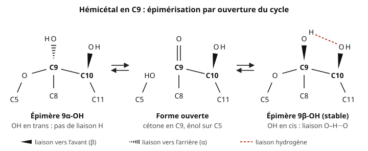
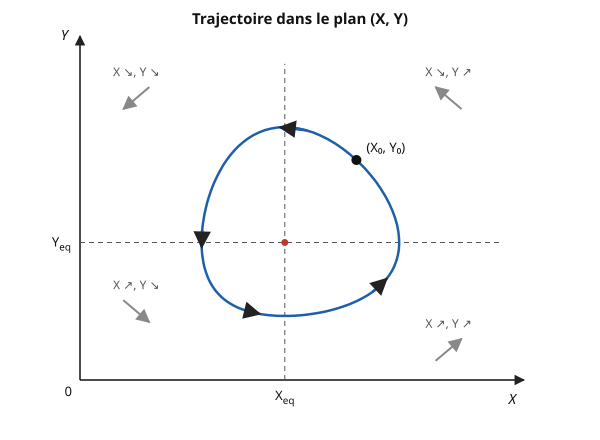
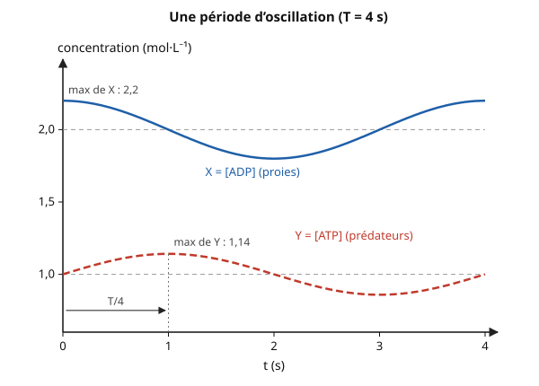
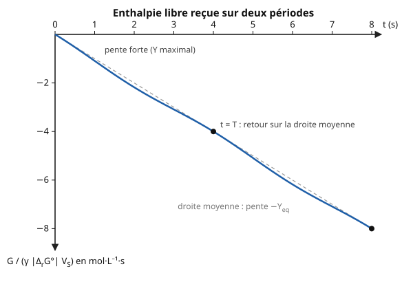
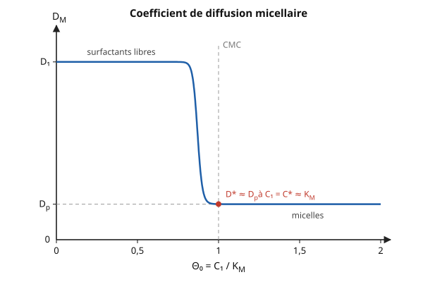

# ENS-PSL PC — Chimie B 2014 · Corrigé guidé

*Corrigé rédigé par IA, non officiel. Signalez toute erreur.*

**Rédaction** · modèle exact non renseigné (famille Claude) · effort non renseigné · vitesse non renseignée

**Révision (tour 2)** · modèle exact non renseigné (famille Claude) · effort non renseigné · vitesse non renseignée · 28 novembre 2026

## Présentation du sujet

Épreuve écrite de six heures, propre à l’ENS de Paris (code U), destinée aux candidats de la filière PC ayant choisi l’option chimie. **La calculatrice est interdite** : le sujet fournit des constantes arrondies ($R=8\ \mathrm{J\cdot K^{-1}\cdot mol^{-1}}$, $\pi=3$…) et les applications numériques se font à la main.

Le sujet compte 82 questions numérotées, réparties en deux parties indépendantes et de poids équivalent.

- **Première partie (48 questions) : synthèse stéréocontrôlée du Trichodermatide A**, d’après une publication de 2013. Trois séquences : de l’acide tartrique à un aldéhyde chiral (1.1 : protection, réduction, organomagnésiens, $\mathrm{S_N2}$, RMN, ozonolyse) ; construction du système pentacyclique par condensation avec la cyclohexane-1,3-dione puis cyclisations acido-catalysées (1.2) ; trois oxydations sélectives, par le réactif de Davis, le dioxyde de sélénium et le dioxygène en présence de cobalt (1.3). Les questions marquées d’un astérisque exigent des formules de Lewis avec doublets non liants et formes mésomères.
- **Deuxième partie (34 questions) : réaction-diffusion en solution.** Lois de Fick et mécanisme de Lindemann-Hinshelwood limité par la diffusion (2.1) ; système oscillant de type Lotka-Volterra construit sur AMP, ADP et ATP (2.2) ; onde chimique de Fisher-Kolmogorov, puis diffusion d’une solution micellaire traitée par transformées de Laplace et de Fourier (2.3). Ces sous-parties sont largement indépendantes.

> [!JURY]
> Le rapport (278 candidats, moyenne 9,30/20, écart-type 3,57) souligne que les candidats qui se distinguent sont ceux qui traitent **les deux parties** ; les cinquante meilleures copies tirent environ 60 % de leurs points de la chimie organique et 40 % de la physico-chimie. En chimie organique, ce sont les connaissances de base qui pèchent : équations-bilans non équilibrées, ions hydroxyde invoqués en catalyse acide, loi de Biot, $\mathrm{S_N2}$ comparée à $\mathrm{S_N1}$, formes mésomères incomplètes, écriture de Lewis des ions polyatomiques, mécanismes d’addition-élimination. En physico-chimie, le jury regrette des abandons rapides alors qu’un quart des questions environ relève de la culture générale ou de la mise en contexte, sans technicité, et que les sous-parties indépendantes permettaient de repartir ; les candidats persévérants y obtiennent de très bons résultats.

Documents officiels : [sujet](https://www.ens.psl.eu/IMG/file/concours/2014/PC/14_sujet_chiB_PC.pdf) et [rapport du jury](https://www.ens.psl.eu/IMG/file/concours/2014/PC/14_pc_rap_ecrit_chi_B_u.pdf).

Les numéros de carbone employés dans la première partie (C1, C7, C9, C13…) sont ceux de la formule du Trichodermatide A donnée en tête du sujet.

## Première partie — Synthèse stéréocontrôlée du Trichodermatide A · 1.1 Transformation de l’acide tartrique en aldéhyde chiral

### Question 1.1.1 — Les trois stéréoisomères de l’acide tartrique

> [!INDICATION]
> Combien de carbones asymétriques ? Combien de combinaisons de descripteurs, et lesquelles désignent en réalité la même molécule ?

> [!INDICATION]
> Une molécule qui possède un plan ou un centre de symétrie dans une de ses conformations est superposable à son image dans un miroir.

#### Solution

L’acide tartrique $\mathrm{HOOC{-}CHOH{-}CHOH{-}COOH}$ possède deux atomes de carbone asymétriques, C2 et C3. Chacun porte quatre substituants différents : $\mathrm{H}$, $\mathrm{OH}$, $\mathrm{COOH}$ et le reste $\mathrm{CH(OH)COOH}$.

Deux centres donnent au plus $2^2=4$ combinaisons de descripteurs : $(2R,3R)$, $(2S,3S)$, $(2R,3S)$ et $(2S,3R)$. Mais les deux carbones portent **le même jeu de substituants** : la molécule a une constitution symétrique, et les combinaisons $(2R,3S)$ et $(2S,3R)$ désignent une seule et même espèce. Il reste donc **trois stéréoisomères**.

- Les isomères $(2R,3R)$ et $(2S,3S)$ sont images l’un de l’autre dans un miroir et ne sont pas superposables : ce sont deux **énantiomères**. Ils sont chiraux (aucun plan ni centre de symétrie, seulement un axe $C_2$). Une molécule chirale fait tourner le plan de polarisation d’une lumière polarisée rectilignement : ces deux isomères sont **optiquement actifs**, avec des pouvoirs rotatoires spécifiques opposés (l’un dextrogyre, l’autre lévogyre) et, par ailleurs, les mêmes propriétés physiques et chimiques en milieu achiral.
- L’isomère $(2R,3S)$ est le composé **méso**. Dans sa conformation éclipsée il possède un plan de symétrie perpendiculaire à la liaison C2–C3 ; dans sa conformation décalée anti, un centre d’inversion au milieu de cette liaison. Il est donc superposable à son image : il est **achiral** bien qu’il contienne deux carbones asymétriques, et **optiquement inactif** (on parle de compensation interne : les contributions des deux moitiés, de configurations opposées, s’annulent). C’est un diastéréoisomère des deux précédents, avec des propriétés physiques différentes (température de fusion, solubilité).

**Bilan : trois stéréoisomères, dont deux seulement (le couple d’énantiomères) dévient le plan de polarisation ; le composé méso est inactif.** Le mélange équimolaire des deux énantiomères (racémique) est lui aussi inactif, mais par compensation entre molécules et non au sein d’une molécule.

> [!PIEGE]
> Chiralité et présence de carbones asymétriques ne sont pas synonymes : le composé méso a deux carbones asymétriques et il est achiral. Le critère est la non-superposabilité à l’image dans un miroir.

### Question 1.1.2 — Rôle de l’APTS

> [!INDICATION]
> Comparer la quantité d’APTS à celle de l’ester [2]. Quel est le groupe partant à créer sur le 2,2-diméthoxypropane ?

#### Solution

L’APTS est un acide fort, soluble en milieu organique, dont la base conjuguée (le tosylate) n’est pas nucléophile. Il est introduit en très faible quantité :

$$\frac{n(\mathrm{APTS})}{n([2])}=\frac{0{,}53}{112}\approx 5\cdot 10^{-3}$$

soit environ 0,5 % en mole. **C’est un catalyseur acide.** Il protone un oxygène du 2,2-diméthoxypropane, ce qui transforme le groupe méthoxy (très mauvais nucléofuge sous forme $\mathrm{CH_3O^-}$) en méthanol, bon groupe partant, et fait apparaître un ion oxocarbénium très électrophile. Il est régénéré en fin de mécanisme et ne figure pas dans le bilan.

Un catalyseur ne modifie pas l’état d’équilibre : la réaction reste thermodynamiquement possible sans lui. Mais l’alcool est un nucléophile médiocre et l’acétal non activé n’est pas électrophile : **sans acide, la transformation serait infiniment lente dans ces conditions et, en pratique, ne s’observerait pas.**

### Question 1.1.3 — Bilan, structure de [3] et mécanisme de la transacétalisation

> [!INDICATION]
> Le 2,2-diméthoxypropane est l’acétal diméthylique de la propanone. Quel petit alcool est libéré, et combien de fois ?

> [!INDICATION]
> Deux séquences identiques s’enchaînent : protonation d’un oxygène, départ de méthanol assisté par le doublet de l’autre oxygène, attaque d’un hydroxyle, déprotonation.

#### Solution

**Bilan.**

$$\mathrm{[2]}+\mathrm{(CH_3)_2C(OCH_3)_2}\;\rightleftharpoons\;\mathrm{[3]}+2\,\mathrm{CH_3OH}$$

soit, en formules brutes, $\mathrm{C_6H_{10}O_6+C_5H_{12}O_2\rightleftharpoons C_9H_{14}O_6+2\,CH_4O}$ (bilan équilibré en C, H et O).

**Structure de [3].** C’est l’acétal cyclique (acétonide) du diol : un cycle 1,3-dioxolane à cinq chaînons $\mathrm{O{-}C(CH_3)_2{-}O{-}CH{-}CH}$, dont le carbone 2 porte les deux méthyles et dont les carbones 4 et 5 portent chacun un groupe $\mathrm{CO_2CH_3}$. Les liaisons C–O des deux carbones asymétriques ne sont pas rompues : leur configuration est conservée, et les deux groupes ester sont en *trans* sur le cycle, comme les deux groupes $\mathrm{CH_2OH}$ dans le diol [4] de l’énoncé. La molécule garde son axe $C_2$. Sur le dessin de l’énoncé, l’ester [2] est de configuration $(2S,3S)$ ; [3] est donc le $(4S,5S)$-2,2-diméthyl-1,3-dioxolane-4,5-dicarboxylate de diméthyle, et le diol [4] dessiné est $(4R,5R)$ : la géométrie n’a pas changé, mais le groupe $\mathrm{CH_2OH}$ passe après le carbone voisin du cycle dans l’ordre des priorités, alors que $\mathrm{CO_2CH_3}$ passait avant.

**Mécanisme** (transacétalisation en catalyse acide ; $\mathrm{H^+}$ désigne le proton apporté par l’APTS ; dans les formules de Lewis, chaque oxygène neutre porte deux doublets non liants, chaque oxygène tricoordonné chargé $+$ en porte un seul).

1. *Protonation.* Un doublet non liant d’un oxygène méthoxy du 2,2-diméthoxypropane capte $\mathrm{H^+}$ : on obtient l’ion oxonium $\mathrm{(CH_3)_2C(OCH_3)(\overset{+}{O}HCH_3)}$.
2. *Départ du méthanol.* La liaison $\mathrm{C{-}O^+}$ se rompt, le doublet partant sur l’oxygène du méthanol libéré. L’autre oxygène assiste ce départ avec l’un de ses doublets. L’intermédiaire est un ion oxocarbénium, décrit par deux formes mésomères :

   $$\mathrm{(CH_3)_2\overset{+}{C}{-}\overline{\underline{O}}{-}CH_3}\;\longleftrightarrow\;\mathrm{(CH_3)_2C{=}\overset{+}{\overline{O}}{-}CH_3}$$

   La seconde, où tous les atomes respectent l’octet, est la plus représentative ; la première montre que le carbone est le site électrophile.
3. *Addition nucléophile.* Un doublet non liant de l’oxygène d’un groupe hydroxyle de [2] attaque le carbone électrophile ; le doublet $\pi$ de $\mathrm{C{=}O^+}$ revient sur l’oxygène. On obtient un oxonium $\mathrm{R{-}\overset{+}{O}H{-}C(CH_3)_2OCH_3}$.
4. *Prototropie.* Cet oxonium perd son proton, et le groupe méthoxy restant est protoné à son tour (échange par l’intermédiaire du milieu) : $\mathrm{R{-}O{-}C(CH_3)_2{-}\overset{+}{O}HCH_3}$. L’espèce neutre intermédiaire est un acétal mixte.
5. *Départ du second méthanol*, assisté par un doublet de l’oxygène lié à R : nouvel ion oxocarbénium $\mathrm{R{-}\overset{+}{O}{=}C(CH_3)_2\leftrightarrow R{-}O{-}\overset{+}{C}(CH_3)_2}$.
6. *Cyclisation.* Le second hydroxyle de [2], voisin, attaque ce carbone électrophile de façon intramoléculaire : fermeture du cycle à cinq chaînons, très favorable.
7. *Déprotonation* de l’oxonium cyclique : on obtient [3] et le proton catalyseur est régénéré.

Toutes les étapes sont renversables : la transformation est un équilibre.

> [!JURY]
> Le rapport relève deux défauts récurrents : des équations-bilans non équilibrées, et l’intervention d’ions hydroxyde dans un mécanisme en catalyse acide. Ici, aucune base forte n’existe dans le milieu : les protons sont cédés au solvant, à un alcool ou à l’ion tosylate, jamais captés par $\mathrm{HO^-}$.

> [!METHODE]
> Pour une question marquée d’un astérisque, écrire tous les doublets non liants des atomes qui réagissent et les deux formes mésomères de l’ion oxocarbénium : c’est explicitement exigé par l’en-tête de la partie.

### Question 1.1.4 — Proportions des réactifs

> [!INDICATION]
> Calculer le rapport des quantités de 2,2-diméthoxypropane et d’ester [2], puis relire la dernière phrase de la question précédente.

#### Solution

Le bilan demande une mole de 2,2-diméthoxypropane par mole de [2]. Or

$$\frac{n(\text{diméthoxypropane})}{n([2])}=\frac{340}{112}\approx 3{,}0$$

**Les réactifs ne sont pas en proportions stœchiométriques : l’acétal est en excès, à raison de trois équivalents environ.** L’APTS, catalyseur, est en quantité très inférieure (0,5 %).

La transacétalisation est un équilibre dont la constante est voisine de l’unité (on échange un acétal contre un autre). L’excès de l’un des réactifs **déplace l’équilibre** vers la formation de [3] et rend la conversion du réactif précieux [2] quasi totale ; il accélère aussi la réaction. Le 2,2-diméthoxypropane s’y prête bien : il est bon marché, volatil (l’excès s’élimine par évaporation, comme le méthanol formé) et peut servir de solvant. Il consomme enfin les traces d’eau, en donnant propanone et méthanol, ce qui évite l’hydrolyse de l’acétal formé.

### Question 1.1.5 — Rôle de la transformation [2] → [3]

> [!INDICATION]
> Quelles fonctions de [2] gêneraient l’action d’un hydrure, puis celle du chlorure de tosyle et d’un organomagnésien ?

#### Solution

C’est une **protection** du diol-1,2 sous forme d’acétal cyclique. Les deux hydroxyles secondaires sont masqués pour la suite :

- ils possèdent un hydrogène acide qui détruirait une partie de l’hydrure réducteur (dégagement de $\mathrm{H_2}$), puis les organomagnésiens ;
- ils seraient tosylés en même temps que les alcools primaires de [4] : la protection permet de **différencier** les quatre hydroxyles et de ne fonctionnaliser que les deux alcools primaires issus de la réduction.

L’acétal est inerte vis-à-vis des bases, des hydrures et des nucléophiles, et il se retire en milieu acide. Les auteurs en tirent parti plus loin : la méthanolyse acide de la partie 1.2 libère le diol au moment où il doit former le cétal du polycycle.

### Question 1.1.6 — Choix du réducteur

> [!INDICATION]
> Lequel des deux hydrures réduit un ester dans les conditions usuelles ?

#### Solution

**Il faut employer $\mathrm{LiAlH_4}$.** Le tétrahydruroborate de sodium réduit les aldéhydes et les cétones, mais il ne réduit pas (ou extrêmement lentement) les esters, dont le carbone est moins électrophile à cause de la délocalisation du doublet de l’oxygène alcoxy. Le tétrahydruroaluminate de lithium est un donneur d’hydrure plus puissant (liaison Al–H plus polarisée que B–H, activation du carbonyle par $\mathrm{Li^+}$) : il réduit les esters en alcools primaires. On l’emploie en solvant anhydre et aprotique (éther diéthylique ou THF), puis on hydrolyse avec précaution.

### Question 1.1.7 — Mécanisme de la réduction d’un ester par l’aluminohydrure

> [!INDICATION]
> Un ester subit d’abord une addition, puis une élimination : quel composé carbonylé intermédiaire se forme, et est-il plus ou moins réactif que l’ester ?

#### Solution

On raisonne sur une fonction ester $\mathrm{R{-}CO{-}OCH_3}$ ; l’autre réagit de même. L’ion $\mathrm{AlH_4^-}$ est tétraédrique, l’aluminium porte une charge formelle négative et aucun doublet non liant : c’est le doublet d’une liaison Al–H qui est transféré.

1. *Addition nucléophile.* Le doublet d’une liaison Al–H attaque le carbone électrophile du groupe carbonyle ; le doublet $\pi$ de $\mathrm{C{=}O}$ bascule sur l’oxygène, qui porte alors trois doublets non liants et une charge négative. On obtient l’intermédiaire tétraédrique $\mathrm{R{-}CH(O^-)(OCH_3)}$ (alcoolate associé à $\mathrm{Li^+}$ ou à l’aluminium) et $\mathrm{AlH_3}$.
2. *Élimination.* Un doublet de l’oxygène chargé reforme la liaison $\pi$ $\mathrm{C{=}O}$ et l’ion méthanolate $\mathrm{CH_3O^-}$ est expulsé : on obtient l’aldéhyde $\mathrm{R{-}CHO}$.
3. *Seconde addition.* L’aldéhyde est plus électrophile que l’ester : il est réduit aussitôt par une nouvelle liaison Al–H et donne l’alcoolate primaire $\mathrm{R{-}CH_2{-}O^-}$. On ne peut pas s’arrêter à l’aldéhyde.
4. *Hydrolyse acide finale.* $\mathrm{R{-}CH_2{-}O^-+H^+\to R{-}CH_2{-}OH}$ ; le méthanolate donne du méthanol.

Chaque fonction ester consomme deux ions hydrure. Les hydrures restants de l’aluminium réagissent à leur tour, de sorte que le bilan, avant hydrolyse, s’écrit

$$\mathrm{[3]}+\mathrm{LiAlH_4}\;\longrightarrow\;\mathrm{Li^+}+\mathrm{Al(OCH_3)_2(OCH_2{-}R'{-}CH_2O)^-}$$

où $\mathrm{R'}$ désigne le cycle dioxolane ; l’hydrolyse libère **le diol [4] et deux molécules de méthanol**. Une mole de $\mathrm{LiAlH_4}$ suffit en principe pour une mole de diester ; on en met un léger excès.

> [!PIEGE]
> Ne pas écrire un ion $\mathrm{H^-}$ libre qui se promène dans le milieu : l’hydrure est transféré depuis la liaison Al–H. Ne pas non plus faire intervenir d’eau avant la fin : $\mathrm{LiAlH_4}$ la réduit violemment.

### Question 1.1.8 — Préparation de l’organomagnésien

> [!INDICATION]
> Identifier le groupe carboné apporté par l’organomagnésien en comparant [5] et [6], puis dérouler le protocole de cours : réactifs, solvant, précautions, réactions parasites évitées.

#### Solution

**Réactif à préparer.** Le passage de $\mathrm{{-}CH_2OTs}$ à $\mathrm{{-}C_6H_{13}}$ ajoute cinq carbones : il s’agit du bromure de pentylmagnésium $\mathrm{CH_3(CH_2)_4MgBr}$, obtenu par insertion du magnésium dans la liaison C–Br du 1-bromopentane :

$$\mathrm{CH_3(CH_2)_4Br}+\mathrm{Mg_{(s)}}\;\longrightarrow\;\mathrm{CH_3(CH_2)_4MgBr}$$

**Réactifs et solvant.** Magnésium en copeaux, en léger excès, dans l’éther diéthylique ou le THF anhydres. Le solvant est une base de Lewis : ses doublets non liants complètent la couche de valence du magnésium et stabilisent l’organomagnésien, qu’ils maintiennent en solution. Il doit être aprotique.

**Conduite de la réaction.** Le magnésium est recouvert d’un peu de solvant ; on ajoute quelques gouttes de la solution de bromoalcane et l’on amorce si nécessaire (cristal de diiode, quelques gouttes de 1,2-dibromoéthane, chauffage local ou écrasement des copeaux pour percer la couche d’oxyde). L’amorçage se reconnaît au trouble et à l’ébullition spontanée du solvant. Le reste de la solution de bromoalcane est alors ajouté **goutte à goutte**, à l’ampoule de coulée, de façon à entretenir un reflux doux : la réaction est très exothermique, et une faible concentration en dérivé halogéné limite le couplage de Wurtz

$$\mathrm{RMgBr}+\mathrm{RBr}\;\longrightarrow\;\mathrm{R{-}R}+\mathrm{MgBr_2}$$

On termine par un court reflux, puis on utilise la solution sans isoler le réactif, après l’avoir éventuellement dosée.

**Précautions.**

- Verrerie séchée à l’étuve, solvant et réactifs anhydres, réfrigérant surmonté d’une garde à chlorure de calcium : l’eau détruit l’organomagnésien, base très forte, selon $\mathrm{RMgBr+H_2O\to RH+\tfrac12 MgBr_2+\tfrac12 Mg(OH)_2}$.
- Atmosphère inerte (diazote ou argon) : le dioxygène et le dioxyde de carbone réagissent avec l’organomagnésien (formation de peroxydes puis d’alcoolates, de carboxylates).
- Solvant très inflammable et volatil : aucune flamme, réfrigérant efficace, bain d’eau froide prêt pour modérer un emballement.

### Question 1.1.9 — Proportions du couplage

> [!INDICATION]
> Le ditosylate [5] possède deux sites électrophiles équivalents. Que se passerait-il avec un excès d’organomagnésien ?

#### Solution

Le ditosylate (10 mmol) est en **large excès**, cinq équivalents pour un équivalent d’organomagnésien (2 mmol), qui est le réactif limitant. La raison est la sélectivité : [5] porte deux groupes $\mathrm{CH_2OTs}$ équivalents (axe $C_2$) et de même réactivité. Après une première substitution, le monotosylate [6] reste électrophile et pourrait réagir une seconde fois pour donner le produit de double alkylation. En maintenant le ditosylate en grand excès, un organomagnésien rencontre presque toujours une molécule de [5] intacte plutôt qu’une molécule de [6] : **on favorise statistiquement la monosubstitution.** L’excès de [5], réactif préparé en trois étapes à partir de l’ester tartrique [2], bon marché, se récupère par chromatographie.

Le rendement de 51 % est rapporté à l’organomagnésien : on isole $0{,}51\times 2\approx 1{,}0$ mmol de [6].

### Question 1.1.10 — Signification de l’indice et de l’exposant, unité du pouvoir rotatoire spécifique

> [!INDICATION]
> Écrire la loi de Biot avec les unités usuelles de chaque grandeur.

#### Solution

$[\alpha]$ est le **pouvoir rotatoire spécifique**, défini par la loi de Biot

$$\alpha=[\alpha]_\lambda^{\theta}\,\ell\,c$$

où $\alpha$ est l’angle de rotation du plan de polarisation mesuré au polarimètre (en degrés), $\ell$ la longueur de la cuve (usuellement en dm) et $c$ la concentration massique de l’espèce optiquement active (en $\mathrm{g\cdot mL^{-1}}$).

- **L’exposant** est la température de la mesure en degrés Celsius : 20 °C pour les auteurs, 15 °C pour la valeur de la littérature.
- **L’indice** indique la longueur d’onde de la lumière employée : D désigne la raie D du sodium, $\lambda=589$ nm.

Le pouvoir rotatoire spécifique n’est pas un angle : les auteurs auraient dû écrire

$$[\alpha]\ \text{en}\ \mathrm{{}^{\circ}\cdot dm^{-1}\cdot g^{-1}\cdot mL}$$

(dans le système international, $\mathrm{rad\cdot m^2\cdot kg^{-1}}$), et non en degrés. On note au passage que les concentrations indiquées ne peuvent pas être des $\mathrm{g\cdot mL^{-1}}$ (plus d’un gramme de soluté par millilitre de solution) : l’usage des publications est d’exprimer $c$ en grammes pour 100 mL.

> [!JURY]
> L’expression et l’emploi de la loi de Biot figurent dans la liste des points de cours mal maîtrisés selon le rapport. Il faut savoir l’écrire, nommer chaque grandeur et donner les unités d’usage.

### Question 1.1.11 — Écart avec la valeur de la littérature

> [!INDICATION]
> De quels paramètres dépend un pouvoir rotatoire spécifique ? Lesquels diffèrent entre les deux mesures ?

#### Solution

Les deux valeurs sont de même signe et voisines ($-20{,}4$ contre $-19{,}8$, soit 3 % d’écart). Plusieurs causes peuvent expliquer la différence.

- **La température** n’est pas la même (20 °C et 15 °C), et le pouvoir rotatoire spécifique en dépend.
- **La concentration** diffère d’un facteur trois environ. La loi de Biot est une loi limite : en pratique $[\alpha]$ varie un peu avec la concentration (associations entre molécules, interactions avec le solvant).
- **La pureté des échantillons** : pureté chimique (traces de solvant, d’impuretés actives ou non) et surtout pureté énantiomérique. Un échantillon partiellement racémisé a un pouvoir rotatoire plus faible en valeur absolue.
- **Le solvant** : même nominalement identique, le chloroforme peut contenir un stabilisant (éthanol) en proportion variable.
- **L’incertitude de mesure** : l’angle lu est petit, et l’incertitude sur la pesée, le volume et la lecture atteint aisément quelques pour cent.

### Question 1.1.12 — Deux singulets pour les méthyles de l’acétal

> [!INDICATION]
> Les deux méthyles portés par le carbone 2 du dioxolane sont-ils échangés par une opération de symétrie de la molécule [7] ?

#### Solution

Les deux singulets d’intégration 3H sont ceux des deux groupes méthyle du motif $\mathrm{O{-}C(CH_3)_2{-}O}$. Ce sont des singulets car le carbone qui les porte n’a pas d’hydrogène : aucun couplage avec un proton voisin.

Ils ne sont pas isochrones parce qu’ils sont **diastéréotopiques**. Le cycle dioxolane porte en 4 et 5 deux substituants différents ($\mathrm{C_6H_{13}}$ et $\mathrm{CH_2I}$), en *trans*. L’un des méthyles est du même côté du cycle que la chaîne hexyle et du côté opposé au groupe iodométhyle ; pour l’autre, c’est l’inverse. Aucune opération de symétrie de [7] ne les échange (la molécule, chirale, n’a plus l’axe $C_2$ de [5]) : leurs environnements magnétiques diffèrent, d’où deux déplacements chimiques voisins mais distincts, 1,43 et 1,39 ppm.

### Question 1.1.13 — Bilan et nature de la réaction [6] → [7]

> [!INDICATION]
> Quel ion remplace quel groupe ? Le carbone concerné est primaire.

#### Solution

En notant $\mathrm{R}$ le reste de la molécule :

$$\mathrm{R{-}CH_2{-}OTs}+\mathrm{NaI}\;\longrightarrow\;\mathrm{R{-}CH_2{-}I}+\mathrm{TsO^-Na^+}$$

L’ion iodure remplace l’ion tosylate sur un carbone tétraédrique : c’est une **substitution nucléophile**. Le carbone est primaire, le nucléophile est bon et le solvant polaire aprotique : elle est **bimoléculaire ($\mathrm{S_N2}$)**.

### Question 1.1.14 — Mécanisme de la substitution, caractéristiques et rôle du DMF

> [!INDICATION]
> Une seule étape : où le nucléophile attaque-t-il par rapport au groupe partant ?

> [!INDICATION]
> Un solvant aprotique ne peut pas donner de liaison hydrogène à l’anion : qu’advient-il de la nucléophilie de l’ion iodure ?

#### Solution

**Mécanisme.** Il se fait en **une seule étape concertée**. L’ion iodure (quatre doublets non liants, charge négative) attaque le carbone $\mathrm{CH_2}$ par l’un de ses doublets, **en anti de la liaison C–O** du groupe partant ; simultanément, le doublet de la liaison C–O part sur l’oxygène du tosylate :

$$\mathrm{I^-}+\mathrm{R{-}CH_2{-}OTs}\;\longrightarrow\;\left[\mathrm{I^{\delta-}\cdots CH_2(R)\cdots OTs^{\delta-}}\right]^{\ddagger}\;\longrightarrow\;\mathrm{I{-}CH_2{-}R}+\mathrm{TsO^-}$$

Dans l’état de transition, le carbone est pentacoordonné (bipyramide trigonale) : le nucléophile entrant et le nucléofuge sont alignés de part et d’autre, les trois autres substituants sont coplanaires.

**Caractéristiques.**

- Acte élémentaire bimoléculaire : loi de vitesse d’ordre global 2, $v=k[\mathrm{RCH_2OTs}][\mathrm{I^-}]$.
- Réaction **stéréospécifique** : inversion de configuration du carbone attaqué (inversion de Walden). Ici ce carbone est un $\mathrm{CH_2}$, non asymétrique : l’inversion n’a pas de conséquence visible, et les deux carbones asymétriques du cycle, non touchés, gardent leur configuration.
- Pas d’intermédiaire carbocationique, donc pas de réarrangement ni de racémisation. Un carbocation primaire, très instable, exclut de toute façon un mécanisme $\mathrm{S_N1}$.
- Réaction sensible à l’encombrement : le carbone est primaire, mais ramifié en $\beta$, ce qui justifie le chauffage à 80–90 °C.
- Le tosylate est un excellent nucléofuge : la charge de $\mathrm{TsO^-}$ est délocalisée sur trois atomes d’oxygène (base conjuguée d’un acide fort).

**Intérêt du DMF.** Solvant polaire ($\varepsilon=38$), il dissout l’iodure de sodium et dissocie les paires d’ions. Par les doublets de son oxygène, il solvate fortement le cation $\mathrm{Na^+}$. Étant aprotogène, il ne donne aucune liaison hydrogène à l’anion : **l’ion iodure, peu solvaté, est « nu » et d’autant plus nucléophile**, ce qui accélère la $\mathrm{S_N2}$. Dans un solvant protique, l’anion serait entouré d’une cage de solvant qu’il faudrait défaire. Son point d’ébullition élevé (153 °C) permet enfin de chauffer.

> [!JURY]
> Le rapport cite la $\mathrm{S_N2}$, et sa comparaison avec la $\mathrm{S_N1}$, parmi les connaissances de base « approximatives ou déficientes ». Une réponse complète donne l’attaque dorsale, l’état de transition, la loi de vitesse et la conséquence stéréochimique.

### Question 1.1.15 — Bromoéthène volatil et montage

> [!INDICATION]
> La synthèse magnésienne est exothermique et se conduit au reflux du solvant. Comparer 15,7 °C à la température du laboratoire et à celle de l’eau du réfrigérant.

#### Solution

La synthèse d’un organomagnésien est exothermique et se conduit à une température voisine de l’ébullition du solvant (66 °C pour le THF), le dérivé halogéné étant coulé goutte à goutte. Or le bromoéthène bout à 15,7 °C : il est gazeux à température ambiante. **Introduit dans le montage usuel, il se vaporiserait, traverserait le réfrigérant à eau (dont l’eau est à une température proche de son point d’ébullition, voire supérieure) et s’échapperait** avant d’avoir réagi : perte de réactif, rendement faible, rejet d’un gaz toxique et inflammable. On ne peut pas non plus le manipuler comme un liquide dans une ampoule de coulée ordinaire.

**Modifications possibles.**

- Remplacer le réfrigérant à eau par un réfrigérant à basse température (doigt froid garni de carboglace et d’acétone, à $-78$ °C), qui recondense le bromoéthène et le renvoie dans le ballon.
- Introduire le bromoéthène sous forme d’une solution dans le THF préalablement refroidie (ampoule de coulée réfrigérée), ou le faire barboter à débit contrôlé dans la suspension de magnésium.
- Travailler en montage fermé sous légère surpression de gaz inerte, en refroidissant le ballon pour modérer la réaction.

Le THF est ici préférable à l’éther diéthylique : meilleur donneur, il permet l’insertion du magnésium dans la liaison C–Br d’un halogénure vinylique, peu réactif.

### Question 1.1.16 — Attribution du spectre de RMN de [8]

> [!INDICATION]
> Dénombrer d’abord les protons de [8] et vérifier que la somme des intégrations les retrouve ; puis classer les groupes de protons du plus déblindé au moins déblindé avec la table.

#### Solution

[8] est le dioxolane portant, en *trans*, une chaîne hexyle sur un carbone du cycle et un groupe allyle $\mathrm{CH_2{-}CH{=}CH_2}$ sur l’autre. Il compte 26 protons, et les intégrations donnent bien $1+2+2+2+2+6+8+3=26$.

| $\delta$ (ppm) | Signal | Attribution | Justification |
|---|---|---|---|
| 5,84 | m, 1H | $\mathrm{{-}CH{=}CH_2}$ | proton éthylénique (table : 4,5–8 ppm), couplé aux deux $\mathrm{{=}CH_2}$ et au $\mathrm{CH_2}$ allylique, d’où le multiplet |
| 5,10 | m, 2H | $\mathrm{{-}CH{=}CH_2}$ | protons éthyléniques terminaux, non équivalents (*cis* et *trans*) |
| 3,64 | m, 2H | les deux $\mathrm{CH{-}O}$ du cycle | protons sur un carbone lié à un oxygène (table : 3,5–5 ppm) |
| 2,31 | m, 2H | $\mathrm{CH_2}$ allylique | table : $\mathrm{C{-}CH_2{-}CH{=}CH_2}$ entre 2 et 3 ppm |
| 1,52 | m, 2H | $\mathrm{CH_2}$ de la chaîne hexyle lié au cycle | en $\beta$ d’un oxygène, un peu plus déblindé que les autres $\mathrm{CH_2}$ |
| 1,37 | s, 6H | $\mathrm{C(CH_3)_2}$ de l’acétal | pas de proton voisin : singulet |
| 1,28 | m, 8H | les quatre autres $\mathrm{CH_2}$ de la chaîne | zone des $\mathrm{C{-}CH_2{-}C}$ |
| 0,88 | t, 3H, $J=6{,}2$ Hz | $\mathrm{CH_3}$ terminal | deux protons voisins : triplet |

Les deux méthyles de l’acétal sont toujours diastéréotopiques (question 1.1.12), mais les substituants allyle et hexyle se ressemblent assez pour que leurs signaux se confondent en un singulet de 6H (isochronie accidentelle).

### Question 1.1.17 — Ozone : structure de Lewis, formes limites, moment dipolaire

> [!INDICATION]
> Dix-huit électrons de valence à répartir sur trois atomes en respectant l’octet : des charges formelles apparaissent.

> [!INDICATION]
> Une molécule formée d’un seul élément peut être polaire si ses atomes ne sont pas équivalents et si elle n’est pas linéaire.

#### Solution

**Structure de Lewis.** L’ozone possède $3\times 6=18$ électrons de valence, soit neuf doublets. L’enchaînement est $\mathrm{O{-}O{-}O}$ (molécule non cyclique). En respectant l’octet pour chaque atome :

$$\mathrm{\overline{\underline{O}}{=}\overset{+}{\overline{O}}{-}\overline{\underline{O}}|^{-}}\;\longleftrightarrow\;\mathrm{{}^{-}|\overline{\underline{O}}{-}\overset{+}{\overline{O}}{=}\overline{\underline{O}}}$$

L’atome central porte un doublet non liant et une charge formelle $+1$ ; l’atome terminal doublement lié porte deux doublets et aucune charge ; l’atome terminal simplement lié porte trois doublets et une charge $-1$.

**Formes limites.** Les deux formes ci-dessus sont équivalentes et de même poids : les deux liaisons O–O sont identiques, intermédiaires entre simple et double, et chaque atome terminal porte en moyenne une charge $-\tfrac12$. On peut écrire d’autres formes, de poids très faible car un atome d’oxygène n’y a que six électrons : $\mathrm{{}^{-}O{-}O{-}O^{+}}$ avec l’atome central neutre, et son symétrique. Elles ne modifient pas la conclusion.

**Géométrie et moment dipolaire.** L’atome central est de type $\mathrm{AX_2E}$ : la molécule est **coudée** (angle voisin de 117°). La répartition des charges n’est pas uniforme : l’atome central est appauvri en électrons ($\delta+$), les atomes terminaux enrichis ($\delta-$). Chaque liaison est donc polarisée, bien qu’elle unisse deux atomes du même élément, et comme la molécule est coudée les deux moments de liaison ne se compensent pas : leur somme est portée par la bissectrice de l’angle, dirigée du milieu des deux atomes terminaux vers l’atome central.

**L’ozone est donc polaire.** La valeur est faible (0,49 D) : les charges réelles sont très inférieures aux charges formelles, et le doublet non liant de l’atome central, dirigé vers l’extérieur du coude, apporte une contribution de sens opposé.

### Question 1.1.18 — Autre produit de l’ozonolyse et rôle du diméthylsulfure

> [!INDICATION]
> Couper la double liaison terminale de [8] : chaque carbone éthylénique devient un carbonyle.

#### Solution

L’ozonolyse coupe la double liaison $\mathrm{R{-}CH_2{-}CH{=}CH_2}$ et transforme chaque carbone éthylénique en groupe carbonyle. Le carbone interne donne l’aldéhyde [9], $\mathrm{R{-}CH_2{-}CHO}$ ; le carbone terminal donne **le méthanal $\mathrm{H_2C{=}O}$**, gazeux, qui s’élimine facilement.

L’ozone donne d’abord un ozonide, espèce peroxydique instable (et explosive à l’état concentré). Le diméthylsulfure est un **réducteur doux** : il réduit l’ozonide et s’oxyde en diméthylsulfoxyde, selon le bilan

$$\mathrm{R{-}CH_2{-}CH{=}CH_2}+\mathrm{O_3}+\mathrm{(CH_3)_2S}\;\longrightarrow\;\mathrm{R{-}CH_2{-}CHO}+\mathrm{H_2CO}+\mathrm{(CH_3)_2SO}$$

Sans ce traitement réducteur, l’hydrolyse de l’ozonide libérerait du peroxyde d’hydrogène, qui **oxyderait les aldéhydes en acides carboxyliques**. Le traitement réducteur permet de s’arrêter à l’aldéhyde [9] et détruit les peroxydes dangereux avant l’isolement.

### Question 1.1.19 — Instabilité des aldéhydes

> [!INDICATION]
> Penser à l’oxydation à l’air, puis aux réactions d’un aldéhyde qui possède des hydrogènes en alpha.

#### Solution

Les aldéhydes se conservent mal.

- Ils **s’oxydent à l’air** en acides carboxyliques (auto-oxydation radicalaire par le dioxygène).
- Lorsqu’ils sont énolisables, comme [9] qui possède un $\mathrm{CH_2}$ en $\alpha$, ils subissent des **condensations sur eux-mêmes** (aldolisation, crotonisation) sous l’effet de traces d’acide ou de base ; ils peuvent aussi se trimériser ou se polymériser.
- Dans le cas présent, [9] porte un oxygène du dioxolane en $\beta$ du carbonyle : une $\beta$-élimination, qui ouvrirait le cycle acétal et donnerait un aldéhyde conjugué, est une voie de dégradation supplémentaire.

Très électrophiles, ils sont donc engagés sans attendre dans l’étape suivante.

## Première partie · 1.2 Formation du système pentacyclique

Dans toute la suite, les atomes du polycycle sont repérés par la numérotation de l’article, rappelée sur le dessin du Trichodermatide A : C1 est le carbone de la cétone, C2 son voisin (porteur d’un hydroxyle dans le produit naturel), C5 et C6 les carbones de la double liaison de l’énone, C7 l’ancien carbone de l’aldéhyde [9], C8, C9 et C10 les carbones suivants du cycle de gauche, C13 le carbone du cétal, C14 le $\mathrm{CH_2}$ de la chaîne, C15 et C16 les deux carbones oxygénés issus de l’acide tartrique.

### Question 1.2.1 — Bilan de la condensation et rôle de la pipéridine

> [!INDICATION]
> Compter les motifs cyclohexanedione présents dans [11], puis équilibrer en oxygène.

#### Solution

[11] contient deux motifs issus de la dione, liés au carbone de l’ancien groupe aldéhyde, dont l’oxygène a disparu. En notant $\mathrm{R{-}CHO}$ l’aldéhyde [9] :

$$\mathrm{R{-}CHO}+2\,\mathrm{C_6H_8O_2}\;\longrightarrow\;\mathrm{R{-}CH(C_6H_7O_2)_2}+\mathrm{H_2O}$$

soit **[9] + 2 [10] → [11] + H₂O** (les deux motifs $\mathrm{C_6H_7O_2}$ de [11] sont écrits sous leur forme énol, stabilisée par conjugaison et par liaison hydrogène intramoléculaire).

**La pipéridine est une base** ($\mathrm{p}K_\mathrm{A}=11{,}2$) : elle déprotone la cyclohexane-1,3-dione et engendre son énolate, qui est le nucléophile de la réaction. Elle est régénérée lors des étapes de protonation (son acide conjugué, l’ion pipéridinium, est le donneur de proton du milieu) : elle joue le rôle de **catalyseur basique**. Une amine secondaire peut aussi activer l’aldéhyde sous forme d’ion iminium, plus électrophile ; l’énoncé retient la voie par l’énolate.

### Question 1.2.2 — Réaction acide-base entre la pipéridine et la dione

> [!INDICATION]
> Comparer les deux $\mathrm{p}K_\mathrm{A}$ et calculer la constante d’équilibre.

#### Solution

$$\mathrm{C_6H_8O_2}+\mathrm{C_5H_{10}NH}\;\rightleftharpoons\;\mathrm{C_6H_7O_2^-}+\mathrm{C_5H_{10}NH_2^+}$$

La dione [10] ($\mathrm{p}K_\mathrm{A}=5{,}3$) est un acide bien plus fort que l’ion pipéridinium ($\mathrm{p}K_\mathrm{A}=11{,}2$). La constante de la réaction est

$$K=10^{\,11{,}2-5{,}3}=10^{5{,}9}\approx 8\cdot 10^{5}$$

**La réaction est quantitative** : la pipéridine introduite est entièrement convertie en ion pipéridinium, et une quantité égale de dione en énolate.

### Question 1.2.3 — Stabilité de la base conjuguée de la dione

> [!INDICATION]
> Écrire toutes les formes mésomères de l’anion obtenu en arrachant un hydrogène du $\mathrm{CH_2}$ situé entre les deux carbonyles.

#### Solution

Le proton acide est porté par le carbone 2 de la dione (numérotation propre à la dione), situé entre les deux groupes carbonyle. L’anion obtenu est décrit par trois formes mésomères :

$$\mathrm{O{=}C{-}\overset{-}{\overline{C}}H{-}C{=}O}\;\longleftrightarrow\;\mathrm{{}^{-}|\overline{\underline{O}}{-}C{=}CH{-}C{=}O}\;\longleftrightarrow\;\mathrm{O{=}C{-}CH{=}C{-}\overline{\underline{O}}|^{-}}$$

La charge négative est **délocalisée sur cinq atomes** ($\mathrm{O{-}C{-}C{-}C{-}O}$), et surtout portée par les deux atomes d’oxygène, très électronégatifs, dans deux formes équivalentes. Cette délocalisation, analogue à celle d’un ion carboxylate dont on aurait écarté les deux oxygènes par un groupe $\mathrm{CH}$ (carboxylate vinylogue), stabilise fortement la base. C’est pourquoi le $\mathrm{p}K_\mathrm{A}$ vaut 5,3, proche de celui d’un acide carboxylique, contre 20 environ pour une cétone simple. Le cycle impose en outre la coplanéité du système conjugué.

> [!JURY]
> Le rapport demande des « formes mésomères complètes » pour justifier une nucléophilie ou une électrophilie. Ici les trois formes sont attendues, avec les doublets et les charges.

### Question 1.2.4 — Intermédiaire [Int1] et mécanisme de sa formation

> [!INDICATION]
> Quel est le site nucléophile carboné de l’énolate, quel est le site électrophile de l’aldéhyde ?

#### Solution

L’énolate réagit par son carbone central, le carbone 2 de la dione (forme mésomère carbanionique), qui porte un doublet non liant. Ce doublet attaque le carbone électrophile du groupe carbonyle de l’aldéhyde [9] ; le doublet $\pi$ de la liaison $\mathrm{C{=}O}$ bascule sur l’oxygène, qui porte alors trois doublets non liants et la charge négative :

$$\mathrm{R{-}CH{=}O}+\mathrm{{}^{-}CH(CO)_2}\;\longrightarrow\;\mathrm{R{-}CH(O^-){-}CH(CO)_2}$$

où $\mathrm{CH(CO)_2}$ désigne le carbone 2 de la dione, inclus dans son cycle. **[Int1] est l’alcoolate d’un aldol** : le carbone de l’ancien aldéhyde porte R, H, l’oxygène chargé, et il est lié au carbone 2 d’un motif cyclohexane-1,3-dione, qui a retrouvé ses deux groupes carbonyle.

C’est une **addition nucléophile** sur un carbonyle (aldolisation). Les étapes 2 et 3 de la séquence sont alors la protonation de l’alcoolate par l’ion pipéridinium (on obtient l’aldol $\mathrm{R{-}CH(OH){-}CH(CO)_2}$), puis la déprotonation, par la pipéridine, de l’hydrogène porté par le carbone situé entre les deux carbonyles, resté très acide : on obtient un nouvel énolate.

### Question 1.2.5 — Étape 4 : formation de [Int2]

> [!INDICATION]
> La base conjuguée de l’aldol est déjà formée à l’étape 3. Quel groupe, placé en $\beta$ de la charge, peut partir ?

#### Solution

À l’issue de l’étape 3, on dispose de l’énolate $\mathrm{R{-}CH(OH){-}\overset{-}{C}(CO)_2}$, dont la charge est délocalisée sur les deux carbonyles. Le doublet du carbone (ou, de façon équivalente, celui de la forme énolate) forme une double liaison $\mathrm{C{=}C}$ avec le carbone voisin, et la liaison C–O de ce carbone se rompt : l’ion hydroxyde est expulsé.

$$\mathrm{R{-}CH(OH){-}\overset{-}{C}(CO)_2}\;\longrightarrow\;\mathrm{R{-}CH{=}C(CO)_2}+\mathrm{HO^-}$$

L’ion hydroxyde est aussitôt protoné par un ion pipéridinium, ce qui donne l’eau du bilan et régénère la pipéridine.

**[Int2] est une 2-alkylidène-cyclohexane-1,3-dione** (produit de Knoevenagel) : double liaison $\mathrm{C{=}C}$ exocyclique conjuguée avec les deux carbonyles.

L’élimination se fait à partir de la base conjuguée du substrat, en une étape monomoléculaire distincte de la déprotonation : c’est une **élimination $\mathrm{E1_{CB}}$**. Elle est possible, bien que $\mathrm{HO^-}$ soit un mauvais nucléofuge, parce que le carbanion est très stabilisé et que le produit est conjugué.

### Question 1.2.6 — Sites électrophiles de [Int2] et étape 5

> [!INDICATION]
> Écrire les formes mésomères de l’énone : où apparaît la charge positive ?

> [!INDICATION]
> L’étape 5 est une addition conjuguée : le nucléophile est le second énolate, et le produit est encore un énolate.

#### Solution

**Sites électrophiles.** [Int2] possède le motif $\mathrm{R{-}CH{=}C(C{=}O)_2}$. Les formes mésomères

$$\mathrm{R{-}CH{=}C{-}C{=}O}\;\longleftrightarrow\;\mathrm{R{-}CH{=}C{-}\overset{+}{C}{-}\overline{\underline{O}}|^{-}}\;\longleftrightarrow\;\mathrm{R{-}\overset{+}{C}H{-}C{=}C{-}\overline{\underline{O}}|^{-}}$$

(et les mêmes avec le second carbonyle) font apparaître une charge positive sur **les deux carbones des groupes carbonyle** et sur **le carbone exocyclique $\mathrm{CH}$, en $\beta$ des deux carbonyles**. Ce dernier est doublement activé, puisque la délocalisation peut se faire vers l’un ou l’autre oxygène : c’est le site le plus réactif vis-à-vis d’un nucléophile stabilisé.

**Étape 5 : addition conjuguée (addition de Michael).** Un second ion énolate de la dione attaque, par le doublet de son carbone 2, le carbone $\mathrm{CH}$ en $\beta$ ; le doublet $\pi$ de $\mathrm{C{=}C}$ se déplace vers le carbone en $\alpha$, et le doublet $\pi$ d’un $\mathrm{C{=}O}$ bascule sur l’oxygène :

$$\mathrm{(CO)_2CH^-}+\mathrm{R{-}CH{=}C(CO)_2}\;\longrightarrow\;\mathrm{(CO)_2CH{-}CH(R){-}C(CO){=}C{-}O^-}$$

On obtient un nouvel énolate, stabilisé par les deux carbonyles du premier motif. L’étape 6 le protone ; les deux motifs dione passent ensuite sous forme énol (tautomérie), ce qui donne [11].

> [!JURY]
> Même remarque du rapport qu’à la question 1.2.3 (formes mésomères complètes). Ici, c’est l’électrophilie du carbone en $\beta$ qu’il faut justifier par une forme mésomère écrite complètement.

### Question 1.2.7 — Bilan de [11] → [12a]

> [!INDICATION]
> Comparer les atomes d’oxygène des deux structures : deux hydroxyles d’énol sont remplacés par un seul pont oxygéné.

#### Solution

Dans [12a], les deux hydroxyles énoliques de [11] ont laissé place à un pont $\mathrm{C{-}O{-}C}$ qui ferme un cycle pyrane central ; le reste est inchangé. Il s’agit d’une déshydratation intramoléculaire :

$$\mathrm{[11]}\;\longrightarrow\;\mathrm{[12a]}+\mathrm{H_2O}$$

Le PTSP, acide faible, est un catalyseur et n’apparaît pas dans le bilan.

### Question 1.2.8 — Fonctions de [11] susceptibles d’être protonées

> [!INDICATION]
> Recenser tous les atomes porteurs d’un doublet non liant ou d’électrons $\pi$.

#### Solution

Peuvent fixer un proton, par un doublet non liant ou par un doublet $\pi$ :

- l’oxygène de chacun des deux groupes carbonyle (cétones conjuguées) ;
- l’oxygène de chacun des deux hydroxyles énoliques ;
- la double liaison $\mathrm{C{=}C}$ de chaque énol, la protonation se faisant alors sur le carbone ;
- les deux oxygènes de l’acétal (cycle dioxolane).

### Question 1.2.9 — Espèce protonée la plus stable

> [!INDICATION]
> Chaque motif est un acide carboxylique vinylogue : $\mathrm{HO{-}C{=}C{-}C{=}O}$. Sur quel oxygène un acide carboxylique se protone-t-il, et pourquoi ?

#### Solution

**L’espèce la plus stable est celle qui résulte de la protonation de l’oxygène d’un groupe carbonyle.** Le cation obtenu est conjugué avec la double liaison et avec le doublet de l’hydroxyle énolique du même cycle :

$$\mathrm{HO{-}C{=}C{-}C{=}\overset{+}{O}H}\;\longleftrightarrow\;\mathrm{HO{-}C{=}C{-}\overset{+}{C}{-}OH}\;\longleftrightarrow\;\mathrm{HO{-}\overset{+}{C}{-}C{=}C{-}OH}\;\longleftrightarrow\;\mathrm{H\overset{+}{O}{=}C{-}C{=}C{-}OH}$$

La charge est délocalisée sur cinq atomes, et les deux formes extrêmes, où tous les atomes ont leur octet, sont équivalentes : la charge est partagée entre deux oxygènes, comme dans un acide carboxylique protoné. C’est $\mathrm{[11]H^+}$.

Les autres sites sont moins favorables : un hydroxyle énolique ou un oxygène de l’acétal protoné donne un oxonium localisé, sans aucune délocalisation ; la protonation du carbone de l’énol donne un cation stabilisé par un seul oxygène et rompt la conjugaison avec le carbonyle.

### Question 1.2.10 — Séquence mécanistique de [11]H⁺ à [12a]

> [!INDICATION]
> Dans $\mathrm{[11]H^+}$, quels carbones sont électrophiles ? Quel atome de l’autre motif, bien placé pour fermer un cycle à six chaînons, est nucléophile ?

> [!INDICATION]
> C’est une addition suivie d’une élimination d’eau, comme dans une estérification.

#### Solution

Notons A le motif protoné et B l’autre motif énol. Dans le cation $\mathrm{[11]H^+}$, les formes mésomères de la question précédente montrent que les deux carbones oxygénés du motif A sont électrophiles.

1. *Addition nucléophile intramoléculaire.* L’oxygène de l’hydroxyle énolique du motif B attaque, par l’un de ses doublets non liants, un carbone oxygéné du motif A. Le cycle formé compte six chaînons : l’oxygène de B, le carbone qui le porte, le carbone 2 de B, le carbone C7 qui relie les deux motifs, le carbone 2 de A et le carbone attaqué. Ce carbone devient tétraédrique et porte un hydroxyle et un oxygène tricoordonné chargé $+$ (oxonium).
2. *Prototropie.* L’oxonium perd son proton et l’hydroxyle porté par le carbone tétraédrique est protoné (transfert par le milieu). On dispose alors d’un groupe partant $\mathrm{{-}\overset{+}{O}H_2}$.
3. *Élimination d’eau.* La liaison $\mathrm{C{-}OH_2^+}$ se rompt, avec l’assistance d’un doublet de l’oxygène du cycle formé : on obtient un cation délocalisé sur l’oxygène du pyrane, la double liaison et l’oxygène de l’autre extrémité du motif A,

   $$\mathrm{{>}\overset{+}{O}{=}C{-}C{=}C{-}OH}\;\longleftrightarrow\;\mathrm{{>}O{-}C{=}C{-}C{=}\overset{+}{O}H}$$

4. *Déprotonation* de l’oxygène terminal : le carbonyle du motif A est rétabli et le proton catalyseur est régénéré.

On obtient [12a] : un cycle pyrane central dont l’oxygène est conjugué avec les deux carbonyles par l’intermédiaire des deux doubles liaisons $\mathrm{C{=}C}$ (deux motifs ester vinylogue). Le motif B a conservé son carbonyle, qui n’a pas participé.

> [!JURY]
> Le rapport signale que le mécanisme d’addition-élimination, « rencontré en $\mathrm{S_EAr}$, en estérification et en formation de bases de Schiff », est mal maîtrisé. Les quatre étapes ci-dessus en sont une transposition directe ; aucune ne fait intervenir d’ion hydroxyde.

### Question 1.2.11 — Structure du diol [12c]

> [!INDICATION]
> Quelle fonction de [12a] réagit avec le méthanol en milieu acide ?

#### Solution

En présence d’acide acétique, le méthanol, en grand excès, réalise la transacétalisation inverse de celle de la question 1.1.3 : l’acétonide est ouvert et la propanone est libérée sous forme de 2,2-diméthoxypropane.

$$\mathrm{[12a]}+2\,\mathrm{CH_3OH}\;\rightleftharpoons\;\mathrm{[12c]}+\mathrm{(CH_3)_2C(OCH_3)_2}$$

**[12c] a le squelette tricyclique de [12a]** (pyrane central accolé aux deux cyclohexénones), dont le carbone C7 porte la chaîne

$$\mathrm{{-}CH_2{-}CH(OH){-}CH(OH){-}(CH_2)_5CH_3}$$

Le cycle dioxolane est remplacé par les deux hydroxyles libres en C15 et C16, dont la configuration est inchangée.

### Question 1.2.12 — Mécanisme de [12c] → [13]

> [!INDICATION]
> Comparer [12c] et [13] : un carbonyle a disparu, un carbone porte deux oxygènes de la chaîne. De quelle fonction s’agit-il, et combien de molécules d’eau sont libérées ?

> [!INDICATION]
> Activer d’abord le carbonyle par protonation, puis enchaîner : addition du premier hydroxyle, départ d’eau, addition du second hydroxyle.

#### Solution

Dans [13], le carbone C13 (ancien carbonyle de l’un des deux motifs) est lié aux deux oxygènes de la chaîne, ceux de C15 et de C16 : c’est une **cétalisation intramoléculaire** d’un des deux carbonyles par le diol-1,2, avec libération d’une molécule d’eau.

$$\mathrm{[12c]}\;\longrightarrow\;\mathrm{[13]}+\mathrm{H_2O}$$

Elle ferme deux cycles : un cycle à six chaînons (C13, C8, C7, C14, C15 et l’oxygène de C15) et un cycle dioxolane à cinq chaînons (C13, O, C15, C16, O). Avec les trois cycles de [12a], on obtient bien le système pentacyclique.

**Mécanisme** (catalyse acide par le PTSP, noté $\mathrm{H^+}$).

1. *Activation.* L’oxygène du carbonyle porté par C13 capte un proton. Le cation est stabilisé par la délocalisation vers l’oxygène du pyrane (forme $\mathrm{{>}\overset{+}{O}{=}C9{-}C8{=}C13{-}OH}$) : C13 est électrophile.
2. *Première addition.* Un doublet non liant de l’oxygène de l’hydroxyle porté par C15 attaque C13 (fermeture du cycle à six chaînons). C13 devient tétraédrique.
3. *Prototropie.* L’oxonium ainsi formé perd son proton : on obtient un hémicétal neutre, dont le groupe hydroxyle est protoné à son tour.
4. *Départ d’eau.* La liaison $\mathrm{C13{-}OH_2^+}$ se rompt, assistée par un doublet de l’oxygène lié à C15 : ion oxocarbénium

   $$\mathrm{C15{-}\overset{+}{O}{=}C13}\;\longleftrightarrow\;\mathrm{C15{-}O{-}\overset{+}{C}13}$$

   stabilisé de plus par la conjugaison avec la double liaison $\mathrm{C8{=}C9}$ et l’oxygène du pyrane.
5. *Seconde addition.* Un doublet de l’oxygène de l’hydroxyle porté par C16 attaque C13 (fermeture du cycle à cinq chaînons).
6. *Déprotonation* : on obtient le cétal [13] et le proton catalyseur est régénéré.

L’ordre des deux additions peut être inversé (cycle à cinq chaînons d’abord) ; toutes les étapes sont renversables. Dans [13], la double liaison $\mathrm{C8{=}C9}$ reste liée à l’oxygène du pyrane (éther d’énol) et l’autre motif garde son caractère d’ester vinylogue $\mathrm{O{-}C5{=}C6{-}C1{=}O}$.

### Question 1.2.13 — Diastéréoisomérie de [13] et [13b], argument de stabilité

> [!INDICATION]
> Quels centres stéréogènes sont communs aux deux structures, lesquels sont créés par la cyclisation ?

> [!INDICATION]
> Un argument de stabilité relative ne prédit le produit majoritaire que sous un certain type de contrôle.

#### Solution

**Diastéréoisomères.** [13] et [13b] ont la même formule développée plane et ne diffèrent que par l’arrangement spatial : ce sont des stéréoisomères de configuration. Les carbones C15 et C16, hérités de l’acide tartrique, ont **la même configuration** dans les deux. Le carbone du cétal, C13, est créé par la cyclisation, mais sa configuration n’est pas libre : C13 et C15 sont les deux têtes de pont du petit système bicyclique formé par le cétal (cycle à six chaînons et dioxolane accolés), et la configuration de C15 impose celle de C13. Elle est donc **la même** dans les deux composés, comme le montre le dessin de l’énoncé, où le motif cétal est tracé à l’identique. La différence porte sur **C7**, qui devient stéréogène dès que les deux motifs dione ne sont plus équivalents : selon que le diol cétalise l’un ou l’autre des deux carbonyles de [12c], C7 prend l’une ou l’autre configuration. [13] et [13b] ont donc les mêmes configurations en C13, C15 et C16 et des configurations opposées en C7 : deux stéréoisomères qui diffèrent par une partie seulement de leurs centres ne sont pas images l’un de l’autre dans un miroir, ce sont des **diastéréoisomères** (ici des épimères en C7).

**Argument des auteurs.** Le cycle à six chaînons du cétal adopte une conformation **chaise** dans [13] et une conformation **bateau** dans [13b], imposée par le système polycyclique. Or la chaise est la conformation la plus stable d’un cycle à six chaînons : toutes les liaisons y sont décalées. Dans le bateau, quatre liaisons sont éclipsées (tension de torsion) et les substituants en positions « mât » se gênent (tension stérique) ; l’écart est de l’ordre de 25 $\mathrm{kJ\cdot mol^{-1}}$ pour le cyclohexane. [13] serait donc plus stable.

**Validité.** L’argument est thermodynamique : il n’explique la sélectivité que si la réaction est sous **contrôle thermodynamique**, c’est-à-dire si les deux diastéréoisomères s’équilibrent dans les conditions opératoires. C’est plausible (catalyse acide, 80 °C, 24 h, étapes renversables), mais c’est une hypothèse, et les auteurs écrivent d’ailleurs « presumably ». Un contrôle cinétique en faveur de [13] n’est pas exclu. En outre, l’argument ne compare qu’un seul cycle : il néglige les autres contributions à l’énergie (contraintes des autres cycles, interactions de la chaîne, effets stéréoélectroniques du cétal). Il faudrait le confirmer en soumettant [13b] isolé aux conditions de la réaction, ou par un calcul des énergies.

### Question 1.2.14 — Interconversion des deux diastéréoisomères

> [!INDICATION]
> Relire la dernière phrase du mécanisme de la question 1.2.12.

#### Solution

Toutes les étapes de la cétalisation acido-catalysée sont **renversables**. En milieu acide, le cétal [13b] peut se rouvrir (protonation d’un oxygène du cétal, ouverture en ion oxocarbénium, puis retour au diol [12c] en présence de l’eau formée), et [12c] peut se refermer sur l’autre carbonyle pour donner [13] :

$$\mathrm{[13b]}+\mathrm{H_2O}\;\rightleftharpoons\;\mathrm{[12c]}\;\rightleftharpoons\;\mathrm{[13]}+\mathrm{H_2O}$$

Le diol [12c] est l’intermédiaire commun : ses deux carbonyles sont constitutionnellement équivalents et C7 n’y est pas stéréogène, de sorte que l’information sur la configuration de C7 est effacée à chaque passage. Les deux diastéréoisomères sont donc en équilibre dans les conditions de la réaction, ce qui rend possible le contrôle thermodynamique invoqué.

## Première partie · 1.3 Fonctionnalisations du polycycle — Obtention du Trichodermatide A

### Question 1.3.1 — Sites électrophiles du chlorure de camphosulfonyle et intermédiaire C₁₀H₁₅NSO₂

> [!INDICATION]
> Écrire la formule brute du chlorure de camphosulfonyle, ajouter $\mathrm{NH_3}$ et chercher quelles petites molécules ont été perdues.

#### Solution

**Sites électrophiles.**

- L’atome de **soufre** du groupe $\mathrm{SO_2Cl}$ : il est lié à trois atomes plus électronégatifs que lui (deux oxygènes et un chlore), donc fortement appauvri en électrons, et il porte un bon groupe partant, l’ion chlorure.
- Le **carbone du groupe carbonyle** de la cétone, polarisé $\mathrm{C^{\delta+}{=}O^{\delta-}}$.

**Intermédiaire.** Le chlorure de camphosulfonyle a pour formule brute $\mathrm{C_{10}H_{15}ClO_3S}$. Or

$$\mathrm{C_{10}H_{15}ClO_3S}+\mathrm{NH_3}\;\longrightarrow\;\mathrm{C_{10}H_{15}NO_2S}+\mathrm{HCl}+\mathrm{H_2O}$$

L’ammoniac a réagi sur les deux sites électrophiles : perte de $\mathrm{HCl}$ (formation d’une liaison S–N) et perte de $\mathrm{H_2O}$ (formation d’une liaison $\mathrm{C{=}N}$). **L’intermédiaire est une imine cyclique N-sulfonylée** (sulfonylimine) : un cycle à cinq chaînons accolé au squelette du camphre, formé de l’enchaînement $\mathrm{C{=}N{-}SO_2{-}CH_2{-}C}$, où le carbone de $\mathrm{C{=}N}$ est celui de l’ancienne cétone et le dernier carbone celui de la tête de pont qui porte le $\mathrm{CH_2}$. Le chlorure d’hydrogène est capté par l’ammoniac en excès ($\mathrm{NH_4^+Cl^-}$).

### Question 1.3.2 — Deux séquences possibles pour former la sulfonylimine

> [!INDICATION]
> Trois étapes : une substitution sur le soufre, une addition sur le carbonyle, une élimination d’eau. Dans quel ordre peut-on les placer ?

#### Solution

Les trois étapes sont : (a) une **substitution nucléophile sur le soufre** ; (b) une **addition nucléophile** d’un azote sur le carbone du carbonyle ; (c) une **élimination d’eau** qui crée la liaison $\mathrm{C{=}N}$. L’élimination suit nécessairement l’addition.

**Séquence 1 : (a), puis (b), puis (c).**

- (a) L’ammoniac attaque le soufre par son doublet non liant ; l’ion chlorure est expulsé (addition sur le soufre puis élimination, ou acte concerté de type $\mathrm{S_N2}$). L’ion $\mathrm{R{-}SO_2{-}NH_3^+}$ est déprotoné par une seconde molécule d’ammoniac : on obtient le **sulfonamide** $\mathrm{R{-}SO_2{-}NH_2}$ et $\mathrm{NH_4^+Cl^-}$.
- (b) Le doublet non liant de l’azote du sulfonamide attaque, de façon intramoléculaire, le carbone de la cétone ; le doublet $\pi$ de $\mathrm{C{=}O}$ bascule sur l’oxygène. Un transfert de proton de l’azote vers l’oxygène donne un hémiaminal cyclique $\mathrm{{>}C(OH){-}NH{-}SO_2{-}}$.
- (c) L’hydroxyle est protoné (par $\mathrm{NH_4^+}$) et part sous forme d’eau, assisté par le doublet de l’azote ; la déprotonation de l’azote donne la liaison $\mathrm{C{=}N}$.

**Séquence 2 : (b), puis (c), puis (a).**

- (b) L’ammoniac attaque le carbone de la cétone ; après transfert de proton, on obtient l’hémiaminal $\mathrm{{>}C(OH){-}NH_2}$.
- (c) Élimination d’eau comme ci-dessus : formation de l’**imine** $\mathrm{{>}C{=}NH}$.
- (a) Le doublet non liant de l’azote de l’imine attaque le soufre de façon intramoléculaire, l’ion chlorure est expulsé, et l’ion iminium $\mathrm{{>}C{=}\overset{+}{N}H{-}SO_2{-}}$ est déprotoné par l’ammoniac.

Dans les deux cas, on écrit sur l’azote neutre son doublet non liant, sur chaque oxygène du groupe sulfonyle deux doublets, et sur l’ion chlorure quatre doublets. La séquence 1 est la plus vraisemblable : le chlorure de sulfonyle est beaucoup plus électrophile que la cétone du camphre, très encombrée, et le sulfonamide est un intermédiaire isolable.

> [!JURY]
> Encore un mécanisme d’addition-élimination, sur le soufre puis sur le carbone : le rapport en fait l’un des points à revoir.

### Question 1.3.3 — Ion persulfate

> [!INDICATION]
> Le soufre est central et lié à quatre oxygènes ; il reste un oxygène et un hydrogène à placer. Quel enchaînement donne son pouvoir oxydant à l’ion ?

#### Solution

**Structure de Lewis.** L’ion $\mathrm{HSO_5^-}$ compte $1+6+5\times 6+1=38$ électrons de valence, soit 19 doublets. Le soufre central est lié à quatre atomes d’oxygène, et le cinquième oxygène forme un **pont peroxo** :

$$\mathrm{H{-}\overline{\underline{O}}{-}\overline{\underline{O}}{-}S({=}O)_2{-}\overline{\underline{O}}|^{-}}$$

Le soufre échange deux doubles liaisons $\mathrm{S{=}O}$ (chaque oxygène terminal porte deux doublets non liants), une liaison simple avec un oxygène porteur de trois doublets et de la charge négative, et une liaison simple avec l’oxygène du pont peroxo ; les deux oxygènes du pont portent chacun deux doublets. On compte 8 doublets liants et 11 doublets non liants, soit 19. Le soufre est hypervalent (douze électrons), ce que permet sa position en troisième période ; la charge est délocalisée sur les trois oxygènes terminaux (trois formes mésomères équivalentes). Le soufre est de type $\mathrm{AX_4}$ : environnement tétraédrique.

**Nombres d’oxydation.**

- Soufre : $+\mathrm{VI}$.
- Les trois oxygènes terminaux : $-\mathrm{II}$.
- Les deux oxygènes du pont peroxo : $-\mathrm{I}$ (la liaison O–O, entre atomes identiques, est partagée également).
- Hydrogène : $+\mathrm{I}$.

Vérification : $+1+6+3\times(-2)+2\times(-1)=-1$. Le caractère oxydant de l’ion vient des oxygènes au degré $-\mathrm{I}$, comme dans le peroxyde d’hydrogène.

> [!JURY]
> L’écriture de Lewis des ions polyatomiques, « tel l’ion persulfate dans l’énoncé », est citée par le rapport parmi les points à revoir.

> [!PIEGE]
> L’erreur classique est d’attribuer $+\mathrm{VIII}$ au soufre en oubliant le pont peroxo : le soufre n’a que six électrons de valence.

### Question 1.3.4 — Stéréosélectivité de la formation du réactif de Davis

> [!INDICATION]
> L’oxydation apporte un atome d’oxygène sur la liaison $\mathrm{C{=}N}$, plane. Les deux faces de cette liaison sont-elles équivalentes dans un squelette bicyclique ponté ?

#### Solution

L’ion persulfate transfère un atome d’oxygène sur la double liaison $\mathrm{C{=}N}$ de la sulfonylimine, qui devient le cycle oxaziridine. Cette double liaison est localement plane et possède deux faces. Dans le squelette bicyclique rigide du camphre, ces deux faces **ne sont pas équivalentes** : l’une est encombrée par le pont qui porte les deux groupes méthyle, l’autre est dégagée. L’oxydant approche par la face la moins encombrée : **un seul des deux stéréoisomères se forme**, la réaction est stéréosélective (diastéréosélective).

**L’autre stéréoisomère** serait l’oxaziridine dont l’oxygène est porté par l’autre face : le carbone et l’azote du cycle à trois chaînons, tous deux stéréogènes (l’azote d’un petit cycle ne s’inverse pas à température ambiante), y auraient la configuration opposée.

**Relation d’isomérie.** Les carbones asymétriques du squelette du camphre (les deux têtes de pont) ont la même configuration dans les deux composés, alors que les deux centres du cycle oxaziridine sont inversés : les deux composés sont des **diastéréoisomères**.

### Question 1.3.5 — Anion formé par l’action du KHMDS sur [13]

> [!INDICATION]
> Chercher les hydrogènes en $\alpha$ d’un carbonyle. Le carbone C6 en porte-t-il ?

> [!INDICATION]
> Pour l’autre anion, penser au principe de vinylogie : la position en $\gamma$ d’une énone est aussi acide.

#### Solution

**Anion formé.** [13] possède une seule cétone, en C1. Le carbone C6, en $\alpha$, est éthylénique et ne porte pas d’hydrogène ; le carbone **C2**, de l’autre côté, est un $\mathrm{CH_2}$. La base forte et encombrée arrache un proton de C2 : on obtient l’**énolate**

$$\mathrm{{}^{-}|\overline{\underline{O}}{-}C1{=}C2H}\;\longleftrightarrow\;\mathrm{O{=}C1{-}\overset{-}{\overline{C}}2H}$$

**Stabilisation.** La charge est délocalisée entre l’oxygène (forme la plus représentative, l’oxygène étant électronégatif) et le carbone C2. Le contre-ion $\mathrm{K^+}$, solvaté par le THF, est associé à l’oxygène. Le KHMDS est assez fort ($\mathrm{p}K_\mathrm{A}$ de l’amine conjuguée voisin de 26) pour déprotoner la cétone ($\mathrm{p}K_\mathrm{A}\approx 20$) quantitativement, et trop encombré pour s’additionner sur le carbonyle.

**Autre anion possible.** La cétone est conjuguée ($\mathrm{O{=}C1{-}C6{=}C5}$) : les hydrogènes du carbone **C4**, en $\gamma$, sont eux aussi acides (vinylogie). Leur arrachement donnerait un **diénolate**, plus délocalisé,

$$\mathrm{{}^{-}O{-}C1{=}C6{-}C5{=}C4}\;\longleftrightarrow\;\mathrm{O{=}C1{-}\overset{-}{C}6{-}C5{=}C4}\;\longleftrightarrow\;\mathrm{O{=}C1{-}C6{=}C5{-}\overset{-}{C}4}$$

donc plus stable (produit thermodynamique). À $-78$ °C, avec une base encombrée et sans équilibration, c’est la déprotonation la plus rapide, en C2, qui l’emporte (contrôle cinétique).

### Question 1.3.6 — Sites nucléophiles de l’énolate

> [!INDICATION]
> Lire les deux formes mésomères de la question précédente.

#### Solution

Les deux formes mésomères de l’énolate placent la charge négative sur **l’oxygène** et sur **le carbone C2** : ce sont les deux sites nucléophiles de cet anion ambident. L’attaque par l’oxygène est favorisée sous contrôle de charge (électrophiles durs) ; l’attaque par le carbone, où l’orbitale la plus haute occupée a son plus gros coefficient, est la plus fréquente et conduit ici à la liaison $\mathrm{C2{-}O}$ du produit [14].

### Question 1.3.7 — Oxydation de l’énolate selon le mode ionique

> [!INDICATION]
> Dans l’oxaziridine, quel atome est électrophile ? Quelle liaison, faible, se rompt, et pourquoi l’azote est-il un bon groupe partant ?

> [!INDICATION]
> L’intermédiaire porte un azote chargé négativement, séparé de l’oxygène par un carbone : quelle élimination redonne une liaison $\mathrm{C{=}N}$ ?

#### Solution

Notons le réactif de Davis $\mathrm{R_2C(O)N{-}SO_2R'}$, le carbone, l’oxygène et l’azote formant le cycle à trois chaînons.

1. *Ouverture de l’oxaziridine.* Le doublet du carbone C2 de l’énolate attaque l’**atome d’oxygène** du cycle, en anti de la liaison N–O ; le doublet de cette liaison part sur l’azote. C’est une substitution nucléophile sur l’oxygène. L’oxygène est électrophile parce que la liaison N–O est faible, que le cycle à trois chaînons est tendu, et que l’azote, substitué par le groupe sulfonyle attracteur, est un bon groupe partant (la charge négative du sulfonamidure est délocalisée sur les oxygènes du groupe $\mathrm{SO_2}$). On obtient

   $$\mathrm{{>}C2H{-}O{-}CR_2{-}\overset{-}{N}{-}SO_2R'}$$

   la cétone en C1 étant rétablie. L’azote porte deux doublets non liants.
2. *Élimination.* Un doublet de l’azote forme la double liaison $\mathrm{C{=}N}$ et la liaison C–O voisine se rompt : l’alcoolate est expulsé.

   $$\mathrm{{>}C2H{-}O{-}CR_2{-}\overset{-}{N}{-}SO_2R'}\;\longrightarrow\;\mathrm{{>}C2H{-}O^-}+\mathrm{R_2C{=}N{-}SO_2R'}$$

   On retrouve la sulfonylimine $\mathrm{C_{10}H_{15}NSO_2}$, précurseur du réactif.
3. *Hydrolyse.* L’alcoolate est protoné : on obtient l’$\alpha$-hydroxycétone [14].

Bilan, avant hydrolyse : énolate + oxaziridine → alcoolate de l’$\alpha$-hydroxycétone + sulfonylimine.

### Question 1.3.8 — Dioxyde de sélénium : Lewis et géométrie

> [!INDICATION]
> Le sélénium ($Z=34$) est dans la colonne de l’oxygène et du soufre : combien d’électrons de valence ?

#### Solution

Le sélénium a pour configuration $[\mathrm{Ar}]\,3d^{10}4s^24p^4$ : six électrons de valence, comme le soufre et l’oxygène. $\mathrm{SeO_2}$ compte donc 18 électrons de valence, soit neuf doublets. Par analogie avec $\mathrm{SO_2}$ :

$$\mathrm{\overline{\underline{O}}{=}\overline{Se}{=}\overline{\underline{O}}}$$

avec un doublet non liant sur le sélénium et deux sur chaque oxygène (le sélénium, en quatrième période, peut dépasser l’octet). On peut aussi écrire les deux formes mésomères respectant l’octet, $\mathrm{O{=}\overset{+}{Se}{-}O^-}$ et sa symétrique.

**Géométrie.** Autour du sélénium : deux atomes liés et un doublet non liant, type $\mathrm{AX_2E}$. La figure de répulsion est triangulaire plane ; **la molécule est coudée**, avec un angle un peu inférieur à 120° car le doublet non liant est plus répulsif que les doublets de liaison.

### Question 1.3.9 — Autres produits possibles de l’oxydation allylique

> [!INDICATION]
> Repérer les deux doubles liaisons $\mathrm{C{=}C}$ de [15], puis les carbones voisins qui portent au moins un hydrogène.

#### Solution

Le dioxyde de sélénium oxyde une liaison C–H **en position allylique**, c’est-à-dire portée par un carbone tétraédrique voisin d’une double liaison $\mathrm{C{=}C}$. [15] possède deux doubles liaisons : $\mathrm{C8{=}C9}$ (éther d’énol) et $\mathrm{C5{=}C6}$ (énone). Leurs positions allyliques sont :

| Double liaison | Carbone voisin | Hydrogène disponible ? |
|---|---|---|
| $\mathrm{C8{=}C9}$ | C10 ($\mathrm{CH_2}$) | oui : produit [16] |
| $\mathrm{C8{=}C9}$ | C7 ($\mathrm{CH}$) | oui |
| $\mathrm{C8{=}C9}$ | C13 (cétal) | non |
| $\mathrm{C5{=}C6}$ | C4 ($\mathrm{CH_2}$) | oui |
| $\mathrm{C5{=}C6}$ | C7 ($\mathrm{CH}$) | oui (même carbone que ci-dessus) |
| $\mathrm{C5{=}C6}$ | C1 (carbonyle) | non |

Trois carbones allyliques portent un hydrogène : C10, C4 et C7. **Deux autres produits sont donc théoriquement possibles**, sans compter la stéréochimie :

- l’alcool secondaire hydroxylé en **C4**, sur le cycle de droite, voisin du carbone C5 lié à l’oxygène du pyrane ;
- l’alcool tertiaire hydroxylé en **C7**, carbone doublement allylique qui porte la chaîne $\mathrm{CH_2}$ vers C15.

### Question 1.3.10 — Sélectivité en faveur de [16]

> [!INDICATION]
> Le dioxyde de sélénium est électrophile. Laquelle des deux doubles liaisons est la plus riche en électrons ?

> [!INDICATION]
> Sur un éther d’énol $\mathrm{O{-}C{=}C}$, quel carbone est nucléophile ? Quel hydrogène allylique est alors transféré ?

#### Solution

**Argument électronique : choix de la double liaison.** Le dioxyde de sélénium est un électrophile (sélénium appauvri par deux oxygènes) : il réagit d’abord avec la double liaison, qui joue le rôle de nucléophile. La double liaison $\mathrm{C8{=}C9}$ est celle d’un éther d’énol, enrichie par l’effet mésomère donneur de l’oxygène du pyrane. La double liaison $\mathrm{C5{=}C6}$ est enrichie par le même oxygène mais appauvrie par la conjugaison avec le carbonyle en C1 (ester vinylogue) : elle est nettement moins nucléophile. La réaction a lieu sur $\mathrm{C8{=}C9}$, ce qui écarte la position C4.

**Argument électronique : choix de l’hydrogène.** Dans l’éther d’énol $\mathrm{O{-}C9{=}C8}$, la forme mésomère $\mathrm{\overset{+}{O}{=}C9{-}\overset{-}{C}8}$ montre que le carbone nucléophile est C8. Le sélénium se lie donc à C8 ; la double liaison se déplace vers $\mathrm{C9{=}C10}$ et c’est un hydrogène de **C10** qui est transféré. La charge positive qui se développe en C9 dans l’état de transition est stabilisée par l’oxygène voisin. Un réarrangement ramène ensuite la double liaison en $\mathrm{C8{=}C9}$ et place l’oxygène sur C10. L’oxydation en C7 demanderait au contraire que le sélénium se lie à C9, carbone électrophile de l’éther d’énol : elle est défavorisée.

**Arguments structuraux.** Les hydrogènes de C10 sont ceux d’un $\mathrm{CH_2}$ dégagé, en périphérie de la molécule. L’hydrogène de C7 est tertiaire, enfoui au cœur du polycycle, entre le carbone C8 (voisin du cétal quaternaire), le carbone C6 et la chaîne : son approche est très encombrée, et la rigidité du système ne permet pas à cette liaison C–H de s’aligner correctement avec le système $\pi$. La face d’approche la plus dégagée de C10 fixe enfin la configuration du nouvel hydroxyle.

Sous contrôle cinétique, le produit majoritaire est celui qui se forme le plus vite : **[16]**.

### Question 1.3.11 — Mécanisme de l’hydratation acide de l’éther d’énol

> [!INDICATION]
> Hydratation d’un alcène en milieu acide : sur quel carbone le proton se fixe-t-il pour donner le cation le plus stable ?

#### Solution

Les auteurs envisageaient l’**hydratation acido-catalysée de l’éther d’énol** $\mathrm{O{-}C9{=}C8}$.

1. *Protonation de la double liaison.* Le doublet $\pi$ de $\mathrm{C8{=}C9}$ capte un proton de $\mathrm{H_3O^+}$ sur le carbone **C8**. Le cation formé en C9 est un ion oxocarbénium, stabilisé par un doublet de l’oxygène du pyrane :

   $$\mathrm{{>}\overline{\underline{O}}{-}\overset{+}{C}9}\;\longleftrightarrow\;\mathrm{{>}\overset{+}{\overline{O}}{=}C9}$$

2. *Addition de l’eau.* Un doublet non liant de l’oxygène d’une molécule d’eau attaque le carbone C9 électrophile : oxonium $\mathrm{C9{-}\overset{+}{O}H_2}$.
3. *Déprotonation* par une molécule d’eau : on obtient l’hémicétal $\mathrm{C9(OH)(O{-})}$, c’est-à-dire [17], et $\mathrm{H_3O^+}$ est régénéré.

Bilan : $\mathrm{[16]+H_2O\to[17]}$. L’eau est le seul nucléophile ; en milieu acide, on n’écrit pas d’ion hydroxyde.

### Question 1.3.12 — Régiosélectivité et stéréosélectivité de cette hydratation

> [!INDICATION]
> Comparer les deux carbocations possibles pour la régiosélectivité. Pour la stéréosélectivité, noter que deux centres sont créés et qu’un hémicétal s’équilibre.

#### Solution

**Régiosélectivité.** Le proton se fixe sur C8 parce que le cation en C9 est le plus stable des deux cations possibles : tertiaire, et surtout stabilisé par l’effet mésomère donneur de l’oxygène voisin (forme oxonium où tous les atomes ont leur octet). Un cation en C8 ne bénéficierait d’aucune stabilisation de ce type. C’est la règle de Markovnikov : **l’hydroxyle se fixe sur C9, l’hydrogène sur C8**, ce qui est bien la constitution de [17].

**Stéréosélectivité.** La réaction crée deux centres stéréogènes, C8 et C9.

- En C8, le proton arrive sur la face la moins encombrée de la double liaison, à l’opposé des substituants volumineux du cétal en C13 : on attend l’hydrogène de C8 du même côté que celui de C7, comme sur la formule du Trichodermatide A donnée par l’énoncé.
- En C9, l’ion oxocarbénium est plan et l’eau l’attaque par sa face la plus dégagée. Surtout, la formation d’un hémicétal est renversable en milieu acide : c’est l’épimère le plus stable qui s’accumule. Celui où l’hydroxyle de C9 est du même côté que l’hydroxyle de C10 est stabilisé par une liaison hydrogène intramoléculaire (question 1.3.15).

Régiosélectivité et stéréosélectivité attendues sont donc en accord avec la structure de [17], et c’est ce qui rendait la tentative raisonnable, même si l’expérience a échoué (le milieu acide aqueux dégrade vraisemblablement les autres fonctions sensibles : cétal, hémicétal, alcool allylique).

### Question 1.3.13 — Espèce radicalaire issue de [16]

> [!INDICATION]
> Pour placer l’électron célibataire en C9, sur quel carbone faut-il apporter un atome d’hydrogène ?

#### Solution

Le complexe du cobalt transfère **un atome d’hydrogène** $\mathrm{H^{\bullet}}$ sur le carbone C8 de la double liaison $\mathrm{C8{=}C9}$. La liaison $\pi$ est rompue de façon homolytique : un de ses électrons sert à former la liaison $\mathrm{C8{-}H}$, l’autre reste sur C9.

L’espèce obtenue est **le radical dont le carbone C9, tricoordonné, porte l’électron célibataire** ; C9 reste lié à l’oxygène du pyrane, à C8 (qui porte maintenant un hydrogène) et à C10 (qui porte l’hydroxyle). Ce radical tertiaire est stabilisé par l’oxygène voisin, dont un doublet non liant interagit avec l’orbitale à un électron.

Il s’agit d’une **addition radicalaire** sur la double liaison (transfert d’atome d’hydrogène, rupture homolytique), avec la même régiosélectivité que l’addition ionique : l’hydrogène se fixe sur C8 de façon à former le radical le plus stable.

### Question 1.3.14 — Réaction avec le dioxygène

> [!INDICATION]
> Quel est l’état de spin fondamental du dioxygène ? Que donne la rencontre de deux espèces à électrons célibataires ?

#### Solution

Dans son état fondamental, le dioxygène est un **biradical** : le diagramme d’orbitales moléculaires place deux électrons célibataires, de spins parallèles, dans les deux orbitales $\pi^*$ dégénérées (état triplet, paramagnétique). Il réagit donc très vite, sans barrière notable, avec un radical carboné : l’électron célibataire de C9 et l’un des deux électrons célibataires de $\mathrm{O_2}$ s’apparient pour former une liaison C–O.

$$\mathrm{{>}C9^{\bullet}}+\mathrm{{}^{\bullet}O{-}O^{\bullet}}\;\longrightarrow\;\mathrm{{>}C9{-}O{-}O^{\bullet}}$$

**Le radical obtenu est le radical peroxyle** $\mathrm{C9{-}\overline{\underline{O}}{-}\overline{\underline{O}}^{\bullet}}$ : C9 est redevenu tétraédrique, lié à l’oxygène du pyrane et à un enchaînement O–O dont l’oxygène terminal porte deux doublets non liants et l’électron célibataire. La capture d’un atome d’hydrogène donne l’hydroperoxyde $\mathrm{C9{-}O{-}O{-}H}$, et la réduction de la liaison O–O conduit à l’hydroxyle de [17].

### Question 1.3.15 — Stéréochimie de l’hydroxyle en C9

> [!INDICATION]
> Un hémicétal est en équilibre avec sa forme ouverte : la configuration de son carbone n’est pas figée. Qu’est-ce qui peut stabiliser l’un des deux épimères ?

#### Solution

C9 est le carbone d’un **hémicétal** : il porte à la fois un hydroxyle et l’oxygène du pyrane. Une telle fonction est en équilibre avec sa forme ouverte (cétone en C9 et hydroxyle énolique sur C5). Par ouverture puis refermeture du cycle, l’hydroxyle de C9 peut se retrouver sur l’une ou l’autre face : **les deux épimères en C9 s’interconvertissent**, comme les deux anomères d’un sucre. La configuration de C9 n’est donc pas fixée par l’étape qui crée la liaison C–O, mais par la stabilité relative des deux épimères (contrôle thermodynamique).

Le carbone voisin C10 porte un hydroxyle en position $\beta$, dont la configuration, elle, est figée. Lorsque l’hydroxyle de C9 est aussi en $\beta$, les deux hydroxyles sont du même côté du plan moyen (*cis*) et assez proches pour former une **liaison hydrogène intramoléculaire** $\mathrm{O{-}H\cdots O}$, qui ferme un pseudo-cycle à cinq chaînons $\mathrm{C9{-}O\cdots H{-}O{-}C10}$. Dans l’épimère $\alpha$, les deux hydroxyles sont de part et d’autre du plan moyen (*trans*) et trop éloignés. L’épimère $\beta$ est donc le plus stable, et l’équilibre se déplace vers lui : c’est le sens de la phrase des auteurs.

> [!PIEGE]
> Ne pas répondre que l’oxygène « arrive par la face β » : l’énoncé insiste sur le caractère hémicétal, c’est-à-dire sur la possibilité d’épimériser. L’argument attendu est thermodynamique.

## Deuxième partie — Quelques aspects de la réaction-diffusion en solution · 2.1 Réactions en solution : mécanisme de Lindemann-Hinshelwood

Les applications numériques emploient les valeurs arrondies imposées par l’énoncé (calculatrice interdite) : $R=8\ \mathrm{J\cdot K^{-1}\cdot mol^{-1}}$, $\mathcal{N}_A=6\cdot 10^{23}\ \mathrm{mol^{-1}}$, $\pi=3$, $\eta=10^{-3}\ \mathrm{Pa\cdot s}$.

### Question 2.1.1 — Loi de Fick à partir du potentiel chimique

> [!INDICATION]
> Un flux de matière est le produit d’une concentration par une vitesse. Calculer ensuite le gradient de $\mu_A$.

#### Solution

Le flux particulaire est le produit de la concentration par la vitesse moyenne des molécules :

$$\vec J_A=[A]\,\frac{d\vec r}{dt}=-\frac{D\,[A]}{RT}\,\vec\nabla\mu_A$$

À température uniforme, $\mu^0(T)$ est uniforme, et

$$\vec\nabla\mu_A=RT\,\vec\nabla\ln\!\left(\frac{[A]}{C_0}\right)=\frac{RT}{[A]}\,\vec\nabla[A]$$

En reportant :

$$\boxed{\vec J_A=-D\,\vec\nabla[A]}$$

C’est la première loi de Fick : le flux est dirigé vers les faibles concentrations. Avec $[A]$ en $\mathrm{mol\cdot m^{-3}}$ et $D$ en $\mathrm{m^2\cdot s^{-1}}$, $J_A$ est bien en $\mathrm{mol\cdot m^{-2}\cdot s^{-1}}$.

### Question 2.1.2 — Équation de diffusion

> [!INDICATION]
> Reporter la loi de Fick dans l’équation de continuité et utiliser le fait que $D$ est constant.

#### Solution

On reporte $\vec J_A=-D\vec\nabla[A]$ dans l’équation de continuité. Avec la première identité fournie, $D$ étant uniforme ($\vec\nabla D=\vec 0$) :

$$\operatorname{div}\!\left(D\,\vec\nabla[A]\right)=D\,\operatorname{div}\!\left(\vec\nabla[A]\right)=D\,\Delta[A]$$

d’où

$$\boxed{\frac{\partial[A]}{\partial t}=D\,\Delta[A]}$$

### Question 2.1.3 — Ordres limites lus sur la figure 1

> [!INDICATION]
> La vitesse est $v=k_{obs}[A]$ : traduire la forme de la courbe $k_{obs}([A])$ aux deux extrémités.

#### Solution

La vitesse de la réaction s’écrit $v=k_{obs}[A]$, et la figure 1 du sujet donne $k_{obs}$ en fonction de $[A]$.

- **Pour $[A]\to 0$**, la courbe se confond avec sa tangente à l’origine (droite en pointillés passant par l’origine) : $k_{obs}$ est proportionnel à $[A]$, donc $v\propto[A]^2$. **La réaction est d’ordre 2.**
- **Pour $[A]\to+\infty$**, la courbe atteint un palier (asymptote horizontale en pointillés) : $k_{obs}$ est constant, donc $v\propto[A]$. **La réaction est d’ordre 1.**

Entre les deux, la réaction n’admet pas d’ordre.

### Question 2.1.4 — Profil stationnaire de A′ autour d’une molécule

> [!INDICATION]
> Symétrie sphérique : seul le terme radial du laplacien subsiste.

> [!INDICATION]
> En régime stationnaire, $r^2\,d[A']/dr$ est une constante : intégrer une seconde fois et fixer les deux constantes avec les conditions aux limites.

#### Solution

**i/** $[A']$ obéit à la loi de Fick avec le coefficient $D$, et ne dépend que de $r$ et de $t$ (symétrie sphérique). Avec le laplacien en coordonnées sphériques donné par l’énoncé :

$$\boxed{\frac{\partial[A']}{\partial t}=\frac{D}{r^2}\,\frac{\partial}{\partial r}\!\left(r^2\,\frac{\partial[A']}{\partial r}\right)}$$

**ii/** En régime stationnaire, le membre de gauche est nul :

$$\frac{d}{dr}\!\left(r^2\,\frac{d[A']}{dr}\right)=0$$

Une première intégration donne $r^2\,\dfrac{d[A']}{dr}=K_1$, une seconde

$$[A'](r)=K_2-\frac{K_1}{r}$$

La condition $[A'](r\to\infty)=[A]$ impose $K_2=[A]$ ; la condition $[A'](R^*)=0$ impose $K_1=[A]R^*$. Donc, pour $r\geqslant R^*$ :

$$\boxed{[A'](r)=[A]\left(1-\frac{R^*}{r}\right)}$$

La concentration locale croît de zéro, au contact, jusqu’à la valeur globale $[A]$ ; la décroissance en $1/r$ est lente : à $r=10R^*$ on est encore à 90 % de $[A]$.

> [!METHODE]
> En toute rigueur, la molécule centrale diffuse elle aussi : le coefficient à employer serait le coefficient de diffusion relatif $2D$. Mais chaque paire de molécules identiques serait alors comptée deux fois, et le facteur $\tfrac12$ correspondant compense exactement. On suit l’énoncé, qui ne définit que $D$.

### Question 2.1.5 — Flux au contact et production de A*

> [!INDICATION]
> Dériver le profil stationnaire, puis l’évaluer en $r=R^*$. Attention au sens du vecteur.

> [!INDICATION]
> Tout ce qui arrive sur la sphère de rayon $R^*$ y est transformé : intégrer le flux sur la surface de la sphère.

#### Solution

**i/** Avec la loi de Fick et le gradient radial :

$$\vec J'=-D\,\frac{d[A']}{dr}\,\vec u_r=-\frac{D\,[A]\,R^*}{r^2}\,\vec u_r$$

soit, en $r=R^*$ :

$$\boxed{\vec J'(R^*)=-\frac{D\,[A]}{R^*}\,\vec u_r}$$

Ce flux est dirigé vers le centre : les molécules $A'$ convergent vers la molécule centrale.

**ii/** En régime stationnaire, il n’y a pas d’accumulation en $R^*$ : chaque molécule $A'$ qui atteint la sphère de rayon $R^*$ y est excitée et repart sous forme de $A^*$, comme le montrent les flèches de la figure 2 du sujet. Les deux flux sont opposés :

$$\boxed{\vec J^*(R^*)=-\vec J'(R^*)=+\frac{D\,[A]}{R^*}\,\vec u_r}$$

**iii/** La quantité de $A^*$ produite par unité de temps est le flux de $\vec J^*$ à travers la sphère de rayon $R^*$. Ce vecteur est radial et de norme uniforme sur la sphère :

$$V_{A^*}=\iint_{\text{sphère}}\vec J^*\cdot d\vec S=4\pi R^{*2}\,J^*(R^*)$$

$$\boxed{V_{A^*}=4\pi\,D\,R^*\,[A]}$$

$V_{A^*}$ est en $\mathrm{mol\cdot s^{-1}}$ : c’est la production due à **une** molécule centrale.

### Question 2.1.6 — Expression de la constante de diffusion

> [!INDICATION]
> Identifier la relation macroscopique à la loi de vitesse de l’acte élémentaire $A+A\to A+A^*$.

> [!INDICATION]
> Deux sphères de rayon $a$ au contact : que vaut la distance entre leurs centres ?

#### Solution

**i/** Un volume unité contient $\mathcal{N}_A[A]$ molécules centrales, et chacune produit $V_{A^*}$ :

$$\frac{d[A^*]}{dt}=\mathcal{N}_A\,[A]\,V_{A^*}=4\pi\,\mathcal{N}_A\,D\,R^*\,[A]^2$$

Par ailleurs, l’acte élémentaire $A+A\to A+A^*$, bimoléculaire, suit la loi de van ’t Hoff : $\dfrac{d[A^*]}{dt}=k_\mathrm{diff}[A]^2$. Par identification :

$$\boxed{k_\mathrm{diff}=4\pi\,\mathcal{N}_A\,D\,R^*}$$

**ii/** Pour deux sphères de rayon $a$ au contact, la distance entre les centres est $R^*=2a$. La relation de Stokes-Einstein donne $D=\dfrac{k_BT}{6\pi\eta a}$. Alors

$$k_\mathrm{diff}=4\pi\,\mathcal{N}_A\times\frac{k_BT}{6\pi\eta a}\times 2a=\frac{4\,\mathcal{N}_Ak_BT}{3\,\eta}$$

Le rayon $a$ se simplifie, et $\mathcal{N}_Ak_B=R$ :

$$\boxed{k_\mathrm{diff}=\frac{4RT}{3\eta}}$$

**$k_\mathrm{diff}$ ne dépend que de la température et de la viscosité du solvant**, pas du soluté.

### Question 2.1.7 — Valeur numérique et rôle de la taille

> [!INDICATION]
> Calculer en unités SI ($\mathrm{m^3\cdot mol^{-1}\cdot s^{-1}}$), puis convertir en litres.

#### Solution

**i/** Pour l’eau à 300 K :

$$k_\mathrm{diff}=\frac{4RT}{3\eta}=\frac{4\times 8\times 300}{3\times 10^{-3}}=3{,}2\cdot 10^{6}\ \mathrm{m^3\cdot mol^{-1}\cdot s^{-1}}$$

Vérification d’unité : $\mathrm{J\cdot mol^{-1}/(Pa\cdot s)=m^3\cdot mol^{-1}\cdot s^{-1}}$. Avec $1\ \mathrm{m^3}=10^3$ L :

$$\boxed{k_\mathrm{diff}\approx 3\cdot 10^{9}\ \mathrm{L\cdot mol^{-1}\cdot s^{-1}}}$$

C’est l’ordre de grandeur des constantes de vitesse des réactions les plus rapides en solution aqueuse, limitées par la diffusion.

**ii/** La taille de $A$ intervient deux fois, en sens opposés. Une grosse molécule diffuse lentement ($D\propto 1/a$ : le frottement visqueux croît avec le rayon), mais elle offre une cible plus grande ($R^*\propto a$ : la rencontre a lieu à plus grande distance). Les deux effets se compensent exactement dans le produit $D\,R^*$ : il ne reste que les propriétés du solvant, $T$ et $\eta$.

### Question 2.1.8 — Nature de A*

> [!INDICATION]
> Comparer les définitions : un intermédiaire est un minimum local d’énergie, un état de transition un maximum le long du chemin réactionnel.

#### Solution

**$A^*$ est un intermédiaire réactionnel.** Plusieurs éléments du mécanisme le montrent.

- $A^*$ est le **produit** d’un acte élémentaire et le **réactif** de deux autres ($A^*+A\to A+A$ et $A^*\to P$). Un état de transition n’apparaît jamais comme réactif ou produit d’un acte élémentaire : il n’existe qu’au sommet de la barrière de chaque acte.
- $A^*$ peut subir une **collision** désactivante avec une autre molécule : il vit donc assez longtemps pour diffuser et rencontrer un partenaire. Il effectue de nombreuses vibrations (de fréquence $\nu$) avant d’évoluer, alors qu’un état de transition a une durée de vie de l’ordre d’une seule période de vibration.
- On lui attribue une **concentration** $[A^*]$ et on lui applique l’approximation des états quasi stationnaires, ce qui n’a de sens que pour une espèce chimique correspondant à un minimum local d’énergie potentielle.

$A^*$ est une molécule de $A$ énergisée (énergie de vibration supérieure à la barrière), qui doit encore concentrer cette énergie sur la bonne coordonnée pour franchir l’état de transition menant à $P$.

### Question 2.1.9 — Signification de κ

> [!INDICATION]
> Comparer les deux constantes de vitesse de disparition de $A^*$ lorsque $[A]=C_0$ : quelle fraction part vers $P$ ?

#### Solution

Les deux voies de disparition de $A^*$ ont pour vitesses $\kappa\nu[A^*]$ (vers $P$) et $(1-\kappa)\nu\dfrac{[A]}{C_0}[A^*]$ (désactivation). À chaque vibration, $A^*$ tente de franchir la barrière : **$\kappa$ est la probabilité, par période de vibration, que cette tentative aboutisse à $P$** (coefficient de transmission). C’est un nombre sans dimension compris entre 0 et 1 ; pour $[A]=C_0$, c’est exactement la fraction des molécules excitées qui donnent le produit, la fraction $1-\kappa$ étant désactivée.

**$\kappa$ ne peut pas valoir 1.**

- La constante de désactivation $(1-\kappa)\nu/C_0$ serait nulle. Or l’activation par rencontre, $A+A\to A+A^*$, existe : son inverse, la désactivation par rencontre, existe nécessairement aussi (réversibilité microscopique).
- $A^*$ réagirait à coup sûr dès sa première vibration : sa durée de vie serait celle d’un état de transition, et ce ne serait plus un intermédiaire.
- Chaque rencontre conduirait au produit : la réaction serait d’ordre 2 à toute concentration, sans palier, en contradiction avec la figure 1.

### Question 2.1.10 — Loi de vitesse et constante apparente

> [!INDICATION]
> Écrire le bilan de $A^*$ avec ses trois actes élémentaires et l’annuler.

#### Solution

**i/** $A^*$ est formé par l’activation et consommé par la désactivation et par la réaction :

$$\frac{d[A^*]}{dt}=k_\mathrm{diff}[A]^2-(1-\kappa)\,\nu\,\frac{[A]}{C_0}\,[A^*]-\kappa\,\nu\,[A^*]=0$$

d’où

$$[A^*]=\frac{k_\mathrm{diff}\,[A]^2}{\nu\left(\kappa+(1-\kappa)\dfrac{[A]}{C_0}\right)}$$

Le produit n’est formé que par l’acte $A^*\to P$ :

$$\frac{d[P]}{dt}=\kappa\,\nu\,[A^*]=\frac{\kappa\,k_\mathrm{diff}\,[A]}{\kappa+(1-\kappa)\dfrac{[A]}{C_0}}\,[A]$$

ce qui est bien de la forme $\dfrac{d[P]}{dt}=k_{obs}([A])\,[A]$ avec

$$\boxed{k_{obs}([A])=\frac{\kappa\,k_\mathrm{diff}\,C_0\,[A]}{\kappa\,C_0+(1-\kappa)\,[A]}}$$

**ii/** La fréquence $\nu$ intervient en facteur dans les **deux** voies de disparition de $A^*$. Elle fixe la durée de vie de $A^*$, donc sa concentration stationnaire (proportionnelle à $1/\nu$), mais pas le **rapport de branchement** entre réaction et désactivation, qui vaut $\kappa/\left(\kappa+(1-\kappa)[A]/C_0\right)$. En régime stationnaire, la vitesse de formation de $P$ est le produit de la vitesse de création de $A^*$ (indépendante de $\nu$) par ce rapport : $\nu$ s’élimine.

### Question 2.1.11 — Ordre de la réaction et pertinence du mécanisme

> [!INDICATION]
> Prendre les deux limites de $k_{obs}$ et les comparer à la figure 1.

#### Solution

- **$[A]\ll\dfrac{\kappa C_0}{1-\kappa}$** : $k_{obs}\simeq k_\mathrm{diff}[A]$ et $v\simeq k_\mathrm{diff}[A]^2$. **Ordre 2** : toute molécule excitée réagit avant d’être désactivée, et l’étape cinétiquement déterminante est l’activation par rencontre, limitée par la diffusion. La pente à l’origine de la courbe est $k_\mathrm{diff}$.
- **$[A]\gg\dfrac{\kappa C_0}{1-\kappa}$** : $k_{obs}\to\dfrac{\kappa\,k_\mathrm{diff}\,C_0}{1-\kappa}$, constante. **Ordre 1** : activation et désactivation, toutes deux rapides, forment un pré-équilibre ; l’étape déterminante est l’acte monomoléculaire $A^*\to P$.
- Entre les deux, pas d’ordre : $k_{obs}$ est une fonction homographique de $[A]$, croissante et concave.

Le mécanisme de Lindemann-Hinshelwood est donc **pertinent** : il rend compte de la tangente à l’origine, du palier et du raccordement monotone de la figure 1, et il donne un sens aux deux asymptotes ; leur intersection, en $[A]=\kappa C_0/(1-\kappa)$, donne accès à $\kappa$. Ses limites : il traite $\kappa$ et $\nu$ comme des constantes, alors que la probabilité de réagir dépend de l’énergie de la molécule excitée, et il n’envisage que l’activation par une autre molécule de soluté, alors qu’en solution les molécules de solvant, bien plus nombreuses, échangent aussi de l’énergie avec $A$. L’accord quantitatif avec la courbe n’est qu’approché.

### Question 2.1.12 — Somme de deux temps caractéristiques

> [!INDICATION]
> Inverser l’expression de $k_{obs}$ et séparer la fraction en deux termes.

> [!INDICATION]
> Deux étapes en série : les durées s’ajoutent, la plus longue impose la vitesse.

#### Solution

**i/** En inversant l’expression de la question 2.1.10 :

$$\frac{1}{k_{obs}}=\frac{\kappa\,C_0+(1-\kappa)[A]}{\kappa\,k_\mathrm{diff}\,C_0\,[A]}$$

$$\boxed{\frac{1}{k_{obs}}=\underbrace{\frac{1}{k_\mathrm{diff}\,[A]}}_{\tau_\mathrm{diff}}+\underbrace{\frac{1-\kappa}{\kappa\,k_\mathrm{diff}\,C_0}}_{\tau_\text{réac}}}$$

Les deux termes sont homogènes à des temps.

**ii/** $1/k_{obs}$ est le temps moyen nécessaire à une molécule de $A$ pour donner $P$. Il est la somme de deux durées, comme pour deux étapes franchies en série (analogie avec deux résistances en série) : **l’étape la plus longue impose la vitesse.**

- $\tau_\mathrm{diff}=1/(k_\mathrm{diff}[A])$ est le temps moyen qu’une molécule met à rencontrer une autre molécule de $A$ par diffusion.
- $\tau_\text{réac}$ est le temps propre à la transformation chimique : c’est l’inverse de la constante du palier, produit de la constante du pré-équilibre d’activation, $k_\mathrm{diff}C_0/((1-\kappa)\nu)$, par la constante $\kappa\nu$ de l’acte $A^*\to P$.

*Cas $k_\mathrm{diff}\to 0$* (solvant très visqueux). $\tau_\mathrm{diff}\to\infty$ : les rencontres deviennent rarissimes et $k_{obs}\to 0$. La réaction est bloquée par la diffusion. Dans ce modèle, $\tau_\text{réac}$ diverge aussi, puisque l’excitation elle-même exige une rencontre : $k_{obs}$ tout entier est proportionnel à $k_\mathrm{diff}$, donc à $T/\eta$.

*Cas $[A]\to\infty$.* $\tau_\mathrm{diff}\to 0$ : les rencontres sont immédiates, et $1/k_{obs}\to\tau_\text{réac}$. La réaction est limitée par l’acte chimique : c’est le palier d’ordre 1.

*Cas $\kappa\to 1$.* $\tau_\text{réac}\to 0$ : toute molécule excitée réagit aussitôt, et $k_{obs}=k_\mathrm{diff}[A]$ à toute concentration. La réaction est entièrement **contrôlée par la diffusion**, d’ordre 2, et sa constante est la valeur maximale possible en solution.

Le phénomène est général : en phase condensée, une réaction est limitée soit par le transport des réactifs l’un vers l’autre, soit par leur transformation une fois en contact, et les deux temps s’ajoutent.

## Deuxième partie · 2.2 Système oscillant biomimétique

### Question 2.2.1 — Équations d’évolution de X et Y

> [!INDICATION]
> Appliquer la loi de van ’t Hoff à chaque acte élémentaire, puis compter ce que chacun crée et consomme.

#### Solution

Les trois actes élémentaires ont pour vitesses $v_1=k_1AX$, $v_2=\beta XY$ et $v_3=\gamma Y$. Le premier consomme un ADP et en forme deux (bilan $+1$) ; le deuxième consomme un ADP ; il consomme un ATP et en forme deux (bilan $+1$) ; le troisième consomme un ATP.

$$\boxed{\begin{aligned}
\frac{dX}{dt}&=k_1AX-\beta XY\\
\frac{dY}{dt}&=\beta XY-\gamma Y
\end{aligned}}$$

### Question 2.2.2 — Lecture proies-prédateurs

> [!INDICATION]
> Écrire chaque équation sous la forme « population multipliée par un taux de croissance par individu ».

#### Solution

**i/** Avec $\alpha=k_1A$ constant :

$$\frac{dX}{dt}=X\,(\alpha-\beta Y)$$

Le taux de croissance par individu de $X$ est $\alpha-\beta Y$. En l’absence de $Y$, $X$ croît exponentiellement, $X=X_0e^{\alpha t}$, sans limitation : la proie dispose d’une nourriture inépuisable (l’AMP, maintenu constant). Le terme $-\beta Y$ est un taux de mortalité proportionnel au nombre de prédateurs : la proie est chassée par $Y$.

**ii/**

$$\frac{dY}{dt}=Y\,(\beta X-\gamma)$$

En l’absence de proies ($X=0$), $Y$ décroît exponentiellement, $Y=Y_0e^{-\gamma t}$ : le prédateur meurt de faim. Son seul terme de croissance, $\beta X$, est proportionnel au nombre de proies : la population de $Y$ ne se maintient que si $X>\gamma/\beta$. **La survie du prédateur dépend entièrement des proies.**

### Question 2.2.3 — Point d’équilibre et linéarisation

> [!INDICATION]
> Annuler les deux dérivées. Pour la suite, développer les produits et ne garder que les termes d’ordre 1 en $x$ et $y$.

> [!INDICATION]
> Éliminer $y$ entre les deux équations linéarisées pour obtenir une équation d’oscillateur harmonique.

#### Solution

**i/** Un point d’équilibre annule les deux dérivées :

$$X\,(\alpha-\beta Y)=0\qquad\text{et}\qquad Y\,(\beta X-\gamma)=0$$

Outre la solution triviale $(0,0)$, on obtient $Y=\alpha/\beta$ par la première équation et $X=\gamma/\beta$ par la seconde :

$$\boxed{X_{eq}=\frac{\gamma}{\beta}\qquad Y_{eq}=\frac{\alpha}{\beta}}$$

**ii/** On pose $X=X_{eq}+x$ et $Y=Y_{eq}+y$. Comme $\alpha-\beta Y_{eq}=0$ et $\beta X_{eq}-\gamma=0$ :

$$\begin{aligned}
\dot x&=(X_{eq}+x)(-\beta y)=-\beta X_{eq}\,y-\beta xy\\
\dot y&=(Y_{eq}+y)(\beta x)=\beta Y_{eq}\,x+\beta xy
\end{aligned}$$

Au premier ordre, on néglige le terme $\beta xy$, du second ordre. Avec $\beta X_{eq}=\gamma$ et $\beta Y_{eq}=\alpha$ :

$$\boxed{\begin{bmatrix}\dot x\\ \dot y\end{bmatrix}=Q\begin{bmatrix}x\\ y\end{bmatrix}\qquad\text{avec}\qquad Q=\begin{bmatrix}0&-\gamma\\ \alpha&0\end{bmatrix}}$$

**iii/** Les valeurs propres de $Q$ sont les racines de $\det(Q-\lambda I)=\lambda^2+\alpha\gamma=0$ :

$$\omega_{1,2}=\pm i\sqrt{\alpha\gamma}$$

Elles sont imaginaires pures et conjuguées : $x$ et $y$ sont des combinaisons de $e^{\pm i\sqrt{\alpha\gamma}\,t}$, c’est-à-dire des fonctions sinusoïdales, sans amortissement ni amplification. On le retrouve en dérivant $\dot x=-\gamma y$ : $\ddot x=-\gamma\dot y=-\alpha\gamma\,x$, équation d’un oscillateur harmonique. **$x$ et $y$ oscillent à la pulsation**

$$\boxed{\omega=\sqrt{\alpha\gamma}=\sqrt{k_1A\,\gamma}}$$

et sont en quadrature, puisque $y=-\dot x/\gamma$.

> [!JURY]
> Le rapport décrit cette sous-partie comme la transposition d’un ressort à deux dimensions étudié pour une petite déviation autour de l’équilibre : c’est exactement ce que fait la linéarisation.

### Question 2.2.4 — Trajectoire qualitative dans le plan (X, Y)

> [!INDICATION]
> Récrire les deux équations en faisant apparaître $Y_{eq}-Y$ et $X-X_{eq}$ : le signe de chaque dérivée ne dépend que du quadrant.

#### Solution

Avec $\alpha=\beta Y_{eq}$ et $\gamma=\beta X_{eq}$, les équations exactes s’écrivent

$$\frac{dX}{dt}=\beta X\,(Y_{eq}-Y)\qquad\qquad\frac{dY}{dt}=\beta Y\,(X-X_{eq})$$

Comme $X>0$ et $Y>0$, le signe de $dX/dt$ est celui de $Y_{eq}-Y$ et le signe de $dY/dt$ celui de $X-X_{eq}$. Les droites en pointillés $X=X_{eq}$ et $Y=Y_{eq}$ découpent quatre quadrants.

| Quadrant | $dX/dt$ | $dY/dt$ | Déplacement |
|---|---|---|---|
| $X>X_{eq}$, $Y>Y_{eq}$ (départ) | $<0$ | $>0$ | vers la gauche et vers le haut |
| $X<X_{eq}$, $Y>Y_{eq}$ | $<0$ | $<0$ | vers la gauche et vers le bas |
| $X<X_{eq}$, $Y<Y_{eq}$ | $>0$ | $<0$ | vers la droite et vers le bas |
| $X>X_{eq}$, $Y<Y_{eq}$ | $>0$ | $>0$ | vers la droite et vers le haut |

Le point $(X_0,Y_0)$ de l’énoncé est dans le premier quadrant : beaucoup de proies, donc les prédateurs prolifèrent ; beaucoup de prédateurs, donc les proies diminuent. La trajectoire **tourne autour du point d’équilibre dans le sens trigonométrique**. Elle coupe la droite $X=X_{eq}$ avec une tangente horizontale ($dY/dt=0$ : $Y$ passe par un extremum) et la droite $Y=Y_{eq}$ avec une tangente verticale ($X$ passe par un extremum).

La trajectoire est **fermée**. En effet $\dfrac{dY}{dX}=\dfrac{Y(X-X_{eq})}{X(Y_{eq}-Y)}$ se sépare en variables, et la quantité

$$H=X-X_{eq}\ln X+Y-Y_{eq}\ln Y$$

est constante le long du mouvement : le système revient à son point de départ. La courbe ne touche jamais les axes ($H$ y serait infini) ; elle est voisine d’une ellipse pour de petits écarts, et se déforme en s’aplatissant le long des axes lorsque l’amplitude augmente.

### Question 2.2.5 — Évolution temporelle sur une période

> [!INDICATION]
> L’écart initial vaut 10 % de $X_{eq}$ : la solution linéarisée suffit. Fixer la phase avec les conditions initiales, puis l’amplitude de $y$ avec $\dot x=-\gamma y$.

> [!INDICATION]
> Le rapport $\alpha/\gamma$ se déduit de $X_{eq}$ et $Y_{eq}$.

#### Solution

L’écart initial $\delta X=0{,}2\ \mathrm{mol\cdot L^{-1}}$ est petit devant $X_{eq}$ : on utilise la solution linéarisée. Avec $x(0)=\delta X$ et $y(0)=0$, soit $\dot x(0)=-\gamma y(0)=0$ :

$$x(t)=\delta X\cos\omega t$$

puis

$$y(t)=-\frac{\dot x}{\gamma}=\frac{\omega}{\gamma}\,\delta X\sin\omega t=\sqrt{\frac{\alpha}{\gamma}}\;\delta X\sin\omega t$$

Or $\dfrac{\alpha}{\gamma}=\dfrac{Y_{eq}}{X_{eq}}=\dfrac12$. L’amplitude de $y$ vaut $\delta X/\sqrt2\approx 0{,}14\ \mathrm{mol\cdot L^{-1}}$, et $\omega=2\pi/T=\pi/2\ \mathrm{rad\cdot s^{-1}}$ :

$$\boxed{\begin{aligned}
X(t)&=2+0{,}2\cos\!\left(\frac{\pi t}{2}\right)\\
Y(t)&=1+0{,}14\sin\!\left(\frac{\pi t}{2}\right)
\end{aligned}}$$

avec $t$ en secondes et les concentrations en $\mathrm{mol\cdot L^{-1}}$. Dans le plan $(X,Y)$, c’est une ellipse centrée sur le point d’équilibre, parcourue dans le sens trigonométrique, conformément à la question 2.2.4.

| $t$ (s) | 0 | 1 | 2 | 3 | 4 |
|---|---|---|---|---|---|
| $X$ ($\mathrm{mol\cdot L^{-1}}$) | 2,2 (max) | 2,0 | 1,8 (min) | 2,0 | 2,2 |
| $Y$ ($\mathrm{mol\cdot L^{-1}}$) | 1,0 | 1,14 (max) | 1,0 | 0,86 (min) | 1,0 |

**Justification de l’appellation.** Les deux populations oscillent avec la même période, celle des prédateurs avec **un quart de période de retard** (1 s) sur celle des proies. Un excès de proies ($t=0$) fait croître les prédateurs, qui passent par leur maximum à $t=1$ s ; ils ont alors ramené les proies à leur valeur d’équilibre et continuent à les faire diminuer jusqu’au minimum ($t=2$ s) ; faute de nourriture, les prédateurs déclinent à leur tour jusqu’à leur minimum ($t=3$ s), ce qui permet aux proies de proliférer à nouveau. C’est le comportement cyclique de deux populations animales dont l’une se nourrit de l’autre.

On peut au passage remonter aux constantes : $\alpha\gamma=\omega^2$ et $\gamma=2\alpha$ donnent $\alpha=\omega/\sqrt2\approx 1{,}1\ \mathrm{s^{-1}}$, $\gamma\approx 2{,}2\ \mathrm{s^{-1}}$ et $\beta=\gamma/X_{eq}\approx 1{,}1\ \mathrm{L\cdot mol^{-1}\cdot s^{-1}}$.

### Question 2.2.6 — Limites expérimentales des trajectoires cycliques

> [!INDICATION]
> Que se passe-t-il, pour une trajectoire de grande amplitude, lorsque l’une des concentrations devient très faible ou très grande ?

#### Solution

Mathématiquement, chaque condition initiale définit une trajectoire fermée. Expérimentalement, seules celles qui restent dans un domaine limité de concentrations sont observables.

- **Vers les faibles concentrations.** Une trajectoire de grande amplitude longe les axes : l’une des concentrations devient extrêmement faible. Le nombre de molécules est alors si petit que les fluctuations l’emportent, et l’espèce peut disparaître du milieu. Si $Y$ s’éteint, $X$ croît sans limite ; si $X$ s’éteint, $Y$ disparaît à son tour : le cycle est rompu, comme le signale l’énoncé.
- **Vers les fortes concentrations.** Les concentrations sont bornées par la solubilité, et les lois de vitesse cessent d’être valables : les enzymes (AK, PGK, AC) saturent, et la vitesse n’est plus proportionnelle aux concentrations.
- **L’hypothèse $A$ constant** suppose une rétroaction capable de compenser instantanément la consommation d’AMP. Lors d’une forte poussée de $X$, cette consommation devient trop rapide et $\alpha$ n’est plus constant.
- Le cycle est **marginalement stable** : rien ne ramène le système vers sa trajectoire après une perturbation (fluctuation de température, de composition, inhomogénéité), il passe simplement sur une trajectoire voisine. L’amplitude dérive donc au cours du temps jusqu’à sortir du domaine précédent. S’y ajoutent les réactions parasites (hydrolyse de l’ATP, dégradation des enzymes).

### Question 2.2.7 — Bilan d’enthalpie libre et entropie sur un cycle

> [!INDICATION]
> Quel acte élémentaire fixe la vitesse de formation de l’AMP cyclique ? Relier l’avancement de la réaction globale à $Y$.

> [!INDICATION]
> L’entropie est une fonction d’état : que vaut sa variation quand le système revient au même état ?

#### Solution

**i/** Chaque fois que la troisième réaction se produit, une molécule de cAMP est formée : l’avancement $\xi$ de la réaction globale $\mathrm{AMP\to cAMP}$ suit la vitesse de l’acte $\mathrm{ATP\to cAMP+PP_i}$. Dans le volume $V_S$ :

$$\frac{d\xi}{dt}=V_S\,\frac{d[\mathrm{cAMP}]}{dt}=\gamma\,Y\,V_S$$

L’enthalpie libre reçue par le système pour un avancement $d\xi$ est $dG=\Delta_rG\,d\xi$, que l’on assimile, comme le suggère l’énoncé, à $\Delta_rG^\circ\,d\xi$ (la composition moyenne varie peu, $A$ étant maintenu constant). Donc

$$\frac{dG}{dt}=\gamma\,\Delta_rG^\circ\,V_S\,Y(t)$$

et, en intégrant entre 0 et $t$ :

$$\boxed{G(t)=\left(\gamma\times\Delta_rG^\circ\times V_S\right)\int_0^tY\,dt+G(0)}$$

**ii/** Avec $Y(t)=Y_{eq}+y_0\sin\omega t$ et $y_0=\delta X/\sqrt2$ :

$$\int_0^tY\,dt=Y_{eq}\,t+\frac{y_0}{\omega}\left(1-\cos\omega t\right)$$

$$G(t)=\gamma\,\Delta_rG^\circ\,V_S\left[Y_{eq}\,t+\frac{y_0}{\omega}\left(1-\cos\omega t\right)\right]$$

$G(t)$ est la somme d’un terme **linéaire** en temps, de pente $\gamma\Delta_rG^\circ V_SY_{eq}$, et d’une petite **ondulation** de période $T=4$ s, qui s’annule à chaque fin de cycle. Comme $Y>0$ à tout instant, $G$ est monotone ; la réaction se fait spontanément ($\Delta_rG<0$) ; en l’assimilant comme plus haut à $\Delta_rG^\circ$, supposé négatif, **$G$ décroît**. La pente est la plus forte en valeur absolue quand $Y$ est maximal ($t=1$ s, puis 5 s) et la plus faible quand $Y$ est minimal ($t=3$ s, puis 7 s). Aux instants $t=4$ s et $t=8$ s, la courbe repasse exactement sur la droite moyenne :

$$G(T)=\gamma\,\Delta_rG^\circ\,V_S\,Y_{eq}\,T\qquad\qquad G(2T)=2\,G(T)$$

En unité réduite $g=G/(\gamma\,|\Delta_rG^\circ|\,V_S)$, avec $Y_{eq}=1\ \mathrm{mol\cdot L^{-1}}$, on a $g(4\ \mathrm{s})=-4$ et $g(8\ \mathrm{s})=-8\ \mathrm{mol\cdot L^{-1}\cdot s}$ ; l’ondulation a une amplitude maximale $2y_0/\omega\approx 0{,}18\ \mathrm{mol\cdot L^{-1}\cdot s}$, atteinte à mi-période.

*Commentaire.* Bien que $X$ et $Y$ reprennent les mêmes valeurs à chaque période, l’enthalpie libre de l’ensemble ne revient pas à sa valeur initiale : elle diminue de la même quantité à chaque cycle. Le fonctionnement cyclique est **dissipatif** et irréversible ; il est entretenu par la transformation continue d’AMP en cAMP. Des oscillations entretenues ne sont possibles que dans un système ouvert, maintenu loin de l’équilibre par un apport de matière (ici l’AMP, maintenu constant) : il n’y a aucune contradiction avec le second principe.

**iii/** L’entropie est une **fonction d’état**. Au bout d’un cycle, le sous-système ADP/ATP retrouve la même composition ($X$, $Y$), la même température et la même pression : son entropie molaire reprend la même valeur.

$$\boxed{\Delta S_\text{cycle}=0}$$

Au cours du cycle, elle varie périodiquement, avec la période $T$, autour de sa valeur à l’équilibre. Ce résultat montre que le sous-système ne peut pas être réellement isolé : l’entropie d’un système isolé ne peut que croître, ce qui interdit toute évolution périodique. L’entropie créée par les réactions irréversibles est évacuée vers l’extérieur, avec le cAMP et le pyrophosphate formés.

## Deuxième partie · 2.3 Diffusions particulières — Onde chimique

### Question 2.3.1 — Équations de réaction-diffusion de l’ADP et de l’AMP

> [!INDICATION]
> Le terme de source est la vitesse de formation de l’espèce par la réaction (4) : positif pour l’ADP, négatif pour l’AMP.

#### Solution

**i/** La réaction (4), $\mathrm{AMP+ADP\to 2\,ADP}$, a pour vitesse $k_1AX$. Elle forme un ADP (bilan net) et consomme un AMP : le terme de source vaut $\rho_X=+k_1AX$ pour l’ADP et $\rho_A=-k_1AX$ pour l’AMP. Avec un coefficient de diffusion commun $D$ :

$$\boxed{\begin{aligned}
\frac{\partial X}{\partial t}-D\,\frac{\partial^2X}{\partial x^2}&=k_1AX\\
\frac{\partial A}{\partial t}-D\,\frac{\partial^2A}{\partial x^2}&=-k_1AX
\end{aligned}}$$

**ii/** En additionnant membre à membre, les termes de source se compensent :

$$\boxed{\frac{\partial\Sigma}{\partial t}-D\,\frac{\partial^2\Sigma}{\partial x^2}=0}$$

$\Sigma$ obéit à une équation de diffusion pure : la réaction convertit l’AMP en ADP sans changer leur somme.

### Question 2.3.2 — Équation de Fisher-Kolmogorov

> [!INDICATION]
> Remplacer $A$ par $\Sigma_0-X$.

#### Solution

Si $\Sigma$ est uniforme et constant, égal à $\Sigma_0$ (ce qui est bien une solution de l’équation précédente), alors $A=\Sigma_0-X$ et

$$\boxed{\frac{\partial X}{\partial t}-D\,\frac{\partial^2X}{\partial x^2}=k_1X\left(\Sigma_0-X\right)}$$

Le terme de source est autocatalytique et saturable : nul pour $X=0$ (pas d’ADP pour amorcer) et pour $X=\Sigma_0$ (plus d’AMP à convertir), maximal pour $X=\Sigma_0/2$.

### Question 2.3.3 — Équation du profil du front

> [!INDICATION]
> Poser $u=x-vt$ et exprimer les dérivées partielles de $X$ à l’aide de $h'(u)$ et $h''(u)$.

#### Solution

On pose $u=x-vt$, de sorte que $X(x,t)=h(u)$. Alors

$$\frac{\partial X}{\partial t}=-v\,h'(u)\qquad\qquad\frac{\partial^2X}{\partial x^2}=h''(u)$$

En reportant dans l’équation de la question 2.3.2 :

$$-v\,h'-D\,h''=k_1h\left(\Sigma_0-h\right)$$

soit, en divisant par $-D$ :

$$h''+\frac{v}{D}\,h'+\frac{k_1\Sigma_0}{D}\,h\left(1-\frac{h}{\Sigma_0}\right)=0$$

C’est la forme demandée, $h''+2\zeta h'+\Gamma^2I(h)=0$ avec $\Gamma^2=\dfrac{k_1\Sigma_0}{D}$, à condition de poser

$$\boxed{\zeta=\frac{v}{2D}\qquad\qquad I(h)=h\left(1-\frac{h}{\Sigma_0}\right)}$$

**Unités.** $\zeta$ est en $\mathrm{m^{-1}}$ (une vitesse divisée par un coefficient de diffusion). $I(h)$ est une concentration, en $\mathrm{mol\cdot L^{-1}}$ ou en $\mathrm{mol\cdot m^{-3}}$. On vérifie que $\Gamma^2$ est en $\mathrm{m^{-2}}$, puisque $k_1\Sigma_0$ est en $\mathrm{s^{-1}}$ : les trois termes de l’équation sont bien des concentrations divisées par des longueurs au carré.

### Question 2.3.4 — Vitesse minimale du front

> [!INDICATION]
> Si $h\ll\Sigma_0$, que devient $I(h)$ ? L’équation devient celle d’un oscillateur amorti.

> [!INDICATION]
> Une concentration ne peut pas osciller autour de zéro : quel régime faut-il imposer ?

#### Solution

À l’avant du front, la concentration en ADP est faible devant celle en AMP : $h\ll\Sigma_0$, donc $I(h)\simeq h$. L’équation se linéarise :

$$h''+2\zeta\,h'+\Gamma^2h=0$$

C’est l’équation d’un oscillateur amorti en la variable $u$. Son équation caractéristique $r^2+2\zeta r+\Gamma^2=0$ a pour discriminant réduit $\zeta^2-\Gamma^2$.

- Si $\zeta<\Gamma$, les racines sont complexes : $h$ tend vers zéro quand $u\to+\infty$ **en oscillant autour de zéro**, donc en prenant des valeurs négatives. C’est impossible pour une concentration.
- Si $\zeta\geqslant\Gamma$, les deux racines sont réelles et négatives : $h$ décroît vers zéro sans changer de signe. C’est le seul cas physiquement acceptable.

La condition $\zeta\geqslant\Gamma$ s’écrit $\dfrac{v}{2D}\geqslant\sqrt{\dfrac{k_1\Sigma_0}{D}}$ : **le front ne peut se propager qu’à une vitesse au moins égale à**

$$\boxed{v^*=2D\,\Gamma=2\sqrt{k_1\,\Sigma_0\,D}}$$

On vérifie l’homogénéité : $\sqrt{\mathrm{s^{-1}\cdot m^2\cdot s^{-1}}}=\mathrm{m\cdot s^{-1}}$. La vitesse du front combine la cinétique chimique ($k_1\Sigma_0$) et la diffusion ($D$) : sans l’une ou l’autre, il n’y a pas de propagation.

### Question 2.3.5 — Diffusion seule ou propagation d’un front

> [!INDICATION]
> Par diffusion, la distance parcourue croît comme la racine carrée du temps ; pour une onde, elle est proportionnelle au temps.

#### Solution

**Diffusion seule.** L’équation de diffusion donne, par analyse dimensionnelle, $L^2\sim D\,\tau_\mathrm{diff}$ :

$$\tau_\mathrm{diff}=\frac{L^2}{D}=\frac{(10^{-6})^2}{2\cdot 10^{-10}}=5\cdot 10^{-3}\ \mathrm{s}$$

**Propagation.** Le front avance à la vitesse $v^*=1\ \mathrm{cm\cdot s^{-1}}=10^{-2}\ \mathrm{m\cdot s^{-1}}$ :

$$\tau_\mathrm{onde}=\frac{L}{v^*}=\frac{10^{-6}}{10^{-2}}=1\cdot 10^{-4}\ \mathrm{s}$$

$$\boxed{\frac{\tau_\mathrm{diff}}{\tau_\mathrm{onde}}=\frac{L\,v^*}{D}=50}$$

**Commentaire.** À l’échelle du micromètre, l’onde chimique est déjà cinquante fois plus rapide que la diffusion, et l’avantage croît avec la distance, puisque $\tau_\mathrm{diff}\propto L^2$ alors que $\tau_\mathrm{onde}\propto L$ : pour $L=1$ mm, il faudrait $5\cdot 10^{3}$ s (plus d’une heure) par diffusion, contre 0,1 s pour l’onde. La diffusion ne l’emporte qu’en dessous de la longueur $D/v^*=2\cdot 10^{-8}$ m, soit 20 nm, inférieure à la taille d’une cellule. De plus, le front se propage sans s’atténuer, car le signal est régénéré en chaque point par la réaction autocatalytique, alors qu’un signal purement diffusif s’étale et se dilue. C’est ce qui permet une signalisation à longue distance entre cellules.

La valeur de $v^*$ donne enfin accès à la cinétique : $k_1\Sigma_0=\dfrac{v^{*2}}{4D}=\dfrac{10^{-4}}{8\cdot 10^{-10}}\approx 1\cdot 10^{5}\ \mathrm{s^{-1}}$, ce qui correspond à une réaction enzymatique très rapide.

## Deuxième partie · 2.3 Diffusions particulières — Diffusion micellaire

### Question 2.3.6 — Comparaison des coefficients de diffusion

> [!INDICATION]
> Relation de Stokes-Einstein : comment $D$ dépend-il du rayon de l’objet ?

#### Solution

D’après les relations (1) et (2), $D=\dfrac{k_BT}{6\pi\eta a}$ : le coefficient de diffusion est inversement proportionnel au rayon de l’objet qui diffuse. Une micelle rassemble $p$ surfactants (plusieurs dizaines) : son rayon, de l’ordre de la longueur de la chaîne étendue, est nettement plus grand que le rayon hydrodynamique d’un surfactant isolé, replié sur lui-même. Le frottement visqueux qu’elle subit est plus grand, donc

$$\boxed{D_p<D_1}$$

### Question 2.3.7 — Conductivité ionique molaire des micelles

> [!INDICATION]
> Rapporter la conductivité à une mole de surfactant. Que deviennent les contre-ions sodium au voisinage d’une surface portant $p$ charges négatives ?

#### Solution

On compare la contribution d’une mole de surfactant à la conductivité selon qu’il est libre ou engagé dans une micelle.

- **Mobilité.** La conductivité molaire d’un ion est liée à sa mobilité, donc à son coefficient de diffusion ; la micelle, volumineuse, subit un frottement plus grand que l’ion laurylsulfate isolé ($D_p<D_1$).
- **Condensation des contre-ions.** La micelle porte en surface $p$ groupes sulfate très rapprochés. Cette forte densité de charge retient à son contact une grande partie des contre-ions $\mathrm{Na^+}$ (couche d’ions associés). La charge effective de la micelle est donc très inférieure à $p$ charges élémentaires, et les ions sodium ainsi liés se déplacent avec la micelle, en sens inverse de leur migration propre : ils ne participent plus au transport du courant.

Le premier argument ne suffit pas seul, car la micelle porte aussi une charge plus grande ; c’est la neutralisation partielle par les contre-ions qui est décisive. Au total, **une mole de surfactant engagé dans des micelles, accompagnée de ses contre-ions, conduit moins bien qu’une mole de surfactant libre.**

### Question 2.3.8 — Protocole de détection de la CMC

> [!INDICATION]
> Utiliser le résultat de la question précédente : quelle grandeur facile à mesurer change de comportement à l’apparition des micelles ?

#### Solution

On procède par **conductimétrie**, en exploitant la question précédente.

1. Étalonner le conductimètre et thermostater le bécher (la conductivité et la CMC dépendent de la température), par exemple à 25 °C.
2. Placer dans le bécher un volume connu d’eau distillée, sous agitation, avec la cellule de conductimétrie immergée.
3. Ajouter à la burette, par petites fractions, une solution concentrée de laurylsulfate de sodium, de concentration connue et très supérieure à la CMC attendue (qui est de l’ordre de $10^{-2}\ \mathrm{mol\cdot L^{-1}}$). Après chaque ajout, attendre l’homogénéisation, relever la conductivité $\sigma$ et calculer la concentration totale $C$ en surfactant, en tenant compte de la dilution.
4. Tracer $\sigma$ en fonction de $C$.

On obtient **deux portions de droite**. En dessous de la CMC, le surfactant est entièrement dissocié en ions libres et $\sigma$ croît linéairement avec une forte pente. Au-dessus, le surfactant ajouté forme des micelles, dont la conductivité molaire est plus faible : la pente diminue nettement. **L’abscisse de la rupture de pente est la CMC.**

On peut aussi suivre la tension superficielle de la solution, qui décroît avec $C$ puis reste constante au-delà de la CMC.

### Question 2.3.9 — Détection par un faisceau laser

> [!INDICATION]
> Comparer la taille des micelles à la longueur d’onde du faisceau.

#### Solution

Des micelles de quelques centaines de nanomètres ont une taille comparable à la longueur d’onde de la lumière visible (400 à 800 nm) : elles **diffusent** fortement la lumière. Une solution de surfactants isolés, objets de taille très inférieure à la longueur d’onde, ne diffuse pratiquement pas.

On envoie donc un faisceau laser à travers des solutions de concentration croissante.

- En dessous de la CMC, le faisceau traverse la solution sans être visible de côté.
- Au-dessus, son trajet devient visible latéralement (effet Tyndall), et l’intensité transmise diminue.

En mesurant l’intensité diffusée à 90° (ou l’intensité transmise) en fonction de la concentration, on observe une rupture nette : **la concentration à laquelle la diffusion apparaît est la CMC**.

### Question 2.3.10 — Équations de réaction-diffusion des micelles et des surfactants

> [!INDICATION]
> Écrire les vitesses des deux actes de l’équilibre (6), puis les termes de source en tenant compte du coefficient stœchiométrique $p$.

#### Solution

L’équilibre (6) met en jeu deux actes : la dissociation, de vitesse $k_d[M_p]$, et la formation, de vitesse $k_f[M_1]^p$ (c’est ce qu’impose la condition d’équilibre donnée par l’énoncé). Une dissociation détruit une micelle et libère $p$ surfactants. Les termes de source sont donc

$$\rho_p=-k_d[M_p]+k_f[M_1]^p\qquad\qquad\rho_1=-p\,\rho_p$$

et, d’après l’équation (5) appliquée à chaque espèce :

$$\boxed{\begin{aligned}
\frac{\partial[M_p]}{\partial t}-D_p\,\frac{\partial^2[M_p]}{\partial x^2}&=-k_d[M_p]+k_f[M_1]^p\\
\frac{\partial[M_1]}{\partial t}-D_1\,\frac{\partial^2[M_1]}{\partial x^2}&=p\,k_d[M_p]-p\,k_f[M_1]^p
\end{aligned}}$$

### Question 2.3.11 — Linéarisation autour de l’équilibre

> [!INDICATION]
> Développer $(C_1+\sigma_1)^p$ au premier ordre et utiliser la condition d’équilibre entre $C_1$ et $C_p$.

#### Solution

$C_1$ et $C_p$ sont uniformes et constants, et vérifient la condition d’équilibre $k_dC_p=k_fC_1^{\,p}$. Au premier ordre en $\sigma_1$ :

$$[M_1]^p=(C_1+\sigma_1)^p\simeq C_1^{\,p}+p\,C_1^{\,p-1}\sigma_1$$

Le terme de source des micelles devient

$$\rho_p=-k_dC_p-k_d\sigma_p+k_fC_1^{\,p}+k_f\,p\,C_1^{\,p-1}\sigma_1=-k_d\,\sigma_p+k_f'\,\sigma_1$$

les termes d’ordre zéro se compensant. Les dérivées de $C_1$ et $C_p$ étant nulles :

$$\boxed{\begin{aligned}
\frac{\partial\sigma_p}{\partial t}-D_p\,\frac{\partial^2\sigma_p}{\partial x^2}&=-k_d\,\sigma_p+k_f'\,\sigma_1\\
\frac{\partial\sigma_1}{\partial t}-D_1\,\frac{\partial^2\sigma_1}{\partial x^2}&=p\,k_d\,\sigma_p-p\,k_f'\,\sigma_1
\end{aligned}}$$

avec $k_f'=k_f\,p\,C_1^{\,p-1}$, homogène à l’inverse d’un temps comme $k_d$.

### Question 2.3.12 — Matrice du système transformé et déterminant

> [!INDICATION]
> Appliquer les deux formules de l’énoncé : la dérivée temporelle devient une multiplication par $s$ (plus la condition initiale), la dérivée seconde spatiale une multiplication par $-q^2$.

#### Solution

**Transformée de Laplace** des deux équations (la transformation est linéaire et commute avec la dérivation par rapport à $x$) :

$$\begin{aligned}
s\,\overline\sigma_p-\sigma_p(x,0)-D_p\,\frac{\partial^2\overline\sigma_p}{\partial x^2}&=-k_d\,\overline\sigma_p+k_f'\,\overline\sigma_1\\
s\,\overline\sigma_1-\sigma_1(x,0)-D_1\,\frac{\partial^2\overline\sigma_1}{\partial x^2}&=p\,k_d\,\overline\sigma_p-p\,k_f'\,\overline\sigma_1
\end{aligned}$$

**Transformée de Fourier**, qui remplace la dérivée seconde par $-q^2$ :

$$\begin{aligned}
\left(s+D_pq^2+k_d\right)\widetilde\sigma_p-k_f'\,\widetilde\sigma_1&=\widehat\sigma_p(q,0)\\
-p\,k_d\,\widetilde\sigma_p+\left(s+D_1q^2+p\,k_f'\right)\widetilde\sigma_1&=\widehat\sigma_1(q,0)
\end{aligned}$$

On lit la matrice :

$$\boxed{\mathcal{M}=\begin{bmatrix}s+D_pq^2+k_d&-k_f'\\[2pt]-p\,k_d&s+D_1q^2+p\,k_f'\end{bmatrix}}$$

Son déterminant vaut

$$\det(\mathcal{M})=\left(s+D_pq^2+k_d\right)\left(s+D_1q^2+p\,k_f'\right)-p\,k_d\,k_f'$$

En développant, le terme $p\,k_dk_f'$ se simplifie :

$$\boxed{\det(\mathcal{M})=\left(s+D_pq^2\right)\left(s+D_1q^2\right)+p\,k_f'\left(s+D_pq^2\right)+k_d\left(s+D_1q^2\right)}$$

### Question 2.3.13 — Coefficient de diffusion micellaire

> [!INDICATION]
> Remplacer $s$ par $-q^2D_M$ : le déterminant devient un polynôme en $q^2$ sans terme constant.

> [!INDICATION]
> Exprimer le rapport $p\,k_f'/k_d$ à l’aide de la constante d’équilibre de (6).

#### Solution

On pose $s=-q^2D_M$ :

$$\det(\mathcal{M})=q^4\left(D_p-D_M\right)\left(D_1-D_M\right)+q^2\left[p\,k_f'\left(D_p-D_M\right)+k_d\left(D_1-D_M\right)\right]$$

Le mode diffusif est celui des grandes longueurs d’onde ($q\to 0$), pour lequel le terme en $q^2$ domine. L’annulation de son préfacteur donne

$$D_M=\frac{k_d\,D_1+p\,k_f'\,D_p}{k_d+p\,k_f'}$$

Or $k_d/k_f=K_M^{\,p-1}$ et $k_f'=k_f\,p\,C_1^{\,p-1}$, d’où

$$\frac{p\,k_f'}{k_d}=p^2\left(\frac{C_1}{K_M}\right)^{p-1}=p^2\,\Theta_0^{\,p-1}$$

$$\boxed{D_M=\frac{D_1+p^2\,\Theta_0^{\,p-1}\,D_p}{1+p^2\,\Theta_0^{\,p-1}}}$$

**Interprétation.** $D_M$ est une **moyenne pondérée** de $D_1$ et $D_p$ : il est toujours compris entre les deux. La condition d’équilibre donne $C_p/C_1=\Theta_0^{\,p-1}$, de sorte que le poids relatif des micelles s’écrit $p^2C_p/C_1$ :

$$D_M=\frac{C_1\,D_1+p^2C_p\,D_p}{C_1+p^2C_p}$$

Un facteur $p$ vient de ce qu’une micelle transporte $p$ surfactants ; l’autre vient de la sensibilité de l’équilibre, une variation relative de $C_1$ entraînant une variation relative $p$ fois plus grande de $C_p$. L’échange chimique étant rapide devant la diffusion aux grandes échelles, une perturbation de concentration est transportée tantôt sous forme de surfactant libre, tantôt sous forme de micelle, et relaxe avec un coefficient unique.

- Si $\Theta_0\ll 1$ (peu de micelles), $D_M\simeq D_1$ : la solution diffuse comme des surfactants libres.
- Si $p^2\Theta_0^{\,p-1}\gg 1$, $D_M\simeq D_p$ : la diffusion est imposée par les micelles, lentes.

Comme $p$ est grand, le facteur $\Theta_0^{\,p-1}$ passe très brutalement de presque zéro à une valeur énorme quand $\Theta_0$ franchit l’unité : la transition est abrupte, ce qui correspond à la notion de concentration micellaire critique, $C^*\simeq K_M$.

### Question 2.3.14 — Variation du coefficient de diffusion micellaire avec la concentration

> [!INDICATION]
> Étudier $D_M$ pour $\Theta_0$ petit, pour $\Theta_0=1$ et pour $\Theta_0$ grand, en gardant à l’esprit que $p$ vaut plusieurs dizaines.

#### Solution

D’après la question précédente, $D_M$ est une fonction décroissante de $C_1$ (le poids $p^2\Theta_0^{\,p-1}$ des micelles croît avec $C_1$, et $D_p<D_1$).

- **Avant la CMC** ($C_1<C^*$, soit $\Theta_0<1$) : $D_M=D_1$, palier horizontal. Il n’y a que des surfactants libres.
- **Au voisinage de la CMC** : chute brutale, d’autant plus raide que $p$ est grand. Le milieu de la marche, $D_M=(D_1+D_p)/2$, est atteint pour $p^2\Theta_0^{\,p-1}=1$, soit $\Theta_0=p^{-2/(p-1)}$, très peu inférieur à 1 (0,87 pour $p=60$).
- **À l’apparition des micelles**, en $C_1=C^*\simeq K_M$ (on prend $\Theta_0=1$) :

   $$\boxed{D^*=\frac{D_1+p^2D_p}{1+p^2}\simeq D_p}$$

- **Après la CMC** : second palier, $D_M\simeq D_p$.

Le graphe est donc une marche descendante : $D_1$ à gauche de $C^*$, $D_p$ à droite.

### Question 2.3.15 — Remontée de D_M aux fortes concentrations

> [!INDICATION]
> Dans l’eau, la charge d’un proton avance plus vite que n’importe quel ion : par quel mécanisme, qui ne demande pas le déplacement d’une même particule ?

> [!INDICATION]
> Pour la seconde explication, penser à ce que provoque dans un fluide le déplacement d’un objet macroscopique, et à ce qui se passe quand ces objets sont nombreux et proches.

#### Solution

Le modèle précédent prévoit $D_M\simeq D_p$ au-delà de la CMC. L’augmentation observée à forte concentration, quand les micelles sont nombreuses et proches les unes des autres, demande d’autres mécanismes.

**i/ Diffusion par relais.** Dans l’eau, le proton diffuse anormalement vite parce qu’il ne se déplace pas en tant que particule : il saute de molécule d’eau en molécule d’eau le long du réseau de liaisons hydrogène (mécanisme de Grotthuss), de sorte que la charge avance par une cascade de transferts sans transport de matière sur toute la distance. De même, quand les micelles sont très proches, **un surfactant libéré par une micelle est capté presque aussitôt par la micelle voisine**, qui en libère un autre de l’autre côté, et ainsi de suite ; des micelles peuvent aussi fusionner puis se scinder. La perturbation de concentration se propage de micelle en micelle par ces échanges, plus vite que ne diffuse une micelle individuelle. Ce transport relayé est d’autant plus efficace que la distance entre micelles est faible, donc que la concentration est élevée.

**ii/ Interactions entre objets macroscopiques.** Une micelle est un objet gros devant les molécules de solvant. Quand un corps macroscopique se déplace dans un fluide, il met en mouvement le fluide qui l’entoure, et cet écoulement entraîne les corps voisins. À forte concentration, les micelles ne diffusent plus indépendamment : leurs mouvements sont couplés par le solvant (interactions hydrodynamiques), et elles se repoussent (volume exclu, répulsion électrostatique entre surfaces chargées). Un excès local de micelles se résorbe alors de façon collective, les micelles se poussant les unes les autres, plus vite que par la marche au hasard d’objets isolés : le coefficient de diffusion collectif augmente avec la concentration.

## Bilan

**Ce que l’épreuve évalue.** La première partie balaie presque tout le cours de chimie organique de PC sur un seul fil conducteur : stéréochimie (acide tartrique, diastéréotopie, diastéréoisomères [13] et [13b]), protection par acétal, réduction par hydrure, organomagnésiens, $\mathrm{S_N2}$, RMN, ozonolyse, énolates (aldolisation, $\mathrm{E1_{CB}}$, addition de Michael, hydroxylation), catalyse acide (acétalisation, hydratation d’un éther d’énol), structures de Lewis et VSEPR ($\mathrm{O_3}$, $\mathrm{HSO_5^-}$, $\mathrm{SeO_2}$), chimie radicalaire. La seconde demande de construire des modèles : passer d’un flux local à une constante de vitesse macroscopique, linéariser un système dynamique, chercher une solution en onde progressive, extraire un mode diffusif d’un système couplé.

**Résultats à retenir.**

- Transacétalisation : $\mathrm{[2]+(CH_3)_2C(OCH_3)_2\rightleftharpoons[3]+2\,CH_3OH}$, catalysée par 0,5 % d’APTS, déplacée par trois équivalents d’acétal.
- Condensation : $[9]+2\,[10]\to[11]+\mathrm{H_2O}$ ; constante de la réaction pipéridine-dione $K=10^{5{,}9}$.
- Constante de vitesse limitée par la diffusion : $k_\mathrm{diff}=4\pi\mathcal{N}_ADR^*=\dfrac{4RT}{3\eta}\approx 3\cdot 10^{9}\ \mathrm{L\cdot mol^{-1}\cdot s^{-1}}$ dans l’eau à 300 K.
- Lindemann-Hinshelwood : $\dfrac{1}{k_{obs}}=\dfrac{1}{k_\mathrm{diff}[A]}+\dfrac{1-\kappa}{\kappa\,k_\mathrm{diff}\,C_0}$, ordre 2 à faible concentration, ordre 1 à forte concentration.
- Lotka-Volterra : équilibre $(\gamma/\beta,\ \alpha/\beta)$, pulsation $\omega=\sqrt{\alpha\gamma}$, prédateurs en retard d’un quart de période.
- Front de Fisher-Kolmogorov : vitesse minimale $v^*=2\sqrt{k_1\Sigma_0D}$ ; à 1 µm, l’onde est 50 fois plus rapide que la diffusion.
- Solution micellaire : $D_M=\dfrac{D_1+p^2\Theta_0^{\,p-1}D_p}{1+p^2\Theta_0^{\,p-1}}$, qui chute de $D_1$ à $D_p$ au passage de la CMC.

**Méthodes transposables.**

- Devant une étape de synthèse inconnue, comparer formules brutes et squelettes du réactif et du produit pour trouver le bilan (petite molécule perdue ou gagnée) avant de chercher le mécanisme.
- En catalyse acide, toute étape se ramène à : protonation, départ d’un groupe partant neutre assisté par un doublet voisin, attaque d’un nucléophile neutre, déprotonation.
- Un argument de stabilité ne justifie une sélectivité que sous contrôle thermodynamique : toujours vérifier que les produits peuvent s’équilibrer (cétal, hémicétal).
- Pour une loi de vitesse à deux régimes, inverser la constante apparente : la somme de deux temps identifie l’étape limitante.
- Pour un système non linéaire, chercher les points fixes, linéariser, lire les valeurs propres.

**Stratégie.** Le sujet est trop long pour être terminé ; le rapport recommande de ne négliger aucune des deux parties. Les questions de cours (1.1.1, 1.1.8, 1.1.10, 1.1.17, 1.3.3, 1.3.8, 2.1.1 à 2.1.3, 2.3.6 à 2.3.9) et les débuts de sous-partie de la physico-chimie rapportent des points sûrs, à condition de soigner les fondamentaux que le jury dit mal maîtrisés.
