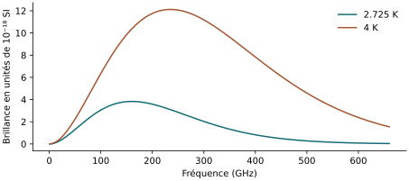
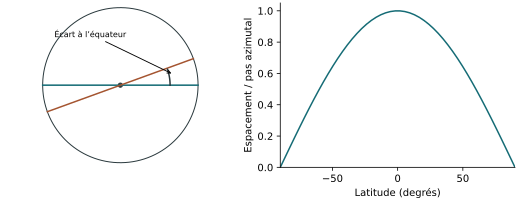
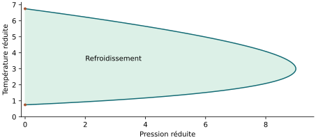
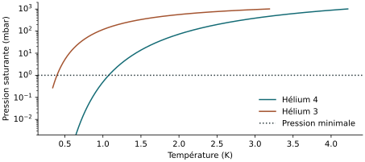
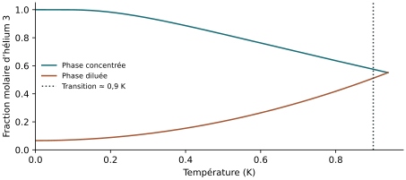

# ENS de Paris (Ulm) PC 2014 — Physique C · Corrigé brut

*Corrigé rédigé par IA, non officiel. Signalez toute erreur.*

**Lecture du rapport du jury** · GPT-6.2 Astra Ultra · vitesse non renseignée

**Rédaction** · GPT-6.2 Astra Ultra · vitesse non renseignée

## La mission Planck

## I. Rayonnement du fond diffus cosmologique

### Question 1 — Unités photométriques

L’intensité spécifique $I_\nu$ se mesure en $\mathrm{W\,m^{-2}\,sr^{-1}\,Hz^{-1}}$, la densité $u_\nu$ en $\mathrm{J\,m^{-3}\,Hz^{-1}}$ et le flux $F_\nu$ en $\mathrm{W\,m^{-2}\,Hz^{-1}}$.

### Question 2 — Transport des photons

Le volume balayé dans une direction entrante est $c\,dt\,dA\cos\theta$. Le nombre de photons est ce volume multiplié par $N_\nu d\Omega\,d\nu$. En multipliant par $h\nu$ et en identifiant à la définition, $I_\nu=h\nu cN_\nu$.

### Question 3 — Nombre total de photons

En isotropie $n_\nu=4\pi N_\nu$. Ainsi $I_\nu=h\nu c n_\nu/(4\pi)$.

### Question 4 — Pression des photons

$u_\nu=4\pi I_\nu/c$. Avec $\int\cos^2\theta\,d\Omega=2\pi\int_{-1}^{1}\mu^2d\mu=4\pi/3$, on obtient $p_\nu=u_\nu/3$. L’intégration en fréquence donne $p=u/3$.

### Question 5 — Flux à travers un plan

$F_\nu^+=2\pi I_\nu\int_0^{\pi/2}\cos\theta\sin\theta\,d\theta=\pi I_\nu$. Le demi-espace opposé donne $F_\nu^-=-\pi I_\nu$ en flux algébrique. Autant d’énergie traverse dans chaque sens et $F_\nu=0$.

### Question 6 — Équation du maximum

En posant $x=h\nu/(kT)$ et $m=3+\beta$, on maximise $x^m/(e^x-1)$. La condition $m/x=e^x/(e^x-1)$ donne $e^x=m/(m-x)$ à la racine physique $0<x<m$. La racine nulle de l’équation réarrangée ne donne pas le maximum intérieur.

### Question 7 — Loi de déplacement approchée

La racine vérifie $x=m(1-e^{-x})$. Avec $x=m-\delta$, $\delta=me^{-m}e^\delta\simeq me^{-m}$ au premier ordre en $me^{-m}$. Donc $\nu_m\simeq(kT/h)m(1-e^{-m})$, croissante avec $\beta$. Pour $\beta=0$, cette approximation donne $59{,}4\,\mathrm{GHz/K}$ et la racine exacte $x=2{,}82144$ donne $58{,}8\,\mathrm{GHz/K}$.

### Question 8 — Émission intégrée

$F=\pi\int_0^\infty\Lambda\nu^\beta B_\nu d\nu$. Avec $\nu=kTx/h$, $F=\sigma_{\beta,\Lambda}T^{4+\beta}$ où $\sigma_{\beta,\Lambda}=2\pi\Lambda k^{4+\beta}Q(3+\beta)/(c^2h^{3+\beta})$.

### Question 9 — Constante de Stefan

$\sigma=2\pi^5 k^4/(15c^2h^3)\simeq5{,}67\,10^{-8}\,\mathrm{W\,m^{-2}\,K^{-4}}$.

### Question 10 — Énergie volumique du corps noir

Puisque $u_\nu=4F_\nu^+/c$, $u=4\sigma T^4/c$.

### Question 11 — Deux températures de corps noir

Le spectre le plus chaud est au-dessus du plus froid pour chaque $\nu>0$. Son maximum se déplace vers les hautes fréquences proportionnellement à $T$ et sa hauteur augmente en $T^3$. Les deux courbes démarrent en zéro et décroissent exponentiellement à haute fréquence.

### Question 12 — Limites spectrales

À basse fréquence $e^x-1\simeq x$ et $B_\nu\simeq2kT\nu^2/c^2$. À haute fréquence $e^x-1\simeq e^x$ et $B_\nu\simeq(2h\nu^3/c^2)e^{-h\nu/(kT)}$.

### Question 13 — Énergie interne

$U=Vu(T)=4\sigma VT^4/c$. Le nombre de photons peut varier avec la température.

### Question 14 — Chaleur et entropie à volume variable

En transformation réversible $\delta Q=dU+p\,dV=V u'(T)dT+(u+p)dV$. D’où $C_V=Vu'=4Vu/T$ et $l=4u/3$. Le second principe donne $dS=(4Vu/T^2)dT+[4u/(3T)]dV$.

### Question 15 — Entropie des photons

Avec $u=4\sigma T^4/c$, la différentielle précédente est celle de $16\sigma VT^3/(3c)$. La constante d’intégration est nulle au zéro absolu, donc $S=16\sigma VT^3/(3c)$.

### Question 16 — Refroidissement par expansion

$S$ constante impose $VT^3=\mathrm{constante}$, donc $T\propto V^{-1/3}$. Comme $p\propto T^4$, $pV^{4/3}$ reste constant et $\gamma=4/3$.

### Question 17 — Température du rayonnement fossile

$TR$ est constant avec $R(t_0)=1$. Le modèle fourni donne $T(t_0)=3000[\sinh(1{,}17584\times3{,}8\,10^5/(13{,}82\,10^9))/\sinh(1{,}17584)]^{2/3}\simeq2{,}36\,\mathrm K$. On utilise dans la suite la mesure $2{,}725\,\mathrm K$ prescrite par le sujet.

### Question 18 — Pic du fond diffus

$\nu_{\max}=2{,}82144 kT_{\rm CMB}/h\simeq160\,\mathrm{GHz}$, ou $162\,\mathrm{GHz}$ avec l’approximation de la question 7.

### Question 19 — Choix des bandes du satellite

143 et 217 GHz encadrent le maximum et les autres bandes échantillonnent ses deux ailes. Les hautes fréquences, où les poussières deviennent brillantes, et les basses fréquences renseignent sur les émissions d’avant-plan qu’il faut distinguer du CMB.

### Question 20 — Corps noir en mouvement

Si $D=\nu_o/\nu_e=\sqrt{1-v^2/c^2}/(1-v\cos\vartheta/c)$, alors $N_o=D^2N_e$ et $I_o=D^3B_{\nu_e}(T_{\rm CMB})$. En remplaçant $\nu_e$ par $\nu_o/D$, on reconnaît $B_{\nu_o}(DT_{\rm CMB})$. La température observée est donc $T(\vartheta)=DT_{\rm CMB}$.

### Question 21 — Dipôle cinématique

$T(\vartheta)\simeq T_{\rm CMB}[1+(v/c)\cos\vartheta]$. L’écart à la moyenne change de signe entre l’avant et l’arrière et s’annule dans la direction transverse. La dépendance en $\cos\vartheta$ est dipolaire.

### Question 22 — Vitesse du système solaire

$v=c\Delta T_{\rm dipôle}/(2T_{\rm CMB})\simeq3{,}68\,10^5\,\mathrm{m/s}$, soit $368\,\mathrm{km/s}$.

### Question 23 — Vitesses orbitales

Pour la Terre, $2\pi D_T/(1\,\mathrm{an})\simeq30\,\mathrm{km/s}$. Pour le système solaire autour du centre galactique, $2\pi D_\odot/T_\odot\simeq225\,\mathrm{km/s}$. Ces valeurs portent sur des référentiels distincts.

### Question 24 — Fluctuation de brillance

On trouve $\delta B_\nu/B_\nu=g(x)\delta T/T$ avec $g(x)=xe^x/(e^x-1)$. À 143 GHz, $x\simeq2{,}52$ et $g\simeq2{,}74$. Une fluctuation relative de température de $10^{-5}$ donne donc un contraste de brillance d’environ $2{,}7\,10^{-5}$.

## II. Poussières galactiques

### Question 25 — Section efficace

Le produit $\sigma_\nu n_d\,ds$ est sans dimension. Avec $n_d$ en mètres cubes inverses, $\sigma_\nu$ est une aire, en $\mathrm{m^2}$.

### Question 26 — Extinction dans une couche uniforme

$dI_\nu/I_\nu=-\sigma_\nu n_d\,ds$. D’où $I_\nu(s)=I_\nu(0)e^{-\tau_\nu(s)}$ avec $\tau_\nu=\sigma_\nu n_ds$.

### Question 27 — Domaine du modèle d’émissivité

Entre 25 GHz et 1 THz, $\lambda=c/\nu$ s’étend de $12\,\mathrm{mm}$ à $300\,\mu\mathrm m$. Toute la plage dépasse $100\,\mu\mathrm m$ et la taille des grains, au plus environ $0{,}3\,\mu\mathrm m$.

### Question 28 — Maximum des poussières

Pour $T_d=17\,\mathrm K$, la formule de la question 7 donne $1{,}39\,\mathrm{THz}$ pour $\beta=1$ et $1{,}76\,\mathrm{THz}$ pour $\beta=2$. Le pic se situe au-delà de celui du CMB.

### Question 29 — Puissance spectrale d’un grain

La puissance par unité de surface est $\pi\epsilon_\nu B_\nu(T_d)d\nu$. Sur la sphère d’aire $4\pi a^2$, $dP_e=4\pi^2a^3\epsilon_0\nu^\beta B_\nu(T_d)d\nu$. Ici $\epsilon_0$ est le paramètre matériel des grains.

### Question 30 — Puissance totale du grain

En posant $x=h\nu/(kT_d)$, $P_e=8\pi^2 a^3\epsilon_0 k^{4+\beta}Q(3+\beta)T_d^{4+\beta}/(c^2h^{3+\beta})$.

### Question 31 — Luminosité de l’étoile

Le flux surfacique vaut $\sigma T_\star^4$. La puissance stellaire totale est donc $L_\star=4\pi R_\star^2\sigma T_\star^4$.

### Question 32 — Puissance interceptée

À la distance $d$, le flux vaut $L_\star/(4\pi d^2)$. La section d’absorption dans le visible vaut $\pi a^2$ car $Q_\nu\simeq1$. Il vient $P_a=\pi\sigma T_\star^4(aR_\star/d)^2$.

### Question 33 — Température d’équilibre du grain

L’équilibre $P_a=P_e$ donne $T_d=C_\beta[T_\star^4(R_\star/d)^2/a]^{1/(4+\beta)}$, où $C_\beta=[(h/k)^\beta Q(3)/(4\epsilon_0 Q(3+\beta))]^{1/(4+\beta)}$. Le facteur quatre provient du rapport entre section collectrice et surface émettrice.

### Question 34 — Grain proche d’une étoile chaude

Avec $a=10^{-7}\,\mathrm m$, $R_\star=1{,}33\,10^9\,\mathrm m$, $d=1{,}5\,10^{12}\,\mathrm m$ et $\beta=2$, la question 33 donne $T_d\simeq3{,}59\,10^2\,\mathrm K$ dans le modèle imposé.

### Question 35 — Limites de la comparaison

À dix unités astronomiques d’une étoile A0V de 9700 K, le grain reçoit un flux bien plus intense que dans le milieu interstellaire diffus. De plus, à plusieurs centaines de kelvins, une part importante de l’émission tombe hors du régime de grandes longueurs d’onde utilisé au calcul.

### Question 36 — Très petits agrégats

Pour quelques atomes, la capacité thermique est faible. Un photon UV provoque une forte élévation transitoire d’énergie et le grain refroidit entre deux absorptions. Une température stationnaire unique rend mal compte de cette succession d’événements.

### Question 37 — Émission vers l’observateur

La fraction reçue dans $d\Omega$ est $d\Omega/(4\pi)$. On obtient $dP_e(d\Omega)=\pi a^3\epsilon_0\nu^\beta B_\nu(T_d)d\nu\,d\Omega=\sigma_\nu B_\nu(T_d)d\nu\,d\Omega$.

### Question 38 — Terme source d’une tranche

Il y a $n_d\,ds\,dA$ grains. En divisant leur puissance par $dA\,d\Omega\,d\nu$, $dI_\nu^+=\sigma_\nu n_d B_\nu(T_d)ds$.

### Question 39 — Équation de transfert

$dI_\nu=\sigma_\nu n_d[B_\nu(T_d)-I_\nu]ds$. Comme $d\tau_\nu=\sigma_\nu n_d ds$, $dI_\nu/d\tau_\nu=B_\nu(T_d)-I_\nu$.

### Question 40 — Intensité émergente

En notant $B_d=B_\nu(T_d)$ et $B_c=B_\nu(T_{\rm CMB})=I_\nu(0)$, $I_{\rm sortie}=B_c e^{-\tau}+B_d(1-e^{-\tau})$. Une couche épaisse donne $B_d$ ; une couche mince donne $B_c+\tau(B_d-B_c)+O(\tau^2)$.

### Question 41 — Contribution relative des poussières

À 143 GHz, $B_d/B_c=(e^{h\nu/(kT_{\rm CMB})}-1)/(e^{h\nu/(kT_d)}-1)\simeq22{,}93$. Le rayonnement ajouté rapporté au CMB incident vaut $(1-e^{-\tau})B_d/B_c$, soit $4{,}6\,10^{-7}$ hors plan et $2{,}29\,10^{-2}$ vers le centre. Les excès nets valent respectivement $4{,}4\,10^{-7}$ et $2{,}19\,10^{-2}$ en incluant l’absorption du fond.

### Question 42 — Nettoyage de l’avant-plan

La valeur hors plan de cet exemple reste sous $2{,}7\,10^{-5}$ à 143 GHz. Vers le centre galactique, le signal parasite dépasse ce contraste de près de trois ordres de grandeur. Pour cartographier les fluctuations sur le ciel, il faut donc estimer et soustraire les poussières, en utilisant notamment la dépendance en fréquence.

## III. Bolomètre et stratégie de balayage

### Question 43 — Équilibre sans illumination

En équilibre stationnaire et sans puissance incidente, $G(T-T_s)=0$. La température initiale de l’absorbeur est $T_s$.

### Question 44 — Réponse à l’allumage

$C\dot T=P_0-G(T-T_s)$ et $T(0)=T_s$. Avec $\tau=C/G$ et $T_e=T_s+P_0/G$, $T(t)=T_s+(P_0/G)(1-e^{-t/\tau})$ pour $t\ge0$.

### Question 45 — Réponse à l’extinction

L’état initial vaut $T_e$. Après extinction, $C\dot T=-G(T-T_s)$, donc $T(t)=T_s+(P_0/G)e^{-t/\tau}$.

### Question 46 — Diamètre de diffraction

Pour $J(u)=1/2$, $u=1{,}616=\pi D\nu\sin(\psi/2)/c$. Aux petits angles, $\psi=bc/(D\nu)$ avec $b=2(1{,}616)/\pi=1{,}029$. À 143 GHz et $D=1{,}5\,\mathrm m$, $\psi=1{,}44\,10^{-3}\,\mathrm{rad}=4{,}95$ minutes d’arc.

### Question 47 — Largeur de tache sur la bande

$\Delta\psi=\psi(\nu_0)(1/0{,}85-1/1{,}15)\simeq4{,}42\,10^{-4}\,\mathrm{rad}$, soit $1{,}52$ minute d’arc. La tache est la plus large au bord de fréquence basse.

### Question 48 — Angle solide du faisceau

$\Omega=2\pi[1-\cos(\psi/2)]\simeq\pi\psi^2/4$.

### Question 49 — Temps disponible par point

Le pointage balaie $\omega_s\delta t$ pendant une mesure ; il faut $5\omega_s\tau\le\psi/2$, soit $\tau_{\max}=\psi/(10\omega_s)$.

### Question 50 — Temps de réponse imposé

$\omega_s=2\pi/60\,\mathrm{rad/s}$ et $\tau_{\max}=1{,}37\,\mathrm{ms}$ à 143 GHz. Le temps de mesure correspondant est environ $6{,}87\,\mathrm{ms}$.

### Question 51 — Rotation de l’axe orbital

$\omega_P=2\pi/(365{,}25\times86400)\simeq1{,}99\,10^{-7}\,\mathrm{rad/s}$.

### Question 52 — Pas entre grands cercles

Pour couvrir les directions perpendiculaires au premier balayage avec le même critère, deux axes successifs diffèrent au plus de $\delta\theta_P=\psi/2\simeq7{,}19\,10^{-4}\,\mathrm{rad}$, soit $2{,}47$ minutes d’arc. Prendre ce maximum espace les corrections de $\delta t_P=\delta\theta_P/\omega_P\simeq3{,}61\,10^3\,\mathrm s$, environ une heure. La figure montre deux cercles et l’écart maximal à l’équateur.

### Question 53 — Durée d’une couverture complète

Un demi-tour de l’axe orbital balaie toutes les orientations utiles. Un relevé demande donc environ six mois. Début août 2009 à fin janvier 2012 représente trente mois, soit environ cinq relevés dans ce modèle idéal.

### Question 54 — Chauffage par le courant de lecture

$C\dot T=P_0+\delta P+i_0^2R(T)-G(T-T_s)$, soit $\tau\dot T+T=T_e+[\delta P+i_0^2R(T)]/G$. À l’équilibre, $T_0=T_e+i_0^2R(T_0)/G$.

### Question 55 — Constante de temps effective

$C\delta\dot T+[G-i_0^2R'(T_0)]\delta T=\delta P$. Notons $G_e=G-i_0^2R'(T_0)$. Le système a alors $\tau_e=C/G_e$.

### Question 56 — Stabilité de la thermistance

$R'(T)=-R(T)\sqrt{T_g/T}/(2T)<0$. À courant fixé, une hausse de température diminue l’effet Joule. Ainsi $G_e>0$ et toute perturbation libre décroît. À $T_0=0{,}1\,\mathrm K$, $R(T_0)=11e^{\sqrt{180}}\simeq7{,}38\,\mathrm M\Omega$.

### Question 57 — Sensibilité en tension

En convention $e^{i\omega t}$, $(G_e+i\omega C)\delta T=\delta P$ et $\delta V=i_0R'\delta T$. Le transfert complexe est $(i_0R'/G_e)/(1+i\omega\tau_e)$. Son module vaut $S_0/\sqrt{1+(\omega\tau_e)^2}$ avec $S_0=|i_0R'|/G_e$. Le gain statique signé est négatif.

### Question 58 — Comparaison entre 0,1 et 4 K

À 0,1 K $R'=-4{,}95\,10^8\,\Omega/\mathrm K$, $G_e=5{,}69\,10^{-10}\,\mathrm{W/K}$, donc $\tau_e=1{,}76\,\mathrm{ms}$ et $S_0=8{,}70\,10^8\,\mathrm{V/W}$. À 4 K, $R=91{,}8\,\Omega$, $R'=-24{,}3\,\Omega/\mathrm K$, donc $\tau_e=13{,}5\,\mathrm{ms}$ et $S_0=329\,\mathrm{V/W}$.

### Question 59 — Puissance acceptée par le télescope

Dans le petit cône $\cos\theta\simeq1$. L’étendue est $A\Omega=(\pi D^2/4)(\pi\psi^2/4)=(\pi bc/4)^2/\nu^2$. En tenant compte de la transmission et de l’absorption, $P_0=\eta(\pi bc/4)^2\int_0^\infty I_\nu\mathcal T(\nu)\,d\nu/\nu^2$.

### Question 60 — Intégrale dans une bande rectangulaire

Avec $\eta=1$ et $I_\nu\simeq I_{\nu_0}$, l’intégrale de $1/\nu^2$ entre $\nu_0\pm\Delta\nu/2$ vaut $\Delta\nu/[\nu_0^2-(\Delta\nu/2)^2]$. On multiplie par $(\pi bc/4)^2I_{\nu_0}$. Pour une bande étroite on peut encore remplacer le dénominateur par $\nu_0^2$.

### Question 61 — Puissance du canal 143 GHz

$B_{143}(2{,}725\,\mathrm K)\simeq3{,}77\,10^{-18}\,\mathrm{W\,m^{-2}\,sr^{-1}\,Hz^{-1}}$. À $\Delta\nu=43\,\mathrm{GHz}$, $P_0\simeq4{,}77\,10^{-13}\,\mathrm W$, ou $4{,}66\,10^{-13}\,\mathrm W$ dans l’approximation de bande étroite.

### Question 62 — Fluctuation de puissance détectable

Avec $\delta V=10^{-8}\,\mathrm V$, $\delta P/P_0=\delta V/(S_0P_0)$. À 0,1 K, le seuil vaut $2{,}4\,10^{-5}$ et à 4 K environ $64$, donc au second point même la puissance totale du CMB est inférieure au seuil équivalent.

### Question 63 — Comparaison au signal recherché

À 0,1 K le contraste primordial en brillance, $2{,}7\,10^{-5}$, dépasse de peu le seuil statique $2{,}4\,10^{-5}$. À 4 K la sensibilité est insuffisante. Avec les paramètres simplifiés de Q58, $1{,}76\,\mathrm{ms}$ dépasse un peu le maximum $1{,}37\,\mathrm{ms}$ de Q50 : le critère temporel de cinq constantes de temps nécessiterait un ajustement du bolomètre ou du balayage. La comparaison statique seule n’assure pas sa tenue.

## IV. Architecture cryogénique

### Question 64 — Détente dans un milieu poreux

En régime permanent et à faible vitesse, les variations d’énergie cinétique et potentielle sont négligeables. La mole reçoit le travail de poussée $P_1v_1$ et fournit $P_2v_2$ à sa sortie. Le conduit calorifugé n’échange pas de chaleur et il n’y a pas de travail d’arbre. Ainsi $u_2-u_1=P_1v_1-P_2v_2$, soit $h_2=h_1$. Le passage dans le tampon est irréversible.

### Question 65 — Coefficient de Joule-Thomson

Sur un chemin réversible auxiliaire $dh=\delta Q_{\rm rev}+v\,dP=c_p\,dT+[v-T(\partial v/\partial T)_P]dP$. Cette identité s’applique aux états d’équilibre. À $dh=0$, $\mu_{JT}=[T(\partial v/\partial T)_P-v]/c_p=(Tv/c_p)[(\partial v/\partial T)_P/v-1/T]$.

### Question 66 — Cas du gaz parfait

$v=RT/P$ donne $(\partial v/\partial T)_P=v/T$, donc $\mu_{JT}=0$. Pour un gaz parfait l’enthalpie ne dépend que de la température.

### Question 67 — Point critique de van der Waals

$P=RT/(v-b)-a/v^2$. Les conditions $RT/(v-b)^2=2a/v^3$ et $2RT/(v-b)^3=6a/v^4$ donnent $v_c=3b$ puis $T_c=8a/(27Rb)$ et $P_c=a/(27b^2)$.

### Question 68 — Loi des états correspondants

$(P_r+3/v_r^2)(3v_r-1)=8T_r$. La relation réduite est commune à tous les gaz du modèle. Leurs isothermes se comparent sur les mêmes axes sans réintroduire $a$ et $b$ pour chaque espèce.

### Question 69 — Température d’inversion

Posons $u=v_r$ et $q=(3u-1)^2/(4T_r u^3)$. La différentiation donne $T(\partial v/\partial T)_P=(v-b)/(1-q)$. Ainsi $\mu_{JT}=(b/c_p)[(3u-1)/(1-q)-3u]$. L’inversion exige $3u q=1$, soit $T_{r,i}=(27/4)[1-1/(3u)]^2$ dans le domaine régulier.

### Question 70 — Courbe d’inversion

Pour le paramètre $u=v_r$, $T_r=(27/4)[1-1/(3u)]^2$ et $P_r=9(2u-1)/u^2$. Le domaine $P_r\ge0$ correspond à $u\ge1/2$. Le maximum de pression se trouve en $u=1$, où $(P_r,T_r)=(9,3)$. Les intercepts à pression nulle sont $T_r=3/4$ et $27/4$.

### Question 71 — Condition de refroidissement

Localement $dT=\mu_{JT}dP$ avec $dP<0$. Un refroidissement exige $\mu_{JT}>0$, dans la zone intérieure de la courbe indiquée par le sujet. Une détente finie suit une isenthalpe.

### Question 72 — Fenêtres de fonctionnement

À l’entrée il faut notamment $T<(27/4)T_c$, soit moins de $224\,\mathrm K$ pour l’hydrogène et $35{,}0\,\mathrm K$ pour l’hélium 4. Le bas de la zone d’inversion tend à $(3/4)T_c$ à pression nulle, environ $24{,}9\,\mathrm K$ et $3{,}89\,\mathrm K$. Ce sont les bornes du domaine de refroidissement du diagramme de van der Waals. La température d’une sortie donnée dépend des pressions, de l’état d’entrée et d’une éventuelle liquéfaction.

### Question 73 — Chaleur latente molaire

À coexistence $L_v=h_g-h_l=T(s_g-s_l)$, en joules par mole. Pour la vaporisation $s_g>s_l$ et $L_v>0$.

### Question 74 — Équilibre liquide-vapeur

Au même $T$ et à la pression de coexistence $P_s(T)$, les potentiels chimiques sont égaux. Pour un corps pur ils sont les enthalpies libres molaires, donc $g_l=g_g$.

### Question 75 — Pente de la pression saturante

Avec $dg=-s\,dT+v\,dP$, $(v_g-v_l)dP_s=(s_g-s_l)dT$. Par la question 73, $dP_s/dT=L_v/[T(v_g-v_l)]$.

### Question 76 — Pression de vapeur approchée

Avec $v_g\gg v_l$, $v_g\simeq RT/P_s$ et $L_v$ quasi constant sur l’intervalle, $d\ln P_s=L_v\,dT/(RT^2)$. L’intégration donne $P_s=P_a\exp[(L_v/R)(1/T_a-1/T)]$. La courbe croît avec $T$ et chute très vite en refroidissant. L’approximation perd sa justification à proximité du point critique.

### Question 77 — Pompage de la vapeur

Le pompage abaisse la pression et entraîne une évaporation qui tend à restaurer la saturation. Le liquide prélève la chaleur latente au composant en contact. L’ensemble se refroidit ; sa pression saturante et le débit de vapeur diminuent à mesure que la température baisse.

### Question 78 — Puissance frigorifique d’évaporation

Si $\dot n=k_pP_s$, $\dot q_E=L_v\dot n=k_pL_v P_a\exp[(L_v/R)(1/T_a-1/T)]$. Le pouvoir frigorifique chute exponentiellement lorsque $T$ diminue.

### Question 79 — Limite imposée par la pompe

$P_s(T_{\min})=P_{\min}$ donne $T_{\min}=[1/T_a+(R/L_v)\ln(P_a/P_{\min})]^{-1}$. Les pressions doivent être exprimées dans la même unité.

### Question 80 — Deux bains d’hélium

Pour $P_a/P_{\min}=1013$, on trouve $T_{\min}\simeq1{,}08\,\mathrm K$ pour l’hélium 4 et $0{,}396\,\mathrm K$ pour l’hélium 3 dans l’approximation de chaleur latente constante.

### Question 81 — Compositions des deux liquides

$x_{3,c}$ décroît avec $T$ à partir de 1. $x_{3,d}$ croît à partir de $a_2=0{,}066$. À $0{,}1\,\mathrm K$, $x_{3,c}=0{,}9993$ et $x_{3,d}=0{,}0715$. Le modèle situe le domaine biphasé sous $T_\lambda\simeq0{,}9\,\mathrm K$. Les interpolations numériques se rencontrent vers $0{,}94\,\mathrm K$, ce qui traduit la précision limitée du modèle au voisinage de la transition.

### Question 82 — Enthalpie concentrée

$dh_{3,c}=b_cT\,dT$. Donc $h_{3,c}=h_{3,c}(0)+b_cT^2/2$.

### Question 83 — Entropie de chaque phase

Sur une branche à pression fixée, $ds_{3,i}=c_{3,i}dT/T=b_i dT$. Avec les zéros d’entropie imposés, $s_{3,c}=b_c T$ et $s_{3,d}=b_d T$.

### Question 84 — Enthalpie de l’hélium 3 dilué

Sur la courbe de coexistence, $h_{3,d}-Ts_{3,d}=h_{3,c}-Ts_{3,c}$ pour les grandeurs molaires partielles du modèle. On obtient $h_{3,d}=h_{3,c}(0)+(b_d-b_c/2)T^2$. Cette expression suit la composition d’équilibre variable de la phase diluée.

### Question 85 — Puissance de dilution

La chaleur prélevée par mole est $h_{3,d}-h_{3,c}=(b_d-b_c)T^2>0$. Pour un débit de l’isotope 3 égal à $\dot n_3$, $\dot q_D=\dot n_3(b_d-b_c)T^2$.

### Question 86 — Puissance frigorifique utile

$\dot q_D=7\,10^{-6}(106-22)(0{,}1)^2\,\mathrm W=5{,}88\,\mu\mathrm W$. À 0,1 K elle dépasse nettement l’évaporation donnée comme très inférieure à $1\,\mu\mathrm W$. Le passage vers la phase diluée maintient une puissance exploitable pour le dernier étage.
