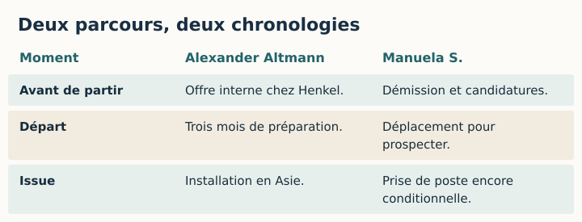

# ENS Rennes · D1 · Allemand 2014 — Corrigé guidé

*Corrigé rédigé par IA, non officiel. Signalez toute erreur.*

**Rédaction** · GPT-6.2 Astra Ultra · vitesse non renseignée

**Couverture partielle.** Le rapport décrit un texte remanié de 256 mots et en donne une proposition française. Les trois paragraphes qui suivent en reprennent le contenu dans une formulation nouvelle, confrontée aux portraits originaux de Focus. Le feuillet allemand distribué et ses reformulations exactes manquent. La question de composition est reproduite à la page 3.

## Version française établie à partir des deux témoins

**Travailler à l’étranger.** Passer un an à Hong Kong, en Irlande ou à Paris peut donner un nouvel élan à une carrière. Encore faut-il surmonter les difficultés du départ. La principale qualité requise, avant même la connaissance de la langue, est la souplesse. Chaque année, plus de 200 000 Allemands quittent leur cadre habituel pour aller travailler à l’étranger. Parmi eux figurent aussi bien des artisans et des chefs d’entreprise que des diplômés de l’enseignement supérieur.

Alexander Altmann a disposé de trois mois pour préparer un séjour à Hong Kong qui a duré un peu plus d’un an. Il raconte s’être aussitôt mis à lire tout ce qu’il pouvait sur le pays et sa culture. À 34 ans, il travaille aux ressources humaines chez Henkel, à Düsseldorf. Un jour, le responsable du personnel pour l’Asie lui a téléphoné. On avait besoin de quelqu’un sur place. Il s’agissait de passer quelques mois à Shanghai avant de rejoindre Hong Kong. Altmann a vite donné son accord. Quelques semaines plus tard, il s’installait en Asie.

À 35 ans, Manuela S. est passée des rives de l’Elbe à celles du Bosphore. D’une chose, elle était certaine : elle voulait vivre à l’étranger. Plusieurs voyages lui avaient déjà permis de découvrir la Turquie. Elle avait aussi une piste pour un emploi, mais cet espoir s’est vite dissipé. D’Allemagne, elle a envoyé une soixantaine de candidatures ; elle avait déjà quitté son poste. En octobre de l’année précédente, elle a décidé de prendre l’avion pour se renseigner sur place. C’est alors que la situation s’est débloquée. Si tout va bien, cette professionnelle du transport de marchandises prendra ses fonctions chez Lufthansa à Istanbul dans quelques semaines. La compagnie a déposé pour elle une demande de permis de travail.

## Composition en allemand

*Was könnte Sie dazu motivieren, im Ausland zu arbeiten?* Environ 100 mots.

Mich würde vor allem die Möglichkeit reizen, einen Beruf aus einer anderen Perspektive kennenzulernen. Als angehende Juristin könnte ich zum Beispiel in einer deutschsprachigen Kanzlei beobachten, wie Kollegen ihren Mandanten einen Vertrag erklären. Im Alltag müsste ich genauer zuhören und nachfragen, wenn mir ein Ausdruck fremd ist. Dafür wäre ein längerer Aufenthalt wertvoller als eine kurze Reise. Entscheidend wäre für mich allerdings, dass ich von meinem Gehalt am neuen Wohnort leben könnte. Auch müsste feststehen, wer mich anfangs bei der Arbeit begleitet. Unter diesen Bedingungen würde ich gern für ein Jahr ins Ausland ziehen und anschließend meine Erfahrungen mit anderen teilen.

*101 mots, comptés par espaces.*

## Comment construire la réponse

**Relier les deux sources.** La page 2 du rapport donne une proposition française en trois paragraphes. L’article de presse, lui, fait aussi intervenir une chercheuse partie en Irlande. Ce troisième portrait disparaît de la proposition du jury. De même, la presse précise que le projet d’Altmann a ensuite été limité à Hong Kong. Le rapport s’arrête, pour ce personnage, à son départ en Asie. Ces différences empêchent de reporter sur le sujet chaque phrase de la publication.

**Choisir les temps à partir de la chronologie.** Quand Manuela se renseigne sur place, elle a déjà démissionné. L’allemand marque cette antériorité par *hatte … gekündigt*, d’où « avait quitté son poste ». L’employeur a demandé un permis ; le texte laisse en suspens le résultat. Le présent *fängt … an*, associé à une échéance de plusieurs semaines et à une condition favorable, appelle ici un futur français. Pour *Speditionskauffrau*, l’activité de l’entreprise concerne l’expédition et le transport de marchandises. Une traduction comme « commerçante » perdrait ce domaine professionnel.

**Écrire à la première personne.** La question invite à se projeter. L’exemple de la juriste montre ce qu’elle ferait au quotidien et ce qu’elle en retirerait. Les conditions concrètes donnent du poids au choix final. *In einer Kanzlei arbeiten* et *im Ausland leben* situent une activité. *Ins Ausland ziehen* indique la destination d’un déménagement. Après une proposition en tête de phrase, garder le verbe conjugué en deuxième position dans la principale : *Unter diesen Bedingungen würde ich …*

[Rapport du jury, version p. 1–2 et question p. 3](https://www.ens-rennes.fr/medias/fichier/rapport-d1-2014-allemand-ecrit_1421747223975-pdf) · [Focus, 13 mai 2012, section « Nicht jeder ist dafür geschaffen »](https://www.focus.de/finanzen/karriere/perspektiven/arbeiten-im-ausland/nicht-jeder-ist-dafuer-geschaffen-expatriate_id_2331494.html)
