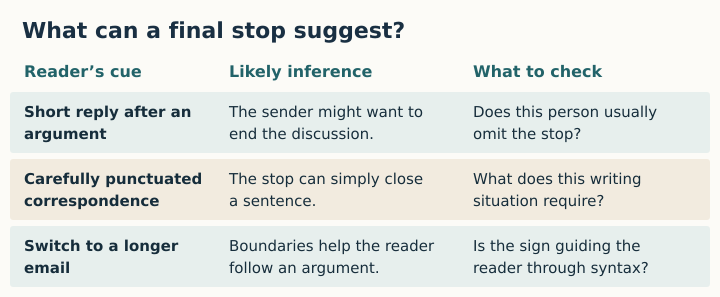

# ENS Rennes · D1 · Anglais 2014 — Corrigé guidé

*Corrigé rédigé par IA, non officiel. Signalez toute erreur.*

**Rédaction** · GPT-6.2 Astra Ultra · vitesse non renseignée

**Couverture partielle.** Le rapport décrit une adaptation de 199 mots hors titre et en cite des fragments. Les traductions ci-dessous portent sur des passages repérés en croisant ces indices avec l’article de Ben Crair. Les intertitres sont rédactionnels. Le feuillet adapté et la délimitation complète de ses sept unités manquent. La question de rédaction figure à la page 3.

## Traduction des passages repérables

**Le point se fâche.** Depuis quelque temps, voilà que le point s’emporte. Qui aurait prévu pareil retournement en linguistique ? Dans la plupart des écrits, le point marque sans arrière-pensée une pause ou la fin d’une idée. Dans la communication numérique, en revanche, il prend des airs plus agressifs.

**Le témoignage.** Mark Liberman, professeur de linguistique à l’université de Pennsylvanie, raconte que, selon son fils de dix-sept ans, beaucoup des textos qu’il lui envoyait paraissaient bien péremptoires, voire durs. C’était sa façon habituelle de mettre un point final qui produisait cette impression. Comment et pourquoi le point a-t-il bien pu se mettre autant en rogne ?

**Le recul historique.** Le point a été l’un des premiers signes de ponctuation employés dans la langue écrite pour marquer une pause. À mesure que l’écrit a pris son autonomie par rapport à la parole, la ponctuation a servi à organiser les textes selon leur logique propre. Ces formulations traduisent des passages identifiables de l’article auxquels renvoient les observations des pages 1 et 2 du rapport.

## Composition en anglais

*With the advent of new technologies, to what extent has the role of punctuation changed in interpersonal communication?* 100 mots maximum.

In a text exchange, pressing send already marks the end of a message. Adding a full stop to “Fine” can therefore make the reply sound final, especially after an argument. Other signs help readers hear a voice they cannot actually hear. An exclamation mark after a thank you may convey warmth, while a question mark can soften a suggestion. These meanings depend on shared habits. A friend who always punctuates messages carefully may intend no rebuke at all. In a long email, moreover, punctuation still helps us follow the grammar. Technology has enlarged its role.

*95 mots, comptés par espaces.*

## Comment construire la réponse

**Garder le sujet de la phrase.** Le point fait figure de personnage. Dans *it’s started getting angry*, c’est lui qui commence à se fâcher ; l’auteur laisse entendre que ce changement récent est encore perceptible. « Depuis quelque temps, voilà que… » combine les deux valeurs. Choisir ensuite pour « en rogne » un registre assez familier pour conserver l’humour de la question.

**Reconstruire un geste social.** *Heel turn* évoque le catcheur qui endosse le rôle du méchant. « Retournement » restitue ici le passage surprenant d’un signe discret à un personnage agressif. Le témoignage du linguiste permet de vérifier cette lecture. C’est le fils qui trouve le ton péremptoire ; c’est le père qui ponctue ses messages. L’anglais *written word* désigne l’écrit comme mode d’expression. Un simple pluriel français, « les mots écrits », effacerait le parallèle historique avec la parole.

**Répondre à la question de degré.** Commencer par un fait matériel : la touche d’envoi clôt déjà le message. Expliquer ensuite ce que le lecteur peut inférer d’un signe désormais facultatif. Introduire un changement de situation, tel le passage du texto au long courriel, pour préciser jusqu’où cet effet se vérifie. Le rapport évalue cohésion, pertinence et correction linguistique. Il annonce sept unités pour la correction de la version sans en donner toutes les bornes.

[Rapport du jury, version p. 1–2 et question p. 3](https://www.ens-rennes.fr/medias/fichier/rapport-d1-2014-anglais-ecrit_1421747229906-pdf) · [Ben Crair, « The Period Is Pissed », The New Republic, 25 novembre 2013](https://newrepublic.com/article/115726/period-our-simplest-punctuation-mark-has-become-sign-anger)
