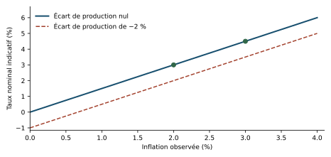
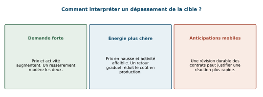

# ENS Rennes D1 — Composition d’ordre économique 2014 · Corrigé guidé

*Corrigé rédigé par IA, non officiel. Signalez toute erreur.*

**Lecture du rapport du jury** · GPT-6.2 Astra Ultra · vitesse non renseignée

**Rédaction** · GPT-6.2 Astra Ultra · vitesse non renseignée

## Faut-il cibler l’inflation ?

### Introduction

> [!INDICATION]
> Identifier dès le début la cible, l’instrument et le délai de transmission. Une dissertation sur les seuls coûts de la hausse des prix laisserait le choix du régime inexpliqué.

Le 25 janvier 2012, la Réserve fédérale américaine a rendu public le taux d’inflation qu’elle juge compatible à long terme avec son mandat. En 2014, une entreprise américaine qui négocie un contrat pluriannuel peut donc prendre pour repère 2 % d’augmentation annuelle de l’indice des prix des dépenses de consommation. La banque centrale ne lui promet pourtant ni que son prix de vente suivra ce rythme, ni que l’inflation observée sera exactement de 2 % l’année suivante.

Cibler l’inflation consiste à publier une définition de la stabilité des prix, un horizon et une orientation de la politique monétaire destinée à y ramener l’inflation prévue. L’instrument principal est le taux directeur, tandis que l’indice des prix est la variable visée. Ce régime répond à un problème de coordination des anticipations. Mais si l’inflation augmente lors d’une récession provoquée par le coût de l’énergie, la ramener immédiatement vers la cible aggraverait la perte de production. L’opportunité du ciblage dépend ainsi de la crédibilité qu’il apporte et de la souplesse qu’il réserve face à des chocs de nature différente.

### I. Un objectif public peut stabiliser les anticipations et orienter l’action monétaire

#### A. L’engagement réduit le coût de la désinflation

> [!INDICATION]
> Faire varier le moment de la décision. Ce qu’une banque souhaiterait faire après la négociation des salaires peut être anticipé avant cette négociation.

Si ménages, entreprises et prêteurs prévoient une inflation durablement forte, ils la répercutent dans les salaires nominaux, les prix convenus et les taux d’intérêt. Une désinflation qui surprend ces contrats réduit temporairement l’activité. Une cible crédible donne un point commun pour les négociations futures. Un choc ponctuel sur les prix alimentaires a alors moins de chances d’alimenter une révision permanente de toutes les rémunérations. Cette crédibilité se construit par des décisions conformes aux prévisions annoncées et une explication des écarts.

L’analyse de l’incohérence temporelle précise l’intérêt d’un engagement. Une autorité pourrait souhaiter, une fois les salaires nominaux fixés, créer une surprise inflationniste pour stimuler la production. Des agents qui anticipent cette tentation demandent des salaires plus élevés d’emblée. On peut alors obtenir davantage d’inflation sans gain durable d’emploi. Un mandat public, l’indépendance dans le choix des instruments et la publication des prévisions limitent cette tentation. La responsabilité démocratique demeure, car il faut expliquer les mesures choisies et indiquer quand les effets attendus devraient apparaître.

#### B. La banque centrale dispose d’un guide de décision vérifiable

> [!INDICATION]
> Faire le calcul en points de pourcentage. Une hausse du taux nominal qui compense simplement l’inflation anticipée laisse le taux réel inchangé.

Une représentation illustrative de la règle de Taylor est $i=r^*+\pi+a(\pi-\pi^*)+b x$, où $x$ est l’écart de production, $\pi^*$ la cible et $a,b>0$. Pour une inflation anticipée durablement plus élevée et un écart de production inchangé, augmenter le taux nominal de plus d’un point par point d’inflation relève le taux réel. L’investissement et la demande de crédit ralentissent, ce qui modère la pression sur les capacités. À titre d’exemple, avec $r^*=1$ %, $\pi^*=2$ %, $a=b=0.5$, $\pi=3$ % et $x=0$, la règle indique $4.5$ %, contre $3$ % lorsque l’inflation est à la cible. Le calcul illustre une réaction, sans prétendre reconstituer une réunion réelle.

Cibler la croissance d’un agrégat monétaire serait une autre façon de donner un ancrage nominal. La relation $MV=PY$ ne transforme pourtant une croissance de $M$ en prévision fiable des prix que sous des hypothèses sur la vitesse de circulation et la production. L’innovation financière modifie la demande de monnaie. Une cible finale d’inflation peut rester lisible même quand cette relation se déplace. La monnaie, le crédit, les enquêtes de prix et les anticipations restent des indicateurs utiles pour établir les prévisions.

### II. L’horizon de retour doit protéger l’activité et tenir compte des limites des instruments

#### A. Un même dépassement appelle des décisions différentes

> [!INDICATION]
> Opposer dans un exemple les signes de la variation des prix et de celle de la production après chacun des deux chocs.

Un choc positif de demande fait généralement monter à la fois les prix et l’activité au-dessus de sa capacité soutenable. Un resserrement modère les deux déséquilibres. Une flambée importée du pétrole peut au contraire accroître l’inflation et réduire la production potentielle ou réelle. Avec des prix et des salaires rigides, vouloir annuler immédiatement tout effet sur l’indice ferait supporter au reste de l’économie une désinflation brutale. Un ciblage flexible laisse passer l’effet de premier tour et surveille les anticipations et la diffusion de la hausse aux autres prix. Le délai se raccourcit si celles-ci menacent de se désancrer.

On peut représenter le choix par une perte $(\pi-\pi^*)^2+\lambda x^2$ avec $\lambda>0$. La stabilisation des prix compte, mais la trajectoire de l’emploi et de la production compte aussi. Publier un horizon conditionnel et des scénarios rend le délai contrôlable. Une règle instrumentale appliquée mécaniquement ignorerait l’incertitude sur la production potentielle, le taux réel neutre et les retards de transmission. Une cible sur le niveau des prix demanderait, elle, de compenser les écarts passés, alors qu’une cible de taux d’inflation laisse généralement ces écarts de niveau acquis.

#### B. Le niveau de la cible et les outils forment un choix institutionnel

> [!INDICATION]
> Restituer les mandats à la date de l’épreuve. Les formulations ultérieures de la stratégie de la BCE ne doivent pas remplacer celle de 2014.

Une cible faible et positive limite le coût de la dérive des prix tout en laissant une marge pour la baisse des taux réels quand les taux nominaux sont proches de leur plancher. Elle facilite aussi certains ajustements de salaires réels en présence de rigidités nominales. Choisir un taux beaucoup plus élevé pour accroître cette marge renchérirait la détention de monnaie et perturberait les contrats. Aucun taux optimal ne se déduit de ces mécanismes sans information sur leurs coûts respectifs. Une cible doit de plus préciser le panier, le traitement des prix volatils et l’horizon. L’indice global a l’avantage d’être observable par le public, tandis que l’inflation sous-jacente aide à comprendre un écart transitoire.

À la date du concours, la BCE visait, à moyen terme, une inflation inférieure à mais proche de 2 % pour la zone euro, avec la stabilité des prix comme objectif principal. La Fed avait publié son objectif de 2 % pour l’indice PCE en 2012 tout en maintenant son double mandat. Le contraste porte donc sur les mandats, les indices et la stratégie. Les qualifier en 2014 d’institutions à objectif respectivement explicite et purement implicite masquerait l’annonce américaine. Enfin, une progression calme des prix à la consommation peut accompagner une hausse excessive du crédit immobilier. La supervision et des instruments macroprudentiels ciblés complètent alors utilement le taux directeur. Lorsque celui-ci est au plancher, la communication sur les taux futurs ou les achats d’actifs cherchent à infléchir les conditions financières, avec des effets moins prévisibles.

### Conclusion

> [!INDICATION]
> Répondre au choix du régime en donnant les conditions sous lesquelles l’engagement demeure crédible et supportable.

Une banque centrale a intérêt à annoncer un ancrage nominal observable lorsqu’elle peut agir sur l’inflation à moyen terme et rendre compte de ses décisions. La cible permet aux agents de distinguer une perturbation temporaire de la trajectoire recherchée. Son efficacité exige une réaction différenciée aux chocs, un horizon crédible, des indicateurs d’activité et des outils financiers complémentaires. L’engagement porte alors sur la stabilisation monétaire dans la durée, ce qui rend possible une réponse graduée à un choc d’offre sans abandonner le repère public.

[Sujet de la session](https://www.ens-rennes.fr/medias/fichier/2014-d1-economie_1421747156190-pdf) · [Rapport du jury](https://www.ens-rennes.fr/medias/fichier/rapport-d1-2014-economie-ecrit_1423045973125-pdf) · [Communiqué de la BCE du 8 mai 2003](https://www.ecb.europa.eu/press/pr/date/2003/html/pr030508_2.en.html) · [Annonce de la Réserve fédérale du 25 janvier 2012](https://www.federalreserve.gov/newsevents/pressreleases/monetary20120125c.htm)
