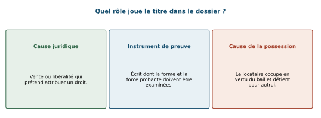
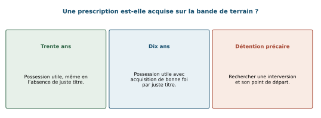

# ENS Rennes D1 — Droit civil 2014 · Corrigé brut

*Corrigé rédigé par IA, non officiel. Signalez toute erreur.*

**Lecture du rapport du jury** · GPT-6.2 Astra Ultra · vitesse non renseignée

**Rédaction** · GPT-6.2 Astra Ultra · vitesse non renseignée

## Propriété et titre

### Introduction

Deux voisins revendiquent une bande de terrain. Le premier produit un acte notarié qui la mentionne. Le second affirme l’avoir possédée comme propriétaire pendant plus de trente ans. Le premier dispose d’un titre, le second invoque un mode d’acquisition que la loi fait précisément fonctionner sans titre. Pour savoir qui est propriétaire, il faut déterminer comment chacun prétend avoir acquis le droit et quelle preuve permet de l’opposer à son adversaire.

La propriété, définie par l’article 544 du Code civil, confère le droit de jouir et de disposer d’une chose dans les limites fixées par les lois et règlements. Le « titre » peut désigner la cause juridique d’une attribution, par exemple une vente, ou l’écrit qui constate l’opération. Il peut aussi qualifier la manière dont une personne possède, pour elle-même ou pour autrui. Ces sens se rencontrent sans coïncider. Une vente valable peut transférer la propriété avant la rédaction de son instrument, tandis qu’un document authentique peut relater une vente consentie par une personne dépourvue du droit vendu. En droit applicable à la session de 2014, comment le titre établit-il l’origine et l’étendue du droit tout en laissant place à la possession et à d’autres indices dans les conflits de propriété ?

### I. Le titre identifie l’origine conventionnelle du droit et peut en préciser la consistance

#### A. L’efficacité du titre dépend de l’acte et du droit du disposant

Les articles 711 et 712 recensent des modes d’acquisition variés, dont la succession, les libéralités, l’effet des obligations, l’accession et la prescription. Dans une vente ordinaire d’un bien individualisé, l’article 1583 dispose que la propriété est acquise de droit à l’acheteur à l’égard du vendeur dès l’accord sur la chose et le prix, même avant livraison et paiement. Il faut tenir compte des clauses qui peuvent différer ce transfert. L’accord constitue le titre juridique. La présence ou l’absence d’un exemplaire signé soulève une difficulté de preuve qui n’a pas forcément détruit l’accord. En revanche, une donation entre vifs soumise à l’article 931 requiert en principe l’acte notarié dans les formes prévues, sous réserve notamment des mécanismes distincts de don manuel. L’instrument devient alors une condition de validité.

Le titre peut définir une propriété moins étendue que ne le prétend son titulaire. Un acte peut réserver un usufruit ou constituer une servitude conventionnelle, dont le titre fixe l’usage et l’étendue dans les conditions de l’article 686. Une servitude continue et apparente s’acquiert par titre ou par possession trentenaire (art. 690). Les servitudes de l’article 691 relèvent en principe du titre, sous réserve des mécanismes spéciaux, dont la destination du père de famille aux conditions légales. Identifier le contenu et le fondement de la charge évite de confondre la détention matérielle de la parcelle avec une propriété libre de tout droit concurrent.

#### B. Le titre peut raccourcir une prescription, et la possession peut le suppléer

Un acquéreur reçoit d’une personne qu’il croit propriétaire un acte qui aurait transféré un immeuble si l’auteur avait effectivement été propriétaire. L’acquéreur de bonne foi pourvu d’un juste titre peut prescrire par dix ans, sous les conditions de l’article 2272. La bonne foi s’apprécie lors de l’acquisition. Le juste titre doit être réellement translatif et porter sur le bien litigieux. Un titre nul pour défaut de forme n’ouvre pas le délai abrégé (art. 2273). Le rôle du titre est décisif sans être suffisant, puisque l’acquéreur doit encore prouver la possession utile pendant le délai.

À défaut de juste titre ou de bonne foi, une prescription immobilière trentenaire demeure possible. Le demandeur doit établir une possession continue et non interrompue, paisible, publique, non équivoque et à titre de propriétaire (art. 2258, 2261 et 2272). Un locataire entré en vertu d’un bail exerce le pouvoir de fait pour autrui. Son intention intérieure de se tenir désormais pour propriétaire ne suffit pas à changer la cause de sa détention. Une interversion dans les conditions de l’article 2268, résultant par exemple d’une contradiction opposée au droit du propriétaire, change le point de départ de l’analyse. Dans le litige des voisins, l’entretien d’une bande avec l’accord du propriétaire n’a donc pas la même valeur qu’une emprise publique et non équivoque exercée pour son propre compte.

### II. Le juge apprécie la portée de l’instrument et les règles d’opposabilité propres au bien

#### A. La preuve du droit ne s’épuise pas dans la preuve de l’acte

Le revendiquant doit convaincre le juge de son droit. L’acte authentique reçu par l’officier public compétent et dans les formes prescrites bénéficie d’une force probante renforcée pour ce que l’officier a personnellement accompli ou constaté. Les déclarations des parties n’ont pas toutes cette force. Un acte sous seing privé dont la signature est reconnue possède aussi une force probante entre signataires, selon l’ancien article 1322. Sous l’ancien article 1341, la preuve d’un acte juridique d’une valeur supérieure à 1 500 euros exige en principe un écrit sous réserve d’exceptions. La règle contre ou outre un écrit obéit à un mécanisme distinct. Ces dispositions sur l’acte juridique ne rendent pas obligatoire une preuve exclusivement écrite de la propriété à l’égard de tout tiers.

Un acte établit qu’une personne a disposé du bien. Il ne démontre pas de façon irréfragable qu’elle en était propriétaire. Exiger du revendiquant des actes remontant à une origine incontestable conduirait à une preuve pratiquement impossible. En matière immobilière le juge confronte les titres, la concordance des descriptions, la possession et les présomptions. Le cadastre constitue un indice, sa fonction fiscale ne lui confère pas à elle seule valeur de titre attributif. La publication foncière rend certains actes opposables aux tiers dans les conditions du décret du 4 janvier 1955. Elle ne guérit pas à elle seule un titre entaché de nullité et ne fait pas obstacle à la prescription réunissant ses conditions.

#### B. Les conflits de titres se résolvent au regard du bien et de la qualité du possesseur

En matière de meubles corporels, « en fait de meubles, la possession vaut titre » (art. 2276). La possession utile peut fournir une présomption de propriété à celui qui possède pour lui-même et, sous ses conditions, protéger l’acquéreur de bonne foi qui tenait le bien d’un non-propriétaire. Des régimes particuliers existent pour certains meubles. Le propriétaire d’un objet perdu ou volé peut le revendiquer pendant trois ans à compter de la perte ou du vol. L’article 2277 impose dans certains circuits d’acquisition, notamment la vente publique, le remboursement du prix au possesseur de bonne foi. L’ancien article 1141 règle en outre la double transmission par un même auteur d’une chose purement mobilière en préférant l’acquéreur mis effectivement en possession de bonne foi, même si son titre est postérieur.

En matière immobilière, un acte plus ancien n’est pas systématiquement décisif dans un conflit entre chaînes de titres différentes. L’objet exact du droit, l’origine commune ou distincte des actes, les règles de publicité pertinentes et, le cas échéant, une prescription acquise modifient l’issue du litige. Ainsi, si le second voisin prouve une possession utile achevée pendant trente ans sur la bande même que décrit le premier acte, le titre initial n’empêche pas une acquisition par prescription. Si son occupation était précaire et qu’aucune interversion n’est établie, l’acte concordant avec la possession de son auteur retrouve toute sa force. L’issue dépend de la qualification et de la durée des faits autant que de la présence d’un papier.

### Conclusion

Le titre donne à la propriété une origine, un contenu et un moyen de preuve. Sa portée dépend cependant de sa fonction dans l’opération invoquée. La possession peut conforter un titre imparfait, suppléer un instrument manquant ou conduire à une acquisition nouvelle. Le raisonnement sur la propriété doit par conséquent identifier le bien, le mode d’acquisition, les effets du titre entre les parties et sa portée envers la personne qui conteste le droit.

[Sujet de la session](https://www.ens-rennes.fr/medias/fichier/2014-d1-droit-civil_1421746998552-pdf) · [Rapport du jury](https://www.ens-rennes.fr/medias/fichier/rapport-d1-2014-droit-civil_1421747236230-pdf) · [Code civil au 1er avril 2014](https://www.legifrance.gouv.fr/codes/texte_lc/LEGITEXT000006070721/2014-04-01/)
