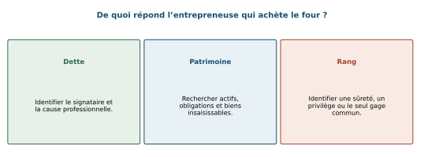
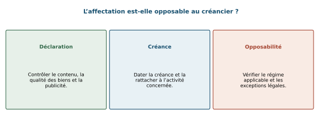

# ENS Rennes D1 — Droit commercial 2014 · Corrigé guidé

*Corrigé rédigé par IA, non officiel. Signalez toute erreur.*

**Lecture du rapport du jury** · GPT-6.2 Astra Ultra · vitesse non renseignée

**Rédaction** · GPT-6.2 Astra Ultra · vitesse non renseignée

## Le patrimoine du commerçant

### Introduction

> [!INDICATION]
> Identifier le débiteur du prix du four et distinguer le fonds de commerce de l’universalité comprenant aussi les dettes.

Une commerçante achète un four à crédit et s’engage à payer son fournisseur après la première saison. Le four sert l’exploitation. La créance du fournisseur, elle, soulève une question plus large. Si les ventes sont mauvaises, pourra-t-il agir aussi sur l’épargne personnelle de la commerçante ou sur un immeuble qui ne sert pas à la boulangerie ? La réponse dépend, en 2014, des opérations que l’entrepreneuse a accomplies pour organiser son patrimoine.

Aux termes de l’article L. 121-1 du Code de commerce, sont commerçants ceux qui exercent des actes de commerce et en font leur profession habituelle. Le singulier du sujet invite à étudier ici une personne physique exerçant en son nom. Son patrimoine est une universalité de droit qui rapproche l’actif et le passif. Son fonds de commerce est un ensemble de biens mobiliers organisés autour de la clientèle. Le fonds peut faire partie du patrimoine, sans englober toutes les dettes et tous les biens personnels du commerçant. Dans le droit applicable en 2014, l’unité patrimoniale favorise le crédit et expose la vie privée aux risques d’exploitation. Comment organiser une protection efficace de l’entrepreneur tout en maintenant un gage identifiable pour ses créanciers ?

### I. Le patrimoine personnel fournit à l’exploitation ses ressources et aux créanciers leur gage

#### A. Un seul commerçant répond en principe sur l’ensemble de ses biens

> [!INDICATION]
> Distinguer l’existence de la dette, l’assiette du droit de gage et les conditions procédurales de sa réalisation.

Dans la conception classique illustrée par Aubry et Rau, le patrimoine est attaché à la personne. Le commerçant individuel n’a pas créé une nouvelle personne en commençant son activité. Une distinction comptable entre compte bancaire privé et compte professionnel, utile à l’administration de l’entreprise, ne suffit donc pas à délimiter deux gages juridiquement autonomes. Les articles 2284 et 2285 du Code civil rattachent les obligations personnelles aux biens présents et à venir du débiteur et posent leur fonction de gage commun sous réserve des causes légitimes de préférence.

Dans notre exemple, le fournisseur impayé est un créancier de la commerçante. S’il ne bénéficie pas d’une sûreté, il participe comme créancier chirographaire au gage commun, dans les limites de l’insaisissabilité et du droit des procédures collectives. L’étendue théorique du gage influe en amont sur la décision d’accorder un délai et sur son prix. La réalisation effective suppose un titre et les procédures requises. Elle dépend aussi des droits acquis par d’autres créanciers, de la valeur réalisable des actifs et du régime matrimonial applicable. Les biens du conjoint ne se confondent pas par principe avec ceux du débiteur.

#### B. Les biens d’exploitation ont une fonction de financement particulière

> [!INDICATION]
> Pour une garantie sur le fonds, rechercher l’élément que le créancier pourra effectivement faire valoir et les formalités qui rendent ce droit opposable.

Le commerçant peut affecter économiquement des matériels et des marchandises à son activité, exploiter une enseigne et organiser une clientèle. La valeur de cet ensemble dépasse parfois celle de la simple addition des éléments. Il peut céder ou nantir le fonds de commerce, dans les conditions et formalités du Code de commerce. Le nantissement donne au créancier sur les éléments qu’il comprend une préférence difficile à déduire de la seule qualité de fournisseur. Des stocks renouvelés, une machine et un droit au bail n’ont ni le même régime ni la même valeur de garantie.

Le patrimoine relie ainsi les décisions privées d’investissement et le financement offert par d’autres. Plus l’entrepreneur offre de garanties, plus il peut obtenir du crédit dans de bonnes conditions. Le même engagement peut faire porter l’échec commercial sur les ressources du ménage. À l’inverse, restreindre le gage peut accroître l’exigence d’un paiement comptant ou de sûretés. Ce lien explique pourquoi les mécanismes de protection demandent des limites de publicité, de date et d’opposabilité.

### II. En 2014, des techniques de protection individualisées modifient l’assiette du risque

#### A. Soustraire un bien au risque professionnel ou l’isoler dans une opération

> [!INDICATION]
> Vérifier la date de publicité de la déclaration par rapport à la naissance de la créance. Pour la fiducie, identifier le titulaire des biens transférés puis le bénéficiaire.

Dans sa rédaction applicable en 2014, l’article L. 526-1 du Code de commerce permettait à l’entrepreneur individuel de déclarer insaisissables ses droits sur sa résidence principale et sur les biens fonciers non affectés à son usage professionnel dans les conditions prévues par la loi. La déclaration devait notamment être reçue par notaire et publiée. Elle ne produisait effet qu’envers les créanciers dont les droits étaient nés après la publication, à l’occasion de l’activité professionnelle. Un fournisseur déjà créancier avant la publicité ne subissait donc pas rétroactivement cette réduction du gage. À cette date, la résidence principale du commerçant n’était pas automatiquement soustraite aux poursuites professionnelles.

La fiducie illustre un autre usage de la séparation patrimoniale. Selon l’article 2011 du Code civil, le constituant transfère des biens, droits ou sûretés à un fiduciaire, qui les tient séparés de son patrimoine propre pour réaliser un but déterminé au profit d’un bénéficiaire. Une fiducie-sûreté peut organiser la garantie plutôt que protéger uniformément le constituant. Son fonctionnement suppose un transfert conforme aux conditions légales, un patrimoine fiduciaire identifié et le respect des droits antérieurs et des règles de fraude. Cette technique éclaire la possibilité d’affecter des actifs à une finalité précise.

#### B. L’affectation par l’EIRL réorganise le crédit autour d’un patrimoine professionnel

> [!INDICATION]
> Une EIRL est une personne physique avec une affectation particulière. Un associé de société à responsabilité limitée et la société immatriculée sont deux sujets de droit distincts.

La loi du 15 juin 2010 a institué l’entrepreneur individuel à responsabilité limitée. En 2014, un commerçant peut constituer par déclaration un patrimoine affecté à l’activité, sans créer une personne morale. Il doit comprendre les éléments nécessaires à l’exercice professionnel et peut comprendre les éléments utilisés que l’entrepreneur décide d’y affecter. La déclaration et, selon les biens, les formalités spécifiques permettent de rendre identifiable la consistance du patrimoine. La tenue d’une comptabilité autonome rend la séparation contrôlable. Une simple étiquette apposée après la naissance des difficultés ne suffit pas.

Lorsque la déclaration est opposable, les créanciers professionnels concernés ont en principe pour gage le patrimoine affecté, tandis que les autres ont pour gage le patrimoine non affecté, avec les tempéraments de l’ancien article L. 526-12. L’opposabilité aux créanciers antérieurs répond à un régime particulier comportant notamment mention, information et possibilité d’opposition. La fraude ou des manquements graves aux règles d’affectation et de comptabilité exposent l’entrepreneur à perdre le bénéfice de la limitation dans les conditions du texte. Dans l’exemple initial, le fournisseur peut étudier la valeur du four et des autres éléments affectés avant d’accorder son délai. Il peut aussi demander une sûreté compatible avec la structure. L’affectation rend le risque plus lisible, tout en modifiant le rapport de négociation.

### Conclusion

> [!INDICATION]
> Revenir à la créance du fournisseur en faisant varier seulement la date de sa naissance et l’organisation préalable des actifs.

En 2014, le commerçant individuel trouve dans son patrimoine les moyens d’exploiter et le crédit que lui consentent les tiers. L’unité du gage facilite le financement mais étend les conséquences d’un échec. L’insaisissabilité déclarée et l’EIRL permettent d’aménager cette exposition, selon des formalités qui protègent aussi l’information et les droits antérieurs des créanciers. La séparation générale des patrimoines de l’entrepreneur individuel introduite par la loi de 2022 relève d’un état ultérieur du droit.

[Sujet de la session](https://www.ens-rennes.fr/medias/fichier/2014-d1-option-droit-commercial-et-droit-public_1421747263648-pdf#page=2) · [Rapport du jury](https://www.ens-rennes.fr/medias/fichier/rapport-d1-2014-droit-commercial_1421747244391-pdf) · [Code de commerce au 1er avril 2014](https://www.legifrance.gouv.fr/codes/texte_lc/LEGITEXT000005634379/2014-04-01/) · [Code civil au 1er avril 2014](https://www.legifrance.gouv.fr/codes/texte_lc/LEGITEXT000006070721/2014-04-01/)
