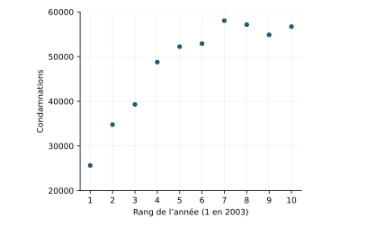
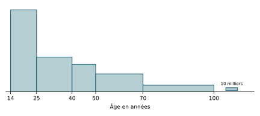
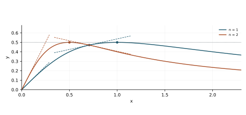

# ENS Rennes D1 — Mathématiques appliquées et statistiques 2014 · Corrigé brut

*Corrigé rédigé par IA, non officiel. Signalez toute erreur.*

**Rédaction** · GPT-6.2 Astra Ultra · vitesse non renseignée

**Révision** · GPT-6.2 Astra Ultra · vitesse non renseignée

Les trois exercices portent sur les statistiques judiciaires, les aires sous une famille de courbes et les probabilités dans la fabrication de savons. Le dernier calcul distingue les moments de la durée de ceux de son logarithme.

## Exercice 1. Condamnations et victimes déclarées

### Question 1.1.a

Pour les abscisses $1,\ldots,10$, les ordonnées sont 25 632, 34 774, 39 300, 48 775, 52 227, 52 905, 58 052, 57 158, 54 874 et 56 714. La copie demande 1 cm par année et 2 cm pour 10 000 condamnations.

### Question 1.1.b

La moyenne est $\bar y=\sum_i y_i/10=48\,041{,}10$. La variance descriptive vaut $V_y=\sum_i y_i^2/10-\bar y^2=110\,155\,212{,}69$ condamnations au carré.

### Question 1.1.c

Avec $\bar x=5{,}5$, $V_x=8{,}25$ et $C_{xy}=\sum x_iy_i/10-\bar x\bar y=26\,911{,}85$, on trouve $r=C_{xy}/\sqrt{V_xV_y}\simeq0{,}89$. Une droite décrit une tendance croissante, mais le tassement des dernières années limite cet ajustement.

### Question 1.1.d

Les valeurs, arrondies au centième, sont les suivantes.

| Rang | 1 | 2 | 3 | 4 | 5 | 6 | 7 | 8 | 9 | 10 |
|---|---|---|---|---|---|---|---|---|---|---|
| z | 12,98 | 32,38 | 50,91 | 131,30 | 185,43 | 198,44 | 332,02 | 303,63 | 241,63 | 290,44 |

### Question 1.1.e

On obtient $\bar z\simeq177{,}92$, $V_z\simeq12\,344{,}17$, $C_{xz}\simeq292{,}04$. Donc $r_{xz}=C_{xz}/\sqrt{V_xV_z}\simeq0{,}92$. L’ajustement affine de $z$ en $x$ est raisonnable et la corrélation est un peu meilleure.

### Question 1.1.f

Les moindres carrés donnent $a=C_{xz}/V_x\simeq35{,}398235$ et $b=\bar z-a\bar x\simeq-16{,}774679$. La droite est $z\simeq35{,}40x-16{,}77$.

### Question 1.1.g

Dans le modèle, $\widehat y(x)=10\,000\ln(ax+b)$ lorsque $ax+b>0$.

### Question 1.1.h

L’année 2014 a le rang $12$. Avec les coefficients non arrondis, $10\,000\ln(12a+b)\simeq60\,112{,}77$, soit environ $60\,113$ condamnations.

### Question 1.2.a

Cette série univariée porte sur l’âge des victimes déclarées. C’est un caractère quantitatif continu regroupé en classes d’amplitudes inégales ; les effectifs sont en milliers.

### Question 1.2.b

Avec des bases de $11,15,10,20,30$ ans, les hauteurs en milliers de victimes par an d’âge valent $60{,}24;25{,}59;20{,}28;13{,}095;4{,}95$. Les aires restituent les cinq effectifs, à l’arrondi près.

### Question 1.2.c

La densité la plus élevée est celle de $[14,25[$ : c’est l’unique classe modale.

### Question 1.2.d

Il faudrait diviser le nombre de victimes de chaque classe par l’effectif de toute la population de cette classe d’âge. Le tableau donne seulement les numérateurs. Le classement des taux de victimation ne peut donc pas être déterminé.

## Exercice 2. Courbes rationnelles et aires

### Question 2.I.1

Pour $n\ge1$, $1-n^2x^2=(1-nx)(1+nx)$ est strictement positif pour $|x|<1/n$, nul pour $x=\pm1/n$, et strictement négatif pour $|x|>1/n$.

### Question 2.I.2

Les polynômes sont dérivables et $1+n^2x^2>0$. Ainsi $f_n'(x)=n(1-n^2x^2)/(1+n^2x^2)^2$ pour tout réel $x$.

### Question 2.I.3

La fonction décroît de sa limite $0$ à la valeur $-1/2$ en $-1/n$, croît ensuite jusqu’à $1/2$ en $1/n$, puis décroît vers $0$. Ces variations sont strictes entre les points critiques.

| Position | $-\infty$ | $-1/n$ | $1/n$ | $+\infty$ |
|---|:---:|:---:|:---:|:---:|
| $f_n$ | $0$ par valeurs négatives | $-1/2$ | $1/2$ | $0$ par valeurs positives |
| Variation vers la colonne suivante | décroît | croît | décroît | |

### Question 2.I.4

Le maximum global vaut $f_n(1/n)=1/2$ et n’est atteint qu’en $x=1/n$ sur le domaine réel de définition. Le cahier désigne ce domaine par $E_n$ à cette question. Le dénominateur $1+n^2x^2$ est strictement positif en tout réel, donc $E_n=\mathbb R$ pour la fonction étudiée. On peut aussi vérifier directement la borne par $(nx-1)^2\ge0$, d’où $2nx\le1+n^2x^2$ avec égalité seulement pour $nx=1$.

### Question 2.I.5

La réduction au même dénominateur donne
$$f_{n+1}(x)-f_n(x)=\frac{x[(n+1)(1+n^2x^2)-n(1+(n+1)^2x^2)]}{(1+n^2x^2)(1+(n+1)^2x^2)}=\frac{x[1-n(n+1)x^2]}{(1+n^2x^2)(1+(n+1)^2x^2)}.$$
Les intersections ont pour abscisses $-\alpha_n,0,\alpha_n$, avec $\alpha_n=1/\sqrt{n(n+1)}$. Le dénominateur est positif. La courbe $C_{n+1}$ est au-dessus sur $]-\infty,-\alpha_n[$ et $]0,\alpha_n[$, au-dessous sur $]-\alpha_n,0[$ et $]\alpha_n,\infty[$.

### Question 2.I.6

On a $n\alpha_n=\sqrt{n/(n+1)}$ et $1+n^2\alpha_n^2=(2n+1)/(n+1)$. Donc $f_n(\alpha_n)=\sqrt{n(n+1)}/(2n+1)$.

### Question 2.I.7

Sur la copie, prendre 4 cm par unité sur les deux axes. L’origine porte les tangentes $y=x$ et $y=2x$. Les sommets sont $(1,1/2)$ et $(1/2,1/2)$, de tangente commune $y=1/2$. En $\alpha_1=1/\sqrt2$, l’ordonnée vaut $\sqrt2/3$ et les pentes sont $2/9$ pour $C_1$ et $-2/9$ pour $C_2$. Les deux tangentes sont donc $y=\sqrt2/3\pm(2/9)(x-1/\sqrt2)$.

### Question 2.II.1

Pour tout réel $x$, $G_n'(x)=2n^2x/(1+n^2x^2)=2n f_n(x)$.

### Question 2.II.2

Une primitive de $f_n$ sur $\mathbb R$ est $G_n(x)/(2n)=\ln(1+n^2x^2)/(2n)$.

### Question 2.II.3

Entre $0$ et $1/\sqrt n$, l’intégrale vaut $\ln(1+n)/(2n)$ et $f_n\ge0$. Une unité d’aire représente $4^2=16$ cm², donc l’aire géométrique est $8\ln(1+n)/n$ cm².

### Question 2.III.1

Sur $]-1,\infty[$, $\psi'(x)=1/(1+x)^2-1/(1+x)=-x/(1+x)^2$. La fonction croît strictement sur $]-1,0]$ puis décroît strictement sur $[0,\infty[$. Aux deux extrémités du domaine elle tend vers $-\infty$ (en $-1^+$, le terme en $-1/(1+x)$ domine le logarithme).

### Question 2.III.2

On a $\psi(0)=0$. C’est son unique maximum, donc $\psi(x)<0$ pour tout $x\ne0$ de son domaine.

### Question 2.III.3

Pour $x>0$, $\varphi'(x)=[x/(1+x)-\ln(1+x)]/(2x^2)=\psi(x)/(2x^2)<0$. Ainsi $\varphi$ décroît strictement sur $]0,\infty[$, de $1/2$ à $0$.

### Question 2.III.4

L’intégrale de 2.II.3 est $\varphi(n)$. La décroissance stricte donne le maximum au plus petit rang, $n=1$, de valeur $\ln2/2$.

## Exercice 3. Fabrication, contrat et réclamations

### Question 3.I.1

Dans le modèle d’essais indépendants, $X\sim\mathcal B(12,0{,}01)$. Pour $0\le k\le12$, $P(X=k)=\binom{12}{k}0{,}01^k0{,}99^{12-k}$.

### Question 3.I.2

On trouve $\mathbb E(X)=12\times0{,}01=0{,}1200$ et $V(X)=12\times0{,}01\times0{,}99=0{,}1188$.

### Question 3.I.3

La probabilité d’au moins deux défauts vaut $1-0{,}99^{12}-12(0{,}01)0{,}99^{11}\simeq0{,}0062$.

### Question 3.II.1.a

Pour $Y\sim\mathcal P(3)$, $P(Y=0)=e^{-3}\simeq0{,}0498$.

### Question 3.II.1.b

La probabilité est $p=P(Y\ge3)=1-e^{-3}(1+3+9/2)\simeq0{,}5768$.

### Question 3.II.2.a

La loi du gain par carton est la suivante.

| Gain en euros | −30 | 40 |
|---|---:|---:|
| Probabilité | $p\simeq0{,}5768$ | $1-p\simeq0{,}4232$ |

### Question 3.II.2.b

Avec $G=40-70\mathbf1_{\{Y\ge3\}}$, l’espérance vaut $40-70p\simeq-0{,}3767$ euro et la variance $70^2p(1-p)\simeq1\,196{,}0912$ euros carrés, en gardant $p$ non arrondi.

### Question 3.II.2.c

Le gain moyen par carton est négatif. Sur le seul critère financier donné, l’usine a intérêt à renégocier les conditions ou à ne pas poursuivre ce contrat en l’état.

Le seuil de rentabilité correspond à $40-70p=0$, soit $p=4/7\simeq0{,}5714$. La valeur obtenue, $p\simeq0{,}5768$, dépasse ce seuil de près de 0,54 point de pourcentage. Le signe de l’espérance dépend donc d’un écart assez faible et se calcule avec la probabilité avant arrondi.

### Question 3.III.1

Les données donnent $P(D)=0{,}0100$, $P(R\mid D)=0{,}8000$ et $P(R\mid\overline D)=0{,}0300$.

### Question 3.III.2

On obtient $P(D\cap R)=0{,}01\times0{,}80=0{,}0080$.

### Question 3.III.3

On a $P(\overline D\cap R)=0{,}99\times0{,}03=0{,}0297$.

### Question 3.III.4

Les cas $D$ et $\overline D$ sont incompatibles et exhaustifs. Par les probabilités totales, $P(R)=0{,}0080+0{,}0297=0{,}0377$.

### Question 3.III.5

La formule de Bayes donne $P(D\mid R)=0{,}0080/0{,}0377=80/377\simeq0{,}2122$.

### Question 3.IV.1.a

Avec $Z=(M-110)/8\sim\mathcal N(0,1)$, $P(M\ge100)=P(Z\ge-1{,}25)=\Phi(1{,}25)\simeq0{,}8944$.

### Question 3.IV.1.b

La conformité a probabilité $P(-1\le Z\le1)=2\Phi(1)-1\simeq0{,}6827$.

### Question 3.IV.2

L’énoncé donne $\mathbb E(T)=4$ et $V(T)=4$. Pour $\ln T\sim\mathcal N(\mu,\sigma^2)$, on en déduit $\sigma^2=\ln(1+4/4^2)=\ln(5/4)$ et $\mu=\ln4-\sigma^2/2$. Ainsi
$$P(T<20)=\Phi\!\left(\frac{\ln20-\mu}{\sigma}\right)\simeq0{,}9999.$$
Si les nombres $4$ et $2$ désignaient les paramètres de la normale $\ln T$, on trouverait $\Phi((\ln20-4)/2)\simeq0{,}3078$. Cette convention décrit une durée dont les moments diffèrent de ceux attribués à $T$ dans le texte.

Pour retrouver les paramètres, écrire $\mathbb E(T)=\exp(\mu+\sigma^2/2)$ et $\mathbb E(T^2)=\exp(2\mu+2\sigma^2)$. Leur rapport $\mathbb E(T^2)/\mathbb E(T)^2=1+V(T)/\mathbb E(T)^2$ vaut $5/4=e^{\sigma^2}$. Avec les moments indiqués, $\sigma\simeq0{,}4724$, $\mu\simeq1{,}2747$ et le seuil centré réduit est environ $3{,}64$.
