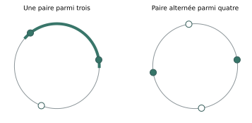
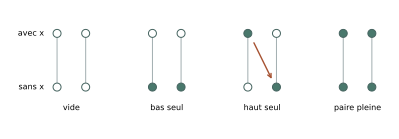
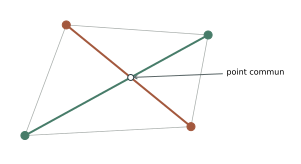

# ENS MP · Informatique-mathématiques 2014 · Corrigé brut

*Corrigé rédigé par IA, non officiel. Signalez toute erreur.*

**Rédaction** · GPT-6.2 Astra Ultra · vitesse non renseignée · 25 novembre 2026

Le sujet appelle dimension VC le plus grand cardinal d’une partie pulvérisée **augmenté de 1**. Nous employons cette convention dans toutes les réponses. La trace sur $U$ est la famille des intersections des hyperarêtes avec $U$.

## I · Dimension et traces

### Question 1 · Compter les familles d’hyperarêtes

**a.** Chaque sommet peut être choisi ou exclu indépendamment. Il existe donc $2^n$ parties de $S$ et $2^n$ est le nombre maximal d’hyperarêtes, réalisé par $H=\mathcal P(S)$.

**b.** Le choix de chacune des $2^n$ hyperarêtes est binaire. Il y a $2^{2^n}$ hypergraphes, y compris celui qui ne possède aucune hyperarête.

**c.** Fixons un élément d’un ensemble à $p$ éléments. Les parties à $q$ éléments qui l’évitent sont au nombre de $\binom{p-1}{q}$. Celles qui le contiennent sont obtenues en lui adjoignant $q-1$ des $p-1$ autres éléments. En additionnant ces deux classes disjointes, on obtient $\binom pq=\binom{p-1}q+\binom{p-1}{q-1}$.

### Question 2 · Comparer les traces emboîtées

**a.** Prenons $S=V=\{1,2\}$, $U=\{1\}$ et $H=\{\{1,2\}\}$. La seule trace sur $U$ est $\{1\}$, absente de la famille des traces sur $V$.

**b.** Si $\alpha\cap V=\beta\cap V$, intersecter chaque membre avec $U\subseteq V$ donne $\alpha\cap U=\beta\cap U$. La contraposée est l’implication demandée.

**c.** L’application $B\mapsto B\cap U$ de $H|_V$ dans $H|_U$ est surjective, puisque $\alpha\cap U=(\alpha\cap V)\cap U$. Les ensembles étant finis, $\#(H|_U)\leq \#(H|_V)$, où le symbole de cardinalité compte les traces distinctes.

### Question 3 · Intervalles de la droite et arcs d’un cercle

**a.** Deux points distincts sont pulvérisés. Un intervalle disjoint les évite, un intervalle réduit à un point sélectionne chaque singleton et un grand intervalle contient les deux. Pour trois points $x<y<z$, tout intervalle contenant $x$ et $z$ contient $y$. Le plus grand cardinal pulvérisé est 2, et la dimension **selon la définition du sujet** vaut $3$.

**b.** Pour trois points du cercle, toute paire est sélectionnée par l’arc joignant ces deux points en évitant le troisième. Les singletons, l’ensemble vide et le triplet s’obtiennent aussi, ce dernier par un intervalle angulaire de longueur $2\pi$. Pour quatre points dans l’ordre cyclique, deux points alternés ne peuvent former la trace d’un arc connexe. Un intervalle de longueur au moins $2\pi$ donne tout le cercle et ne change pas ce raisonnement. Tout sous-ensemble d’un ensemble pulvérisé est pulvérisé, donc aucun ensemble plus grand ne convient. Le cardinal maximal est 3 et la dimension vaut $4$, même lorsque $n=3$.

### Question 4 · Borne de Sauer–Shelah

**a.** Deux hyperarêtes distinctes diffèrent sur au moins un élément $x$. Leurs traces sur $\{x\}$ sont alors $\varnothing$ et $\{x\}$, ce qui donnerait une dimension au moins 2. Ainsi la dimension 1 impose $|H|\leq1$.

**b.** Pour chaque $B\subseteq S\setminus\{x\}$, la trace $B$ a pour seuls antécédents possibles $B$ et $B\cup\{x\}$. Il y a au moins un antécédent quand $B\in H'$ et un second exactement quand $B\in H''$. En additionnant les tailles de ces fibres, $|H|=|H'|+|H''|$.

**c.** Si $U$ est pulvérisé par $H'$, il l’est par $H$ puisque sa trace ne dépend pas de la présence de $x$. Si $U$ est pulvérisé par $H''$, chaque trace sur $U$ possède deux témoins dans $H$, l’un avec $x$, l’autre sans. Ainsi $U\cup\{x\}$ est pulvérisé par $H$. Les deux inégalités sur les dimensions suivent. Une famille vide ne pulvérise même pas $\varnothing$. Quand la définition écrite ne lui affecte pas de maximum, on peut lui donner conventionnellement la dimension 0 ou traiter séparément sa contribution nulle aux comptages.

**d.** Posons $F(n,d)=\sum_{i=0}^{d-1}\binom ni$, en convenant que $\binom ni=0$ pour $i>n$ et que $F(n,0)=0$. On montre par récurrence sur $n$ que toute famille de dimension au plus $d$ a cardinal au plus $F(n,d)$. Pour $n=0$, la seule hyperarête possible est le vide. Pour $d=1$ on dispose de **a**, et la famille vide vérifie toute borne applicable. Sinon **b–c** et la récurrence donnent

$$
|H|\leq F(n-1,d)+F(n-1,d-1)=F(n,d).
$$

La dernière égalité suit terme à terme de la formule de Pascal. Le cas $d>n$ est également immédiat par la borne $2^n$.

**e.** Prendre toutes les parties de taille au plus $d-1$. Leur nombre est exactement $F(n,d)$. Tout ensemble à $d-1$ éléments est pulvérisé car toutes ses parties sont présentes. Aucun ensemble à $d$ éléments ne peut être sa propre trace. La dimension vaut bien $d$.

## II · Compression d’un hypergraphe

### Question 5 · Comprimer dans une direction sans perdre d’arêtes

Une paire $\{B,B\cup\{x\}\}$ contient zéro, une ou deux hyperarêtes. Le décalage n’affecte pas les paires vides ou pleines. Si la paire contient une seule hyperarête, le décalage garde ou place cette arête en position basse $B$. Ainsi la bijection de $H$ vers $D_x(H)$ descend uniquement les arêtes hautes dont la position basse était absente. Deux paires différentes restent disjointes. Donc $|D_x(H)|=|H|$.

### Question 6 · Faire passer une compression à travers une restriction

**a.** Si $x\notin U$, descendre une arête ne change pas son intersection avec $U$. Dans une paire pleine les traces sont également conservées. Ainsi $(D_xH)|_U=H|_U$. Comme les traces ne contiennent pas $x$, $D_x(H|_U)=H|_U$ aussi.

**b.** Soit $B$ une trace sur $U$ d’une arête de $D_xH$, avec $x\in U$. Si $x\notin B$, il existait dans $H$ une arête dont la trace était $B$ ou $B\cup\{x\}$. Le décalage dans les traces garde alors $B$. Si $x\in B$, l’arête haute dont elle provient a survécu et sa partenaire basse appartenait à $H$. Les deux traces $B$ et $B\setminus\{x\}$ étaient donc présentes et $B$ survit encore dans $D_x(H|_U)$. On a bien l’inclusion annoncée.

### Question 7 · La compression ne fait pas croître la dimension

Si $U$ est pulvérisé par $D_x H$, la question 6 donne $\mathcal P(U)\subseteq D_x(H|_U)$. La compression préserve le cardinal par la question 5. Ainsi $\#(H|_U)\geq 2^{|U|}$. Puisque les traces sur $U$ sont toutes des parties de $U$, on a égalité et $H$ pulvérise aussi $U$. Le maximum des tailles pulvérisées ne peut augmenter.

### Question 8 · Stabilisation des compressions cycliques

**a.** Posons $P(K)=\sum_{A\in K}|A|$. Quand $D_xK\neq K$, au moins une arête descend et chacune de ces descentes enlève une unité à $P$. L’entier $P\geq0$ ne peut décroître strictement qu’un nombre fini de fois. Après le dernier changement, la famille est fixe. Comme chaque coordonnée apparaît encore dans la suite cyclique, $H^*$ est fixe pour chaque $D_x$.

**b.** Si $A\in H^*$ et $x\in A$, alors $A\setminus\{x\}\in H^*$, sinon cette direction ferait descendre $A$. Par suppressions successives, toutes les parties de $A$ appartiennent à $H^*$ et $A$ est pulvérisé. Les questions 6–7 donnent donc $|A|\leq\dim_{\rm VC}(H^*)-1\leq\dim_{\rm VC}(H)-1$.

**c.** Les compressions préservent le nombre d’arêtes. Or chaque arête de $H^*$ a au plus $d-1$ sommets et il n’existe que $\sum_{i=0}^{d-1}\binom ni$ telles parties. D’où la même borne pour $|H|$.

## III · Hypergraphes géométriques

### Question 9 · Caractériser l’enveloppe convexe

**a.** Si deux points appartiennent à l’intersection, leur segment appartient à chacun des convexes et donc à l’intersection. Pour une famille vide, l’intersection universelle est $\mathbb R^d$, convexe lui aussi.

**b.** Si $A$ est convexe, il appartient à la famille dont on prend l’intersection pour définir $\operatorname{conv}(A)$. Comme $A$ est contenu dans tous les membres, on a égalité. Inversement l’enveloppe est convexe par **a**, donc l’égalité entraîne la convexité. La propriété (3) implique la convexité en prenant $n=2$. Pour la réciproque, supposons $A$ convexe et raisonnons par récurrence sur le nombre de termes d’une combinaison convexe. Si le dernier coefficient vaut 1, la combinaison est le dernier point. Sinon normalisons les autres coefficients par leur somme $1-\lambda_n>0$. Ils définissent un point $y\in A$ par hypothèse de récurrence, et $(1-\lambda_n)y+\lambda_n x_n\in A$ par convexité. Cela traite aussi les coefficients nuls.

**c.** Toute combinaison convexe finie de points de $A$ appartient à tout convexe contenant $A$, donc à l’enveloppe. Réciproquement, l’ensemble de ces combinaisons contient $A$ par les combinaisons à un terme. Il est convexe, car combiner deux de ses éléments revient à concaténer leurs listes après multiplication respective des coefficients par $\lambda$ et $1-\lambda$. Il contient donc l’enveloppe. Pour $A=\varnothing$ les deux ensembles sont vides.

### Question 10 · Tester l’intersection avec un demi-espace fermé

**a.** Si $x\cdot c\leq t$ et $y\cdot c\leq t$, alors $(\lambda x+(1-\lambda)y)\cdot c\leq\lambda t+(1-\lambda)t=t$ pour $0\leq\lambda\leq1$. Cela prouve la convexité. Le même raisonnement vaut avec des inégalités strictes pour le demi-espace ouvert.

**b.** Comme $X\subseteq\operatorname{conv}(X)$, une intersection avec $X$ implique une intersection avec l’enveloppe. Si $D\cap X=\varnothing$, tous les points de $X$ vérifient $x\cdot c>t$. Toute combinaison convexe finie vérifie alors elle aussi une inégalité stricte, puisqu’au moins un coefficient est positif. Par la question 9, l’enveloppe reste disjointe de $D$. Cela donne l’autre implication, y compris pour $X$ vide.

### Question 11 · Partition de Radon

**a.** Les $n\geq d+2$ vecteurs $(x_i,1)$ de $\mathbb R^{d+1}$ sont liés. Une relation non triviale donne simultanément $\sum_i\lambda_ix_i=0$ et $\sum_i\lambda_i=0$.

**b.** Les indices à coefficients strictement positifs et strictement négatifs forment deux classes non vides. La somme des positifs $a$ égale l’opposé de la somme des négatifs. Alors

$$
z=\sum_{\lambda_i>0}\frac{\lambda_i}{a}x_i
=\sum_{\lambda_i<0}\frac{-\lambda_i}{a}x_i
$$

est une combinaison convexe de chaque classe. Affecter les indices à coefficient nul au premier groupe, par exemple, achève la partition sans faire perdre $z$ à aucune enveloppe.

### Question 12 · Demi-espaces et dimension VC

Soit $U\subseteq S$ de cardinal $d+2$. Il possède une partition $V_1,V_2$ dont les enveloppes se rencontrent. Si un demi-espace fermé $D$ avait pour trace $V_1$ sur $U$, sa convexité donnerait $\operatorname{conv}(V_1)\subseteq D$. Comme $D$ évite $V_2$, la question 10 donnerait $D\cap\operatorname{conv}(V_2)=\varnothing$. C’est incompatible avec le point commun des enveloppes. Ainsi aucun ensemble à $d+2$ éléments n’est pulvérisé et aucun ensemble plus grand ne l’est non plus. La dimension au sens du sujet est au plus $d+2$. Lorsque $|S|<d+2$, la borne découle directement de la taille de $S$.

### Question 13 · Convexes sur des points du cercle

Pour toute partie $B\subseteq S$, choisissons $C=\operatorname{conv}(B)$. Si $x\in S\setminus B$, tout $y\in B$ vérifie $x\cdot y<1$ car les deux vecteurs unitaires sont distincts. Pour toute combinaison convexe de ces $y$ on conserve l’inégalité stricte, tandis que $x\cdot x=1$. Donc $x\notin C$. Si $B$ est vide, on prend le convexe vide. Ainsi $S\cap C=B$ pour chaque partie et $S$ tout entier est pulvérisé. La dimension vaut $n+1$. Elle peut donc devenir arbitrairement grande même dans le plan.

## IV · Approximation et points centraux

### Question 14 · Théorème de Helly

**a.** Choisissons pour chaque $k$ un point $x_k\in\bigcap_{j\ne k}C_j$. Si $x_k=x_l$ pour deux indices distincts, ce point appartient à tous les $C_j$, y compris $C_k$ et $C_l$ par l’autre témoin. Sinon, les $x_k$ sont distincts et, par la question 11, il existe deux groupes d’indices disjoints, non vides, de réunion tous les indices, dont les enveloppes de témoins ont un point commun $z$. Pour chaque $j$, au moins un de ces groupes évite l’indice $j$. Tous ses témoins sont dans $C_j$ et leur enveloppe aussi par convexité. Ainsi $z\in C_j$ pour chaque $j$.

**b.** Par hypothèse, toute sous-famille de $d+1$ ensembles a une intersection non vide. Si c’est vrai pour toute sous-famille de $k\geq d+1$ ensembles, appliquons **a** à chaque sous-famille de $k+1$ ensembles. Toutes ses intersections omettant un membre sont non vides, donc son intersection totale l’est. La récurrence donne le résultat jusqu’à $k=n$.

### Question 15 · Existence d’un point central

**a.** Le complément d’un demi-espace fermé est un demi-espace ouvert et réciproquement. Si $c$ appartient à un demi-espace fermé contenant strictement moins de $n/(d+1)$ points, il est extérieur à un ouvert contenant strictement plus de $dn/(d+1)$ points. La réciproque suit par le même passage au complément. Nier cet énoncé donne exactement la caractérisation demandée.

**b.** Pour $C_i=\operatorname{conv}(S\cap D_i)$ dans $\mathcal C(S)$, on a $|S\setminus D_i|<n/(d+1)$. L’union de $d+1$ tels compléments contient strictement moins de $n$ éléments. Il existe un point de $S$ présent dans chaque $D_i$ et donc dans chaque $C_i$.

**c.** La famille $\mathcal C(S)$ est finie puisque seuls les sous-ensembles de l’ensemble fini $S$ interviennent. Elle est non vide car il existe un demi-espace ouvert contenant tout $S$. Si elle a au moins $d+2$ membres, appliquer la question 14 en utilisant **b**. Si elle en possède moins, on peut répéter certains membres pour en considérer $d+1$ dans **b**. L’intersection de toute la famille contient donc un point $c$. Pour chaque ouvert $D$ considéré, on a $c\in\operatorname{conv}(S\cap D)\subseteq D$. Par **a**, $c$ est central.

### Question 16 · Terminaison de la méthode et taille du filet

Posons $m=\lceil\varepsilon n\rceil$. Supposons d’abord $m\geq3$. Après chaque ajout, marquons tout triangle de $S$ dont l’enveloppe contient au moins un point de $T$. Si l’algorithme choisit $C$, aucun triangle de $C\cap S$ n’était marqué, car son enveloppe est incluse dans $C$ et $C\cap T=\varnothing$. Par le lemme de sélection admis, le point central ajouté marque au moins $(2/9)\binom{|C\cap S|}{3}\geq(2/9)\binom m3$ nouveaux triangles. Comme il n’y en a que $\binom n3$, le nombre d’ajouts vérifie

$$
|T|\leq\frac{9\binom n3}{2\binom m3}.
$$

Quand $m\geq4$, le rapport des coefficients binomiaux est au plus $(n/m)^3 m^2/((m-1)(m-2))\leq(8/3)\varepsilon^{-3}$. On obtient ainsi $|T|\leq12\varepsilon^{-3}$. Pour $m=3$, au moins un triangle entier est marqué à chaque pas et $n\leq3/\varepsilon$, donc $|T|\leq\binom n3\leq (9/2)\varepsilon^{-3}$.

Si $m\leq2$, un témoin $C\cap S$ peut avoir moins de trois points. Marquons en plus les singletons et les paires dont l’enveloppe contient un point choisi. Tout pas marque au moins une nouvelle partie de taille 1, 2 ou 3. Pour trois points ou plus, le lemme le montre. Pour un singleton ou une paire, tout point central appartient à son enveloppe. En effet, un point extérieur à un point ou à un segment est contenu dans un demi-espace fermé disjoint de celui-ci, par la perpendiculaire au segment reliant le point à sa projection la plus proche. Cela contredirait la centralité. La nouvelle partie n’était pas marquée puisque son enveloppe est dans $C$. Le nombre d’ajouts est alors au plus

$$
\binom n1+\binom n2+\binom n3=(n^3+5n)/6\leq n^3\leq8\varepsilon^{-3}.
$$

La terminaison et la borne uniforme $|T|\leq12\varepsilon^{-3}$ valent donc pour tout $n\geq1$. À l’arrêt, tout convexe contenant au moins $\varepsilon n$ points rencontre $T$, ce qui est exactement la propriété d’un ensemble $\varepsilon$-fin. Le point central ajouté se trouve dans le convexe choisi, comme le montrent les enveloppes des parties qu’il vient de marquer.
