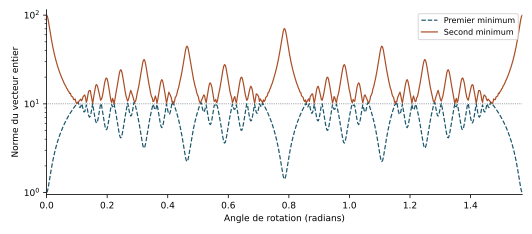

# ENS MP — Mathématiques C 2014 · Corrigé brut

*Corrigé rédigé par IA, non officiel. Signalez toute erreur.*

**Rédaction** · GPT-6.2 Astra Ultra · vitesse non renseignée

**Révision** · GPT-6.2 Astra Ultra · vitesse non renseignée · 26 novembre 2026

**Minima de Minkowski en dimension deux.** On note $\lambda_1,\lambda_2$ les deux plus petites longueurs nécessaires pour trouver deux vecteurs entiers indépendants, dans la norme associée à $M$. Les moyennes angulaires sont normalisées par la longueur de leur intervalle.

## A.I. Norme associée à une matrice positive

### Question A.I.1

Par le théorème spectral, $M=P\operatorname{diag}(\mu_1^2,\mu_2^2)P^t$ avec $P$ orthogonale. La matrice $A=\operatorname{diag}(\mu_1,\mu_2)P^t$ est inversible et $A^tA=M$.

### Question A.I.2

On a $u^t Mv=u^t A^tAv=(Au)^tAv$. En prenant $v=u$ et la racine positive, $\|u\|_M=\|Au\|$.

### Question A.I.3

Le produit est bilinéaire, symétrique et positif par A.I.2. Si $\langle u,u\rangle_M=0$, alors $Au=0$, et l’inversibilité donne $u=0$. La fonction $\|Au\|$ est donc définie positive, absolument homogène et sous-additive par la norme euclidienne. C’est la norme du produit scalaire obtenu.

### Question A.I.4

Si $P^tu=(s,t)$, alors $\|u\|_M^2=\mu_1^2s^2+\mu_2^2t^2$ et $s^2+t^2=\|u\|^2$. Encadrer chaque coefficient par $\mu_1^2$ et $\mu_2^2$ puis prendre les racines donne l’encadrement.

### Question A.I.5

$u\in B^M(r)$ équivaut à $Au\in B(r)$ par A.I.2, et $A$ est bijective. Donc $AB^M(r)=B(r)$. L’aire est multipliée par $|\det A|=\sqrt{\det M}$. Il en résulte $\mathrm{Aire}(B^M(r))=\pi r^2/\sqrt{\det M}$.

## A.II. Encadrement et existence des minima

### Question A.II.1

Pour $z\in\mathbb Z^2\setminus\{0\}$, $\|z\|_M\ge\mu_1\|z\|\ge\mu_1$. L’infimum conserve cette borne.

### Question A.II.2

$e_1,e_2$ sont indépendants et chacun a norme $M$ au plus $\mu_2$ par A.I.4. Classons-les du plus court au plus long. Cette paire est admissible et donne $\lambda_2\le\mu_2$.

### Question A.II.3

Toute paire indépendante comporte un vecteur non nul de plus grande norme. Celle-ci vaut au moins $\lambda_1$ et donc $\lambda_2\ge\lambda_1$. Avec les deux questions précédentes, $\mu_1\le\lambda_1\le\lambda_2\le\mu_2$.

### Question A.II.4

À permutation des axes près, $M=\operatorname{diag}(\mu_1^2,\mu_2^2)$. Le vecteur $e_1$ réalise $\lambda_1=\mu_1$. Dans une paire indépendante, l’un des vecteurs a une seconde coordonnée entière non nulle, donc une norme $M$ au moins $\mu_2$. A.II.2 donne l’égalité $\lambda_2=\mu_2$, y compris lorsque les valeurs propres sont égales.

### Question A.II.5

Il suffit de considérer les candidats de norme $M$ au plus $\mu_2$, car la base canonique fournit une paire dans cette borne. Ils vérifient $\|z\|\le\mu_2/\mu_1$ et forment donc un ensemble fini. Le minimum sur ses vecteurs non nuls et celui sur ses paires indépendantes triées sont atteints.

## B.I. Bases entières

### Question B.I.1.a

Si $P=[u,v]$ a déterminant $\pm1$, il est inversible. Son inverse est sa comatrice transposée divisée par $\det P$. Le numérateur est entier et le dénominateur est une unité de $\mathbb Z$, donc $P^{-1}$ est entière.

### Question B.I.1.b

La colonne $(\alpha,\beta)^t=P^{-1}z$ est entière par (a) et l’égalité $P(\alpha,\beta)^t=z$ donne $z=\alpha u+\beta v$.

### Question B.I.2

En exprimant $e_1,e_2$ par hypothèse, on forme une matrice entière $B$ avec $[u,v]B=I$. Donc $\det[u,v]\det B=1$ dans $\mathbb Z$. Les deux facteurs sont des unités et $|\det[u,v]|=1$.

## B.II. Existence d’une base réduite

### Question B.II.1

Choisissons $u$ de norme $\lambda_1$ et une paire indépendante réalisant $\lambda_2$. Un des membres $v$ n’est pas colinéaire à $u$. Comme $\|u\|_M\le\|v\|_M\le\lambda_2$ et $(u,v)$ est admissible, $\|v\|_M=\lambda_2$.

### Question B.II.2.a

Prenons $m,n\in\mathbb Z$ les plus proches de $\alpha,\beta$. Alors $z'=z-mu-nv$ est entier et ses coordonnées $\alpha'=\alpha-m$, $\beta'=\beta-n$ sont de module au plus $1/2$. Au moins l’une n’est pas nulle, puisque les coordonnées initiales ne sont pas toutes entières. La liberté de $u,v$ donne $z'\ne0$.

### Question B.II.2.b

Si $\beta'=0$, $\|z'\|_M\le\lambda_1/2<\lambda_1$. Si $\beta'\ne0$ et $\alpha'=0$, $\|z'\|_M\le\lambda_2/2$. Si les deux sont non nuls, $\alpha'u,\beta'v$ sont indépendants et l’inégalité triangulaire est stricte pour la norme du produit scalaire. Ainsi $\|z'\|_M<(|\alpha'|+|\beta'|)\lambda_2\le\lambda_2$.

### Question B.II.2.c

Le premier cas de (b) contredit la définition de $\lambda_1$. Dans l’autre, $u,z'$ sont indépendants et $\|u\|_M=\lambda_1\le\|z'\|_M<\lambda_2$. Cela contredit le second minimum. Toute décomposition d’un vecteur entier dans $(u,v)$ est donc entière et B.I.2 prouve que cette famille est une base du réseau.

## B.III. Géométrie du produit des minima

### Question B.III.1

Le triangle de sommets $0,e_1,e_2$ est d’aire $1/2$. Sa transformation par $[a,b]$ donne $T$, d’aire $|\det(a,b)|/2$.

### Question B.III.2

Les quatre triangles de sommet commun 0 ont chacun aire $|\det(u',v')|/2=1/(2\lambda_1\lambda_2)$, puisque $|\det(u,v)|=1$. Ainsi $\mathrm{Aire}(Q)=2/(\lambda_1\lambda_2)$.

### Question B.III.3

Pour $|\alpha|+|\beta|\le1$, l’inégalité triangulaire donne $\|\alpha u'+\beta v'\|_M\le1$. Donc $Q\subseteq B^M(1)$ et $2/(\lambda_1\lambda_2)\le\pi/\sqrt{\det M}$. On en tire la borne inférieure $(2/\pi)\sqrt{\det M}$ du produit.

### Question B.III.4.a

Chacun de $v\pm u$ est indépendant de $u$. Il a norme au moins $\lambda_1=\|u\|_M$ et la paire avec $u$ est admissible dans la définition de $\lambda_2$. D’où $\|v\pm u\|_M\ge\lambda_2=\|v\|_M$.

### Question B.III.4.b

On trouve $\|u\|_M^2\pm2\langle u,v\rangle_M\ge0$. Donc $|\langle u,v\rangle_M|\le\lambda_1^2/2$. La division par $\lambda_1\lambda_2$ donne $|\langle u',v'\rangle_M|\le\lambda_1/(2\lambda_2)\le1/2$.

### Question B.III.4.c

Posons $a=|\alpha|,b=|\beta|$. Alors $ab\le(a+b)^2/4$ et $a^2+b^2-ab=(a+b)^2-3ab\ge(a+b)^2/4\ge1/4$. En développant le carré de la norme et en utilisant (b), $\|\alpha u'+\beta v'\|_M^2\ge\alpha^2+\beta^2-|\alpha\beta|\ge1/4$.

### Question B.III.4.d

La preuve précédente donne en fait $\|\alpha u'+\beta v'\|_M\ge(|\alpha|+|\beta|)/2$. Donc la boule fermée de rayon $1/2$ est incluse dans $Q$. La comparaison des aires donne $\pi/(4\sqrt{\det M})\le2/(\lambda_1\lambda_2)$. Avec B.III.3,
$$\frac2\pi\sqrt{\det M}\le\lambda_1\lambda_2\le\frac8\pi\sqrt{\det M}.$$

## C.I. Continuité et valeurs moyennes

### Question C.I.1

Par Cauchy–Schwarz et A.I.4, $|\|u\|_{M'}^2-\|u\|_M^2|\le\|M'-M\|\,\|u\|^2\le\nu\|u\|_M^2$. L’hypothèse $\nu<1$ permet de prendre les racines dans les deux inégalités et donne les facteurs $\sqrt{1-\nu}$ et $\sqrt{1+\nu}$.

### Question C.I.2

Le premier minimum est un infimum sur un ensemble fixe de vecteurs. Le second s’écrit $\inf_{\det(u,v)\ne0}\max(\|u\|_M,\|v\|_M)$ sur les paires entières. Pour chaque candidat, les comparaisons de C.I.1 s’appliquent, y compris au maximum des deux normes. Prendre les infimums donne pour $j=1,2$,
$$\sqrt{1-\nu}\,\lambda_j(M)\le\lambda_j(M')\le\sqrt{1+\nu}\,\lambda_j(M).$$

### Question C.I.3

À $M$ fixée, $\mu_1(M)>0$. Quand $M'\to M$ parmi les matrices définies positives, $\nu\to0$. Les bornes de C.I.2 convergent toutes deux vers $\lambda_j(M)$, d’où la continuité.

### Question C.I.4

Les matrices $M_\theta=R_\theta^t M R_\theta$ sont définies positives et continues en $\theta$. Les deux minima sont donc continus en l’angle. De plus $\lambda_1(M_\theta)\ge\mu_1(M)>0$ car la rotation conserve les valeurs propres. Les trois intégrandes sont continues sur le segment et leur moyenne existe.

### Question C.I.5

Écrivons $\mathbb E$ pour l’intégrale angulaire divisée par $2\pi$ et $L=\lambda_1(M_\theta)>0$. Par Cauchy–Schwarz, $1=(\mathbb E[\sqrt L/\sqrt L])^2\le\mathbb E[L]\,\mathbb E[1/L]$. Cela donne la minoration demandée.

### Question C.I.6

Par B.III.4.d, $\lambda_2(M_\theta)\le(8/\pi)\sqrt{\det M}/\lambda_1(M_\theta)$ car $\det M_\theta=\det M$. Prendre la moyenne donne le résultat.

## C.II. Estimation d’une intégrale avec seuil

### Question C.II.1

Si $z=r(\cos\varphi,\sin\varphi)$, alors $\|R_\theta z\|_M=r\sqrt{\cos^2(\theta+\varphi)+\mu^4\sin^2(\theta+\varphi)}$. La moyenne sur une période est invariante par translation de l’angle. Les symétries des carrés réduisent l’intervalle à $[0,\pi/2]$ avec sa mesure normalisée $2\,d\theta/\pi$. Cela vaut aussi après application du seuil $E$, dont les éventuels sauts ne compromettent pas l’intégrale.

### Question C.II.2

Comme $\sin''=-\sin\le0$, le sinus est concave et $\sin\theta\ge2\theta/\pi$ sur $[0,\pi/2]$. Le radical est au moins $\mu^2\sin\theta\ge2\mu^2\theta/\pi$ et au moins 1 car $\mu\ge1$. D’où le maximum annoncé.

### Question C.II.3

$E$ étant croissante, majorons son argument par $1/[r\max(1,2\mu^2\theta/\pi)]$. Cela vaut $1/r$ jusqu’à $a=\pi/(2\mu^2)$, puis $\pi/(2r\mu^2\theta)$ jusqu’à $b=\pi/(\mu r)$, enfin le seuil donne zéro. Ici $b\ge a$ car $r\le2\mu$. Si $b>\pi/2$, prolonger le second morceau positif jusqu’à $b$ ne fait que majorer l’intégrale réelle. En multipliant les deux intégrales par $2/\pi$, on obtient $I(z)\le J(r)$.

### Question C.II.4

Avec $a,b$ ci-dessus,
$$J(r)=\frac2\pi\left(\frac a r+\frac{\pi}{2\mu^2r}\ln(b/a)\right)
=\frac{1+\ln(2\mu/r)}{\mu^2r}=\frac{1}{\mu^2r}\ln\frac{2e\mu}{r}.$$

## C.III. Moyenne des minima du réseau tourné

### Question C.III.1

Un minimiseur entier $z$ existe et $1\le\|z\|\le\lambda_1(M_\theta)$ puisqu’ici $\mu_1=1$. D’autre part $\lambda_1^2\le\lambda_1\lambda_2\le(8/\pi)\sqrt{\det M}=(8/\pi)\mu^2<4\mu^2$. Ainsi $z\in Z$ et $\lambda_1(M_\theta)=\min_{z\in Z}\|R_\theta z\|_M$. Le plus grand réciproque est $1/\lambda_1\ge1/(2\mu)$, donc il survit au seuil. Cela donne l’égalité avec le maximum des $E$.

### Question C.III.2

$Z$ est fini. La formule précédente donne $1/\lambda_1(M_\theta)\le\sum_{z\in Z}E(1/\|R_\theta z\|_M)$. En prenant la moyenne on obtient la somme des $I(z)$.

### Question C.III.3.a

Pour $z\in Z$, $1\le\|z\|_\infty\le\|z\|\le2\mu$. Donc $Z\subseteq\bigcup_{1\le k\le2\mu}Z_k$. La couronne carrée compte $(2k+1)^2-(2k-1)^2=8k$ points.

### Question C.III.3.b

Sur $[1,2\mu]$, $J'(r)=-(1+\ln(2e\mu/r))/(\mu^2r^2)<0$. Par C.II, tout $z\in Z\cap Z_k$ vérifie $I(z)\le J(\|z\|)\le J(k)$. Additionner et majorer le nombre d’éléments de l’intersection par $8k$ donne le résultat.

### Question C.III.3.c

$kJ(k)=\mu^{-2}\ln(2e\mu/k)$. La fonction $x\mapsto\ln(2e\mu/x)$ est décroissante et positive sur $]0,2\mu]$. Chaque terme de la somme est majoré, avant le facteur $\mu^{-2}$, par l’intégrale sur $[k-1,k]$. L’intégrale impropre existe et
$$\int_0^{2\mu}\ln(2e\mu/x)\,dx=\left[x\ln(2e\mu/x)+x\right]_0^{2\mu}=4\mu.$$
Ainsi $C=4$ convient, sans supposer $2\mu$ entier. L’indication découle aussi de $\sum_{k=1}^n\ln k\ge\int_1^n\ln x\,dx$.

### Question C.III.3.d

Les questions 2, 3.a, 3.b et 3.c donnent $\mathbb E[1/\lambda_1(M_\theta)]\le\sum_{z\in Z} I(z)\le8\sum_{1\le k\le2\mu}kJ(k)\le8C/\mu=32/\mu$.

### Question C.III.4

Par C.I.5, $\mathbb E\lambda_1\ge\mu/(8C)$. Par C.I.6, $\mathbb E\lambda_2\le(8/\pi)\mu^2(8C/\mu)=64C\mu/\pi$. Comme $\lambda_1\le\lambda_2$ et $\mu=(\det M)^{1/4}$, on peut prendre $c_1=1/32$ et $c_2=256/\pi$.

### Question C.III.5

Choisir une base propre orthonormée directe, quitte à changer le signe d’un vecteur. Alors $M$ est conjuguée par une rotation à $\mu_1^2\operatorname{diag}(1,\mu^4)$ avec $\mu=(\mu_2/\mu_1)^{1/2}$. La rotation initiale translate l’angle, sans changer la moyenne, et le facteur $\mu_1^2$ multiplie les deux minima par $\mu_1$. Or $\mu_1\mu=\sqrt{\mu_1\mu_2}=(\det M)^{1/4}$. Les mêmes constantes conviennent.

### Question C.III.6

Pour chaque angle, A.II.3 place les minima entre $\mu_1$ et $\mu_2$, ici 1 et 100. Leurs **moyennes** sont chacune de l’ordre de $\sqrt{\mu_1\mu_2}=10$, avec des constantes universelles. Aux angles extrêmes de la figure, les axes propres sont alignés avec le réseau et les valeurs 1 et 100 sont réalisées. Des pics du second minimum accompagnent des creux du premier, en accord avec le contrôle ponctuel du produit à l’échelle $\mu_1\mu_2=100$. Le graphique est en ordonnées logarithmiques.

À l’angle $\pi/4$, la forme quadratique sur $(m,n)$ s’écrit $\big((m-n)^2+10^4(m+n)^2\big)/2$. Le vecteur $(1,-1)$ donne $\lambda_1=\sqrt2$. Tout vecteur indépendant a $m+n\ne0$. Si $|m+n|=1$, alors $m-n$ est impair et la plus petite norme au carré est $10001/2$, atteinte en $(1,0)$. Pour $|m+n|\ge2$, elle est encore plus grande. Ainsi $\lambda_2=\sqrt{10001/2}$, ce qui explique le pic visible au milieu de l’intervalle $[0,\pi/2]$.

## D. Longueur euclidienne des bases réduites

### Question D.I.1

Les deux vecteurs sont entiers non nuls, donc de norme euclidienne au moins 1. Pour chacun, $\|z\|\le\|z\|_M/\mu_1\le\lambda_2/\mu_1\le\mu_2/\mu_1=\kappa(M)$, ce qui donne toute la chaîne.

### Question D.I.2.a

La forme est $\|(x,y)\|_M^2=(x-\mu y)^2+\mu^2 y^2$. Pour un entier non nul avec $y=0$ elle est au moins 1, et pour $y\ne0$ elle est au moins $\mu^2\ge1$. Le vecteur $u=(1,0)$ réalise donc $\lambda_1=1$. Toute paire indépendante comporte un vecteur de $y\ne0$ et impose un maximum au moins $\mu$. Or $v=(\mu,1)$ a norme $M$ égale à $\mu$ et $\det(u,v)=1$. La base proposée est donc réduite.

### Question D.I.2.b

Le déterminant est $\mu^2$ et la trace $1+2\mu^2$. La plus grande valeur propre vaut $L=(1+2\mu^2+\sqrt{1+4\mu^4})/2$, d’où $\kappa=L/\mu$. Comme $\sqrt{1+4\mu^4}\le2\mu^2+1/(4\mu^2)$, on a $L\le2\mu^2+5/8$ pour $\mu\ge1$. Par ailleurs
$$2\mu\sqrt{1+\mu^2}-2\mu^2=\frac{2}{1+\sqrt{1+\mu^{-2}}}\ge\frac2{1+\sqrt2}>\frac58.$$
Donc $\kappa\le2\sqrt{1+\mu^2}=2\|v\|$.

### Question D.II

Pour toute base réduite choisie de $M_\theta$, D.I.1 donne plus précisément $\max(\|u\|,\|v\|)\le\lambda_2(M_\theta)/\mu_1(M)$. L’intégrale existe par l’hypothèse de régularité par morceaux. C.III.4–5 donnent
$$\mathbb E\max(\|u\|,\|v\|)\le c_2\frac{(\det M)^{1/4}}{\mu_1(M)}=c_2\sqrt{\kappa(M)}.$$
Ainsi $C_2=256/\pi$ convient. La borne valable à chaque angle croît linéairement en $\kappa$ et D.I.2 montre qu’elle est de cet ordre dans certains cas. La moyenne en rotation bénéficie d’une borne en racine carrée.
