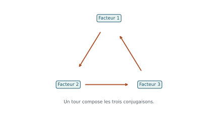

# ENS MP — Mathématiques D 2014 · Corrigé brut

*Corrigé rédigé par IA, non officiel. Signalez toute erreur.*

**Rédaction** · GPT-6.2 Astra Ultra · vitesse non renseignée

**Révision (tour 1)** · GPT-6.2 Astra Ultra · vitesse non renseignée · 26 novembre 2026

**Partitions, matrices monomiales et groupes de Heisenberg.** Le raffinement des partitions est ordonné du bloc unique vers les singletons. Une conjugaison intérieure oublie les facteurs scalaires, distinction qui intervient dans la partie V.

## I. Ordre sur les partitions

### Question I.1

L’unique bloc $\Omega_n$ de $P_-$ est la réunion de tous les blocs de $P$. À son tour, chaque bloc de $P$ est la réunion de ses singletons, qui sont des blocs de $P_+$. Donc $P_-\le P\le P_+$.

### Question I.2

Si $P\le Q$, un bloc $Q_j$ qui rencontre $P_i$ participe à la réunion égale à $P_i$ et s’y trouve donc inclus. Réciproquement, si tous les blocs rencontrés sont inclus, leur réunion est incluse dans $P_i$ et contient chacun de ses points, puisque $Q$ est une partition. Cela donne l’égalité demandée pour chaque $i$.

### Question I.3.a

La réflexivité vient de ce que tout bloc est inclus dans lui-même. Si $P\le Q\le R$, chaque bloc de $R$ se trouve dans un bloc de $Q$, lui-même dans un bloc de $P$, d’où la transitivité. Si $P\le Q$ et $Q\le P$, les blocs des deux partitions contenant un point fixé se contiennent mutuellement, donc coïncident. En parcourant tous les points on obtient $P=Q$.

### Question I.3.b

Pour $n=1$ il n’y a qu’une partition, pour $n=2$ les deux sont $P_-,P_+$, comparables par I.1. Pour $n\ge3$, prendre les partitions ayant respectivement comme seul bloc non singleton $\{1,2\}$ et $\{1,3\}$. Aucun des deux blocs n’est contenu dans un bloc de l’autre partition. Elles sont incomparables.

### Question I.4

La famille $R=\{P_i\cap Q_j:P_i\cap Q_j\ne\varnothing\}$ partitionne $\Omega_n$, et $P\le R$, $Q\le R$. Pour toute autre partition $E$ vérifiant les deux inégalités, un bloc de $E$ est contenu simultanément dans un $P_i$ et un $Q_j$, donc dans leur intersection. Ainsi $R\le E$ et $P\wedge Q=R$ avec la notation du sujet.

## II. Sous-groupes paraboliques et cycles

### Question II.1.a

Si $a,b$ sont dans le même bloc, la transposition conserve ce bloc et fixe tous les autres points. Si elle conserve chaque bloc, le bloc de $a$ doit contenir son image $b$. C’est l’équivalence annoncée.

### Question II.1.b

L’identité conserve chaque bloc, et cette préservation est stable par composition et inverse, donc $S_{n,P}$ est un sous-groupe. Le morphisme $\sigma\mapsto(\sigma|_{P_i})_i$ est injectif puisque les blocs couvrent $\Omega_n$, et surjectif car des permutations prescrites séparément sur les blocs se recollent. Après numérotation de chaque bloc, c’est l’isomorphisme sur $\prod_i S_{|P_i|}$.

### Question II.2.a

Si $P\le Q$, conserver chaque bloc de $Q$ fait conserver toute réunion de ces blocs, donc ceux de $P$. Réciproquement, si $S_{n,Q}\subseteq S_{n,P}$, deux éléments distincts d’un même bloc de $Q$ sont échangés par une transposition de $S_{n,Q}$, donc sont dans le même bloc de $P$ par II.1.a. Chaque bloc de $Q$ est inclus dans un bloc de $P$, y compris les singletons. Ainsi $P\le Q$.

### Question II.2.b

L’égalité des partitions implique celle des sous-groupes. L’égalité des sous-groupes donne les inclusions dans les deux sens, donc $P\le Q$ et $Q\le P$ par (a). L’antisymétrie donne $P=Q$.

### Question II.3

Une permutation dans les deux groupes conserve chaque $P_i\cap Q_j$, donc appartient à $S_{n,P\wedge Q}$ par I.4. L’inclusion réciproque découle de $P,Q\le P\wedge Q$ et II.2.a. Donc $S_{n,P\wedge Q}=S_{n,P}\cap S_{n,Q}$.

### Question II.4

L’ensemble des partitions d’un ensemble fini est fini. Toute famille non vide de sous-groupes paraboliques comporte donc un nombre fini non nul de membres distincts. Leur intersection est parabolique par récurrence à partir de II.3.

### Question II.5.a

$S_n=S_{n,P_-}$ contient $H$. L’intersection de tous les paraboliques contenant $H$ est donc définie, contient $H$ et est parabolique par II.4. Comme elle est incluse dans chacun des membres, elle en est le plus petit et en particulier l’unique minimal.

### Question II.5.b

La partition en orbites $R=\{H\cdot p:p\in\Omega_n\}$ est stabilisée bloc par bloc par $H$, donc $H\subseteq S_{n,R}$. Si $H\subseteq S_{n,Q}$, l’orbite de tout point reste dans son bloc de $Q$, d’où $Q\le R$ et $S_{n,R}\subseteq S_{n,Q}$. Ainsi $S_n(H)=S_{n,R}$ et $P(H)=R$ par II.2.b. L’action de $H$ sur chacune de ses orbites est transitive par définition.

### Question II.5.c

Le support du cycle est une seule orbite, parcourue par ses puissances. Les points hors du support sont fixes. $P(H)$ est formée du support et de tous les singletons extérieurs.

### Question II.6.a

Un $n$-cycle a pour seule orbite $\Omega_n$. Réciproquement, si l’orbite de 1 est tout $\Omega_n$, les itérés $1,\sigma(1),\ldots,\sigma^{n-1}(1)$ sont distincts et $\sigma^n(1)=1$. La permutation envoie chacun au suivant dans cette liste cyclique, donc est un $n$-cycle.

### Question II.6.b

Sur chaque orbite non singleton, les itérés d’un point décrivent un cycle. Le prolonger par l’identité hors de cette orbite. Les cycles ainsi obtenus ont des supports disjoints et leur produit coïncide avec $\sigma$ en tout point. Pour l’identité, on prend le produit vide.

### Question II.7.a

On a $f(\sigma)e_j=e_{\sigma(j)}$. Cela donne $f(\mathrm{id})=I$ et $f(\sigma)f(\tau)e_j=e_{\sigma(\tau(j))}$, donc $f(\sigma\tau)=f(\sigma)f(\tau)$. L’inverse est $f(\sigma^{-1})$. Enfin l’image de chaque vecteur de base détermine $\sigma$, d’où l’injectivité.

### Question II.7.b

Le déterminant composé avec $f$ est un morphisme. Les colonnes de $f(\sigma)$ sont orthonormées, donc son déterminant réel vaut $\pm1$. L’identité et toute transposition réalisent ces deux valeurs puisque $n\ge2$. L’image est $\{1,-1\}$.

### Question II.8.a

Sur les $l$ vecteurs d’un cycle, $f(\sigma)$ est un décalage cyclique. Un vecteur de base et ses $l-1$ premiers itérés forment une base et le $l$-ième itéré revient au départ, donc le bloc est compagnon de $T^l-1$. Les points fixes donnent des blocs $[1]$. Le polynôme caractéristique est
$$(T-1)^{n-\sum l_j}\prod_j(T^{l_j}-1).$$
Chaque cycle a déterminant $(-1)^{l_j-1}$, donc $\epsilon(\sigma)=(-1)^{\sum_j(l_j-1)}$.

### Question II.8.b

Le vecteur cyclique de chaque bloc de longueur $l$ montre que son polynôme minimal est $T^l-1$ : aucune combinaison des $l$ premiers itérés de degré moindre ne l’annule. Le minimal global est le ppcm unitaire de tous les $T^{l_j}-1$ et de $T-1$ s’il y a des points fixes. En particulier pour l’identité il vaut $T-1$.

## III. Sous-groupes maximaux

### Question III.1

Parmi les sous-groupes propres contenant $H$, il y a au moins $H$. Choisir l’un d’eux de cardinal maximal. Un sur-groupe strict aurait cardinal strictement supérieur et ne peut être propre. Ce sous-groupe est donc maximal dans $G$.

### Question III.2.a

Si $s\ge3$, fusionner deux blocs donne une partition plus grossière qui a encore au moins deux blocs. Son parabolique est strictement plus grand (une transposition entre les deux blocs fusionnés le montre) et reste propre. Cela contredit la maximalité. Comme $s\ge2$, $s=2$.

### Question III.2.b

Si $|P_1|=|P_2|$ et $n\ge3$, cette taille est au moins deux. Le stabilisateur de la paire non ordonnée $\{P_1,P_2\}$ contient strictement $S_{n,P}$ car il autorise un échange des blocs. Il est propre car une seule transposition entre blocs n’en préserve pas la paire non ordonnée. Ceci contredit la maximalité, donc $2|P_1|\ne n$.

### Question III.3

Notons $U=Q_1$, $W=Q_2$ avec $|U|>|W|$. Si un sous-groupe $K$ contient strictement $S_{n,Q}$, prendre $g\in K$ ne préservant pas $U$. Alors $g(U)$ rencontre $W$ et rencontre aussi $U$ par cardinalité. Il existe $i,j\in U$ dont les images sont dans des blocs distincts. Ainsi $g(i,j)g^{-1}=(g(i),g(j))$ est une transposition croisée de $K$. En conjuguant par les permutations internes des deux blocs, on obtient toutes les transpositions croisées. Avec les internes, elles engendrent $S_n$, donc $K=S_n$. Ceci traite aussi $k=1$.

## IV. Automorphismes des matrices et matrices monomiales

### Question IV.1

La conjugaison par $C$ est linéaire, multiplicative, unitaire et bijective d’inverse la conjugaison par $C^{-1}$. On a $\operatorname{Int}(CD)=\operatorname{Int}(C)\operatorname{Int}(D)$. Le noyau est $Z(\mathcal A)\cap\mathcal A^\times$. Dans $M_n(\mathbb C)$, commuter avec les $E_{ii}$ force une matrice à être diagonale, puis commuter avec tous les $E_{ij}$ force ses coefficients diagonaux à être égaux. Le noyau est donc $\mathbb C^\times I_n$.

### Question IV.2.a

Pour $D_\lambda=\operatorname{diag}(\lambda_i)$, $f(\sigma)D_\mu f(\sigma)^{-1}=D_{\sigma\mu}$ avec $(\sigma\mu)_i=\mu_{\sigma^{-1}(i)}$. Ainsi $g(\lambda,\sigma)g(\mu,\tau)=g(\lambda\,\sigma\mu,\sigma\tau)$, produit coordonnée par coordonnée. L’identité est $g(\mathbf1,\mathrm{id})$ et l’inverse est $g(\sigma^{-1}(\lambda^{-1}),\sigma^{-1})$. Donc $G_n$ est un sous-groupe.

### Question IV.2.b

La colonne $j$ a son unique entrée non nulle sur la ligne $\sigma(j)$, de valeur $\lambda_{\sigma(j)}$. Le support détermine donc $\sigma$ et les valeurs déterminent toutes les $\lambda_i$. L’application est injective et surjective par définition de $G_n$.

### Question IV.2.c

D’après IV.2.a, $w_n(gh)=w_n(g)w_n(h)$ et $w_n(I)=\mathrm{id}$. L’unicité des paramètres de IV.2.b rend cette définition non ambiguë.

### Question IV.3.a

$D_n$ est un sous-espace vectoriel stable par produit, calculé coordonnée par coordonnée, et contient $I_n$. C’est une sous-algèbre unitaire.

### Question IV.3.b

Si $X$ est diagonale et $X^2=X$, chaque entrée vaut 0 ou 1. La trace 1 impose exactement une entrée égale à 1, soit $X=E_{ii}$. Réciproquement tout $E_{ii}$ satisfait les conditions.

### Question IV.3.c

Toute matrice monomiale conjugue une diagonale en une autre, et son inverse aussi. Réciproquement, si $C D_n C^{-1}=D_n$, la conjugaison préserve idempotence et trace. Elle permute donc les $E_{ii}$ par (b), disons en $E_{\sigma(i)\sigma(i)}$. Prendre les images de ces projecteurs donne $C(\mathbb Ce_i)=\mathbb Ce_{\sigma(i)}$. Ainsi $C$ est monomiale et appartient à $G_n$.

### Question IV.4.a

Avec les indices cycliques modulo $n$, $Ae_j=\omega^j e_j$ et $Be_j=e_{j+1}$, où $\omega=e^{2\pi i/n}$. On a donc $A^n=B^n=I$ et $ABe_j=\omega^{j+1}e_{j+1}=\omega BAe_j$, y compris pour $j=n$.

### Question IV.4.b

Une matrice qui commute avec $A$ préserve chacune de ses droites propres, donc est diagonale. Pour commuter avec $B$ il faut que deux coefficients successifs de la diagonale soient égaux, donc qu’elle soit scalaire. Les scalaires commutent effectivement avec les deux matrices.

### Question IV.5

De $X^n=I$, $X$ est diagonalisable et ses valeurs propres sont des racines $n$-ièmes de 1. Si $Xv=\lambda v$, alors $X(Yv)=\omega\lambda Yv$, avec $Yv\ne0$. Une seule valeur propre engendre donc par rotation les $n$ valeurs distinctes, toutes simples en dimension $n$. Choisir $v$ propre pour $\omega$. La base $(v,Yv,\ldots,Y^{n-1}v)$ met $X$ sous la forme $A$ et $Y$ sous la forme $B$ (le dernier vecteur revient au premier car $Y^n=I$). Le changement de coordonnées inverse de cette base est le $C$ demandé.

### Question IV.6

Pour un automorphisme $\psi$, $X=\psi(A)$ et $Y=\psi(B)$ vérifient les relations de IV.5, car $\psi$ est complexe linéaire et unitaire. Après une conjugaison, l’automorphisme fixe $A,B$. Chaque $E_{ii}$ est un polynôme en $A$ par interpolation sur ses $n$ valeurs propres distinctes. Et $B^{i-j}E_{jj}=E_{ij}$ avec les indices cycliques. L’automorphisme fixe donc toute la base et est l’identité. En annulant la conjugaison ajoutée, on voit que $\psi$ est intérieur.

L’interpolation citée donne concrètement les $n$ projecteurs et leur transport :
$$P_j=\prod_{k\ne j}\frac{A-\omega^k I}{\omega^j-\omega^k}=E_{jj},
\qquad B^{i-j}P_j=E_{ij}.$$
En effet $P_j e_k=\delta_{jk}e_k$ et $B^{i-j} e_j=e_i$. Comme une application d’algèbres qui fixe $A,B$ fixe ces produits, elle fixe séparément les $n^2$ coefficients matriciels.

## V. Produits d’algèbres de matrices

### Question V.1.a

$h(\sigma)$ est linéaire, préserve l’unité $(I,\ldots,I)$ et le produit car la composante $i$ après permutation est l’ancienne composante $\sigma^{-1}(i)$. Son inverse est $h(\sigma^{-1})$, d’où un automorphisme.

### Question V.1.b

Pour $h(\sigma)h(\tau)X$, la composante $i$ est $X_{\tau^{-1}(\sigma^{-1}(i))}=X_{(\sigma\tau)^{-1}(i)}$. De plus $h(\mathrm{id})$ est l’identité, donc $h$ est un morphisme.

### Question V.2.a

$X=(a_i)$ vérifie $X^2=X$ si et seulement si $a_i^2=a_i$ pour chaque $i$, soit $a_i\in\{0,1\}$. Les idempotents sont donc exactement les sommes de sous-familles des $F_i$.

### Question V.2.b

Les $F_j$ sont exactement les idempotents non nuls qui ne sont pas sommes de deux idempotents non nuls de produit nul. En effet tout support d’au moins deux indices se scinde en deux sous-ensembles disjoints non vides. Un automorphisme préserve cette caractérisation et permute donc les $F_j$. Ces éléments distincts déterminent la permutation de façon unique.

### Question V.2.c

Pour toute permutation $\sigma$, $h(\sigma)F_j=F_{\sigma(j)}$. Par V.2.b, tout automorphisme coïncide ainsi avec un unique $h(\sigma)$ sur la base $(F_j)$ puis partout. Avec V.1.b cela donne l’isomorphisme.

### Question V.3.a

Un tuple est inversible si et seulement si chacune de ses composantes l’est, l’inverse étant le tuple des inverses. Donc $\mathcal A_{n,r}^\times=GL_n(\mathbb C)^r$.

### Question V.3.b

Le centre du produit est le produit des centres, chacun égal aux matrices scalaires par IV.1. C’est précisément $\mathbb C^r$ inclus comme dans l’énoncé. Un automorphisme préserve le centre (sa réciproque aussi), et sa restriction à ce centre permute les $F_j$ de façon unique par V.2.b.

### Question V.3.c

Soit $\sigma$ la permutation obtenue. L’automorphisme $\psi h(\sigma)^{-1}$ fixe chaque $F_j$ et conserve donc l’idéal $\mathcal A F_j$, une copie de $M_n(\mathbb C)$ dont $F_j$ est l’unité. Par IV.6 sa restriction y est la conjugaison par un $C_j\in GL_n(\mathbb C)$ (trivial pour $n=1$). Sur tout le produit, on obtient $\psi=\operatorname{Int}((C_j)_j)h(\sigma)$, prouvant la surjectivité.

### Question V.4.a

Les indices étant cycliques, $(u_C X)_j=C_jX_{j-1}C_j^{-1}$. Au bout d’un tour, $(u_C^r X)_j=P_jX_jP_j^{-1}$ avec $P_j=C_jC_{j-1}\cdots C_1C_r\cdots C_{j+1}$. En particulier $P_r=C_r\cdots C_1$. Si $X$ est fixé par $u_C$, il est déterminé par $X_r$. Ses composantes $X_j$, $1\le j<r$, sont les conjuguées de $X_r$ par $C_j\cdots C_1$. La dernière relation est exactement $X_rP_r=P_rX_r$. Réciproquement tout élément du commutant de $P_r$ donne ainsi un unique point fixe. Projection et reconstruction respectent addition, multiplication, scalaires et unité, d’où l’isomorphisme d’algèbres.

### Question V.4.b

Si $u_C^m=1$, alors $u_C^{rm}=1$, et (a) donne $\operatorname{Int}(P_r^m)=1$. Donc $P_r^m=\alpha I$ avec $\alpha\ne0$. Le polynôme $T^m-\alpha$ étant scindé à racines simples sur $\mathbb C$, il existe $S$ tel que $SP_rS^{-1}=D$ soit diagonale. Conjuguer $u_C$ par $\operatorname{Int}(T)$ remplace $C_j$ par $T_j C_j T_{j-1}^{-1}$. Prendre $T_r=S$, puis $T_j=T_{j-1}C_j^{-1}$ pour $1\le j<r$, avec $T_0=T_r$. Les $r-1$ premiers coefficients deviennent $I$ et le dernier devient $SP_rS^{-1}=D$.

### Question V.4.c

La condition $MD=DM$ imprimée est trop forte. La formulation exacte est $MDM^{-1}=cD$ pour un scalaire $c\ne0$. En effet la permutation des facteurs de $\psi$ commute au cycle de $u_{C'}$. Le centralisateur d’un cycle complet dans $S_r$ est formé de ses puissances (l’image de 1 détermine toutes les autres). Après composition avec une puissance inverse de $u_{C'}$, il reste une conjugaison composante par composante. Les liens identitaires imposent la même conjugaison $\operatorname{Int}(M)$ sur tous les facteurs. Le dernier lien impose exactement $\operatorname{Int}(M)\operatorname{Int}(D)=\operatorname{Int}(D)\operatorname{Int}(M)$, équivalente à la condition scalaire par IV.1.

Par exemple, prendre $n=r=2$, $D=\operatorname{diag}(1,-1)$ et $J$ la matrice qui échange les deux axes. On a $JD=-DJ$, donc $\psi=\operatorname{Int}(J,J)$ commute avec $u_{(I,D)}$, d’ordre fini. Dans la décomposition annoncée, la puissance de $u_{(I,D)}$ devrait être paire car $\psi$ fixe les deux facteurs. Or $u_{(I,D)}^{2h}=\operatorname{Int}(D^h,D^h)$. Si le facteur restant commutait strictement avec $D$, $J$ serait proportionnelle à une matrice commutant avec $D$, ce qui contredit $JD=-DJ$. Cette exception n’empêche pas la preuve de V.6 ci-dessous.

### Question V.5

Le centre de $\mathcal A$ est engendré par les idempotents des facteurs simples, que tout automorphisme permute comme en V.3.b. L’idéal correspondant à un facteur de taille $n_i$ a dimension $n_i^2$, et les dimensions sont conservées par tout automorphisme linéaire. Ainsi seuls les facteurs de même taille s’échangent. Chacun des produits $\mathcal A_{n_i,r_i}$ est donc stable et les restrictions donnent un antécédent de l’automorphisme par $\rho$.

### Question V.6

Il suffit de construire dans chaque facteur simple une algèbre diagonale dans une certaine base, ces algèbres étant permutées par $G$. Leur produit est conjugué à $D$ par un tuple de changements de base. Prouvons la construction par récurrence forte sur $\dim\mathcal A$, le cas de dimension un étant immédiat. Si le produit a plusieurs facteurs simples, traiter chaque orbite de facteurs séparément. Dans un facteur choisi, l’image de son stabilisateur est un groupe abélien fini d’automorphismes de cette algèbre de dimension strictement inférieure. La récurrence y donne une algèbre diagonale invariante. Transportons-la aux autres facteurs de l’orbite par les éléments de $G$. Deux transports vers le même facteur diffèrent par le stabilisateur, donc donnent la même algèbre. Les transports restent des diagonales dans une certaine base par IV.6. Cela traite le cas produit.

Reste $\mathcal A=M_n(\mathbb C)$. Si l’action est triviale, toute diagonale convient. Sinon prenons $\operatorname{Int}(S)\in G$ non triviale, ce qui est possible par IV.6. Une puissance de $S$ est scalaire non nulle, donc $S$ est diagonalisable et possède au moins deux espaces propres distincts. Chaque automorphisme de $G$ commute avec $\operatorname{Int}(S)$ et envoie $S$ sur un multiple scalaire de $S$. Il conserve donc l’algèbre commutante $C(S)$, produit des algèbres de matrices sur les espaces propres de $S$. Sa dimension, somme des carrés des dimensions des espaces propres, est strictement inférieure à $n^2$. Par récurrence, le groupe des restrictions y préserve un produit de diagonales dans des bases convenables des espaces propres. La réunion de ces bases est une base de $\mathbb C^n$, et le produit en question est exactement sa diagonale. On obtient la conclusion par changement de base.

### Question V.7

Le sous-groupe $\operatorname{Int}(H)$ est fini et abélien, puisque les commutateurs de $H$ sont scalaires et donc dans le noyau de $\operatorname{Int}$. Par V.6, après conjugaison il stabilise $D_n$. La caractérisation IV.3.c donne alors $CHC^{-1}\subseteq G_n$.

## VI. Groupes de Heisenberg

### Question VI.1

La relation $AB=\omega BA$ donne $[A,B]=\omega I$. Toute lettre inverse est une puissance positive, et tout mot se ramène à $\omega^k A^iB^j$ avec $0\le i,j,k<n$. Tous ces produits appartiennent effectivement à $H_n\subseteq G_n$. Leur permutation sous-jacente détermine $j$. Après annulation de $B^j$, le quotient de deux coefficients diagonaux consécutifs détermine $\omega^i$, puis la diagonale détermine $\omega^k$. Il y a donc exactement $n^3$ éléments.

### Question VI.2

Si $\mathbb C^n=V\oplus W$ avec les deux facteurs non nuls et stables, le projecteur sur $V$ parallèlement à $W$ commute à $H_n$, donc à $A,B$. Par IV.4.b il est scalaire, ce qui est impossible pour un projecteur de rang strictement compris entre 0 et $n$. Ainsi $H_n$ est anisotrope au sens imprimé.

### Question VI.3

Si $CHC^{-1}$ est monomial et que son action sur les axes n’est pas transitive, la somme des axes d’une orbite propre et celle de son complément forment une décomposition stable non triviale. Cela contredit l’anisotropie. II.5.b identifie la transitivité à $P=P_-$.

Réciproquement, si $H$ préserve $V\oplus W$ avec $V,W\ne0$, ses images dans $GL(V),GL(W)$ sont finies et ont aussi leurs commutateurs scalaires. Par V.7, chacune est monomiale dans une base propre à ce facteur. En réunissant les bases, on obtient une conjugaison monomiale de $H$ dont les axes de $V$ et ceux de $W$ sont deux sous-ensembles stables non vides. Le groupe de permutations n’est pas transitif. Cela contredit la condition universelle (ii).

### Question VI.4.a

$w_p(H)$ est abélien car $w_p$ annule les scalaires et donc les commutateurs, et il est transitif par VI.3. Si une permutation de ce groupe fixe un point, elle fixe toute son orbite par commutation, donc tous les points. Les stabilisateurs sont triviaux. Le cardinal du groupe est donc celui de l’orbite, à savoir $p$. Un groupe d’ordre premier est cyclique.

### Question VI.4.b

Après conjugaison par une matrice de permutation, supposer que $w_p(H)$ est engendré par le cycle de $B$. Prenons $U\in H$ relevant ce cycle. On a $Ue_j=c_j e_{j+1}$ avec $c_j\ne0$. Choisir $\gamma$ tel que $\gamma^p=\prod_j c_j$. Il existe un changement de base diagonal ramenant $U$ à $\gamma B$ : les facteurs d’échelle successifs sont imposés par $c_j$ et la condition de fermeture est exactement l’équation sur $\gamma$. Ces deux conjugaisons sont dans $G_p$.

Dans le groupe ainsi normalisé, le noyau $K$ de $w_p|_H$ est diagonal. Pour $L=\operatorname{diag}(a_j)\in K$, la commutation de $L$ et $B$ à un scalaire près impose $a_{j+1}/a_j=\eta$ indépendant de $j$, avec $\eta^p=1$. Donc $L$ est un multiple scalaire d’une puissance de $A$. Le groupe est engendré par $U$ et $K$ puisque leur image couvre le quotient. Si tout $K$ était scalaire, les droites propres de $B$ constitueraient une décomposition stable, contraire à l’anisotropie. Il existe donc dans $K$ un multiple de $A^h$ avec $h\not\equiv0\pmod p$. Comme $p$ est premier, sa classe projective engendre celle de $A$. Les classes projectives de $H$ engendrent donc exactement celles de $A,B$. Par IV.1 cela donne l’égalité des groupes intérieurs, et en inversant la conjugaison monomiale initiale on obtient le $C$ de l’énoncé.

Pour écrire la conjugaison diagonale, posons $d_1=1$ et $d_{j+1}=c_jd_j/\gamma$. Le produit des rapports donne $d_{p+1}=d_1$. Dans la base $d_1e_1,\ldots,d_pe_p$, on a $U(d_je_j)=\gamma d_{j+1}e_{j+1}$, y compris au dernier indice. Le résidu scalaire $\gamma$ disparaît dans $\operatorname{Int}(U)$.

### Question VI.5

Par V.7, il existe $S\in GL_p(\mathbb C)$ avec $SHS^{-1}\subseteq G_p$. La conjugaison conserve la finitude, les commutateurs scalaires et l’anisotropie. VI.4.b donne $C_0\in G_p$ tel que $\operatorname{Int}(C_0 H_p C_0^{-1})=\operatorname{Int}(SHS^{-1})$. Conjuguer cette égalité par $\operatorname{Int}(S^{-1})$ fournit la conclusion avec $C=S^{-1}C_0$.
