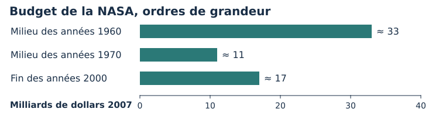

# X-ENS · MP-PC · Anglais 2014 — Corrigé guidé

*Corrigé rédigé par IA, non officiel. Signalez toute erreur.*

**Rédaction** · GPT-6.2 Astra Ultra · vitesse non renseignée

Le cahier XEULCR fixe quatre heures pour l’ensemble, sans document autorisé. La partie A demande, en anglais, une synthèse de 600 à 675 mots précédée d’un titre, sur les documents 1 à 4, sans opinion personnelle. La partie B demande un texte d’opinion en anglais de 500 à 600 mots qui réagisse à l’éditorial de Lawrence M. Krauss. Les décomptes ci-dessous portent sur le corps des deux textes.

Pour A, inscrire la provenance, la date, la position et au moins un élément précis pour chaque document. Relever l’unité du graphique à la page 8. Pour B, choisir une proposition de Krauss assez convaincante pour mériter une réponse de fond, puis énoncer d’emblée sa propre position.

## A. Synthèse de documents

**Croiser les sources.** Aderin-Pocock part d’un souvenir britannique de télévision pour relire une histoire qui inclut les V2 tombés sur Londres, la coopération européenne et des entreprises britanniques. McKie regarde depuis la presse britannique les décisions de présidents américains. Son texte de 2008, republié à la mort d’Armstrong, formule des prévisions datées. L’emploi de *would leave* les situe au moment de la rédaction. Les deux auteurs ont des positions différentes. Le rapport invite notamment à entendre l’humour des allusions aux vacanciers et aux bagages.

**Traiter le graphique comme une source.** L’abscisse donne les années. L’ordonnée mesure des milliards de dollars après correction de l’inflation sur la base de 2007. Les valeurs lues sont des approximations. Le pic se situe avant le premier alunissage humain. Le budget redescend ensuite, puis remonte partiellement. Un niveau de fin de série inférieur au pic étaye la comparaison des engagements budgétaires. Il ne mesure directement ni l’opinion publique ni la valeur des découvertes. Les 16 milliards évoqués par McKie dans son article relèvent d’une présentation différente du budget.

**Organiser la synthèse.** Pour chaque thème, rapprocher au moins deux pièces avant de changer de paragraphe. La station fournit ici un exemple à trois voix. Pour Aderin-Pocock, l’approvisionnement par SpaceX montre que des entreprises participent déjà à l’aventure. Pour McKie, la dépendance américaine à l’égard de la Russie risque de devenir politique. Pour Singer, les dépenses permanentes posent la question du but scientifique. Le titre annonce ce problème commun et les jugements restent attribués à leurs auteurs.

**After Apollo, who gets to choose the destination?**

A British child who watched astronauts land on the Moon might have expected ordinary passengers to follow them within her lifetime. Writing in 2013, space scientist Maggie Aderin-Pocock still finds that prospect credible. Yet British science editor Robin McKie and American physicist Fred Singer find it difficult even to identify what the United States intends to accomplish next. The record of NASA spending gives their disagreement a historical scale. The issue running through these accounts is how an achievement made possible by an exceptional political commitment might be followed by another when the people setting the priorities and paying the bills have changed.

For Aderin-Pocock, the history starts uncomfortably close to home. Rockets developed in Germany fell on London during the Second World War. The rival powers subsequently recruited German expertise and found military uses for observations from space. McKie locates a different source of pressure in Washington. Eisenhower wanted to restore national prestige after American failures had been exposed by Soviet successes. Later, Kennedy's death gave the lunar programme political protection. The budget chart makes the exceptional nature of that period visible. In constant 2007 dollars, annual spending climbed to roughly $33 billion in the middle of the 1960s. By the middle of the following decade it was close to $11 billion. Apollo's achievement owed something to circumstances that its successors could hardly reproduce at will.

Sharing the expense appeared to offer a way forward. Aderin-Pocock explains how the price of satellites and launches encouraged European governments to pool resources in the European Space Agency. Cooperation made scientific missions possible, although the need for agreement could postpone an ambitious decision. An American illustration exposes another difficulty. As McKie saw it in his 2008 assessment, the coming retirement of the shuttles would leave the United States reliant on Russia to carry crews to a station financed largely by American taxpayers. Singer subsequently questions the value of the station itself. Its maintenance absorbs money while its scientific achievements and public appeal, in his judgement, fall short of the promises made for it. Sharing a facility leaves open the question of what it is meant to achieve.

That question also divides assessments of future destinations. Singer doubts that establishing a lunar base would teach scientists enough to justify its cost or bring travellers appreciably closer to Mars. He wants advocates of visiting asteroids to explain what could be learned there that samples already on Earth cannot reveal. McKie's account puts the familiar contrast with Apollo in perspective. The apparently triumphant flight of Apollo 8 concealed a gamble with equipment and software. Nor does continued expenditure settle the argument. At the end of the budget series NASA was still spending approximately $17 billion a year in constant dollars, substantial resources for which, in McKie's view, the public could reasonably ask to see results.

Commercial firms offer Aderin-Pocock a third source of initiative. American company SpaceX already supplies the space station. In Britain, the reusable vehicle proposed by Reaction Engines adds an engineering example to Virgin Galactic's promise of passenger travel. Her jokes about holidaymakers and luggage charges make the unfamiliar sound as ordinary as catching a cheap flight. They also mark a difference in what would count as success. An accessible journey might vindicate her optimism even if it produced none of the scientific discoveries Singer asks a public agency to justify. From these British and American perspectives, the prospects for another great venture depend on who has reason to undertake it. A national government defending its standing, a group of research partners and a firm seeking customers each need a destination, but they answer to different constituencies.

*605 mots.*

## B. Texte d’opinion en réponse à Lawrence M. Krauss

**Faire une objection qui porte.** La thèse choisie accepte la prémisse sur la masse de carburant. Elle réinterprète ensuite la proposition de Robert Zubrin que Krauss rapporte. Faire précéder l’équipage par du matériel pourrait permettre d’essayer ce matériel sur Mars. L’absence de retour est une décision supplémentaire qui exige sa propre justification.

**Éprouver le consentement dans le temps.** Les volontaires sondés au cours d’une sortie ne se trouvent pas encore dans la situation de l’équipage. Une maladie, un changement politique sur Terre ou une interruption de ravitaillement rendraient la décision initiale difficile à réviser. Le parallèle avec les migrations gagne en précision dès qu’on pose une question matérielle sur la dépendance des arrivants. Le choix d’astronautes plus âgés ne règle à lui seul ni le blindage ni la responsabilité médicale.

**Donner une voix au texte.** Le rapport valorise une prise de position nette, à la première personne si elle convient. Les verbes *would vote*, *would fund* et *am prepared to wait* engagent le narrateur sur des décisions différentes. Le texte répond à Krauss lorsqu’il doute de l’argument scientifique, puis termine sur un choix que le lecteur pourrait lui-même accepter ou contester.

**A ticket home is part of the mission**

I would gladly help pay for a mission to Mars. I would vote against sending the first crew with no way home. Lawrence Krauss has found an uncomfortable question for people like me. If volunteers are prepared to spend the rest of their lives on another planet, why should the taxpayers who send them insist on buying a return ticket? My answer concerns the kind of promise the rest of us make when we watch the rocket lift off.

Krauss is right about the arithmetic that gives his proposal its appeal. Carrying the fuel for a return journey makes the outward journey more expensive. He describes a scheme in which a separate craft would produce fuel on Mars before the crew needed it. He asks whether we could dispense with the return altogether once the two journeys have been separated. I would draw a different conclusion from the same scheme. Landing equipment in advance gives us a chance to test whether it works before anyone's life depends on it. That strikes me as an excellent reason to separate the journeys.

The volunteers deserve to be taken seriously. I can imagine an experienced geologist finding a few years of work on Mars worth the sacrifice of familiar surroundings. But raising a hand during a field trip, as the engineers in Krauss's anecdote did, tells us little about what it would mean to remain after a colleague fell gravely ill. Even a volunteer who fully understood the risk could change her mind. The analogy with emigrants sailing to the New World makes the difference especially clear. Whatever the hardships on arrival, nobody across the ocean had to manufacture the air they breathed or vote each year to send them another breath.

Krauss expects uncrewed ships to deliver supplies and suggests recruiting older scientists whose remaining years might be spent fruitfully on Mars. Those suggestions bring us to the part of the bill that a cheap outward ticket leaves unpaid. Future governments would inherit a duty to maintain those deliveries. A decision to cancel a supply flight would become a decision about people already on the surface. And if shielding during the crossing proves inadequate, the fact that some volunteers are older scarcely answers the question of what level of exposure the organisers may reasonably ask them to accept.

There is a fair challenge here for anyone who supports crewed exploration. If machines can do the work, as Krauss himself suspects, curiosity alone will be a poor justification for the risk. I would send instruments first and ask scientists to identify observations for which human judgement on the spot would make a demonstrable difference. If that case is made, I would fund a crew, tested protection and a credible means of return. A wealthy volunteer might choose to stay when the time came. Leaving that choice open would honour the courage of the people who went and the obligations of those of us who remained at home. If the only mission we can afford depends on closing that choice before launch, then I am prepared to wait.

*514 mots.*

[Épreuve A et B de quatre heures](https://banques-ecoles.fr/cms/wp-content/uploads/2014/10/14_mppc_suj_lv_ang.pdf) · [Rapport d’anglais](https://banques-ecoles.fr/cms/wp-content/uploads/2015/01/14_mp_pc_rap_ecrit_lv_anglais.pdf)
