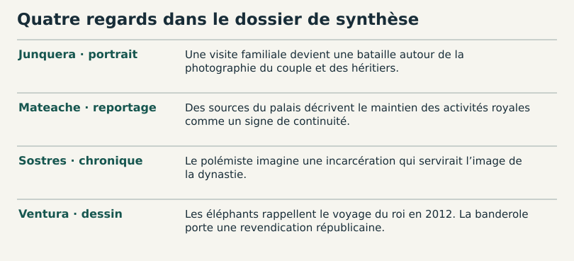

# X-ENS MP-PC — Espagnol 2014 · Corrigé guidé

*Corrigé rédigé par IA, non officiel. Signalez toute erreur.*

**Rédaction** · GPT-6.2 Astra Ultra · vitesse non renseignée

Le cahier XEULCR accorde quatre heures pour l’ensemble, sans document. Les deux compositions sont en espagnol. La synthèse A croise les documents 1 à 4 en 600 à 675 mots, avec un titre et sans avis personnel. Le texte B répond aux arguments du document 5 en 500 à 600 mots.

## A. Synthèse de documents

> [!INDICATION]
> Interroger une image commune aux quatre pièces : que voit le public de la Couronne et qui décide de ce qui sera visible ? Repérer ensuite les écarts de date et de genre. Le portrait de Junquera s’appuie sur des scènes, Mateache rapporte les inquiétudes du palais, Sostres pousse une défense dynastique jusqu’au paradoxe et Ventura réclame la République par le dessin. Le rapport d’Isabelle Mayoral demande que le lecteur puisse identifier et distinguer chaque pièce.

**Una familia ante las cámaras, una institución ante el público**

En enero de 2014, la nueva imputación de la infanta Cristina en el caso Nóos sitúa a la Corona española ante una dificultad de representación. Allí donde sus miembros pueden ver vínculos familiares o decisiones privadas, la prensa y los ciudadanos leen signos de lo que cabe esperar de la institución. Natalia Junquera reconstruye esa distancia en el retrato «Una mujer empecinada», publicado en El País. A. G. Mateache examina sus consecuencias para la sucesión en «La Corona, preocupada por el efecto de la imputación», de La Razón. En «Cristina», publicado en El Mundo, Salvador Sostres lleva hasta la provocación las exigencias del deber dinástico. Una viñeta de Ventura aparecida en El Jueves en 2012 muestra que el cuestionamiento de la monarquía precede al último episodio judicial.

Para Junquera, pocas escenas expresan mejor el conflicto que una visita al rey hospitalizado. Cristina llega con su marido, Iñaki Urdangarin, pese al empeño de la Casa en evitar que se vea a los duques de Palma junto a los príncipes. Todos coinciden en la habitación y, sin embargo, las cámaras registran llegadas distintas. El episodio deja ver la determinación de una mujer que quiso ejercer una profesión y casarse por amor, rasgos presentados en su día como pruebas de modernidad. La investigación sobre los negocios de su esposo expone ahora las cuentas de la infanta y el coste de su residencia en Barcelona. En el retrato de Junquera, aquella independencia convive con los préstamos y las ayudas que hicieron posible un elevado nivel de vida.

El relato de Mateache permite entender lo que se juega en el encuadre de esas fotografías. Según sus fuentes, preocupa especialmente el porvenir del príncipe Felipe, que mantiene las distancias con los duques y conserva una valoración favorable. La Casa había previsto la decisión del juez Castro. Al conocerse, expresó respeto por la justicia y mantuvo la actividad oficial en los días siguientes. El periódico recoge asimismo las especulaciones que suscitaron los tropiezos del rey al leer un discurso tras su operación. Hasta los titubeos de una lectura pública se interpretan a la luz de la situación familiar. Mientras tanto, coinciden ambos diarios, Cristina conserva sus derechos sucesorios, de escaso alcance práctico pero de indudable valor simbólico.

Sostres convierte ese valor en materia de una paradoja. Partidario declarado de que la monarquía dé continuidad a España, imagina que el encarcelamiento de la infanta fortalecería al rey y a su heredero. Cristina ocupa un lugar secundario en la sucesión, pero ver a una hija del rey sometida a la justicia devolvería credibilidad a la igualdad ante la ley. La ironía del columnista se vuelve más áspera cuando considera beneficioso el sacrificio incluso si la culpabilidad fuera dudosa. Su ataque a los republicanos y las burlas dirigidas a los duques hacen de su escrito una intervención polémica. Donde Mateache expone la cautela del palacio, Sostres exige que Cristina acepte públicamente las consecuencias de su posición.

Ventura atribuye al descrédito real un desenlace opuesto. Tras el accidente de Juan Carlos durante una cacería en Botsuana, dibuja dos elefantes en los pedestales que ocupan los leones a la entrada del Congreso. Sobre las columnas, una pancarta reclama la llegada inmediata de la Tercera República. La conducta del propio monarca queda así inscrita en la fachada de la representación popular. La caricatura de 2012 y la columna de 2014 comparten el recurso a la exageración, pero una se vale de ella para pedir un cambio de régimen y la otra para preservar la dinastía. Entre esas posiciones, los dos reportajes muestran hasta qué punto gestionar una agenda o evitar una fotografía resulta insuficiente para controlar el significado público de los actos de la familia real.

> [!INDICATION]
> Relire les verbes d’attribution. *Imagina* réserve à Sostres son hypothèse outrancière. *Según sus fuentes* borne ce qu’affirme Mateache. L’entrée du Congrès, les éléphants sur les socles et la banderole appartiennent au dessin. L’allusion vise la chasse de Juan Carlos au Botswana en 2012 et fournit un précédent à la contestation de 2014.

## B. Texte d’opinion

> [!INDICATION]
> Le document 5 est l’éditorial mexicain « Infanta Cristina: jaque al rey » de *La Jornada*, daté du 8 janvier 2014. Examiner successivement les indices retenus par le juge, les objections opposées à son initiative, puis le passage du cas individuel au jugement sur la monarchie. Une réponse personnelle peut accepter le premier raisonnement et discuter le dernier.

La Jornada acierta al ver en la citación de Cristina de Borbón una prueba para la credibilidad de la justicia española. Cuando se investiga el destino de dinero público y aparecen documentos que vinculan a una persona con las operaciones examinadas, su apellido no puede decidir si tendrá que dar explicaciones. Ahora bien, me parece que el editorial mexicano identifica demasiado pronto la suerte de tres cuestiones diferentes. Una es si hay indicios para tomar declaración a la infanta. Otra, si cometió un delito. Y otra, qué forma de Estado desean los españoles. Confundirlas permitiría que partidarios y adversarios de la monarquía exigieran al mismo juez que resolviera las tres.

El editorial destaca que el juez Castro ha seguido adelante pese a la oposición del fiscal y de la Abogacía del Estado. Comprendo que esa resistencia resulte chocante para quien espera que los intereses del contribuyente estén defendidos con especial celo. También entiendo que se pida conocer el contenido de las facturas y de las declaraciones fiscales en las que se basa la imputación. En cambio, del desacuerdo entre quienes intervienen en una causa no se deduce por sí solo que todos se hayan conjurado para proteger a la hija del rey. Lo que podemos exigir es que cada uno exponga razones que otro pueda contrastar. Cuanto más poderosa sea la persona investigada, más importante será poder seguir ese razonamiento sin depender de filtraciones interesadas.

La advertencia más persuasiva del periódico se refiere a lo que ocurriría si la comparecencia se frustrase mediante una maniobra incomprensible para el público. Una excepción concedida en silencio valdría más que cien discursos para convencer a muchos ciudadanos de que hay dos justicias. Pero también dañaría esa confianza que el tribunal estuviese obligado a condenar a Cristina para demostrar su independencia. El indicio que justifica oírla puede perder fuerza cuando se conozca su respuesta. Si eso sucede, la justicia debe poder reconocerlo y explicar por qué. Aplicar a una infanta las garantías de cualquier acusado forma parte del mismo compromiso que permite llamarla a declarar.

Queda el argumento constitucional. La inviolabilidad que protege a la persona del rey plantea una dificultad genuina a quien cree en la igualdad de todos ante la ley. Esa protección no se extiende automáticamente a su hija, como demuestra el procedimiento en curso. El debate sobre sus límites merece celebrarse a la luz del día, incluso si mañana se despejasen todas las sospechas sobre Cristina. Del mismo modo, exigir cuentas sobre la utilización de los fondos públicos tendría sentido bajo una presidencia electiva. Elegir al jefe del Estado cambia el origen de su autoridad, pero no sustituye los mecanismos necesarios para controlar cómo se ejerce.

Por eso compartiría la imagen del jaque en un sentido limitado. La imputación obliga a la Corona a responder ante una sociedad que ya no concede crédito en blanco a su conducta. El desenlace sigue abierto. A los tribunales les corresponde esclarecer hechos determinados y a los ciudadanos discutir, con información suficiente, qué instituciones quieren. Mi confianza crecería si ninguna de esas dos decisiones se tomara de antemano en nombre de la otra.

> [!INDICATION]
> Le document 5 donne une référence inexacte pour l’inviolabilité du roi. La disposition applicable est l’article 56, paragraphe 3, de la Constitution espagnole. Elle vise la personne du roi. Pour traiter le dossier à la date de l’épreuve, *imputada* indique que Cristina est mise en cause dans la procédure ; cela ne préjuge pas la décision du tribunal. [Texte constitutionnel au BOE](https://www.boe.es/buscar/act.php?id=BOE-A-1978-31229#a56)

[Cahier de l’épreuve](https://banques-ecoles.fr/cms/wp-content/uploads/2014/10/14_mppc_suj_lv_esp.pdf) · [Rapport du jury](https://banques-ecoles.fr/cms/wp-content/uploads/2015/01/14_mp_pc_rap_ecrit_lv_espagnol.pdf) · [Seconde publication du rapport](https://www.ens.psl.eu/IMG/file/concours/2014/MPI/14_mppc_rap_elv_esp.pdf)
