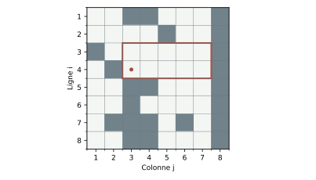
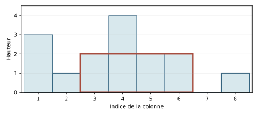

# X-ENS MP-PC · Informatique B 2014 · Corrigé guidé

*Corrigé rédigé par IA, non officiel. Signalez toute erreur.*

**Rédaction** · GPT-6.2 Astra Ultra · vitesse non renseignée · 25 novembre 2026

Langage choisi : Python. Les positions passées en argument sont numérotées à partir de 1 comme dans le sujet. Les listes Python sont stockées sans case fictive. Les bornes internes des histogrammes sont des indices Python.

## Repères

Fixer le coin inférieur gauche amène à réexaminer des cases. Le prétraitement remplace ces examens par des hauteurs verticales, puis les deux bornes de chaque barre permettent de calculer une aire par simple produit.

## I · Recherche unidimensionnelle

### Question 1 · Longueur d’une plage vers la droite

**Indication.** Tester la borne du tableau avant de lire la case suivante.

#### Solution

On fait avancer $j$ tant que toutes les cases vues depuis $i$ valent 0. Au premier 1 ou à la sortie, $j$ désigne la première case exclue et la réponse vaut $j-i$. Une case initiale à 1 renvoie 0, même en dernière position. Dans le tableau du sujet, les résultats aux indices 4 et 6 valent respectivement 0 et 2. Les arguments de position sont numérotés de 1 à $n$ comme sur le sujet, et la liste Python commence à l'indice 0.

```python
def nombreZerosDroite(i, tab, n):
    j = i
    while j <= n and tab[j - 1] == 0:
        j += 1
    return j - i
```

### Question 2 · Plus longue plage de zéros

**Indication.** Après le comptage d’une plage, avancer au premier indice qui lui succède.

#### Solution

À chaque début de boucle, les plages terminées avant $i$ ont été mesurées et leur maximum est mémorisé. Une case à 1 coûte un déplacement d'une position. Sur un 0, toute la plage restante est comptée en une fois. Chaque case à 0 appartient à un seul appel et chaque 1 est examiné un nombre borné de fois. Le temps est donc $O(n)$ et l'espace supplémentaire $O(1)$. Le tableau de l'énoncé a deux plages de longueur 3, et le maximum renvoyé est 3.

```python
def nombreZerosMaximum(tab, n):
    maximum = 0
    i = 1
    while i <= n:
        if tab[i - 1] == 1:
            i += 1
        else:
            longueur = nombreZerosDroite(i, tab, n)
            maximum = max(maximum, longueur)
            i += longueur
    return maximum
```

## II · De la 1D vers la 2D

### Question 3 · Meilleur rectangle partant d’un coin inférieur gauche

**Indication.** En montant d’une ligne, la largeur encore possible peut uniquement diminuer.

#### Solution

Fixons les indices $i,j$ donnés dans la numérotation de l'énoncé. Pour un bord haut sur la ligne $r\le i$, la plus grande largeur vaut le minimum des longueurs de plages partant de $j$ sur les lignes $r,\ldots,i$. On ne teste sur la nouvelle ligne que les colonnes de la largeur encore disponible. L'aire de cette hauteur est cette largeur multipliée par $i-r+1$. Si la largeur devient nulle, aucune ligne plus haute ne peut améliorer le résultat. En $(4,3)$ la ligne 4 autorise 5 colonnes, la ligne 3 en laisse 5, et les suivantes rétrécissent le rectangle. Le maximum est $2\times5=10$. Au pire on lit $O(i(n-j+1))$, donc $O(n^2)$ cases, pour $O(1)$ mémoire supplémentaire.

```python
def rectangleHautDroit(tab2, n, i, j):
    maximum = 0
    largeur = n - j + 1
    for ligne in range(i, 0, -1):
        k = 0
        while k < largeur and tab2[ligne - 1][j - 1 + k] == 0:
            k += 1
        largeur = k
        if largeur == 0:
            break
        maximum = max(maximum, largeur * (i - ligne + 1))
    return maximum
```



### Question 4 · Essai de tous les coins

**Indication.** Tout rectangle non vide possède un coin inférieur gauche.

#### Solution

Pour chaque couple $(i,j)$ de $\{1,\ldots,n\}^2$, calculer `rectangleHautDroit(tab2,n,i,j)` et garder la plus grande aire. La Q3 considère tous les bords hauts à partir de ce coin. Le temps est $O(n^4)$, et atteint cet ordre sur une matrice entièrement nulle puisque le nombre total de lectures est de l'ordre de $\sum_i i\sum_j(n-j+1)=\Theta(n^4)$. Une matrice sans zéro produit la réponse 0.

### Question 5 · Hauteurs de zéros consécutifs

**Indication.** Utiliser la cellule déjà calculée immédiatement au-dessus.

#### Solution

Dans une colonne, une case valant 1 remet le compteur à zéro. Sur un 0, elle prolonge exactement d'une unité la plage qui se termine sur la ligne précédente, avec une hauteur précédente nulle sur le bord supérieur. Un parcours de haut en bas réalise donc $c_{ij}=0$ si la case vaut 1 et $c_{ij}=1+c_{i-1,j}$ sinon. Par exemple, la quatrième ligne du tableau des hauteurs vaut $(1,0,3,3,2,4,4,0)$.

```python
def colonneZeros(tab2, n):
    col = [[0] * n for _ in range(n)]
    for i in range(n):
        for j in range(n):
            if tab2[i][j] == 0:
                col[i][j] = 1 if i == 0 else col[i - 1][j] + 1
    return col
```

### Question 6 · Coût du précalcul

**Indication.** Comparer le nombre d’itérations au nombre de valeurs à renvoyer.

#### Solution

L'initialisation des lignes indépendantes et les deux boucles traitent $n^2$ cases, en temps $\Theta(n^2)$. La sortie contient $n^2$ entiers et exige elle-même cet ordre de mémoire. Aucun parcours complémentaire d'une colonne n'est demandé par la récurrence.

## III · Rectangles dans un histogramme

### Question 7 · Bornes gauches par sauts

**Indication.** Maintenir une plage déjà certifiée puis franchir toute la plage du prédécesseur en une fois.

#### Solution

En numérotation du sujet, les bornes $L[1],\ldots,L[i-1]$ sont acquises par récurrence. Dans la boucle pour $i$, toutes les barres de $j$ à $i$ ont hauteur au moins $h_i$. Si $j=1$ ou $h_{j-1}<h_i$, on a exactement la plus petite borne admissible. Sinon les barres de $L[j-1]$ à $j-1$ ont hauteur au moins $h_{j-1}\ge h_i$. Le saut $j\leftarrow L[j-1]$ conserve l'invariant et fait strictement décroître $j$. Cela établit correction et terminaison.

Dans l'exemple de taille $2n$, les hauteurs de 1 à $n$ dans la première moitié ont $L[i]=i$ et ne nécessitent aucun saut. À sa seconde occurrence, la hauteur $n$ ne nécessite qu'un saut jusqu'à sa première occurrence. Pour une hauteur descendante $k<n$, le précédent de hauteur $k+1$ mène directement à l'indice $k+1$ de la montée. On saute ensuite par la première barre de hauteur $k$ jusqu'à $k$, où l'on s'arrête. Chaque barre descendante utilise donc au plus deux sauts. Le temps total est $O(n)$, y compris lorsque $k=1$.

Les fonctions ci-dessous mettent en œuvre le même algorithme de chaque côté. Elles stockent des **indices Python** entre 0 et $n-1$. Pour reproduire la fiche en numérotation de 1 à $n$, on ajoute 1 à ces indices. Dans le tableau $(3,1,2,4,2,2,0,1)$ on trouve $L=(1,1,3,4,3,3,1,8)$ et $R=(1,6,6,4,6,6,8,8)$.

```python
def calculeL(histo, n):
    borne = [0] * n
    for i in range(n):
        j = i
        while j > 0 and histo[j - 1] >= histo[i]:
            j = borne[j - 1]
        borne[i] = j
    return borne

def calculeR(histo, n):
    borne = [0] * n
    for i in range(n - 1, -1, -1):
        j = i
        while j + 1 < n and histo[j + 1] >= histo[i]:
            j = borne[j + 1]
        borne[i] = j
    return borne
```

### Question 8 · Rectangle associé à une barre

**Indication.** Décomposer l’intervalle à la verticale de sa barre de référence.

#### Solution

Par définition de $L[i]$, toutes les hauteurs de $L[i]$ à $i$ sont au moins $h_i$. Par définition de $R[i]$, la même propriété vaut de $i$ à $R[i]$. Le rectangle de hauteur $h_i$ placé sur l'intervalle union est donc contenu dans l'histogramme. Son aire est $h_i(R[i]-L[i]+1)$, car les deux colonnes extrêmes sont incluses.



### Question 9 · Pourquoi un optimum apparaît parmi ces rectangles

**Indication.** Exploiter successivement l’impossibilité de monter et celle d’élargir un rectangle optimal.

#### Solution

Pour un rectangle optimal d'aire positive sur $[l,r]$, sa hauteur $h$ est le minimum des hauteurs de cet intervalle. Si elle était strictement plus petite, on pourrait l'augmenter et accroître l'aire. Prenons un indice $i$ où le minimum est atteint. La plage du niveau $h_i$ contient $[l,r]$ et ne peut le dépasser ni à gauche ni à droite, car une colonne ajoutée augmenterait l'aire de $h>0$. Ainsi $h_i=h$, $L[i]=l$ et $R[i]=r$.

Si toutes les barres sont nulles, la plus grande aire est 0 et l'intervalle total en donne un représentant avec $L=1$, $R=n$. Interprétée littéralement pour **tout** rectangle de hauteur nulle, la caractérisation des bornes échoue alors, car un sous-intervalle strict a lui aussi une aire nulle. L'algorithme renvoie bien la valeur optimale dans ce cas.

### Question 10 · Aire maximale dans l’histogramme

**Indication.** Prendre le maximum sur les rectangles certifiés par les deux questions précédentes.

#### Solution

Les bornes sont calculées une fois pour l'histogramme entier. Le produit testé pour chaque barre est réalisable d'après la Q8 et un optimum figure parmi les candidats d'après la Q9. Avec les deux routines linéaires fournies par l'énoncé, le temps est $O(n)$, pour $O(n)$ cases auxiliaires. Dans le tableau de huit barres, la hauteur 2 des colonnes 3 à 6 donne l'aire maximale 8.

```python
def plusGrandRectangleHistogramme(histo, n):
    gauche = calculeL(histo, n)
    droite = calculeR(histo, n)
    maximum = 0
    for i in range(n):
        maximum = max(maximum, histo[i] * (droite[i] - gauche[i] + 1))
    return maximum
```

## IV · Retour à la matrice

### Question 11 · Passer de l’histogramme à l’image

**Indication.** Fixer la ligne du bas, puis interpréter les barres comme des colonnes de zéros remontant depuis cette ligne.

#### Solution

Sur une ligne $i$ du tableau `col`, un rectangle d'histogramme de hauteur $h$ et de base $[l,r]$ correspond exactement à un rectangle de zéros de l'image sur les lignes $i-h+1,\ldots,i$ et sur les colonnes $l,\ldots,r$. Chacun des rectangles non vides possède une telle ligne inférieure. Prendre le maximum sur toutes les lignes donne donc l'aire recherchée. Pour la matrice officielle, les lignes 1 à 6 et les colonnes 6 à 7 donnent notamment un rectangle d'aire 12, qui atteint ce maximum.

```python
def rectangleToutZero(tab2, n):
    col = colonneZeros(tab2, n)
    maximum = 0
    for ligne in col:
        maximum = max(maximum, plusGrandRectangleHistogramme(ligne, n))
    return maximum
```

### Question 12 · Complexité de l’algorithme complet

**Indication.** Compter séparément la construction des hauteurs et les appels sur les lignes.

#### Solution

Le tableau `col` coûte $\Theta(n^2)$ à construire. Pour chacune de ses $n$ lignes, le traitement de l'histogramme prend $O(n)$ temps, soit $O(n^2)$ en tout. La complexité est donc $\Theta(n^2)$, pour $O(n^2)$ mémoire supplémentaire avec la sortie intermédiaire telle qu'imposée à la Q5. Si seule l'aire finale importe, mettre à jour les hauteurs d'une ligne à la suivante permet de réduire la mémoire à $O(n)$.
