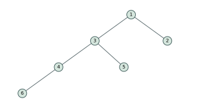
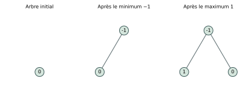
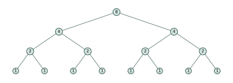

# X-ENS MP · Informatique A 2014 · Corrigé guidé

*Corrigé rédigé par IA, non officiel. Signalez toute erreur.*

**Rédaction** · GPT-6.2 Astra Ultra · vitesse non renseignée · 25 novembre 2026

**Langage choisi.** Caml (syntaxe OCaml). Un arbre à $n$ nœuds étiquetés possède $n+1$ sous-arbres vides, d’où la taille $2n+1$ employée dans le sujet. La hauteur de l’arbre vide est 0 et les logarithmes sont en base 2.

## Repères

Dessiner la fusion de deux petites racines avant de programmer. Noter les places gauches et droites après leur échange. Pour borner une séquence de fusions, suivre le potentiel dans les arbres consommés et produits.

## I · Structure d’arbre croissant

### Question 1 · Lire le minimum

**Indication.** Relire la condition qui lie la racine à tous ses descendants.

#### Solution

La racine d’un arbre croissant non vide est un minimum. Une inspection du constructeur suffit, en temps constant.

```ocaml
type arbre = E | N of arbre * int * arbre

let minimum = function
  | E -> invalid_arg "minimum"
  | N (_, x, _) -> x
```

### Question 2 · Vérifier l’ordre sans recalculer les minima

**Indication.** Il suffit de vérifier les inégalités sur toutes les arêtes. L’ordre sur un chemin découle de la transitivité.

#### Solution

```ocaml
let est_un_arbre_croissant t =
  let racine_au_moins x = function
    | E -> true
    | N (_, y, _) -> x <= y
  in
  let rec verifier = function
    | E -> true
    | N (g, x, d) ->
        racine_au_moins x g && racine_au_moins x d
        && verifier g && verifier d
  in
  verifier t
```

Sur un arbre qui satisfait la définition, les tests locaux sont tous vrais. Réciproquement, pour chaque descendant, la succession des inégalités depuis la racine majore l’étiquette de cette dernière par celle du descendant. Le test réapplique la même condition dans chaque sous-arbre. Il effectue un travail constant par sommet ou arbre vide examiné, d’où $O(|t|)$ même lorsqu’il doit parcourir tout l’arbre. Les étiquettes égales sont admises.

### Question 3 · Compter les arbres sur n clés distinctes

**Indication.** Où peut se trouver l’étiquette maximale ? En la supprimant, compter les positions libres pour l’insertion inverse.

#### Solution

Pour $n=0$, seul $E$ convient. Dans un arbre sur $1,\ldots,n$, le sommet $n$ ne peut avoir d’enfant non vide, dont l’étiquette devrait être plus grande. Sa suppression laisse un arbre sur $1,\ldots,n-1$ et marque une place vide. Un arbre à $m$ nœuds a $m+1$ places vides, comme le montre une récurrence sur ses deux sous-arbres. Réciproquement, insérer $n$ à n’importe quelle place vide conserve l’ordre et donne une paire arbre-position distincte. Si $a_n$ compte les arbres, $a_n=n a_{n-1}$ et $a_0=1$. Ainsi $a_n=n!$.

## II · Opérations sur les arbres

### Question 4 · Fusionner les deux exemples

**Indication.** Choisir la plus petite racine, poursuivre à droite de cette racine, puis mettre l’ancien enfant gauche à droite.

#### Solution

Notons $[x]=N(E,x,E)$. Les racines choisies sont successivement 1, 3, puis 4. À la dernière étape, $[6]$ devient fils gauche de 4. Le résultat est

$$
N\bigl(N(N([6],4,E),3,[5]),\ 1,\ [2]\bigr).
$$

Voici la définition de la fusion utilisée dans les programmes suivants.

```ocaml
let rec fusion t1 t2 =
  match t1, t2 with
  | E, t | t, E -> t
  | N (g1, x1, d1), N (g2, x2, d2) ->
      if x1 <= x2 then N (fusion d1 t2, x1, g1)
      else N (fusion d2 t1, x2, g2)
```



### Question 5 · Prouver ordre et conservation des occurrences

**Indication.** Pour une récurrence bien fondée, additionner les tailles des deux arguments. À chaque appel, un des arguments est remplacé par un sous-arbre strict.

#### Solution

Si l’un des arguments est vide, l’autre est renvoyé et les occurrences s’additionnent avec zéro. Supposons les deux arbres non vides et $x_1\leq x_2$. Posons $u=\operatorname{fusion}(d_1,t_2)$. Par récurrence, $u$ est croissant et contient, avec multiplicité, les éléments de $d_1$ et de $t_2$. Tous sont au moins $x_1$, car ceux de $t_2$ sont au moins $x_2$. Ceux de $g_1$ sont aussi au moins $x_1$. Ainsi $N(u,x_1,g_1)$ est croissant. Pour toute étiquette $y$, son nombre d’occurrences y est

$$
\operatorname{occ}(y,d_1)+\operatorname{occ}(y,t_2)
+\mathbf 1_{y=x_1}+\operatorname{occ}(y,g_1)
=\operatorname{occ}(y,t_1)+\operatorname{occ}(y,t_2).
$$

Si $x_2<x_1$, on échange les indices dans le même argument. La taille totale diminue strictement à chaque appel récursif.

### Question 6 · Ajouter une occurrence

**Indication.** Le second argument de fusion peut être un singleton.

#### Solution

```ocaml
let ajoute x t = fusion t (N (E, x, E))
```

Le singleton ajoute par la question 5 exactement une occurrence de $x$ et laisse inchangés les autres effectifs.

### Question 7 · Supprimer une occurrence minimale

**Indication.** Retirer la racine puis réunir les sous-arbres.

#### Solution

```ocaml
let supprime_minimum = function
  | E -> invalid_arg "supprime_minimum"
  | N (g, _, d) -> fusion g d
```

La racine est minimale par la question 1. La fusion des enfants conserve tous leurs éléments et donc toutes les occurrences, sauf celle de la racine enlevée. Une autre occurrence du même minimum peut subsister.

### Question 8 · Construire par insertions successives

**Indication.** L’accumulateur doit être le premier argument de la fusion, conformément à la définition de la suite.

#### Solution

```ocaml
let ajouts_successifs a =
  Array.fold_left (fun t x -> ajoute x t) E a
```

Après $i$ lectures, l’accumulateur est $t_i$. La mise à jour produit précisément $t_{i+1}$ avec $x_i$. Le tableau vide laisse l’accumulateur égal à $E$.

### Question 9 · Obtenir une grande hauteur

**Indication.** Choisir chaque nouvelle clé strictement plus petite que celles déjà présentes.

#### Solution

Prenons $x_i=n-i$. À chaque insertion, la nouvelle racine est la clé ajoutée et la fusion de son enfant droit vide avec l’arbre précédent restitue cet arbre, qui devient le fils gauche. On forme une chaîne de $n$ nœuds de hauteur $n$, donc au moins $n/2$. Le résultat vaut aussi pour $n=0$.

### Question 10 · Hauteur pour les clés dans l’ordre croissant

**Indication.** Lorsque l’on insère un nouveau maximum, la racine est conservée et ses anciens fils échangent de côté. Suivre séparément les insertions envoyées dans chacun des deux sous-arbres.

#### Solution

Pour un arbre bâti sur une suite strictement croissante de $n\geq1$ clés, la première reste racine. Les deux sous-arbres sont eux-mêmes obtenus par insertions croissantes, avec respectivement $\lfloor n/2\rfloor$ et $\lfloor(n-1)/2\rfloor$ nœuds. Prouvons ceci par récurrence pendant la construction. C’est vrai après la première clé. Le maximum suivant est inséré dans l’ancien sous-arbre droit et le résultat devient le nouveau gauche, tandis que l’ancien gauche devient le nouveau droit. L’insertion prolonge donc l’une des deux suites croissantes et transforme les effectifs $(a,b)$ en $(b+1,a)$, ce qui donne les formules annoncées au rang suivant.

Par récurrence forte en $n$, un arbre issu de toute suite croissante de longueur $n$ a alors hauteur $\lfloor\log_2 n\rfloor+1$. En effet pour $n=1$ la hauteur est 1, et pour $n\geq2$ la plus grande des deux hauteurs est celle associée à $\lfloor n/2\rfloor$, d’après les formules de rangs inférieurs. On gagne un niveau en ajoutant la racine. Pour $n=0$ on a séparément $h(E)=0$.

## III · Analyse du coût amorti

### Question 11 · Compter les nœuds lourds en un parcours

**Indication.** Renvoyer, pour chaque sous-arbre, sa taille et son potentiel dans la même paire.

#### Solution

```ocaml
let potentiel t =
  let rec mesurer = function
    | E -> (1, 0)
    | N (g, _, d) ->
        let sg, pg = mesurer g in
        let sd, pd = mesurer d in
        (1 + sg + sd, pg + pd + (if sg < sd then 1 else 0))
  in
  snd (mesurer t)
```

Pour un arbre vide, la taille du sujet vaut 1 et il n’existe aucun nœud lourd. La taille d’un nœud est la somme des deux tailles augmentée de 1. Son potentiel est la somme des deux potentiels, augmentée de 1 exactement si le sous-arbre droit est strictement plus grand. Les informations de chaque sous-arbre se calculent une seule fois, donc le coût est $O(|t|)$.

### Question 12 · Facturer les fusions avec le potentiel

**Indication.** Classer les racines choisies pendant la fusion selon leur état initial, lourdes ou légères. Suivre les pas vers la droite dans chacun des deux arbres d’origine.

#### Solution

Le chemin des appels traverse des préfixes des deux branches droites initiales. À chaque appel sur deux arbres non vides, une racine est choisie et l’on avance dans son ancien enfant droit. Les autres nœuds gardent leurs deux sous-arbres et leur état lourd ou léger. Notons $H,L$ les nombres de racines choisies initialement lourdes et légères. Chaque choix produit exactement un appel récursif, donc $C=H+L$.

À une racine choisie, l’ancien gauche $g$ devient le nouveau droit. Le nouveau gauche est la fusion de l’ancien droit $d$ avec l’autre argument, et sa taille est au moins $|d|$, par conservation des nœuds. Si cette racine était lourde, $|g|<|d|$ et elle devient légère. Une racine légère peut au plus ajouter une unité de potentiel. Ainsi $\Phi(t)-\Phi(t_1)-\Phi(t_2)\leq L-H$ et

$$
C+\Phi(t)-\Phi(t_1)-\Phi(t_2)\leq 2L.
$$

Sur la branche droite d’un arbre $s$, tout pas à une racine légère fait passer à une taille $|d|\leq(|s|-1)/2$. Les autres pas ne font pas augmenter la taille, et la taille finale est au moins 1. La branche comporte donc au plus $\log_2|s|$ de ces pas. Appliqué aux deux branches, cela donne $L\leq\log_2|t_1|+\log_2|t_2|$, puis l’inégalité (1). Si l’un des arguments est vide, le coût est nul et la même borne reste valable.

### Question 13 · Additionner les coûts des insertions

**Indication.** Le potentiel du singleton est nul. Écrire le terme de potentiel à deux instants consécutifs.

#### Solution

Notons $C_i$ le coût de l’insertion $i$. On a $|t_i|=2i+1$ et $|[x_i]|=3$. La question 12 donne

$$
C_i\leq\Phi(t_i)-\Phi(t_{i+1})+2\log_2(2i+1)+2\log_2 3 .
$$

En sommant pour $0\leq i<n$, la somme des potentiels vaut $\Phi(t_0)-\Phi(t_n)=-\Phi(t_n)\leq0$. Les logarithmes sont majorés par $\log_2(2n+1)$, donc le total est $O(n\log(n+1))$, en particulier $O(n\log n)$ asymptotiquement. Le travail constant hors appels ajoute au plus $O(n)$.

### Question 14 · Un appel de coût linéaire

**Indication.** Pour rallonger une branche droite, procéder par deux insertions. Placer un nouveau minimum à la racine, puis insérer un nouveau maximum pour déplacer l’ancien arbre à droite.

#### Solution

Pour $n=2m\geq2$, commençons par 0. Pour chaque $j=1,\dots,m-1$, insérons successivement $-j$ et $j$, puis terminons par $m$. Avant chaque paire, soit $T$ l’arbre courant. Après $-j$, il devient $N(T,-j,E)$. Après $j$, il devient $N([j],-j,T)$. La longueur de sa branche droite augmente d’un nœud à chaque paire. Juste avant le dernier ajout, cette branche contient $m$ nœuds. Comme $m$ dépasse toutes les clés présentes, la dernière fusion les visite tous, puis atteint le cas vide. Son coût est exactement $m=n/2$.

Cette famille fournit bien des opérations de coût linéaire. Si l’on interprète la borne littérale comme portant sur **tout** entier $n$, une précision de parité est nécessaire. Dans tout arbre obtenu par insertions successives de singletons, un nœud dont le fils droit est non vide possède également un fils gauche non vide. Cela se vérifie par récurrence sur la fusion avec le singleton. Si ce dernier devient racine, son fils droit est vide. Si l’ancienne racine reste, son nouveau gauche contient au moins un nœud, l’invariant étant préservé dans les sous-arbres. Une branche droite de $r$ nœuds nécessite donc au moins $2r-1$ nœuds en tout. Avant une insertion parmi $n$, l’arbre a au plus $n-1$ nœuds. Une fusion avec un singleton compare au plus les $r$ racines de cette branche, même si le singleton devient racine plus tôt. Son coût est donc au plus $\lfloor n/2\rfloor$. Pour $n$ impair, la famille précédente appliquée aux $n-1$ premières insertions et prolongée d’une clé atteint ce plancher.

La question 12 borne le coût amorti $C+\Phi(t)-\Phi(t_1)-\Phi(t_2)$ par une somme de logarithmes. Dans une séquence d’opérations qui consomme ses anciens arbres, les variations du potentiel total des arbres présents se compensent. Un appel réel peut être linéaire, alors que le total des coûts sur la séquence bénéficie de cette borne amortie.



### Question 15 · Sommer les coûts des suppressions

**Indication.** Comparer le potentiel de l’arbre à la somme des potentiels de ses deux enfants avant chaque suppression.

#### Solution

Écrivons $t_i=N(g_i,x_i,d_i)$. Avec $b_i=1$ si la racine est lourde et 0 sinon, $\Phi(g_i)+\Phi(d_i)=\Phi(t_i)-b_i$. Comme $t_{i+1}=\operatorname{fusion}(g_i,d_i)$, le coût $C_i$ vérifie

$$
C_i\leq \Phi(t_i)-\Phi(t_{i+1})-b_i
 +2\log_2|g_i|+2\log_2|d_i|.
$$

Les tailles sont au plus $2n+1$. Le télescopage fournit un terme initial $\Phi(t_0)\leq n$, un terme final nul et une somme négative que l’on peut majorer par zéro. Donc la somme des $n$ coûts est au plus $n+4n\log_2(2n+1)$, soit $O(n\log n)$.

## IV · Tri et construction par niveaux

### Question 16 · Trier le tableau en extrayant le minimum

**Indication.** L’arbre de départ doit être construit avant toute réécriture du tableau.

#### Solution

```ocaml
let tri a =
  let t = ref (ajouts_successifs a) in
  for i = 0 to Array.length a - 1 do
    a.(i) <- minimum !t;
    t := supprime_minimum !t
  done
```

Au début de l’itération $i$, l’arbre contient le multiensemble initial privé des $i$ occurrences déjà écrites. On écrit le plus petit élément restant, et l’on en retire une seule occurrence. Le préfixe écrit croît au sens large, y compris en présence de doublons. Pour le tableau donné on obtient $[2,2,3,4,7]$. La construction initiale coûte $O(n\log n)$ par la question 13, et les $n$ suppressions ensemble $O(n\log n)$ par la question 15. Les accès au minimum et les écritures coûtent $O(n)$ au total. Si le tableau est vide, la boucle n’est pas exécutée.

### Question 17 · Fusionner les singletons par niveaux

**Indication.** Faire disparaître les potentiels sur l’arbre de toutes les fusions. Les fusions entre grands arbres sont peu nombreuses.

#### Solution

Au niveau $i$, un arbre contient $2^i$ nœuds, donc $2^{i+1}+1$ unités de taille. Dans (1), chaque fusion vers le niveau suivant paie au plus $4\log_2(2^{i+1}+1)$ en plus du potentiel des entrées moins celui de la sortie. Ce niveau comporte $2^{k-i-1}$ fusions. Dans la somme sur tous les niveaux, le potentiel d’un arbre intermédiaire apparaît une fois avec chaque signe. Les singletons initiaux ont potentiel nul, et le dernier arbre est soustrait. Il reste au plus

$$
4\sum_{i=0}^{k-1}2^{k-i-1}\log_2(2^{i+1}+1)
\leq 4\cdot 2^k\sum_{i=0}^{\infty}\frac{i+2}{2^{i+1}}=O(2^k).
$$

Le nombre d’opérations de fusion et de créations de feuilles est aussi $O(2^k)$, y compris pour $k=0$.



### Question 18 · Construire en temps linéaire

**Indication.** Garder les arbres du niveau courant dans le préfixe d’un tableau. Les résultats peuvent être écrits à gauche des cases qui restent à lire.

#### Solution

```ocaml
let construire a =
  let t = Array.map (fun x -> N (E, x, E)) a in
  let longueur = ref (Array.length t) in
  if !longueur = 0 then E
  else begin
    while !longueur > 1 do
      let moitie = !longueur / 2 in
      for j = 0 to moitie - 1 do
        t.(j) <- fusion t.(2*j) t.(2*j + 1)
      done;
      longueur := moitie
    done;
    t.(0)
  end
```

Pour $n=2^k$, la longueur active reste paire jusqu’au dernier singleton de la liste des arbres. Au niveau $i$, la case $j$ située dans le préfixe actif contient exactement $t_i^j$. À la mise à jour, les cases $2j$ et $2j+1$ n’ont pas été écrasées par les résultats précédents. À la fin de la boucle on obtient la fusion de toutes les clés, avec leurs multiplicités. Il y a $n-1$ paires traitées au total, et les coûts récursifs se somment en $O(n)$ par la question 17. Le programme n’a pas besoin de connaître $k$.

### Question 19 · Accueillir un effectif quelconque

**Indication.** Diviser le tableau en deux blocs de tailles différant d’au plus un. Pour l’analyse, regrouper les nœuds de fusion par profondeur.

#### Solution

```ocaml
let construire_quelconque a =
  let n = Array.length a in
  if n = 0 then E
  else begin
    let rec bloc debut longueur =
      if longueur = 1 then N (E, a.(debut), E)
      else
        let g = longueur / 2 in
        fusion (bloc debut g) (bloc (debut+g) (longueur-g))
    in
    bloc 0 n
  end
```

Chaque appel non trivial renvoie la fusion des deux blocs adjacents qui constituent son intervalle. Aucun découpage ne crée de tableau intermédiaire. La correction se déduit par récurrence sur la longueur et le cas $n=0$ est explicite.

Pour $n\geq1$, posons $h=\lceil\log_2 n\rceil$. À profondeur $d<h$, on compte au plus $2^d$ fusions. Chaque bloc à cette profondeur contient au plus $\lceil n/2^d\rceil\leq2^{h-d}$ éléments. Dans la borne de la question 12, la somme des logarithmes pour une telle fusion est $O(h-d+1)$. Les potentiels se compensent comme à la question 17. Le coût total des fusions est donc

$$
O\left(\sum_{d=0}^{h-1}2^d(h-d+1)\right)
=O\left(2^h\sum_{j=1}^{h}\frac{j+1}{2^j}\right)=O(n).
$$

Les $n$ feuilles et les $n-1$ appels internes demandent aussi $O(n)$ de travail hors fusion. Le cas $n=1$ retourne directement un singleton.
