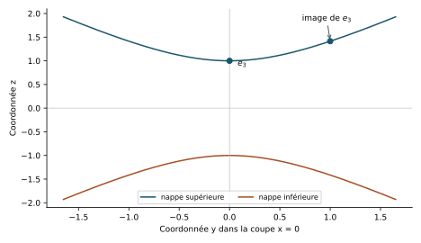

# X-ENS MP — Mathématiques A 2014 · Corrigé brut

*Corrigé rédigé par IA, non officiel. Signalez toute erreur.*

**Rédaction** · GPT-6.2 Astra Ultra · vitesse non renseignée

**Révision (tour 1)** · GPT-6.2 Astra Ultra · vitesse non renseignée · 26 novembre 2026

**Formes quadratiques et groupes d’isométries.** On écrit $\widetilde q$ pour la forme polaire. Le corps est de caractéristique nulle. Seule la deuxième partie utilise des propriétés propres aux réels.

## Préliminaires sur les formes quadratiques

### Question 1

Pour $q(x)=\sum_i a_ix_i^2$, on a $q(\lambda x)=\lambda^2q(x)$. Le développement donne $\widetilde q(x,y)=\sum_i a_i x_i y_i$, qui est bilinéaire et symétrique. Ce sont les deux conditions demandées.

### Question 2

Pour toute forme quadratique, $\widetilde q(x,x)=(q(2x)-2q(x))/2=q(x)$. Réciproquement, pour une forme bilinéaire symétrique $b$, $q_b(x)=b(x,x)$ est homogène de degré deux et $q_b(x+y)-q_b(x)-q_b(y)=2b(x,y)$. La polaire de $q_b$ est donc $b$. Les deux constructions sont inverses.

### Question 3.a

Soit $B$ la matrice symétrique de la polaire. Le vecteur de coordonnées $X$ est orthogonal à tout vecteur si et seulement si $X^t B Y=0$ pour toute colonne $Y$, donc si et seulement si $BX=0$. Ainsi le radical est nul exactement lorsque $B$ est inversible, soit $\det B\ne0$.

### Question 3.b

La matrice est $\mathrm{diag}(a_1,\ldots,a_n)$ par Q1. Son déterminant $\prod_i a_i$ est non nul puisque chaque $a_i$ est non nul et que $K$ est un corps. La forme est donc non dégénérée.

### Question 4.a

Soit $F:V\to V'$ une isométrie. La polarisation donne $\widetilde q'(Fx,Fy)=\widetilde q(x,y)$. Pour $u'\ne0$, écrivons $u'=Fx$ avec $x\ne0$. La non-dégénérescence de $q$ donne $y$ tel que $\widetilde q(x,y)\ne0$. Alors $Fy$ témoigne que $u'$ n’est pas dans le radical de $q'$.

### Question 4.b

L’application $y\mapsto\widetilde q(x,y)$ est une forme linéaire non nulle, car $x\ne0$ et $q$ est non dégénérée. Elle est de rang un, donc son noyau $x^\perp$ est un sous-espace de dimension $n-1$.

### Question 4.c

Par les dimensions, $Kx$ et $x^\perp$ sont supplémentaires exactement si $x\notin x^\perp$, c’est-à-dire si $\widetilde q(x,x)=q(x)\ne0$.

### Question 5

L’identité conserve $q$. Si $f,g$ la conservent, $q\circ f\circ g=q\circ g=q$. Si $q\circ f=q$, composer par $f^{-1}$ donne $q=q\circ f^{-1}$. Ainsi $O(q)$ est un sous-groupe. Si $F:V\to V'$ est une isométrie, $f\mapsto FfF^{-1}$ est à valeurs dans $O(q')$ car $q'F=q$. La conjugaison préserve l’identité et la composition et son inverse est $g\mapsto F^{-1}gF$. C’est l’isomorphisme demandé.

## I. Bases orthogonales sur le corps K

### Question 6.a

Si $q$ s’annulait sur tout $V$, sa formule de polarisation donnerait $\widetilde q=0$. Or $V$ contient un vecteur non nul, qui serait alors dans le radical. C’est impossible.

### Question 6.b

Prenons $e\ne0$ avec $q(e)=0$ et $z$ avec $b=\widetilde q(e,z)\ne0$. Ils sont indépendants car $\widetilde q(e,e)=0$. Dans cette base,
$$q(ue+vz)=2buv+q(z)v^2=(2bu+q(z)v)v.$$
L’application $ue+vz\mapsto(2bu+q(z)v,v)$ a déterminant $2b\ne0$. Elle transporte donc $q$ sur le plan hyperbolique $h(X,Y)=XY$.

### Question 6.c

Avec les mêmes $e,z$ dans une dimension quelconque, $q(z+te)=q(z)+2t\widetilde q(z,e)$. Le coefficient de $t$ est non nul. Cette droite affine fournit donc toutes les valeurs de $K$.

### Question 7.a

Raisonnons par récurrence sur la dimension, le cas zéro étant vide. Par 6.a choisir $x$ avec $q(x)\ne0$. Par 4.c, $V=Kx\oplus x^\perp$. Si $z\in x^\perp$ est orthogonal à $x^\perp$, il est déjà orthogonal à $x$, donc à $V$ et vaut zéro. La restriction à $x^\perp$ est non dégénérée. Une base orthogonale y existe par récurrence et l’adjonction de $x$ achève la construction.

### Question 7.b

Dans cette base, $q(\sum t_ie_i)=\sum q(e_i)t_i^2$. Si $q(e_i)=0$, $e_i$ serait orthogonal à toute la base, y compris à lui-même. Donc $a_i=q(e_i)\ne0$. L’application des coordonnées est l’isométrie voulue vers $\langle a_1,\ldots,a_n\rangle$.

## II. Groupe orthogonal réel de signature donnée

### Question 8

D’après 7.b, regroupons les $r$ coefficients positifs avant les $s=n-r$ coefficients négatifs. Le changement de coordonnées $y_i=\sqrt{|a_i|}\,x_i$ est inversible sur $\mathbb R$. Il transforme $\sum a_ix_i^2$ en $\sum_{i\le r}y_i^2-\sum_{i>r}y_i^2=Q_{r,s}(y)$.

### Question 9

Écrivons $J=I_{r,s}$. La conservation de $Q_{r,s}$ équivaut par polarisation à $X^tM^tJMY=X^tJY$ pour toutes colonnes $X,Y$, soit $M^tJM=J$. Réciproquement cette égalité donne $(\det M)^2=1$ puisque $\det J\ne0$. Elle implique donc aussi l’inversibilité requise, et elle conserve la forme. Les deux valeurs du déterminant sont réalisées, par $I_n$ et par la matrice qui change le signe d’une seule coordonnée.

### Question 10

C’est un sous-groupe par Q5, via l’identification par les matrices. C’est de plus l’image réciproque de $\{J\}$ par l’application continue $M\mapsto M^tJM$. La caractérisation de Q9 assure même la fermeture dans tout $M_n(\mathbb R)$, donc dans $GL_n(\mathbb R)$.

### Question 11

$O(n)$ est fermé et borné (ses colonnes ont norme 1), donc compact. Son intersection avec le fermé $O_{r,s}$ est compacte. Pour $M\in O(n)$, l’égalité $M^tJM=J$ équivaut à $JM=MJ$. La matrice $M$ préserve donc les sous-espaces propres de $J$ pour $+1$ et $-1$. Elle est diagonale par blocs $\mathrm{diag}(U,V)$ avec $U\in O(r)$ et $V\in O(s)$. Réciproquement chaque telle paire convient, ce qui donne la bijection par extraction des deux blocs, y compris pour un bloc de taille zéro.

### Question 12

Toute matrice de $SO(2)$ a pour première colonne $(\cos\theta,\sin\theta)$ et pour seconde $(-\sin\theta,\cos\theta)$ par orthonormalité et déterminant positif. Notons-la $R_\theta$. Le chemin $u\mapsto R_{u\theta}$, $0\le u\le1$, la relie à l’identité dans $SO(2)$.

### Question 13.a

$H=Q_{2,1}^{-1}(-1)$. Toute isométrie envoie donc $H$ dans $H$. L’isométrie inverse a la même propriété, ce qui donne l’autre inclusion et $f(H)=H$.

### Question 13.b

$SO_{2,1}$ est le noyau du morphisme continu $\det:O_{2,1}\to\{1,-1\}$. C’est par conséquent un sous-groupe fermé.

### Question 14.a

Le bloc sur $(y,z)$ envoie $(y,z)$ sur $(y\cosh t+z\sinh t,y\sinh t+z\cosh t)$. La différence des carrés est préservée puisque $\cosh^2t-\sinh^2t=1$, qui est aussi le déterminant du bloc. Enfin $r_t e_3=(0,\sinh t,\cosh t)$ a sa troisième coordonnée positive. Ainsi $r_t\in SO_{2,1}^+$.

### Question 14.b

Écrivons $f(e_3)=(x,y,z)$ avec $z=\sqrt{1+x^2+y^2}>0$. Posons $a=\sqrt{x^2+y^2}$. Une rotation $\rho$ d’axe $e_3$ place ce point en $(0,a,z)$, en prenant l’identité si $a=0$. Pour $t=-\operatorname{arsinh} a$, on a $\sinh t=-a$ et $\cosh t=z$. Les nouvelles coordonnées sont $0,za-az=0,z^2-a^2=1$. La composée préserve la forme et a déterminant 1. Fixant $e_3$, elle appartient bien à $SO_{2,1}^+$.

### Question 14.c

Posons $H_0=r_t\rho f$. Puisqu’il fixe $e_3$, $H_0$ préserve son orthogonal pour la forme, le plan horizontal. Sa restriction à ce plan est orthogonale usuelle et a déterminant 1. Donc $H_0=\mathrm{diag}(R_\phi,1)$. Si $\rho=\mathrm{diag}(R_\theta,1)$, le chemin
$$F_u=\mathrm{diag}(R_{-u\theta},1)\,r_{-ut}\,\mathrm{diag}(R_{u\phi},1),\qquad 0\le u\le1,$$
va de l’identité à $f$. Chaque facteur préserve la forme et a déterminant 1. La dernière coordonnée de $F_u e_3$ est $\cosh(ut)>0$. Le chemin reste donc dans $SO_{2,1}^+$.

### Question 15

Classons $M$ par $(\det M,\operatorname{sgn}(Me_3)_3)$. Sur $H$, la dernière coordonnée a module au moins 1. Chacun des quatre ensembles est donc fermé dans $O_{2,1}$. La classe $(+,+)$ est connexe par arcs d’après 14.c. Prenons $D=\mathrm{diag}(-1,1,1)$ et $T=\mathrm{diag}(1,1,-1)$. Les représentants $I,D,T,DT$ ont respectivement pour signes $(+,+),(-,+),(-,-),(+,-)$. Pour chaque paire, la multiplication à gauche par une telle matrice diagonale convenablement choisie est un homéomorphisme de $(+,+)$ sur la classe en question, car elle multiplie le déterminant et la coordonnée verticale par des signes fixés. Les quatre classes sont non vides, disjointes, connexes par arcs et de réunion $O_{2,1}$.

### Question 16

Chaque nappe est connexe par arcs car elle est le graphe de $(x,y)\mapsto\pm\sqrt{1+x^2+y^2}$. Une isométrie continue de $H$ envoie toute la nappe supérieure dans celle de son point $Me_3$. Par linéarité, elle envoie l’autre nappe dans l’opposée. Le signe $\epsilon(M)=\operatorname{sgn}(Me_3)_3$ code donc une permutation des deux nappes et vérifie $\epsilon(MN)=\epsilon(M)\epsilon(N)$. Le morphisme $M\mapsto(\det M,\epsilon(M))$ est surjectif par les matrices de Q15 et a pour noyau $SO_{2,1}^+$. Identifier chaque signe $s$ à $(1-s)/2\bmod 2$ fournit le morphisme demandé dans l’écriture additive, avec image de l’identité $(0,0)$.

## III. Réflexions et décomposition de Witt

### Question 17.a

La polaire de $q\perp q'$ est $((x,x'),(y,y'))\mapsto\widetilde q(x,y)+\widetilde q'(x',y')$. Elle est bilinéaire symétrique et la forme est homogène de degré deux. Si un vecteur est dans le radical, le tester sur $(y,0)$ puis $(0,y')$ donne séparément $x=0$ et $x'=0$. Enfin $((x,x'),x'')\mapsto(x,(x',x''))$ est un isomorphisme conservant la somme des trois valeurs, donc une isométrie.

### Question 17.b

Si $F$ envoie isométriquement $(V',q')$ sur $(V'',q'')$, alors $(x,y)\mapsto(x,Fy)$ est linéaire bijective et $q(x)+q''(Fy)=q(x)+q'(y)$.

### Question 17.c

Si $z\in V'$ est orthogonal à $V'$, il est aussi orthogonal à $V''$ par hypothèse, donc à tout $V$ et vaut zéro. Même preuve dans $V''$. L’application $(x,y)\mapsto x+y$ est un isomorphisme par la somme directe. Le terme mixte $2\widetilde q(x,y)$ est nul, donc $q(x+y)=q'(x)+q''(y)$ et l’application est une isométrie.

### Question 18.a

Par 4.c, $V=Kx\oplus x^\perp$. Dans cette écriture, $s_x(ux+z)=-ux+z$. C’est une involution linéaire, et $q(-ux+z)=u^2q(x)+q(z)=q(ux+z)$. Elle est donc isométrique. Puisque $-\mathrm{id}$ conserve $q$, la composée $-s_x$ est aussi une isométrie.

### Question 18.b

Posons $x=w-v$. De $q(w)=q(v)$ on tire $q(x)=2(q(v)-\widetilde q(v,w))$, donc $2\widetilde q(x,v)=-q(x)$. Si $q(x)\ne0$, la formule de réflexion donne $s_x(v)=v+x=w$.

### Question 18.c

L’identité $q(w+v)+q(w-v)=2q(w)+2q(v)=4q(v)\ne0$ assure $q(w+v)\ne0$ dans le cas restant. La question 18.b appliquée à $v,-w$ donne une réflexion envoyant $v$ sur $-w$. Sa composée avec $-\mathrm{id}$ envoie $v$ sur $w$. Si $v=-w$, l’hypothèse $q(w-v)=0$ contredirait déjà $q(v)\ne0$. Les deux cas établissent l’assertion.

### Question 19

Diagonalisons $q_3$ par 7.b. Il suffit d’annuler une droite de valeur $a\ne0$, puis de répéter, le cas de dimension zéro étant immédiat. Soit $F:(U,q)\perp Ke\to(U',q')\perp Ke'$ une isométrie, avec $q(e)=q(e')=a$ en désignant ici les valeurs dans les sommes. Les vecteurs $F(e)$ et $e'$ ont même valeur non nulle. Par 18, il existe une isométrie de l’espace cible envoyant le premier sur le second (prendre l’identité s’ils coïncident). La composée envoie $e$ sur $e'$ et donne une bijection entre leurs orthogonaux, égaux à $U$ et $U'$. Sa restriction est l’isométrie recherchée. L’itération annule tout $q_3$.

### Question 20

Si $q$ est anisotrope, prendre $m=0$. Sinon choisir $e\ne0$ isotrope puis $z$ avec $\widetilde q(e,z)=b\ne0$. Leur plan a matrice polaire de déterminant $-b^2\ne0$, donc est non dégénéré et isométrique à $h$ par 6.b. Il est en somme directe avec son orthogonal : la forme restreinte au plan identifie celui-ci à son dual, donc pour tout vecteur on peut retrancher un unique vecteur du plan ayant les mêmes produits avec le plan. L’orthogonal est non dégénéré par 17.c. On recommence en dimension inférieure de deux et l’on termine par une partie anisotrope, éventuellement de dimension zéro.

Supposons $q_{\rm an}\perp m h\simeq q'_{\rm an}\perp m'h$ avec $m\le m'$. Annuler $mh$ par Q19 donne $q_{\rm an}\simeq q'_{\rm an}\perp(m'-m)h$. Si $m'>m$, le second membre est isotrope, contrairement au premier. Donc $m=m'$ et les deux parties anisotropes sont isométriques.
